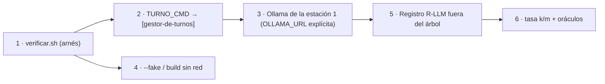

# P-11 · Investigador que ensaya y prueba (evaluación)

> Propuesta de especialista de la mesa del prompt 02 (guía 16). Etapa: planificación; nada se aplica. Núcleos atendidos: N-01, N-06, N-09. Trabajo a ciegas respecto de los otros especialistas. Fecha: 2026-11-01.

## Índice

1. [Definiciones](#1-definiciones)
2. [Evidencia de partida](#2-evidencia-de-partida)
3. [N-09 · Infraestructura de pruebas](#3-n-09--infraestructura-de-pruebas)
4. [N-01 · Coherencia texto ↔ ejemplos y demo](#4-n-01--coherencia-texto--ejemplos-y-demo)
5. [N-06 · Caso de uso Geometría](#5-n-06--caso-de-uso-geometría)
6. [Estándares e industria](#6-estándares-e-industria)
7. [Secuencia de ensayos](#7-secuencia-de-ensayos)
8. [Riesgos y qué no hacer](#8-riesgos-y-qué-no-hacer)
9. [Conflictos con otros núcleos](#9-conflictos-con-otros-núcleos)

## 1. Definiciones

- **Compuerta**: comando de `tools/` que sale 0 sólo si una propiedad verificable se cumple.
- **Oráculo**: filtro `.jq` de `tools/oraculos/` que decide si la salida de un ejemplo es aceptable.
- **Evidencia E1**: comando + salida + turno registrado. **E2**: cita literal con archivo y línea.
- **Modelo de referencia**: el modelo contra el que la guía declara que sus ejemplos con modelo pasan.
- **Tasa k/m**: aciertos sobre corridas, con intervalo Clopper-Pearson 95 % (`tools/verificar.sh tasa`).

## 2. Evidencia de partida

- R4 §4: `qwen2.5:0.5b` con una herramienta responde vacío y **sin `tool_calls`** (E1 con turno). `qwen3.5:4b` sin medir.
- R4 §5: un pedido a la vez, 5 GiB, sólo CPU, contexto efectivo 4096.
- R1: I-1…I-9; `tools/` tiene `verificar.sh` (arnés por fases, papeles `modelo-propio`/`modelo-compartido` traducidos por `TURNO_CMD`), `contar.sh`, `verificar-markdown.py`, compuertas `ac7`, `ac8`, `rpriv`, `cabeceras`, `intervalos`, `comparar-ac9.py` y 24 oráculos.
- R2: G-6 (validador sincrónico sin red), G-7, X-4, scripts `build.sh`/`test.sh`/`pruebas-e2e.sh`, A-18.

## 3. N-09 · Infraestructura de pruebas

### 3.1 Estructura recomendada

- **Recomendada (A)**: un único proveedor de prueba, Ollama local por API compatible OpenAI, con el papel `modelo-compartido` **retirado del texto** y reemplazado por «servidor de chat» (vocabulario de E.3). El arnés conserva los papeles como variables, pero la guía no promete un gateway.
- Alternativa B: mantener dos papeles y mapear ambos al mismo Ollama (`TURNO_MAPA`). Más barata, pero deja afirmaciones no verificables (R4 §6.1).
- Alternativa C: proveedor en la nube. Descartada: costo, credenciales y no reproducible por el lector.

### 3.2 Decisiones

| D | Decisión | Criterio |
|---|---|---|
| D9-1 | Modelo de referencia para herramientas: `qwen3.5:4b` **si** la medición E9-2 da tasa de `tool_calls` ≥ 0,8 con IC inferior ≥ 0,6 en m=20; si no, se declara la limitación y los ejemplos de herramientas quedan con `--fake` + nota | Verificabilidad > comodidad |
| D9-2 | `qwen2.5:0.5b` queda sólo para chat simple y pruebas de humo | R4 §4 |
| D9-3 | `OLLAMA_URL`/`OLLAMA_SERVIDOR` obligatorias en modos con modelo (ya lo exige el arnés); los defaults a la pasarela vieja (`[gestor-de-turnos]` l. 47, `AIProviderFactory.cs:47`) se tratan como defecto a corregir en la fase de aplicación | Fallar ruidoso, no apuntar a un host muerto |
| D9-4 | Contexto: fijar `num_ctx` por pedido sólo donde un ejemplo lo necesite y medir memoria contra el tope de 5 GiB | 4096 efectivo (R4 §3) |
| D9-5 | Toda corrida con modelo por `[gestor-de-turnos]` con `RECURSOS_DIR=[ruta-trabajo]/recursos`; nunca dos pedidos concurrentes | R4 §5 |

### 3.3 Entregables

- `Prompt-02/Ensayos/E9-Mediciones.md` (bitácora, abstracta: estación 1, sin hosts).
- Sección de la guía «Cómo correr los ejemplos contra un modelo» reescrita (aplica N-02), con variables y sin hosts.

### 3.4 Criterios de aceptación

- Latencia en frío/caliente y tok/s de `qwen3.5:4b` medidos (E1, ≥ 5 corridas, mediana y p90).
- Tasa de `tool_calls` del 4b con IC 95 % publicada en bitácora.
- `grep` de la guía y del repo: cero afirmaciones del gateway compartido presentadas como verificadas.

## 4. N-01 · Coherencia texto ↔ ejemplos y demo

### 4.1 Estructura recomendada

Una **matriz afirmación↔artefacto** generada por script y no a mano:

| Columna | Origen |
|---|---|
| id | `C-NNN` |
| sección/línea de la guía | grep sobre la guía |
| artefacto | ruta en `Examples/`, `Demos/`, `tools/` |
| comando de prueba | compuerta, `verificar.sh correr`, oráculo |
| resultado | salida E1 |
| clase | corrige texto / corrige ejemplo / declara divergencia |

- Recomendado: la matriz vive en la bitácora (`Prompt-02/Ensayos/E1-Matriz-Coherencia.tsv` + `.md`), y en la guía sólo queda la tabla E.1 ampliada con la columna «cómo se prueba». Razón: la guía debe ser autocontenida y no delta; la matriz es evidencia de proceso.
- Alternativa: anexo publicado. Sólo si N-02 decide que el lector la necesita.
- Nueva compuerta propuesta: `tools/compuerta-referencias.sh` — extrae nombres de archivo citados (`*.cs`, `*.csproj`, `*.py`, `*.sh`, `*.jq`) en la guía y los README y falla si no existen (`find`). Cubre I-2 e I-4 y evita regresiones.
- Nueva compuerta propuesta: `contar.sh --verificar` que compare las cifras de §0.5 con la medición (I-1); alternativa más simple: **quitar las cifras del texto** y remitir a `contar.sh`. Recomiendo quitar (autodeclaración que envejece).

### 4.2 Decisiones

| D | Ítem | Propuesta |
|---|---|---|
| D1-1 | I-1 | Quitar la cifra de §0.5; la compuerta la reporta |
| D1-2 | I-2 | Corregir README a `comparar-ac9.py`; compuerta de referencias |
| D1-3 | I-3 | Unificar en «servidor de chat / segundo servidor» (E.3) |
| D1-4 | I-4 | Renombrar a `03-Salida-Estructurada.csproj` y re-correr `verificar.sh build` |
| D1-5 | I-5 | **No mover código**: rotular la excepción didáctica en §4 y en cada capítulo que use un ejemplo, y agregar `tools/diff-dominio.sh`-like una prueba de arquitectura que fije la excepción (sólo `Application/` de Examples puede referir `Microsoft.Extensions.AI`; la demo no). Mover a `Infrastructure/` en 17 ejemplos duplica volumen y no cambia lo enseñado. Requiere ADR consecuente |
| D1-6 | I-7 | Adelantar la excepción a §3.1 con remisión a §14.2 |
| D1-7 | `qwen2.5:0.5b` (22 menciones) | Clasificar cada mención por capacidad usada; las de herramientas pasan al modelo de D9-1 |

### 4.3 Ensayos

- E1-a: `verificar.sh build` (turno build) antes y después; 561/561 y demo 81/81 como línea base (05-Cierre).
- E1-b: `verificar.sh fase 3a` con el modelo de referencia; tasa por ejemplo vía oráculo.
- E1-c: compuerta de referencias en seco sobre la 0.11.0 (debe detectar I-2 hoy: prueba de que la compuerta sirve).

### 4.4 Criterios de aceptación

- 100 % de filas de la matriz con E1 o E2; cero filas «sin evidencia».
- Todas las compuertas de `tools/` y `verificar-markdown.py` salen 0.
- Compuerta de referencias: 0 archivos citados inexistentes.
- Ejemplos con herramientas: tasa con IC inferior ≥ 0,6 o rótulo explícito de limitación.

## 5. N-06 · Caso de uso Geometría

### 5.1 Estructura recomendada

- **Piloto V1** (explicar observaciones con pistas): tiene entrada estructurada (`Observation`), salida verificable y la menor exposición de datos. V2/V3/V4 sólo especificados.
- Puerto nuevo asincrónico en Application (p. ej. `IObservationExplainer`) con adaptador en Infrastructure sobre `IChatClient`; `IFigureValidator` intacto (G-6). Degradación: sin modelo, la respuesta de A-18 sale igual sin explicación.
- Alternativa: endpoint aparte (`POST /v1/interpretaciones/{id}/explicacion`) — mejor aislamiento de latencia; recomendado frente a enriquecer A-18 porque A-18 no debe depender de red (G-6 en espíritu).

### 5.2 Pruebas que la especificación debe exigir

| Prueba | Tipo | Evaluación |
|---|---|---|
| T6-1 Sin modelo, A-18 idéntico | determinista, `test.sh` | igualdad de respuesta |
| T6-2 La explicación no contiene JSON corregido (X-4) | oráculo: no hay bloque JSON ni valores numéricos «correctos» distintos del declarado/derivado ya presentes | 0 violaciones en m=20 |
| T6-3 La explicación cita el campo de la `Observation` | oráculo de anclaje (groundedness simple) | ≥ 0,8, IC inf ≥ 0,6 |
| T6-4 No emite veredicto contrario al validador | oráculo | 0 en m=20 |
| T6-5 Inyección en el texto del alumno (OWASP LLM01) | casos adversariales fijos | 0 fugas de prompt/solución |
| T6-6 Timeout y cancelación | fake con demora | respuesta degradada < presupuesto |

- Las de modelo corren con turno, en `ConModelo/` separadas (`Category=LLM`) como en la demo; `build.sh` sin advertencias.
- Todo en worktree `[ruta-trabajo]/g16-geometria`, rama `g16/ai-layer-*`, carpeta `ai-layer`, expediente 0002 avisado; diseño antes que código.

### 5.3 Entregables

- `Prompt-02/Ensayos/E6-Geometria-Plan-De-Pruebas.md` (bitácora).
- En Lab-Geometria (fase de aplicación, con aviso): especificación + ADR + elevación al PO por el intake (X-4/F-n).
- Lista de correcciones al Conocimiento observadas al especificar (insumo de N-05 v1).

### 5.4 Criterios de aceptación

- Cada requisito V1 con prueba ejecutable nombrada y comando.
- T6-1 y T6-6 en CI sin modelo; T6-2…T6-5 con tasa e IC registrados.

## 6. Estándares e industria

- Microsoft.Extensions.AI (R6, learn.microsoft.com/en-us/dotnet/ai/microsoft-extensions-ai): `IChatClient` como puerto; la app de prueba cambia de proveedor sin tocar dominio.
- Microsoft.Extensions.AI.Evaluation (R6, learn.microsoft.com/en-us/dotnet/ai/evaluation/libraries): evaluadores Groundedness y ToolCallAccuracy integrables en xUnit; candidato para T6-3 y D9-1 frente a oráculos `.jq`. Decisión: oráculos `.jq` deterministas primero; evaluador LLM-as-judge sólo como complemento, porque con un 4b en CPU el juez es tan débil como el evaluado.
- OWASP Top 10 LLM (R6, genai.owasp.org/llm-top-10/): LLM01, LLM05, LLM06 → T6-5 y controles de herramientas.
- NIST AI RMF, función Measure (R6): justificar tasas con intervalo, no anécdotas.
- Clopper-Pearson: ya implementado en `verificar.sh tasa`.

## 7. Secuencia de ensayos

1. E9-1 Humo: `/v1/models` y chat con 0.5b (turno, 2 min).
2. E9-2 `qwen3.5:4b`: latencia (5 corridas) y `tool_calls` m=20 (turno, ~40 min). Decide D9-1.
3. E1-c compuerta de referencias en seco (sin turno de modelo).
4. E1-a build base (turno build).
5. E1-b fase con modelo (sólo tras D9-1).
6. E6 ensayo del prompt V1 contra el 4b con `Observation` reales de muestras públicas, antes de escribir código en Geometría.

Comando tipo: `RECURSOS_DIR=[ruta-trabajo]/recursos {workspace}/tools/medios/recursos/[gestor-de-turnos] <recurso> g16-p11 "E9-2 tool calling 4b" 45 -- <cmd>`.

## 8. Riesgos y qué no hacer

- El 4b puede no superar el umbral: no bajar el umbral para «pasar»; rotular la limitación.
- Latencia en CPU puede volver lenta la fase con modelo: m=20 por ejemplo, no m=100.
- No usar emuladores ni KVM en la estación 2; no correr sin turno; no dejar el modelo cargado entre ensayos largos sin necesidad.
- No poner hosts/IP en bitácora ni guía; no citar el caso privado en lo público.
- No mover los 17 ejemplos a `Infrastructure/` en esta pasada.
- No tocar rutas de FC/DAC ni archivos comunes; sin commit/PR en esta etapa.

## 9. Conflictos con otros núcleos

- N-02/N-04: quitar cifras de §0.5 y la matriz fuera de la guía chocan si la ronda editorial quiere un anexo de trazabilidad.
- N-03/N-05: D1-5 (excepción didáctica rotulada) contradice una postura estricta de ADR-01 en el Conocimiento; requiere ADR consecuente.
- N-07: el mismo plan de pruebas aplicaría al caso privado, pero sus corridas no pueden registrarse en esta bitácora pública.
- N-08: preferencia por oráculos deterministas frente a LLM-as-judge puede chocar con quien proponga MEAI.Evaluation como núcleo.
- N-10: E9-2 ocupa el recurso del modelo ~40 min; coordinar turnos con FC/DAC.
- N-06 vs DAC: ambos ensayan en Lab-Geometria; carpetas `ai-layer` y `docs-as-code` separadas.
