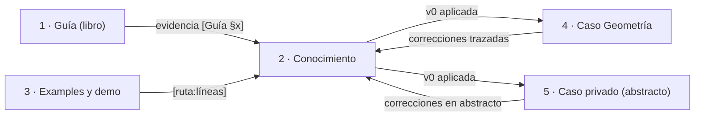

# P-13 · Forma de conocimiento y perfil Study-Guide — propuesta para N-05, N-02 y N-10

**Prompt:** 02 de la guía 16 · **Etapa:** planificación (nadie aplica) · **Fecha:** 2026-11-01 · **Especialista:** E-13, forma de conocimientos y perfil Study-Guide (trabajo a ciegas respecto de las otras comisiones).

Regla de evidencia de este informe: cada afirmación lleva su ancla. Rutas relativas a la raíz del workspace (`/`), como las cita el prompt. Lo que es criterio de este especialista va marcado **PROPUESTA**; lo no leído, **NO VERIFICADO**.

## Índice

- [1. Fuentes leídas](#1-fuentes-leídas)
- [2. Definiciones](#2-definiciones)
- [3. Hallazgos de partida](#3-hallazgos-de-partida)
- [4. N-05 · Forma del Conocimiento de especificación](#4-n-05--forma-del-conocimiento-de-especificación)
  - [4.1 Alternativas](#41-alternativas)
  - [4.2 Decisión recomendada](#42-decisión-recomendada)
  - [4.3 Esqueleto](#43-esqueleto)
  - [4.4 Regla, razón y evidencia](#44-regla-razón-y-evidencia)
  - [4.5 Ensayos de efectividad](#45-ensayos-de-efectividad)
  - [4.6 Entregables y aceptación](#46-entregables-y-aceptación)
- [5. N-02 · Conformidad del libro con el perfil Study-Guide](#5-n-02--conformidad-del-libro-con-el-perfil-study-guide)
- [6. N-10 · Gobernanza de la forma y registro de excepciones](#6-n-10--gobernanza-de-la-forma-y-registro-de-excepciones)
- [7. Estándares e industria](#7-estándares-e-industria)
- [8. Riesgos y qué no hacer](#8-riesgos-y-qué-no-hacer)
- [9. Conflictos previstos con otros núcleos](#9-conflictos-previstos-con-otros-núcleos)

## 1. Fuentes leídas

| Id | Fuente | Leído |
|---|---|---|
| S1 | `/LAB/Lab-Documentos/Lab-Documentos.Documentacion/PROMPTs/Guides/16-IA-Layer/02-Ajuste-Coherencia-Reedicion-Documentacion.md` | entero |
| S2 | `/IA/PROMPTs/IA.Prompts/PromptFramework/Profiles/Study-Guide-Documentation.md` | entero |
| S3 | `/IA/PROMPTs/IA.Prompts/PromptFramework/RuleSets/RuleSet-Study-Guide.md` | entero |
| S4 | `/IA/IA.Knowledge.Base/Rules/Rule-Forma-De-Conocimiento.md` | §0, §1, §2, §3.1, §3.2, §3.12, §6 |
| S5 | `/LAB/Lab-Documentos/Lab-Documentos/Concepts/Framework-Concept/Conocimientos/Knowledge-App-Hibrida-OTA-Offline-First.md` (sólo lectura, territorio FC) | cabecera y encabezados §0–§13 |
| S6 | Bitácora Prompt-02: `00-Coordinacion-Entre-Sesiones.md`, `01-Convocatoria.md`, `Nucleos/00-Cohesion.md`, N-02, N-05, N-10, `Relevamiento/R5-Marco.md` (§1–§8), `Relevamiento/R6-Industria.md` (§Propuesta, §9) | lo citado |
| S7 | Guía 0.11.0: front matter (líneas 1–13), `wc -l` = 5268 líneas; `Conocimientos/` con el archivo destino en 0 bytes (`ls -la`, 2026-11-01) | lo citado |

## 2. Definiciones

| Término | Definición | Fuente |
|---|---|---|
| Pieza de la base | Archivo `.md` de `IA.Knowledge.Base` cuyo nombre empieza con un prefijo de clase | S4 §0 «Terminología» |
| Cabecera de once campos | `Alias` … `Fecha`, como `**Campo:** valor`, ninguno vacío, sin campo doce | S4 §3.1 |
| Regla / razón / evidencia | Columnas «Principio» (Id `P-n`), «Criterio para aplicarlo», «Fuente» | S5 §2; R5 §6 |
| Marco de referencia | Escenarios, contextos y actores, definidos una vez y referenciados | S2 «Enfoque» |
| Documento temático | Definición · Aplicación por escenario · Ejemplos · Preguntas guía · Criterios de calidad · Anexo | S2 «Estructura de cada documento temático» |
| Excepción | Desvío declarado de un conocimiento, con ficha propia | `Knowledge-Excepcion-A-Un-Conocimiento.md` (existe en `/IA/IA.Knowledge.Base/Knowledges/`; contenido NO VERIFICADO en esta ronda) |

## 3. Hallazgos de partida

| # | Hallazgo | Evidencia |
|---|---|---|
| H-1 | `Rule-Forma-De-Conocimiento` rige **piezas de la base**; el Conocimiento de especificación vive en un repo de guías (LD), no en la base. Su aplicación es por analogía, no obligatoria. | S4 §0 «Fija la forma de las piezas de la base» |
| H-2 | El nombre fijado por el PO, `knowledge-AI-Layer-…` (minúscula), no cumple F-1 (prefijo `Knowledge-`). El precedente de FC usa `Knowledge-…`. | S1 «Contexto»; S4 §6 F-1; S5 (nombre de archivo) |
| H-3 | Alias candidato `AI-Layer-Integration-Designing-Specification`: 44 caracteres, gramática de §3.2 válida, ASCII. | S4 §3.2 (≤ 64) |
| H-4 | El precedente vigente en LD (FC) usa cabecera de once campos con `Compatible-con` apuntando a su libro, y cuerpo §0–§13 propio, no §0–§10 de S4 §2. | S5 cabecera; R5 §6, T3 |
| H-5 | La guía tiene 5268 líneas y no menciona el Conocimiento; el archivo destino existe vacío. | S7; N-05 §6 (cita R1) |
| H-6 | El perfil exige marco de tres ejes y documentos temáticos con estructura idéntica; R5 T7 deja abierto si la 0.11.0 los tiene. | S2; R5 §8 T7 |
| H-7 | La ruta del RuleSet citada por el perfil omite `PROMPTs/`. | R5 §5, T4 |

## 4. N-05 · Forma del Conocimiento de especificación

### 4.1 Alternativas

| Alt. | Forma | A favor | En contra |
|---|---|---|---|
| A | S4 §2 estricta: §0–§10 (Identidad, Estructura, Contrato, Decisiones, Esqueletos, **§6 Criterios de aceptación normativos**, Anti-patrones, Conformidad, Trazabilidad, Control de cambios) | Forma interoperable de la base; verificable con F-1…F-23; portable a `IA.Knowledge.Base` sin reescritura | Diverge del libro hermano de LD (S5); §1–§3 son de caracterización de artefacto, no de procedimiento de diseño |
| B | Forma FC: cabecera de once + §0–§13 temáticos (Cuándo usarlo, Principios P-n, Arquitectura, Contratos, …, Checklist, Industria, Límites) | Coherencia entre libros acordada con FC (00-Coordinacion); separa regla/razón/evidencia; es lo que la plantilla de R5 §7 ya propone | No pasa F-8 (exige §6, §8, §9 con esos nombres); sin parte normativa con niveles |
| C | **Híbrida (PROPUESTA)**: cabecera de once de S4 + cuerpo temático de B + tres secciones finales que cubren lo que S4 pide (Criterios de aceptación con nivel y modo de verificación; Conformidad; Trazabilidad con «Origen» y «Dependencias»; Control de cambios) | Cumple la coherencia con FC y deja la pieza a un paso de ser promovible a la base; los criterios con nivel son exactamente la «base mecánica» que necesitan N-06/N-07 | Más largo que B (≈ 3 secciones); numeración distinta de S4 §2, a declarar |

### 4.2 Decisión recomendada

**PROPUESTA: alternativa C**, con este criterio explícito (orden de prioridad):

1. **Coherencia entre libros de LD** primero (acuerdo con FC, 00-Coordinacion): misma cabecera, mismo patrón regla/razón/evidencia, «Límites» al final.
2. **Verificabilidad**: la parte normativa con nivel (`[obligatorio]`/`[recomendado]`/`[permitido]`, vocabulario BCP 14 de S4 §0) y modo (`[enumerable]`/`[interpretativo]`) permite medir si una especificación de N-06/N-07 está completa (responde la pregunta 3 de N-05).
3. **Simplicidad**: no se adopta arc42 completo; ver §4.3 sección 7.

Decisiones derivadas:

| # | Decisión | Criterio |
|---|---|---|
| D-1 | `Compatible-con: Dot-Net-Integration-AI-Layer-Guide.md <versión de la edición>` y, en §0, una línea que declara la divergencia de numeración frente a S4 §2 y cita H-1 | Precedente S5; S4 no rige fuera de la base (H-1) |
| D-2 | No se abre ficha de excepción mientras la pieza viva en LD; se abre sólo si se promueve a la base | H-1: no hay norma que exceptuar |
| D-3 | Nombre de archivo: **se respeta el del PO** (`knowledge-…`); la discrepancia con F-1 va al lote de dudas del PO (renombrar a `Knowledge-…` alinea con FC y con S4) | Regla «no inventar»; el nombre lo fijó el PO (S1) |
| D-4 | `Naturaleza: propio`; `Consumidor` sin vocabulario de framework: «quien especifica la capa de IA de un servicio .NET nuevo o existente; quien preside una mesa de diseño sobre ella» | S4 §3.1, §3.12 |
| D-5 | El Conocimiento **no repite** la guía: condensa en decisiones, contratos, listas y remite a `[Guía §x]` | S5 §0 (citado en R5 §6) |
| D-6 | Mapa de carga en §0 obligatorio si supera 500 líneas; **tope propuesto 600 líneas** | S4 §2 «Mapa de carga», F-21 |
| D-7 | Caso privado sólo como «un servicio privado de notificaciones», sin nombres, rutas, hosts ni cifras | Carta común; R5 §7 regla 3 |

### 4.3 Esqueleto

```text
# Capa de IA integrada en .NET: cómo se especifica su diseño en un proyecto nuevo o existente
(cabecera de once campos, S4 §3.1)
## Índice
## 0. Propósito y alcance        regla de evidencia · mapa de carga · divergencia declarada (D-1) · omisiones
## 1. Cuándo usarlo y cuándo no   árbol de decisión «¿necesita capa de IA?» (mermaid)
## 2. Marco de referencia         escenarios · contextos · actores (remite a la guía, no redefine)
## 3. Principios P-n              Id | Principio | Criterio | Fuente | prioridad al chocar
## 4. Arquitectura de referencia  C4 contexto + contenedores en mermaid; contactos MAUI por referencia
## 5. Contratos                   interfaces, herramientas tipadas, versionado
## 6. Riesgos y controles         tabla riesgo → control → prueba (OWASP LLM / Agentic)
## 7. Plantilla de especificación subconjunto arc42: 1 metas y restricciones · 3 contexto · 5 bloques
                                  · 8 conceptos transversales · 9 ADR · 10 calidad · 11 riesgos;
                                  requisitos con Id, criterio de aceptación y prueba
## 8. Métricas, pruebas y compuertas
## 9. Procedimiento de aplicación  pasos mínimos + entregables por paso
## 10. Checklist de arranque
## 11. Casos de uso               Geometría (nombre y enlace) · servicio privado en abstracto
## 12. Referencias e industria    Caso | Qué toma | [Rn] (URL completas en la guía)
## 13. Criterios de aceptación    parte normativa: ítems con nivel y modo (S4 §3.4, §6)
## 14. Conformidad                consultiva; a quién se aplica
## 15. Límites de este conocimiento
## 16. Trazabilidad               Origen · Dependencias · Control de cambios
## Glosario                       remisión al glosario único de la guía
```



### 4.4 Regla, razón y evidencia

1. Ninguna fila de §3 sin «Fuente» resoluble: `[Guía §x]`, `[Examples/NN/…:líneas]`, `[Rn]`; si es criterio propio, **propuesta**.
2. Cada ítem de §13 remite a un `P-n` y a una sección de la plantilla (§7): así el juicio de completitud es mecánico.
3. Cifras medidas de la demo = «parámetros, no norma» (patrón S5, R5 §6).
4. Los principios `P-n` son **el subconjunto operativo** de los fundamentos de N-03, con el mismo Id cuando coinciden (PROPUESTA para la pregunta abierta de 00-Cohesion §5).

### 4.5 Ensayos de efectividad

| Ensayo | Cómo | Evaluación |
|---|---|---|
| T-1 Forma | `grep` de los once campos, orden y ausencia de vacíos; encabezados numerados únicos; `tools/verificar-markdown.py` sobre el archivo; mermaid por la herramienta del workspace | 0 fallas |
| T-2 Autocontención | Lector sin contexto (E-14) aplica v0 al caso Geometría **sin abrir la guía**; registra cada vez que necesita salir | ≤ 3 salidas, todas a una remisión `[Guía §x]` explícita |
| T-3 Completitud | Cada especificación de N-06/N-07 se puntúa contra los ítems `[obligatorio]` de §13 | 100 % obligatorios cumplidos o con «no aplica» motivado |
| T-4 Trazabilidad v0→v1 | Cada cambio de v1 lleva fila caso → hallazgo → `P-n`/§ en la bitácora | 0 cambios sin fila |
| T-5 Neutralidad pública | Búsqueda de nombres, hosts, rutas e IP del caso privado sobre el archivo (patrón de `tools/compuerta-rpriv.sh`, que ya existe en el repo; contenido NO VERIFICADO) | 0 coincidencias |
| T-6 Agente | Un subagente sin contexto previo recibe sólo el Conocimiento y un enunciado de proyecto; se compara su salida con la plantilla §7 | todos los campos obligatorios presentes |

### 4.6 Entregables y aceptación

| Entregable | Ruta | Aceptación |
|---|---|---|
| Esqueleto v0 | Bitácora `Prompt-02/Conocimiento/K-v0.md` (no el repo, etapa de plan) | T-1 en verde |
| Tabla P-n v0 | dentro de K-v0 | 100 % filas con fuente |
| Registro v0→v1 | `Prompt-02/Conocimiento/Registro-Correcciones.md` | T-4 |
| Versión final | `Guides/IA/Dot-Net-Integration-AI-Layer-Guide/Conocimientos/knowledge-AI-Layer-Integration-Designing-Specification.md` (en la fase de ejecución) | T-1…T-6; ≤ 600 líneas; no delta (el registro queda fuera del archivo) |

## 5. N-02 · Conformidad del libro con el perfil Study-Guide

Arquitectura recomendada (PROPUESTA), alineada con el libro MAUI y con S2:

| Pieza del perfil (S2) | Ubicación en el libro unificado |
|---|---|
| Marco de referencia (escenarios, contextos, actores) | Parte I, capítulo propio, definido una sola vez |
| Mapa conceptual «estoy acá → qué aplico» | Prólogo: tablas por escenario, por contexto y por artefacto |
| Documentos temáticos con estructura idéntica | Un capítulo por tema, con las seis subsecciones de S2 como **nivel 3 fijo** |
| Métodos y marcos alternativos | Capítulo de criterios de elección |
| Anexos | Plantillas comentadas, listas, glosario único, referencias con fecha |
| README | Tabla de contenido y ruta de lectura (ojo: archivo común si es el README de la carpeta de guías; el de la carpeta de la guía es territorio propio) |

Alternativa considerada: conservar el patrón actual «En este laboratorio / Práctica / Qué decisión toca» (N-02 pregunta 2). **PROPUESTA: mapearlo** a las seis subsecciones (Práctica → Ejemplos concretos; Qué decisión toca → Preguntas guía + Criterios de calidad) en lugar de sumar un patrón nuevo; menos reescritura, misma conformidad.

Lista de control de conformidad (entregable `Prompt-02/Conformidad/Checklist-Study-Guide.md`), con criterio medible:

| # | Control | Medición |
|---|---|---|
| C-1 | Índice al inicio de cada documento | presente (Rule-Indexing) |
| C-2 | Ejes definidos una vez | `grep` de cada definición: 1 aparición; el resto, enlace |
| C-3 | Cada capítulo temático cruza ≥ 1 escenario | tabla escenario × capítulo sin filas vacías |
| C-4 | Seis subsecciones por capítulo temático | conteo de encabezados nivel 3 |
| C-5 | No delta | 0 bloques «Historia», 0 «versión anterior»/«era …» en el cuerpo |
| C-6 | Evidencia | 0 afirmaciones técnicas sin ancla en muestreo de 30 párrafos; lo propio declarado |
| C-7 | Mermaid | etiquetas «1 · Texto», sin URL, validado |
| C-8 | Voz única | revisión de estilo (E-08) sin cambios de persona gramatical |
| C-9 | Doble audiencia | front matter con `audience`, diagramas como código |

Entregable adicional: `Prompt-02/Conformidad/Diagnostico-0.11.0.md` con la medición de C-1…C-9 sobre la guía actual (resuelve T7).

## 6. N-10 · Gobernanza de la forma y registro de excepciones

- **Registro de excepciones** (PROPUESTA): `Prompt-02/Conformidad/Registro-Excepciones.md`, tabla `# | Norma | Ítem | Desvío | Motivo | Quién decide | Estado`. Entradas iniciales: D-1 (numeración), D-3 (nombre del archivo), T4 (ruta del RuleSet).
- **Precedencia de normas** al escribir el Conocimiento y el libro: prompt 02 (Reglas) > perfil y RuleSet Study-Guide > acuerdo de coherencia entre libros (00-Coordinacion) > `Rule-Forma-De-Conocimiento` por analogía (H-1).
- **Lote al PO** (no bloquea): nombre del archivo (D-3); promover o no el Conocimiento a `IA.Knowledge.Base` (si sí, entonces numeración S4 §2 y ficha de excepción).
- **Territorio**: todo lo de esta propuesta se escribe en la bitácora; nada en `Concepts/**` (S5 sólo se lee), ni en archivos comunes.

## 7. Estándares e industria

| Estándar | Qué respalda | Referencia |
|---|---|---|
| BCP 14 (RFC 2119/8174) | niveles normativos de §13 | S4 §0 «Vocabulario normativo» |
| Agent Skills, «Progressive disclosure» (< 500 líneas, carga por secciones) | Mapa de carga y tope D-6 | citado en S4 §2 |
| arc42 (subconjunto), C4, ADR | plantilla §7 y arquitectura §4 | R6 §Propuesta |
| OWASP Top 10 LLM / Agentic | riesgos §6 | R6 §Propuesta; nombres ASI NO VERIFICADO (R6 §9) |
| Diátaxis (tutorial / guía / referencia / explicación) | separación libro (explicación) ↔ Conocimiento (referencia + guía de tareas) | **NO VERIFICADO**: no está en R6; criterio propio a verificar por E-09 |

## 8. Riesgos y qué no hacer

| Riesgo | Mitigación |
|---|---|
| El Conocimiento se vuelve un resumen de la guía | D-5; T-2 mide autocontención, no extensión |
| Choque de normas paraliza la redacción | precedencia de §6; registro de excepciones |
| Fuga del caso privado en repo público | D-7, T-5 |
| La regla de seis subsecciones infla la guía (C2 de la cohesión) | mapear patrón existente (§5) y mover Prácticas largas a README de ejemplos |

No hacer: renombrar el archivo sin el PO; copiar las §0–§10 de S4 sin necesidad; editar `Concepts/**` o el Conocimiento de FC; poner en el Conocimiento un «registro de cambios» delta en el cuerpo (va en §16 como tabla de versiones, no como narración); inventar Ids P-n sin fuente.

## 9. Conflictos previstos con otros núcleos

| Con | Conflicto | Propuesta |
|---|---|---|
| N-03 | Si los fundamentos usan otra numeración de principios | `P-n` del Conocimiento = mismos Id que N-03 cuando coinciden |
| N-02 / E-06, E-07 | Patrón temático: seis subsecciones vs. patrón actual | mapeo §5 |
| N-04 / E-08 | Hoja de estilo debe incluir C-5…C-9 | compartir checklist |
| N-06 / E-12 | La plantilla §7 exige ítems de IA a un intake decidido sin IA (C6) | «no aplica» motivado es válido en T-3 |
| E-04 | Puede pedir arc42 completo | subconjunto con criterio de simplicidad; ampliable |
| C3 de la cohesión | Forma del Conocimiento | resuelto por alternativa C + D-1/D-2 |
