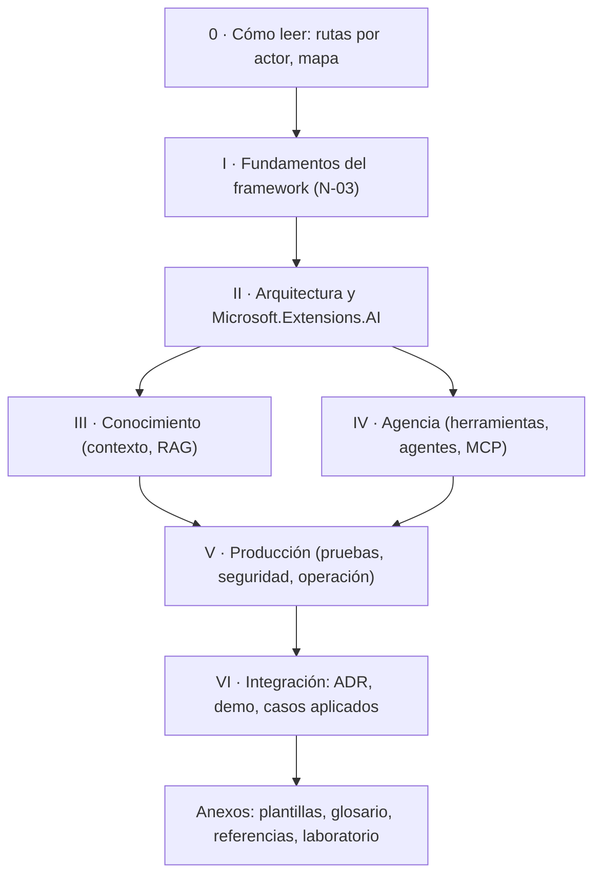

# P-14 · Lector sin contexto — propuesta para N-02, N-03 y N-05

> Comisión de la mesa del prompt 02 (guía 16). Rol: desarrollador .NET que nunca vio la guía; prueba de autocontención. Trabajo a ciegas respecto de las demás comisiones. Etapa: **planificación** (no se editó la guía, los Examples, la demo ni el Conocimiento). Fecha: 2026-11-01.
> Fuentes leídas: prompt 02; `00-Coordinacion-Entre-Sesiones.md`; `Nucleos/00-Cohesion.md`, N-02, N-03, N-05; `Relevamiento/R1-Guia.md`, R5-Marco (§5–§8), R6-Industria (lista de URL), R2-Geometria (§1–§2); `RuleSet-Study-Guide.md`. Toda cifra viene de esos relevamientos; lo que es propuesta de esta comisión va marcado **PROPUESTA**.

## Índice

1. [Mandato y definición de «autocontenido»](#1-mandato-y-definición-de-autocontenido)
2. [Lo que vería un lector nuevo hoy (hallazgos)](#2-lo-que-vería-un-lector-nuevo-hoy-hallazgos)
3. [N-02 · Libro unificado](#3-n-02--libro-unificado)
4. [N-03 · Fundamentos](#4-n-03--fundamentos)
5. [N-05 · Conocimiento de especificación](#5-n-05--conocimiento-de-especificación)
6. [Ensayo de autocontención (protocolo común)](#6-ensayo-de-autocontención-protocolo-común)
7. [Entregables y criterios de aceptación](#7-entregables-y-criterios-de-aceptación)
8. [Riesgos y qué no hacer](#8-riesgos-y-qué-no-hacer)
9. [Conflictos previsibles con otros núcleos](#9-conflictos-previsibles-con-otros-núcleos)

## 1. Mandato y definición de «autocontenido»

**Definición operativa (PROPUESTA).** Un documento es autocontenido para un lector L si L puede responder un cuestionario de comprensión fijado de antemano usando sólo ese documento (más los archivos de código que el documento enlaza explícitamente como evidencia), sin bitácoras, mesas, versiones previas ni conocimiento oral. «No delta» es el caso particular: ninguna frase necesita conocer un estado anterior para entenderse.

Fundamento: el prompt 02 exige «autocontenida y no delta» (Reglas); el perfil Study-Guide exige «trazable» y «verificable contra el mapa» (R5 §5); N-03 §5 y N-05 §5 ya ponen al lector sin contexto como juez.

## 2. Lo que vería un lector nuevo hoy (hallazgos)

Leídos desde R1 (no re-medidos por esta comisión; ancla E2 sobre R1).

| # | Hallazgo | Ancla | Nivel |
|---|---|---|---|
| L-1 | 62 bloques «Historia (hasta el 2026-10-28)» y 22 menciones de `qwen2.5:0.5b` retirado: el lector debe reconstruir qué está vigente | R1 §5, §6 | P1 |
| L-2 | Nombres «históricos» de variables (`OLLAMA_PROPIO_*`, «compartido») y vocabulario distinto entre guía y `Examples/README.md` (I-3) | R1 §4 I-3 | P1 |
| L-3 | Una regla de §3.1 cuya excepción se define 3.400 líneas después (§14.2) (I-7) | R1 §4 I-7 | P2 |
| L-4 | Dos «fundamentos»: la Parte II se titula así pero trata arquitectura y SDK (I-6); los principios reales están en §1, §3, §4.1–§4.2 y ADR-08 | R1 §2, §4 I-6 | P1 |
| L-5 | Referencias a artefactos de proceso («plan §C», «H2-047», «era ApiWeb») ininteligibles fuera de la bitácora | R1 §6 | P2 |
| L-6 | Los ejemplos violan ADR-01 (`Application/` con `IChatClient`) y la guía lo declara sólo en E.1 (I-5): quien copia un ejemplo copia la deuda | R1 §4 I-5 | P1 |
| L-7 | El Conocimiento está vacío y la guía no lo menciona: un lector no sabe que existe | R1 §3 | P1 |
| L-8 | 72.364 palabras, 130 % del tope: la longitud misma es una barrera de entrada | R1 §7 | P2 |

## 3. N-02 · Libro unificado

### 3.1 Estructura recomendada (PROPUESTA)

Partes numeradas con capítulos, índice general al inicio y glosario + referencias con fecha al final, como acordaron FC y la guía 16 (00-Coordinacion, «Coherencia entre libros»):

| Alternativa | Ventaja | Costo | Veredicto de esta comisión |
|---|---|---|---|
| A · Mantener las 7 partes actuales, renombrar II, insertar I-Fundamentos | Mínimo retrabajo; anclas `sN` se conservan casi todas | No reduce extensión por sí sola | **Recomendada** |
| B · Reordenar por escenario (ESC) | Fiel al perfil Study-Guide «escenarios primero» | Rompe todas las remisiones y ejemplos | No |
| C · Partir en dos libros (conceptual / laboratorio) | Baja la extensión del principal | Contradice «un solo documento» del prompt | No |

### 3.2 Decisiones con criterio

| Id | Decisión (PROPUESTA) | Criterio | Fuente |
|---|---|---|---|
| D2-1 | La procedencia histórica sale del cuerpo **a la bitácora**; el libro conserva sólo un Anexo de versiones (estado vigente, una tabla) | No delta (prompt); el lector no necesita la historia para usar la guía | R1 §6, prompt Reglas |
| D2-2 | Cada término se define una vez (Anexo glosario o §3.0, no ambos con texto); el resto enlaza | Unicidad | N-02 §5; R1 §5 |
| D2-3 | Toda excepción a una regla se enuncia junto a la regla (al menos remisión explícita con ancla) | L-3 | R1 I-7 |
| D2-4 | Las Prácticas largas (§5, §7, §8) pasan al `README.md` del ejemplo; en el libro queda: objetivo, comando, salida esperada y enlace | Extensión y foco | R1 §1, §7 |
| D2-5 | Cada «En este laboratorio» declara si el ejemplo respeta ADR-01 o no, en una línea | L-6 | R1 I-5 |
| D2-6 | Nada de referencias a mesas, planes ni folios en el cuerpo | L-5 | R1 §6 |
| D2-7 | El libro enlaza el Conocimiento en el Capítulo 0 (rutas) y al final de la Parte VI | L-7 | R1 §3 |

Respaldo de industria: separar narrativa de referencia y de tutorial es la idea de Diátaxis (**NO VERIFICADO** en R6: no figura; se propone a N-08 que lo verifique antes de citarlo). arc42/C4/ADR sí están en R6 (arc42.org, c4model.com, adr.github.io).

## 4. N-03 · Fundamentos

### 4.1 Frontera fundamento / arquitectura (PROPUESTA)

- **Fundamento** = enunciado que sigue siendo cierto si se cambia el SDK, el modelo o el framework de agentes («la salida del modelo es una propuesta», ADR-08).
- **Arquitectura** = cómo se materializa en .NET (capas, `IChatClient`, pipeline).
- Prueba: si la frase menciona un tipo .NET, no es fundamento.

### 4.2 Estructura del capítulo

1. Definición del framework en un párrafo (qué problema resuelve, para quién).
2. Lista cerrada P-1…P-n, **sólo** de principios ya presentes en la guía (R1 §2 los ubica): capa con contrato propio; propuesta vs autoridad (ADR-08); dos escaleras saber/hacer (§3.2); diseño para el error (§2); evidencia antes de afirmar (§0.4); «si alcanza una función, no un agente» (regla de Agent Framework, R6, URL learn.microsoft.com/agent-framework/overview). Cada P con: enunciado · razón · dónde se desarrolla · fuente.
3. Un mermaid principios → capas → escaleras.
4. Marco ESC/CTX/ACT referenciado (§2 ya existe), no redefinido.

Tope: **≤ 1.500 palabras** (PROPUESTA; la Parte I ya está al 105 %, R1 §7), compensado moviendo §4.1–§4.2 «por qué ahora» dentro del capítulo y quitándolos de la Parte II.

### 4.3 Decisión clave

| Id | Decisión (PROPUESTA) | Criterio |
|---|---|---|
| D3-1 | Una sola lista P-n compartida libro↔Conocimiento; el Conocimiento la cita por Id y no la reescribe | Evita dos fuentes de verdad (pregunta 2 de N-03) |
| D3-2 | La regla de Agent Framework entra como **principio** (es independiente del SDK) con su criterio de aplicación en el Conocimiento | Pregunta 3 de N-03 |
| D3-3 | La Parte II deja de llamarse «Fundamentos» → «Arquitectura y SDK» | L-4 |

## 5. N-05 · Conocimiento de especificación

### 5.1 Forma (T3)

**PROPUESTA:** forma del Conocimiento MAUI (§0–§13 propios, regla · criterio · fuente en columnas, «Límites» al cierre), con cabecera de 11 campos de `Rule-Forma-De-Conocimiento` y la divergencia declarada en §0 (opción ya formulada en R5 §8 T3). Criterio: coherencia entre libros acordada con FC (00-Coordinacion) y, para el lector nuevo, una sola forma que aprender en el mismo repo.

### 5.2 Lo que un lector sin contexto necesita del Conocimiento

1. **Mapa de carga** en §0 (tarea → secciones): un agente no lee 13 secciones.
2. **Plantilla de especificación llenable** con campos obligatorios: problema y escenario, actores, decisión «¿hace falta IA?» (con criterio de salida «no»), escalón de saber y de hacer, contratos, requisitos con Id + criterio de aceptación + prueba, riesgos mapeados a OWASP LLM/Agentic (R6), escenarios de calidad medibles con las librerías de evaluación .NET (R6), ADR.
3. **Un ejemplo resuelto completo** de la plantilla, con un caso público (Geometría, si N-06 lo produce; si no, la demo Movilidad Urbana).
4. **Glosario mínimo propio o remisión con ancla**: el Conocimiento no puede depender de leer el libro entero para entender un término.
5. **Subconjunto mínimo de arc42** (contexto, solución, decisiones, calidad, riesgos), no las 12 secciones — simplicidad pedida por el prompt (pregunta 2 de N-05).

### 5.3 Lo que no debe pasar

- Que repita la guía (riesgo de N-05 §7): regla de oro — si una celda tiene más de 3 líneas, remite al capítulo.
- Que dependa de Examples para entender una regla (sí para verla funcionar).

## 6. Ensayo de autocontención (protocolo común)

Aplica a los tres núcleos. **PROPUESTA** de ensayo E-LSC:

| Paso | Qué | Cómo se evalúa |
|---|---|---|
| 1 | Antes de leer el texto final, la mesa fija un cuestionario por núcleo (N-02: 10 preguntas de navegación — «¿dónde está X?»; N-03: «enunciá los principios y una consecuencia de cada uno»; N-05: «especificá la capa de IA de un servicio dado») | Respuestas de referencia escritas por quien redacta, cerradas antes del ensayo |
| 2 | Lectores: un subagente sin acceso a bitácoras ni repos (sólo el archivo y, en N-05, la carpeta `Examples/` en lectura), y si el PO lo dispone, un humano | Contexto aislado documentado |
| 3 | El lector responde y marca cada término/frase que no entendió | Registro verbatim en la bitácora |
| 4 | Para N-05: aplicar el Conocimiento a (a) Geometría y (b) un servicio ficticio neutro, sin abrir la guía | Lista de control de completitud de la plantilla (todo campo obligatorio lleno con fuente) |
| 5 | Repetir tras correcciones | Dos corridas seguidas sin términos marcados P0/P1 |

Métricas: % de respuestas correctas (meta ≥ 90 %); términos no resueltos (meta 0 en N-03); en N-05, campos obligatorios llenos con fuente (meta 100 %) y consultas a la guía necesarias (meta 0). Infraestructura: subagentes de la sesión; no requiere modelo local ni turno de recursos.

Checks mecánicos complementarios: `grep -c "Historia (hasta"` = 0; grep de «histórico», «era », «plan §», «H2-» en el cuerpo = 0; `tools/verificar-markdown.py` sin anclas rotas; mermaid validado con `tools/medios/mermaid.sh` (00-Coordinacion).

## 7. Entregables y criterios de aceptación

Todos en la bitácora durante la planificación; la ruta final se indica entre paréntesis.

| Entregable | Ruta (bitácora) | Aceptación |
|---|---|---|
| Cuestionarios E-LSC N-02/N-03/N-05 | `Prompt-02/Ensayos/E-LSC/Cuestionarios.md` | Cerrados y fechados antes del primer borrador |
| Mapa sección vieja → nueva | `Prompt-02/Nucleos/N-02-Mapa.md` (→ libro) | 229 encabezados con destino, 0 huérfanos |
| Lista P-n con fuente | `Prompt-02/Nucleos/N-03-Principios.md` (→ libro Parte I y §2 del Conocimiento) | Cada P con ancla a la 0.11.0 o a R6; ninguno nuevo |
| Conocimiento v0 | `Prompt-02/Borradores/Conocimiento-v0.md` (→ `Conocimientos/knowledge-AI-Layer-Integration-Designing-Specification.md`) | Forma §5.1; plantilla + ejemplo resuelto; 0 reglas sin fuente |
| Resultados E-LSC | `Prompt-02/Ensayos/E-LSC/Corrida-NN.md` | Métricas de §6 cumplidas en dos corridas |

## 8. Riesgos y qué no hacer

- **No** inflar Fundamentos con un resumen de la guía (N-03 §7).
- **No** dejar que el ensayo lo haga quien redactó (sesgo del autor); el lector no ve la bitácora.
- **No** inventar principios para «redondear» la lista.
- **No** usar el servicio privado como ejemplo resuelto en el Conocimiento público; sólo en abstracto.
- **No** tocar territorios de FC/DAC ni archivos comunes (00-Coordinacion).
- Riesgo: el cuestionario redactado por los autores mide lo que ellos creen importante. Mitigación: la mitad de las preguntas la redacta Requisitos.

## 9. Conflictos previsibles con otros núcleos

| Con | Conflicto | Propuesta |
|---|---|---|
| N-01 | D2-5 (rotular ADR-01 en cada ejemplo) vs alinear los ejemplos | Si N-01 alinea, D2-5 desaparece |
| N-04 | La revisión tipo libro corre después; si cambia términos, el E-LSC debe repetirse | Última corrida E-LSC después de N-04 |
| N-06 | El ejemplo resuelto del Conocimiento depende del caso Geometría (C6: intake sin IA por decisión del PO, R2/00-Cohesion) | Plan B: demo Movilidad Urbana |
| N-07 | Correcciones del caso privado sólo como criterio abstracto | Sin conflicto de forma |
| N-08 | Diátaxis no está en R6 | Verificar o no citar |
| N-02 ↔ N-03 | Mover §4.1–§4.2 a Fundamentos baja la Parte II pero sube la I | Presupuesto conjunto I+II |
| N-10 | El ensayo agrega un paso y un folio | Incluirlo en el despacho |
