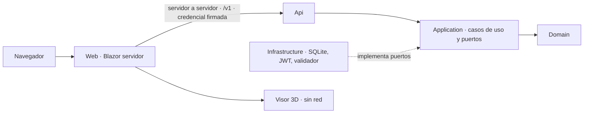

# R2 · Relevamiento de Geometría (Fábrica de Geometría)

> Etapa: planificación del prompt 02 de la guía 16. Sólo lectura: no se tocó ningún repositorio.
> Fecha: 2026-11-01. Fuentes: `Lab-Geometria` `main` `5f07b12` (PR #234, 2026-10-27; árbol local limpio y al día con `origin/main`) e ia-db 4.0 de `Lab-Geometria.Documentacion` (generada 2026-11-01 sobre esa misma revisión).
> Rutas relativas a la raíz de cada repositorio. `{ws}` = raíz del espacio de trabajo.

## Índice

1. Qué es el producto
2. Arquitectura con rutas
3. Superficie HTTP
4. Dominio e interpretación
5. Pruebas, puertas y cómo corre
6. SDD y expedientes
7. Dónde aportaría valor real una capa de IA
8. Restricciones del repositorio
9. Ramas remotas ajenas
10. Consecuencias para el prompt 02

## 1. Qué es el producto

El alumno pega el texto JSON que emite su propio programa (la Actividad 1 con `Describir()`); el producto lo interpreta, reconstruye las figuras, **señala las discrepancias entre el valor declarado y el derivado de las dimensiones** y las dibuja en 3D. El docente habilita cuentas, revisa lo entregado y deja un desenlace con comentario opcional. Fuente: `AGENTS.md` §«Qué es»; ia-db `README.md` §2.

Stack: C# / .NET 10, ASP.NET Core (JWT Bearer, OpenAPI + Scalar), Blazor con render en servidor, EF Core 10.0.11 sobre SQLite, visor TypeScript 5.6 + webpack + three.js 0.169, xUnit y NUnit/Playwright, MinVer (ia-db `README.md` §2). Última etiqueta `v1.2.0`. Fases `a`–`h` y `k` cerradas; `i` (despliegue real) realizada y no cerrada.

## 2. Arquitectura con rutas

Dos unidades de entrega sobre siete proyectos (ia-db `indexes/04_Arquitectura-Y-Proyectos.md` §1–§2):

| Proyecto | Ruta | Rol |
| --- | --- | --- |
| Domain | `src/GeometriaFactory.Domain/` (`Entities/`, `Values/`, `Guards/`) | Entidades `Account`, `Work`, `Piece`, `Component`, `Observation`; sin dependencias |
| Contracts | `src/GeometriaFactory.Contracts/` | DTO planos; compartido por las dos unidades |
| Application | `src/GeometriaFactory.Application/` (`Accounts/`, `Works/`, `Ports/`) | Casos de uso; puertos `IFigureValidator`, `IWorkRepository`, `IAccountRepository`, `ISystemClock` |
| Infrastructure | `src/GeometriaFactory.Infrastructure/` (`Persistence/`, `Security/`, `Figures/`, `Time/`) | Adaptadores; `Figures/LocalFigureValidator.cs` |
| Api | `src/GeometriaFactory.Api/` (`Composition/`, `Endpoints/`, `Program.cs`) | Host delgado y composición de raíz |
| Web | `src/GeometriaFactory.Web/` (`Components/`, `Services/`, `Integration/`) | Front Blazor; llama a la Api servidor a servidor |
| Visor | `visor/` (NoTargets) | Bundle 3D sin red, configuración ni identidad |

Reglas de producto RA-01..03: el navegador sólo habla con el front; la Api es dueña del dato y de las reglas sobre un único SQLite; el visor no tiene red (ia-db `README.md` §2; intake §14).

## 3. Superficie HTTP

17 puntos, 16 bajo `/v1/` (prefijo único en `src/GeometriaFactory.Api/Endpoints/ContractRoutePrefix.cs`) y `/salud` exento. Grupos: autenticación (A-01 `POST /v1/auth/token`), cuentas y aprovisionamiento (A-02, A-03, A-05, A-17), administración de la comisión (A-06..A-09), trabajos (A-10..A-15 y **A-18 `POST /v1/interpretaciones`**, previsualización sin guardar), salud (A-16). Error único con `ErrorCode` traducido en `Endpoints/ContractTranslation.cs`. Fuente: ia-db `indexes/06_Superficie-HTTP-Y-Contratos.md` §2–§3.

## 4. Dominio e interpretación

- `Work` guarda `OriginalJson`, `Pieces`, `Observations`, `AdministratorComment?`; `Observation` tiene `Kind` (error de validación o discrepancia de valor), posición de pieza, campo, valor declarado y derivado (`src/GeometriaFactory.Domain/Entities/*.cs`; `Values/ObservationKind.cs`).
- El puerto `src/GeometriaFactory.Application/Ports/IFigureValidator.cs` es **sincrónico y sin red por contrato** (G-6) y un texto mal escrito es un resultado, no una avería (G-7). El adaptador `LocalFigureValidator` compara con tolerancia `0.01`.
- Desenlace del docente: `src/GeometriaFactory.Application/Works/ResolveWorkUseCase.cs` (`ApplyOutcome(..., comment, ...)`, comentario opcional).
- Contrato del validador, trampas T1–T4, escenarios E-1..E-8: `SDD/Docs/Unidades-Entrega/GeometriaFactory-Api/02-Especificacion-Funcional/Definicion-Contrato-Del-Validador-De-Figuras.md`.
- Exclusiones relevantes (intake §9, ia-db `02` §5): **X-4** «corrección/edición del JSON del alumno» vigente (contradice la premisa); **X-5** retirada (entra devolución escrita, F-21), la calificación con nota sigue excluida; X-1 sin correo.

## 5. Pruebas, puertas y cómo corre

- Construir: `bash scripts/build.sh` (0 y sin advertencias, `TreatWarningsAsErrors`).
- Probar: `bash scripts/test.sh` (Domain, Application, Integration); E2E aparte con `bash scripts/pruebas-e2e.sh`; cobertura `bash scripts/coverage.sh` (0 pasa, 1 no, 2 no medido ≠ aprobación). Puertas por etapa `scripts/verify-stage-<c..i>.sh` y otras `verify-*.sh`.
- Correr: `scripts/run-api.sh`, `scripts/run-web.sh`; `deploy/` con Dockerfiles y `compose.yaml` de verificación.
- CI: `.github/workflows/ci.yml` (PR y push a `main`, .NET 10 y Node 22), `e2e.yml`, `deploy-front-ftp.yml`.
- 20 samples ejecutables por capa en `samples/`.
Fuente: `AGENTS.md`; ia-db `indexes/18_Forma-De-Trabajo-Y-Agentes.md` §3.

## 6. SDD y expedientes

`SDD/` (1.330 archivos) gobierna el código: `Docs/`, `Intake/` (intake 5.1 aprobado, documento humano: lo desalineado se eleva), `Expedientes/`, `Maquetas/`. Hay **un solo expediente**: `SDD/Expedientes/0001-Migracion-Normativa-A-13.16`. Según la coordinación entre sesiones, la guía 16 tomaría el **0002** avisando antes. 60 ADR vivas (ia-db `15`).

## 7. Dónde aportaría valor real una capa de IA

Criterio: complementar, nunca sustituir, la verificación determinista; respetar G-6/G-7, X-4 y RA-03.

| # | Punto | Fundamento en el código | Valor | Límite |
| --- | --- | --- | --- | --- |
| V1 | Explicar observaciones al alumno en lenguaje natural ("tu área declarada del cilindro difiere de π·r²·…; revisá la fórmula en `Describir()`") | `Observation` ya trae campo, valor declarado y derivado; A-18 previsualiza | Pedagógico directo: el producto existe para que el alumno entienda la discrepancia | Pistas, no la solución; no reescribe el JSON (X-4); el veredicto sigue siendo el del validador |
| V2 | Borrador del comentario del docente en el desenlace | `ResolveWorkUseCase` recibe `comment` opcional; F-21 | Ahorra tiempo al docente | El docente revisa y firma; sin nota (calificación excluida) |
| V3 | Resumen de errores frecuentes de la comisión | A-13 lista trabajos; observaciones persistidas por trabajo | Retroalimentación de cátedra | Sólo agregados; sin exponer datos de alumnos a terceros |
| V4 | Asistente de consulta sobre el contrato JSON y los errores de lectura (G-7) | Observaciones de validación con índice de figura y campo (F-09) | Reduce consultas repetidas | No genera el JSON por el alumno (premisa didáctica de `Describir()`) |

Arquitectura sugerida (a especificar, no decidida): un **puerto nuevo y asincrónico en Application** (p. ej. un explicador de observaciones) con adaptador en Infrastructure, separado de `IFigureValidator` para no romper G-6; degradación elegante si el modelo no responde; nada en el visor (RA-03) ni llamadas desde el navegador (RA-01). Requiere ADR nueva y, probablemente, revisar el intake (documento humano: se eleva al PO) porque hoy no hay capacidad F-n de IA.

## 8. Restricciones del repositorio

- **Público de consulta**: no nombrar infraestructura ni proyectos privados.
- **Ciclo de PR automático** por delegación del PO con guardas G1–G4 (sin conflicto, `mergeable_state` `clean`, controles en verde sobre el SHA, merge commit atado al SHA; borrar rama y comprobar 404); ante decisión irreversible con efecto externo, manual (ia-db `README.md` §4; `AGENTS.md`).
- Una unidad de trabajo por PR; commits con título en una línea y cuerpo del porqué, sin acentos en el cuerpo.
- Identificadores en inglés, texto en castellano; términos nuevos se agregan primero a `SDD/Docs/Producto/Norma-De-Nomenclatura.md` §6; códigos de condición en su catálogo.
- No tocar: `PROMPTs/`, `_legacy/`, el intake (se eleva), los contenedores del despliegue real del PO, el almacén con rutinas destructivas.
- Eventualidades del entorno a `SDD/Docs/Producto/11-Documentacion/Bitacora-Eventualidades.md`.
- `AGENTS.md` es derivado de `Contrato-Agentes.md` (manda el contrato).
- La ia-db no se edita a mano: se actualiza con su prompt de manifiesto; por el reparto acordado, la reindexación la hace la última sesión que cierre, anunciándola.

## 9. Ramas remotas ajenas

Tras `git fetch --prune` (2026-11-01):

| Repositorio | Rama remota | Estado |
| --- | --- | --- |
| `Lab-Geometria` | `archivo/reanudacion-6-2026-09-12` | Ajena, histórica; no tocar |
| `Lab-Geometria.Documentacion` | `entrega/delegacion-y-verificar` | Ajena; no tocar |
| `Lab-Geometria.Documentacion` | `ia-db/4.0` | Ajena (regeneración de la ia-db); no tocar |

## 10. Consecuencias para el prompt 02

- Geometría sirve como caso de uso real y público de la guía 16: tiene puertos limpios y un punto de extensión natural (observaciones).
- Trabajo en worktree `{dir-de-trabajo}/g16-lab-geometria`, rama `g16/<tema>`, expediente 0002 avisado; especificación antes que código.
- Cuidar la carpeta `ai-layer` de casos de uso (la de `docs-as-code` es de otra sesión).
