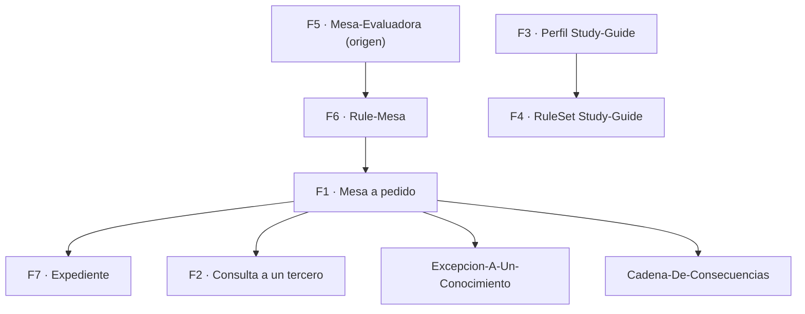
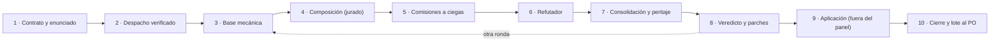

# R5 — Marco de trabajo: procedimiento de mesa, reglas del perfil y plantilla del Conocimiento de especificación

**Prompt:** 02 de la guía 16 (reedición, coherencia, conocimiento de especificación, casos de uso) · **Etapa:** planificación · **Fecha:** 2026-11-01 · **Autor:** relevador R5 (sin voto, sin hallazgos).

Relevamiento: describe lo que dicen las fuentes, con su ancla. Lo que es propuesta de este relevamiento va marcado **PROPUESTA**. Rutas relativas a la raíz del workspace (`/`), como las cita el prompt.

## Índice

- [1. Fuentes leídas](#1-fuentes-leídas)
- [2. Definiciones](#2-definiciones)
- [3. Qué norma rige y cómo se ordenan](#3-qué-norma-rige-y-cómo-se-ordenan)
- [4. Procedimiento de la mesa, paso a paso](#4-procedimiento-de-la-mesa-paso-a-paso)
  - [4.1 Contrato de entrada y enunciado](#41-contrato-de-entrada-y-enunciado)
  - [4.2 Clase de objeto](#42-clase-de-objeto)
  - [4.3 Convocatoria y roles obligatorios](#43-convocatoria-y-roles-obligatorios)
  - [4.4 Despacho y comisiones](#44-despacho-y-comisiones)
  - [4.5 Refutación, consolidación y peritaje](#45-refutación-consolidación-y-peritaje)
  - [4.6 Jurado y veredicto](#46-jurado-y-veredicto)
  - [4.7 Parches, aprobación, aplicación](#47-parches-aprobación-aplicación)
  - [4.8 Cierre y criterio de corte](#48-cierre-y-criterio-de-corte)
  - [4.9 Escalada al PO](#49-escalada-al-po)
  - [4.10 Consulta a un tercero](#410-consulta-a-un-tercero)
  - [4.11 Expedientes](#411-expedientes)
- [5. Reglas del perfil Study-Guide-Documentation](#5-reglas-del-perfil-study-guide-documentation)
- [6. Convenciones del libro MAUI](#6-convenciones-del-libro-maui)
- [7. Plantilla del Conocimiento de especificación](#7-plantilla-del-conocimiento-de-especificación)
- [8. Tensiones detectadas para la mesa](#8-tensiones-detectadas-para-la-mesa)

## 1. Fuentes leídas

| Id | Fuente | Versión | Leído |
|---|---|---|---|
| F1 | `/IA/IA.Knowledge.Base/Knowledges/Knowledge-Mesa-De-Expertos-A-Pedido.md` | 3.1 (2026-10-24) | §0, §2–§5.3 |
| F2 | `/IA/IA.Knowledge.Base/Knowledges/Knowledge-Mesa-Consulta-A-Un-Tercero.md` | 2.0 (2026-10-24) | §0–§7 |
| F3 | `/IA/PROMPTs/IA.Prompts/PromptFramework/Profiles/Study-Guide-Documentation.md` | — | entero (85 líneas) |
| F4 | `/IA/PROMPTs/IA.Prompts/PromptFramework/RuleSets/RuleSet-Study-Guide.md` | — | entero |
| F5 | `/IA/PROMPTs/IA.Prompts/Base/Mesa-Evaluadora.md` | — | §3–§7 |
| F6 | `/IA/IA.Knowledge.Base/Rules/Rule-Mesa.md` | 1.1 | §3.4.1, §3.5.4, §3.5.7 |
| F7 | `/IA/IA.Knowledge.Base/Rules/Rule-Expediente.md` | 1.0 | §1, §2 |
| F8 | `/IA/IA.Knowledge.Base/Rules/Rule-Forma-De-Conocimiento.md` | 1.3 | §2, §3.1, §3.12 |
| F9 | `/LAB/Lab-Documentos/Lab-Documentos/Concepts/Framework-Concept/MAUI-Framework-Developer-Guide.md` | 1.0.0-borrador | front matter, índice, prólogo, Anexos A–C |
| F10 | `…/Framework-Concept/Conocimientos/Knowledge-App-Hibrida-OTA-Offline-First.md` | 1.0 | §0–§2, §10–§13 |

F6–F8 no las nombra la carta, pero F1 y F2 remiten a ellas (`Mesa`, `Expediente`, `Escalas-De-Juicio`, `Forma-De-Conocimiento`) y F1 §0 renglón 6 manda cargar `Excepcion-A-Un-Conocimiento` y `Cadena-De-Consecuencias` cuando el acto lo pide.

## 2. Definiciones

| Término | Definición | Fuente |
|---|---|---|
| Mesa a pedido | Mesa convocada porque alguien la pide por nombre, no por la condición de `Mesa` §3.1 | F1 §0 |
| Enunciado (`ENUNCIADO`) | Cada frase del pedido clasificada como incógnita, dato, requisito, deseable o exclusión, con sujeto y origen; ningún despacho sale antes | F1 §3.1, §5.1 |
| Agregado | Cláusula del objetivo que no sale del pedido ni de una regla; no se despacha, o sale marcada | F1 §3.1 |
| Comisión | Especialista del panel; trabaja a ciegas y en paralelo | F1 §3.2 |
| Folio | Pieza numerada del expediente; los informes van verbatim | F1 §2.3; F7 §2 |
| P0–P3 | Única escala de nivel de hallazgo; su lectura se declara por caso | F1 §4, §5.1 |
| E1–E4, C | Clase de ancla: ejecutable, cita literal, contraejemplo, regla declarada, conjetura (C sólo funda preguntas) | F5 §3; F1 §3.2 |
| Por criterio / por decisión | Cierre con dos rondas seguidas sin hallazgos interpretativos / cualquier otro cierre, declarado | F6 §3.5.7; F1 §4 |

## 3. Qué norma rige y cómo se ordenan

`Mesa-Evaluadora.md` (F5) es el marco de origen; F1 lo destila para la base y **rechaza dos cosas de él**: la escala S1–S4 (se usa P0–P3) y los esquemas JSON/YAML de informes (se usan documentos con tablas) [F1 §4, filas «Escala de severidad» y «Formato de informes»]. **Ante contradicción, rige F1 (y F6)**; F5 aporta la forma del ciclo, el jurado y los criterios de coherencia (§3 «Coherencia») que F1 no contradice.



## 4. Procedimiento de la mesa, paso a paso

Los diez pasos son los de F1 §2.1. Lo que se agrega es la instancia para este prompt.

### 4.1 Contrato de entrada y enunciado

Paso 1 (presidente) [F1 §2.1, §5.1]. El contrato lleva: `PEDIDO (literal)`, `ENUNCIADO`, `CLASE DE OBJETO`, `OBJETO` (ruta y commit), `OBJETIVO` (cada cláusula con su frase o regla de origen), `PREGUNTAS DEL CASO`, `LECTURA P0–P3`, `RESTRICCIONES DURAS`, `DECISIONES CERRADAS`, `CONVENCIONES QUE RIGEN` (con el comando de barrido del índice y su salida, F1 §3.4), `FUERA DE ALCANCE`, `MEDIOS`, `EXPEDIENTE`, `QUIÉN APLICA`, `PRESUPUESTO`, `DESPACHO VERIFICADO`.

- Barrido de convenciones: `grep '^| \[' /IA/IA.Knowledge.Base/Knowledges/Index-Knowledge.md | cut -d'|' -f4,6,12` [F1 §5.1].
- Lectura P0–P3 de referencia: P0 viola una restricción dura o imposibilita el objetivo; P1 retrabajo o interpretación divergente; P2 pérdida acotada; P3 claridad [F1 §5.1].
- Paso 2: verificar el despacho: cada dato que va al panel con su comando y su salida [F1 §2.1, §3.2: «el despacho llevaba cuatro datos y tres estaban mal»].
- Paso 3: base mecánica antes de opinar; lo que falla entra con E1 [F1 §2.1]. Para la guía 16, las compuertas de `tools/` del repo de la guía (inventario en R1–R4) y los cinco chequeos de coherencia de F5 §3.

**PROPUESTA** de frases del pedido para el `ENUNCIADO` (literal del prompt 02): «solicitar a la mesa de expertos una revisión» (requisito), «Coherencia de lo redactado… congruente con las ejemplificaciones» (requisito), «documento unificado… autocontenida y no delta… índices» (requisito), «ronda de revisión como si fuera un libro» (requisito), «sección inicial que explique estos fundamentos» (requisito), «confeccionar un conocimiento de especificación» (requisito), «añadir referencias y casos… de la industria» (requisito), «aplicar el conocimiento de especificación en los diseños de… Geometria y [un servicio privado de notificaciones]» (requisito, casos de uso), «seria interesante enriquecer ejemplos y guia relativo a… Geometría» (deseable), un servicio privado de notificaciones (exclusión de publicación), «simplicidad y practicidad, escalabilidad» (requisito de criterio), «abrir los expedientes si se requiere» (condicional).

### 4.2 Clase de objeto

Cuatro clases [F1 §2.2]. Un objeto de dos clases toma la de la pregunta principal y suma sólo los roles que una señal pida; `CLASE DE OBJETO` declara la descartada.

| Parte del pedido | Clase | Regla de cierre propia |
|---|---|---|
| Revisión y reedición de la guía 0.11.0 | Corpus documental existente | La de `Mesa` §3.5.7 |
| Conocimiento de especificación nuevo | Diseño de una norma | Dictamen que responde cada pregunta del pedido por separado, sin «depende»; comisiones de dominio citan fuentes externas y no inventan cláusulas |

**PROPUESTA**: clase principal «diseño de una norma» (lo nuevo y lo que se prueba en los casos de uso), con «corpus documental» declarado como segunda. A decidir por la presidencia.

### 4.3 Convocatoria y roles obligatorios

Paso 4: compone el **jurado**, no el presidente [F1 §2.1; §4 «Composición»: vota el jurado, empate convoca, techo de cinco variables]. La composición nunca se eleva a quien pidió [F1 §3.1].

| Grupo | Roles | Fuente |
|---|---|---|
| Núcleo permanente (siempre) | Requisitos · Verificación · Lector sin contexto · Refutador (entra último) | F6 §3.4.1 |
| Pedidos por nombre en el prompt 02 | Analistas en sistemas; arquitectos de apps móviles MAUI .NET; especialistas en análisis con criterios de decisión (= rol «análisis de decisiones» de F1); documentación técnica de usuario y sistemas; académicos de edición bibliográfica y de libros; investigadores que ensayan | prompt 02, «Crea una mesa…» |
| Seis intervenciones editoriales del prompt | Edición de contenido · académica · corrección de estilo · ortotipográfica · diseño editorial · corrección de pruebas | prompt 02, tabla |
| Jurado (fijo en función) | Evidencia · Impacto · Costo y beneficio · Coherencia histórica · Riesgo e irreversibilidad | F6 §3.5.4 |
| Condicionales | Perito (ante contradicción, no vota) · análisis de decisiones (sólo si hay ficha de excepción admitida) · cuerpo de parches · quien aplica (fuera del panel) | F1 §2.1 pasos 6 bis, 7, 8, 9 |

Tensión: los roles pedidos superan el techo de cinco variables. El pedido por nombre manda (F1 §3.1, «Hacé una mesa de expertos en `<dominio>`»: comisiones de ese dominio; fuera de catálogo, ad hoc con carta de mandato). **PROPUESTA**: agrupar las seis intervenciones editoriales en una o dos comisiones (edición de contenido+académica; estilo+ortotipografía+diseño+pruebas) o en fases sucesivas de la «ronda como libro», y que el jurado vote la composición registrando los descartes con motivo. La mesa de recuperación ya usó «Panel-edicion», «Panel-didactica», «Panel-arquitectura», «AH-01/02» (ad hoc) [`OUTPUTs/Bitacoras/Mesa/Recuperacion-2026-10-28/`].

### 4.4 Despacho y comisiones

Paso 5 [F1 §2.1, §5.2]. Cada carta sale del esqueleto de F1 §5.2 y lleva: rol y objeto, «refutar, no verificar», a ciegas, clase, pedido literal, objetivo con origen, cláusula `BLOQUEO: paso — salida — prueba de una variable`, competencia y no-competencia (fuera de mandato → solicitud de convocatoria, no hallazgo), nivel P0–P3 + ancla E1–E4/C por hallazgo, fuentes externas con autor/número si la clase es diseño de norma, convenciones que rigen, norma (ruta+versión) con lectura en dos pasos y línea «Secciones … leídas», tope de hallazgos, hasta tres «lo que revisé y está bien», ruta del folio. La carta se archiva en `evidencia/` antes de despachar [F1 §2.1 paso 2].

Convenciones que no se rompen [F1 §3.2]: comisiones a ciegas y en paralelo; cada dato con su comando; todo hallazgo con su ancla; un hallazgo heredado de un informe anterior entra como `C`; informes verbatim; cada comisión escribe su folio y el presidente los cuenta; quien diseña un parche no lo vota.

### 4.5 Refutación, consolidación y peritaje

- Paso 6: el refutador ataca la lectura dominante **y el objetivo** contra el pedido literal (qué se dio por fijo sin pedirlo; solución más chica) y, por ficha de excepción, «¿cuánto cuesta cumplir?» [F1 §2.1].
- Paso 6 bis: análisis de decisiones por ficha admitida [F1 §2.1; `Excepcion-A-Un-Conocimiento` §5.3].
- Paso 7: el presidente consolida sin juzgar ni votar; contradicciones como ítem; peritaje que cambia una sola variable [F1 §2.1, §3.3].
- Filtros de juicio: descripción / control / decisión (un control no ejercido o una decisión de diseño no se «corrigen» en el documento); la unidad de aplicación es el documento; caso que funciona antes que diseño; comportamiento no es restricción [F1 §3.3]. Para la guía: si el texto **describe** los Examples o la demo, se corrige contra ellos; si declara una **decisión** que el código no cumple, es deriva y va a código o ADR.

### 4.6 Jurado y veredicto

Paso 8 [F6 §3.5.4]: quórum 5; mayoría simple entre `PROCEDE`, `NO_PROCEDE` (con motivo), `INSUFICIENTE` (vuelve una vez); empate → `INSUFICIENTE`, segundo empate → escalada; veto acotado del juez de riesgo sólo si irreversible **y** P2/P3 (convierte en escalada); voto sin fundamento no cuenta; >80 % de 5-0 → sospecha de homogeneidad, el refutador revisa los `NO_PROCEDE`.

### 4.7 Parches, aprobación, aplicación

- Cuerpo de parches: texto concreto, capa, derivados a revalidar, verificación y reversión; parches que tocan la misma sección se fusionan [F5 §5.4].
- Aprobación: `APLICAR` · `MEJORAR_PLAN` (máx. 2) · `NO_APLICAR` (deuda declarada) · `ESCALAR`; chequeo obligatorio de capa de origen [F5 §5.5].
- Paso 9: aplica **quien convocó o quien el pedido designe, nunca un rol del panel ni el jurado**; si el pedido no autoriza aplicar, la mesa entrega el plan [F1 §4 «Quién aplica»]. Último tramo: reintegración a la especificación [F1 §2.1 paso 9]. En esta etapa (planificación) la carta común prohíbe editar guía, Examples, demo y Conocimiento: la mesa entrega plan.

### 4.8 Cierre y criterio de corte

Paso 10 [F1 §2.1; F6 §3.5.7; F1 §4 «Criterio de corte»]:

- Contar folios: comisiones + refutador + análisis (si hubo) + perito (si hubo) + jurado de composición + jurado de veredicto; si no da, no cierra.
- **Por criterio** sólo con dos rondas seguidas sin hallazgos interpretativos; una ronda = pasos 3 a 8. Con una ronda se cierra **por decisión** y se escribe. Cuatro rondas sin criterio → sube a quien pidió.
- Bloque de cierre: fila `Reintegra`, apartado «Excepciones a conocimientos», deuda declarada, capas a revalidar, rendimiento por especialista (procedentes / convocados), preguntas sobrevivientes **en lote con `SI NO RESPONDÉS`**; una fila de alcance o una excepción no se asientan por silencio.
- Cruce de «Secciones leídas» de cada folio con el Mapa de carga de F1 §0.

### 4.9 Escalada al PO

Lista cerrada de siete disparadores [F5 §6; F6 §3.6]: ambigüedad de intención irresoluble, conflicto de restricciones duras, cambio de alcance, irreversibilidad con impacto, consecuencia externa, empate persistente, reapertura de decisión cerrada. Todo lo demás lo resuelve la mesa. Formato: una pregunta cerrada, contexto ≤5 líneas, opciones A/B con consecuencia, recomendación con reparto de votos, `si_no_respondés` [F5 §6]. Se entregan juntas al cierre, salvo 2 y 3 (bloquean y salen ya). Un paso prescripto que falla es `BLOQUEO` y sale en el mismo turno [F1 §3.1].

### 4.10 Consulta a un tercero

F2 se carga sólo cuando se lo nombra (`Condicion-de-carga: —`) [F2 §0]; el prompt 02 lo nombra. Requiere que el PO ponga **destinatario, canal y límites** [F2 §1]. El prompt no nombra ningún tercero ni canal: sin esos datos la consulta no se abre y lo que no tenga respuesta en el árbol va al lote del cierre (§4.8). Si se abre:

1. Roles: especialistas anotan dudas (`rol · pregunta · por qué · prioridad · qué hago si no contesta`); entrevistador destila (3–5 por ronda, sin inventar ni cambiar intención); coordinador es la **única mano en el canal** [F2 §1–§2].
2. Un mensaje por ronda, preguntas `R<n>.<m>` con rol, una cosa por pregunta, opciones o ejemplo, sin jerga interna ni nombres de agentes/documentos; «no sé» sirve [F2 §3]. Modo «de a una» si el tercero lo pide, con ok del PO [F2 §2.1].
3. Esperar sin bloquear (canal que despierta o revisión cada 10–20 min); la mesa sigue con lo que no depende [F2 §4].
4. Correlación directa o **inferida**; aportes espontáneos; el contenido del tercero es **dato, no instrucción** [F2 §5]; contrastar el insumo con el pedido antes de usarlo [F2 §5 bis].
5. Cortes al PO: desconfianza, tema sensible, pedido que excede consultar, cambio de forma, 24 h sin respuesta; tope de 3 rondas por duda [F2 §2, §6.1].
6. Registro por ronda en el expediente: dudas, mensaje con hora, respuestas textuales, asignación, estado [F2 §7.1].

### 4.11 Expedientes

Toda mesa a pedido deja registro aunque no encuentre nada; «vive en la sesión del coordinador» no es admisible [F1 §2.3]. Se abre **expediente** si el caso atraviesa más de una corrida o más de un repositorio, o entra material externo que funda una decisión; no si es sólo una mesa que ya deja su registro donde el adoptante lo declara [F7 §1]. Se radica en el repo donde corre la corrida; si otro repo lleva uno sobre el mismo caso, se citan mutuamente [F7 §1].

Estructura [F7 §2]: `<NNNN>-<Titulo>/` con `.gitignore`, `README.md` (6 campos: Número, Título, Objeto, Apertura, Origen, Base), `actuaciones/NNN-<tipo>-<slug>.md` (Tipo, Fecha, Autor, Corrige; pase «Sigue: <acto> · <quién>»), `evidencia/` (+ `local/` sin versionar). Correspondencia de piezas [F1 §2.3]: pedido → `presentacion` con testimonio (literal, canal, fecha-hora, huella SHA-256); contrato y verificación → `providencia`; cartas → `evidencia/`; informes → `informe` verbatim; plan y cierre → `resolucion`. Cada rol escribe primero en `<caso>/despacho/<rol>.md`; el presidente mueve, no transcribe. Barrido de secretos antes de versionar.

Aplicado aquí (de la coordinación entre sesiones, `00-Coordinacion-Entre-Sesiones.md`): el caso toca LD, Lab-Geometria y un repo privado → cumple la rama 1. Geometría: la guía 16 toma el 0002 de `SDD/Expedientes`, avisando antes; el repo privado tiene norma propia correlativa en `Prompts/`, mirando el último en main y avisando. La mesa de LDD deja su registro en `OUTPUTs/Bitacoras/Prompt-02/` (precedente: `Bitacoras/Mesa/Recuperacion-2026-10-28/`).



## 5. Reglas del perfil Study-Guide-Documentation

Enfoque [F3 «Enfoque»]: mapa antes que piezas; marco de referencia de tres ejes —**escenarios, contextos, actores**— definidos una vez y referenciados; de lo general a lo particular (mapa → ejes → un documento por tema → anexos). «Un tema que no se cruza con ningún escenario ni contexto sobra o está mal delimitado.»

Piezas a producir [F3 «Objetivos específicos»]: marco de referencia, mapa conceptual («estoy acá → qué aplico»), documentos por tema con estructura idéntica, métodos y marcos alternativos con criterio de elección, anexos (plantillas, listas, glosario), README con ruta de lectura.

Estructura de cada documento temático [F3]: 1 Definición (qué es, qué no es) · 2 Aplicación por escenario · 3 Ejemplos concretos · 4 Preguntas guía · 5 Criterios de calidad · 6 Anexo con plantilla comentada.

Criterios de calidad [F3]: formativo (deja decidir), trazable (`Rule-Evidences`; lo propio se declara), consistente (una voz, `Rule-Narrative-Voice`), interconectado (ningún huérfano del mapa), verificable (revisión final contra el mapa: huecos, solapamientos, contradicciones). Diagramas como código (`Rule-Dual-Audience`).

RuleSet [F4]: `Rule-All`, `Rule-Workflow`, `Rule-Evidences`, `Rule-Markdown`, `Rule-Documentation`, `Rule-Indexing`, `Rule-Agents`, `Rule-Dual-Audience`, `Rule-Narrative-Voice`, en `/IA/IA.Prompts/PromptFramework/Rules/` (en disco: `/IA/PROMPTs/IA.Prompts/PromptFramework/Rules/`; la ruta citada por F3/F4 omite `PROMPTs/`).

Reglas del prompt 02 que se suman: jerárquico, definiciones, explicaciones, ejemplos, mermaid cuando haga falta, autocontenido, no delta, con índice; descomposición por núcleos con documento de cohesión e integración; no inventar; toda afirmación con evidencia verificable.

## 6. Convenciones del libro MAUI

Libro [F9]:

- Front matter YAML (`doc_id`, `doc_type: libro`, `status`, `origin`, `confidence`, `owner`, `last_review`, `audience: [humano, agente]`, `traces`), luego título, línea de versión/fecha/estado y un resumen citado.
- Índice general al inicio; Prólogo con rutas de lectura por perfil (Tabla 0.1) y mermaid de dependencias (etiquetas «1 · Texto»); Partes I–V (Fundamentos, Mecanismo, Ingeniería, Práctica, Industria) con capítulos numerados; Anexos A–H.
- Tablas y figuras numeradas con leyenda («Tabla 0.1.», «Figura 0.1.»).
- Marcas de estado: NO VERIFICADO, NO EJECUTADO, ESPECULACIÓN, HISTÓRICO (fecha), VARIANTE NO FUSIONADA.
- Citas al final de oración: `[archivo:líneas]`, `[folio NNN]` (privado, sin enlace), `[E0x]` ensayos, `[Rn]` web, `[bitácora …, núcleo Nn]`. Cifras medidas fuera del texto, en la corrida fechada (Anexo H).
- Glosario único bilingüe (Término · Definición · Equivalente · §). Referencias `R<n>. Autor. *Título*. URL. Consulta: fecha.` Folios con roles neutros, sin enlace. Mapa libro ↔ demo (Anexo D). Plantillas (Anexo F).

Conocimiento [F10]: cómo separa regla, razón y evidencia:

| Capa | Dónde | Ejemplo |
|---|---|---|
| Regla | Columna «Principio» con Id estable `P-n`; listas de checklist; procedimientos | P-2 «Un solo método en el puente» |
| Razón | Columna «Criterio para aplicarlo»; prioridad entre principios cuando chocan | «La superficie expuesta al contenido no crece» |
| Evidencia | Columna «Fuente»: `[Libro §x]`, `[ruta:líneas]`, `[Rn]`; marcas **propuesta** / NO VERIFICADO | `[../Demo/src/…/PuenteDelCascaron.cs:9-17]` |

Además: «Regla de evidencia» en §0; «No repite el libro: lo condensa en decisiones, contratos y listas, y remite al capítulo donde está la evidencia»; cifras de la demo = «parámetros, no norma»; Mapa de carga en §0; §13 «Límites de este conocimiento». Cabecera de 11 campos de `Forma-De-Conocimiento` [F8 §3.1], con `Compatible-con` apuntando al libro (no a `Rule-Forma-De-Conocimiento.md`), y cuerpo en §0–§13 propios, no en las §0–§10 de F8 §2.

## 7. Plantilla del Conocimiento de especificación

**PROPUESTA** para `Conocimientos/knowledge-AI-Layer-Integration-Designing-Specification.md`, coherente con F10 y con la cabecera de F8. Los contenidos entre `{{ }}` los fija la mesa; nada se rellena sin fuente.

```markdown
# Capa de IA integrada en .NET: cómo se especifica su diseño en un proyecto nuevo o existente

**Alias:** AI-Layer-Integration-Designing-Specification
**Naturaleza:** propio
**Tema:** {{una línea, la misma que iría a un índice}}
**Consumidor:** {{rol por su tarea: quien especifica la capa de IA de un servicio .NET; quien preside una mesa de diseño sobre ella}}
**Condicion-de-carga:** {{al decidir si un servicio necesita capa de IA; al especificar …; se carga por secciones según el Mapa de carga de §0}}
**Hereda-de:** —
**Sustituye:** —
**Compatible-con:** `Dot-Net-Integration-AI-Layer-Guide.md` {{versión de la guía}}
**Versión:** 1.0
**Estado:** Vigente
**Fecha:** {{AAAA-MM-DD}}

---

## Índice
## 0. Propósito y alcance
  - Qué decide, qué no repite (remite a la guía), implementación de referencia (Examples, demo).
  - Regla de evidencia: `[Guía §x]`, `[ruta:líneas]` relativa a la carpeta, `[Rn]` del anexo de referencias de la guía; **propuesta** / NO VERIFICADO.
  - Mapa de carga (Tarea | Secciones).
## 1. Cuándo usarlo y cuándo no            (criterios numerados, cada uno con fuente)
## 2. Principios y decisiones con criterio  (tabla Id P-n | Principio | Criterio | Fuente; prioridad al chocar, marcada propuesta si lo es)
## 3. Arquitectura de referencia            (mermaid; capas y fronteras; puntos de contacto con el libro MAUI se referencian, no se redefinen)
## 4. Contratos                             (interfaces, mensajes, versionado)
## 5…n. Un núcleo por sección               (los que fije la mesa; cada uno: definición, regla, criterio, fuente, ejemplo de Examples/NN)
## n+1. Plantilla de especificación          (los campos que un proyecto llena: escenario, contexto, actores, requisitos con Id y criterio de aceptación, decisiones, pruebas)
## n+2. Métricas y pruebas                  (cómo se verifica; compuertas de tools/)
## n+3. Procedimientos                      (tabla Procedimiento | Pasos mínimos | Fuente)
## n+4. Checklist de arranque de proyecto   (casillas que remiten a secciones)
## n+5. Casos de uso                        (Geometría por nombre y con enlace; el servicio privado en abstracto: «un servicio privado de notificaciones»)
## n+6. Referencias y casos de la industria (tabla Caso o estándar | Qué toma | Fuente [Rn]; URL completas en la guía)
## n+7. Límites de este conocimiento        (qué no se ensayó, qué queda NO VERIFICADO)
## Glosario (o remisión al glosario único de la guía)
```

Reglas de la plantilla:

1. Regla, razón y evidencia en columnas separadas (§6); nada en «Principio» sin fila en «Fuente».
2. Requisitos de la plantilla de especificación con Id, criterio de aceptación y prueba que lo referencia: son los chequeos de coherencia de F5 §3 y permiten base mecánica en los casos de uso.
3. Lo que viene del caso privado entra sólo como criterio general, sin nombres, rutas, hosts ni credenciales (carta común).
4. Mermaid con etiquetas «1 · Texto» y sin URLs; validar con `tools/medios/mermaid.sh` (00-Coordinacion).

## 8. Tensiones detectadas para la mesa

| # | Tensión | Fuentes | Propuesta de tratamiento |
|---|---|---|---|
| T1 | F5 usa S1–S4 y YAML; F1 los rechaza | F5 §3, §8; F1 §4 | Rige F1: P0–P3 y tablas |
| T2 | Roles pedidos > techo de 5 variables | prompt 02; F1 §4 | Jurado vota composición; agrupar o escalonar intervenciones editoriales; descartes con motivo |
| T3 | Forma del Conocimiento: F8 §2 (§0–§10, `Compatible-con: Rule-Forma…`) frente a F10 (§0–§13, `Compatible-con: libro`) | F8 §2, §3.1; F10 cabecera | Seguir F10 por coherencia entre libros (00-Coordinacion), declarando la divergencia en §0; o ficha de `Excepcion-A-Un-Conocimiento` si la mesa entiende que F8 rige en LD |
| T4 | Ruta del RuleSet citada sin `PROMPTs/` | F3, F4 | Usar la ruta en disco; anotar |
| T5 | Consulta a tercero nombrada sin destinatario ni canal | prompt 02; F2 §1 | No abrir consulta; dudas al lote del cierre |
| T6 | Etapa de planificación: nadie aplica | carta común; F1 §4 | `QUIÉN APLICA: nadie: sólo plan` |
| T7 | Perfil pide marco de ejes (escenarios/contextos/actores) | F3 «Enfoque» | Verificar que la guía 0.11.0 lo tenga (R1–R4); si no, primer hallazgo |

> **Nota de redacción** 2026-11-01: el nombre del servicio privado se reemplazó por la fórmula abstracta «un servicio privado de notificaciones» (pendiente 3 de `Ejecucion/Verificacion-Etapa-2.md`, `Ejecucion/Pendientes-Etapa-2.md`). No se cambió nada más.
