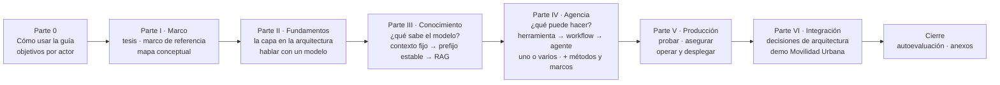
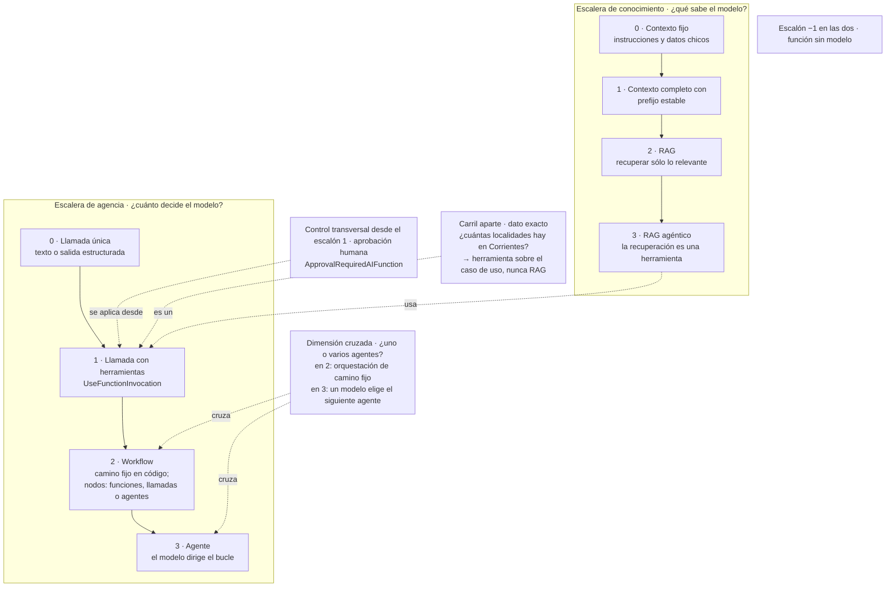

# Carta de redacción de la guía 16

Todos los redactores siguen esta carta. **Donde una regla anterior y §16 (lecciones de la sección de muestra, decididas por la presidencia el 2026-10-27) difieren, rige §16.** Es una **extracción** del plan aprobado v3 (`../04-Plan-De-Integracion.md`), del marco de referencia N0 (`../03-Marco-De-Referencia.md`), de la reedición (`../../Crear-IA-Layer-Guide-Reedicion.md`) y de la bitácora de construcción (`../06-Construccion.md` §8). No agrega decisiones: donde tuvo que elegir entre dos lecturas del plan, lo dice como «criterio de la carta» y lo deja para que la presidencia lo confirme. Si algo de esta carta contradice al plan v3, **rige el plan** y la carta se corrige.

Compañeros de esta carta, en la misma carpeta: `00-Referencias.md` (registro único `[REF-nn]`), `00-Glosario.md` (términos canónicos) y `00-Versiones.md` (tabla única de versiones). Cada sección se escribe en `secciones/`, un archivo por sección.

## Índice

- [1. Reglas duras](#1-reglas-duras)
- [2. Encuadre: tesis, columna vertebral y principio rector](#2-encuadre-tesis-columna-vertebral-y-principio-rector)
- [3. Las dos escaleras](#3-las-dos-escaleras)
- [4. Marco de referencia: escenarios, contextos de uso y actores](#4-marco-de-referencia-escenarios-contextos-de-uso-y-actores)
- [5. Objetivos de aprendizaje (tabla única)](#5-objetivos-de-aprendizaje-tabla-única)
- [6. Plantilla de encabezados y forma de cada sección](#6-plantilla-de-encabezados-y-forma-de-cada-sección)
- [7. Preguntas guía](#7-preguntas-guía)
- [8. Una casa por pieza](#8-una-casa-por-pieza)
- [9. Citas, snippets y salidas rotuladas](#9-citas-snippets-y-salidas-rotuladas)
- [10. Qué cifras se pueden citar](#10-qué-cifras-se-pueden-citar)
- [11. Estilo](#11-estilo)
- [12. Controles de edición y compuertas](#12-controles-de-edición-y-compuertas)
- [13. Anclas previstas de toda la guía](#13-anclas-previstas-de-toda-la-guía)
- [14. Mapa de ejemplos y demo por sección](#14-mapa-de-ejemplos-y-demo-por-sección)
- [15. Puntos abiertos que la carta no resuelve](#15-puntos-abiertos-que-la-carta-no-resuelve)
- [16. Lecciones de la muestra](#16-lecciones-de-la-muestra)

---

## 1. Reglas duras

1. **No inventar** (R-PO-6, R-PO-7, R-EVID). Toda afirmación técnica lleva respaldo verificable: una fuente primaria `[REF-nn]` de `00-Referencias.md`, un archivo del repositorio de la guía o un registro de `Evidencia/`. Lo que es criterio propio se escribe como tal («criterio de la guía: …»). Si falta respaldo, la afirmación se quita o se marca «no verificado» y se informa en el despacho; nunca se completa de memoria. Tampoco se completan de memoria títulos, autores ni fechas de una referencia.
2. **Caso único: Movilidad Urbana** (I-06, RD-PO-1 a RD-PO-3). Todo snippet, pregunta guía, ejemplo y explicación usa `Localidad`, `Provincia` (de `Catalogos`), `RespuestaDeEncuesta`, medios de transporte, frecuencias, motivos y sesiones. No entra nada de otros proyectos del PO (ni dominio, ni arquitectura, ni stack, ni nombres) ni los dominios genéricos inventados que usan algunos snippets de los dossiers y que I-06 enumera en RD-PO-3; la lista de términos no se repite acá porque la vigila la compuerta AC-8. Si una pregunta de un dossier venía en otro dominio, se reescribe sobre Movilidad Urbana; si la idea no encaja, queda como explicación conceptual sin ejemplo.
3. **R-PRIV: el repositorio es público.** Nunca se escriben IPs, nombres de host o de máquina del laboratorio, puertos de la LAN, usuarios, rutas absolutas de una máquina, credenciales ni nombres de contenedores o volúmenes privados. El servidor de modelos se nombra por su variable: `OLLAMA_ENDPOINT` (default `http://localhost:11434`) y, para el Ollama propio, `OLLAMA_PROPIO_ENDPOINT` / `OLLAMA_EMBED_ENDPOINT`. En prosa: «el servidor Ollama compartido del laboratorio» y «el Ollama propio del laboratorio». Los nombres internos de recurso o de turno del gestor tampoco van a la guía.
4. **Snippets reales.** Todo bloque de código sale de un archivo de `Examples/` o `Demos/`, citado por su ruta relativa a la carpeta de la guía, copiado textual o recortado con `// …`. Nunca código escrito de memoria, ni «adaptado» sin decirlo. La única excepción declarada por el plan es el snippet de LangGraph por HTTP de §9.4, rotulado «adaptación no ejecutada».
5. **Salidas reales y rotuladas.** Toda salida de modelo que se muestre sale de un registro de `Evidencia/` y lleva su rótulo (§9 de esta carta).
6. **Markdown jerárquico**, con índice, anclas explícitas (§13) y diagramas mermaid que rendericen en GitHub: etiquetas entre comillas dobles, sin paréntesis ni comillas sin escapar dentro de una etiqueta de nodo, saltos con `<br/>`. La guía es autocontenida: el lector no necesita las bitácoras. Ninguna remisión «plan §…» ni ningún ID interno pasa a la guía (§12).
7. **Dónde se escribe.** Las secciones, en `secciones/` de esta carpeta; la guía integrada, en `Dot-Net-Integration-AI-Layer-Guide.md`; la bitácora de redacción, en `07-Redaccion.md`. Nada en `PROMPTs/` fuera de `OUTPUTs/`. Sin commit. La redacción no corre el modelo.

---

## 2. Encuadre: tesis, columna vertebral y principio rector

### 2.1 Tesis (plan §A.1, literal)

> **Una capa de IA no es «llamar a una API de IA»: es el lugar de la aplicación por donde el modelo *propone* —texto, datos tipados o llamadas a herramientas— y la aplicación *decide*. La llamada al modelo vive en `Infrastructure` detrás de un contrato. Ese contrato es un puerto propio de `Application` cuando el prompt es un detalle de la funcionalidad (extraer una localidad, normalizar una respuesta de encuesta, ayudar con una regla), y puede ser el mismo `IChatClient` cuando la funcionalidad *es* la conversación. La capa crece por dos escaleras casi independientes, *qué sabe el modelo* y *qué puede hacer el modelo*, y se sube un escalón cuando el de abajo no alcanza, según un criterio de salto explícito. Cuando un ejemplo sube más de lo necesario para poder enseñar un escalón, la guía lo dice.**

Respaldo de la tesis por partes: contrato en el núcleo y adaptador en Infrastructure [REF-182], [REF-183]; «subir cuando hace falta» [REF-115] («only increasing complexity when needed») y [REF-117] («If you can write a function to handle the task, do that instead»). La fuente dice *cuando hace falta*, no *cuando se demuestra que mejora*: la guía no promete una demostración que sus ejemplos no hacen. Que sean dos escaleras es criterio de la guía.

**Pasos que suben más de lo necesario, declarados** (se dicen en la sección que los usa): PD-2 hace RAG sobre un corpus que cabe en el escalón 0 de conocimiento; PD-6 y el ejemplo 11 usan un agente de MAF para conservar la conversación entre dos peticiones, no para la aprobación, que ya existe en el escalón 1; la variante de dos agentes de 12 resuelve una tarea que un agente resuelve.

### 2.2 Columna vertebral (plan §A.2)

Ocho bloques: Parte 0, seis Partes numeradas y el Cierre. El diagrama vive en §0 (es el de plan §A.2) y no se repite en otra sección.



Dos consecuencias que cada redactor respeta:
- **Las ADR van en la Parte VI** (§13), porque eligen entre alternativas que el lector todavía no conoce en la Parte II. Para no esconder la arquitectura, ADR-01 y ADR-02 se anticipan en §4.6 y §5.8 como «decisión en curso», y cada sección temática cierra con «qué decisión de arquitectura toca esto», con remisión a §13.
- **La seguridad no se relega a la Parte V**: cada práctica riesgosa lleva su advertencia donde se enseña (texto externo en §7, herramientas de escritura en §8, exposición MCP en §8.9) y §11 consolida.

### 2.3 Principio rector (plan §A.4)

> **El modelo propone; la aplicación ejecuta, autoriza y valida.**

Forma operativa. Cada ejemplo con salida estructurada o herramientas tiene que **mostrarla en el código**, no sólo decirla:

1. Lo que el modelo devuelve es una **propuesta**: se consume con `TryGetResult`, con **campos anulables** para todo dato que el pedido puede no traer (`Habitantes` es `int?` en `LocalidadPropuesta`, como en `LocalidadModel` del caso base), y se normaliza contra `Catalogos` antes de llegar al caso de uso. La ausencia la detectan las reglas (`LocalidadRules.HabitantesValidos(null)` es `false`) y la aplicación pide el dato. El campo anulable le da al modelo un lugar para no inventar; **no le impide inventar**. Lo que garantiza el código es que un valor numérico propuesto se acepta sólo si aparece en el texto de entrada o si la persona lo confirma. Cuánto inventa el modelo se mide aparte (ejemplo 03).
2. Las herramientas son **casos de uso de Application**, nunca el repositorio, el `DbContext` ni SQL.
3. La **identidad** (en la demo, la sesión: `X-Sesion-Id` en la API, la cookie `sesion-movilidad` pasada al circuito en Blazor, una sesión fija declarada en el ejemplo MCP) la pone el código. El modelo nunca la elige.
4. Lo destructivo pasa por **aprobación humana** (`ApprovalRequiredAIFunction`), que no reemplaza la autorización.
5. Las **reglas del dominio** son la autoridad; el prompt sólo orienta.
6. **Toda capacidad que escribe** pasa por un caso de uso de Application que compone extracción, reglas y guardado (`AltaDesdeTextoService`, `EncuestaDesdeTextoService`). Dos excepciones declaradas: el chat (PD-1, PD-5, PD-6), donde la página Blazor consume el `IChatClient` del asistente y las escrituras ocurren dentro de herramientas que son casos de uso; y la ayuda (PD-2), excepción **de lectura**, que va del endpoint a `IAyuda` sin caso de uso.

Es criterio de la guía, sostenido por [REF-160] y [REF-162], y se declara como tal. **Qué materializa la demo y qué no**: *ejecuta* y *valida* están en el código; de *autoriza*, la demo muestra aislamiento por sesión y aprobación humana, pero no autorización: `X-Sesion-Id` no autentica. §11 y §14.6 lo dicen.

El diagrama de secuencia «el modelo propone» (plan §A.4) va en §1.

---

## 3. Las dos escaleras

Criterio de la guía: las dos preguntas del lector son casi independientes y se cruzan en un solo punto, el RAG agéntico. El diagrama vive en §3.2 (casa única); §6.1 y §8.1 remiten.



> Nota de sintaxis: el diagrama del plan lleva paréntesis y comillas dentro de las etiquetas («(N3b §3.3)», «("¿cuántas…?")», «"If you can write a function…" (MAF)»). Esta versión los quita para cumplir la regla 6; la cita de MAF va en la prosa con [REF-117].

**Escalera de conocimiento**: 0 contexto fijo → 1 contexto completo con prefijo estable → 2 RAG → 3 RAG agéntico. Criterios de salto: tamaño del corpus contra la ventana **efectiva** (no la declarada), frecuencia de cambio, latencia, costo y aislamiento de datos. En Movilidad Urbana el corpus real (los 12 literales de `*Policy`) está en el escalón 0. *CAG* sin calificar se reserva para el método del artículo [REF-67], que exige la caché KV persistida y el modelo en proceso.

**Escalera de agencia**: −1 función sin modelo → 0 llamada única → 1 llamada con herramientas → 2 workflow → 3 agente. El escalón mide **cuánto decide el modelo**, no qué tan difícil es la API. El workflow va **antes** del agente porque en un workflow el camino lo fija el código ([REF-115]: workflows = «predefined code paths»; agentes = «LLMs dynamically direct their own processes»). Un workflow con agentes como nodos sigue en el escalón 2.

**Frontera entre los escalones 1 y 3.** Escalón 1: el pedido es acotado (una intención), el código fija las herramientas y un tope de iteraciones, y el bucle termina cuando el modelo responde ese pedido. Escalón 3: tarea abierta; el modelo fija submetas, elige qué sigue y decide cuándo terminó. Prueba observable: si el código puede enumerar de antemano qué pedido resuelve el bucle, es escalón 1. «Borrá Resistencia» con `eliminar_localidad(nombre, provincia)` es escalón 1.

**Tres dimensiones que no son escalones**: (a) uno o varios agentes; (b) aprobación humana, que vive en M.E.AI y se aplica desde el escalón 1; (c) estado de la conversación, que no aumenta lo que decide el modelo. Ubicaciones fijas que todas las secciones repiten igual: PD-1 y PD-5 en el escalón 1 (PD-5 con aprobación); PD-6 en el 1 con estado; 11 usa un `AIAgent` y sigue en el 1 con estado; el escalón 3 queda conceptual; la encuesta de tres pasos (ejemplo 10) es el **contraejemplo** del escalón 2 (parece un workflow y es una función, escalón −1); la variante «un-agente» de 12 es la **instancia positiva** del escalón 2.

**Línea de ubicación** al empezar cada sección temática (plan §B, preámbulo): «Estás en: escalón X de la escalera Y · capa Z · OA-…». Forma canónica y casos mixtos en §16.2. Para las secciones que no son de una escalera (§4, §10, §11, §12) la línea nombra la capa y los OA, y el escalón se omite o se escribe «transversal» (criterio de la carta).

**Capas** (casa única §3.1, tabla de plan §B.1): Presentación (Blazor, endpoints, servidor MCP como adaptador de entrada) · Application (casos de uso y puertos de IA) · Domain (`*Rules`, `Catalogos`, sin IA) · Infrastructure/AI (`IChatClient` y adaptador, `IEmbeddingGenerator`, `VectorStoreCollection`, herramientas) · Infrastructure/Persistence · Host (`Program.cs`, configuración, OpenTelemetry). El servidor de modelos está fuera de la solución y se alcanza por `OLLAMA_ENDPOINT`. Invariante del mapa: no existen flechas del modelo al repositorio ni del modelo al dominio.

---

## 4. Marco de referencia: escenarios, contextos de uso y actores

Se definen **una sola vez**, en §2 de la guía; el resto usa los IDs. Fuente: `03-Marco-De-Referencia.md`.

### 4.1 Escenarios

| ID | Escenario | Entra → sale | Qué puede hacer el modelo | En Movilidad Urbana | Riesgo dominante |
|---|---|---|---|---|---|
| ESC-01 | Asistente conversacional sobre datos propios | pregunta → respuesta fundada en datos de la aplicación | leer (recuperación o herramientas de sólo lectura) | «¿Qué medio de transporte declararon más las personas que respondieron la encuesta?» | respuesta inventada o con datos de otra sesión |
| ESC-02 | Búsqueda semántica | consulta libre → lista ordenada por similitud | nada: sólo embeddings | buscar por descripción, no por texto exacto | recuperación irrelevante que parece buena |
| ESC-03 | Extracción y clasificación estructurada | texto libre → objeto tipado validado | proponer; la aplicación valida y decide | frase con nombre, provincia, CP y habitantes → `LocalidadModel` validado por `LocalidadRules` | salida fuera de esquema o que viola reglas |
| ESC-04 | Automatización con agentes y herramientas | objetivo → acciones sobre la aplicación | decidir qué herramienta y con qué argumentos; puede escribir | asistente que da de alta, consulta o borra localidades por los casos de uso | agencia excesiva |
| ESC-05 | Exposición de capacidades por MCP | cliente MCP externo → herramientas de la aplicación | decide el modelo del cliente; la aplicación expone | servidor MCP con consultas sobre localidades | exposición sin control de acceso |

Delimitación: el resumen o la generación libre son ESC-01 sin datos propios. ESC-03 se separa de ESC-04 porque en ESC-03 decide la aplicación. ESC-05 invierte el sentido: la aplicación sirve a un modelo ajeno.

**Cobertura** (plan §C, §3.3; la cobertura es del conjunto guía + ejemplos + demo): ESC-01 → §5, §6, §7 · 01, 05, 07 · PD-1 (cableado), PD-2 · ESC-02 → §7 · 06 · ninguno en la demo · ESC-03 → §5.3 · 03, 04 · PD-3, PD-4 (cableado) · ESC-04 → §8 · 08, 09, 11, 12 · PD-5 (cableado), PD-6 · ESC-05 → §8.9, §11.5 · 13 · ninguno en la demo.

### 4.2 Contextos de uso

Se escribe siempre «contexto de uso» o el ID CTX-, para no confundirlo con el **contexto** que recibe el modelo (§3.0). Son pares independientes.

| ID | Contexto de uso | Qué cambia |
|---|---|---|
| CTX-LOCAL | Modelo local (en esta guía, Qwen en el servidor Ollama del laboratorio) | sin costo por token ni salida de datos; capacidad y ventana acotadas por el hardware; la calidad de la llamada con herramientas depende del modelo |
| CTX-NUBE | Modelo en la nube | más calidad y escala; costo por token, latencia de red, datos que salen, cuotas |
| CTX-PROTO | Prototipo | se tolera no determinismo y poca observabilidad; el objetivo es aprender si el escenario vale la pena |
| CTX-PROD | Producción | evaluación, observabilidad, límites de costo, controles de seguridad, plan para fallas y cambios de versión del modelo |
| CTX-PUB | Datos públicos o no sensibles | recuperación y registro de prompts amplios |
| CTX-SENS | Datos sensibles o personales (en el caso: `Nombre` y `Edad` de `RespuestaDeEncuesta`) | minimizar lo que entra al contexto, aislar por sesión, registrar sin datos personales, restringir proveedores |
| CTX-EXISTENTE | Aplicación existente (la copia de Movilidad Urbana en `8fb4c3a`) | reglas con huecos que se endurecen; estructura de capas y hosts heredada (ADR-11, ADR-13); un caso de uso que no valida no se expone; tabla de delta |
| CTX-NUEVA | Aplicación nueva | reglas con el catálogo desde el inicio; capas como proyectos son igual de válidas; sin delta. **Sin artefacto**: se explica como «qué cambiaría», sin ejecución |

La combinación de esta guía y su demo es **CTX-EXISTENTE × CTX-LOCAL × CTX-PROTO**; CTX-NUBE × CTX-SENS es la que más condiciona el diseño. Toda recomendación que no valga para todas las combinaciones lo dice.

> Al pasar la fila CTX-LOCAL a §2.2: el marco N0 trae una marca pendiente «[C: verificar soporte de herramientas de Qwen en Ollama en N2]». La compuerta C2 exige `grep '\[C:'` = 0. La marca se resuelve con el sondeo del entorno (los dos modelos del servidor compartido devuelven `tool_calls` bien formados; `/v1` no admite `tool_choice` [REF-51]) y con los registros de 08, 09 y 11, sin copiar la marca.

### 4.3 Actores

| ID | Actor | Decide | No decide |
|---|---|---|---|
| ACT-DEV | Desarrollador .NET (lector principal; su faceta *AI Engineer*, desarrollada en §2.3) | cómo implementar el escenario con las abstracciones elegidas; cómo describir herramientas; cómo probar; adaptador, pipeline y estrategia de conocimiento dentro del ADR vigente | qué escenarios se habilitan; qué proveedor va a producción; qué datos entran al contexto; el umbral de éxito del escenario |
| ACT-ARQ | Arquitecto o líder técnico | dónde vive la capa; qué abstracción y qué marco; qué escenarios se construyen y con qué estrategia; el umbral de éxito | la operación diaria del modelo; las políticas de datos |
| ACT-OPS | Operador / DevOps | cómo se sirve el modelo; configuración y secretos; observabilidad; costo; resiliencia | la lógica de los casos de uso |
| ACT-SEC | Responsable de datos y seguridad | qué datos llegan a qué modelo; qué acciones pueden ejecutarse sin confirmación; registro y retención | cómo se implementa cada control en código |
| ACT-USR | Usuario final | qué pide y si confirma una acción propuesta | nada del diseño. **No es lector**: es el actor cuyos datos y acciones la guía protege |

Lector secundario declarado: **quien viene de Semantic Kernel** (ruta propia: tronco + §9.7 + ejemplo 14). El proveedor del modelo no es actor: sus restricciones son propiedades de CTX-NUBE.

---

## 5. Objetivos de aprendizaje (tabla única)

Plan §A.3. Esta tabla es **la única fuente**: las rutas de §0.2 y los ítems de §15 se derivan de ella. Son **27 OA**. Va al principio de la Parte 0 (§0.1).

| ID | Actor | Al terminar, el lector puede… | § | Ejemplo / paso |
|---|---|---|---|---|
| OA-0.1 | Todos | Dado un pedido sobre Movilidad Urbana, responder las cuatro preguntas de §2.4 y decidir si hace falta un modelo | §2.1–§2.4 | — |
| OA-0.2 | Todos | Ubicar cada pieza de la imagen de entrada en Presentación, Application, Domain o Infrastructure, y decir por qué | §3.1, §4.3, §4.5, §14.2 | demo §14.2 |
| OA-0.3 | Todos | Ubicar un caso en las dos escaleras y nombrar el escalón más bajo que lo resuelve | §3.2–§3.5, §14.3 | §3.5 |
| OA-D1 | ACT-DEV | Consumir un modelo con `IChatClient` y cambiar de adaptador tocando sólo la raíz de composición | §5.1–§5.6 | 01, 02 |
| OA-D2 | ACT-DEV | Obtener salida estructurada con `TryGetResult`, con campos anulables para lo que puede faltar, y pasarla por las reglas antes de guardar | §5.3 | 03, 04, PD-3 |
| OA-D3 | ACT-DEV | Elegir entre contexto fijo, contexto completo con prefijo estable y RAG para un corpus dado, con los criterios de salto | §6 | 05 |
| OA-D4 | ACT-DEV | Armar un RAG con citas validadas en código y medir el hit rate@k contra una línea base, con consultas no respondibles | §7, §10.7 | 06, 07, PD-2 |
| OA-D5 | ACT-DEV | Exponer un caso de uso como herramienta, con pruebas negativas, la sesión puesta por el código y aprobación para toda escritura | §8.2–§8.5 | 08, 09, PD-1, PD-5 |
| OA-D6 | ACT-DEV | Elegir entre función, llamada con herramientas, workflow y agente para un caso, y justificarlo con el criterio de salto | §8.1, §8.6, §8.7 | 10, 11, PD-6 |
| OA-D7 | ACT-DEV | Decidir si una tarea necesita uno o varios agentes y medir el costo de la variante con más agentes con métricas deterministas | §8.8 | 12 |
| OA-D8 | ACT-DEV | Exponer lecturas por MCP en loopback y consumir herramientas MCP como `AIFunction` | §8.9, §11.5 | 13 |
| OA-D9 | ACT-DEV | Escribir pruebas de cableado con un `IChatClient` falso, separadas de las corridas contra el modelo, y registrar una corrida R-LLM | §10.1–§10.4 | 15 |
| OA-A1 | ACT-ARQ | Registrar una decisión de la capa como ADR con alternativas, consecuencias y cuándo deja de valer | §13 | ADR-01…ADR-13 |
| OA-A2 | ACT-ARQ | Fijar para un escenario la métrica, los tipos de error, el umbral para seguir y qué ve la persona cuando la respuesta está mal | §2.4–§2.5 | — |
| OA-A3 | ACT-ARQ | Elegir estrategia de conocimiento y almacén según tamaño, frecuencia de cambio y aislamiento | §6, §7 | 05, 07 |
| OA-A4 | ACT-ARQ | Elegir marco (M.E.AI, MAF, SK sólo como migración) y explicar por qué LangGraph y Microsoft Graph no son opciones .NET para esto | §9 | — |
| OA-A5 | ACT-ARQ | Decidir, para una capacidad, si el contrato es un puerto propio de Application o `IChatClient`, y justificarlo con quién define el prompt y qué cambia al cambiar de proveedor | §4.4 | demo: `IExtractorDeLocalidad` frente al chat (§14.2) |
| OA-A6 | ACT-ARQ | Dado un cambio de la capa de IA sobre una aplicación existente de Movilidad Urbana (CTX-EXISTENTE), clasificar cada pieza tocada en agregado, modificado a causa de la IA o modificado por otro motivo, y decir qué regla del caso base conserva | §2.2, §14.1, §14.4 | demo: tabla de delta |
| OA-O1 | ACT-OPS | Configurar `UseOpenTelemetry` y comprobar con un exportador en memoria qué contenido sale con `EnableSensitiveData` apagado y encendido | §12.1–§12.2 | 17 |
| OA-O2 | ACT-OPS | Configurar endpoint, modelo, `num_ctx` y timeouts por variable, sin ningún valor en el repositorio | §5.5, §5.7, §11.6, §12.5–§12.6, §14.5 | §14.5 |
| OA-O3 | ACT-OPS | Leer un puntaje de LLM juez: decir si está calibrado y qué sesgo declara | §10.5–§10.6 | 15 |
| OA-O4 | ACT-OPS | Elegir entre modelo local, servidor compartido o nube por concurrencia, datos y costo | §12.3–§12.4 | — |
| OA-S1 | ACT-SEC | Para un escenario, nombrar los riesgos OWASP que aplican y su control mínimo en código | §11.1 | 16 (ficha de riesgo del Anexo A llena para 16); pregunta guía de §11 «Indexo texto que no escribí yo…» |
| OA-S2 | ACT-SEC | Decidir qué herramientas piden aprobación, cuáles no se montan con contexto no confiable y qué datos llegan a qué modelo | §8.5, §11.2, §11.3, §11.4, §11.7 | 09, 16 |
| OA-S3 | ACT-SEC | Aplicar el filtro por permiso en la recuperación y no después | §7.6 | — |
| OA-S4 | ACT-SEC | Armar el pedido de aprobación con los argumentos que resolvió el código, no con la prosa del modelo | §8.5, §11.3 | 11, PD-6 |
| OA-SK1 | Si venís de SK | Pasar una herramienta `[KernelFunction]` a `[Description]` + `AIFunctionFactory` sin cambiar su esquema | §9.7 | 14 |

**Criterio de inclusión, en tres sentidos** (plan §A.3): (1) ningún ejemplo ni pregunta guía entra sin un OA de esta tabla; (2) toda subsección aparece en la columna «§» de algún OA, o es **subsección de encuadre** y no lleva ítem en §15; (3) todo OA tiene al menos un ejemplo o una pregunta guía **antes** de §15. Exentas del sentido (2) por regla de clase: las subsecciones «Decisión en curso» y «Qué decisión toca» (§4.6, §5.8, §6.7, §7.8, §8.10, §10.8, §11.8, §12.10). Subsecciones de encuadre: §3.0 y §4.1 (vocabulario), §4.2 (por qué ahora), §12.7 (Aspire, snippet no compilado), §12.8 (lo que la demo no implementa), §12.9 (realimentación, explicada) y §14.6 (lo que la demo no hace).

**Rutas de lectura** (§0.2, derivadas): tronco común §0–§3 y §4.1–§4.3. ACT-DEV: la guía completa. ACT-ARQ: tronco + §4.4, §6, §7, §9, §13; a mano, §8.1, §8.6–§8.7 y §14. ACT-OPS: tronco + §5.4–§5.7, §10.1–§10.6, §11, §12. ACT-SEC: tronco + §7.1–§7.6, §8.2–§8.5, §8.7, §8.9, §11. Si venís de SK: tronco + §9.7 y el ejemplo 14.

---

## 6. Plantilla de encabezados y forma de cada sección

### 6.1 Plantilla de las secciones temáticas §4–§8 y §10–§12 (plan §C)

Se declara una vez en §0.4 y se usa igual en todas. §5 es la **sección de muestra**: se redacta primero y la plantilla se ajusta ahí antes de redactar las demás.

```
# Parte N · Título                                   (nivel 1)
## §N Título                                          (nivel 2)
> Estás en: escalón X de la escalera Y · capa Z · OA-…   (una línea)
### §N.1 … §N.k                                       (nivel 3; cada una abre con su Definición: qué es, qué resuelve, qué no es)
### Práctica de §N                                    (nivel 3, sin número; ancla sN-practica; sólo agrupa, §16.1)
#### Aplicación por escenario                         (nivel 4; tabla ESC × contexto de uso, sólo las celdas que cambian)
#### Ejemplos                                         (nivel 4; snippet de un archivo de Examples/ o Demos/ + carpeta + salida real rotulada)
#### Preguntas guía                                   (nivel 4; como máximo 5, cada una con su OA; respuesta explicativa)
#### Criterios de calidad y antipatrones              (nivel 4)
### §N.k Qué decisión toca: ADR-…                     (nivel 3; remisión a §13 y a la plantilla del Anexo A)
```

**Criterio de la carta** (dos lecturas del plan que no cierran solas; ver §15):
- El plan dice «subsección en nivel 3, plantilla en nivel 4» y, en la línea siguiente, dibuja las subsecciones con `####`. La carta sigue la regla escrita entre paréntesis: subsecciones en nivel 3, bloques de la plantilla en nivel 4.
- El último bloque de la plantilla («Qué decisión toca y plantilla») coincide con la última subsección numerada de cada sección (§4.6, §5.8, §6.7, §7.8, §8.10, §10.8, §11.8, §12.10), que el plan ya nombra así. No se duplica: esa subsección numerada **es** el bloque, en nivel 3, y cierra la sección. Los cuatro bloques de nivel 4 van entre la última subsección temática y esa subsección final. **Resuelto con la muestra (§16.1):** los cuatro bloques cuelgan de un título de nivel 3 sin número, «Práctica de §N» (ancla `sN-practica`), para que en la tabla de contenido no queden debajo de la última subsección temática.

### 6.2 Secciones sin plantilla (plan §0.4)

| Sección | Forma |
|---|---|
| §0 | tabla de OA (§0.1), rutas derivadas, qué necesitás, cómo leer, remisión al Anexo E |
| §1–§3 | propósito → desarrollo → diagrama → preguntas guía |
| §9 | cuadro comparativo → criterio de elección → preguntas guía (pieza «métodos y marcos» del Profile) |
| §13 | la plantilla ADR del Anexo A, una subsección por ADR |
| §14 | recorrido por paso (PD-1…PD-6) |
| §15 | tabla de ítems, uno por OA, con columnas de escenario y actor |

Los agrupadores de §8 («Escalón 1», «Escalón 2», «El artefacto agente y el escalón 3», «Dimensión cruzada») son **párrafos en negrita**, no títulos.

---

## 7. Preguntas guía

**Regla** (H-038, plan §C):
- Cada pregunta **cambia una decisión del lector** y está atada a un OA de §0.1.
- Cada pregunta **vive en un solo lugar** (su «casa»); las demás secciones remiten a ella por ancla. Como máximo 5 por sección temática.
- Las preguntas sobre el **estado de un paquete** («¿sigue sirviendo…?», «¿y AutoGen?», «¿Safety con un modelo local?», «¿puedo confiar en que `gen_ai.*` no cambie?») no son preguntas guía: pasan al Anexo F como filas de estado (ver `00-Versiones.md` §2).
- Las que en los dossiers usan otro dominio se reescriben sobre Movilidad Urbana (RD-PO-3).
- La respuesta es **explicativa y formadora de criterio**: dice en qué caso se aplica, qué cambia según el contexto de uso y qué haría falta para cambiar la respuesta. No es «sí» o «no». Forma verificable, formato y control de la evidencia citada: §16.7.

La lista de preguntas de cada sección y su OA está en la ficha de esa sección en plan §C; el redactor la toma de ahí, textual en el sentido y reescrita en la forma. Asignaciones cruzadas que suelen confundirse:

| Pregunta | Casa | Remite |
|---|---|---|
| «¿Qué del diagrama se sostiene y qué es simplificación?» (OA-0.2) | §3.1 | §1 |
| «¿En qué se distingue una capa de IA de "llamar a una API de IA"?» (OA-A5) | §4.4 | §1 |
| «¿Qué cambia si el modelo es local o en la nube?» / «¿Ollama, Foundry Local o la nube?» (OA-O4) | §12.4 | §2 |
| «Si mi corpus entra en la ventana, ¿tengo que hacer RAG igual?» (OA-D3) | §6 | §7 |
| «¿Cómo armo un conjunto de evaluación sin usuarios?» (OA-D4) | §10.7 | §7.5 |
| «¿De verdad necesito varios agentes o basta con uno bien diseñado?» (OA-D7) | §8.8 | — |
| «¿Qué es un *AI Engineer*?» | se responde dentro de §2.3 | — |
| «¿Para qué un ADR si el código ya muestra la decisión?» (OA-A1) | §13 | — (la pregunta «¿cuándo deja de valer?» es un campo de la plantilla ADR, no pregunta guía) |

---

## 8. Una casa por pieza

H-039: cada pieza tiene una sola sección dueña; en las demás va una remisión por ancla, sin copiar la pieza.

| Pieza | Casa | Remiten |
|---|---|---|
| Tabla capas de la imagen ↔ capas .NET | §3.1 | §1, §14.2 |
| Diagrama de las dos escaleras | §3.2 | §6.1, §8.1 |
| Hitos de «por qué ahora» | §4.2, **sólo la tabla** (el `timeline` no se usa) | — |
| Cuadro de marcos M.E.AI / MAF / SK / OpenAI / LangGraph | §9.1 | §9.2 |
| Diagrama de ecosistemas | §9.2 | — |
| Cuadro de formas de construir y familias de anotaciones | §9.3 | §8.1 |
| Conjunto de evaluación (Query/Context/Answer) | §10.7 | §7.5 |
| Versiones de paquetes y estado | Anexo F | §5, §7, §9 (sin tabla propia) |

Otras casas únicas que fija el plan en las fichas y que la carta agrega a la tabla para que nadie las duplique: columna vertebral (§0); diagrama «el modelo propone» (§1); escenarios, contextos de uso y actores (§2); tabla de OA (§0.1); tabla de tres cachés (§6.4, como tabla y no como diagrama); tabla de diferencias entre adaptador y proveedor (§5.6); tabla de delta de la demo (§14.1); mapa de `Examples/` y de la demo (Anexo E); glosario (Anexo C); referencias (Anexo D).

> Nota: el plan escribe «Hitos de "por qué ahora" → §4.1, sólo la tabla», pero en la ficha de §4 los hitos son §4.2 («§4.2 Por qué ahora…, tabla de los 12 hitos "I" de N1b §3.2, casa única») y §4.1 es el vocabulario. La carta toma **§4.2** (ver §15).

---

## 9. Citas, snippets y salidas rotuladas

### 9.1 Referencias

- Forma única del Anexo D: `[REF-nn] Autor u organización, «Título», URL, versión o fecha de publicación, consultado AAAA-MM-DD`.
- En el cuerpo: `[REF-nn]` **al final de la oración que respalda**. Varias: `[REF-45], [REF-121]`.
- Sólo se citan números de `00-Referencias.md`. Si un redactor necesita una fuente que no está, la da de alta con el protocolo de §16.10 (alta pendiente, que la presidencia convalida); nunca la cita sin esa constancia.
- Una versión de paquete no se cita con un REF en el cuerpo: se remite al Anexo F.
- La correspondencia con los IDs de los dossiers no pasa a la guía.

### 9.2 Snippets

- **Procedencia** en la línea anterior al bloque, con la ruta relativa a la carpeta de la guía: «`Examples/03-Salida-Estructurada/Program.cs`» o «`Demos/MovilidadUrbana.Asistente/src/MovilidadUrbana.Asistente/Infrastructure/AI/Chat/HerramientasDelAsistente.cs`». La ruta se copia del árbol y se comprueba que existe; nunca se escribe de memoria.
- **Textual** o recortado con `// …` (en C#) donde se saltean líneas; nunca se reescribe una línea. Si el recorte cambia el sentido (por ejemplo, saca un `TryGetResult`), no se recorta. Se permite quitar la sangría común del bloque; tope de largo y líneas con IDs internos: §16.5.
- **Comando**: el que dice el README del ejemplo, que es el del arnés: `tools/verificar.sh correr <carpeta>` (con `--fake`, sin servidor) y `tools/verificar.sh correr <carpeta> --con-modelo`, desde la carpeta de la guía. La vía sin arnés (`docker run … dotnet run -- --fake` de `Examples/README.md`) se nombra sólo si la sección la necesita. Ningún comando con direcciones o nombres de máquina.
- Bloques con lenguaje declarado (`csharp`, `json`, `bash`, `yaml`, `mermaid`).
- El snippet de LangGraph por HTTP (§9.4) es la única pieza no ejecutada y lleva el rótulo «adaptación no ejecutada».

### 9.3 Salidas rotuladas

Toda salida de un modelo que se muestre sale del campo `salida` (o `herramientas`) de un registro de `Evidencia/R-LLM/` o `Evidencia/Sondas/`, y lleva un rótulo **inmediatamente antes o después** del bloque. Una salida de `--fake` puede salir también de un log de verificación de `Evidencia/` (por ejemplo `Evidencia/Cierre-Construccion/verificar-build.*.log`). Rótulo completo y corto, sondeo del entorno, conducta en prosa y copia textual: §16.6.

- Con modelo, servidor compartido: «Observado en el laboratorio: `qwen3.5:4b` (digest `2a654d98e6fb`), Ollama 0.32.0-rc0, sólo CPU, servidor compartido, 2026-10-27.»
- Con modelo, Ollama propio: «Observado en el laboratorio: `qwen2.5:0.5b` (digest `a8b0c5157701`), Ollama 0.40.11, Ollama propio, 2026-10-27.» (Para embeddings, `qwen3-embedding:0.6b`, digest `ac6da0dfba84`.) El hardware del Ollama propio no está registrado: no se escribe «CPU» ni «GPU» para él.
- Sin modelo: «Salida con `--fake` (cliente guionado), sin modelo.» Una salida guionada nunca se presenta como conducta del modelo.
- Si el estímulo lo escribió el mismo autor: agregar «estímulo del mismo autor».
- Una salida de la demo: el mismo rótulo y «humo de la demo».

Rótulos por registro (verificados en los campos `modelo`, `digest`, `ollama_version`, `maquina` y `fecha`):

| Pieza | Registro | Rótulo |
|---|---|---|
| 01, 03 (base y ext.), 04 (base y ext.), 07 (chat), 08 (base y ext.), 09, 11, 12, 13, 16, 17, demo, DEP-09, DEP-13 | `R-LLM/<pieza>.modelo*.jsonl` (03 base: `03-Salida-Estructurada.jsonl`), `Sondas/DEP-09-…`, `Sondas/DEP-13-…` | `qwen3.5:4b` · Ollama 0.32.0-rc0 · servidor compartido · 2026-10-27 |
| 02, 05 (corrida 4), 15 (juez), DEP-03 | `R-LLM/02-…modelo.jsonl`, `05-…modelo.corrida-4.jsonl`, `15-…modelo.jsonl`, `Sondas/DEP-03-…` | `qwen2.5:0.5b` · Ollama 0.40.11 · Ollama propio · 2026-10-27 |
| 06, embeddings de 07 y PD-2 | `R-LLM/06-…modelo.jsonl` | `qwen3-embedding:0.6b` · Ollama 0.40.11 · Ollama propio · 2026-10-27 |
| 10, 14 | `R-LLM/10-…jsonl`, `R-LLM/14-…jsonl` | sin modelo |

> Los nombres «DEP-03», «DEP-09», «DEP-13» son internos: en la guía se dice «la sonda de `num_ctx`», «la sonda de aprobación en dos peticiones», «la sonda de tiempos», con su registro.

---

## 10. Qué cifras se pueden citar

Regla (AC-9; plan §10.4; `06-Construccion.md` §8): una cifra entra sólo si sale de un registro de `Evidencia/R-LLM/` o `Evidencia/Sondas/` que se recalculó en el saneamiento y coincidió (365/365 y 4/4), con `entradas_hash` igual al de `ejemplo.json` y `truncado_posible` distinto de `true`. Va con el rótulo de §9.3 y, si corresponde, con «estímulo del mismo autor». Con **M ≤ 12** toda tasa es descriptiva: k/M con su IC95 de Clopper-Pearson y sin afirmar diferencias que la regla pareada no sostiene. Lo que no cumple esto entra **sin cifra**, como conducta mostrada o como garantía de código («lo asegura una prueba», no «se midió»). `razonamiento` y `num_ctx` del registro **nunca** se presentan como observados: con el modelo se reconstruyen.

| Pieza | Puede citar | Sin cifra o no se cita |
|---|---|---|
| 01 | conducta: 2 de 2 salidas válidas | la variante «sin la capa» (sólo `--fake`); tiempos |
| 02 | conducta: la misma entrada pasa por los dos adaptadores y vuelve el mismo texto libre; el modelo agrega un ejemplo con una provincia fuera de `Catalogos` y un CP que no tiene cuatro dígitos; **el ejemplo no lo filtra** y esa propuesta no pasaría `LocalidadRules` (corregido en la muestra: ninguna regla la rechazó) | las duraciones (por `/v1` no llegan); `truncado_posible` (por `/v1` queda en «no verificable» por diseño de `GuardaDeTruncado`: los tokens de entrada sí llegan); los nombres y valores inventados |
| 03 | base 2/2 como conducta; extensión: 8/8 pasan el oráculo, IC95 [0,631; 1]; JSON válido 8/8; habitantes propuestos sin el dato 0/4, IC95 [0; 0,602] (estímulo del mismo autor) | comparación con otro modelo o servidor |
| 04 | base: d01 pasa, d02 falla (frecuencia `null`) como conducta; extensión: 7/8, IC95 [0,473; 0,997] | — |
| 05 | duraciones observadas de la corrida 4 y «5 de 6 pares a favor» descriptivo; con-prefijo de 385 a 487 ms desde p02 (rotulando la corrida) | «con-prefijo ≪ sin-prefijo»; caché caliente o fría; el 6/6 de `--orden calentamiento`; las corridas 2 y 3 |
| 06 | hit@1 10/12, hit@3 12/12, MRR 0,889; léxica 7/12, 8/12, 0,679; azar 1/12, 3/12, 0,259; ventaja sobre el azar con p = 0,012 y 0,004 | ventaja sobre la léxica o entre variantes; `num_ctx` (no aplica a embeddings). El README de 06 dice «todas a favor»: en la guía, «p < 0,05» |
| 07 | afirmación correcta 7/7, cita válida 5/5, «No sé» 0/4, cita y contradice 1/12, cada una con su IC95 | la estabilidad (3 repeticiones) como tasa; la corrida interrumpida |
| 08 | base 2/2 como conducta; extensión: herramienta invocada con argumentos válidos 4/4 legítimas, IC95 [0,398; 1]; el corte del bucle a las 3 iteraciones (garantía de código). El 6/8 del oráculo no-inventa, IC95 [0,349; 0,968], **sólo** junto con la lectura de sus dos fallas (xl04 suma dos conteos, xn03 repite un identificador de sesión con dígitos): ninguna es invención del modelo | una «tasa de invención» o «negativas sin invención 3/4»; el oráculo como prueba de que el id corresponde al nombre |
| 09 | conducta: 2 de 2 | tiempos |
| 10 | «workflow = función» en las 4 entradas congeladas (sin modelo) | generalizarlo al abandono después de un rechazo |
| 11 | conducta: 1 de 1, la baja ejecutada es la mostrada; sonda de dos peticiones: el pedido se conserva y la aprobación alterada se rechaza, 25,1 s y 29,6 s por petición (duración del servidor, `total_duration_ms`; el resumen de P4 da 25,2 s porque toma el reloj) | la prueba `Category("LLM")` (no corrió) |
| 12 | conducta: 4 de 4, 0 vueltas | el camino del corrector contra el modelo (no se observó) |
| 13 | conducta: 1 de 1 | — |
| 14 | equivalencia de las anotaciones (sin modelo) | que el beta transitivo de SK sea estable |
| 15 | sólo «juez no calibrado»: 0/52 interpretables; acuerdo 0/10, IC95 [0; 0,308]; anotador = agente, no una persona | cualquier tasa de calidad de 07 juzgada por el juez |
| 16 | pedidos de baja inducidos 0/6 por variante, IC95 [0; 0,459], b = c = 0, «sobre un solo texto de ataque, del mismo autor» | «origen» como medido (es garantía de código); la corrida interrumpida |
| 17 | conducta ejecutada contra el modelo, 1 de 1 | tiempos |
| Demo PD-2, PD-3, PD-6 | conducta del humo con su registro; en PD-6, 0 bajas sin aprobación (las 70 pruebas de la demo) | tasas (una sola entrada); la garantía numérica de la demo como equivalente a la de 03 (es más laxa); el primer PD-6 |
| Sondas y tiempos | `num_ctx`: con la capa única el servidor procesa 5.714 tokens; sin la opción, 2.050 (recorte silencioso); 2,33 caracteres por token con ese estímulo; dos mediciones de tiempo de 91,7 s y 123,1 s; que los tiempos pesimistas por clase no acotan la cola bajo carga | la sonda de tiempos como calibración; un umbral de ms por token como fijado; las cifras de dossiers que no se re-ejecutaron en la construcción |

Los tiempos del servidor compartido **no se comparan** entre variantes. Las cifras de los dossiers (por ejemplo, el 8/8 de N3 E3, que se midió sobre otro corpus) no se citan como resultado de la guía.

> Atención para §5.7: el plan escribe que `num_ctx` «trunca en silencio a 4096 si no se fija» (lo que dice la FAQ de Ollama [REF-55] y lo observado en un dossier). La medición de la construcción que se puede citar es la de la sonda, en el **Ollama propio** con `qwen2.5:0.5b`: sin la opción, 2.050 tokens procesados de 5.714. Las dos cosas no se mezclan: el valor por defecto se cita de la fuente; lo medido, con su rótulo.

---

## 11. Estilo

- **Idioma**: español rioplatense neutro y técnico. Los nombres de API, tipos, paquetes y términos sin traducción establecida van en inglés y en código (`IChatClient`, `AIFunction`) o en cursiva (*embedding*, *spotlighting*) la primera vez; después, el término canónico del glosario.
- **Persona gramatical** (criterio de la carta, tomado de cómo el plan formula las preguntas guía y los OA: «Si venís de SK», «¿qué elegís y por qué?», «cambiá el adaptador de 02»): la prosa expositiva va en impersonal o en tercera persona («la aplicación valida», «el código pone la sesión»); cuando la guía se dirige al lector (preguntas guía, ítems de §15, instrucciones de laboratorio), usa **vos** (voseo). No se usa «tú» ni «usted», ni el «nosotros» de autor salvo en la fórmula «lo escribimos para el ejemplo» que ya usan los README.
- **Voz** (Rule-Narrative-Voice): analista que entiende el sistema, formal sin acartonamiento; afirma con seguridad cuando hay evidencia y señala la incertidumbre cuando la hay. Varía el largo de las frases. Prosa donde corresponde prosa (causa → efecto → impacto en un párrafo); listas sólo para enumeraciones reales. La primera frase de una sección aporta un hecho, no repite el título.
- **Tells a evitar**: «Es importante destacar que», «Cabe destacar», «En resumen», «En conclusión», «Como se puede observar», «Vale la pena mencionar»; «Además», «Asimismo», «Por otro lado» encadenados; cierres que resumen lo dicho; sobre-explicación de lo obvio. Si un párrafo se puede borrar sin perder información, sobra.
- **Criterio propio** se escribe «criterio de la guía: …». Lo no verificado, «no verificado». Qué puede y qué no puede marcar «criterio de la guía»: §16.9.
- **Dificultad** de los ejemplos: con palabras (básico, intermedio, avanzado), nunca con letras.
- **Números**: coma decimal y punto de miles (0,889; 5.714); intervalos como «IC95 [0,631; 1]». Cuatro cifras, literales de código y fechas: §16.9.
- **Longitud** (plan §C, «Presupuesto de extensión»; conteo: tokens con al menos una letra o un dígito, sin bloques de código, sin tablas del Anexo F, sin comentarios HTML, sin anclas ni filas separadoras):

| Bloque | Tope de palabras de prosa |
|---|---|
| Parte 0 | ≤ 1.400 |
| Parte I | ≤ 3.500 |
| Parte II | ≤ 5.000 |
| Parte III | ≤ 5.500 |
| Parte IV | ≤ 7.500 |
| Parte V | ≤ 6.500 |
| Parte VI | ≤ 4.500 |
| Cierre | ≤ 3.000 |
| Anexos | ≤ 7.430 |
| **Total** | **≤ 44.330** |

El plan fija topes por Parte; la presidencia los reparte por sección y por bloque en §16.3, con un comando de conteo reproducible. Una Parte que pasa su tope en más del 15 % dispara la relectura integral, que recorta o registra el motivo; el 15 % no es un presupuesto. Todo agregado declara cuántas palabras suma y qué saca. Cada redactor informa en su despacho el conteo de su sección.

---

## 12. Controles de edición y compuertas

### 12.1 Base mecánica de la reedición (REED-16 §9.1)

| # | Chequeo | En esta guía | Cómo se corre |
|---|---|---|---|
| C1 | Sin afirmaciones contradictorias | ninguna recomendación contradice a otra; las tensiones resueltas en N6 se cuentan igual en todas las secciones | lectura cruzada guiada por la tabla de tensiones (BIT-16-02 §4) |
| C2 | Todo requisito con ID, criterio y prueba | toda solicitud y toda pregunta del caso tiene sección; toda afirmación técnica tiene fuente con versión y fecha o experimento | trazabilidad de BIT-16-02 §5; `grep '\[C:'` en la guía = 0 |
| C3 | Toda tarea referencia un requisito | toda sección responde a una solicitud o a un núcleo | trazabilidad inversa |
| C4 | Sin huérfanos | todo núcleo tiene sección, preguntas guía y al menos un ejemplo; todo directorio de `Examples/` y `Demos/` es citado y toda cita apunta a algo existente | script de enlaces + listado de directorios |
| C5 | Glosario unívoco | *agente*, *herramienta*, *orquestación*, *workflow*, *RAG*, *embedding*, *chunk*, *contexto*, *prompt*, *capa de IA* con un solo sentido; ningún título usa un alias | búsqueda de cada término; `grep` de los alias de `00-Glosario.md` sobre los encabezados = 0 |

Compuertas adicionales de la reedición: anclas e índice coherentes; mermaid que renderiza; `grep` R-PRIV en cero; versiones de los `PackageReference` iguales a las que cita la guía (con gestión central, las de `Directory.Packages.props` y las del Anexo F).

### 12.2 Compuertas del plan y de la construcción sobre la guía

| Compuerta | Qué exige | Estado de la herramienta |
|---|---|---|
| Remisiones al plan | `grep -nE "§[A-H]([.0-9]\|\b)"` sobre la guía = 0 (ninguna «plan §…» llega a la guía; en la tabla `\|` es el `|` de la expresión) | comando, con el grep del sistema (§16.11) |
| Familias de ID | `grep -nE '(^\|[^-[:alnum:]])((H2?\|PAR2?\|AJ\|DEP\|SUP\|R\|P\|PR\|S\|TURNO\|EMB)-[0-9A-C]+\|(RD\|Q)-PO-[0-9]+\|T[1-7])\b'` = 0, salvo excepciones con motivo. Llegan al lector sólo OA-, ESC-, CTX-, ACT-, ADR-, PD-, REF- y los números de ejemplo | comando, con `Compuertas/familias-id.positivos` y `.negativos` |
| AC-7 (R-PRIV) | 0 IPs privadas ni del rango de red superpuesta, 0 términos de la lista privada, nombres de persona sólo «Persona NN» | `tools/compuerta-ac7.sh` |
| AC-8 (RD-PO-4) | 0 términos de dominios ajenos ni nombres de otros proyectos, fuera de las excepciones listadas | `tools/compuerta-ac8.sh` |
| AC-9 (cifras) | toda cifra de la guía está en la tabla de §10 de esta carta, con su registro | revisión contra `06-Construccion.md` §8 |
| Anclas | ningún ancla falta, se repite ni apunta a algo inexistente | `tools/toc.sh --verificar` **no existe todavía** |
| Inclusión de OA | toda subsección en la columna «§» de un OA o en la lista de encuadre; todo OA con ejemplo o pregunta antes de §15 | `tools/inclusion.sh` **no existe todavía** |
| Rutas | las rutas de §0.2 coinciden con las que se derivan de la tabla de OA | `tools/rutas.sh` **no existe todavía** |
| Conteo | palabras de prosa por Parte y por sección, con la regla de §11 | `tools/contar.sh` **no existe todavía**; mientras tanto, el comando de §16.3 |
| Pendientes | ningún comentario `<!-- PENDIENTES` llega a la guía integrada | `grep -c '<!--'` sobre la guía = 0 (§16.11) |

AC-7, AC-8 y AC-9 se vuelven a correr **sobre la guía escrita** antes del cierre (la guía pesaba 0 bytes en la construcción). Los README de los ejemplos llevan IDs internos («TURNO-1», «§E.5»): un redactor que copie una frase de un README tiene que sacarlos.

### 12.3 Relectura integral (REED-16 §10)

Una vez integrada la guía, todo el panel la lee entera y corrige **edición** (jerarquía, índice, voz única, formato uniforme de snippets y tablas, Anexo D completo con versión y fecha), **compresión** (definiciones antes del uso, sin repeticiones entre secciones ni mermaid que duplique la prosa; recortar redundancia no autoriza recortar evidencia) y **coherencia** (los cinco chequeos de §12.1, las mismas versiones en el texto y en los `.csproj`, el marco de referencia usado igual en todas las secciones). Antes de esa relectura cada redactor deja su sección pasando §12.1 y §12.2 hasta donde las herramientas existen.

---

## 13. Anclas previstas de toda la guía

**Régimen** (plan §0.4, H2-046): cada encabezado lleva un **ancla explícita** en la línea anterior (`<a id="s5-3"></a>`) y toda remisión de la guía usa esa ancla (`[§5.3](#s5-3)`). Los títulos repetidos de la plantilla nunca se enlazan por su ancla automática. Formato: `parte-0` … `parte-vi`, `cierre`; `sN` para una sección; `sN-k` para una subsección; `anexo-a` … `anexo-g`. En GitHub, `id` explícito se publica con el prefijo `user-content-` y un enlace `#s5-3` lo resuelve igual, así que el ancla explícita funciona en el visor de GitHub y no depende del texto del título.

Los títulos de la columna «Título previsto» condensan la ficha del plan; el redactor puede pulirlos, pero **el ancla no cambia**. Anclas de los bloques de la plantilla (criterio de la carta, porque el plan no las nombra): `sN-practica` (el agrupador de §16.1), `sN-escenarios`, `sN-ejemplos`, `sN-preguntas`, `sN-calidad`, para N ∈ {4, 5, 6, 7, 8, 10, 11, 12}. Anclas de los OA en la tabla de §0.1 (decisión de la muestra, §16.2): `oa-0-1`, `oa-0-2`, `oa-0-3`, `oa-d1` … `oa-d9`, `oa-a1` … `oa-a6`, `oa-o1` … `oa-o4`, `oa-s1` … `oa-s4`, `oa-sk1`: el ID en minúsculas, con el punto como guion.

| Ancla | Nivel | Título previsto |
|---|---|---|
| `parte-0` | 1 | Parte 0 · Cómo usar esta guía |
| `s0` | 2 | §0 Cómo usar esta guía |
| `s0-0` | 3 | §0.0 Tabla de contenido |
| `s0-1` | 3 | §0.1 Qué vas a poder hacer al terminar |
| `s0-2` | 3 | §0.2 Rutas de lectura |
| `s0-3` | 3 | §0.3 Qué necesitás |
| `s0-4` | 3 | §0.4 Cómo leer cada sección y la evidencia |
| `s0-5` | 3 | §0.5 Dónde está el mapa de los ejemplos y la demo |
| `parte-i` | 1 | Parte I · Marco |
| `s1` | 2 | §1 «IA ya es parte del stack»: de la diapositiva a una solución |
| `s2` | 2 | §2 Marco de referencia: escenarios, contextos y actores |
| `s2-1` | 3 | §2.1 Escenarios |
| `s2-2` | 3 | §2.2 Contextos de uso |
| `s2-3` | 3 | §2.3 Actores |
| `s2-4` | 3 | §2.4 ¿Vale la pena? Valor, error y éxito |
| `s2-5` | 3 | §2.5 Diseñar para respuestas que pueden estar mal |
| `s3` | 2 | §3 Marco conceptual y mapa: «estoy acá → qué aplico» |
| `s3-0` | 3 | §3.0 Doce términos en una línea |
| `s3-1` | 3 | §3.1 Las capas |
| `s3-2` | 3 | §3.2 Las dos escaleras |
| `s3-3` | 3 | §3.3 Tabla por escenario y cobertura |
| `s3-4` | 3 | §3.4 Tabla por artefacto |
| `s3-5` | 3 | §3.5 Mapa de la demo |
| `parte-ii` | 1 | Parte II · Fundamentos |
| `s4` | 2 | §4 La capa de IA en la arquitectura de la aplicación |
| `s4-1` | 3 | §4.1 Vocabulario |
| `s4-2` | 3 | §4.2 Por qué ahora: de la arquitectura al componente con contrato |
| `s4-3` | 3 | §4.3 Dónde vive la capa |
| `s4-4` | 3 | §4.4 Dos contratos: el puerto propio y el `IChatClient` |
| `s4-5` | 3 | §4.5 Antipatrones de ubicación |
| `s4-6` | 3 | §4.6 Decisión en curso: ADR-01 |
| `s5` | 2 | §5 Hablar con un modelo desde .NET: Microsoft.Extensions.AI y proveedores |
| `s5-1` | 3 | §5.1 `IChatClient`, `ChatMessage` y `ChatOptions` |
| `s5-2` | 3 | §5.2 Historial y streaming |
| `s5-3` | 3 | §5.3 Salida estructurada y campos anulables |
| `s5-4` | 3 | §5.4 El pipeline y las opciones del proveedor en una sola capa |
| `s5-5` | 3 | §5.5 Registro en DI y variables |
| `s5-6` | 3 | §5.6 Cambiar de adaptador no es cambiar de proveedor |
| `s5-7` | 3 | §5.7 En este laboratorio |
| `s5-8` | 3 | §5.8 Decisión en curso: ADR-02 |
| `parte-iii` | 1 | Parte III · Conocimiento: ¿qué sabe el modelo? |
| `s6` | 2 | §6 Estrategias de conocimiento: de contexto fijo a RAG agéntico |
| `s6-1` | 3 | §6.1 El carril aparte: un dato exacto se consulta |
| `s6-2` | 3 | §6.2 Escalón 0: contexto fijo |
| `s6-3` | 3 | §6.3 Escalón 1: contexto completo con prefijo estable |
| `s6-4` | 3 | §6.4 Tres cachés y un «sin caché» |
| `s6-5` | 3 | §6.5 Ventana declarada, efectiva y configurada |
| `s6-6` | 3 | §6.6 Escalones 2 y 3: cuándo saltar a RAG y a RAG agéntico |
| `s6-7` | 3 | §6.7 Qué decisión toca: ADR-04 |
| `s7` | 2 | §7 RAG en .NET: embeddings, ingesta, almacén vectorial y recuperación |
| `s7-1` | 3 | §7.1 Embedding y modelo de embeddings |
| `s7-2` | 3 | §7.2 Ingesta y fragmentación |
| `s7-3` | 3 | §7.3 `VectorStore`, colecciones y atributos |
| `s7-4` | 3 | §7.4 Consulta, filtros, contexto y citas |
| `s7-5` | 3 | §7.5 Medir la recuperación antes que la respuesta |
| `s7-6` | 3 | §7.6 Riesgos de la recuperación |
| `s7-7` | 3 | §7.7 Preparar los datos propios |
| `s7-8` | 3 | §7.8 Qué decisión toca: ADR-04 y ADR-05 |
| `parte-iv` | 1 | Parte IV · Agencia: ¿qué puede hacer el modelo? |
| `s8` | 2 | §8 Herramientas, agentes y orquestación |
| `s8-1` | 3 | §8.1 La escalera de agencia y el criterio de salto |
| `s8-2` | 3 | §8.2 Llamada con herramientas |
| `s8-3` | 3 | §8.3 Primer ejercicio: sólo lectura, negativas y sesión |
| `s8-4` | 3 | §8.4 Caso de uso como herramienta |
| `s8-5` | 3 | §8.5 Aprobación humana desde el escalón 1 |
| `s8-6` | 3 | §8.6 Workflows |
| `s8-7` | 3 | §8.7 Agentes de MAF y el escalón 3 |
| `s8-8` | 3 | §8.8 ¿Uno o varios agentes? |
| `s8-9` | 3 | §8.9 MCP: exponer y consumir herramientas |
| `s8-10` | 3 | §8.10 Qué decisión toca: ADR-06, ADR-07 y ADR-12 |
| `s9` | 2 | §9 Métodos y marcos comparados |
| `s9-1` | 3 | §9.1 Cuadro comparativo |
| `s9-2` | 3 | §9.2 Ecosistemas |
| `s9-3` | 3 | §9.3 Formas de construir y familias de anotaciones |
| `s9-4` | 3 | §9.4 LangGraph en .NET |
| `s9-5` | 3 | §9.5 Aclaración de nombres |
| `s9-6` | 3 | §9.6 ¿Integrar un marco de agentes o construir uno propio? |
| `s9-7` | 3 | §9.7 Si venís de Semantic Kernel |
| `s9-8` | 3 | §9.8 La fecha de un tutorial es un dato técnico |
| `parte-v` | 1 | Parte V · Producción |
| `s10` | 2 | §10 Probar y evaluar una capa de IA |
| `s10-1` | 3 | §10.1 Qué puede afirmar una prueba sobre un sistema no determinista |
| `s10-2` | 3 | §10.2 Doble de `IChatClient` |
| `s10-3` | 3 | §10.3 Contrato de la salida estructurada |
| `s10-4` | 3 | §10.4 Corridas contra el modelo |
| `s10-5` | 3 | §10.5 `Microsoft.Extensions.AI.Evaluation` |
| `s10-6` | 3 | §10.6 El LLM juez y sus sesgos |
| `s10-7` | 3 | §10.7 Conjunto de oro |
| `s10-8` | 3 | §10.8 Qué decisión toca: ADR-10 |
| `s11` | 2 | §11 Asegurar la capa de IA |
| `s11-1` | 3 | §11.1 Mapa de riesgos por escenario |
| `s11-2` | 3 | §11.2 Inyección directa e indirecta |
| `s11-3` | 3 | §11.3 Agencia excesiva |
| `s11-4` | 3 | §11.4 Datos personales |
| `s11-5` | 3 | §11.5 Exponer por MCP |
| `s11-6` | 3 | §11.6 Secretos y repositorios públicos |
| `s11-7` | 3 | §11.7 Escenario construido: una localidad con instrucciones en el nombre |
| `s11-8` | 3 | §11.8 Qué decisión toca: ADR-06 |
| `s12` | 2 | §12 Operar y desplegar |
| `s12-1` | 3 | §12.1 Observar con OpenTelemetry |
| `s12-2` | 3 | §12.2 Contenido en la telemetría sólo por ambiente |
| `s12-3` | 3 | §12.3 Costo y latencia |
| `s12-4` | 3 | §12.4 Local, servidor compartido o nube |
| `s12-5` | 3 | §12.5 Configuración y secretos por ambiente |
| `s12-6` | 3 | §12.6 El camino mínimo: contenedor con endpoint configurable |
| `s12-7` | 3 | §12.7 Aspire como orquestador de desarrollo |
| `s12-8` | 3 | §12.8 Del prototipo a producción |
| `s12-9` | 3 | §12.9 Realimentación del usuario |
| `s12-10` | 3 | §12.10 Qué decisión toca: ADR-03 y ADR-09 |
| `parte-vi` | 1 | Parte VI · Integración |
| `s13` | 2 | §13 Decisiones de arquitectura de la capa de IA |
| `s13-1` | 3 | §13.1 Cómo leer un ADR |
| `s13-2` | 3 | §13.2 ADR-01 Dónde vive la llamada al modelo |
| `s13-3` | 3 | §13.3 ADR-02 Contrato de acceso y adaptador del proveedor |
| `s13-4` | 3 | §13.4 ADR-03 Local, servidor compartido o nube |
| `s13-5` | 3 | §13.5 ADR-04 Herramienta, contexto fijo, prefijo estable o RAG |
| `s13-6` | 3 | §13.6 ADR-05 Almacén vectorial |
| `s13-7` | 3 | §13.7 ADR-06 Herramientas sobre casos de uso y aprobación |
| `s13-8` | 3 | §13.8 ADR-07 Escalón de orquestación |
| `s13-9` | 3 | §13.9 ADR-08 La salida del modelo es una propuesta |
| `s13-10` | 3 | §13.10 ADR-09 Pipeline transversal |
| `s13-11` | 3 | §13.11 ADR-10 Pruebas y evaluación |
| `s13-12` | 3 | §13.12 ADR-11 Capas como carpetas o como proyectos |
| `s13-13` | 3 | §13.13 ADR-12 Estado del pedido de aprobación y ciclo de vida del cliente |
| `s13-14` | 3 | §13.14 ADR-13 Un host para la demo |
| `s13-15` | 3 | §13.15 Decisiones que este registro no toma |
| `s14` | 2 | §14 Movilidad Urbana con capa de IA: la demo |
| `s14-1` | 3 | §14.1 El punto de partida y la tabla de delta |
| `s14-2` | 3 | §14.2 La imagen redibujada con los componentes reales |
| `s14-3` | 3 | §14.3 Recorrido PD-1…PD-6 |
| `s14-4` | 3 | §14.4 Siete tensiones de integración |
| `s14-5` | 3 | §14.5 Cómo se corre y qué evidencia produjo |
| `s14-6` | 3 | §14.6 Qué no hace la demo y qué haría falta en producción |
| `cierre` | 1 | Cierre |
| `s15` | 2 | §15 Autoevaluación |
| `anexo-a` | 2 | Anexo A · Plantillas comentadas |
| `anexo-b` | 2 | Anexo B · Listas de verificación por actor |
| `anexo-c` | 2 | Anexo C · Glosario |
| `anexo-d` | 2 | Anexo D · Referencias |
| `anexo-e` | 2 | Anexo E · Laboratorio |
| `anexo-f` | 2 | Anexo F · Versiones verificadas y señales de obsolescencia |
| `anexo-g` | 2 | Anexo G · Lecturas para seguir |

Anclas internas de los anexos (criterio de la carta): Anexo A, una plantilla por sección temática, `anexo-a-4`, `anexo-a-5`, `anexo-a-6`, `anexo-a-7`, `anexo-a-8`, `anexo-a-10`, `anexo-a-11`, `anexo-a-12`, `anexo-a-13` y `anexo-a-props` (el `Directory.Packages.props` comentado); Anexo B, `anexo-b-dev`, `anexo-b-arq`, `anexo-b-ops`, `anexo-b-sec` y `anexo-b-herramientas` (lista de seguridad para herramientas).

---

## 14. Mapa de ejemplos y demo por sección

Rutas relativas a la carpeta de la guía. «Ejemplo hermano» es el de `Examples/` que mide la conducta que el paso de la demo sólo compone.

| Sección | Ejemplos | Demo |
|---|---|---|
| §4 | ninguno propio | `IExtractorDeLocalidad` frente al `IChatClient` del chat (§14.2) |
| §5 | `Examples/01-Chat-Y-Streaming/`, `02-Cambio-De-Adaptador/`, `03-Salida-Estructurada/`, `04-Normalizacion-Contra-Catalogo/` | PD-3, PD-4 |
| §6 | `Examples/05-Contexto-Completo-Con-Prefijo/` | — |
| §7 | `Examples/06-Embeddings-Y-Busqueda-Semantica/`, `07-RAG-Con-Citas/` | PD-2 |
| §8 | `Examples/08-Primera-Herramienta-Solo-Lectura/`, `09-Caso-De-Uso-Como-Herramienta/`, `10-Workflow-Y-Contraejemplo/`, `11-Agente-Con-Aprobacion/`, `12-Uno-O-Varios-Agentes/`, `13-Servidor-Y-Cliente-MCP/` | PD-1, PD-5, PD-6 |
| §9 | `Examples/14-Anotaciones-SK-vs-MEAI/` (fuera de la secuencia principal); snippet de LangGraph «adaptación no ejecutada» | — |
| §10 | `Examples/15-Pruebas-Y-Evaluacion/`; el modo `--fake` de todas las carpetas | `tests/Cableado`, `tests/ConModelo` |
| §11 | `Examples/16-Inyeccion-Indirecta/`; MCP en 13 | PD-6 y las pruebas de sesión ajena |
| §12 | `Examples/17-Observabilidad-Y-Pipeline/` | README y `compose.yaml` de la demo |
| §13, §14 | — | `Demos/MovilidadUrbana.Asistente/` completa |
| Anexo E | todos, en orden de lectura, con su dificultad | PD-1…PD-6 |

Pasos de la demo (plan §F.1): PD-1 consulta sobre casos de uso de lectura (ESC-01, agencia 1, carril «dato exacto»; cableado; hermano 08 y 12) · PD-2 ayuda con RAG (ESC-01, conocimiento 2, sube más de lo necesario; humo con modelo; hermano 07) · PD-3 extracción tipada (ESC-03, agencia 0; humo con modelo; hermano 03) · PD-4 normalización de la encuesta (ESC-03, agencia 0; cableado; hermano 04) · PD-5 alta con aprobación (ESC-03/ESC-04, agencia 1; cableado; hermano 09) · PD-6 baja con aprobación en dos peticiones (ESC-04, agencia 1 con estado; humo con modelo; hermano 11). La demo prueba la composición en un host; los ejemplos, la conducta.

Dificultad de cada ejemplo (plan §E.2, en palabras): básico 01, 02, 03, 04, 08; intermedio 05, 06, 09, 13, 14, 16; avanzado 07, 10, 11, 12, 15, 17.

---

## 15. Puntos abiertos que la carta no resuelve

Quedan para la presidencia o para la sección de muestra. Mientras tanto rige lo que la carta dice entre paréntesis.

1. **Nivel de las subsecciones** (plan §C, plantilla): el texto dice nivel 3 y el dibujo usa `####`. La carta adopta nivel 3 (§6.1). **Cerrado en la muestra**: nivel 3 para las subsecciones, nivel 4 para los bloques, bajo «Práctica de §N» (§16.1).
2. **«Qué decisión toca» duplicado**: el bloque final de la plantilla coincide con la última subsección numerada. La carta los funde en la subsección numerada de nivel 3 y deja los cuatro bloques de nivel 4 antes de ella. **Cerrado en la muestra**: confirmado, con el agrupador «Práctica de §N» entre la última subsección temática y la de decisión (§16.1).
3. **Casa de los hitos**: la tabla «Una casa por pieza» dice §4.1 y la ficha de §4 dice §4.2. La carta toma §4.2.
4. **Herramientas que el plan da por existentes** (`tools/toc.sh`, `tools/inclusion.sh`, `tools/rutas.sh`, `tools/contar.sh`): no están en `tools/` de la guía. Hasta que existan, esas cuatro compuertas se hacen a mano y se declaran así en `07-Redaccion.md`.
5. **Especificación MCP**: §11.5, la fila 13 y el Anexo B citan MCP 2025-06-18 (*Transports*, *Tools*), que no tiene número REF porque la verificó la mesa y no un dossier, y la última publicada es la 2026-07-28 [REF-38]. Hasta verificarla, §11.5 no cita esos MUST como fuente; puede describir lo que hace el código de 13.
6. **Títulos de referencias** sin registrar (89 entradas de `00-Referencias.md`): se pueden citar; el título exacto se completa contra la URL antes del cierre.
7. **README de 03, 04 y 08** siguen diciendo que la extensión «no se corrió contra el modelo», aunque corrió (los `ejemplo.json` ya se actualizaron). Un redactor de §5 u §8 no toma de esos README el estado de la extensión: lo toma de §10 de esta carta. Actualizar los README es tarea del repositorio de la guía, fuera de esta carta.

---

## 16. Lecciones de la muestra

La sección de muestra (§5, `secciones/05.md`) pasó por tres lecturas (didáctica, editorial y técnica .NET). La presidencia decidió qué se aplica el 2026-10-27; lo decidido y lo descartado, con su motivo, está en `01-Muestra-Decisiones.md`. Estas reglas valen para todas las secciones y, donde difieren de las anteriores, rigen.

### 16.1 Plantilla de encabezados: «Práctica de §N»

Los cuatro bloques de la plantilla cuelgan de un **título de nivel 3 sin número**, «Práctica de §N», con ancla `sN-practica`. Debajo, los bloques siguen en nivel 4, en este orden y con estas anclas: Aplicación por escenario (`sN-escenarios`), Ejemplos (`sN-ejemplos`), Preguntas guía (`sN-preguntas`), Criterios de calidad y antipatrones (`sN-calidad`). «Práctica de §N» va después de la última subsección temática (o del recuadro de laboratorio) y antes de la subsección numerada «Qué decisión toca» / «Decisión en curso», que cierra la sección. «Práctica de §N» no lleva texto propio. Se declara una vez en §0.4.

```
### §N.k-1 …                      (última subsección temática, o «En este laboratorio»)
<a id="sN-practica"></a>
### Práctica de §N
<a id="sN-escenarios"></a>
#### Aplicación por escenario
<a id="sN-ejemplos"></a>
#### Ejemplos
<a id="sN-preguntas"></a>
#### Preguntas guía
<a id="sN-calidad"></a>
#### Criterios de calidad y antipatrones
<a id="sN-k"></a>
### §N.k Qué decisión toca: ADR-…
```

Motivo: el plan pide la plantilla en nivel 4 y la subsección en nivel 3 (plan §C); el agrupador conserva las dos cosas y saca los bloques de debajo del recuadro. Una sección sin ejemplos propios (§4) lleva igual el agrupador.

### 16.2 Línea de ubicación y apertura

- **Forma canónica**, en una línea y sin incisos: `> Estás en: escalón X de <escalera> · capa Z · [OA-…](#oa-…), [OA-…](#oa-…)`. `<escalera>` es «agencia» o «conocimiento». Una sola capa. Si la sección abarca dos escalones: «escalón 0 de agencia, anticipa el 1». Secciones transversales (§4, §10, §11, §12): «transversal · capa Z · OA-…». Si la capa es más de una, se nombra la dominante y la otra va en la prosa.
- **Cada OA enlaza** a su fila de la tabla de §0.1 (anclas `oa-…`, §13). El redactor de §0 pone el ancla `<a id="oa-d1"></a>` en la primera celda de cada fila.
- **Apertura**: un párrafo de ≤ 90 palabras que empieza con un hecho, nombra los ESC que cubre la sección, remite a donde se decidió lo previo y al Anexo F si hay versiones. **No enumera las subsecciones** (la tabla de §0.0 lo hace).
- El título `# Parte N · …` lo escribe la **primera sección de cada Parte** (§0, §1, §4, §6, §8, §10, §13, §15).
- Sin índice local en las secciones: alcanza la tabla de §0.0.

### 16.3 Presupuesto por sección y por bloque

Reparto de los topes por Parte de §11 (criterio de la presidencia, proporcional a las subsecciones, ejemplos y preguntas de cada ficha del plan §C). Dentro de una Parte, una sección puede tomar palabras de la otra **sólo** si las dos lo declaran en su comentario PENDIENTES.

| Parte (tope) | Sección | Tope de prosa |
|---|---|---|
| 0 (1.400) | §0 | 1.400 |
| I (3.500) | §1 · §2 · §3 | 700 · 1.500 · 1.300 |
| II (5.000) | §4 · §5 | 1.800 · 3.200 |
| III (5.500) | §6 · §7 | 2.500 · 3.000 |
| IV (7.500) | §8 · §9 | 4.700 · 2.800 |
| V (6.500) | §10 · §11 · §12 | 2.200 · 2.100 · 2.200 |
| VI (4.500) | §13 · §14 | 2.600 · 1.900 |
| Cierre (3.000) | §15 | 3.000 |

**Topes orientativos por bloque**: apertura ≤ 90; cada «Definición.» ≤ 120; cada respuesta de pregunta guía 60–130; «Qué mirar» de un ejemplo, una oración; Aplicación por escenario ≤ 4 filas; Criterios de calidad y antipatrones ≤ 6 viñetas en total; «Qué decisión toca» ≤ 80.

**Orden de recorte** cuando una sección se pasa: (1) lo que repite: antipatrones que repiten un criterio, rótulos completos repetidos (pasan a la forma corta de §16.6), aclaraciones que ya están en otra sección; (2) filas de detalle cuya casa es otra sección, que pasan a una remisión; (3) frases de transición y de contexto. **Nunca** se recortan la evidencia (rótulos, cifras, procedencia), las preguntas guía, las definiciones ni las advertencias de seguridad.

**Comando de conteo** (la regla de §11, reproducible hasta que exista `tools/contar.sh`; usa el grep del sistema, ver §16.11):

````bash
perl -0777 -pe 's/```.*?```//gs; s/<!--.*?-->//gs; s/<a id="[^"]*"><\/a>//g; s/^\|[-| :]+\|[ \t]*$//mg' secciones/NN.md \
  | tr -s '[:space:]' '\n' | command grep -c '[[:alnum:]]'
````

Sobre la versión de la muestra que leyó la mesa da 3.391, el mismo número que había informado la redacción.

### 16.4 Ficha de cada ejemplo

Cada ejemplo del bloque Ejemplos sigue esta ficha, en este orden:

1. Línea de título, en un párrafo: número y título en negrita, carpeta en código, dificultad en palabras, «ilustra» con el ancla de la subsección y el OA enlazado, separados por «·» (en §5: «**01 · Chat y streaming** · `Examples/01-Chat-Y-Streaming/` · básico · ilustra §5.1 y §5.2 · OA-D1»). Si hace falta, una oración de qué hace.
2. Comando del README, en un bloque `bash`: la línea `--fake` y la línea `--con-modelo` (§9.2).
3. Snippet con su procedencia (§16.5).
4. «Qué mirar:» una oración que apunta a la línea del snippet o de la salida que importa.
5. Salida rotulada (§16.6): primero la del modelo si existe, después la de `--fake`.
6. Opcional, «Probá…»: sólo una opción que el README del ejemplo documente; nunca una variante inventada.

Los ejemplos van en el **orden de su numeración** (el del Anexo E) y la sección lo dice en una línea; cada subsección que un ejemplo ilustra remite a él por ancla. Un paso de la demo va al final, en un párrafo «**En la demo.**», con su rótulo.

### 16.5 Snippets

- **Tope orientativo**: unas 25 líneas por bloque. Más sólo si recortar quitaría lo que la prosa enseña, con el motivo en PENDIENTES.
- **Sangría**: se quita la sangría común del bloque (no cuenta como reescribir). Nada más se transforma.
- **Recorte que no engaña**: el `// …` no puede quitar el comentario que sostiene lo que la prosa enseña, ni la declaración del identificador que es tema de la subsección (en §5: `_historial`, `Envolver`).
- **IDs internos en comentarios**: una línea de comentario con un ID interno o una remisión al plan («plan §E.1», «H-056», «hueco H4», «TURNO-2», «DEP-03») se saltea entera con `// …`; nunca se edita. Si esa línea llevaba la enseñanza, se explica en la prosa con otro respaldo.
- **Piezas transversales** (pipeline, capa de opciones, DI, fábrica) van una sola vez, en la subsección que las define; los snippets de los ejemplos numerados, en Ejemplos. Si la primera pieza que ve el lector es de infraestructura, la subsección de entrada remite al ejemplo más simple que usa el contrato.
- Cada snippet de código de aplicación va seguido de «Qué mirar» (en Ejemplos) o de una oración que diga qué mirar (en las subsecciones).
- Las rutas se verifican antes de entregar y cada línea no recortada se compara con su archivo (en la muestra: script que busca cada línea del bloque, sin sangría, en el archivo de origen).

### 16.6 Salidas y rótulos

- **Rótulo completo**, la primera vez que aparece cada entorno en la sección: «Observado en el laboratorio: `qwen3.5:4b` (digest `2a654d98e6fb`), Ollama 0.32.0-rc0, sólo CPU, servidor compartido, 2026-10-27.» o «Observado en el laboratorio: `qwen2.5:0.5b` (digest `a8b0c5157701`), Ollama 0.40.11, Ollama propio, 2026-10-27.» Si sale de una sonda, se nombra después de «laboratorio»: «Observado en el laboratorio, sonda de `num_ctx`: …».
- **Rótulo corto**, las veces siguientes en la misma sección y para el mismo entorno: «Observado: `qwen3.5:4b`, servidor compartido, 2026-10-27.» o «Observado: `qwen2.5:0.5b`, Ollama propio, 2026-10-27.» Lleva siempre modelo, servidor y fecha, y se le suman «estímulo del mismo autor» o «humo de la demo» cuando corresponda. Dentro del mismo ejemplo, una segunda cifra puede decir «con el mismo rótulo». No hay variante entre paréntesis.
- **Sondeo del entorno** (fuente `Bitacoras/Sondeo-Entorno.md`, sin digest registrado): «Observado en el sondeo del entorno: `qwen3.5:4b` (sin digest registrado), Ollama 0.32.0-rc0, sólo CPU, servidor compartido, 2026-10-25 y 2026-10-26.» Sólo entra como **conducta**, sin cifras (sus tiempos y presupuestos no están en §10).
- **Conducta contada en prosa** (sin bloque) lleva rótulo igual que un bloque; la de un paso de la demo, con «humo de la demo».
- **Copia textual**: la salida se copia como está, aunque traiga tuteo, faltas o datos inventados; no se corrige. Un recorte se marca con «[…]» y no cambia el sentido. Los nombres y valores inventados por el modelo no se citan en prosa (§10).
- **Procedencia en PENDIENTES**: por cada bloque de salida, el archivo de registro o de log y el `entrada_id` o la línea.
- Un rótulo nunca usa una familia de ID interna (ni «DEP-», ni «R-»).

### 16.7 Preguntas guía

- **Formato** (en GitHub dos líneas seguidas se pegan en un párrafo): la pregunta en negrita en su propio párrafo, con el OA enlazado entre paréntesis; **línea en blanco**; la respuesta en un párrafo de 60–130 palabras.
- **Tres momentos**, sin rótulos: (a) la decisión y el caso en que vale; (b) qué cambia según el contexto de uso o el escenario, con al menos un CTX- nombrado; (c) qué haría falta para que la respuesta cambie.
- **La evidencia coincide con la pregunta**: el ejemplo citado tiene que tener, en su registro, exactamente la conducta que se afirma, y del mismo artefacto (una pregunta sobre JSON se apoya en una salida JSON). En la muestra, «JSON perfecto» se apoyaba en una salida de texto libre; pasó a la salida de 03 con `--fake`.
- **Vuelve sobre su OA**: la respuesta usa el verbo del OA al que está atada (en §5, la pregunta de OA-O2 cierra con la variable que configura la ventana). El OA es el de la decisión que cambia, no el del tema. Si ningún OA encaja, la pregunta no entra o se pide un OA.
- **Progresión**: una pregunta se responde con lo enseñado hasta esa sección. Una remisión hacia adelante amplía, no completa. En la prosa se distinguen «visto en [§4.4]» y «se desarrolla en [§10.2]».
- Imperativos en voseo (§16.9).

### 16.8 Vocabulario de la evidencia

§0.4 define en un párrafo, y el Anexo C recoge (ya están en `00-Glosario.md`): conducta frente a tasa (una salida mostrada es conducta; una tasa es k/M sobre entradas distintas, §10), **oráculo**, **IC95** (una línea y remisión a §10.4), **cliente guionado** y modo `--fake`, **prueba de cableado**, **prueba de humo**, **estímulo del mismo autor**. Cada sección enlaza a `#s0-4` el primer uso de estos términos (basta una oración al empezar el bloque Ejemplos, como en §5).

### 16.9 Estilo: términos, números, voseo y «criterio de la guía»

- **Alias**: los alias de `00-Glosario.md` no se usan en la prosa, salvo en la primera mención entre paréntesis (no sólo en los títulos). La carta se corrigió: «salida tipada» → «salida estructurada».
- **Términos frecuentes sin entrada en el glosario**: *streaming* y *pipeline* en cursiva la primera vez y después en redonda; «tramo (*span*)» la primera vez, después «tramo»; *endpoint* sólo en código o como «dirección del servidor»; «función» sólo para la función sin modelo (escalón −1), para la invocación de funciones de M.E.AI o como nombre de API, nunca como sinónimo de herramienta ni de capacidad.
- **Números**: punto de miles desde cuatro cifras en la prosa (4.096, 5.714). Un literal de código o de configuración va en código y sin separador (`8192`, `"habitantes":30000`). Fechas ISO completas; dos días se escriben «2026-10-25 y 2026-10-26», nunca «2026-10-25/26».
- **Voseo de control**: preví, poné, decí, hacé, tené, elegí, probá, comprobá, mirá, sospechá. Antes de entregar: `command grep -nwE 'prevé|ten|haz|pon|di|puedes|debes|tienes'` sobre la sección, fuera de las salidas textuales del modelo, = 0.
- **«Criterio de la guía»** marca sólo una decisión o recomendación propia. Nunca marca una afirmación sobre la conducta de una biblioteca, un servidor o un modelo: eso lleva REF o registro, o «no verificado». Orientativo: no más de ocho marcas por sección; si hacen falta más, la sección está opinando donde debería citar.
- **Citas literales en inglés**: entre comillas latinas, con su paráfrasis o traducción en español en la misma oración, y el REF al final.

### 16.10 Referencias nuevas

Un redactor puede dar de alta una fuente que falta, con esta constancia: URL fijada (a un commit, si es código), cita textual que respalda la afirmación, fecha de consulta, cómo se verificó y la fila de correspondencia con «ninguno: verificada por la redacción de §N (fecha)». La anota al final de `00-Referencias.md` y la declara en su comentario PENDIENTES y en el despacho. La presidencia la convalida (vuelve a comprobar la cita) o la devuelve. REF-192 se convalidó así.

### 16.11 Comentarios PENDIENTES y compuertas

- El bloque `<!-- PENDIENTES: … -->` va al final de cada sección, con estas partes: quitado por falta de respaldo · fuentes dadas de alta · desvíos de la ficha · procedencia de las salidas · conteo y tope · snippets por encima del tope, con motivo · remisiones usadas · cifras citadas. Vive sólo en `secciones/` y en `07-Redaccion.md`: **se quita al integrar** en `Dot-Net-Integration-AI-Layer-Guide.md`. Compuerta: `command grep -c '<!--'` sobre la guía integrada = 0. Aunque se borre, no lleva datos de R-PRIV.
- **grep**: en las sesiones de redacción `grep` puede ser un alias de otra herramienta con otra sintaxis; las compuertas se corren con `command grep -E` (o con la ruta del grep del sistema).
- **AC-7 y AC-8** necesitan listas que, por R-PRIV, viven fuera del repositorio. El redactor no las busca: declara «AC-7/AC-8 sin correr» en su despacho, y las corre la integración.
- Antes de entregar, cada redactor corre sobre su sección (sin el comentario PENDIENTES): remisiones al plan, familias de ID, rutas privadas e IPs, el control de voseo y el de alias de §16.9, la comprobación de snippets de §16.5 y el conteo de §16.3.

### 16.12 Recuadro de laboratorio y tabla de escenarios

- El recuadro «En este laboratorio» es una subsección numerada opcional, la última temática. No abre con «Definición.»: abre con «**Qué se observó y con qué.**» en una o dos oraciones, y cada viñeta lleva su rótulo (§16.6). Las subsecciones «Qué decisión toca» / «Decisión en curso» tampoco llevan Definición.
- Cuando una subsección define un concepto, el «qué no es» va en una oración explícita.
- En Aplicación por escenario, «—» significa «sin diferencia con la combinación de la guía, CTX-EXISTENTE × CTX-LOCAL × CTX-PROTO», y la sección lo dice así. Cada celda se apoya en algo enseñado en la sección o remite a su casa por ancla.

### 16.13 Avisos que salen de la muestra

- La fila 02 de la tabla de cifras (§10) se corrigió: el ejemplo 02 **no** aplica reglas a la salida del modelo. La tabla de `06-Construccion.md` §8 dice lo mismo que decía la carta y queda para quien mantiene esa bitácora; mientras tanto, rige §10 de esta carta.
- Por `/v1` sí llegan los tokens de entrada; lo que no hay es ventana fijada por la aplicación, y por eso `GuardaDeTruncado` responde «no verificable». Que `/v1` no admita `num_ctx` **no está verificado**: se escribe lo que hace el código («la capa no lo manda por `/v1`»).
- `ConfiguracionDelModelo.Validar` rechaza el servidor compartido cuando `OLLAMA_NUM_CTX` **no está definida**, no cuando vale el número por defecto.
- Que una ventana distinta recargue el modelo de otros clientes lo dicen comentarios del código y un README, no una fuente: va como «no verificado».
