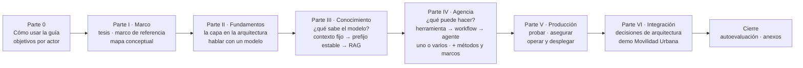

<a id="parte-0"></a>
# Parte 0 · Cómo usar esta guía

<a id="s0"></a>
## §0 Cómo usar esta guía

Esta guía suma una capa de IA a Movilidad Urbana, una aplicación .NET que ya existía, con diecisiete ejemplos que compilan cada uno desde su carpeta y una demo de seis pasos ([§14](#s14)). Es para quien programa en .NET sin haber trabajado con modelos; arquitectura, operación y seguridad tienen ruta propia ([§0.2](#s0-2)).

<a id="s0-0"></a>
### §0.0 Tabla de contenido

Ocho bloques, de lo general a lo particular, con las secciones y subsecciones debajo:



- [Parte 0 · Cómo usar esta guía](#parte-0)
  - [§0 Cómo usar esta guía](#s0): [§0.1](#s0-1) · [§0.2](#s0-2) · [§0.3](#s0-3) · [§0.4](#s0-4) · [§0.5](#s0-5)
- [Parte I · Marco](#parte-i)
  - [§1 «IA ya es parte del stack»: de la diapositiva a una solución](#s1)
  - [§2 Marco de referencia: escenarios, contextos y actores](#s2): [§2.1](#s2-1) · [§2.2](#s2-2) · [§2.3](#s2-3) · [§2.4](#s2-4) · [§2.5](#s2-5)
  - [§3 Marco conceptual y mapa: «estoy acá → qué aplico»](#s3): [§3.0](#s3-0) · [§3.1](#s3-1) · [§3.2](#s3-2) · [§3.3](#s3-3) · [§3.4](#s3-4) · [§3.5](#s3-5)
- [Parte II · Fundamentos](#parte-ii)
  - [§4 La capa de IA en la arquitectura de la aplicación](#s4): [§4.1](#s4-1) · [§4.2](#s4-2) · [§4.3](#s4-3) · [§4.4](#s4-4) · [§4.5](#s4-5) · [§4.6](#s4-6)
  - [§5 Hablar con un modelo desde .NET: Microsoft.Extensions.AI y proveedores](#s5): [§5.1](#s5-1) · [§5.2](#s5-2) · [§5.3](#s5-3) · [§5.4](#s5-4) · [§5.5](#s5-5) · [§5.6](#s5-6) · [§5.7](#s5-7) · [§5.8](#s5-8)
- [Parte III · Conocimiento: ¿qué sabe el modelo?](#parte-iii)
  - [§6 Estrategias de conocimiento: de contexto fijo a RAG agéntico](#s6): [§6.1](#s6-1) · [§6.2](#s6-2) · [§6.3](#s6-3) · [§6.4](#s6-4) · [§6.5](#s6-5) · [§6.6](#s6-6) · [§6.7](#s6-7)
  - [§7 RAG en .NET: embeddings, ingesta, almacén vectorial y recuperación](#s7): [§7.1](#s7-1) · [§7.2](#s7-2) · [§7.3](#s7-3) · [§7.4](#s7-4) · [§7.5](#s7-5) · [§7.6](#s7-6) · [§7.7](#s7-7) · [§7.8](#s7-8)
- [Parte IV · Agencia: ¿qué puede hacer el modelo?](#parte-iv)
  - [§8 Herramientas, agentes y orquestación](#s8): [§8.1](#s8-1) · [§8.2](#s8-2) · [§8.3](#s8-3) · [§8.4](#s8-4) · [§8.5](#s8-5) · [§8.6](#s8-6) · [§8.7](#s8-7) · [§8.8](#s8-8) · [§8.9](#s8-9) · [§8.10](#s8-10)
  - [§9 Métodos y marcos comparados](#s9): [§9.1](#s9-1) · [§9.2](#s9-2) · [§9.3](#s9-3) · [§9.4](#s9-4) · [§9.5](#s9-5) · [§9.6](#s9-6) · [§9.7](#s9-7) · [§9.8](#s9-8)
- [Parte V · Producción](#parte-v)
  - [§10 Probar y evaluar una capa de IA](#s10): [§10.1](#s10-1) · [§10.2](#s10-2) · [§10.3](#s10-3) · [§10.4](#s10-4) · [§10.5](#s10-5) · [§10.6](#s10-6) · [§10.7](#s10-7) · [§10.8](#s10-8)
  - [§11 Asegurar la capa de IA](#s11): [§11.1](#s11-1) · [§11.2](#s11-2) · [§11.3](#s11-3) · [§11.4](#s11-4) · [§11.5](#s11-5) · [§11.6](#s11-6) · [§11.7](#s11-7) · [§11.8](#s11-8)
  - [§12 Operar y desplegar](#s12): [§12.1](#s12-1) · [§12.2](#s12-2) · [§12.3](#s12-3) · [§12.4](#s12-4) · [§12.5](#s12-5) · [§12.6](#s12-6) · [§12.7](#s12-7) · [§12.8](#s12-8) · [§12.9](#s12-9) · [§12.10](#s12-10)
- [Parte VI · Integración](#parte-vi)
  - [§13 Decisiones de arquitectura de la capa de IA](#s13): [§13.1](#s13-1) · [§13.2](#s13-2) · [§13.3](#s13-3) · [§13.4](#s13-4) · [§13.5](#s13-5) · [§13.6](#s13-6) · [§13.7](#s13-7) · [§13.8](#s13-8) · [§13.9](#s13-9) · [§13.10](#s13-10) · [§13.11](#s13-11) · [§13.12](#s13-12) · [§13.13](#s13-13) · [§13.14](#s13-14) · [§13.15](#s13-15)
  - [§14 Movilidad Urbana con capa de IA: la demo](#s14): [§14.1](#s14-1) · [§14.2](#s14-2) · [§14.3](#s14-3) · [§14.4](#s14-4) · [§14.5](#s14-5) · [§14.6](#s14-6)
- [Cierre](#cierre)
  - [§15 Autoevaluación](#s15)
  - [Anexo A · Plantillas comentadas](#anexo-a)
  - [Anexo B · Listas de verificación por actor](#anexo-b)
  - [Anexo C · Glosario](#anexo-c)
  - [Anexo D · Referencias](#anexo-d)
  - [Anexo E · Laboratorio](#anexo-e)
  - [Anexo F · Versiones verificadas y señales de obsolescencia](#anexo-f)
  - [Anexo G · Lecturas para seguir](#anexo-g)

<a id="s0-1"></a>
### §0.1 Qué vas a poder hacer al terminar

Esta tabla es la única fuente de los objetivos de aprendizaje (OA): de ella salen las rutas de [§0.2](#s0-2) y la autoevaluación de [§15](#s15); ningún ejemplo ni pregunta guía existe sin el suyo. El prefijo dice el actor de [§2.3](#s2-3): D es ACT-DEV, A ACT-ARQ, O ACT-OPS, S ACT-SEC, 0 todos y SK quien viene de Semantic Kernel. Los números son carpetas de `Examples/`; PD-n, pasos de la demo ([§14.3](#s14-3)).

| OA | Al terminar, vas a poder… | Dónde se enseña | Ejemplo o paso |
|---|---|---|---|
| <a id="oa-0-1"></a>OA-0.1 | Dado un pedido sobre Movilidad Urbana, responder las cuatro preguntas de [§2.4](#s2-4) y decidir si hace falta un modelo | [§2.1](#s2-1)–[§2.4](#s2-4) | — |
| <a id="oa-0-2"></a>OA-0.2 | Ubicar cada pieza de la diapositiva de [§1](#s1) en Presentación, Application, Domain o Infrastructure, y decir por qué | [§3.1](#s3-1), [§4.3](#s4-3), [§4.5](#s4-5), [§14.2](#s14-2) | [§14.2](#s14-2) |
| <a id="oa-0-3"></a>OA-0.3 | Ubicar un caso en las dos escaleras y nombrar el escalón más bajo que lo resuelve | [§3.2](#s3-2)–[§3.5](#s3-5), [§14.3](#s14-3) | mapa de la demo, [§3.5](#s3-5) |
| <a id="oa-d1"></a>OA-D1 | Consumir un modelo con `IChatClient` y cambiar de adaptador tocando sólo la raíz de composición | [§5.1](#s5-1)–[§5.6](#s5-6) | 01, 02 |
| <a id="oa-d2"></a>OA-D2 | Obtener salida estructurada con `TryGetResult`, con campos anulables para lo que puede faltar, y pasarla por las reglas antes de guardar | [§5.3](#s5-3) | 03, 04, PD-3 |
| <a id="oa-d3"></a>OA-D3 | Elegir entre contexto fijo, contexto completo con prefijo estable y RAG para un corpus dado, con los criterios de salto | [§6](#s6) | 05 |
| <a id="oa-d4"></a>OA-D4 | Armar un RAG con citas validadas en código y medir el hit rate@k contra una línea base, con consultas no respondibles | [§7](#s7), [§10.7](#s10-7) | 06, 07, PD-2 |
| <a id="oa-d5"></a>OA-D5 | Exponer un caso de uso como herramienta, con pruebas negativas, la sesión puesta por el código y aprobación para toda escritura | [§8.2](#s8-2)–[§8.5](#s8-5) | 08, 09, PD-1, PD-5 |
| <a id="oa-d6"></a>OA-D6 | Elegir entre función, llamada con herramientas, workflow y agente para un caso, y justificarlo con el criterio de salto | [§8.1](#s8-1), [§8.6](#s8-6), [§8.7](#s8-7) | 10, 11, PD-6 |
| <a id="oa-d7"></a>OA-D7 | Decidir si una tarea necesita uno o varios agentes y medir el costo de la variante con más agentes con métricas deterministas | [§8.8](#s8-8) | 12 |
| <a id="oa-d8"></a>OA-D8 | Exponer lecturas por MCP en loopback y consumir herramientas MCP como `AIFunction` | [§8.9](#s8-9), [§11.5](#s11-5) | 13 |
| <a id="oa-d9"></a>OA-D9 | Escribir pruebas de cableado con un `IChatClient` falso, separadas de las corridas contra el modelo, y dejar registrada una corrida contra el modelo | [§10.1](#s10-1)–[§10.4](#s10-4) | 15 |
| <a id="oa-a1"></a>OA-A1 | Registrar una decisión de la capa como ADR con alternativas, consecuencias y cuándo deja de valer | [§13](#s13) | ADR-01…ADR-13 |
| <a id="oa-a2"></a>OA-A2 | Fijar para un escenario la métrica, los tipos de error, el umbral para seguir y qué ve la persona cuando la respuesta está mal | [§2.4](#s2-4)–[§2.5](#s2-5) | — |
| <a id="oa-a3"></a>OA-A3 | Elegir estrategia de conocimiento y almacén según tamaño, frecuencia de cambio y aislamiento | [§6](#s6), [§7](#s7) | 05, 07 |
| <a id="oa-a4"></a>OA-A4 | Elegir marco (M.E.AI, MAF, SK sólo como migración) y explicar por qué LangGraph y Microsoft Graph no son opciones .NET para esto | [§9](#s9) | — |
| <a id="oa-a5"></a>OA-A5 | Decidir, para una capacidad, si el contrato es un puerto propio de Application o `IChatClient`, y justificarlo con quién define el prompt y qué cambia al cambiar de proveedor | [§4.4](#s4-4) | demo: `IExtractorDeLocalidad` frente al chat, [§14.2](#s14-2) |
| <a id="oa-a6"></a>OA-A6 | Dado un cambio de la capa de IA sobre una aplicación existente de Movilidad Urbana (CTX-EXISTENTE), clasificar cada pieza tocada en agregado, modificado a causa de la IA o modificado por otro motivo, y decir qué regla del caso base conserva | [§2.2](#s2-2), [§14.1](#s14-1), [§14.4](#s14-4) | demo: tabla de delta, [§14.1](#s14-1) |
| <a id="oa-o1"></a>OA-O1 | Configurar `UseOpenTelemetry` y comprobar con un exportador en memoria qué contenido sale con `EnableSensitiveData` apagado y encendido | [§12.1](#s12-1)–[§12.2](#s12-2) | 17 |
| <a id="oa-o2"></a>OA-O2 | Configurar endpoint, modelo, `num_ctx` y timeouts por variable, sin ningún valor en el repositorio | [§5.5](#s5-5), [§5.7](#s5-7), [§11.6](#s11-6), [§12.5](#s12-5)–[§12.6](#s12-6), [§14.5](#s14-5) | [§14.5](#s14-5) |
| <a id="oa-o3"></a>OA-O3 | Leer un puntaje de LLM juez: decir si está calibrado y qué sesgo declara | [§10.5](#s10-5)–[§10.6](#s10-6) | 15 |
| <a id="oa-o4"></a>OA-O4 | Elegir entre modelo local, servidor compartido o nube por concurrencia, datos y costo | [§12.3](#s12-3)–[§12.4](#s12-4) | — |
| <a id="oa-s1"></a>OA-S1 | Para un escenario, nombrar los riesgos OWASP que aplican y su control mínimo en código | [§11.1](#s11-1) | 16, con su ficha de riesgo ([Anexo A](#anexo-a-11)) |
| <a id="oa-s2"></a>OA-S2 | Decidir qué herramientas piden aprobación, cuáles no se montan con contexto no confiable y qué datos llegan a qué modelo | [§8.5](#s8-5), [§11.2](#s11-2), [§11.3](#s11-3), [§11.4](#s11-4), [§11.7](#s11-7) | 09, 16 |
| <a id="oa-s3"></a>OA-S3 | Aplicar el filtro por permiso en la recuperación y no después | [§7.6](#s7-6) | — |
| <a id="oa-s4"></a>OA-S4 | Armar el pedido de aprobación con los argumentos que resolvió el código, no con la prosa del modelo | [§8.5](#s8-5), [§11.3](#s11-3) | 11, PD-6 |
| <a id="oa-sk1"></a>OA-SK1 | Pasar una herramienta `[KernelFunction]` a `[Description]` + `AIFunctionFactory` sin cambiar su esquema | [§9.7](#s9-7) | 14 |

Un objetivo sin ejemplo («—») se practica con las preguntas guía de su sección.

<a id="s0-2"></a>
### §0.2 Rutas de lectura

Cada ruta sale de [§0.1](#s0-1): tronco común, más dónde se enseñan los OA del actor, sus preguntas guía y lo que usan sus ejemplos; lo agregado a mano dice para qué. **Tronco común**: [§0](#s0)–[§3](#s3) y [§4.1](#s4-1)–[§4.3](#s4-3).

| Lector | Después del tronco común |
|---|---|
| ACT-DEV | la guía completa |
| ACT-ARQ | [§4.4](#s4-4), [§6](#s6), [§7](#s7), [§9](#s9), [§13](#s13); a mano, [§8.1](#s8-1) y [§8.6](#s8-6)–[§8.7](#s8-7), para leer ADR-07 y ADR-12, y [§14](#s14), que materializa las ADR |
| ACT-OPS | [§5.4](#s5-4)–[§5.7](#s5-7), [§10.1](#s10-1)–[§10.6](#s10-6), [§11.4](#s11-4), [§11.6](#s11-6) y las [preguntas guía de §11](#s11-preguntas), [§12](#s12), [§14.5](#s14-5) |
| ACT-SEC | [§7.6](#s7-6), [§8.2](#s8-2)–[§8.5](#s8-5), [§8.7](#s8-7), [§11](#s11); a mano, [§7.1](#s7-1)–[§7.5](#s7-5), para leer §7.6, y [§8.9](#s8-9), base de [§11.5](#s11-5) |
| Si venís de Semantic Kernel | [§9.7](#s9-7) y el ejemplo 14 |

Por escenario, se entra por [§3.3](#s3-3).

<a id="s0-3"></a>
### §0.3 Qué necesitás

**Se da por sabido**: C# y .NET 10, `Microsoft.Extensions.DependencyInjection`, ASP.NET Core (controllers o Minimal API), EF Core con SQLite y NUnit básicos, y las capas Domain, Application e Infrastructure. **Se explica**: puerto, adaptador y raíz de composición ([§4.3](#s4-3)); el vocabulario de IA ([§3.0](#s3-0), [§4.1](#s4-1)); el intervalo de Clopper-Pearson ([§10.4](#s10-4)); dónde vive la conversación del chat en Blazor, el circuito ([§13.13](#s13-13)).

**En la máquina**: Docker, bash, jq y GNU grep; .NET corre en contenedores del SDK y no se instala. Sin servidor de modelos, todo ejemplo corre con `--fake` ([§0.4](#s0-4)); contra el modelo, hace falta un Ollama alcanzable por `OLLAMA_ENDPOINT` y, para los embeddings, 02, 05 y el juez de 15, el de `OLLAMA_PROPIO_ENDPOINT`. Servidores y fases: [Anexo E.3](#anexo-e-3); versiones: [Anexo F](#anexo-f).

**El caso.** Movilidad Urbana tiene un ABM de localidades (`Localidad`: nombre, provincia, código postal, habitantes) y una encuesta de movilidad por pasos (`RespuestaDeEncuesta`: nombre, edad, localidad, medios de transporte, frecuencia, distancia, minutos, motivo) [REF-186]. Domain tiene las entidades, los valores válidos (`Catalogos`) y las reglas (`LocalidadRules`, `EncuestaRules`); Application, los casos de uso (`LocalidadService`, `EncuestaService`) y los requisitos que ve la persona (`*Policy`); Infrastructure, EF Core con SQLite. Cada visitante trabaja en su **sesión** (`X-Sesion-Id` en la API, la cookie `sesion-movilidad` en la web), que aísla los datos y no autentica ([§8.3](#s8-3)). Ejemplos y demo parten de una copia ([§14.1](#s14-1)).

<a id="s0-4"></a>
### §0.4 Cómo leer cada sección y la evidencia

Las secciones temáticas (§4–§8, §10–§12) tienen esta forma:

```text
## §N Título
> Estás en: escalón X de <escalera> · capa Z · OA-…
### §N.1 … §N.k                  cada una abre con su Definición: qué es, qué resuelve, qué no es
### §N.k En este laboratorio      opcional: qué se observó y con qué
### Práctica de §N
#### Aplicación por escenario     escenario × contexto de uso, sólo las celdas que cambian
#### Ejemplos                     carpeta, dificultad, comando, código real, qué mirar, salida rotulada
#### Preguntas guía               hasta cinco, cada una atada a un OA
#### Criterios de calidad y antipatrones
### §N.k Qué decisión toca        o «Decisión en curso»: la ADR de §13 y la plantilla del Anexo A
```

«Estás en» ubica la sección en las escaleras y capas de [§3](#s3), o dice «transversal». En la tabla de escenarios, «—» es «igual que en CTX-EXISTENTE × CTX-LOCAL × CTX-PROTO», la combinación de la guía ([§2.2](#s2-2)). Dificultad: básico, intermedio o avanzado. Tienen forma propia §1–§3 (propósito, desarrollo, diagrama, preguntas guía), §9 (cuadro y criterio de elección), §13 (ADR), §14 (paso a paso) y §15 (ítems). En §8, los grupos por escalón son párrafos en negrita.

**Evidencia.** Cada afirmación técnica lleva un `[REF-nn]` ([Anexo D](#anexo-d)), un archivo del repositorio o una corrida registrada; lo propio dice «criterio de la guía», y lo no comprobado, «no verificado». Versiones, sólo en el [Anexo F](#anexo-f). Cada bloque de código sale de `Examples/` o `Demos/`, con su ruta encima; `// …` marca un recorte de código, y «[…]», uno de una salida. Cada salida de modelo es copia textual de una corrida y lleva rótulo, completo la primera vez en la sección («Observado en el laboratorio: `qwen3.5:4b` (digest `2a654d98e6fb`), Ollama 0.32.0-rc0, sólo CPU, servidor compartido, 2026-10-27.»), corto después («Observado: `qwen3.5:4b`, servidor compartido, 2026-10-27.») y, sin modelo, «Salida con `--fake` (cliente guionado), sin modelo.»

- **Conducta y tasa.** Una salida mostrada es conducta: pasó una vez. Una tasa es k de M entradas distintas, con su intervalo.
- **Oráculo.** Regla mecánica, fijada antes de correr, que decide si una salida pasa, falla o se excluye.
- **IC95.** Intervalo de Clopper-Pearson del 95 % de k/M. Con M ≤ 12 la tasa es descriptiva ([§10.4](#s10-4)).
- **Cliente guionado y `--fake`.** Un `IChatClient` que responde un guion, sin servidor: muestra conducta del código, nunca del modelo.
- **Prueba de cableado.** Con el cliente guionado, comprueba que las piezas están compuestas como dice el diseño.
- **Prueba de humo.** Una entrada contra el modelo, de punta a punta: conducta, no tasa.
- **Estímulo del mismo autor.** Entrada escrita por quien escribió el código y el oráculo; puede favorecerlos.

<a id="s0-5"></a>
### §0.5 Dónde está el mapa de los ejemplos y la demo

Los ejemplos en orden de lectura, con su dificultad ([E.1](#anexo-e-1)), los pasos de la demo ([E.2](#anexo-e-2)) y cómo reproducirlos y registrar una corrida ([E.5](#anexo-e-5), [E.6](#anexo-e-6)) están en el [Anexo E](#anexo-e).

<!-- PENDIENTES:
Quitado por falta de respaldo o porque el cuerpo no lo sostiene:
- §0.3 (b) prometía, según la ficha, que §8.3 explica «el circuito de Blazor Server y por qué no ve la petición HTTP». Ninguna sección lo explica: §8.3 trata la sesión en 08 (consola) y la palabra «circuito» sólo aparece en §8.7, §8 Ejemplos, §13.13 y §14. Se remite a §13.13 con la forma honesta («dónde vive la conversación del chat en Blazor, el circuito»). Si se quiere la explicación completa, falta en §8.3 o §13.13.
- «R-LLM» en OA-D9 («registrar una corrida R-LLM»): es vocabulario interno; quedó «dejar registrada una corrida contra el modelo».
- «Imagen de entrada» en OA-0.2: la guía es autocontenida; quedó «la diapositiva de §1».
- Párrafo sobre por qué las ADR van al final y la seguridad no espera a la Parte V (carta §2.2): sacado por presupuesto; la plantilla de §0.4 ya muestra «Qué decisión toca» y cada sección lo aplica.
- «El laboratorio usó un Ollama compartido… cuyos tiempos no se comparan»: sacado por presupuesto; lo dicen §5.7, §14.5 y el Anexo E.3.
Fuentes dadas de alta: ninguna. REF usado: REF-186 (caso base, commit 8fb4c3a).
Desvíos de la ficha:
- §0.0: la ficha pide la tabla generada por tools/toc.sh, que no existe. Se generó con un script desde los encabezados con ancla de secciones/*.md (01–15, A, B, E) más las anclas previstas de la carta §13 para los anexos C, D, F y G, que todavía no tienen archivo. Formato compacto: partes y secciones con título; subsecciones numeradas sólo por número, para el presupuesto. Hay que regenerarla al integrar.
- §0.1: se sacó la columna «Actor»; el prefijo del ID la reemplaza y se explica en la apertura de §0.1. El texto de los 27 OA es el de la carta §5, con los dos cambios de arriba; el orden es el que usa §15.
- §0.2: ACT-OPS suma §14.5 respecto de la ficha, porque la regla de derivación lo exige (§14.5 está en la columna de OA-O2). Las demás rutas son las de la ficha. ACT-SEC conserva §8.9 «a mano» sin motivo escrito (la ficha tampoco lo da; lo usa §11.5).
- §0.3 (c): versión corta con remisión a Anexo E.3, que ya detalla herramientas, servidores y fases (escrito en paralelo).
- §0.5: además del Anexo E, remite a E.1, E.2, E.5 y E.6.
- Sin línea «Estás en»: §0 no es sección temática.
Respaldo de los datos de §0.3: Examples/README.md (bash, docker, jq, GNU grep; imagen del SDK 10.0; --fake; variables), Demos/MovilidadUrbana.Asistente/src/MovilidadUrbana.Asistente/Domain/Entities/Localidad.cs, RespuestaDeEncuesta.cs, Domain/Catalogos.cs, Application/Localidades/LocalidadPolicy.cs, Infrastructure/DependencyInjection.cs (UseSqlite), Sessions/SessionHeaderMiddleware.cs (X-Sesion-Id), Infrastructure/Sessions/SessionContext.cs (cookie sesion-movilidad, copiada de la web del caso base), tests/*.csproj (NUnit). «Diecisiete ejemplos» y «seis pasos»: carpetas 01–17 de Examples/ y PD-1…PD-6.
Procedencia de las salidas: ninguna salida de modelo. Los dos rótulos de §0.4 son la forma de la carta §16.6, con los valores registrados (modelo, digest, versión de Ollama, servidor y fecha) que ya usan las demás secciones.
Conteo y tope (comando de la carta §16.3): 1.788 palabras de prosa con la tabla de contenido; 1.487 sin ella (la tabla de contenido sola da 301; la tabla de OA, 634). Tope de la Parte 0: 1.400. Exceso: +6 % sin la tabla de contenido, +28 % con ella. Primer borrador: 2.417; se recortaron la columna Actor, el párrafo de las ADR, la línea del servidor compartido y se compactaron §0.3 y §0.4. Propuesta para la presidencia: tratar la tabla de contenido como material generado y no contarla (como las tablas del Anexo F). Aun así, la tabla única de OA ocupa casi la mitad del tope; el resto de §0 (definiciones de vocabulario que pide la carta §16.8, rótulos, forma de las secciones y el caso) no baja más sin perder algo que el plan exige.
Snippets por encima del tope: ninguno (sin snippets de código; dos bloques: el mermaid de la columna vertebral, copiado de la carta §2.2, y la plantilla de encabezados en text).
Mermaid: el de la columna vertebral, igual al de la carta §2.2; etiquetas entre comillas, sin paréntesis ni comillas internas, saltos con <br/>.
Compuertas corridas sin este comentario: remisiones al plan 0, familias de ID 0, IPs y rutas de máquina 0, voseo 0, alias 0, «nosotros» 0. AC-7/AC-8 sin correr (las corre la integración). Anclas: las 143 remisiones resuelven contra secciones/*.md salvo anexo-c, anexo-d y anexo-f, previstas en la carta §13 y sin archivo todavía (anexo-g ya está en G.md; verificación adversarial 2026-10-27).
Remisiones usadas: s1, s2-1 … s2-5, s2-3, s3, s3-0 … s3-5, s4-1 … s4-6, s5-1 … s5-8, s6, s6-1 … s6-7, s7, s7-1 … s7-8, s8-1 … s8-10, s9, s9-1 … s9-8, s10-1 … s10-8, s11, s11-1 … s11-8, s11-preguntas, s12, s12-1 … s12-10, s13, s13-1 … s13-15, s14, s14-1 … s14-6, s15, cierre, parte-i … parte-vi, anexo-a … anexo-g, anexo-a-11, anexo-e-1, anexo-e-2, anexo-e-3, anexo-e-5, anexo-e-6; internas: parte-0, s0, s0-0 … s0-5 y las 27 anclas oa-… que piden las demás secciones (oa-0-1 … oa-sk1).
Verificación adversarial (2026-10-27): (1) §0.3 decía sólo `OLLAMA_ENDPOINT`; Examples/README.md (Variables) y Anexo E.3 exigen además `OLLAMA_PROPIO_ENDPOINT` para 02, 05, embeddings y el juez de 15: agregado. (2) ACT-SEC: §7.1–§7.5 y §8.9 no se derivan de sus OA; se pasaron a «a mano» con motivo, como pide la regla de §0.2. (3) Plantilla de §0.4: §5.8 se titula «Decisión en curso» (carta §16.1); agregado. (4) Recorte de salida «[…]» (carta §16.6): agregado. Suman unas 35 palabras.
Cifras citadas: ninguna medida. «M ≤ 12» es la regla de la carta §10, no una medición.
-->
