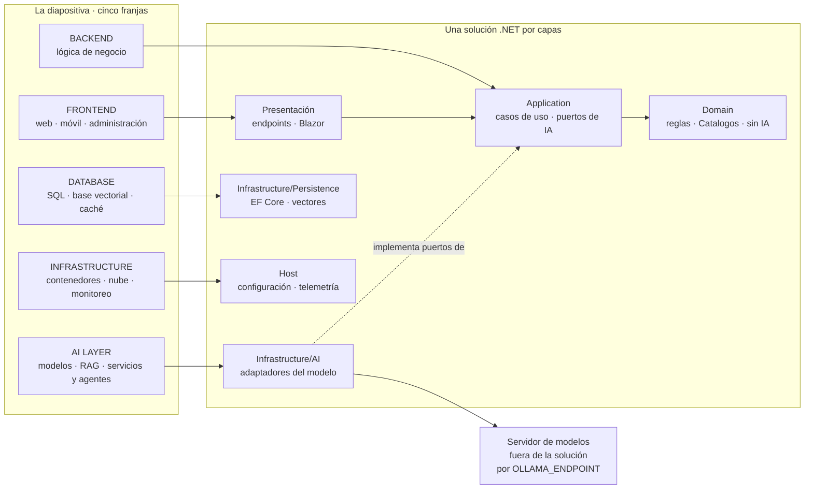
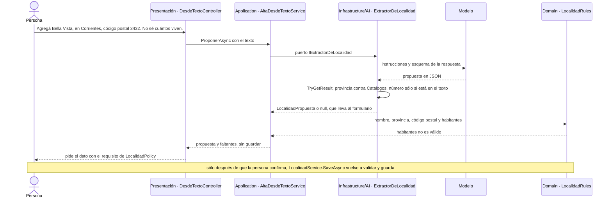

# Parte I · Marco

## §1 «IA ya es parte del stack»: de la diapositiva a una solución

Esta guía parte de una diapositiva de divulgación titulada «IA ya es parte del stack», cuyo autor no se verificó. La guía no la reproduce: la describe, la redibuja y la convierte en una solución .NET que se compila, se prueba y se opera. Un solo caso recorre todos los capítulos, Movilidad Urbana, y al final de esta sección se anticipan los cinco escenarios que fija [§2](#s2).

**Lo que dibuja la diapositiva.** Cinco franjas apiladas: *Frontend* (web, móvil, administración e integraciones de terceros); *Backend* (pasarela de API, autenticación, lógica de negocio, microservicios); *AI Layer*, resaltada (modelos generativos, un *pipeline* de RAG, servicios y agentes, y debajo recuperación, *embeddings* y base vectorial); *Database* (SQL, NoSQL, otra vez la base vectorial, caché), e *Infrastructure* (contenedores, nube, monitoreo). Dos flechas dobles tocan la franja de IA: una la une con la lógica de negocio y otra con la base vectorial.

**Lo que no dice.** La diapositiva afirma que la IA es una capa propia, entre el negocio y los datos. No dice qué contrato la separa del proveedor, dónde viven las herramientas respecto de los casos de uso, quién valida lo que el modelo devuelve ni cómo se opera. Tampoco dibuja dos piezas: el dominio, que es donde vive la autoridad, y el servidor de modelos, que no es parte de la solución y se alcanza por configuración (`OLLAMA_ENDPOINT`). El redibujo las agrega:

La tabla pieza por pieza vive en [§3.1](#s3-1); la versión con los componentes reales de la demo, en [§14.2](#s14-2).

**La tesis.** Una capa de IA no es «llamar a una API de IA»: es el lugar de la aplicación por donde el modelo *propone* (texto, datos tipados o llamadas a herramientas) y la aplicación *decide*. La llamada al modelo vive en Infrastructure detrás de un contrato, que el núcleo define y un adaptador implementa [REF-182], [REF-183]. Ese contrato es un puerto propio de Application cuando el prompt es un detalle de la funcionalidad (extraer una localidad) y puede ser el mismo `IChatClient` cuando la funcionalidad es la conversación ([§4.4](#s4-4)). La capa crece por dos escaleras casi independientes, qué sabe el modelo y qué puede hacer ([§3.2](#s3-2)); que sean dos es criterio de la guía. Se sube un escalón cuando el de abajo no alcanza: Anthropic aconseja aumentar la complejidad sólo cuando hace falta, «only increasing complexity when needed» [REF-115], y Microsoft, escribir una función si la tarea la admite, «If you can write a function to handle the task, do that instead of using an AI agent» [REF-117]. Cuando un ejemplo sube de más, la guía lo dice en su lugar.

**El principio rector.**

> **El modelo propone; la aplicación ejecuta, autoriza y valida.**

Es criterio de la guía, sostenido por los riesgos de inyección de instrucciones y de agencia excesiva que describe OWASP [REF-160], [REF-162]. Así se ve en el alta de una localidad desde texto libre, paso PD-3 de la demo ([§14.3](#s14-3)):

El caso de uso conoce el puerto, no el prompt ni el modelo (`Demos/MovilidadUrbana.Asistente/src/MovilidadUrbana.Asistente/Application/Localidades/AltaDesdeTextoService.cs`). Un JSON con la forma correcta sigue siendo una propuesta: deciden las reglas. *Ejecuta* y *valida* están en el código; de *autoriza*, la demo muestra aislamiento por sesión y aprobación humana, no autenticación ([§11](#s11), [§14.6](#s14-6)).

**El caso.** Movilidad Urbana es una aplicación .NET que ya existía: un registro de localidades (nombre, provincia del catálogo, código postal, habitantes) y una encuesta de movilidad por pasos (medios de transporte, frecuencia, distancia, minutos, motivo), con los datos aislados por sesión [REF-186]. La demo le suma una capa de IA sin reescribir sus casos de uso, y en ella aparecen tres de los cinco escenarios: consultas y ayuda sobre los datos propios (ESC-01), alta y encuesta desde texto libre (ESC-03), altas y bajas por chat con aprobación (ESC-04). La búsqueda semántica (ESC-02) y la exposición por MCP (ESC-05) quedan en los ejemplos. Qué cambió respecto del original: [§14.1](#s14-1).

**Preguntas guía.** Las dos que plantea la diapositiva viven en su casa: «¿Qué del diagrama se sostiene y qué es simplificación?» en [§3.1](#s3-1) ([OA-0.2](#oa-0-2)) y «¿En qué se distingue una capa de IA de "llamar a una API de IA"?» en [§4.4](#s4-4) ([OA-A5](#oa-a5)).

<!-- PENDIENTES:
Quitado por falta de respaldo citable o por decisión de la mesa:
- Autoría de la diapositiva: el dossier de la capa en el stack la da por no verificada; la marca que lleva no se nombra porque la ficha decide no reproducir la imagen ni su marca (decisión revertible de la mesa). Si la presidencia revierte, se agrega la atribución «diagrama tomado de una captura provista por el PO», sin más.
- Corregido por la verificación: la frase «La única flecha que entra a la franja de IA viene de la lógica de negocio» contradecía la lectura literal de N1 §1.1 y de REED-16 §1.1, que registran también una flecha doble entre la caja de recuperación y la Vector DB de Database. Se reemplazó por «Dos flechas dobles tocan la franja de IA: una la une con la lógica de negocio y otra con la base vectorial.»; para no pasar el tope se acortó la última oración de la tesis («Cuando un ejemplo sube de más…»). Conteo después del cambio: 700.
- Lista completa de componentes de la imagen (API Gateway, Kubernetes, Object Storage…): condensada en la descripción para respetar el tope; la tabla pieza por pieza es de §3.1.
- Corrección «LLM → RAG → Agents es una progresión, no un flujo»: no se escribe acá; es parte de la respuesta de la pregunta de §3.1 y de §3.2 (una casa por pieza). Acá sólo queda la mención de las dos escaleras.
- Pasos que suben más de lo necesario (PD-2, PD-6 y 11, variante de dos agentes de 12): la tesis los anuncia en una oración; el detalle va en cada sección que los usa.
- Mensaje del diagrama de secuencia del plan («CP 34, unos 90 mil habitantes» y «Result con errores»): reemplazado por el estímulo real de PD-3 del README de la demo y por lo que devuelve el código (`PropuestaDeAlta` con `Faltantes`, sin guardar). El diagrama no muestra una salida del modelo: muestra el flujo del código, por eso no lleva rótulo de observación. Que en el humo de PD-3 el modelo dejó `habitantes` en null está rotulado en §5 (Ejemplos, «En la demo»).
Fuentes dadas de alta: ninguna.
Desvíos de la ficha:
- Sin subsecciones numeradas (la ficha y las anclas de la carta §13 no prevén s1-k): párrafos con entrada en negrita, en el orden propósito → desarrollo → diagrama → preguntas guía.
- Sin línea «Estás en»: §1 no es sección temática.
- Diagrama de capas: simplificado del de §B.1 del plan (sin Third-Party Integrations ni la caja de recuperación; sin paréntesis, comillas ni asterisco en las etiquetas; el cilindro pasó a nodo rectangular).
- Diagrama de secuencia: participantes con «·» en lugar de paréntesis; sin punto y coma ni dos puntos dentro de los mensajes; nombres tomados de AltaDesdeTextoService.cs, IExtractorDeLocalidad.cs, ExtractorDeLocalidad.cs, GarantiaNumerica.cs, LocalidadRules.cs y DesdeTextoController.cs de la demo.
Procedencia de las salidas: ninguna salida de modelo en la sección.
Respaldo de los datos del caso: entidades de la demo (Domain/Entities/RespuestaDeEncuesta.cs: Medios, Frecuencia, Distancia, Minutos, Motivo; LocalidadRules.cs) y README de la demo (CTX-EXISTENTE, «sin reescribir sus casos de uso», recorrido PD-1…PD-6), con procedencia en el commit 8fb4c3a del caso base [REF-186].
Conteo y tope: 700 palabras de prosa con el comando de la carta §16.3; tope 700. Primer borrador 764: se condensaron la descripción de las franjas, la apertura, el caso y la remisión de preguntas guía. Sin margen: cualquier agregado tiene que sacar lo mismo.
Anticipo de escenarios: ESC-01, ESC-03 y ESC-04 en la demo; ESC-02 y ESC-05 en los ejemplos (carta §4.1, cobertura). Los nombres de los escenarios no se repiten acá: su casa es §2.
Compuertas corridas sin el comentario: remisiones al plan 0, familias de ID 0, rutas e IPs 0, voseo 0, alias 0. AC-7/AC-8 sin correr (las corre la integración). Mermaid validado a mano: etiquetas entre comillas, sin paréntesis ni comillas internas, sin punto y coma en el diagrama de secuencia.
Snippets por encima del tope: ninguno (sin snippets; se cita una ruta).
Remisiones usadas: s2, s3-1, s3-2, s4-4, s11, s14-1, s14-2, s14-3, s14-6, oa-0-2, oa-a5.
Cifras citadas: ninguna (el 3432 y los 12 requisitos no se citan; 3432 aparece sólo como texto del estímulo).
-->
