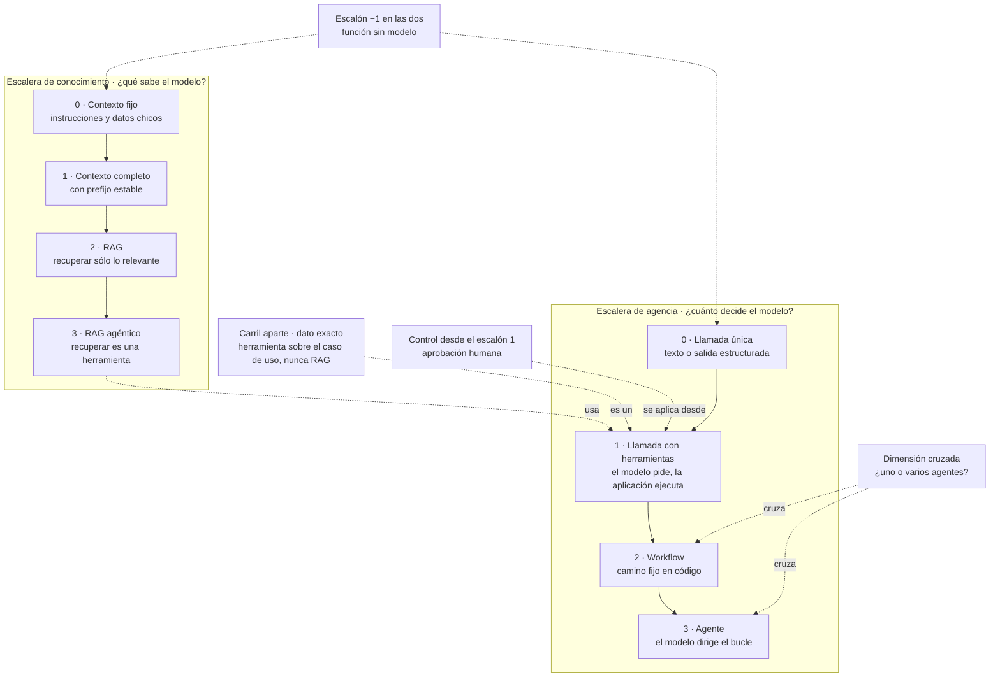
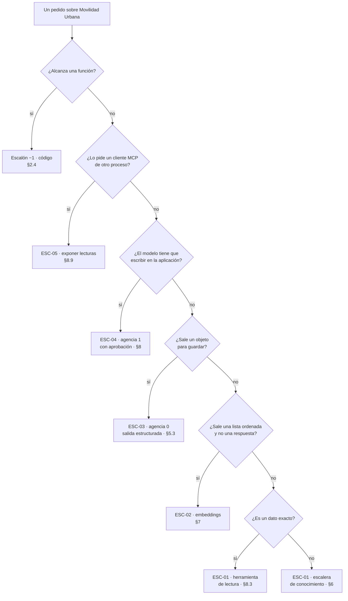
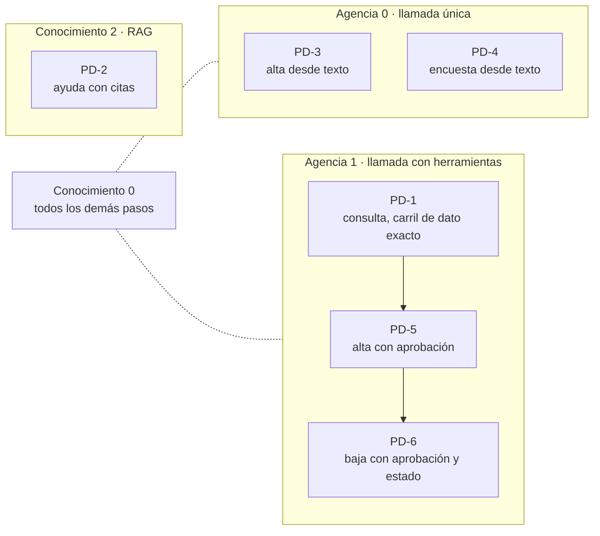

## §3 Marco conceptual y mapa: «estoy acá → qué aplico»

> Estás en: transversal · todas las capas · [OA-0.2](#oa-0-2), [OA-0.3](#oa-0-3)

Cada sección temática abre ubicándose en una escalera y una capa. Acá se define ese mapa: términos, capas, escaleras y tablas de entrada por escenario ([§2.1](#s2-1)), artefacto y paso de la demo.

### §3.0 Doce términos en una línea

| Término | En una línea | Se desarrolla en |
|---|---|---|
| modelo | Predice el siguiente token; no conoce los datos propios salvo que viajen en el contexto [REF-11] | [§4.1](#s4-1) |
| prompt | El texto al que responde el modelo, en mensajes con rol [REF-13] | [§4.1](#s4-1) |
| contexto | Todo lo que el modelo recibe en **una** llamada; lo que no se reenvía, no lo ve [REF-12], [REF-45] | [§6](#s6) |
| herramienta | Función de la aplicación que el modelo puede pedir invocar [REF-121]; acá envuelve un caso de uso | [§8.4](#s8-4) |
| llamada con herramientas | El modelo pide, la aplicación ejecuta y le devuelve el resultado [REF-121] | [§8.2](#s8-2) |
| salida estructurada | Respuesta con un tipo que fija la aplicación [REF-47]; sigue siendo una propuesta | [§5.3](#s5-3) |
| embedding | Vector que mide parecido de significado [REF-87] | [§7.1](#s7-1) |
| RAG | Recuperar en cada consulta lo relevante y pasarlo con su fuente [REF-85], [REF-86] | [§7](#s7) |
| RAG agéntico | RAG donde recuperar es una herramienta que el modelo decide llamar | [§6.6](#s6-6) |
| contexto completo con prefijo estable | El corpus entero en cada llamada, con un prefijo idéntico que el servidor reutiliza | [§6.3](#s6-3) |
| workflow | Camino de pasos fijado en el código [REF-115] | [§8.6](#s8-6) |
| agente | El modelo dirige su propio proceso y sus herramientas [REF-115] | [§8.7](#s8-7) |

### §3.1 Las capas

Criterio de la guía: la diapositiva de [§1](#s1) es didáctica, no normativa:

| Capa de la diapositiva | En .NET | Capa de la solución | Ver |
|---|---|---|---|
| FRONTEND | páginas Blazor, controllers REST | Presentación | [§4.3](#s4-3) |
| Third-Party Integrations | servidor MCP, adaptador de entrada | Presentación | [§8.9](#s8-9) |
| BACKEND · Business Logic | `LocalidadService`, `EncuestaService` y los puertos `IExtractorDeLocalidad`, `IExtractorDeEncuesta`, `IAyuda`; el chat usa `IChatClient` | Application | [§4.4](#s4-4) |
| no dibujada | `LocalidadRules`, `EncuestaRules`, `Catalogos`, sin IA | Domain | [§4.3](#s4-3) |
| AI LAYER · LLM | `IChatClient` y el adaptador del proveedor | Infrastructure/AI | [§5](#s5) |
| AI LAYER · RAG · Embeddings | `IEmbeddingGenerator`, `VectorStoreCollection`, ingesta | Infrastructure/AI | [§7](#s7) |
| AI LAYER · Services & Agents | herramientas sobre casos de uso, agentes, workflows | Infrastructure/AI | [§8](#s8) |
| DATABASE · Vector DB | el almacén de vectores; en la guía, en memoria | Persistence o servicio externo | [§7.3](#s7-3) |
| DATABASE · SQL · Cache | EF Core con SQLite; caché de respuestas en el *pipeline* del cliente (17) | Infrastructure | [§6.4](#s6-4) |
| INFRASTRUCTURE | contenedores, configuración, telemetría | Host | [§12](#s12) |
| no dibujado | servidor de modelos | fuera, por `OLLAMA_ENDPOINT` | [§12.4](#s12-4) |

La base vectorial figura dos veces: el uso es de la capa de IA; el almacenamiento, de la de datos. Invariante: ninguna flecha va del modelo al repositorio ni al dominio; lo que sale del modelo pasa por un adaptador hasta un caso de uso, salvo dos excepciones rotuladas en [§14.2](#s14-2). Su pregunta guía: [Preguntas guía de §3](#s3-preguntas).

### §3.2 Las dos escaleras

Criterio de la guía: lo que el modelo **sabe** y lo que **puede hacer** son preguntas casi independientes, que se cruzan sólo en el RAG agéntico. Se sube un escalón cuando el de abajo no alcanza [REF-115], [REF-117].

| Escalón | En Movilidad Urbana |
|---|---|
| −1 | validar el código postal; la encuesta de tres pasos (10) |
| Conocimiento 0 | los requisitos de las `*Policy` en las instrucciones (01) |
| Conocimiento 1 | un padrón de localidades entero, con el mismo prefijo (05) |
| Conocimiento 2 | la ayuda recupera los requisitos más parecidos y cita (07, PD-2) |
| Conocimiento 3 | el modelo decide cuándo buscar; sin ejemplo |
| Agencia 0 | una frase → propuesta de localidad (03, PD-3) |
| Agencia 1 | «¿Cuántas localidades tengo en Corrientes?» (08, PD-1); «Borrá Resistencia» con aprobación (11, PD-6) |
| Agencia 2 | redactor y verificador en camino fijo (12) |
| Agencia 3 | tarea abierta; ningún pedido del caso la necesita ([§8.7](#s8-7)) |

En agencia, el escalón mide cuánto decide el modelo, no qué artefacto se usa. No son escalones la cantidad de agentes, la aprobación ni el estado de la conversación. Versión con API: [§6.1](#s6-1) y [§8.1](#s8-1).

### §3.3 Tabla por escenario y cobertura

Escalones en la combinación de la guía, CTX-EXISTENTE × CTX-LOCAL × CTX-PROTO ([§2.2](#s2-2)), y qué cambia con otro contexto de uso:

| Escenario | Conocimiento | Agencia | Cambia | Secciones |
|---|---|---|---|---|
| ESC-01 | 0; el dato exacto, carril aparte | 0, o 1 con lecturas | CTX-SENS: agregados sin `Nombre` ni `Edad` | [§6](#s6), [§7](#s7), [§8.3](#s8-3) |
| ESC-02 | recuperación sin generación | ninguno | CTX-SENS: filtro por permiso al recuperar | [§7](#s7) |
| ESC-03 | 0 | 0 | CTX-NUEVA: reglas contra el catálogo desde el inicio | [§5.3](#s5-3) |
| ESC-04 | 0 | 1 con aprobación; con estado entre peticiones | CTX-PROD: autorización además de aprobación | [§8](#s8), [§11.3](#s11-3) |
| ESC-05 | del cliente | del cliente | CTX-PROD: control de acceso fuera de loopback | [§8.9](#s8-9), [§11.5](#s11-5) |

La cobertura es del conjunto; «cableado» indica que el paso cierra con una prueba de cableado ([§0.4](#s0-4)):

| Escenario | Guía | Ejemplos | Demo |
|---|---|---|---|
| ESC-01 | [§5](#s5), [§6](#s6), [§7](#s7) | 01, 05, 07 | PD-1 (cableado), PD-2 |
| ESC-02 | [§7](#s7) | 06 | ninguno |
| ESC-03 | [§5.3](#s5-3) | 03, 04 | PD-3, PD-4 (cableado) |
| ESC-04 | [§8](#s8) | 08, 09, 11, 12 | PD-5 (cableado), PD-6 |
| ESC-05 | [§8.9](#s8-9), [§11.5](#s11-5) | 13 | ninguno |

### §3.4 Tabla por artefacto

| Si tenés… | Aplicá | Dónde | Ejemplo |
|---|---|---|---|
| un `IChatClient` y querés texto | llamada única detrás del contrato | [§5.1](#s5-1) | 01, 02 |
| texto libre que termina guardado | salida estructurada, campos anulables, reglas antes de guardar | [§5.3](#s5-3) | 03, 04 |
| un corpus propio | la escalera de conocimiento desde el 0 | [§6](#s6), [§7](#s7) | 05, 06, 07 |
| un pedido de conteo | herramienta sobre la lectura | [§6.1](#s6-1) | 08 |
| un caso de uso que escribe | herramienta con aprobación | [§8.4](#s8-4), [§8.5](#s8-5) | 09 |
| una aprobación entre dos peticiones | estado guardado en el servidor | [§8.7](#s8-7) | 11 |
| pasos fijos | una función; workflow si un verificador va en el medio | [§8.6](#s8-6) | 10, 12 |
| lecturas para otro proceso | MCP en loopback, cliente con lista permitida | [§8.9](#s8-9) | 13 |
| herramientas de Semantic Kernel | `[Description]`, mismo esquema de parámetros | [§9.7](#s9-7) | 14 |
| texto ajeno en el contexto | política de origen: escrituras sin montar o sólo aprobables | [§11.3](#s11-3) | 16 |

Orden y dificultad de los ejemplos: [Anexo E](#anexo-e).

### §3.5 Mapa de la demo

PD-2 sube de más: sus requisitos caben en el escalón 0. PD-6 conserva estado sin subir. El escalón 2 lo muestra 12; el 3 queda conceptual. Recorrido: [§14.3](#s14-3).

### Preguntas guía de §3

**¿Qué del diagrama se sostiene y qué es simplificación?** ([OA-0.2](#oa-0-2))

Ubicá cada caja en la tabla de [§3.1](#s3-1) y decí por qué. Se sostiene que la IA tiene un lugar propio junto a la lógica de negocio, y que la base vectorial tiene dos. Es simplificación leer «LLM → RAG → Agents» como flujo obligatorio: un agente puede no usar RAG y un RAG no requiere agente [REF-115], [REF-116]. Faltan el dominio y el servidor de modelos. En CTX-NUBE la ausencia del servidor pesa más, porque por él salen los datos; en CTX-NUEVA las capas podrían ser proyectos ([§13.12](#s13-12)). Con el modelo en proceso, el servidor entraría a la solución.

**¿Cuál es la estrategia más simple que resuelve mi problema?** ([OA-0.3](#oa-0-3))

El escalón más bajo de cada escalera que alcanza: sumar complejidad sólo cuando hace falta [REF-115]. Validar un código postal es una función; «¿Cuántos dígitos lleva el código postal?» se resuelve con los requisitos en las instrucciones (escalón 0). En CTX-NUBE, un corpus mayor consultado seguido se abarata con el prefijo estable ([§6.3](#s6-3)); en CTX-SENS, si cada sesión ve datos distintos no hay prefijo común y corresponde RAG con filtro ([§6.6](#s6-6)). Nombrá el escalón y su criterio de salto: se sube si el corpus deja de entrar en la ventana efectiva o cambia más rápido que la caché.

**Mi caso necesita saber y actuar: ¿por qué escalera empiezo?** ([OA-0.3](#oa-0-3))

Por las dos, por separado. Decidí primero si lo que hay que saber es un dato: «¿Cuántas localidades tengo en Corrientes?» no es conocimiento, es una herramienta, escalón 1 de agencia. «Agregá Goya, Corrientes…» (PD-5) queda en conocimiento 0, porque las reglas validan en código, y en agencia 1 con aprobación. En CTX-PROD lo que actúa suma autorización ([§11.3](#s11-3)); en CTX-SENS la herramienta devuelve lo mínimo ([§11.4](#s11-4)). Se cruzan sólo si el modelo tiene que decidir qué buscar: el RAG agéntico, que usa el escalón 1 de agencia.

<!-- PENDIENTES:
Quitado por falta de respaldo o por decisión de forma:
- Columna «Fuente» de la tabla de capas del plan: llevaba IDs de dossier, que no llegan a la guía. Se reemplazó por «Ver», con la sección que desarrolla cada pieza y cita su fuente.
- «La IA sólo se comunica con el Backend, nunca con el Frontend» (lectura del dossier de la capa en el stack, criterio propio de ese dossier): no entra, porque la demo tiene una excepción declarada (la página de chat consume el IChatClient del asistente). La respuesta de OA-0.2 dice sólo «un lugar propio junto a la lógica de negocio».
- Paquetes y nombres de SDK en la tabla de capas (OllamaSharp, SDK de OpenAI contra /v1, InMemoryVectorStore, UseOpenTelemetry/UseLogging, IDistributedCache): fuera por el tope; la tabla nombra la pieza y remite a la sección que la muestra. Versiones: ninguna (Anexo F, por remisión de las secciones temáticas).
- Cifras: ninguna. Se evitó «doce requisitos» y el tamaño en tokens del corpus (el tamaño no se midió en la construcción; §6.2 lo dice).
- Que el escalón 0 de conocimiento valga para PD-1, PD-3, PD-4, PD-5 y PD-6 («todos los demás pasos»): criterio de la guía, leído del código (instrucciones fijas en SesionDeChat.cs, ExtractorDeLocalidad.cs y ExtractorDeEncuesta.cs; los datos llegan por herramientas). PD-2 también es agencia 0 (una llamada); el diagrama no lo dibuja para no cruzar subgrafos.
Fuentes dadas de alta: ninguna.
Desvíos de la ficha:
- Línea «Estás en»: §3 no es temática; se usó la forma transversal de §2 («transversal · todas las capas · OA-0.2, OA-0.3»). Si la presidencia prefiere que §1–§3 no la lleven, se borra sin otro cambio.
- Preguntas guía: las tres al final, en «Preguntas guía de §3» (ancla s3-preguntas, nivel 3 sin número, como s2-preguntas). La de OA-0.2 tiene su casa declarada en §3.1 y §1 enlaza a #s3-1: §3.1 cierra con una remisión a s3-preguntas. Alternativa: que §1 enlace directo a #s3-preguntas (cambio de una línea en 01.md, a cargo de la integración).
- §3.2: diagrama de las dos escaleras sin nombres de API (la ficha pide la versión legible; quedan fuera UseFunctionInvocation y ApprovalRequiredAIFunction). Se agregó la flecha del escalón −1 a los dos escalones 0 para que el nodo no quede suelto. La versión con API vive en §6.1 y §8.1.
- §3.3: «mapa por escenario (flowchart de decisión)» de la ficha. Es por escenario y no por estrategia de conocimiento, para no duplicar el flowchart de §6.1. Orden de las preguntas: criterio de la guía (primero la función, después ESC-05, ESC-04, ESC-03, ESC-02 y ESC-01).
- Tabla de cobertura: copiada de la ficha del plan (respuesta de la presidencia del ciclo 2). Observación: el ejemplo 08 es de sólo lectura y §8 lo trata como «ESC-01 con herramientas»; la ficha lo pone en ESC-04. Se respetó la ficha; si la presidencia lo mueve, cambia una celda.
- Tabla por escenario: en la columna «Cambia» va un solo contexto de uso por fila, tomado de la «Aplicación por escenario» de §8 (ESC-01, ESC-04, ESC-05), de §2.2 (CTX-NUEVA en ESC-03) y de OA-S3/§7.6 (ESC-02). «ninguno» y «del cliente» en lugar de «—», porque «—» significa otra cosa en las tablas de Aplicación por escenario (carta §16.12).
- Tercera pregunta guía («Mi caso necesita saber y actuar…»): el ejemplo PD-5 está tomado de la tabla de §14.3 (pedido «Agregá Goya, Corrientes, CP 34, con 90000 habitantes.»), recortado con «…»; no se citan sus números.
Procedencia de las salidas: ninguna salida de modelo en la sección (ficha: «ningún ejemplo propio»).
Respaldo de lo que no lleva REF:
- Servidor MCP como adaptador de entrada: §8.9 de la guía. En el ejemplo 13 el código vive en Examples/13-Servidor-Y-Cliente-MCP/Infrastructure/Mcp/ (ServidorMcp.cs, LecturasMcp.cs); la tabla de capas lo pone en Presentación por su función (criterio de la guía, como en el plan). Si la relectura lo objeta, la celda puede decir «adaptador de entrada; en 13, carpeta Infrastructure/Mcp».
- Almacén de vectores en memoria: InMemoryVectorStore en Demos/.../Infrastructure/AI/Ayuda/AyudaConRecuperacion.cs y en Examples/07-RAG-Con-Citas/Application/IndiceDeAyuda.cs.
- Caché de respuestas en el pipeline: Examples/17-Observabilidad-Y-Pipeline/Infrastructure/PipelineObservado.cs (UseDistributedCache). La demo no la usa.
- EF Core con SQLite: Demos/.../Infrastructure/DependencyInjection.cs (UseSqlite).
- Ejemplos por escalón: 01 (AsistenteDeAyuda.cs, requisitos de las *Policy en las instrucciones), 05 (padrón escrito para el ejemplo, según su README y §6), 07 (recuperación top-3 con cita), 03, 08, 10, 11, 12 según §5, §8 y la tabla de §14.3.
- Orden de las preguntas y la frase «la salida de un objeto para guardar» como rasgo de ESC-03: tomados de la tabla de escenarios de §2.1.
Conteo y tope: 1.300 palabras de prosa con el comando de la carta §16.3; tope de §3: 1.300. Primer borrador 1.629; se recortó por el orden de la carta (aclaraciones repetidas, columnas de detalle, transiciones). Sin margen.
Respuestas de las preguntas guía: 88 a 98 palabras cada una (rango 60–130).
Snippets: ninguno (la ficha no prevé ejemplos propios).
Compuertas corridas sin el comentario: remisiones al plan 0; familias de ID 0; rutas e IPs 0; voseo 0; alias 0 salvo «LLM» dentro de las etiquetas literales de la diapositiva («AI LAYER · LLM», «LLM → RAG → Agents»), que el glosario permite como cita literal. AC-7/AC-8 sin correr (las corre la integración). Mermaid validado a mano (tres bloques): etiquetas entre comillas dobles, sin paréntesis ni comillas internas, saltos con  , aristas con texto en la forma que usa §6.1, aristas a subgrafos en §3.5 (sintaxis de flowchart admitida por GitHub).
Remisiones usadas: anexo-e, oa-0-2, oa-0-3, s0-4, s1, s2-1, s2-2, s4-1, s4-3, s4-4, s5, s5-1, s5-3, s6, s6-1, s6-3, s6-4, s6-6, s7, s7-1, s7-3, s8, s8-1, s8-2, s8-3, s8-4, s8-5, s8-6, s8-7, s8-9, s9-7, s11-3, s11-4, s11-5, s12, s12-4, s13-12, s14-2, s14-3; internas: s3-1, s3-preguntas.
Referencias citadas: REF-11, REF-12, REF-13, REF-45, REF-47, REF-85, REF-86, REF-87, REF-115, REF-116, REF-117, REF-121.
Cifras citadas: ninguna.
Verificación adversarial (2026-10-27): REF-11/12/13/45/47/85/86/87/115/116/117/121 cotejadas con su fila del registro y el dossier (N1 F02–F17, N4 F01/F21; «un agente puede no usar RAG» = N1 §1.1); tipos y archivos de la tabla de capas confirmados en Demos/ y Examples/ (controllers, IExtractorDe*, IAyuda, *Rules, Catalogos, InMemoryVectorStore, UseDistributedCache en 17, UseSqlite, OLLAMA_ENDPOINT); pasos PD contra la tabla de §14.3; README de 01, 05, 08–14 y 16; anclas internas y externas presentes (oa-0-2, oa-0-3, s0-4 en 00.md); los tres mermaid renderizados con mermaid-cli sin error; barrido R-PRIV/RD-PO 0. Cambios: [REF-121] y [REF-47] se movieron antes de la parte que es criterio de la guía («acá envuelve un caso de uso», «sigue siendo una propuesta»); §3.1 abre con «Criterio de la guía:» (N1 §1.1 lo marca como criterio propio); §3.4 fila 14: «sin cambiar el esquema» → «mismo esquema de parámetros» (README de 14, punto 3: el esquema de la función entera difiere por la clave `condition` de SK); respuesta de OA-0.2: «esa caja ausente» → «la ausencia del servidor» (había dos cajas ausentes). Compensación: «una sola vez» y «cae ahí» fuera; conteo final 1.300.
-->
