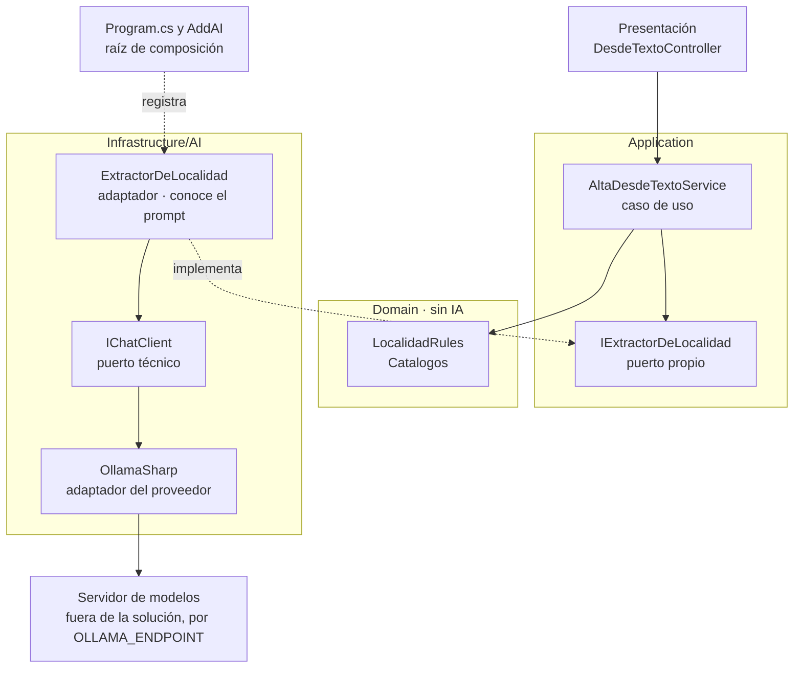

<a id="parte-ii"></a>
# Parte II · Fundamentos

<a id="s4"></a>
## §4 La capa de IA en la arquitectura de la aplicación

> Estás en: transversal · capa Application · [OA-0.2](#oa-0-2), [OA-A5](#oa-a5)

La imagen de entrada dibuja la «AI Layer» como una franja entre la lógica de negocio y los datos ([§3.1](#s3-1)). En .NET esa franja es un contrato de Application y un adaptador de Infrastructure que habla con el servidor de modelos. Esta sección fija dónde vive cada pieza en ESC-01, ESC-03 y ESC-04 ([§2.1](#s2-1)).

<a id="s4-1"></a>
### §4.1 Vocabulario

**Definición.** Diez términos que el resto de la guía usa sin redefinir; el glosario completo es el [Anexo C](#anexo-c).

| Término | Qué es y qué no es | Fuente |
|---|---|---|
| modelo (LLM) | Predice el siguiente token a partir de los anteriores. No conoce los datos de la aplicación salvo que viajen en el contexto | [REF-11] |
| token | Unidad en que se parte el texto; mide límite y costo. No equivale a una palabra | [REF-12] |
| ventana (ventana de contexto) | Máximo de tokens entre entrada y salida: declarada, efectiva o configurada ([§6.5](#s6-5)). No es memoria | [REF-12], [REF-45] |
| prompt e instrucciones (system prompt) | Texto al que responde el modelo, en mensajes con rol; las instrucciones dicen cómo comportarse (`ChatOptions.Instructions`). No son un control ni una regla de negocio | [REF-13], [REF-46], [REF-160] |
| temperatura | Alta, salida más variable; baja, más enfocada. Que 0 repita la salida no está verificado con Ollama y Qwen | [REF-14] |
| salida estructurada | Respuesta con un tipo que fija la aplicación ([§5.3](#s5-3)). No es una validación | [REF-47] |
| alucinación | Texto sin sustento en la entrada ni en las fuentes; llega con la forma de una respuesta correcta | [REF-15], [REF-16] |
| grounding (anclaje) | Apoyar la respuesta en fuentes provistas y poder citarlas. Reduce la alucinación; no la elimina | [REF-16], [REF-86] |
| embedding | Vector que permite medir parecido de significado ([§7.1](#s7-1)). No es búsqueda exacta | [REF-87] |
| modelo de razonamiento | Produce tokens de razonamiento antes de responder (`ChatOptions.Reasoning`; `think` en Ollama), que gastan tiempo y salida ([§5.7](#s5-7)) | [REF-46], [REF-52] |

<a id="s4-2"></a>
### §4.2 Por qué ahora: de la arquitectura al componente con contrato

**Definición.** Este tramo fecha cuándo el modelo empezó a ofrecer contratos que una aplicación puede programar. Resuelve por qué la guía parte de `IChatClient`. No es una carrera de modelos: tamaños y puntajes quedan fuera.

| Fecha | Hito | Qué cambió para la aplicación | Fuente |
|---|---|---|---|
| 2020-05-22 | RAG | datos propios con procedencia, sin reentrenar | [REF-85] |
| 2023-06-13 | Llamada con herramientas (*function calling*) de OpenAI | el modelo propone, la aplicación ejecuta | [REF-23] |
| 2023-07-08 | Ollama v0.0.1 | servidor local con API HTTP | [REF-34] |
| 2024-07-25 | Ollama con herramientas | herramientas en CTX-LOCAL | [REF-35] |
| 2024-08-06 | Salida estructurada con JSON Schema de OpenAI | respuestas tipables en C# | [REF-24] |
| 2024-09-19 | Qwen2.5, pesos abiertos | la familia del Ollama propio | [REF-31] |
| 2024-10-08 | `Microsoft.Extensions.AI` en preview | un contrato común a los proveedores | [REF-40] |
| 2024-11-05 y 2024-11-25 | MCP: especificación y anuncio | publicar herramientas para clientes ajenos | [REF-38], [REF-37] |
| 2024-12-06 | Ollama con salida estructurada | ESC-03 en local | [REF-36] |
| 2025-04-02 | SDK de C# para MCP | MCP desde .NET | [REF-41] |
| 2025-05-21 | GA de `Microsoft.Extensions.AI` y de VectorData | abstracciones estables | [REF-42] |
| 2026-04-03 | Microsoft Agent Framework 1.0 | agentes y workflows estables | [REF-43] |

De contexto: Transformer [REF-17], GPT-3 [REF-18], InstructGPT [REF-19], ReAct [REF-21], ChatGPT [REF-20], Toolformer [REF-22], las ventanas largas [REF-25], [REF-26], [REF-27], [REF-28], Llama 2 [REF-29], Semantic Kernel 1.0.1 [REF-39] y Qwen3 [REF-33]. Versiones: [Anexo F](#anexo-f).

Criterio de la guía: el diseño lo cambiaron las herramientas y los contratos de formato, no el tamaño: «Making language models bigger does not inherently make them better at following a user's intent», agrandar un modelo no lo vuelve mejor para seguir la intención de quien lo usa [REF-19]. Desde que el modelo devuelve una llamada que la aplicación decide si ejecutar [REF-23], es un componente con contrato.

El modelo de chat usado en el laboratorio, `qwen3.5:4b` (digest `2a654d98e6fb`), no tiene fila: no se registró una fuente primaria de su publicación; el Ollama propio sirvió `qwen2.5:0.5b` (digest `a8b0c5157701`).

<a id="s4-3"></a>
### §4.3 Dónde vive la capa

**Definición.** Un *puerto* es la interfaz con que el núcleo dice lo que necesita: «A port identifies a purposeful conversation», una conversación con propósito [REF-183]. Un *adaptador* lo implementa en Infrastructure contra un servicio externo, aquí el servidor de modelos, y la *raíz de composición* (`Program.cs`) los conecta por inyección de dependencias [REF-182]. La persistencia del caso base ya lo usa, con `ILocalidadRepository` [REF-186].

Domain no conoce el modelo; Application define el puerto y el caso de uso; Infrastructure/AI tiene adaptador, prompt y SDK. El alta desde texto de la demo:



En el caso base las capas son carpetas de un ensamblado [REF-186]: el compilador no impide que Domain referencie `Microsoft.Extensions.AI`. La demo lo reemplaza con una prueba de arquitectura por reflexión (ADR-11, [§13.12](#s13-12)):

`Demos/MovilidadUrbana.Asistente/tests/MovilidadUrbana.Asistente.Tests/Cableado/ArquitecturaTests.cs`
```csharp
[Test]
[Description("Domain/ no referencia Microsoft.Extensions.AI*, OllamaSharp ni OpenAI")]
public void Domain_SinDependenciasDeIa()
{
    var tipos = TiposDe($"{Raiz}.Domain");
    Assert.That(tipos, Is.Not.Empty, "al menos un tipo en Domain");
    AssertSinReferencias(tipos, a => a.StartsWith("Microsoft.Extensions.AI", StringComparison.Ordinal) || SdkDelProveedor.Contains(a));
}
```

Qué mirar: `Is.Not.Empty` impide que la prueba pase vacía si el namespace cambia de nombre. Otras tres reglas siguen en el archivo ([§4.5](#s4-5)).

<a id="s4-4"></a>
### §4.4 Dos contratos: el puerto propio y el `IChatClient`

**Definición.** El *puerto propio* es una interfaz de Application con la firma de la funcionalidad en palabras del dominio; prompt, modelo y proveedor quedan en el adaptador. `IChatClient` es el *puerto técnico*: aísla del proveedor [REF-44], no de la decisión de usar un modelo. Ninguno elige al proveedor: eso pasa en la raíz.

`Demos/MovilidadUrbana.Asistente/src/MovilidadUrbana.Asistente/Application/Abstractions/IExtractorDeLocalidad.cs`
```csharp
/// <summary>
/// Puerto propio de Application: «de este texto, ¿qué localidad se quiere dar de alta?». El prompt,
/// el modelo y el proveedor son detalle del adaptador (ADR-01). Devuelve <c>null</c> cuando no hay
/// interpretación posible: el caso de uso cae al camino sin IA (el formulario).
/// </summary>
public interface IExtractorDeLocalidad
{
    Task<LocalidadPropuesta?> ExtraerAsync(string texto, CancellationToken cancellationToken = default);
}
```

En el alta, el adaptador es el único que conoce las instrucciones y el `IChatClient`:

`Demos/MovilidadUrbana.Asistente/src/MovilidadUrbana.Asistente/Infrastructure/AI/Extraccion/ExtractorDeLocalidad.cs`
```csharp
public sealed class ExtractorDeLocalidad(IChatClient chat, NormalizadorDeCatalogo normalizador) : IExtractorDeLocalidad
{
    public const string Instrucciones = """
        Extraé los datos de una localidad del pedido de la persona. Devolvé sólo lo que el pedido dice.
        Si un dato no está en el pedido, devolvelo como null: no lo estimes ni lo completes.
        provincia: el nombre de la provincia tal como aparece. codigoPostal: los dígitos tal como aparecen.
        habitantes: un número entero sólo si el pedido lo dice.
        """;

    public async Task<LocalidadPropuesta?> ExtraerAsync(string texto, CancellationToken cancellationToken = default)
    {
        var respuesta = await chat.GetResponseAsync<Cruda>(
            [new ChatMessage(ChatRole.User, texto)],
            new ChatOptions { Instructions = Instrucciones },
            cancellationToken: cancellationToken);
        if (!respuesta.TryGetResult(out var cruda) || cruda is null) return null;

        // …
    }

    // …
}
```

El caso de uso no sabe que hay un modelo:

`Demos/MovilidadUrbana.Asistente/src/MovilidadUrbana.Asistente/Application/Localidades/AltaDesdeTextoService.cs`
```csharp
/// <summary>
/// «Agregá Bella Vista, en Corrientes…»: el extractor propone y las reglas del dominio deciden. El
/// caso de uso no llama al modelo ni conoce el prompt; sólo conoce el puerto.
/// </summary>
public sealed class AltaDesdeTextoService(IExtractorDeLocalidad extractor)
{
    public async Task<PropuestaDeAlta> ProponerAsync(string texto, CancellationToken cancellationToken = default)
    {
        var propuesta = await extractor.ExtraerAsync(texto, cancellationToken);
        if (propuesta is null)
        {
            return new PropuestaDeAlta(false, null, new Dictionary<string, string>
            {
                ["texto"] = "No pude interpretar el pedido: completá el formulario de alta."
            });
        }

        // …
        if (!LocalidadRules.HabitantesValidos(propuesta.Habitantes)) faltantes["habitantes"] = LocalidadPolicy.RequisitoDeLosHabitantes;

        return new PropuestaDeAlta(true, propuesta, faltantes);
    }
}
```

Qué mirar: el `null` del puerto termina en el formulario, y el veredicto sale de `LocalidadRules`.

**Cuándo alcanza `IChatClient` como puerto.** Cuando la funcionalidad es la conversación. El chat de la demo no tiene puerto de Application: la página inyecta `SesionDeChat`, de `Infrastructure/AI/Chat/`, que arma el pipeline sobre el `IChatClient` base ([§5.4](#s5-4)) y reenvía el historial:

`Demos/MovilidadUrbana.Asistente/src/MovilidadUrbana.Asistente/Infrastructure/AI/Chat/SesionDeChat.cs`
```csharp
var respuesta = await _cliente.GetResponseAsync(
    _historial, new ChatOptions { Instructions = Instrucciones, Tools = _herramientasDelPedido }, cancellationToken);
_historial.AddRange(respuesta.Messages);
```

Las escrituras ocurren en herramientas que llaman a casos de uso ([§8.4](#s8-4)); el recorrido está en [§14.2](#s14-2).

<a id="s4-5"></a>
### §4.5 Antipatrones de ubicación

**Definición.** Un antipatrón de ubicación pone una pieza donde no corresponde. No es un error de compilación: con capas como carpetas, compila.

| Antipatrón | Qué rompe | Contra eso, en la demo |
|---|---|---|
| Llamar al modelo desde Blazor o un controller | la regla de dependencia [REF-182] | `DesdeTextoController` llama al caso de uso; el chat, excepción de [§4.4](#s4-4) |
| La regla de negocio en las instrucciones | nada la hace cumplir [REF-160] | decide `LocalidadRules` |
| Herramienta sobre el repositorio | agencia excesiva [REF-162] | `Herramientas_SinRepositorios` |
| SDK del proveedor en Application | cambiar de proveedor toca casos de uso | `SdkDelProveedor_SoloEnInfrastructureAIyProgram` |
| Dirección del servidor y modelo en el código | filtra infraestructura | `OLLAMA_ENDPOINT` ([§5.5](#s5-5)) |

<a id="s4-practica"></a>
### Práctica de §4

<a id="s4-escenarios"></a>
#### Aplicación por escenario

«—» significa sin diferencia con CTX-EXISTENTE × CTX-LOCAL × CTX-PROTO ([§2.2](#s2-2)). En CTX-NUBE la ubicación no cambia ([§5.6](#s5-6)).

| Escenario | Contrato en la demo | CTX-SENS | CTX-NUEVA |
|---|---|---|---|
| ESC-01 | chat: `IChatClient`; ayuda: puerto `IAyuda` | las herramientas de lectura devuelven agregados, sin `Nombre` ni `Edad` | — |
| ESC-03 | `IExtractorDeLocalidad` e `IExtractorDeEncuesta`, detrás de un caso de uso | el texto de la persona viaja al modelo ([§11.4](#s11-4)) | reglas con `Catalogos` desde el inicio; capas como proyectos ([§13.12](#s13-12)) |
| ESC-04 | `IChatClient`; cada herramienta llama a un caso de uso | — | — |

<a id="s4-ejemplos"></a>
#### Ejemplos

Sin ejemplo numerado: 01 y 02 son de [§5](#s5-ejemplos). La ilustran los archivos de la demo de [§4.3](#s4-3) y [§4.4](#s4-4).

**En la demo.** Desde `Demos/MovilidadUrbana.Asistente/`:

```bash
tools/demo.sh pruebas          # build + Cableado/ y las pruebas del caso base, sin servidor de modelos, + chequeo de versiones
```

Qué mirar: las cuatro reglas de `ArquitecturaTests` entre las pasadas. Salida sin modelo, pruebas de cableado, 2026-10-27: pasaron las cuatro.

<a id="s4-preguntas"></a>
#### Preguntas guía

**¿Mi funcionalidad necesita un modelo o alcanza con código?** ([OA-0.1](#oa-0-1))

Si la tarea se puede especificar (contar las localidades de Corrientes, validar un código postal), código: «If you can write a function to handle the task, do that instead of using an AI agent», si podés escribir la función, escribila [REF-117]. El modelo aporta con lenguaje libre, como una respuesta de encuesta en palabras de la persona. En CTX-PROD y CTX-SENS, si su error no se puede verificar con una regla, ese punto no lleva modelo (criterio de la guía). Cuando la regla existe, la respuesta cambia: el modelo propone y la regla decide.

**¿Dónde pongo la llamada al modelo: Domain, Application o Infrastructure?** ([OA-0.2](#oa-0-2))

En Infrastructure, detrás de un puerto de `Application/Abstractions/` como `IExtractorDeLocalidad`. Así Presentación usa la infraestructura «strictly through interfaces defined in Application Core», sólo por interfaces del núcleo [REF-182], Domain no conoce el prompt y el caso de uso se prueba con un doble ([§10.2](#s10-2)). En CTX-EXISTENTE lo vigila una prueba de arquitectura; en CTX-NUEVA, proyectos separados lo imponen al compilar. En un CTX-PROTO de una pantalla, un servicio de Application puede inyectar `IChatClient`, registrado como deuda.

**`IChatClient` ya es una abstracción: ¿hace falta otra interfaz encima?** ([OA-A5](#oa-a5))

`IChatClient` aísla del proveedor [REF-44], no de la decisión de usar un modelo: quien lo inyecta arma mensajes e instrucciones. Para extraer una localidad de una frase conviene un puerto propio: `AltaDesdeTextoService` no se entera de qué hay detrás. Si la funcionalidad es la conversación, `IChatClient` es el puerto. En CTX-NUBE nada cambia: el proveedor se cambia en la raíz ([§5.6](#s5-6)). Decidilo por quién define el prompt (criterio de la guía): si es el adaptador, puerto propio; si la persona lo escribe en cada vuelta, `IChatClient`.

**¿En qué se distingue una capa de IA de «llamar a una API de IA»?** ([OA-A5](#oa-a5))

Llamar a una API devuelve texto. La capa es el lugar donde el modelo propone y la aplicación decide: un contrato en Application, un adaptador que es el único que conoce prompt y SDK, un `null` que lleva al camino sin IA y reglas que deciden antes de guardar. En CTX-PROTO una llamada directa alcanza para explorar; en CTX-PROD, sin contrato no hay doble para probar ni punto único de telemetría ([§12.1](#s12-1)). Para cada capacidad, decidí el contrato por quién define el prompt y qué cambia si cambiás de proveedor.

**¿La regla de negocio puede vivir en las instrucciones del modelo?** ([OA-D2](#oa-d2))

No como fuente de verdad: las instrucciones orientan y la regla se cumple en código. OWASP recomienda manejar las funciones «in code rather than providing them to the model», en el código y no en el modelo [REF-160]. Las instrucciones de `ExtractorDeLocalidad` piden `null` si falta un dato; aun así decide `LocalidadRules.HabitantesValidos` (se desarrolla en [§5.3](#s5-3)). En CTX-EXISTENTE comprobá que la regla del caso base alcance: `ProvinciaValida` se endureció contra `Catalogos` ([§14.1](#s14-1)). Pasá la propuesta por las reglas antes de guardar.

<a id="s4-calidad"></a>
#### Criterios de calidad y antipatrones

- Domain no referencia `Microsoft.Extensions.AI` ni el SDK; con capas como carpetas, una prueba lo comprueba.
- Cada capacidad con prompt propio tiene un puerto con firma del dominio y un `null` hacia el camino sin IA.
- Las instrucciones y el SDK viven sólo en Infrastructure/AI; el caso de uso no los conoce.
- Antipatrones: [§4.5](#s4-5).

<a id="s4-6"></a>
### §4.6 Decisión en curso: ADR-01

Esta sección anticipa **ADR-01, dónde vive la llamada al modelo** ([§13.2](#s13-2)). Entre un componente que llama al SDK, un servicio de Application que inyecta `IChatClient` y un puerto propio con adaptador en Infrastructure/AI, la guía usa el tercero cuando el prompt es detalle e `IChatClient` para el chat; el segundo, sólo en un prototipo y como deuda. Toca también **ADR-11, capas como carpetas o proyectos** ([§13.12](#s13-12)). Plantilla: [Anexo A](#anexo-a-4).

<!-- PENDIENTES:
Quitado por falta de respaldo citable:
- «Temperatura 0 no garantiza determinismo»: N1 lo marca criterio propio y no verificado; la carta §16.9 no deja marcar con «criterio de la guía» una afirmación sobre la conducta de un modelo. Queda como «no verificado con Ollama y Qwen».
- «Dos embeddings de modelos distintos no son comparables» (glosario, criterio de la guía): es conducta de los modelos; se quitó de §4.1 y queda para §7.1 con respaldo.
- La cifra 1.3B frente a 175B de InstructGPT (N1b P1): se reemplazó por la cita literal del mismo REF-19, sin números.
- Cifras de ventanas largas (100K a 1M) en la línea de hitos de contexto: quitadas; sólo «las ventanas largas de 2023 y 2024» con sus REF.
- Fecha de ModelContextProtocol 1.0.0 (2026-02-25, de E2 de N1b): no entra; la tabla lleva la fecha del anuncio del SDK y las versiones remiten al Anexo F.
- Hito del modelo de chat del laboratorio (qwen3.5:4b): sin fuente primaria registrada; se nombra con etiqueta y digest, sin fila, como fija la ficha.
- Pregunta de N1b P1 (¿tamaño o herramientas?): se responde en la prosa de §4.2, no como pregunta guía, como fija la ficha.
- §4.1 «ventana»: el glosario canoniza «ventana declarada / efectiva / configurada»; §4.1 nombra las tres y remite a §6.5. Alias «ventana de contexto», «system prompt», «LLM», «anclaje» y «function calling» sólo entre paréntesis en su primera mención.
- Tiempos en ms de las pruebas de la demo: la salida de las pruebas va en prosa, sin copiar el log.
Fuentes dadas de alta: ninguna.
Desvíos de la ficha:
- La tabla de hitos tiene 12 filas «I» de N1b §3.2 (filas 2, 9, 10, 16, 17, 18, 19, 20, 21, 22, 24, 25); la columna «Peso» no pasa a la guía.
- §4.1 se arma como tabla (término, qué es, qué no es, fuente), con la «Definición.» en una línea antes: diez términos en ≤ 1.800 palabras de sección no entran como subsecciones.
- La línea de ubicación nombra OA-0.2 y OA-A5 (los OA cuya columna «§» incluye §4); las preguntas enlazan además OA-0.1 y OA-D2.
- La pregunta de N1 P9 dice «system prompt»; en la guía, «instrucciones» (alias sólo en §4.1, regla del glosario).
- Ejemplos: ninguno propio, como fija la ficha; el bloque remite a los snippets de la demo de §4.3 y §4.4 y lleva el «En la demo.» con el comando de pruebas sin servidor.
Procedencia de las salidas:
- No hay salidas de modelo en la sección. La conducta de las pruebas de arquitectura sale de Evidencia/Cierre-Construccion/demo-pruebas.cierre.log (líneas 28, 29, 75 y 76: Passed para las cuatro reglas; «Test Run Successful»). Rótulo: sin modelo, 2026-10-27.
- «Con un tope chico la respuesta puede llegar vacía» (fila modelo de razonamiento): remite a §5.7, que la rotula con el sondeo del entorno.
- «Las herramientas de lectura devuelven agregados, sin Nombre ni Edad»: README de la demo, fila PD-1.
- «ProvinciaValida se endureció; el caso base sólo exigía no vacío»: comentario de Demos/MovilidadUrbana.Asistente/src/MovilidadUrbana.Asistente/Domain/Rules/LocalidadRules.cs (línea del endurecimiento). La línea del comentario lleva IDs internos, por eso no se copió como snippet.
Snippets: rutas verificadas contra el árbol; líneas copiadas textuales (IExtractorDeLocalidad.cs l. 6–14; ExtractorDeLocalidad.cs l. 15–22 y 24–30, con dos «// …» (normalización y el record Cruda); AltaDesdeTextoService.cs l. 16–31, 39, 41–43; SesionDeChat.cs l. 133–135; ArquitecturaTests.cs l. 23–30). Las líneas 1 de cada archivo (comentario «Delta…» con remisiones al plan) se omitieron por ser comentario de cabecera fuera del bloque recortado. AltaDesdeTextoService tiene 24 líneas, dentro del tope.
Conteo de palabras de prosa (comando de la carta §16.3): 1.800 (tras la verificación adversarial; antes 1.798). Tope de la sección (carta §16.3): 1.800. La primera versión daba 2.668; se recortó en cuatro pasadas siguiendo el orden de §16.3 (repeticiones, filas de detalle con casa en otra sección, transiciones), sin tocar evidencia, definiciones ni preguntas. Cada respuesta de pregunta guía quedó entre 76 y 94 palabras. No toma palabras de §5.
Remisiones usadas: s2-1, s2-2, s3-1, s5-ejemplos, s5-3, s5-4, s5-5, s5-6, s5-7, s6-5, s7-1, s8-4, s10-2, s11-4, s12-1, s13-2, s13-12, s14-1, s14-2, anexo-a-4, anexo-c, anexo-f, oa-0-1, oa-0-2, oa-a5, oa-d2; internas: s4-3, s4-4, s4-5. Anclas propias: parte-ii, s4, s4-1 … s4-6, s4-practica, s4-escenarios, s4-ejemplos, s4-preguntas, s4-calidad.
Cifras citadas: ninguna de la tabla de cifras citables. Fechas de los hitos, de sus fuentes primarias (REF-23 a REF-43, REF-85). Los digests de los modelos son los del rótulo de la carta §9.3.
AC-7/AC-8 sin correr (las listas viven fuera del repositorio).
Verificación adversarial (2026-10-27): snippets cotejados línea por línea contra los cinco archivos; citas de REF-19, REF-117, REF-160, REF-182 y REF-183 confirmadas en N1/N1b; hitos cotejados con N1b §3.2; log de cableado confirmado (líneas 28, 29, 75, 76, 619). Cambios: §4.5 fila 1 nombra la excepción del chat (la página inyecta `SesionDeChat`, clase de Infrastructure, como declara el plan §A.4 punto 6), fila 5 «Endpoint» → «Dirección del servidor» (carta: *endpoint* sólo en código), «En el alta,» antes de «el adaptador es el único…» (SesionDeChat también conoce `IChatClient`), y se quitó la remisión a §0.4 del bloque Ejemplos para compensar (+5, +2, +3, −8).
-->
