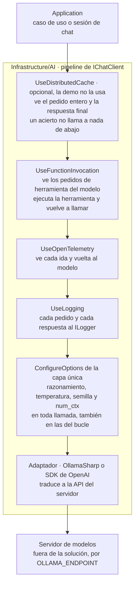

<a id="s5"></a>
## §5 Hablar con un modelo desde .NET: Microsoft.Extensions.AI y proveedores

> Estás en: escalón 0 de agencia, anticipa el 1 · capa Infrastructure/AI · [OA-D1](#oa-d1), [OA-D2](#oa-d2), [OA-O2](#oa-o2)

Todos los ejemplos y la demo de esta guía hablan con el modelo por una sola interfaz, `IChatClient`, de las bibliotecas `Microsoft.Extensions.AI` (M.E.AI) [REF-44]. Sobre ese contrato se arman el chat de ESC-01, la salida estructurada de ESC-03 y la base de las herramientas de ESC-04, que sigue en [§8.2](#s8-2). Dónde vive el contrato se decidió en [§4.4](#s4-4); las versiones de los paquetes están en el [Anexo F](#anexo-f).

<a id="s5-1"></a>
### §5.1 `IChatClient`, `ChatMessage` y `ChatOptions`

**Definición.** `IChatClient` es la abstracción de un cliente de chat: manda mensajes con contenido multimodal, recibe la respuesta completa o en fragmentos y permite pedirle servicios tipados al cliente o al servicio que tiene debajo [REF-45]. Resuelve el acoplamiento con el proveedor: los SDK la implementan (OllamaSharp [REF-50], el adaptador del SDK de OpenAI [REF-49]) y la aplicación sólo conoce la interfaz [REF-44]. No es un marco de agentes: la documentación lo dice así, «MEAI alone isn't an agent framework» [REF-48].

Una llamada lleva **mensajes** (`ChatMessage`, cada uno con su rol: usuario, asistente, sistema o herramienta), **opciones** (`ChatOptions`) y un token de cancelación. Las opciones comunes están tipadas (`Temperature`, `ModelId`, `Tools`, `Instructions`, `Reasoning`…); lo propio de un proveedor viaja por `AdditionalProperties` o `RawRepresentationFactory` [REF-45], [REF-46]. La respuesta (`ChatResponse`) trae una lista ordenada de mensajes y el último es el final [REF-45].

Las instrucciones van en `ChatOptions.Instructions`, no en el historial. El ejemplo 01, el uso más simple del contrato ([Ejemplos](#s5-ejemplos)), las arma desde los literales de `LocalidadPolicy` y `EncuestaPolicy`.

<a id="s5-2"></a>
### §5.2 Historial y streaming

**Definición.** El *historial* es la lista de mensajes que el que llama reenvía en cada pedido: con un servicio sin estado, como Ollama, lo que no se reenvía no existe para el modelo; un servicio con estado guarda la conversación y se identifica con `ChatOptions.ConversationId` [REF-45]. El *streaming* pide la misma respuesta como fragmentos: `GetStreamingResponseAsync` devuelve `IAsyncEnumerable<ChatResponseUpdate>` y `ToChatResponse` los vuelve a juntar [REF-45]. Ninguno cambia lo que el modelo sabe o puede hacer, y el streaming no lo acelera. Criterio de la guía: sirve cuando una persona mira la pantalla, porque el texto empieza a aparecer antes.

El historial crece en cada vuelta, y con él el costo y el riesgo de pasar la ventana configurada ([§6.5](#s6-5)); los reductores de M.E.AI son experimentales [REF-45]. La verificación de 01 comprueba que la segunda vuelta reenvía la conversación entera.

<a id="s5-3"></a>
### §5.3 Salida estructurada y campos anulables

**Definición.** La *salida estructurada* es pedirle al modelo una respuesta con un tipo que fija la aplicación: `GetResponseAsync<T>` manda el esquema de `T` y entrega la respuesta deserializada [REF-47]. `TryGetResult` la consume sin excepciones: si el texto no es un JSON del tipo pedido, devuelve `false` y la aplicación sigue por el camino sin IA (prueba `TryGetResult_FalseConTextoNoJson` de 03). A diferencia de la llamada con herramientas ([§8.2](#s8-2)), no hay acción: la aplicación fija la forma. El modo JSON que la precedió en OpenAI no garantizaba el esquema: «does not guarantee that the model’s response will conform to a particular schema» [REF-24]. La salida estructurada no es una validación: un JSON con la forma exacta puede traer un valor falso.

Por eso la guía suma dos piezas. **Campos anulables** para todo dato que el pedido puede no traer: en `LocalidadPropuesta`, `Habitantes` es `int?`, como en `LocalidadModel` del caso base [REF-186]. Eso le da al modelo un lugar para decir «no está», pero no le impide inventar un número plausible. Y una **garantía del código**: un número propuesto (habitantes, código postal) se acepta sólo si aparece en el texto de entrada; si no, queda ausente y la persona lo confirma. Recién entonces deciden las reglas: el caso de uso normaliza la provincia contra `Catalogos`, `LocalidadRules` da el veredicto y la única escritura es `LocalidadService.SaveAsync`, que vuelve a validar. El ejemplo 04 aplica lo mismo a los medios de transporte, con una regla endurecida respecto del caso base ([§14.1](#s14-1)).

En Ollama, la API nativa admite un esquema JSON en `format` [REF-53]; la página de `/v1` nombra `response_format` y el modo JSON, no el esquema [REF-51]. Criterio de la guía: en CTX-LOCAL la salida estructurada se prueba con el modelo y el servidor reales antes de depender de ella.

<a id="s5-4"></a>
### §5.4 El pipeline y las opciones del proveedor en una sola capa

**Definición.** `ChatClientBuilder` envuelve un `IChatClient` en capas que también son `IChatClient`; cada `Use*` agrega una, que hace algo antes y después de delegar en la siguiente [REF-45]. M.E.AI trae invocación de funciones (`UseFunctionInvocation`), telemetría (`UseOpenTelemetry`), registro (`UseLogging`), caché de respuestas (`UseDistributedCache`) y una capa que completa las opciones de cada llamada (`ConfigureOptions`); `DelegatingChatClient` es la base para escribir una propia [REF-45]. La primera capa que se agrega es la de más afuera [REF-192]. El pipeline no es una política de seguridad: cada capa ve sólo lo que pasa por ella.



Criterio de la guía, derivado del modelo de decoradores: con la caché por fuera de la invocación de funciones, un acierto devuelve la respuesta final sin volver a ejecutar herramientas; con OpenTelemetry por dentro, hay un tramo (*span*) por cada ida al modelo, y por fuera, uno solo por pedido de la persona. La demo arma el chat así, sin caché:

`Demos/MovilidadUrbana.Asistente/src/MovilidadUrbana.Asistente/Infrastructure/AI/Chat/SesionDeChat.cs`
```csharp
_cliente = new ChatClientBuilder(clienteBase)
    .UseFunctionInvocation(registro, f =>
    {
        f.MaximumIterationsPerRequest = MaximoDeIteraciones;
        f.MaximumConsecutiveErrorsPerRequest = MaximoDeErroresSeguidos;
    })
    .UseOpenTelemetry(sourceName: "MovilidadUrbana.Asistente")
    .UseLogging(registro)
    .Build();
```

**Dónde se fijan las opciones propias del proveedor.** En una sola capa `ConfigureOptions` de Infrastructure/AI, pegada al adaptador dentro de `clienteBase`, en el fondo del pipeline: por ella pasan también las llamadas del bucle de herramientas. Ningún ejemplo ni caso de uso fija estas opciones a mano.

`Examples/_Comun/MovilidadUrbana.Asistente.Comun/AI/OpcionesDelProveedor.cs`
```csharp
public static ChatClientBuilder UseOpcionesDelProveedor(
    this ChatClientBuilder builder, ConfiguracionDelModelo configuracion, Adaptador adaptador)
{
    ArgumentNullException.ThrowIfNull(configuracion);
    return builder.ConfigureOptions(options => Aplicar(options, configuracion, adaptador));
}

// …
public static void Aplicar(ChatOptions options, ConfiguracionDelModelo configuracion, Adaptador adaptador)
{
    options.Reasoning ??= new ReasoningOptions { Effort = ReasoningEffort.None };
    options.Temperature ??= configuracion.Temperatura;
    options.Seed ??= configuracion.Semilla;
    if (adaptador == Adaptador.OllamaSharp)
    {
        options.AddOllamaOption(OllamaOption.NumCtx, configuracion.NumCtx);
    }
}
```

El `??=` respeta lo que un caso de uso pida a propósito. `num_ctx` es una opción de la API nativa y la capa la agrega sólo con OllamaSharp ([§5.6](#s5-6)). Dos pruebas con un cliente espía lo comprueban sin servidor (`Examples/_Comun/MovilidadUrbana.Asistente.Comun.Pruebas/CapaDeOpcionesTests.cs`). Una aplicación referencia `Microsoft.Extensions.AI` y su adaptador; una biblioteca que implementa un adaptador, sólo `.Abstractions` [REF-44]. Criterio de la guía: Domain, ninguno; Application, a lo sumo `.Abstractions`.

<a id="s5-5"></a>
### §5.5 Registro en DI y variables

**Definición.** `AddChatClient` registra un `IChatClient` en el contenedor y devuelve un `ChatClientBuilder`; las capas que necesitan servicios los toman del contenedor [REF-45]. Resuelve que el proveedor se elija en la raíz de composición y que los casos de uso lo reciban por constructor. No resuelve qué servidor, qué modelo ni qué ventana: eso sale del entorno.

`Demos/MovilidadUrbana.Asistente/src/MovilidadUrbana.Asistente/Infrastructure/AI/DependencyInjection.cs`
```csharp
// Cliente base singleton: el SDK del proveedor sólo aparece acá y en la capa única.
services.AddChatClient(_ => guion
    ? FabricaDeClientes.Envolver(new ClienteDeDemostracion(), config, Adaptador.OllamaSharp)
    : FabricaDeClientes.CrearChatOllama(config.Endpoint, config.Modelo, config));
```

`Envolver` le pone la capa de opciones a todo cliente base, también al guionado del modo `--fake` ([§0.4](#s0-4)). La invocación de funciones la arma la sesión de chat, una por conexión de Blazor (ADR-12, [§13.13](#s13-13)). La fábrica da diez minutos de espera y ningún reintento. Criterio de la guía: contra un servidor en CPU, reintentar duplica la carga sin acortar la cola.

`Examples/_Comun/MovilidadUrbana.Asistente.Comun/AI/FabricaDeClientes.cs`
```csharp
public static readonly TimeSpan TimeoutDelModelo = TimeSpan.FromMinutes(10);

// …
public static IChatClient CrearChatOllama(string endpoint, string modelo, ConfiguracionDelModelo configuracion) =>
    Envolver(new OllamaApiClient(CrearHttp(endpoint), modelo), configuracion, Adaptador.OllamaSharp);

/// <summary>
/// Envuelve cualquier <see cref="IChatClient" /> base (OllamaSharp, SDK OpenAI, el guionado del
/// modo --fake) con la capa única. Así el modo falso pasa por las mismas opciones que el real.
/// </summary>
public static IChatClient Envolver(IChatClient interno, ConfiguracionDelModelo configuracion, Adaptador adaptador) =>
    new ChatClientBuilder(interno).UseOpcionesDelProveedor(configuracion, adaptador).Build();
```

Las variables del chat, con el valor por defecto de `ConfiguracionDelModelo.cs`; ningún valor de infraestructura vive en el repositorio:

| Variable | Por defecto | Para qué |
|---|---|---|
| `OLLAMA_ENDPOINT` · `OLLAMA_MODEL` | `http://localhost:11434` · `qwen3.5:4b` | servidor y modelo de chat |
| `OLLAMA_SERVIDOR` | `propio` | `propio`, `compartido` o `nube` |
| `OLLAMA_NUM_CTX` | `8192` | ventana que manda la capa de opciones |
| `OLLAMA_PROPIO_ENDPOINT` · `OLLAMA_PROPIO_MODEL` | `http://localhost:11434` · `qwen2.5:0.5b` | el Ollama propio, de 02 y 05 |

Las de embeddings están en [§7](#s7) y la configuración por ambiente en [§12.5](#s12-5). Con `OLLAMA_SERVIDOR=compartido` y sin `OLLAMA_NUM_CTX` definida, el código rechaza la corrida antes de llamar (prueba `Compartido_SinNumCtxDelArnes_Rechaza`). Criterio de la guía: en un servidor compartido la ventana no la elige cada cliente; se lee la del modelo ya cargado y se exporta. El motivo que da el código, que otra ventana recargaría el modelo de los demás, no se verificó.

<a id="s5-6"></a>
### §5.6 Cambiar de adaptador no es cambiar de proveedor

**Definición.** El *adaptador* es la implementación de `IChatClient` que traduce el contrato a la API de un servidor: OllamaSharp habla la nativa de Ollama; el SDK de OpenAI con `Microsoft.Extensions.AI.OpenAI`, la de OpenAI y la de cualquier servidor compatible [REF-49]. El *proveedor* es quien sirve el modelo. Cambiar de adaptador sin tocar Application prueba que el contrato aguanta; no prueba que otro proveedor se comporte igual.

El ejemplo 02 hace lo primero, **sobre el mismo Ollama**, y una prueba verifica que `Program.cs` es el único archivo que nombra los adaptadores. El cambio a un proveedor en la nube **no se ejecutó**: habría sumado una credencial a un repositorio público. Lo que el ejemplo no ejercita (caché de la nube: [§6.4](#s6-4)):

| Aspecto | En el ejemplo 02 | Con otro proveedor | Fuente |
|---|---|---|---|
| Forzar una herramienta | `/v1` no admite `tool_choice`; 02 no usa herramientas | `ChatOptions.ToolMode`, si el servicio lo respeta (no verificado) | [REF-51], [REF-46] |
| Ventana y recorte | `num_ctx` sólo por OllamaSharp; por `/v1`, recorte «no verificable» | la fija el servicio, según su documentación | [REF-55]; registro de 02 |
| Razonamiento | la capa lo apaga: `think` en la nativa, `reasoning_effort` en `/v1` | `ChatOptions.Reasoning`, según el adaptador (no verificado fuera de Ollama) | [REF-52], [REF-51] |
| Duraciones del servidor | OllamaSharp las expone; por `/v1` no llegan | según el servicio | [REF-65]; registro de 02 |

El adaptador tampoco cambia la conducta del modelo, y cada capacidad se verifica por modelo y versión: Ollama anunció el soporte de herramientas nombrando modelos concretos [REF-35]. Antes de correr contra el modelo, el código pide a `/api/show` las capacidades y salta la prueba si faltan (`Examples/_Comun/MovilidadUrbana.Asistente.Comun/AI/PredicadoDeSalto.cs`).

<a id="s5-7"></a>
### §5.7 En este laboratorio

**Qué se observó y con qué.** Lo observado donde corrieron los ejemplos que cambia cómo se escribe el código; no describe a Ollama ni a Qwen en general. El entorno completo está en el [Anexo F](#anexo-f).

- **Razonamiento encendido por defecto.** Con un presupuesto de salida chico, `qwen3.5:4b` lo gastó en razonamiento y devolvió texto vacío, terminado por largo; sin razonamiento, respondió. Observado en el sondeo del entorno: `qwen3.5:4b` (sin digest registrado), Ollama 0.32.0-rc0, sólo CPU, servidor compartido, 2026-10-25 y 2026-10-26. La capa de opciones lo apaga, y la variante negativa de 01 reproduce la falla sin servidor.
- **`num_ctx` recorta en silencio.** La documentación de Ollama da un contexto por defecto de 4.096 tokens [REF-55], o uno que depende de la memoria de video [REF-56]. Lo medido: con la capa, el servidor procesó 5.714 tokens del prompt; sin la opción, 2.050, sin error. Con ese estímulo hubo 2,33 caracteres por token. Observado en el laboratorio, sonda de `num_ctx`: `qwen2.5:0.5b` (digest `a8b0c5157701`), Ollama 0.40.11, Ollama propio, 2026-10-27. Como el servidor no avisa, la guarda de truncado compara los tokens informados con una estimación y saca de toda tasa la corrida que no cierra. Por `/v1` llegan los tokens, pero la aplicación no fija la ventana y la guarda responde «no verificable» (`Examples/_Comun/MovilidadUrbana.Asistente.Comun/AI/GuardaDeTruncado.cs`).
- **Latencias de minutos.** Dos mediciones de la misma consulta tardaron 91,7 s y 123,1 s. Observado en el laboratorio, sonda de tiempos: `qwen3.5:4b` (digest `2a654d98e6fb`), Ollama 0.32.0-rc0, sólo CPU, servidor compartido, 2026-10-27. Dependen de la carga ajena y no se comparan; de ahí las esperas de [§5.5](#s5-5).
- **Reutilización del prefijo.** Con `qwen3.5:4b` no está medida; lo de [§6.3](#s6-3) es de `qwen2.5:0.5b` y no se traslada.

<a id="s5-practica"></a>
### Práctica de §5

<a id="s5-escenarios"></a>
#### Aplicación por escenario

Sólo las celdas que cambian; «—» significa sin diferencia con la combinación de la guía, CTX-EXISTENTE × CTX-LOCAL × CTX-PROTO ([§2.2](#s2-2)).

| Escenario | Qué aporta | CTX-LOCAL | CTX-NUBE | CTX-SENS | CTX-PROD |
|---|---|---|---|---|---|
| ESC-01 | historial explícito y streaming | razonamiento y `num_ctx` en la capa única; esperas largas | credencial como secreto ([§11.6](#s11-6)) | el historial entero vuelve al modelo: minimizarlo ([§11.4](#s11-4)) | el historial crece ([§5.2](#s5-2)); telemetría ([§12.1](#s12-1)) |
| ESC-03 | `GetResponseAsync<T>`, anulables, garantía del texto y reglas | el esquema se prueba con el modelo real | — | — | contrato probado sin modelo ([§10.3](#s10-3)) |
| ESC-04 | `UseFunctionInvocation` afuera, opciones en el fondo | sin `tool_choice` [REF-51] | `ToolMode` según el servicio | — | topes de iteraciones y errores ([§8.2](#s8-2)) |

<a id="s5-ejemplos"></a>
#### Ejemplos

Los comandos se corren desde la carpeta de la guía; el orden es el de lectura del [Anexo E](#anexo-e). El vocabulario de la evidencia (cliente guionado, oráculo, IC95, cableado, humo, estímulo del mismo autor) está en [§0.4](#s0-4).

**01 · Chat y streaming** · `Examples/01-Chat-Y-Streaming/` · básico · ilustra [§5.1](#s5-1) y [§5.2](#s5-2) · [OA-D1](#oa-d1).

```bash
tools/verificar.sh correr 01-Chat-Y-Streaming                # --fake --verificar, sin servidor
tools/verificar.sh correr 01-Chat-Y-Streaming --con-modelo
```

`Examples/01-Chat-Y-Streaming/Application/AsistenteDeAyuda.cs`
```csharp
private readonly List<ChatMessage> _historial = [];

// …
public async Task<VueltaDeChat> PreguntarAsync(string pregunta, Action<string> alFragmento, CancellationToken cancellationToken = default)
{
    _historial.Add(new ChatMessage(ChatRole.User, pregunta));
    var enviados = _historial.ToList();
    var opciones = new ChatOptions { Instructions = Instrucciones, MaxOutputTokens = TopeDeSalida };

    var updates = new List<ChatResponseUpdate>();
    var fragmentos = new List<string>();
    await foreach (var update in cliente.GetStreamingResponseAsync(enviados, opciones, cancellationToken))
    {
        updates.Add(update);
        if (!string.IsNullOrEmpty(update.Text))
        {
            fragmentos.Add(update.Text);
            alFragmento(update.Text);
        }
    }

    var respuesta = updates.ToChatResponse();
    // …
    _historial.AddRange(respuesta.Messages);
    return new VueltaDeChat(enviados, opciones, respuesta, fragmentos);
}
```

Qué mirar: `enviados` copia el historial entero antes de cada llamada y `_historial.AddRange` suma la respuesta para la vuelta siguiente.

Observado en el laboratorio: `qwen3.5:4b` (digest `2a654d98e6fb`), Ollama 0.32.0-rc0, sólo CPU, servidor compartido, 2026-10-27; estímulo del mismo autor. Respuesta a «¿Qué datos tengo que cargar para dar de alta una localidad?»:

```text
Para dar de alta una localidad debes introducir su **nombre** (entre 3 y 60 caracteres, único por provincia), la **provincia**, el **código postal** (4 dígitos) y los **habitantes**. Además, recuerda que todos estos campos son obligatorios para completar correctamente el formulario.
```

Las dos preguntas nombraron cada campo pedido y terminaron por `stop`: 2 de 2, como demostración, sin tasa. Salida con `--fake` (cliente guionado), sin modelo, de la variante negativa:

```text
variante negativa (simulada): sin la capa → Text «», finish=length; con la capa → «Nombre, provincia, código postal y habitantes.», finish=stop
```

**02 · Cambio de adaptador** · `Examples/02-Cambio-De-Adaptador/` · básico · ilustra [§5.6](#s5-6) · [OA-D1](#oa-d1). La aplicación sólo llama a `cliente.GetResponseAsync`; lo que cambia está en la raíz de composición.

```bash
tools/verificar.sh correr 02-Cambio-De-Adaptador               # compila y corre con --fake (sin red)
tools/verificar.sh correr 02-Cambio-De-Adaptador --con-modelo
```

`Examples/02-Cambio-De-Adaptador/Program.cs`
```csharp
public static IChatClient Crear(Adaptador adaptador, ConfiguracionDelModelo config) => adaptador switch
{
    Adaptador.OllamaSharp => FabricaDeClientes.CrearChatOllama(config.PropioEndpoint, config.PropioModelo, config),
    _ => FabricaDeClientes.Envolver(CrearOpenAIv1(config), config, Adaptador.OpenAIv1)
};

// …
public static IChatClient CrearOpenAIv1(ConfiguracionDelModelo config)
{
    var opciones = new OpenAIClientOptions
    {
        Endpoint = new Uri(new Uri(config.PropioEndpoint), "/v1"),
        NetworkTimeout = FabricaDeClientes.TimeoutDelModelo,
        RetryPolicy = new ClientRetryPolicy(maxRetries: 0)
    };
    return new OpenAIClient(new ApiKeyCredential("ollama"), opciones)
        .GetChatClient(config.PropioModelo)
        .AsIChatClient();
}
```

Qué mirar: las dos ramas del `switch` terminan en la misma capa única (`Envolver`); el SDK de OpenAI exige una clave, y Ollama la ignora [REF-51].

Salida con `--fake` (cliente guionado), sin modelo:

```text
[ollamasharp · proveedor «ollama»] Nombre, provincia, código postal y habitantes (guion, vía ollamasharp).
    num_ctx enviado: 8192 · razonamiento: None · truncado_posible: False
[openai-v1 · proveedor «openai»] Nombre, provincia, código postal y habitantes (guion, vía openai-v1).
    num_ctx enviado: no (por /v1 no llega) · razonamiento: None · truncado_posible: no verificable
```

Observado: `qwen2.5:0.5b` (`a8b0c5157701`), Ollama 0.40.11 propio, 2026-10-27. Por los dos adaptadores volvió el mismo texto libre, que agrega por su cuenta un «por ejemplo» con una provincia que no está en `Catalogos` y un código postal que no tiene cuatro dígitos. El ejemplo no lo filtra, y esa propuesta no pasaría `LocalidadRules.ProvinciaValida` ni `CodigoPostalValido`: cambiar de adaptador no cambia lo que hace el modelo.

**03 · Salida estructurada** · `Examples/03-Salida-Estructurada/` · básico · ilustra [§5.3](#s5-3) · [OA-D2](#oa-d2). Entrada: «En Bella Vista, Corrientes, CP 3432, no sé cuántos viven».

```bash
tools/verificar.sh correr 03-Salida-Estructurada                 # --fake --verificar, sin servidor
tools/verificar.sh correr 03-Salida-Estructurada --con-modelo
```

`Examples/03-Salida-Estructurada/Application/Localidades/LocalidadPropuesta.cs`
```csharp
public sealed record LocalidadPropuesta
{
    [JsonPropertyName("nombre")] public string? Nombre { get; init; }

    [JsonPropertyName("provincia")] public string? Provincia { get; init; }

    [JsonPropertyName("codigoPostal")] public string? CodigoPostal { get; init; }

    [JsonPropertyName("habitantes")] public int? Habitantes { get; init; }
}
```

`Examples/03-Salida-Estructurada/Infrastructure/AI/ExtractorDeLocalidadConModelo.cs`
```csharp
public async Task<DetalleDeExtraccion> ExtraerConDetalleAsync(string texto, CancellationToken cancellationToken = default)
{
    List<ChatMessage> mensajes = [new(ChatRole.User, texto)];
    var opciones = new ChatOptions { Instructions = Instrucciones };
    var respuesta = await cliente.GetResponseAsync<LocalidadPropuesta>(mensajes, opciones, cancellationToken: cancellationToken);

    // …
    if (!respuesta.TryGetResult(out var propuesta) || propuesta is null)
    {
        return new DetalleDeExtraccion(new ExtraccionDeLocalidad(null, []), mensajes, opciones, respuesta, false, null);
    }
    var (garantizada, descartados) = GarantiaDelTexto.Aplicar(propuesta, texto);
    return new DetalleDeExtraccion(new ExtraccionDeLocalidad(garantizada, descartados), mensajes, opciones, respuesta, true, propuesta);
}
```

El caso de uso de Application normaliza, valida y escribe:

`Examples/03-Salida-Estructurada/Application/Localidades/AltaDesdeTextoService.cs`
```csharp
public static DecisionDeAlta Decidir(ExtraccionDeLocalidad extraccion)
{
    if (extraccion.Propuesta is not { } p)
    {
        return new DecisionDeAlta(EstadoDeLaPropuesta.SinPropuesta, new LocalidadModel(),
            new Dictionary<string, string>(), extraccion.Descartados);
    }

    var modelo = new LocalidadModel
    {
        Nombre = (p.Nombre ?? string.Empty).Trim(),
        Provincia = NormalizarProvincia(p.Provincia),
        CodigoPostal = (p.CodigoPostal ?? string.Empty).Trim(),
        Habitantes = p.Habitantes
    };
    var errores = Validar(modelo);
    return new DecisionDeAlta(errores.Count == 0 ? EstadoDeLaPropuesta.Lista : EstadoDeLaPropuesta.FaltanDatos,
        modelo, errores, extraccion.Descartados);
}

// …
public Task<Result> ConfirmarAsync(DecisionDeAlta decision, int? habitantesConfirmados = null,
    string? codigoPostalConfirmado = null, CancellationToken cancellationToken = default)
{
    // …
    return localidades.SaveAsync(modelo, cancellationToken);
}
```

Qué mirar: el `false` de `TryGetResult` termina en `SinPropuesta`, el formulario de siempre, y `ConfirmarAsync` escribe sólo por `SaveAsync`.

Observado: `qwen3.5:4b` (`2a654d98e6fb`), Ollama 0.32.0-rc0, sólo CPU, servidor compartido, 2026-10-27; estímulo del mismo autor. El modelo dejó `habitantes` en `null` y las reglas decidieron `faltan:habitantes`:

```json
{
  "nombre": "Bella Vista",
  "provincia": "Corrientes",
  "codigoPostal": "3432",
  "habitantes": null
}
```

Salida con `--fake` (cliente guionado), sin modelo; el guion inventa el dato a propósito para mostrar la garantía:

```text
[e02] En Bella Vista, Corrientes, CP 3432, no sé cuántos viven
  modelo devolvió: {"nombre":"Bella Vista","provincia":"Corrientes","codigoPostal":"3432","habitantes":30000}
  TryGetResult: true; descartado por no estar en el texto: habitantes
  decisión de las reglas: faltan:habitantes → Ingrese una cantidad de habitantes mayor a cero.
  oráculo: pasa
```

En la extensión de medición, con el mismo rótulo, las ocho decisiones pasaron el oráculo, IC95 [0,631; 1]; las ocho respuestas fueron JSON válido; y en los cuatro pedidos sin el dato el modelo no propuso habitantes, 0/4, IC95 [0; 0,602]. Son tasas descriptivas ([§10.4](#s10-4)); la garantía del código no depende de la muestra.

**04 · Normalización contra el catálogo** · `Examples/04-Normalizacion-Contra-Catalogo/` · básico · ilustra [§5.3](#s5-3) · [OA-D2](#oa-d2). La persona contesta en sus palabras; la encuesta guarda claves de `Catalogos`.

```bash
tools/verificar.sh correr 04-Normalizacion-Contra-Catalogo                 # --fake, sin red
tools/verificar.sh correr 04-Normalizacion-Contra-Catalogo --con-modelo
```

`Examples/04-Normalizacion-Contra-Catalogo/Application/NormalizacionDeMovilidad.cs`
```csharp
public ResultadoDeNormalizacion Decidir(PropuestaDeMovilidad? propuesta)
{
    var modelo = new EncuestaModel();
    if (propuesta is null)
    {
        // El modelo no devolvió el JSON pedido: el paso queda vacío y ValidarPaso lo dice.
        return new(modelo, _encuestas.ValidarPaso(2, modelo), PropuestaValida: false);
    }

    // Cada medio propuesto entra a la encuesta: normalizado si hay clave, tal cual si no.
    // …
    foreach (var texto in propuesta.Medios ?? [])
    {
        if (texto is null) continue;
        var clave = normalizador.NormalizarMedio(texto);
        if (clave.Length > 0) modelo.AlternarMedio(clave, true); // «  » o «¿?» plegados quedan vacíos
    }
    modelo.Frecuencia = propuesta.Frecuencia is null ? string.Empty : normalizador.NormalizarFrecuencia(propuesta.Frecuencia);

    return new(modelo, _encuestas.ValidarPaso(2, modelo), PropuestaValida: true);
}
```

Qué mirar: un medio sin clave entra «tal cual», no se descarta, y `ValidarPaso` lo rechaza con su nombre.

Observado con el rótulo de 03; estímulo del mismo autor. Para «Algunos días por semana voy caminando y otros en moto.», el modelo dejó la frecuencia en `null` y el paso quedó con error; la otra entrada pasó:

```json
{
  "medios": ["caminando", "moto"],
  "frecuencia": null
}
```

En la extensión, con el mismo rótulo, 7 de 8 expresiones terminaron con la clave esperada, IC95 [0,473; 0,997]. Con `--fake`, el guion propone un medio inventado y el código lo rechaza con su nombre («Medio fuera del catálogo: avion»).

**En la demo.** PD-3 repite el patrón de 03 en el host. Observado: `qwen3.5:4b`, servidor compartido, 2026-10-27; humo de la demo: dejó `habitantes` en `null`. PD-4 repite el de 04 y se prueba por cableado ([§14.3](#s14-3)).

<a id="s5-preguntas"></a>
#### Preguntas guía

**¿Por qué programar contra `IChatClient` y no contra el SDK del proveedor?** ([OA-D1](#oa-d1))

Porque el proveedor se elige en la raíz de composición, Application se prueba con un doble ([§10.2](#s10-2)) y las capas del pipeline sirven para cualquier adaptador [REF-44]: en 02, cambiar de adaptador tocó sólo `Program.cs`. En CTX-LOCAL, lo propio de Ollama (`num_ctx`) vive en la capa única; en CTX-NUBE, lo propio del servicio viaja igual, por `AdditionalProperties` [REF-45]. La respuesta cambia si necesitás una capacidad del proveedor que el contrato no expone: bajás al cliente nativo con `GetService` o usás `RawRepresentationFactory` [REF-45] en ese punto, sin abandonar el contrato en el resto.

**Para Ollama, ¿OllamaSharp o el SDK de OpenAI contra `/v1`?** ([OA-D1](#oa-d1))

Con Ollama y prompts grandes, OllamaSharp: habla la API nativa, recibe `num_ctx` en cada pedido y expone las duraciones del servidor [REF-50], [REF-65]. El SDK de OpenAI contra `/v1` sirve si querés un mismo adaptador para Ollama y un servicio compatible [REF-49], y aceptás lo de [§5.6](#s5-6): sin `tool_choice`, sin duraciones y con el recorte «no verificable». Con un prompt corto, como en 02, dan lo mismo. Con un corpus entero en el contexto ([§6.3](#s6-3)) la elección cambia: sólo la nativa fija la ventana en cada pedido; por `/v1` hay que fijarla en el servidor [REF-55] y la aplicación no puede comprobarla.

**¿Cuándo uso respuesta completa, streaming o `GetResponseAsync<T>`?** ([OA-D2](#oa-d2))

Según quién consume el resultado. Una persona en pantalla: streaming, como en 01. Código que propone un alta o normaliza una respuesta de encuesta: `GetResponseAsync<T>` con `TryGetResult`, como en 03 y 04, porque el tipo reemplaza el parseo frágil del texto [REF-47]. Un paso de backend que guarda un resumen: respuesta completa. En CTX-LOCAL puede cambiar la elección el soporte del esquema en ese modelo y ese servidor: probalo con el modelo real y preví el `false` como camino normal.

**El modelo devolvió un JSON perfecto: ¿lo guardo?** ([OA-D2](#oa-d2))

No sin las reglas. El esquema garantiza la forma, no la verdad: en 03, con `--fake`, el guion devuelve un JSON válido con `"habitantes":30000`, que el texto no trae; `TryGetResult` da `true` y la garantía del texto lo descarta. El orden es el de 03 y 04: el adaptador descarta lo que no está en el texto, el caso de uso normaliza contra `Catalogos` y valida, y la pantalla pide lo que falta. En CTX-EXISTENTE comprobá antes que las reglas del caso base rechacen un valor inventado: con los medios de transporte no lo hacían. Si un dato no tiene regla, lo que falta es la regla.

**¿Por qué el modelo me devolvió vacío?** ([OA-O2](#oa-o2))

Con un modelo que razona por defecto, como `qwen3.5:4b`, lo más probable es que gastó el presupuesto pensando ([§5.7](#s5-7)). Mirá `FinishReason`: si es `length` sin texto, apagá el razonamiento en la capa de opciones, no en cada llamada, para que valga también en el bucle de herramientas. Si la respuesta ignora las instrucciones o el principio del corpus, sospechá del recorte: la ventana sale de `OLLAMA_NUM_CTX` y la manda la misma capa ([§5.5](#s5-5)). Con un servicio en la nube la causa puede ser otra, pero el diagnóstico empieza igual: `FinishReason` y los tokens que informa el servidor.

<a id="s5-calidad"></a>
#### Criterios de calidad y antipatrones

- Application recibe `IChatClient` o su puerto propio ([§4.4](#s4-4)) por constructor, y un solo archivo de la raíz de composición nombra al adaptador.
- Las opciones del proveedor se fijan en una capa pegada al adaptador, y una prueba con un cliente espía verifica que salen en toda llamada.
- Toda salida que consume código usa `GetResponseAsync<T>` y `TryGetResult`, con campos anulables, y pasa por las reglas antes de escribir.
- Endpoint, modelo y ventana salen del entorno; cada adaptador tiene una espera elegida para su servidor y una política de reintentos explícita.
- Antipatrón: leer `.Result` en lugar de `TryGetResult`. El camino sin IA no queda escrito en el código (criterio de la guía).
- Antipatrón: tomar `/v1` de Ollama por la API de OpenAI completa. No hay `tool_choice` ni Responses con estado [REF-51].

<a id="s5-8"></a>
### §5.8 Decisión en curso: ADR-02

Esta sección aplica **ADR-02, contrato de acceso y adaptador del proveedor** ([§13.3](#s13-3)). Entre el SDK del proveedor directo, `IChatClient` con OllamaSharp, `IChatClient` con el SDK de OpenAI contra `/v1` y el paquete de M.E.AI para Ollama, la guía usa la segunda, muestra la tercera para probar el contrato y descarta la cuarta por su estado ([Anexo F](#anexo-f)). Toca también **ADR-08, la salida del modelo es una propuesta** ([§13.9](#s13-9)). La plantilla del cliente y su pipeline está en el [Anexo A](#anexo-a-5).

<!-- PENDIENTES:
Quitado por falta de respaldo citable:
- Que qwen3.5:4b sea híbrido: sólo lo respalda una inspección en una bitácora. §5.7 dice «no está medida» sin la causa.
- Cifras del sondeo del entorno (tiempos y presupuesto de tokens de la falla por razonamiento): no están en la tabla de cifras citables. La falla entra como conducta, con el rótulo del sondeo.
- Mínimos de caché de los servicios en la nube: fuera de la tabla de cifras citables; §5.6 remite a §6.4.
- Que .Result lanza una excepción ante texto no JSON: sin respaldo citable. El antipatrón queda como criterio de la guía.
- Que una ventana distinta recargue el modelo en el servidor compartido: lo afirman un comentario del código y el README de 01, no un REF ni un registro; queda marcado «no verificado en la construcción».
- «Qwen no está en el anuncio de herramientas»: inferencia débil sobre un anuncio de 2024; se reemplazó por el mecanismo del código (PredicadoDeSalto.cs).
- Que /v1 no admita num_ctx: no verificado; se escribe lo que hace el código (la capa no lo manda por /v1).
- Nombres y valores inventados por el modelo en 02: se describe la conducta sin ellos.
- Constantes de la guarda de truncado: se describe el mecanismo sin números.
- Fila «Credencial» de la tabla de §5.6: pasó a «Qué mirar» de 02 para ahorrar palabras.
Fuente nueva: REF-192, convalidada por la presidencia (01-Muestra-Decisiones.md).
Procedencia de las salidas:
- 01 modelo: Evidencia/R-LLM/01-Chat-Y-Streaming.modelo.jsonl, primera llamada. 01 --fake: Evidencia/Arnes/01-Chat-Y-Streaming.fake.log.
- 02 --fake: Evidencia/Cierre-Construccion/verificar-build.saneo.log, bloque de 02 (reverificacion.log lo abrevia con «...»). 02 modelo (prosa): Evidencia/R-LLM/02-Cambio-De-Adaptador.modelo.jsonl, a01, las dos llamadas.
- 03 modelo: Evidencia/R-LLM/03-Salida-Estructurada.jsonl. 03 --fake: Evidencia/03-Salida-Estructurada/fake-demostracion.log. Extensión: 03-Salida-Estructurada.modelo-ext.jsonl.
- 04 modelo: Evidencia/R-LLM/04-Normalizacion-Contra-Catalogo.modelo.jsonl, d02. Extensión: 04-…modelo-ext.jsonl. --fake: Evidencia/Arnes/04-Normalizacion-Contra-Catalogo.reverificacion.log.
- PD-3: Evidencia/R-LLM/Demo-MovilidadUrbana.Asistente.modelo.jsonl, pd3-01.
- Sondeo del entorno: Bitacoras/Sondeo-Entorno.md §2 (conducta, sin cifras).
Conteo de palabras de prosa (comando de la carta §16.3): 3.200 tras la verificación adversarial del 2026-10-27 (antes 3.191). Cambios del verificador: «consulta corta» de DEP-13 → «consulta» (el prompt lleva el padrón, clase M); fila «Forzar una herramienta» decía que en 02 «la piden las instrucciones», pero 02 no usa herramientas; remisión a §6.4 que esta nota daba por hecha y faltaba; apóstrofo literal de REF-24; rótulo completo (digest, versión, hardware) en 02 y 03, y 04 remite al de 03; procedencia de la salida --fake de 02; tres recortes para no pasar el tope. Tope de la sección (carta §16.3): 3.200.
Snippets por encima de 25 líneas, con motivo: 01 (26: el bucle de streaming y las dos líneas del historial son el tema de §5.2) y AltaDesdeTextoService (27: el camino SinPropuesta y la única escritura son el tema de §5.3).
Remisiones usadas: s0-4, s2-2, s4-4, s6-3, s6-4, s6-5, s7, s8-2, s10-2, s10-3, s10-4, s11-4, s11-6, s12-1, s12-5, s13-3, s13-9, s13-13, s14-1, s14-3, anexo-a-5, anexo-e, anexo-f, oa-d1, oa-d2, oa-o2; internas: s5-1, s5-2, s5-3, s5-5, s5-6, s5-7, s5-ejemplos.
Cifras citadas (todas en la tabla de cifras citables): 01 2 de 2; 03 extensión 8/8 IC95 [0,631; 1], JSON 8/8, 0/4 IC95 [0; 0,602]; 04 extensión 7/8 IC95 [0,473; 0,997]; sonda de num_ctx 5.714, 2.050 y 2,33; sonda de tiempos 91,7 s y 123,1 s. El 4.096 por defecto se cita de la fuente, separado de lo medido.
-->
