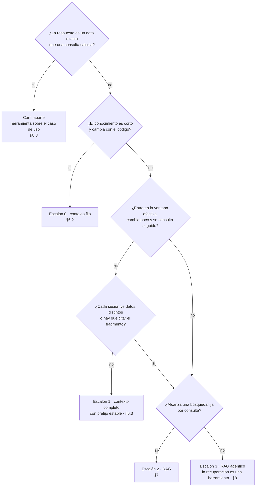

<a id="parte-iii"></a>
# Parte III · Conocimiento: ¿qué sabe el modelo?

<a id="s6"></a>
## §6 Estrategias de conocimiento: de contexto fijo a RAG agéntico

> Estás en: escalones 0 y 1 de conocimiento, anticipa el 2 y el 3 · capa Application · [OA-D3](#oa-d3), [OA-A3](#oa-a3)

El modelo sabe de Movilidad Urbana sólo lo que la aplicación le pasa en el contexto de cada llamada ([§3.0](#s3-0)). Esta sección elige cómo pasárselo en ESC-01 y deja a [§7](#s7) la búsqueda semántica de ESC-02. Las escaleras están en [§3.2](#s3-2); la capa de opciones, en [§5.4](#s5-4); las versiones, en el [Anexo F](#anexo-f).

<a id="s6-1"></a>
### §6.1 El carril aparte: un dato exacto se consulta

**Definición.** Un *dato exacto* es una respuesta que calcula una consulta sobre los datos de la aplicación: «¿cuántas localidades hay en Corrientes?». RAG recupera los fragmentos **más parecidos** por distancia entre embeddings [REF-86], [REF-87]: puede traer las de Chaco porque se parecen, y no cuenta. El dato exacto va por una herramienta sobre el caso de uso de lectura, como `contar_localidades` de 08 ([§8.3](#s8-3)). No es un escalón: es la pregunta previa a subir.



<a id="s6-2"></a>
### §6.2 Escalón 0: contexto fijo

**Definición.** El *contexto fijo* es poner las instrucciones y los datos chicos en el prompt de cada llamada, sin depender de una caché. Resuelve el conocimiento corto que cambia con el código. No es «meter todo en el prompt»: deja de convenir cuando reenviarlo pesa en costo o latencia (umbral: criterio de la guía).

Ahí está el corpus real del caso: los doce requisitos de `LocalidadPolicy` y `EncuestaPolicy`, oraciones cortas que toman sus límites de las reglas («4 dígitos.», «Entre 16 y 110 años.») [REF-186]. El ejemplo 01 los arma desde el código:

`Examples/01-Chat-Y-Streaming/Application/AsistenteDeAyuda.cs`
```csharp
/// <summary>
/// Instrucciones armadas desde las *Policy del caso: si un requisito cambia en las reglas del
/// dominio, cambia también lo que el modelo recibe. Van en ChatOptions.Instructions, no en el historial.
/// </summary>
public static string Instrucciones => $"""
    Sos el asistente de ayuda de Movilidad Urbana. Respondé en castellano, en una o dos oraciones,
    nombrando cada campo que pide el formulario por el que te preguntan.
    El alta de una localidad pide: nombre ({LocalidadPolicy.RequisitoDelNombre}), provincia
    ({LocalidadPolicy.RequisitoDeLaProvincia}), código postal ({LocalidadPolicy.RequisitoDelCodigoPostal})
    y habitantes ({LocalidadPolicy.RequisitoDeLosHabitantes}).
    La encuesta de movilidad pide: nombre ({EncuestaPolicy.RequisitoDelNombre}), edad ({EncuestaPolicy.RequisitoDeLaEdad}),
    localidad ({EncuestaPolicy.RequisitoDeLaLocalidad}), medios de transporte ({EncuestaPolicy.RequisitoDeLosMedios}),
    frecuencia ({EncuestaPolicy.RequisitoDeLaFrecuencia}), distancia ({EncuestaPolicy.RequisitoDeLaDistancia}),
    minutos de viaje ({EncuestaPolicy.RequisitoDeLosMinutos}) y motivo ({EncuestaPolicy.RequisitoDelMotivo}).
    """;
```

Qué mirar: las instrucciones leen los requisitos de las `*Policy`; si `LocalidadRules` cambia un límite, el contexto cambia con él. Su tamaño en tokens no se midió.

<a id="s6-3"></a>
### §6.3 Escalón 1: contexto completo con prefijo estable

**Definición.** El *contexto completo con prefijo estable* es mandar el corpus entero en cada llamada, con un prefijo idéntico byte a byte y la pregunta al final, para que el servidor reutilice el trabajo ya hecho sobre ese prefijo. Resuelve reprocesar un corpus que entra en la ventana y se consulta seguido. No es CAG: la aplicación no guarda nada, sólo controla el texto que manda.

**CAG, en sentido estricto.** El artículo que lo define: «Our method involves preloading all relevant resources […] into the LLM's extended context and caching its runtime parameters», es decir, precarga el corpus y guarda los parámetros de ejecución [REF-67]. Esa caché KV «is stored on disk or in memory for future use» [REF-67], y el código de los autores necesita el modelo en proceso, con `transformers` de Python [REF-68]. Por `IChatClient` esa caché no se ve; por eso *CAG* sin calificar designa sólo ese método.

**Lo que el artículo midió.** Un modelo (Llama 3.1 8B), dos conjuntos de datos y BERTScore, con resultados más acotados que su tesis [REF-67]: en HotPotQA grande, BM25 top-5 (0,7535) superó a CAG (0,7407); en tiempo, CAG fue más lento que BM25 top-3 en los tres tamaños (2,2631 s contra 0,6667 s en el grande). La ventaja fuerte es contra el contexto largo sin caché: 2,2631 s contra 92,0824 s [REF-67]. Los autores lo acotan a corpus de «manageable size» [REF-67].

**Lo que ofrecen los servicios.** Reutilizar del lado del servidor un prefijo idéntico. Consultado el 2026-10-26; cambia por modelo y familia:

| Servicio | Cómo se activa | Mínimo para que haya caché | Dónde se ve | Fuente |
|---|---|---|---|---|
| OpenAI | por defecto en los modelos soportados | 1.024 tokens desde GPT-5.6; varía según el pedido en los anteriores | `cached_tokens` | [REF-70] |
| Azure OpenAI | por defecto en los modelos soportados | 1.024 tokens, y los primeros 1.024 idénticos | `cached_tokens` en `prompt_tokens_details` | [REF-71] |
| Anthropic | `cache_control` por bloque, o automático con uno en el nivel superior del pedido | de 512 a 4.096 tokens según el modelo; por debajo, sin caché y sin error | `cache_creation_input_tokens`, `cache_read_input_tokens` | [REF-72] |

Con OpenAI o Azure no hay nada que activar; hay que poner lo estable primero: «Place stable or repeated content at the beginning of the prompt and dynamic content at the end» [REF-71]. La caché dura de minutos a horas según el servicio [REF-70], [REF-71], [REF-72], y un carácter distinto en el prefijo la pierde [REF-71].

**En .NET.** `ChatOptions` no tiene propiedad de caché de prompts; lo propio de un servicio viaja por `RawRepresentationFactory` [REF-64] (`PromptCacheKey`, de la Responses API de OpenAI [REF-63], no se ejecutó). Los tokens leídos de la caché van a `UsageDetails.CachedInputTokenCount` [REF-62], [REF-66]: el adaptador de OpenAI lo llena [REF-63]; OllamaSharp no, y deja las duraciones del servidor en `AdditionalProperties` [REF-65].

**En Ollama, comportamiento del motor y no contrato.** En v0.32.0-rc0, Ollama le manda a `llama-server` `"cache_prompt": true` en cada pedido de chat [REF-73]; llama.cpp reutiliza así el prefijo común con un pedido anterior y advierte que «can cause nondeterministic results» [REF-75]. La FAQ no lo menciona [REF-55], y el código de 0.40.11, donde corrió 05, no se leyó. Lo medido es de `qwen2.5:0.5b` ([Ejemplos](#s6-ejemplos)); con `qwen3.5:4b`, el modelo de chat de la guía, no está medido.

<a id="s6-4"></a>
### §6.4 Tres cachés y un «sin caché»

**Definición.** Cuatro mecanismos que se confunden. La caché de respuestas evita llamar al modelo; las de prefijo abaratan la llamada sin recalcular el corpus. Ninguna cambia lo que el modelo sabe.

| Mecanismo | Qué guarda | Dónde vive | Cuándo acierta | En .NET |
|---|---|---|---|---|
| Caché de respuestas | la respuesta, como JSON | `IDistributedCache` de la aplicación | mismo pedido | `UseDistributedCache` [REF-69] |
| Caché de prefijo | el cálculo del prefijo | servidor del modelo | mismo prefijo, otra pregunta | `CachedInputTokenCount`, si el adaptador lo informa [REF-62] |
| CAG del artículo | la caché KV del corpus, persistida | proceso con el modelo | al cargar esa caché | sin soporte por API [REF-67] |
| Contexto largo sin caché | nada | — | nunca | cualquier `IChatClient` |

<a id="s6-5"></a>
### §6.5 Ventana declarada, efectiva y configurada

**Definición.** La ventana *declarada* es el máximo que anuncia el fabricante; la *efectiva*, lo que el modelo todavía usa bien; la *configurada*, lo que el servidor reserva para la llamada. Resuelve contra qué se compara el corpus. No es memoria: lo que no entra en la configurada no llega.

RULER: «only half of them can maintain satisfactory performance at the length of 32K», aunque todos declaraban 32K o más [REF-76]. Pocos modelos sostienen la precisión arriba de 64K [REF-77], y lo del medio de un contexto largo se usa peor [REF-84].

En Ollama la configurada es `num_ctx`: 4.096 por defecto según la FAQ [REF-55], o según la memoria de video [REF-56]; un prompt que la excede se recorta o se rechaza [REF-73]. El recorte silencioso observado está en [§5.7](#s5-7); 05 fija `num_ctx` en la capa de opciones. Más ventana no es mejor: la memoria crece con ella y con las peticiones paralelas [REF-55].

<a id="s6-6"></a>
### §6.6 Escalones 2 y 3: cuándo saltar a RAG y a RAG agéntico

**Definición.** *RAG* recupera en cada consulta sólo los fragmentos relevantes y los pasa con su fuente ([§7](#s7)). *RAG agéntico* es RAG en el que recuperar es una herramienta que el modelo decide llamar ([§8.2](#s8-2)): el único cruce de las dos escaleras (criterio de la guía).

Se salta al 2 cuando el corpus excede la ventana efectiva, cambia más rápido de lo que dura una caché, cada sesión ve un subconjunto distinto o hay que citar el fragmento: la procedencia es lo que la memoria del modelo no da [REF-85]. Con recursos suficientes el contexto largo superó a RAG, pero «RAG's significantly lower cost remains a distinct advantage», RAG sigue siendo más barato [REF-80]. Se salta al 3 cuando una búsqueda fija no alcanza, con varios pasos o fuentes; criterio de la guía: el agente suma costo y no determinismo ([§8.7](#s8-7)).

Los escalones se combinan: el artículo de CAG propone precargar una base y recuperar sólo casos borde [REF-67]. La demo hace RAG sobre los doce requisitos, que caben en el escalón 0: sube más de lo necesario para enseñar el 2, y lo dice ([§14.3](#s14-3)).

<a id="s6-practica"></a>
### Práctica de §6

<a id="s6-escenarios"></a>
#### Aplicación por escenario

«—» significa sin diferencia con CTX-EXISTENTE × CTX-LOCAL × CTX-PROTO ([§2.2](#s2-2)).

| Escenario | Qué aporta | CTX-LOCAL | CTX-NUBE | CTX-SENS |
|---|---|---|---|---|
| ESC-01, escalón 0 | los requisitos desde `*Policy` | — | difícilmente llegan al mínimo de caché (no medido) | — |
| ESC-01, escalón 1 | corpus entero, prefijo idéntico, pregunta al final | reutilización según el motor; `num_ctx` explícito | caché automática o con `cache_control`; mínimo y vida según el servicio | un prefijo con datos de varias sesiones las expone a todas |
| ESC-01, escalones 2 y 3 | recuperar sólo lo relevante, con fuente | embeddings en el servidor propio ([§7.1](#s7-1)) | — | filtro por permiso antes de recuperar ([§7.6](#s7-6)) |
| ESC-02 | no pasa conocimiento al modelo: ordena por similitud | — | — | — ([§7](#s7)) |

En CTX-SENS, la frontera que declara Azure es la suscripción: «The system doesn't share prompt caches between Azure subscriptions» [REF-71]. Criterio de la guía: entre sesiones separa el código, y ni `Nombre` ni `Edad` de `RespuestaDeEncuesta` van a un prefijo común ([§11.4](#s11-4)).

<a id="s6-ejemplos"></a>
#### Ejemplos

Los comandos se corren desde la carpeta de la guía ([Anexo E](#anexo-e)); el vocabulario de la evidencia está en [§0.4](#s0-4).

**05 · Contexto completo con prefijo** · `Examples/05-Contexto-Completo-Con-Prefijo/` · intermedio · ilustra [§6.3](#s6-3), [§6.4](#s6-4) y [§6.5](#s6-5) · [OA-D3](#oa-d3). Seis preguntas sobre un padrón de 70 localidades ficticias, escrito para el ejemplo, van de dos formas: *con-prefijo*, el prefijo exacto, y *sin-prefijo*, con un *nonce* distinto al principio. El orden es fijo y alternado, y al final una *vuelta a frío* cambia sólo el primer carácter. Mide duraciones del servidor, nunca el reloj. **La calidad no se mide**: `qwen2.5:0.5b` muestra tiempos, no aciertos, y un modelo mayor no entraba en el presupuesto de tiempo. Sin variante RAG, esa comparación es deuda declarada ([§14.6](#s14-6)).

```bash
tools/verificar.sh correr 05-Contexto-Completo-Con-Prefijo                # --fake --verificar, sin servidor
tools/verificar.sh correr 05-Contexto-Completo-Con-Prefijo --con-modelo
```

`Examples/05-Contexto-Completo-Con-Prefijo/Application/PrefijoEstable.cs`
```csharp
public static string Construir(string padronEnTexto) =>
    "Padrón de localidades de Movilidad Urbana (escrito para el ejemplo: 70 registros ficticios, " +
    "«Localidad 01» a «Localidad 70»; no son datos reales).\n" +
    "Respondé en castellano, en una o dos oraciones, usando sólo este padrón. " +
    "Si el dato no está en el padrón, decí «no está en el padrón».\n\n" +
    padronEnTexto;

/// <summary>
/// Variante «sin-prefijo»: un nonce distinto AL PRINCIPIO. Desde el primer token el texto ya
/// no coincide con nada cacheado, así que el servidor tiene que procesar todo el prefijo.
/// </summary>
public static string ConNonce(string prefijo, string nonce) => $"Consulta {nonce}\n{prefijo}";
```

`Examples/05-Contexto-Completo-Con-Prefijo/Application/CorridaDelPrefijo.cs`
```csharp
foreach (var consulta in plan)
{
    // …
    List<ChatMessage> mensajes = [new(ChatRole.System, consulta.Sistema), new(ChatRole.User, consulta.Pregunta)];
    var opciones = new ChatOptions();
    // …
        respuesta = await cliente.GetResponseAsync(mensajes, opciones, cancellationToken);
```

`Examples/05-Contexto-Completo-Con-Prefijo/Application/OraculoDelPar.cs`
```csharp
public const double UmbralAFavor = 0.5;

// …
    var razon = con.PromptEvalDurationMs.Value / sin.PromptEvalDurationMs.Value;
    var aFavor = razon < UmbralAFavor;
    // La vuelta a frío NO tiene que aprovechar la caché: si también saliera rápida, lo que se midió
    // no es el prefijo (p. ej. el servidor cachea otra cosa) y el par falla.
    var vuelta = llamadas.FirstOrDefault(l => l.Paso == Pasos.VueltaAFrio);
```

Qué mirar: el prefijo va en el mensaje de sistema y la pregunta al final; `--verificar` comprueba ese orden y el prefijo byte a byte, lo único que la aplicación controla.

Observado en el laboratorio: `qwen2.5:0.5b` (digest `a8b0c5157701`), Ollama 0.40.11, Ollama propio, 2026-10-27; estímulo del mismo autor. Duración del procesamiento del prompt que informa el servidor, en ms, corrida 4:

| Pregunta | sin-prefijo | con-prefijo | Oráculo |
|---|---|---|---|
| p01 | 17.582,7 | 19.000,5 | falla |
| p02 | 23.872,8 | 487,3 | pasa |
| p03 | 22.215,8 | 384,7 | pasa |
| p04 | 19.384,3 | 436,1 | pasa |
| p05 | 19.872,0 | 475,5 | pasa |
| p06 | 21.840,6 | 468,3 | pasa |

La vuelta a frío tardó 17.881,0 ms; el modelo arrancó descargado (3.096,3 ms de carga). Resultado: 5 de 6 pares a favor, descriptivo; por la regla de [§10.4](#s10-4), «con-prefijo mucho más rápido» no se afirma sin 6 de 6. p01 falla por diseño: su sin-prefijo empieza con un *nonce*, así que su con-prefijo es la primera vez que el servidor ve el prefijo. Desde p02, aun con una sin-prefijo intercalada, el con-prefijo bajó a 385–487 ms: el motor conservó el prefijo, algo que la documentación de Ollama no describe. El conteo de tokens del prompt casi no cambió; sólo la duración distingue los dos estados [REF-54].

Salida con `--fake` (cliente guionado), sin modelo; las duraciones las inventa el simulador del ejemplo:

```text
05 · orden alternado (plan) · modo falso: duraciones SIMULADAS
padrón: 70 registros, sha256 cefe78c3b49a; prefijo 3098 caracteres
entrada | paso          | prompt_eval_count | prompt_eval_ms | load_ms | estado_cache
p01     | sin-prefijo   |               799 |          15980 |       1 | desconocido
p01     | con-prefijo   |               793 |        15820.4 |       1 | desconocido
p02     | sin-prefijo   |               795 |        15820.8 |       1 | desconocido
p02     | con-prefijo   |               788 |          355.6 |       1 | desconocido
[…]
p06     | vuelta-a-frio |               787 |        15700.4 |       1 | desconocido
par p01: falla (con/sin = 0.990) — con-prefijo no bajó de la mitad
par p02: pasa (con/sin = 0.022)
[…]
pares a favor: 5 de 6 válidos (0 excluidos). No se afirma «con-prefijo ≪ sin-prefijo» (hace falta 6 de 6, §10.4).
```

Probá `--orden calentamiento`, que agrega una con-prefijo antes del primer par: es una exploración no adoptada: explica por qué p01 llega en frío, pero no da el resultado del ejemplo.

<a id="s6-preguntas"></a>
#### Preguntas guía

**Si mi corpus entra en la ventana, ¿tengo que hacer RAG igual?** ([OA-D3](#oa-d3))

No necesariamente. Si entra en la ventana **efectiva** con margen, cambia poco y no hay que citar el fragmento, el contexto completo es más simple y no tiene error de recuperación: el artículo de CAG lo encontró comparable o mejor que RAG en la mayoría de sus casos [REF-67]. En CTX-SENS la respuesta cambia si cada sesión ve datos distintos: no hay prefijo común y el filtro por permiso es de RAG ([§7.6](#s7-6)). Elegí RAG cuando el corpus crezca hasta pasar la ventana efectiva, cambie entre consultas o haga falta la procedencia [REF-85].

**¿El contexto completo con prefijo estable es lo mismo que `UseDistributedCache`?** ([OA-D3](#oa-d3))

No. `UseDistributedCache` guarda la **respuesta** y acierta sólo cuando vuelve el mismo pedido [REF-69]: una pregunta nueva sobre el mismo padrón paga el corpus entero. La caché de prefijo guarda el **cálculo** del corpus en el servidor y sirve a preguntas distintas ([§6.4](#s6-4)). Se combinan: una evita llamar al modelo ante preguntas repetidas; la otra abarata las nuevas. En CTX-PROD, mirá antes cuántas preguntas se repiten ([§12.3](#s12-3)); si casi ninguna, elegí sólo el prefijo estable.

**En Ollama, ¿qué cuida la caché del prefijo y qué la rompe?** ([OA-D3](#oa-d3))

La cuida un prefijo idéntico byte a byte con la pregunta al final, lo único que controla tu código. La rompen un carácter cambiado al principio, como la vuelta a frío de 05, y que el modelo se descargue: `keep_alive` es de 5 minutos por defecto [REF-55]. En CTX-LOCAL con servidor compartido, otro cliente puede forzar una recarga (no verificado); registrá la duración de carga para no confundirla con un fallo de caché. Medí con `prompt_eval_duration`, que cuenta sólo los tokens no cacheados [REF-54], y volvé a medir si cambia la versión del motor.

**Los 12 requisitos de Movilidad Urbana, ¿van por contexto fijo o por RAG?** ([OA-A3](#oa-a3))

Por contexto fijo, como en 01 ([§6.2](#s6-2)). Son doce oraciones que cambian con las reglas y entraron en la ventana configurada: en 01 la guarda de truncado no marcó ninguna llamada. Observado en el laboratorio: `qwen3.5:4b` (digest `2a654d98e6fb`), Ollama 0.32.0-rc0, sólo CPU, servidor compartido, 2026-10-27. En CTX-NUBE probablemente no haya caché que aprovechar: un texto así difícilmente llega al mínimo de 1.024 tokens de OpenAI y Azure [REF-70], [REF-71] (no medido). La demo igual les hace RAG para enseñar el escalón 2, y lo declara ([§6.6](#s6-6)). Elegí RAG si el corpus pasa a ser una guía de uso extensa que crece y hay que citar.

**¿Uso RAG para contar localidades en Corrientes?** ([OA-D3](#oa-d3))

No. Es un dato exacto: lo calcula el caso de uso filtrado por provincia ([§6.1](#s6-1)); RAG traería fragmentos parecidos, no un conteo. En 08, en las 4 preguntas legítimas el modelo pidió una herramienta con argumentos válidos, IC95 [0,398; 1] ([§8.3](#s8-3)). Observado: `qwen3.5:4b`, servidor compartido, 2026-10-27; estímulo del mismo autor. Vale en CTX-LOCAL y en CTX-NUBE: el número sale del código. Cambia si la pregunta es sobre texto propio, «¿qué pongo en el código postal?»: ahí elegís entre los escalones 0 y 2.

<a id="s6-calidad"></a>
#### Criterios de calidad y antipatrones

- El caso de uso pone lo estable primero y lo variable al final; una prueba sin modelo comprueba el prefijo byte a byte.
- Toda medición de tiempos registra modelo, digest, versión, `num_ctx`, carga y si el servidor era compartido.
- Antipatrón: poner la fecha, la sesión o un identificador al principio del mensaje de sistema. Cada pedido estrena prefijo y la caché no acierta [REF-71].
- Antipatrón: elegir el escalón 1 porque el modelo declara una ventana grande; se compara con la efectiva [REF-76].
- Antipatrón: juzgar el acierto por el conteo de tokens del prompt; se mira la duración [REF-54].

<a id="s6-7"></a>
### §6.7 Qué decisión toca: ADR-04

Esta sección aplica **ADR-04, herramienta, contexto fijo, contexto completo con prefijo estable o RAG** ([§13.5](#s13-5)). En Movilidad Urbana elige la herramienta para los datos exactos y el contexto fijo para los requisitos; el prefijo estable se enseña con un padrón escrito para el ejemplo, y RAG, en [§7](#s7). El almacén vectorial es ADR-05 ([§7.8](#s7-8)). La ficha de decisión «contexto fijo, prefijo estable o RAG» está en el [Anexo A](#anexo-a-6).

<!-- PENDIENTES:
Quitado por falta de respaldo citable (AC-9 o sin REF):
- Cifras del dossier de CAG no re-ejecutadas en la construcción: 102,7 s → 1,1 s → 91,6 s (Ollama 0.32.0-rc0), 4.728 → 2.050 tokens, 250–265 tokens del corpus real, 9,4 tok/s y 474,7 s del servidor compartido, context_length 65.536 cargado. No entran; el recorte silencioso se remite a §5.7 (sonda de num_ctx, citable).
- Tamaño en tokens de los 12 requisitos: no medido en la construcción. §6.2, la pregunta de OA-A3 y la tabla de escenarios dicen «no medido» y «difícilmente llega al mínimo» como inferencia, sin cifra. Propuesta para la presidencia: medir prompt_eval_count de las instrucciones de 01 o contar bytes del texto renderizado, y entonces afirmar «por debajo de 1.024».
- prompt_eval_count de 05 (1.710–1.735) y el prefijo de 3.098 caracteres: no están en la fila 05 de la tabla de cifras; en prosa va sin número («casi no cambió»). El 3098 aparece sólo dentro de la salida textual de --fake.
- Razones con/sin de 0,017–0,024 del README de 05: derivadas, no listadas; no se citan.
- «El 7B en CPU pasa los 400 s por consulta»: cifra del dossier; se reemplazó por «un modelo mayor no entraba en el presupuesto de tiempo».
- Que qwen3.5:4b sea híbrido y pueda limitar la reutilización: sin REF; sólo «no está medido».
- Que con OLLAMA_NUM_PARALLEL=1 otro prefijo en el mismo slot borra la caché: lo contradice la corrida 4 de 05 (el con-prefijo sobrevivió a la sin-prefijo intercalada); y la configuración del Ollama propio no está en el registro. Se cuenta sólo la conducta observada.
- Que una recarga por otro cliente borre la caché en el servidor compartido: marcado «no verificado».
- Hardware del Ollama propio («sólo CPU» del README de 05): no se escribe (carta §9.3). Lo de «emuladores de otras sesiones» del README es R-PRIV y no entra.
- Título del artículo de CAG: sin título registrado en REF-67; no se nombra.
- Adaptador de Anthropic para M.E.AI y PromptCacheKey contra OpenAI: no verificados/no ejecutados; se dice.
Fuentes dadas de alta: ninguna.
Cifras de fuente primaria (no de laboratorio), con REF y fecha de consulta: tablas 2 y 3 de REF-67 (0,7535/0,7407; 2,2631/0,6667/92,0824 s); mínimos de caché de REF-70, REF-71, REF-72 (consultados 2026-10-26); 4.096 por defecto de REF-55; 32K/64K de REF-76 y REF-77; keep_alive 5 min de REF-55.
Desvíos de la ficha del plan:
- Título: el despacho decía «… (incluye CAG)»; se usó el del plan y el de la tabla de anclas, sin el paréntesis (rige el plan).
- El flowchart de decisión va en §6.1 (es la entrada de la sección); el diagrama de las dos escaleras no se repite (casa §3.2).
- Tabla de proveedores reducida a activación, mínimo y dónde se ve; vida y descuentos en una oración con REF.
- Línea de ubicación: «escalones 0 y 1 de conocimiento, anticipa el 2 y el 3» (la sección cubre dos escalones a fondo); capa Application porque el caso de uso decide el orden del prompt.
- Las preguntas del dossier P3, P4 y P7 se responden dentro de §6.3 (activación, por qué no CAG estricto) y §6.5 (más ventana).
Procedencia de las salidas:
- 05 modelo: Evidencia/R-LLM/05-Contexto-Completo-Con-Prefijo.modelo.corrida-4.jsonl, 13 llamadas (prompt_eval_duration_ms, load_duration_ms de p01 llamada 1) y 6 renglones de entrada (p01 falla, p02–p06 pasan).
- 05 --fake: Evidencia/Arnes/05-Contexto-Completo-Con-Prefijo.fake.log (igual en Cierre-Construccion/verificar-build.saneo.log, bloque 05), recortado con […].
- 08 (pregunta guía): Evidencia/R-LLM/08-Primera-Herramienta-Solo-Lectura.modelo-ext.jsonl, xl01–xl04 (contar_localidades en xl01, xl02, xl04; listar_localidades en xl03); cifra 4/4 IC95 [0,398; 1] de la tabla de cifras.
- 01 (truncado): Evidencia/R-LLM/01-Chat-Y-Streaming.modelo.jsonl, truncado_posible false en las dos llamadas.
Conteo de palabras de prosa (comando de la carta §16.3): 2.500 (tras la verificación adversarial). Tope de la sección: 2.500.
Snippets: todos por debajo de 25 líneas; comprobados línea por línea contra su archivo. Se saltearon con // … las líneas de comentario con IDs internos (CorridaDelPrefijo l. 34–35, OraculoDelPar l. 97, PrefijoEstable l. 8–11); la enseñanza del orden va en «Qué mirar».
Marcas «criterio de la guía»: 4.
Remisiones usadas: s0-4, s2-2, s3-0, s3-2, s5-4, s5-7, s7, s7-1, s7-6, s7-8, s8-2, s8-3, s8-7, s10-4, s11-4, s12-3, s13-5, s14-3, s14-6, anexo-a-6, anexo-e, anexo-f, oa-d3, oa-a3; internas: s6-1, s6-2, s6-3, s6-4, s6-5, s6-6, s6-ejemplos.
Cifras citadas de la tabla de cifras: 05 corrida 4 (duraciones de los 6 pares, vuelta a frío 17.881,0 ms, carga 3.096,3 ms, 5 de 6 descriptivo, con-prefijo 385–487 ms desde p02); 08 extensión 4/4 IC95 [0,398; 1].
Verificación adversarial (2026-10-27): «derivadas de las reglas» y «ningún requisito está escrito a mano» corregidos (cinco requisitos de las *Policy* son literales); «entran holgadas» pasó a «entraron en la ventana configurada» (no hay medida de tamaño); rótulo completo agregado a la conducta de 01 y rótulo corto en 08; `PromptCacheKey` ubicado en la Responses API con [REF-63]; recortes para volver al tope (árbol, antipatrón del conteo, calentamiento).
Compuertas corridas sobre la sección: remisiones al plan 0, familias de ID 0, rutas/IPs 0, voseo 0, alias 0. AC-7/AC-8 sin correr (las corre la integración).
-->
