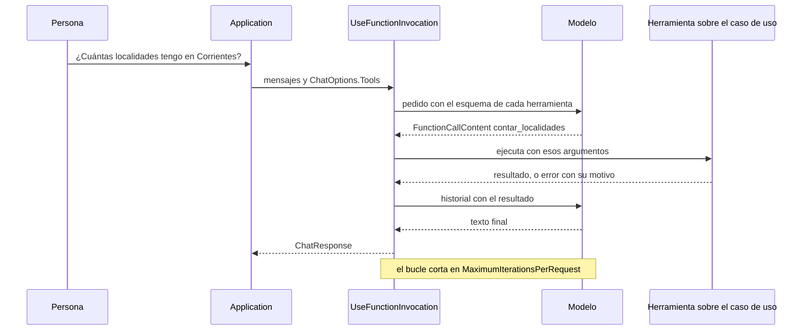
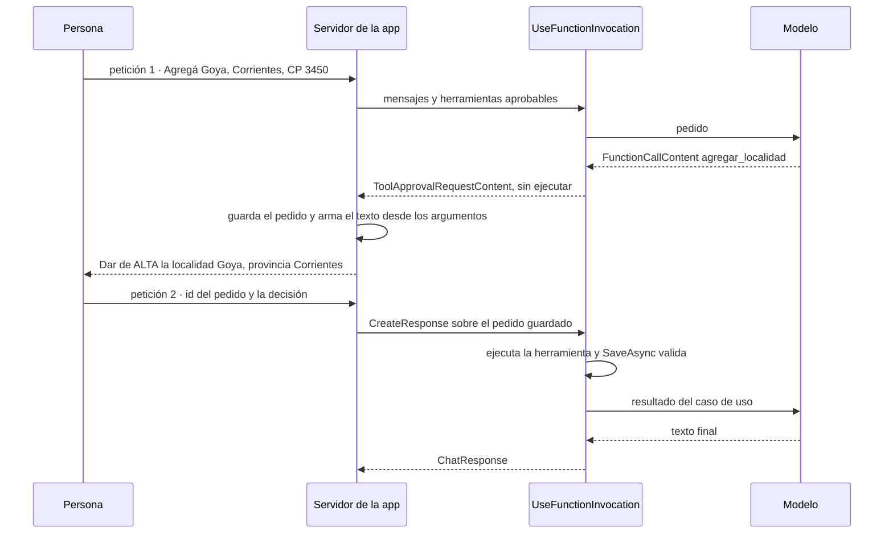
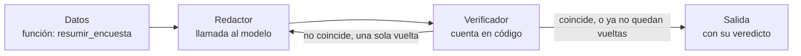
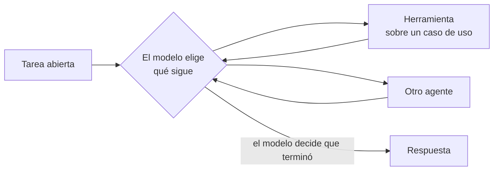
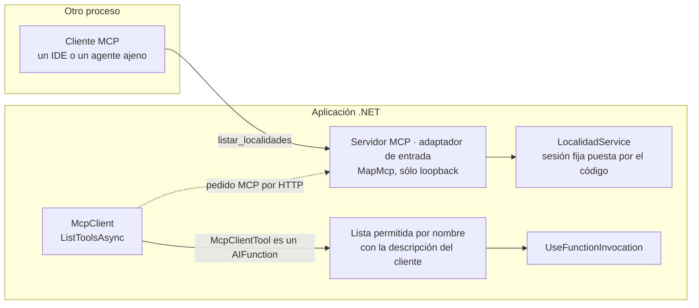

<a id="parte-iv"></a>
# Parte IV · Agencia: ¿qué puede hacer el modelo?

<a id="s8"></a>
## §8 Herramientas, agentes y orquestación

> Estás en: escalones 1 a 3 de agencia · capa Infrastructure/AI · [OA-D5](#oa-d5), [OA-D6](#oa-d6), [OA-D7](#oa-d7), [OA-D8](#oa-d8), [OA-S2](#oa-s2), [OA-S4](#oa-s4)

«¿Cuántas localidades tengo en Corrientes?» y «Borrá Resistencia» se resuelven con el mismo mecanismo: el modelo pide una herramienta y la aplicación ejecuta un caso de uso. Esta sección sube la escalera de agencia de [§3.2](#s3-2) escalón por escalón, cubre ESC-04, ESC-05 y el ESC-01 con herramientas, y llega a la pregunta central: ¿uno o varios agentes? El contrato `IChatClient` y su pipeline vienen de [§5.4](#s5-4); las versiones de M.E.AI, MAF y el SDK de MCP están en el [Anexo F](#anexo-f).

<a id="s8-1"></a>
### §8.1 La escalera de agencia y el criterio de salto

**Definición.** La escalera de agencia ordena las formas de usar un modelo según **cuánto decide**: −1 función sin modelo, 0 llamada única, 1 llamada con herramientas, 2 workflow, 3 agente (el diagrama está en [§3.2](#s3-2)). Resuelve cuál es el escalón más bajo que alcanza para un pedido. No mide qué tan difícil es la API ni qué artefacto se usa. El workflow va antes del agente porque su camino lo fija el código: Anthropic llama workflows a los sistemas orquestados por «predefined code paths» (caminos de código predefinidos) y agentes a los que dejan que los modelos «dynamically direct their own processes» (dirijan su propio proceso) [REF-115].

Cada escalón suma latencia, tokens, puntos de falla y pruebas. Anthropic recomienda empezar por la solución más simple y advierte que los sistemas agénticos cambian latencia y costo por desempeño [REF-115]. El criterio de salto es explícito: se sube cuando el escalón de abajo no alcanza. MAF lo formula para el primero: «If you can write a function to handle the task, do that instead of using an AI agent» (si una función resuelve la tarea, escribí la función) [REF-117]. En el caso, validar un código postal o contar respuestas de la encuesta ya es código (`LocalidadRules`, `EncuestaService`), y un dato exacto se consulta por herramienta, nunca por RAG ([§6.1](#s6-1)).

**Frontera entre los escalones 1 y 3.** En el 1, el pedido es acotado, el código fija las herramientas y un tope de iteraciones, y el bucle termina cuando el modelo responde ese pedido. En el 3, la tarea es abierta: el modelo fija submetas, elige qué sigue y decide cuándo terminó. Criterio de la guía: si el código puede enumerar de antemano qué pedido resuelve el bucle, es escalón 1. «Borrá Resistencia» con `eliminar_localidad(nombre, provincia)` es escalón 1, aunque el modelo liste antes de borrar. Tres cosas no son escalones: la cantidad de agentes ([§8.8](#s8-8)), la aprobación humana ([§8.5](#s8-5)) y el estado de la conversación ([§8.7](#s8-7)). Las formas de construir cada escalón en .NET, con sus anotaciones, están en el cuadro de [§9.3](#s9-3).

**Escalón 1 · el modelo pide, la aplicación ejecuta.**

<a id="s8-2"></a>
### §8.2 Llamada con herramientas

**Definición.** La *llamada con herramientas* (*tool calling*) es el mecanismo por el que el modelo devuelve, en lugar de texto, el pedido de invocar una herramienta con ciertos argumentos; la aplicación la ejecuta y le devuelve el resultado en el historial. En M.E.AI la herramienta es un `AIFunction` que `AIFunctionFactory.Create` arma desde un método, viaja en `ChatOptions.Tools`, y el bucle pedir → ejecutar → reenviar lo hace `UseFunctionInvocation` [REF-121], [REF-45]. Resuelve que el modelo use datos y acciones de la aplicación sin inventarlos. No es un agente ni le da al modelo acceso al sistema: el código decide qué monta y qué ejecuta.

ReAct intercalaba razonamiento y acciones dentro del texto del prompt [REF-21]; desde 2023 las API devuelven la llamada como dato estructurado [REF-23], y en .NET el bucle lo maneja `FunctionInvokingChatClient` sin parsear texto.



**Describir la herramienta es parte del contrato.** El nombre, la `[Description]` del método y la de cada parámetro son todo lo que el modelo ve de ella; Anthropic pide diseñar y probar esa interfaz con el mismo cuidado que una interfaz para personas [REF-115]. En 08, la descripción de `contar_localidades` enumera las provincias de `Catalogos` y la de `listar_localidades` dice lo que **no** devuelve. Una provincia fuera del catálogo vuelve como error con su motivo, nunca como un «0» que el modelo leería como dato.

**Cortar el bucle.** `FunctionInvokingChatClient` expone `MaximumIterationsPerRequest` y `MaximumConsecutiveErrorsPerRequest`; 08 fija 3 y 2. Con un guion que pide `listar_localidades` sin parar, el bucle ejecuta tres herramientas y corta: es una garantía del código y se comprueba en toda corrida. La invocación de funciones va por fuera y las opciones del proveedor en el fondo, para que las llamadas del bucle también las lleven ([§5.4](#s5-4)).

**¿Esto se resolvía con una función?** Si la pregunta fuera siempre «cuántas en tal provincia», sí: un desplegable y `GetAllAsync` filtrado. Criterio de la guía: la herramienta se justifica cuando la persona pregunta con sus palabras y el código no puede prever qué consulta le toca.

<a id="s8-3"></a>
### §8.3 Primer ejercicio: sólo lectura, negativas y sesión

**Definición.** El primer ejercicio del escalón 1 es una herramienta de **sólo lectura** sobre un caso de uso, probada con pedidos que tienen que fallar y con la **sesión** puesta por el código. Resuelve aprender el mecanismo sin riesgo de escritura. No prueba que el modelo use bien las herramientas: eso lo mide una corrida contra el modelo ([§10.4](#s10-4)).

**La sesión es la identidad mínima.** En el caso base, cada visitante tiene sus localidades, aisladas por un id de sesión (`X-Sesion-Id` en la API) [REF-186]. En 08 cada sesión es un alcance de inyección de dependencias con su `SessionContext` fijado antes de armar las herramientas, y ninguna firma recibe un id: el modelo no puede pedir datos de otra sesión porque no hay argumento por donde pedirlos. Dos sesiones en paralelo no se ven, y la propia nunca alcanza a Goya, que sólo tiene la ajena. La sesión no autentica: quien conoce el id ve los datos [REF-186] ([§11.3](#s11-3)).

**Pruebas negativas.** Las de 08 son una provincia fuera del catálogo («Corrientes Capital»), una localidad inexistente, datos que sólo tiene otra sesión y un dato que ninguna herramienta devuelve (los habitantes). Su oráculo, «no inventa», exige que la respuesta no afirme un conteo si alguna herramienta devolvió error, y que toda cifra afirmada coincida con lo que devolvieron las herramientas.

**Menos datos de los que hay.** `listar_localidades` devuelve id, nombre y provincia, sin código postal ni habitantes. En la encuesta, con CTX-SENS, la herramienta `resumir_encuesta` de la demo devuelve porcentajes y su tipo de retorno no tiene `Nombre` ni `Edad` ([§11.4](#s11-4)). En la demo, PD-1 hace estas lecturas desde el chat ([§14.3](#s14-3)).

<a id="s8-4"></a>
### §8.4 Caso de uso como herramienta

**Definición.** Una herramienta de escritura envuelve un caso de uso de Application (`LocalidadService.SaveAsync`, `DeleteAsync`), nunca el repositorio, el `DbContext` ni SQL. Resuelve que el modelo actúe sobre la aplicación sin saltear sus reglas: en el caso base el repositorio no valida duplicados ni reglas, y `SaveAsync` sí [REF-186]. No es un atajo: criterio de la guía, si una herramienta necesita algo que ningún caso de uso expone, se agrega el caso de uso.

**El `Result` vuelve al modelo.** En 09, `agregar_localidad` devuelve el `Result` del caso de uso (`exito`, `mensaje`, `errores`, `id`). Con el código postal «34», `SaveAsync` rechaza por `codigoPostal`, el modelo lee el error y se lo cuenta a la persona. La descripción le pide pasar los datos «tal como los dio la persona», para que corrija la regla y no el modelo. La baja busca por nombre y provincia (`GetByNombreYProvinciaAsync`) y vuelve a buscar al ejecutar, porque la base pudo cambiar entre el pedido y la aprobación; el modelo nunca da un id.

OWASP llama *agencia excesiva* a la vulnerabilidad que permite ejecutar acciones dañinas a partir de salidas inesperadas, ambiguas o manipuladas del modelo, y recomienda limitar las extensiones a lo necesario y pedir aprobación humana para las de alto impacto [REF-162]. Por eso 09 monta sólo dos herramientas, las dos aprobables. En la demo, PD-5 repite el alta desde el chat ([§14.3](#s14-3)).

<a id="s8-5"></a>
### §8.5 Aprobación humana desde el escalón 1

**Definición.** La *aprobación* es que la persona confirme una acción concreta que el modelo pidió, sobre argumentos que resolvió el código, antes de ejecutarla. Se envuelve la herramienta en `ApprovalRequiredAIFunction`: cuando el modelo la pide, la respuesta termina con un `ToolApprovalRequestContent` en lugar de ejecutar, y quien llama contesta con `CreateResponse(true)` o `CreateResponse(false)` [REF-122]. El tipo es de M.E.AI: 09 lo usa sin referenciar MAF (`Examples/09-Caso-De-Uso-Como-Herramienta/09-Caso-De-Uso-Como-Herramienta.csproj`), así que es un control transversal desde el escalón 1. No es validación ni autorización.

**En dos peticiones.** En una aplicación web, el pedido y la decisión llegan en peticiones distintas. 09 guarda el pedido en el servidor al terminar la primera; la segunda trae sólo el id y la decisión, y la respuesta se arma con `CreateResponse` sobre el pedido **guardado**, nunca con datos que mande el cliente. Si llega una llamada con argumentos distintos de los mostrados, se rechaza (prueba `Aprobacion_ArgumentosAlterados_SeRechaza`). Una sonda repitió el alta contra el modelo y esas garantías se cumplieron. Observado en el laboratorio, sonda de aprobación en dos peticiones: `qwen3.5:4b` (digest `2a654d98e6fb`), Ollama 0.32.0-rc0, sólo CPU, servidor compartido, 2026-10-27.



**Aprobar no es validar ni autorizar.** En la demostración de 09 la persona aprueba también el «34»; el que no deja escribir es `SaveAsync`. Y aprobar dice que la persona quiere la acción, no que pueda hacerla: la demo muestra aislamiento por sesión y aprobación, no autorización ([§11.3](#s11-3)).

**Advertencia.** Toda herramienta que escribe se monta aprobable. Si antes de pedirla el modelo leyó texto que la aplicación no escribió (el nombre de una localidad, un resultado que llegó por MCP), 11 y la demo marcan el pedido y lo dicen al mostrarlo. La defensa contra instrucciones escondidas en ese texto está en [§11.2](#s11-2).

**¿Quién arma el texto que aprueba la persona?** El código, desde los argumentos de la llamada y lo que resolvió el caso de uso; la prosa del modelo no entra. En 11 el modelo pidió la baja con la provincia vacía, y el pedido mostró «(Chaco), id 2», que salió de `GetByNombreYProvinciaAsync`. Observado: `qwen3.5:4b`, servidor compartido, 2026-10-27 ([Ejemplos](#s8-ejemplos)).

**Escalón 2 · el camino lo fija el código.**

<a id="s8-6"></a>
### §8.6 Workflows

**Definición.** Un *workflow* de MAF es un grafo dirigido de *executors* unidos por aristas, armado con `WorkflowBuilder`; en .NET la API es sólo la de grafo [REF-124]. Corre por *supersteps*: en cada uno se entregan los mensajes pendientes, corren los executors de destino y hay una barrera antes del siguiente [REF-125]; al cerrar cada uno puede quedar un *checkpoint* [REF-127]. Un `RequestPort` es el nodo por donde el workflow le pide algo a una persona; los pedidos pendientes viajan en el checkpoint y se vuelven a emitir al restaurar [REF-128]. No es un agente: sus nodos pueden ser funciones, llamadas al modelo o agentes, y sigue en el escalón 2 mientras el camino lo fije el código.

Un executor con `[MessageHandler]` es una clase `partial` derivada de `Executor` [REF-126], y exige el paquete `Microsoft.Agents.AI.Workflows.Generators`: sin él no compila (`CS0534`). La documentación vuelve executor a una función con `BindExecutor`; con la versión del [Anexo F](#anexo-f) eso no compila (`CS0411`) y el método es `BindAsExecutor`. Las dos fallas se reprodujeron al construir 10. El almacén de checkpoints es una frontera de confianza: «Checkpoint storage is a trust boundary» [REF-127].

**El contraejemplo.** La encuesta de tres pasos parece un workflow. La tabla de MAF indica uno cuando «the process has well-defined steps» (el proceso tiene pasos bien definidos) [REF-117], y la encuesta los tiene. La deja afuera la regla de la misma página: si una función resuelve la tarea, se escribe la función [REF-117]. 10 la escribe dos veces, como un `for` y como workflow con `RequestPort` y checkpoints, sobre el mismo `ValidarPaso`. Las dos dan lo mismo en las cuatro entradas congeladas, y el workflow se rehidrata en otra instancia sin volver a preguntar. Funciona, y no compra nada que la encuesta necesite: no hay modelo que elija el camino ni una espera que sobrevivir a un reinicio. Es escalón −1.

**La instancia positiva.** La variante «un-agente» de 12 pone un modelo dentro de un camino fijo: un nodo de datos, un redactor que llama al modelo y un verificador que compara los porcentajes con `ResultadosDeEncuestaService`, con una sola vuelta de corrección. Criterio de la guía: acá el workflow se justifica porque el verificador tiene que ser código y estar en el medio del camino.



Los workflows de MAF son grafos con estado, checkpoints y pausa humana [REF-124], [REF-127], [REF-128], como LangGraph en Python [REF-142], [REF-143]. Llamarlos su equivalente en .NET es criterio de la guía; si existe un LangGraph para .NET y cómo se integra uno se responde en [§9.4](#s9-4).

**El artefacto agente y el escalón 3.**

<a id="s8-7"></a>
### §8.7 Agentes de MAF y el escalón 3

**Definición.** En MAF, un *agente* (`AIAgent`) usa un modelo para procesar entradas, llamar herramientas y servidores MCP y responder [REF-117]. Se arma con `AsAIAgent` sobre cualquier `IChatClient` [REF-119], y su `AgentSession` guarda el estado de la conversación entre llamadas a `RunAsync` [REF-122]. Resuelve instrucciones propias, estado y composición con otros agentes. No es el escalón 3: el artefacto no fija el escalón.

**11 usa un agente y sigue en el escalón 1.** El pedido es acotado («Borrá Resistencia.»), el código monta dos herramientas y el bucle tiene tope 3. Lo que suma el agente es **estado**: la `AgentSession` se serializa al final de la primera petición (`SerializeSessionAsync`) y se deserializa en la segunda (`DeserializeSessionAsync`); entre una y otra, el servidor guarda sólo la sesión y el pedido pendiente. El ejemplo sube más de lo necesario para la aprobación, que 09 resuelve sin agente: el agente se justifica por la conversación que tiene que sobrevivir entre dos peticiones.

**El escalón 3, sin ejemplo ejecutado.** En el escalón 3 el modelo recibe una tarea que el código no puede enumerar de antemano y decide qué herramienta o qué agente sigue. MAF trae orquestaciones prearmadas como *handoff* y Magentic [REF-129]; criterio de la guía: en ellas un modelo elige al siguiente agente. Anthropic pide para los agentes autónomos entornos aislados, guardas y condiciones de corte, como un máximo de iteraciones [REF-115]. La guía no lo ejecuta porque ningún pedido del caso lo necesita.



**¿Qué perderías con `UseFunctionInvocation` y el historial en el circuito?** Para la baja con aprobación, nada que el caso use: la demo hace PD-6 así, con la conversación en el estado del circuito de Blazor y el bucle de M.E.AI ([§14.3](#s14-3)). Se pierde la composición con otros agentes y una sesión serializable que puede volver en otro proceso: si la conversación tiene que sobrevivir al proceso, 11 muestra que alcanza con serializar la `AgentSession`.

**Dimensión cruzada · ¿uno o varios agentes?**

<a id="s8-8"></a>
### §8.8 ¿Uno o varios agentes?

**Definición.** La cantidad de agentes no es un escalón. Entre las orquestaciones de MAF están secuencial, concurrente, *handoff* y Magentic [REF-129]. Criterio de la guía: las dos primeras siguen un camino fijo (escalón 2); en las otras dos un modelo elige al siguiente agente (escalón 3, el de mayor autonomía). Resuelve repartir una tarea entre instrucciones distintas. No mejora la calidad por sí sola: cada agente es un artefacto más que configurar, probar y observar.

**El costo en 12.** La variante «dos-agentes» cambia sólo quién recibe la corrección: un segundo agente, hecho con `AsAIAgent` sobre el mismo cliente, recibe el mismo mensaje que el redactor recibe en «un-agente». El camino, el verificador y el pedido no cambian. Con el guion y una vuelta, las dos variantes hacen las mismas llamadas al modelo. Contra el modelo, en las cuatro corridas (dos pedidos por dos variantes) el primer texto del redactor ya coincidió con el servicio: 4 de 4, sin vueltas, y el corrector nunca se llamó contra el modelo. Observado: `qwen3.5:4b`, servidor compartido, 2026-10-27; estímulo del mismo autor. Con dos pedidos, 12 ilustra el costo con métricas deterministas (llamadas, tokens, vueltas); no responde si conviene uno o varios, y los tiempos del servidor compartido no se comparan ([§10.4](#s10-4)).

<a id="s8-9"></a>
### §8.9 MCP: exponer y consumir herramientas

**Definición.** *MCP* (*Model Context Protocol*) es un protocolo abierto para que un cliente de IA descubra y llame herramientas y recursos de otro proceso [REF-37], [REF-130]. Resolvió lo que la llamada con herramientas dejaba a cada aplicación: «Every new data source requires its own custom implementation» (cada fuente nueva pedía su integración a medida) [REF-37]. La aplicación puede exponer (servidor) o consumir (cliente). No es un marco de agentes ni reemplaza la llamada con herramientas: criterio de la guía, si la herramienta la usa sólo tu aplicación, un `AIFunction` en proceso alcanza.



**Servidor: sólo lecturas y sólo loopback.** En 13 el servidor es un adaptador de entrada, como un controller: `[McpServerToolType]` y `[McpServerTool]` publican `listar_localidades` sobre `LocalidadService`, siempre en una sesión fija de demostración que pone el código; el SDK le pasa por inyección de dependencias los servicios que pide [REF-133]. Escucha en loopback y limita `AllowedHosts` a loopback, como pide la documentación del SDK para servidores HTTP locales contra el *rebinding* de DNS [REF-132]; además rechaza todo `Origin` que no sea de loopback. Ninguna de las tres cosas es control de acceso: cualquier proceso de la máquina puede llamarlo, y por eso publica una sola lectura. La demo no expone `/mcp`.

**Cliente: lo que anuncia el servidor no decide.** `McpClient.ListToolsAsync` devuelve `McpClientTool`, que hereda de `AIFunction` y entra tal cual en `ChatOptions.Tools` [REF-132]. 13 no lo monta tal cual: toma sólo lo que está en su lista permitida por nombre, con la descripción que escribe el cliente, y descarta el resto. Un servidor guionado que anuncia `borrar_todo` marcada `ReadOnly = true` no se monta, y una escritura permitida se montaría aprobable. Qué exige la especificación sobre `Origin` y sobre autorización está en [§11.5](#s11-5).

<a id="s8-practica"></a>
### Práctica de §8

<a id="s8-escenarios"></a>
#### Aplicación por escenario

Sólo las celdas que cambian; «—» significa sin diferencia con la combinación de la guía, CTX-EXISTENTE × CTX-LOCAL × CTX-PROTO ([§2.2](#s2-2)).

| Escenario | Qué aporta | CTX-LOCAL | CTX-NUBE | CTX-SENS | CTX-PROD |
|---|---|---|---|---|---|
| ESC-01 con herramientas | lecturas sobre casos de uso; el dato exacto por herramienta | el modelo puede no llamar a la herramienta pedida (08, [Ejemplos](#s8-ejemplos)); la capacidad se prueba por modelo [REF-35] | — | agregados, nunca filas con `Nombre` y `Edad` ([§11.4](#s11-4)) | telemetría de cada ejecución ([§12.1](#s12-1)) |
| ESC-04 | escrituras sobre casos de uso, todas aprobables | por `/v1` no hay `tool_choice` [REF-51] | argumentos y resultados viajan al proveedor en el contexto | la herramienta devuelve lo mínimo | autorización además de aprobación ([§11.3](#s11-3)) |
| ESC-05 | servidor MCP de lecturas; cliente con lista permitida | sólo loopback | — | sesión fija, sin datos de personas | control de acceso antes de salir de loopback ([§11.5](#s11-5)) |

<a id="s8-ejemplos"></a>
#### Ejemplos

Los comandos se corren desde la carpeta de la guía; el orden es el de lectura del [Anexo E](#anexo-e). El vocabulario de la evidencia (cliente guionado, oráculo, IC95, cableado, humo, estímulo del mismo autor) está en [§0.4](#s0-4). Las entradas de 08 a 13 las escribimos para los ejemplos: todas son estímulo del mismo autor.

**08 · Primera herramienta, de sólo lectura** · `Examples/08-Primera-Herramienta-Solo-Lectura/` · básico · ilustra [§8.2](#s8-2) y [§8.3](#s8-3) · [OA-D5](#oa-d5).

```bash
tools/verificar.sh correr 08-Primera-Herramienta-Solo-Lectura                 # --fake --verificar, sin servidor
tools/verificar.sh correr 08-Primera-Herramienta-Solo-Lectura --con-modelo
```

`Examples/08-Primera-Herramienta-Solo-Lectura/Infrastructure/AI/HerramientasDeLectura.cs`
```csharp
[Description("Cuenta cuántas localidades tiene cargadas la persona en una provincia del catálogo.")]
public async Task<ConteoDto> ContarLocalidadesAsync(
    [Description("Nombre exacto de la provincia, uno de: Buenos Aires, Chaco, Córdoba, Corrientes, Entre Ríos, Mendoza, Santa Fe.")] string provincia,
    CancellationToken cancellationToken = default)
{
    // Misma regla que LocalidadRules.ProvinciaValida: clave exacta del catálogo. Un texto fuera de
    // catálogo es un error con su motivo, nunca un «0» (que el modelo leería como dato).
    if (!Catalogos.Provincias.Contains(provincia))
    {
        return new ConteoDto(provincia, null,
            $"La provincia «{provincia}» no está en el catálogo ({string.Join(", ", Catalogos.Provincias)}).");
    }
    var todas = await localidades.GetAllAsync(cancellationToken);
    return new ConteoDto(provincia, todas.Count(l => l.Provincia == provincia), null);
}
```

`Examples/08-Primera-Herramienta-Solo-Lectura/Infrastructure/AI/AsistenteDeConsulta.cs`
```csharp
_bucle = new ChatClientBuilder(Grabador)
    .UseFunctionInvocation(configure: f =>
    {
        f.MaximumIterationsPerRequest = MaximoDeIteraciones;
        f.MaximumConsecutiveErrorsPerRequest = 2;
    })
    .Build();
```

Qué mirar: `ContarLocalidadesAsync` llama a `localidades`, el caso de uso de la sesión, y devuelve `Cantidad` nula con el motivo cuando la provincia no está en `Catalogos`.

Observado: `qwen3.5:4b`, servidor compartido, 2026-10-27; estímulo del mismo autor. En l01 el modelo llamó a `contar_localidades` con `"Corrientes"`, recibió `"cantidad":1` y contestó:

```text
Tiene cargada 1 localidad en la provincia de Corrientes.
```

En n01 («¿Cuántos habitantes tiene Goya según mis datos? Usá las herramientas.») no llamó a ninguna herramienta, aunque se le pedía, y contestó que no tiene ese dato. Pasan las 2, sin tasa. En la extensión, con el mismo rótulo, el modelo invocó la herramienta con argumentos válidos en las 4 entradas legítimas, IC95 [0,398; 1]. El oráculo «no inventa» dio 6 de 8, IC95 [0,349; 0,968], y sus dos fallas no son invenciones: en una el modelo sumó dos conteos que devolvieron las herramientas, en otra repitió un identificador de sesión que lleva dígitos, y el oráculo los leyó como cifras. Salida con `--fake` (cliente guionado), sin modelo:

```text
n01 (negativa: dato que no está ni en la base ni en el pedido): «¿Cuántos habitantes tiene Goya según mis datos? Usá las herramientas.»
  herramienta contar_localidades({"provincia":"Goya"}) → {"provincia":"Goya","error":"La provincia «Goya» no está en el catálogo (Buenos Aires, Chaco, Córdoba, Corrientes, Entre Ríos, Mendoza, Santa Fe)."}
  herramienta listar_localidades({}) → [{"id":4,"nombre":"Corrientes","provincia":"Corrientes"},{"id":5,"nombre":"Resistencia","provincia":"Chaco"}]
  respuesta del guion: No tengo ese dato: Goya no está entre tus localidades y las herramientas no informan habitantes.
  llamadas al modelo: 3 · herramientas ejecutadas: 2
  oráculo no-inventa: pasa
corte del bucle (guion que pide listar_localidades sin parar): 3 herramientas ejecutadas y 4 llamadas al «modelo», con MaximumIterationsPerRequest = 3
```

Probá `--extension`, que corre las 8 entradas de la extensión en lugar de las 2 de la demostración.

**09 · Caso de uso como herramienta** · `Examples/09-Caso-De-Uso-Como-Herramienta/` · intermedio · ilustra [§8.4](#s8-4) y [§8.5](#s8-5) · [OA-D5](#oa-d5), [OA-S2](#oa-s2). Dos escrituras aprobables, sin MAF.

```bash
tools/verificar.sh correr 09-Caso-De-Uso-Como-Herramienta                 # --fake, sin red
tools/verificar.sh correr 09-Caso-De-Uso-Como-Herramienta --con-modelo
```

`Examples/09-Caso-De-Uso-Como-Herramienta/Application/Herramientas/HerramientasDeLocalidades.cs`
```csharp
public IList<AITool> Crear() =>
[
    new ApprovalRequiredAIFunction(AIFunctionFactory.Create(AgregarAsync, Agregar,
        "Da de alta una localidad en el ABM. Pasá los datos tal como los dio la persona, sin corregirlos.")),
    new ApprovalRequiredAIFunction(AIFunctionFactory.Create(EliminarAsync, Eliminar,
        "Da de baja una localidad del ABM, buscándola por nombre y provincia."))
];

// …
    var model = new LocalidadModel { Nombre = nombre, Provincia = provincia, CodigoPostal = codigoPostal, Habitantes = habitantes };
    var resultado = ResultadoDeHerramienta.De(await localidades.SaveAsync(model, cancellationToken));
```

`Examples/09-Caso-De-Uso-Como-Herramienta/Application/Aprobacion/ServidorDeAprobaciones.cs`
```csharp
public ToolApprovalResponseContent Responder(string id, bool aprobar, FunctionCallContent? recibida = null)
{
    if (!_pendientes.Remove(id, out var pendiente))
    {
        throw new InvalidOperationException($"No hay un pedido de aprobación pendiente con id {id}.");
    }
    if (recibida is not null && (recibida.Name != pendiente.Herramienta || Canonico(Copiar(recibida.Arguments)) != Canonico(pendiente.Argumentos)))
    {
        return pendiente.Pedido.CreateResponse(false, "Los datos no coinciden con el pedido que se mostró.");
    }
    if (aprobar) Aprobados.Add(pendiente.CallId);
    return pendiente.Pedido.CreateResponse(aprobar, aprobar ? null : "La persona no lo aprobó.");
}
```

Qué mirar: `Responder` arma la respuesta desde `pendiente.Pedido`, el pedido guardado, y la rechaza si los argumentos recibidos no son los mostrados.

Observado: `qwen3.5:4b`, servidor compartido, 2026-10-27; estímulo del mismo autor. La persona aprueba los dos pedidos:

```text
e01: «Agregá Goya, Corrientes, CP 34, 90000 habitantes.»
  pedido de aprobación [ficc_e5e09204]: Dar de ALTA la localidad «Goya», provincia «Corrientes», CP «34», 90000 habitantes.
  la persona aprueba
  ejecutó agregar_localidad → rechazo: Revise los campos marcados en rojo. (codigoPostal: El código postal debe tener 4 dígitos.)
  asistente (modelo): La localidad no se pudo registrar porque el código postal tiene un formato incorrecto; requiere exactamente cuatro dígitos. Por favor, inténtalo nuevamente con los datos correctos.
  llamadas al modelo: 2 · oráculo alta-con-aprobacion (esperado rechazo): pasa
```

El modelo pasó el «34» sin corregirlo y lo rechazó `SaveAsync`; con «3450», el alta se guardó con lo mismo que mostró el pedido. 2 de 2, sin tasa; con `--fake`, la respuesta es del guion.

**10 · Workflow y contraejemplo** · `Examples/10-Workflow-Y-Contraejemplo/` · avanzado · ilustra [§8.6](#s8-6) · [OA-D6](#oa-d6). Sin modelo.

```bash
tools/verificar.sh correr 10-Workflow-Y-Contraejemplo   # compila con -warnaserror y corre --fake --verificar
```

`Examples/10-Workflow-Y-Contraejemplo/Application/Encuestas/EncuestaComoFuncion.cs`
```csharp
for (var paso = 1; paso <= EncuestaRules.TotalDePasos; paso++)
{
    while (true)
    {
        var respuesta = persona.Contestar(paso);
        if (respuesta is null)
            return new ResultadoDeEncuesta(false, paso, intentos, rechazos, ResultadoDeEncuesta.DatosDe(modelo));

        intentos[paso - 1]++;
        respuesta.AplicarA(modelo);
        var errores = servicio.ValidarPaso(paso, modelo);
        if (errores.Count == 0) break;
        rechazos.AddRange(errores.Keys.Order(StringComparer.Ordinal).Select(c => $"{paso}.{c}"));
    }
}
```

`Examples/10-Workflow-Y-Contraejemplo/Application/Workflows/EncuestaComoWorkflow.cs`
```csharp
var encuesta = new EncuestaExecutor(servicio);
var persona = RequestPort.Create<PedidoDePaso, Contestacion>(PersonaId);
// …
var cierre = cerrar.BindAsExecutor(CierreId);

return new WorkflowBuilder(encuesta)
    .AddEdge(encuesta, persona)
    .AddEdge(persona, encuesta)
    .AddEdge(encuesta, cierre)
    .WithOutputFrom(cierre)
    .WithName("encuesta-de-tres-pasos")
    .Build();
```

Qué mirar: las dos versiones llaman al mismo `ValidarPaso`; lo único que agrega el workflow es el `RequestPort` como nodo y la arista de vuelta.

Salida sin modelo (no hay `IChatClient` que reemplazar), de la entrada con un medio fuera del catálogo:

```text
e02: un medio fuera del catálogo en el paso 2; la persona corrige
  […]
  antes de la pausa: pedido paso 3: se deja sin contestar (pausa)
  antes de la pausa: superstep 11: checkpoint con el pedido pendiente; se corta
  rehidratado: pedido paso 3 (intento 1): contesta
  función: completa[1,2,1] · workflow: completa[1,2,1] · rehidratado: completa[1,2,1]
  supersteps: 14 · checkpoints: 14 · pedidos tras rehidratar: 1
  oráculo workflow-igual-funcion (esperado completa[1,2,1]): pasa
```

`completa[1,2,1]` son los intentos por paso: el medio rechazado en el paso 2 lo rechaza `ValidarPaso` en las dos versiones, porque la regla es del caso de uso y no de la orquestación.

**11 · Agente con aprobación** · `Examples/11-Agente-Con-Aprobacion/` · avanzado · ilustra [§8.5](#s8-5) y [§8.7](#s8-7) · [OA-D6](#oa-d6), [OA-S4](#oa-s4).

```bash
tools/verificar.sh correr 11-Agente-Con-Aprobacion                 # --fake, sin red
tools/verificar.sh correr 11-Agente-Con-Aprobacion --con-modelo
```

`Examples/11-Agente-Con-Aprobacion/Corrida.cs`
```csharp
var agente = ArmarAgente(grabador, herramientas.Crear());
var sesion = await agente.CreateSessionAsync(cancellationToken);
var respuesta = await agente.RunAsync(texto, sesion, cancellationToken: cancellationToken);
// …
estado = (await agente.SerializeSessionAsync(sesion, cancellationToken: cancellationToken)).GetRawText();
// …
var agente = ArmarAgente(grabador, herramientas.Crear());
using var guardado = JsonDocument.Parse(estado);
var sesion = await agente.DeserializeSessionAsync(guardado.RootElement, cancellationToken: cancellationToken);
List<AIContent> respuestas = [.. automaticas, .. decisiones.Select(d => servidor.Responder(d.Id, d.Aprobar))];
var respuesta = await agente.RunAsync(new ChatMessage(ChatRole.User, respuestas), sesion, cancellationToken: cancellationToken);
```

Qué mirar: cada petición arma el agente de nuevo, y lo único que pasa de una a otra es `estado`, la `AgentSession` serializada.

Observado: `qwen3.5:4b`, servidor compartido, 2026-10-27; estímulo del mismo autor.

```text
e01: «Borrá Resistencia.»
  pedido de aprobación [ficc_d72b35cd]: Borrar "Resistencia" (Chaco), id 2, de tu sesión.
  la persona aprueba
  ejecutó eliminar_localidad → éxito: Se eliminó la localidad Resistencia.
  asistente (modelo): La baja de la localidad "Resistencia" fue aprobada y se ha realizado correctamente. Ya no figura en el listado del ABM de localidades.
  peticiones: 2 · AgentSession serializada entre peticiones: 2 vez/veces · base: 2 → 1 localidades
  llamadas al modelo: 2 · oráculo agente-con-aprobacion (esperado baja): pasa
```

El modelo llamó directo a `eliminar_localidad`, sin listar, con la provincia vacía; el pedido mostró lo que resolvió el caso de uso y la baja ejecutada fue la mostrada. 1 de 1, sin tasa. Con `--fake`, el guion lista antes de borrar y el pedido sale marcado («Este pedido viene después de leer texto que la app no escribió.»).

**12 · ¿Uno o varios agentes?** · `Examples/12-Uno-O-Varios-Agentes/` · avanzado · ilustra [§8.6](#s8-6) y [§8.8](#s8-8) · [OA-D7](#oa-d7).

```bash
tools/verificar.sh correr 12-Uno-O-Varios-Agentes                 # --fake --verificar, sin servidor
tools/verificar.sh correr 12-Uno-O-Varios-Agentes --con-modelo
```

`Examples/12-Uno-O-Varios-Agentes/Application/Workflows/CaminoDelResumen.cs`
```csharp
var builder = new WorkflowBuilder(datos)
    .AddEdge(datos, redactor)
    .AddEdge(redactor, verificador);

if (variante == Variante.UnAgente)
{
    builder = builder.AddEdge(verificador, redactor);
}
else
{
    var agente = (clienteDelCorrector ?? throw new ArgumentNullException(nameof(clienteDelCorrector)))
        .AsAIAgent(instructions: Indicaciones.DelCorrector, name: "corrector",
                   description: "Reescribe un resumen con los errores que encontró el verificador.");
    var corrector = new CorrectorExecutor(agente);
    builder = builder.AddEdge(verificador, corrector).AddEdge(corrector, verificador);
}

return builder.WithOutputFrom(verificador).WithName($"resumen-{Nombre(variante)}").Build();
```

Qué mirar: la única diferencia entre variantes es el destino de la arista que sale del verificador.

Salida con `--fake` (cliente guionado), sin modelo; el guion escribe un porcentaje equivocado para forzar la vuelta:

```text
e01.un-agente: «Escribí un resumen breve de la encuesta para el informe: qué porcentaje de las respuestas usa colectivo y qué porcentaje usa bicicleta.»
  camino: Datos → Redactor → Verificador → Redactor → Verificador
  redactor (guion): El 25 % de las respuestas usa colectivo y el 35 % usa bicicleta.
  redactor (guion): El 20 % de las respuestas usa colectivo y el 35 % usa bicicleta.
  verificador: coincide
  oráculo porcentajes-del-servicio: pasa
e01.dos-agentes: «Escribí un resumen breve de la encuesta para el informe: qué porcentaje de las respuestas usa colectivo y qué porcentaje usa bicicleta.»
  camino: Datos → Redactor → Verificador → Corrector → Verificador
  redactor (guion): El 25 % de las respuestas usa colectivo y el 35 % usa bicicleta.
  corrector (guion): El 20 % de las respuestas usa colectivo y el 35 % usa bicicleta.
  verificador: coincide
  oráculo porcentajes-del-servicio: pasa
```

Observado: `qwen3.5:4b`, servidor compartido, 2026-10-27; estímulo del mismo autor. El primer texto del redactor, el mismo en las dos variantes:

```text
El 20 % de las respuestas indica el uso del colectivo y el 35 % corresponde a la bicicleta.
```

**13 · Servidor y cliente MCP** · `Examples/13-Servidor-Y-Cliente-MCP/` · intermedio · ilustra [§8.9](#s8-9) · [OA-D8](#oa-d8).

```bash
tools/verificar.sh correr 13-Servidor-Y-Cliente-MCP                 # --fake --verificar, sin servidor de modelos
tools/verificar.sh correr 13-Servidor-Y-Cliente-MCP --con-modelo
```

`Examples/13-Servidor-Y-Cliente-MCP/Infrastructure/AI/ClienteMcp.cs`
```csharp
public static Montaje Montar(IEnumerable<McpClientTool> anunciadas, PoliticaDeMontaje politica)
{
    var montadas = new List<AITool>();
    var descartadas = new List<string>();
    foreach (var herramienta in anunciadas)
    {
        if (politica.Lecturas.TryGetValue(herramienta.Name, out var descripcion))
        {
            // La descripción que ve el modelo es la del cliente, no la que mandó el servidor.
            montadas.Add(herramienta.WithDescription(descripcion));
        }
        else if (politica.Escrituras.Contains(herramienta.Name))
        {
            montadas.Add(new ApprovalRequiredAIFunction(herramienta));
        }
        else
        {
            descartadas.Add(herramienta.Name);
        }
    }
    return new Montaje(montadas, descartadas);
}
```

Qué mirar: el `else` final descarta todo lo que el cliente no permitió por nombre, diga lo que diga el servidor de sí mismo.

Observado: `qwen3.5:4b`, servidor compartido, 2026-10-27; estímulo del mismo autor. La errata de la respuesta es del modelo:

```text
[…]
m01 (lectura por MCP en la sesión fija demo-mcp): «¿Qué localidades tengo cargadas? Usá la herramienta.»
  herramienta MCP listar_localidades({}) → {"$type":"text","Text":"[{\"id\":1,\"nombre\":\"Corrientes\",\"provincia\":\"Corrientes\"},{\"id\":2,\"nombre\":\"Resistencia\",\"provincia\":\"Chaco\"}]","Annotations":null,"AdditionalProperties":null}
  respuesta del modelo: Téngés cargadas las localidades de Corrientes y Resistencia.
  llamadas al modelo: 2 · herramientas ejecutadas: 1
  oráculo mcp-sesion-fija: pasa
servidor guionado (anuncia borrar_todo con ReadOnly = true): el cliente descarta borrar_todo; borrar_todo no se ejecutó
Host ajeno → 400 · Origin ajeno → 403 · Origin «null» → 403 · Origin de loopback → 200
```

1 de 1, sin tasa. El resultado de la herramienta llega como texto: es contenido que la aplicación no escribió. Con `--fake`, la herramienta y el servidor MCP son reales y sólo la respuesta es del guion.

**En la demo.** PD-1 y PD-5 se prueban por cableado y se apoyan en 08, 12 y 09 ([§14.3](#s14-3)). PD-6 repite la baja de 11 sin MAF: `UseFunctionInvocation` y el historial en el circuito de Blazor. Las escrituras se montan así:

`Demos/MovilidadUrbana.Asistente/src/MovilidadUrbana.Asistente/Infrastructure/AI/Chat/HerramientasDelAsistente.cs`
```csharp
AIFunction agregar = new GuardaDeOrigen(AIFunctionFactory.Create(AgregarLocalidadAsync, Agregar,
    "Da de alta una localidad en la sesión. La app le pide confirmación a la persona antes de guardar."), estado);
AIFunction eliminar = new GuardaDeOrigen(AIFunctionFactory.Create(EliminarLocalidadAsync, Eliminar,
    "Da de baja una localidad de la sesión por nombre y, si hace falta, provincia. La app pide confirmación."), estado);
herramientas.Add(escriturasAprobables ? new ApprovalRequiredAIFunction(agregar) : agregar);
herramientas.Add(escriturasAprobables ? new ApprovalRequiredAIFunction(eliminar) : eliminar);
```

Observado: `qwen3.5:4b`, servidor compartido, 2026-10-27; humo de la demo. Ante «Borrá Resistencia», el modelo pidió `eliminar_localidad` con Resistencia y Chaco, el código mostró «Eliminar la localidad «Resistencia» (Chaco), id 2, de tu sesión.», la persona rechazó en la segunda petición y la base no cambió. Ninguna de las 70 pruebas de la demo registra una baja sin aprobación.

<a id="s8-preguntas"></a>
#### Preguntas guía

**¿Necesito un agente o alcanza con `UseFunctionInvocation`?** ([OA-D6](#oa-d6))

Para un pedido acotado, alcanza con `UseFunctionInvocation`: una pregunta, una o dos herramientas, una respuesta, como en 08 y 09. El agente de MAF se justifica cuando hace falta algo que el bucle no trae: una sesión serializable entre peticiones, como en 11, instrucciones propias que se reusan o la composición con otros agentes ([§8.7](#s8-7)). En CTX-LOCAL el agente no cambia el modelo ni sus capacidades: corre sobre el mismo `IChatClient` [REF-119], con la misma capa de opciones y un solo bucle de herramientas, como comprueba 11. La respuesta cambia si la tarea se vuelve abierta y el código ya no puede enumerar qué pedido resuelve el bucle: ahí se habla de escalón 3, y elegís el agente por la autonomía, no por el estado.

**¿Cómo convierto un caso de uso en herramienta sin saltear sus reglas?** ([OA-D5](#oa-d5))

La herramienta recibe el caso de uso de Application y le pasa los argumentos sin corregirlos; devuelve el `Result` entero, con errores por campo, para que el modelo los cuente o reintente ([§8.4](#s8-4)). La sesión la pone el código antes de armar la herramienta, y ninguna firma la recibe ([§8.3](#s8-3)). En CTX-EXISTENTE comprobá antes que el caso de uso valide de verdad: el caso base tiene reglas con huecos ([§14.1](#s14-1)), y una herramienta sobre un caso de uso que no valida expone ese hueco al modelo. Si la herramienta necesita un dato que ningún caso de uso da, como los agregados de la encuesta, la respuesta es escribir ese caso de uso.

**¿Cuándo pido aprobación humana y quién arma el pedido?** ([OA-S2](#oa-s2), [OA-S4](#oa-s4))

En esta guía, para toda escritura: alta y baja se montan con `ApprovalRequiredAIFunction`, y las lecturas no. El pedido lo arma el código con los argumentos de la llamada y lo que resolvió el caso de uso, como en 09 y 11, y la respuesta se construye sobre el pedido guardado ([§8.5](#s8-5)). Con CTX-SENS, el pedido tampoco muestra más de lo necesario: una baja sobre la encuesta no tendría por qué enseñar `Nombre` ni `Edad`. La respuesta cambia para una escritura reversible y ya validada en un contexto sin datos sensibles: ahí podrías decidir no pedir aprobación, pero esa decisión es de ACT-SEC y queda en ADR-06.

**¿Agente o workflow?** ([OA-D6](#oa-d6))

Si los pasos se conocen de antemano, workflow; si el modelo tiene que decidir qué sigue, agente [REF-117]. Antes de las dos, preguntá si una función alcanza: la encuesta de 10 tiene pasos fijos y gana el `for` ([§8.6](#s8-6)). El workflow paga su costo cuando hay una pausa humana que tiene que sobrevivir a un reinicio (checkpoint y `RequestPort`) [REF-127], [REF-128], varias piezas que coordinar [REF-117] o pasos en paralelo [REF-125]. En CTX-PROD pesa además que el almacén de checkpoints es una frontera de confianza [REF-127]. La respuesta cambia si el número y el tipo de pasos dependen del contenido de cada pedido: ahí el camino no se puede dibujar antes y elegís el agente.

**¿De verdad necesito varios agentes o basta con uno bien diseñado?** ([OA-D7](#oa-d7))

En Movilidad Urbana basta con uno: en 12 el segundo agente sólo cambia quién recibe la corrección, y contra el modelo nunca llegó a llamarse ([§8.8](#s8-8)). Cada agente suma instrucciones, pruebas y telemetría propias. Varios agentes se justifican cuando las instrucciones de cada parte se contradicen o crecen tanto que una sola no las sostiene; criterio de la guía: medilo antes, con métricas deterministas (llamadas, tokens, vueltas) sobre los mismos pedidos. En CTX-NUBE cada llamada de más tiene precio por token, y en CTX-LOCAL ocupa un servidor compartido. La respuesta cambia si la variante con más agentes resuelve en la medición pedidos que la de uno no resuelve.

<a id="s8-calidad"></a>
#### Criterios de calidad y antipatrones

- Cada herramienta envuelve un caso de uso de Application, recibe la sesión del alcance y no de un argumento, y devuelve lo mínimo; una prueba de arquitectura verifica que ninguna reciba un repositorio ([§14.2](#s14-2)).
- El bucle tiene tope de iteraciones y de errores seguidos, y una prueba con un guion que no para lo comprueba.
- Toda escritura es aprobable, el pedido lo arma el código, y la respuesta se construye sobre el pedido guardado.
- Cada escalón por encima del 1 tiene escrito su criterio de salto; si sube más de lo necesario para enseñar, se dice.
- Antipatrón: una herramienta sobre el repositorio. Saltea duplicados y reglas, y es una puerta trasera del caso de uso [REF-186].
- Antipatrón: montar lo que anuncia un servidor MCP tal como llega. El cliente decide por su lista permitida, no por las anotaciones del servidor.

<a id="s8-10"></a>
### §8.10 Qué decisión toca: ADR-06, ADR-07 y ADR-12

Esta sección aplica **ADR-06, herramientas sobre casos de uso y aprobación** ([§13.7](#s13-7)): toda herramienta es un caso de uso y toda escritura es aprobable. Toca **ADR-07, escalón de orquestación** ([§13.8](#s13-8)), que fija el escalón más bajo que resuelve cada paso de la demo, y **ADR-12, estado del pedido de aprobación y ciclo de vida del cliente** ([§13.13](#s13-13)). La plantilla de una herramienta está en el [Anexo A](#anexo-a-8); la lista de seguridad para herramientas, en el [Anexo B](#anexo-b-herramientas).

<!-- PENDIENTES:
Quitado o no usado por falta de respaldo citable:
- Especificación MCP 2025-06-18 (MUST validar Origin; lo que anuncia un servidor es no confiable): sin número REF (carta §15.5). §8.9 describe lo que hace el código de 13 y remite a §11.5; no se copiaron las líneas de comentario de 13 que la citan.
- «Not all models support function calling» de REF-118: según N6 F11 está sólo en la pestaña Python. No se usa; la tabla de escenarios se apoya en REF-35.
- Motivo «FunctionInvokingChatClient ejecuta la llamada que trae la respuesta»: sólo lo dice un comentario de código. §8.5 dice lo que hace el código (la respuesta se arma sobre el pedido guardado) sin dar ese motivo.
- «more costs and compounding errors» (plan §B.3) como cita literal: no consta verificada como literal. Se parafrasea con lo que N4 P2 atribuye a REF-115 (latencia y costo por desempeño) y lo de §2.15 (condiciones de corte).
- Mapeo de los patrones de Anthropic a MAF (chaining, routing, orchestrator-workers…): criterio propio del dossier N4; no entra por espacio. Queda para §9 si su redactor lo toma.
- Cifras fuera de la tabla citable: tokens de 12 contra el modelo (575 y 48), estimaciones del guion de 12 (808, 802), prompt_eval_count de 09, 11 y 13, supersteps de 10 en prosa. No se citan; los supersteps aparecen sólo dentro de la salida rotulada «sin modelo».
- Tiempos de la sonda de aprobación (25,1 s y 29,6 s): citables, omitidos porque no cambian ninguna decisión de §8.
- Estado de SK y AutoGen, y LangGraph en detalle: casa en §9 y Anexo F; acá sólo remisión.
Fuentes dadas de alta: ninguna. REF-162 se re-verificó con curl el 2026-10-27 para la definición textual de LLM06 («Excessive Agency is the vulnerability that enables damaging actions to be performed in response to unexpected, ambiguous or manipulated outputs from an LLM»); la entrada no cambia.
Aviso a la presidencia (contradicción carta / código):
- La carta §2.1 dice que «PD-6 y el ejemplo 11 usan un agente de MAF». El código de la demo no referencia Microsoft.Agents (grep sobre *.cs y *.csproj de Demos/: sólo aparece el nombre en VersionesTests.cs); PD-6 usa UseFunctionInvocation y el historial de SesionDeChat (scoped por circuito). La sección sigue el código y el plan §B.3 («PD-6 … con estado: el historial del circuito»). Conviene corregir la carta.
- Los README de 08 y 09 todavía dicen que la extensión de 08 y la sonda de aprobación no se corrieron; las cifras salen de la carta §10 y de los registros (carta §15.7).
Desvíos de la ficha:
- Línea de ubicación con rango («escalones 1 a 3 de agencia»): la forma canónica de §16.2 prevé un escalón o «anticipa el …»; §8 enseña tres. Se pide confirmar la forma.
- Un diagrama más que los que lista la ficha: la aprobación en dos peticiones (§8.5), porque el orden de las peticiones es lo que enseña la subsección.
- El título del despacho agrega «incluye LangGraph y su equivalente en .NET, anotaciones». Por la regla de casa única (plan §C), el cuadro de formas de construir y anotaciones vive en §9.3 y LangGraph en §9.4: §8.1 remite a §9.3; §8.2 enseña [Description] donde la usa; §8.6 dice en una oración, como criterio de la guía, que los workflows de MAF son el equivalente funcional, y remite a §9.4.
- 10 lleva una sola línea de comando (no tiene modelo, su README no trae --con-modelo).
- OA-D8 no tiene pregunta guía propia (la ficha no la prevé); queda cubierto por el ejemplo 13 antes de §15.
- Los cierres «¿esto se resolvía con una función?», «¿quién arma el texto que aprueba la persona?» y «¿qué perderías con UseFunctionInvocation…?» van como párrafos en negrita al final de §8.2, §8.5 y §8.7, no como preguntas guía.
Procedencia de las salidas:
- 08 modelo: Evidencia/R-LLM/08-Primera-Herramienta-Solo-Lectura.modelo.jsonl, l01 llamada 2 (salida) y n01 (conducta en prosa). Extensión: 08-…modelo-ext.jsonl (cifras de la carta §10). --fake: Evidencia/08-Primera-Herramienta-Solo-Lectura/correr-fake-reanudacion.log (bloque n01 y línea del corte), igual a Cierre-Construccion/verificar-build.saneo.log l. 449–455.
- 09 modelo: Evidencia/Arnes/09-Caso-De-Uso-Como-Herramienta.modelo.log, bloque e01; la línea «asistente (modelo)» coincide con el campo salida de R-LLM/09-…modelo.jsonl, e01 llamada 2.
- Sonda de aprobación en dos peticiones (prosa): Evidencia/Sondas/DEP-09-Sonda-Aprobacion.jsonl y Sondas/dep09.log.
- 10 sin modelo: Evidencia/10-Workflow-Y-Contraejemplo/correr.redespacho.log, bloque e02 (recorte «[…]» de los cuatro renglones «workflow:» y los tres primeros «antes de la pausa:»). CS0534 y CS0411: variantes-rotas.redespacho.log.
- 11 modelo: Evidencia/11-Agente-Con-Aprobacion/corrida-lan-turno1.log, bloque e01; coincide con R-LLM/11-Agente-Con-Aprobacion.modelo.jsonl. Marca del pedido con --fake: README de 11 y R-LLM/11-…fake.jsonl.
- 12 --fake: Evidencia/Arnes/12-Uno-O-Varios-Agentes.fake.log, bloques e01.un-agente y e01.dos-agentes. 12 modelo: R-LLM/12-Uno-O-Varios-Agentes.modelo.jsonl, e01.un-agente (la salida de e01.dos-agentes es idéntica).
- 13 modelo: Evidencia/13-Servidor-Y-Cliente-MCP/corrida-lan-turno2.log; «[…]» quita la línea de num_ctx y las dos líneas de arranque (la del servidor trae el puerto efímero de loopback) y lo que sigue a la línea de Host/Origin.
- Demo PD-6 (prosa): Evidencia/R-LLM/Demo-MovilidadUrbana.Asistente.modelo.jsonl, pd6-01; Evidencia/Demo-MovilidadUrbana.Asistente/humo-corrida-3-pd6.txt.
Conteo de palabras de prosa (comando de la carta §16.3): 4.698 tras la verificación adversarial. Tope de la sección (carta §16.3): 4.700. Apertura 81; definiciones 58–117; respuestas de preguntas guía 107–125. «Criterio de la guía»: 9 marcas en prosa, contadas con grep fuera de bloques de código y comentarios (la verificación sumó las de §8.7 y §8.8).
Verificación adversarial (2026-10-27): REF-129 (página «Workflow capabilities», releída) sólo enumera «sequential, concurrent, handoff, group-chat, and Magentic patterns for coordinating agents»; no dice que en handoff y Magentic un modelo elija al siguiente agente. §8.7 y §8.8 pasan esa atribución a «criterio de la guía». En la pregunta «¿Agente o workflow?», «varias piezas que coordinar» se apoya en REF-117 («Multiple agents or functions must coordinate», releída) y «pasos en paralelo» en REF-125 (supersteps), no en REF-127/128.
Snippets por encima de 25 líneas: ninguno (el más largo, ClienteMcp.Montar, 22). Diez bloques comprobados línea por línea contra su archivo: 0 diferencias. Ocho salidas comprobadas contra sus registros y logs: 0 diferencias.
Compuertas corridas sobre la sección sin este comentario: remisiones al plan 0; familias de ID 0; IPs, rutas y puertos 0; voseo 0; alias en títulos 0 (en prosa sólo «tool calling» y «Model Context Protocol», en su primera mención entre paréntesis). AC-7 y AC-8 sin correr (listas fuera del repositorio; las corre la integración). Mermaid: cinco diagramas revisados a mano (etiquetas entre comillas, sin paréntesis ni comillas internas, saltos con <br/>, aristas con |"…"|); no se renderizaron.
Remisiones usadas: s0-4, s2-2, s3-2, s5-4, s6-1, s9-3, s9-4, s10-4, s11-2, s11-3, s11-4, s11-5, s12-1, s13-7, s13-8, s13-13, s14-1, s14-2, s14-3, anexo-a-8, anexo-b-herramientas, anexo-e, anexo-f, oa-d5, oa-d6, oa-d7, oa-d8, oa-s2, oa-s4; internas: s8-2 … s8-9, s8-ejemplos.
REF citados: REF-21, REF-23, REF-35, REF-37, REF-45, REF-51, REF-115, REF-117, REF-119, REF-121, REF-122, REF-124, REF-125, REF-126, REF-127, REF-128, REF-129, REF-130, REF-132, REF-133, REF-142, REF-143, REF-162, REF-186.
Cifras citadas (todas en la tabla de cifras citables, carta §10): 08 base 2 de 2; extensión 4/4 legítimas con argumentos válidos, IC95 [0,398; 1]; oráculo no-inventa 6/8, IC95 [0,349; 0,968], con la lectura de sus dos fallas; corte del bucle en 3 (garantía de código). 09 2 de 2. 10 «workflow = función» en las 4 entradas congeladas, sin modelo. 11 1 de 1, la baja ejecutada es la mostrada. 12 4 de 4, 0 vueltas, corrector no llamado contra el modelo. 13 1 de 1. Demo PD-6: conducta del humo y 0 bajas sin aprobación en las 70 pruebas. Los 3 y 2 de 08 y el tope 3 de 11 son constantes del código.
-->
