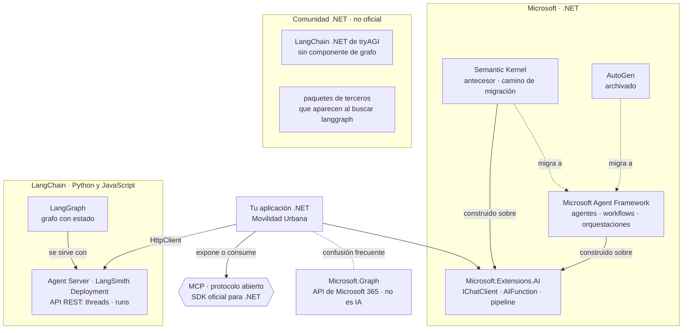

<a id="s9"></a>
## §9 Métodos y marcos comparados

> Estás en: transversal · capa Infrastructure/AI · [OA-A4](#oa-a4), [OA-SK1](#oa-sk1)

Microsoft presenta a Agent Framework (MAF) como sucesor directo de Semantic Kernel y de AutoGen, hecho por los mismos equipos [REF-117]. Elegir marco cambia el paquete, no el mecanismo: la llamada con herramientas, el workflow y el agente de ESC-04, y el servidor MCP de ESC-05, se enseñaron en [§8](#s8). Esta sección no usa la plantilla de las secciones temáticas: va del cuadro comparativo al criterio de elección y a las preguntas guía ([§0.4](#s0-4)). Las versiones y su estado están en el [Anexo F](#anexo-f).

<a id="s9-1"></a>
### §9.1 Cuadro comparativo

Cinco vías; el estado de cada paquete está en el [Anexo F](#anexo-f).

| Vía | Qué es | Cuándo conviene | Cuándo no | Qué cuesta |
|---|---|---|---|---|
| `Microsoft.Extensions.AI` (M.E.AI) | Abstracciones `IChatClient` y `AIFunction`, y el *pipeline* de capas ([§5](#s5)) | Siempre como base: una llamada, un chat o un bucle de herramientas se arman con M.E.AI «without becoming "agentic"», sin volverse agénticos [REF-48] | Cuando hace falta orquestación de varios pasos hacia un objetivo: ahí la misma página manda a MAF [REF-48] | Nada aparte: todos los ejemplos y la demo lo usan |
| Microsoft Agent Framework | Agentes (`AsAIAgent`, `AgentSession`), workflows en grafo y orquestaciones ya armadas, construidos sobre M.E.AI [REF-117], [REF-187] | Estado de conversación entre peticiones, pasos fijos con checkpoints o pausa humana, varios agentes [REF-117] | «If you can write a function to handle the task, do that instead of using an AI agent»: si alcanza una función, no se usa un agente [REF-117] | Más dependencias; una versión estable por semana en septiembre y octubre de 2026 [REF-188], que obliga a fijar versiones |
| Semantic Kernel (SK) | El SDK anterior: `Kernel`, plugins con `[KernelFunction]`, agentes propios [REF-138], [REF-139]. Su README anuncia «Semantic Kernel is now Microsoft Agent Framework!» [REF-136] | Código SK existente o una entrega urgente: «it is perfectly fine to use Semantic Kernel» [REF-137] | Proyecto nuevo: el mismo blog recomienda empezar con MAF [REF-137] | Una migración pendiente ([§9.7](#s9-7)); tipos con el mismo nombre que los de M.E.AI |
| SDK de OpenAI directo | El cliente `OpenAI` contra la API del proveedor o un servidor compatible; `Microsoft.Extensions.AI.OpenAI` lo adapta a `IChatClient` [REF-49] | Para entender el mecanismo o usar algo del proveedor que el contrato no expone. Anthropic sugiere «start by using LLM APIs directly», empezar por la API del modelo [REF-115] | Si Application tiene que quedar libre del proveedor: entonces va como adaptador, como en el ejemplo 02 ([§5.6](#s5-6)) | Bucle, topes, aprobación y telemetría escritos a mano |
| LangGraph por HTTP | Un grafo de LangGraph en Python o JavaScript, servido por el Agent Server, que .NET llama por su API REST [REF-142], [REF-146] | El grafo ya existe y lo opera otro equipo ([§9.4](#s9-4)) | Un proyecto .NET nuevo: no hay paquete oficial para .NET [REF-189] | Un segundo *runtime* para operar, la red de por medio y la autenticación del servicio [REF-146] |

Las tres primeras filas no compiten: SK y MAF dependen de M.E.AI, según sus `.nuspec` [REF-187].

<a id="s9-2"></a>
### §9.2 Ecosistemas

**Definición.** Un *ecosistema* es el conjunto de paquetes que publica un mismo responsable, con su propio ciclo de versiones. Para esta guía hay tres: el de Microsoft para .NET, el de LangChain para Python y JavaScript, y el de la comunidad .NET. MCP no pertenece a ninguno: es un protocolo abierto con un SDK oficial de C# [REF-130].



«LangGraph Platform» pasó a llamarse LangSmith Deployment en octubre de 2025 [REF-144], [REF-145]. LangChain .NET de tryAGI es un port comunitario sin componente de grafo [REF-150].

<a id="s9-3"></a>
### §9.3 Formas de construir y familias de anotaciones

**Definición.** Una *forma de construir* es qué escribe el desarrollador para que exista la pieza: métodos anotados, una llamada a `AsAIAgent`, un grafo de executors, un YAML o un servidor MCP. Una *familia de anotaciones* es el juego de atributos de C# que una biblioteca lee por reflexión. El cuadro va por mecanismo, en el orden de la escalera de agencia ([§3.2](#s3-2)). Las anotaciones no fijan el escalón: lo fija cuánto decide el modelo.

| Forma | Qué se escribe | Anotaciones | Escalón | Conviene / no conviene | En la guía |
|---|---|---|---|---|---|
| Herramientas sobre un cliente | Métodos → `AIFunctionFactory.Create` → `ChatOptions.Tools`; bucle con `UseFunctionInvocation` [REF-121] | `[Description]` de `System.ComponentModel`, en el método y en los parámetros | 1 | Conviene si el caso de uso existe y el modelo sólo elige y arma argumentos; no, si el camino es fijo | 08, 09 |
| Agente por código | `IChatClient.AsAIAgent(…)`, `AgentSession`, `RunAsync` [REF-118] | Las mismas `[Description]` | 1 a 3 | Conviene para conservar la conversación entre peticiones o componer agentes; no, para una sola llamada con herramientas [REF-117] | 11 |
| Workflow | `WorkflowBuilder`, executors, aristas, checkpoints, `RequestPort` [REF-125], [REF-127], [REF-128] | `[MessageHandler]` en una clase `partial` derivada de `Executor` [REF-126] | 2 | Conviene si los pasos se conocen de antemano y hace falta reanudar o pausar; no, si alcanza una función | 10, 12 |
| Declarativo | YAML de agentes y workflows [REF-129] | Ninguna | 2 a 3 | Criterio de la guía: sirve para versionar el flujo fuera del código y no para aprender, porque esconde lo que se depura | — |
| Herramientas para agentes externos | Un servidor MCP [REF-130] | `[McpServerToolType]` y `[McpServerTool]`; también las de prompts y recursos | expone | Conviene para clientes de otros procesos; no, para herramientas que sólo usa la aplicación ([§8.9](#s8-9)) | 13 |
| Forma anterior | Plugins de SK [REF-139] | `[KernelFunction]` + `[Description]` | — | Sólo con código SK existente ([§9.7](#s9-7)) | 14 |

Las fuentes citadas crean el agente por código o en YAML; los atributos marcan herramientas, nodos del grafo o capacidades expuestas, no agentes. Dos complementos que no son anotaciones: `ApprovalRequiredAIFunction`, que pide aprobación antes de ejecutar ([§8.5](#s8-5)) [REF-122], y el YAML declarativo. Trampa: `[MessageHandler]` exige el paquete `Microsoft.Agents.AI.Workflows.Generators`; sin él, `CS0534`, como muestra la variante rota de 10 (`Examples/10-Workflow-Y-Contraejemplo/README.md`).

<a id="s9-4"></a>
### §9.4 LangGraph en .NET

**Definición.** LangGraph es, en palabras de LangChain, «a low-level orchestration framework and runtime for building, managing, and deploying long-running, stateful agents»: un marco de orquestación de bajo nivel para agentes con estado y de larga duración [REF-142]. Está inspirado en Pregel y Apache Beam, y persiste el estado de cada hilo (`thread_id`) con un *checkpointer* [REF-142], [REF-143]. No es un paquete de Microsoft.

**Qué no existe.** No hay un LangGraph oficial para .NET: se publica para Python y JavaScript [REF-148], [REF-149]. La búsqueda de NuGet devuelve sólo paquetes de terceros que usan el nombre o la idea [REF-189], y LangChain .NET de tryAGI no tiene componente de grafo [REF-150].

**El equivalente funcional.** Los workflows de MAF son un grafo con estado: executors y aristas, ejecución por *supersteps* según un modelo Pregel modificado, checkpoints y pausa humana con `RequestPort` [REF-124], [REF-125], [REF-127], [REF-128]. Criterio de la guía: en .NET ocupan el lugar que LangGraph ocupa en Python; son otro producto, con otro responsable.

**Las vías de integración**, si el grafo ya existe: (1) servirlo con el Agent Server y llamarlo por REST, con hilos y corridas [REF-146]; (2) consumirlo como herramienta o agente remoto por MCP o A2A, que el Agent Server lista entre sus recursos [REF-146], con una configuración no verificada; (3) reescribirlo como workflow de MAF. La vía 1, en C#:

Adaptación no ejecutada: no hay servidor LangGraph en el laboratorio. Las rutas y los campos salen del SDK oficial de Python de LangGraph [REF-147]; que `POST /threads` devuelva `thread_id` no se contrastó con la referencia REST.

```csharp
using System.Net.Http.Json;

var baseUrl = Environment.GetEnvironmentVariable("LANGGRAPH_URL") ?? "http://localhost:2024";
using var http = new HttpClient { BaseAddress = new Uri(baseUrl) };
// En LangSmith Deployment: http.DefaultRequestHeaders.Add("X-Api-Key", Environment.GetEnvironmentVariable("LANGSMITH_API_KEY"));

var thread = await (await http.PostAsJsonAsync("/threads", new { })).Content.ReadFromJsonAsync<Dictionary<string, object>>();
var threadId = thread!["thread_id"].ToString();

var resp = await http.PostAsJsonAsync($"/threads/{threadId}/runs/wait", new
{
    assistant_id = "agent",                                        // nombre del grafo en langgraph.json
    input = new { messages = new[] { new { role = "user", content = "Hola" } } },
});
Console.WriteLine(await resp.Content.ReadAsStringAsync());          // estado final del grafo
```

Qué mirar: sin cliente .NET, la aplicación arma a mano el hilo y la corrida con `HttpClient`.

<a id="s9-5"></a>
### §9.5 Aclaración de nombres

**Definición.** Cuatro nombres que un buscador mezcla y que no designan lo mismo. Uno no existe; otro no tiene relación con la IA.

| Nombre | Qué es | Respaldo |
|---|---|---|
| LangGraph | El marco de orquestación de LangChain, para Python y JavaScript ([§9.4](#s9-4)) | [REF-142], [REF-148], [REF-149] |
| Workflows de MAF | El grafo de executors de Microsoft para .NET ([§8.6](#s8-6)) | [REF-124] |
| Microsoft Graph | `Microsoft.Graph`, el cliente de las API de Microsoft 365: «Microsoft Graph Client Library allows you to call Office 365, Azure AD and other Microsoft services…». «Graph» es el grafo de datos de Microsoft 365, no un grafo de agentes | [REF-187] |
| «GraphLang» | No es un producto ni un paquete: la búsqueda de NuGet no devuelve nada | [REF-189] |

<a id="s9-6"></a>
### §9.6 ¿Integrar un marco de agentes o construir uno propio?

**Definición.** *Construir un marco propio* es escribir en la aplicación el descubrimiento de herramientas, el esquema que ve el modelo, el bucle, los topes, el estado y los controles. *Integrar* es tomar esas piezas de M.E.AI y MAF.

| Pieza que hace falta | Qué ya la resuelve | Fuente | Dónde se ve |
|---|---|---|---|
| De un método C# al esquema JSON que ve el modelo | `AIFunctionFactory.Create`, que lee `[Description]` por reflexión | [REF-121] | 08, 14 |
| Bucle de pedidos de herramienta, con topes | `UseFunctionInvocation`, `MaximumIterationsPerRequest` | [REF-45], [REF-121] | 08 |
| Políticas alrededor de cada llamada | Capas del *pipeline* y `DelegatingChatClient` | [REF-45] | 17 |
| Aprobación humana antes de ejecutar | `ApprovalRequiredAIFunction` | [REF-122] | 09, 11 |
| Estado de la conversación entre peticiones | `AgentSession` | [REF-117] | 11 |
| Pasos fijos que se reanudan o esperan a una persona | Workflows, checkpoints y `RequestPort` | [REF-127], [REF-128] | 10 |
| Herramientas entre procesos | SDK de MCP | [REF-130] | 13 |

Criterio de la guía: las anotaciones no son un *runtime*. Un `[Description]` no ejecuta nada; lo que corre es la fábrica, el bucle y las capas. Un marco propio vuelve a escribir esas piezas y queda a cargo de su mantenimiento; la guía no registra evidencia de lo que eso cuesta, y por eso no lo recomienda ni lo construye.

<a id="s9-7"></a>
### §9.7 Si venís de Semantic Kernel

**Definición.** Migrar una herramienta de SK a M.E.AI es borrar `[KernelFunction]` y cambiar la fábrica: la guía de migración de Microsoft pasa a métodos sin atributos obligatorios, con `[Description]` opcional, y mapea `Kernel` a `IChatClient`, `AgentThread` a `AgentSession` e `InvokeAsync` a `RunAsync` [REF-140]. No es reescribir el caso de uso: el cuerpo de la herramienta no cambia. SK sigue recibiendo correcciones críticas y de seguridad por al menos un año después de la GA de MAF [REF-137], que fue en abril de 2026 [REF-43]; no hay fecha oficial de fin de soporte. AutoGen está archivado: su README dice «Project archived and no longer maintained» [REF-141].

**14 · Anotaciones SK frente a M.E.AI** · `Examples/14-Anotaciones-SK-vs-MEAI/` · intermedio · ilustra [§9.7](#s9-7) · [OA-SK1](#oa-sk1). Ruta opcional, fuera de la secuencia principal: la misma `contar_localidades(provincia)` anotada para los dos marcos, sobre el mismo `LocalidadService`. No llama al modelo.

```bash
tools/verificar.sh correr 14-Anotaciones-SK-vs-MEAI   # compila con -warnaserror y corre --fake --verificar
tools/verificar.sh build                              # todo Examples/, con estas pruebas incluidas
```

`Examples/14-Anotaciones-SK-vs-MEAI/Infrastructure/AI/PluginSk.cs`
```csharp
public sealed class PluginSk(LocalidadService localidades)
{
    public const string NombreDelPlugin = "Localidades";

    [KernelFunction("contar_localidades")]
    [Description("Cuenta cuántas localidades tiene cargadas la persona en una provincia del catálogo.")]
    public Task<ConteoDto> ContarLocalidadesAsync(
        [Description("Nombre exacto de la provincia, uno de: Buenos Aires, Chaco, Córdoba, Corrientes, Entre Ríos, Mendoza, Santa Fe.")] string provincia,
        CancellationToken cancellationToken = default) =>
        ConteoDeLocalidades.ContarAsync(localidades, provincia, cancellationToken);

    // …
    public KernelPlugin Crear() => KernelPluginFactory.CreateFromObject(this, NombreDelPlugin);
}
```

`Examples/14-Anotaciones-SK-vs-MEAI/Infrastructure/AI/HerramientaMeai.cs`
```csharp
public sealed class HerramientaMeai(LocalidadService localidades)
{
    public const string Nombre = "contar_localidades";

    [Description("Cuenta cuántas localidades tiene cargadas la persona en una provincia del catálogo.")]
    public Task<ConteoDto> ContarLocalidadesAsync(
        [Description("Nombre exacto de la provincia, uno de: Buenos Aires, Chaco, Córdoba, Corrientes, Entre Ríos, Mendoza, Santa Fe.")] string provincia,
        CancellationToken cancellationToken = default) =>
        ConteoDeLocalidades.ContarAsync(localidades, provincia, cancellationToken);

    // …
    public AIFunction Crear() => AIFunctionFactory.Create(ContarLocalidadesAsync, Nombre);
}
```

Qué mirar: las dos `[Description]` son idénticas y las dos delegan en `ConteoDeLocalidades`; lo único que cambia es `[KernelFunction]` y la fábrica de la última línea.

Salida sin modelo (el ejemplo no llama a ningún `IChatClient` y `--fake` no cambia nada), 2026-10-27:

```text
M.E.AI · nombre para el modelo «contar_localidades» · esquema {"type":"object","properties":{"provincia":{"description":"Nombre exacto de la provincia, uno de: Buenos Aires, Chaco, Córdoba, Corrientes, Entre Ríos, Mendoza, Santa Fe.","type":"string"}},"required":["provincia"]}
SK     · plugin «Localidades», función «contar_localidades» · como AIFunction se llama «Localidades_contar_localidades» · esquema {"type":"object","condition":"Cuenta cuántas localidades tiene cargadas la persona en una provincia del catálogo.","properties":{"provincia":{"description":"Nombre exacto de la provincia, uno de: Buenos Aires, Chaco, Córdoba, Corrientes, Entre Ríos, Mendoza, Santa Fe.","type":"string"}},"required":["provincia"]}
e01: provincia del catálogo con tres localidades en la sesión
  firma igual: True · esquema del parámetro igual: True
  M.E.AI → {"provincia":"Corrientes","cantidad":3}
  SK     → {"provincia":"Corrientes","cantidad":3,"error":null}
  normalizados iguales: True
  oráculo anotaciones-coinciden: pasa
[…]
e04: negativo: una localidad en lugar de una provincia; las dos devuelven el error, no un 0
  firma igual: True · esquema del parámetro igual: True
  M.E.AI → {"provincia":"Goya","error":"La provincia «Goya» no está en el catálogo (Buenos Aires, Chaco, Córdoba, Corrientes, Entre Ríos, Mendoza, Santa Fe)."}
  SK     → {"provincia":"Goya","cantidad":null,"error":"La provincia «Goya» no está en el catálogo (Buenos Aires, Chaco, Córdoba, Corrientes, Entre Ríos, Mendoza, Santa Fe)."}
  normalizados iguales: True
  oráculo anotaciones-coinciden: pasa
```

La firma es la misma en las cuatro entradas, y en e04 las dos devuelven el error del catálogo: la regla es del caso de uso. Es equivalencia del código, sin tasa ([§0.4](#s0-4)). Tres cosas que vigilar al migrar, observadas con las versiones del [Anexo F](#anexo-f) y fijadas por las pruebas de `Pruebas/AnotacionesTests.cs`:

- **`FunctionCallContent` existe en los dos espacios de nombres.** Un archivo con `using Microsoft.Extensions.AI;` y `using Microsoft.SemanticKernel;` no compila sin calificarlo: la variante rota da `error CS0104: 'FunctionCallContent' is an ambiguous reference`. En el ejemplo, sólo `Comparador.cs` tiene los dos `using`, y lo califica.
- **La `KernelFunction` ya es un `AIFunction`, con el nombre del plugin adelante.** Montada tal cual, el modelo ve `Localidades_contar_localidades`; si el prompt o los registros nombran la herramienta, ese nombre importa.
- **El esquema de la función entera difiere.** El de SK trae una clave `condition`; el de los parámetros es idéntico.

<a id="s9-8"></a>
### §9.8 La fecha de un tutorial es un dato técnico

**Definición.** Un tutorial describe una versión. En este ecosistema los nombres cambiaron en menos de un año, y un código copiado de una página vieja no compila o usa un paquete abandonado. La fecha no indica calidad, sino contra qué versión se escribió. Lo que cambió:

- **Renombres entre las previews de 2025 y MAF 1.x**: `AgentThread` pasó a `AgentSession`, `GetNewThread` a `CreateSessionAsync`, `AgentRunResponse` a `AgentResponse`; en M.E.AI, `FunctionApprovalRequestContent` a `ToolApprovalRequestContent`. Los nombres viejos no están en las versiones del [Anexo F](#anexo-f) [REF-187].
- **Documentación por detrás del paquete**: la página de executors usa `BindExecutor` [REF-126], que con la versión del Anexo F no compila (`CS0411`); el ejemplo 10 usa `BindAsExecutor`. La misma página no nombra el paquete generador de [§9.3](#s9-3). La variante rota de 10 reproduce las dos fallas (`Examples/10-Workflow-Y-Contraejemplo/README.md`).
- **Paquetes que dejaron de ser la opción**: `Microsoft.Extensions.AI.Ollama` está deprecado en favor de OllamaSharp [REF-188] y `Azure.AI.Inference` se retiró el 2026-08-26 [REF-57].
- **Cadencia**: MAF publica una estable por semana [REF-188].

Criterio de la guía: antes de copiar, mirá la fecha del tutorial y la versión que usa, comparala con el [Anexo F](#anexo-f) y compilá antes de creer. En CTX-PROD, las versiones se fijan con gestión central, como hacen los ejemplos en `Examples/Directory.Packages.props`.

<a id="s9-criterio"></a>
### Criterio de elección

Para ESC-04 y ESC-05 en CTX-EXISTENTE × CTX-LOCAL × CTX-PROTO ([§2.2](#s2-2)):

1. **Empezá por M.E.AI.** Una llamada, la salida estructurada y la llamada con herramientas no necesitan otro marco [REF-48]. Así trabajan 08 y 09 ([§8.2](#s8-2)).
2. **Subí a MAF por un mecanismo, no por el nombre.** Estado de conversación entre peticiones (11), pasos fijos con checkpoints o una pausa humana (10, como contraejemplo), varios agentes (12) [REF-117]. Un `AIAgent` no sube el escalón ([§8.7](#s8-7)).
3. **SK sólo si ya está.** Lo nuevo va en M.E.AI y MAF; la migración, por [§9.7](#s9-7) [REF-137].
4. **El SDK de OpenAI directo, en el adaptador.** Detrás de `IChatClient` ([§5.6](#s5-6)).
5. **LangGraph, sólo si el grafo ya existe** y alguien opera su servidor ([§9.4](#s9-4)).
6. **MCP es independiente del marco.** El servidor de ESC-05 se escribe con su SDK, con MAF o sin él ([§8.9](#s8-9)).

En CTX-PROD pesan el soporte y la cadencia: MAF tiene compromiso de soporte a largo plazo desde su versión 1.0 [REF-43] y publica cada semana [REF-188], así que las versiones se fijan y se revisan ([§9.8](#s9-8)). No hay un ADR del marco: la elección se apoya en ADR-02, el contrato de acceso ([§13.3](#s13-3)), y en ADR-07, el escalón de orquestación ([§13.8](#s13-8)).

<a id="s9-preguntas"></a>
### Preguntas guía

**¿Existe un LangGraph oficial para .NET, o algo parecido?** ([OA-A4](#oa-a4))

Oficial, no: LangGraph se publica para Python y JavaScript, y en NuGet sólo aparecen paquetes de terceros [REF-148], [REF-149], [REF-189]. Parecido, sí: los workflows de MAF son el grafo con estado de .NET, con checkpoints y pausa humana ([§9.4](#s9-4)). En CTX-PROD elegí el workflow de MAF, que tiene responsable y compromiso de soporte [REF-43]. La respuesta cambiaría si LangChain publicara un SDK para .NET: mirá el [Anexo F](#anexo-f) y la búsqueda de NuGet antes de descartarlo.

**Un buscador me dijo que «GraphLang en .NET» es Microsoft Graph: ¿qué es cada cosa?** ([OA-A4](#oa-a4))

Son tres cosas y una que no existe ([§9.5](#s9-5)). LangGraph orquesta agentes en Python; los workflows de MAF hacen lo equivalente en .NET; `Microsoft.Graph` es el cliente de las API de Microsoft 365 y no orquesta nada [REF-187]; «GraphLang» no da resultados en NuGet [REF-189]. Explicale a tu equipo por qué ni LangGraph ni Microsoft Graph son opciones .NET para orquestar: el primero no tiene paquete oficial y el segundo no es IA. En CTX-EXISTENTE, Movilidad Urbana no usa nada de Microsoft 365: `Microsoft.Graph` no tiene lugar en la solución. Con una respuesta de buscador, la prueba es abrir el paquete en NuGet y leer su descripción.

**¿Qué hay para crear agentes con anotaciones en .NET?** ([OA-A4](#oa-a4))

Anotaciones que marcan piezas: `[Description]` para herramientas de M.E.AI y MAF, `[MessageHandler]` para nodos de un workflow, los atributos de MCP para lo que se expone y `[KernelFunction]` en SK ([§9.3](#s9-3)). El agente se crea por código, con `AsAIAgent` [REF-118], o en YAML [REF-129]. En CTX-EXISTENTE, como Movilidad Urbana, `[Description]` sobre el caso de uso alcanza para el escalón 1 (08, 09). Si el caso pide pasos fijos con estado, sumá `[MessageHandler]` y el paquete generador, o el build falla con `CS0534`. Si tu equipo ya escribe `[KernelFunction]`, la migración está en [§9.7](#s9-7).

**¿Integro un marco de agentes o construyo uno propio?** ([OA-A4](#oa-a4))

Integrá. El esquema, el bucle con topes, la aprobación, el estado, los workflows y MCP ya existen en M.E.AI y MAF ([§9.6](#s9-6)) [REF-121], [REF-122], [REF-117]. Un marco propio repite esas piezas y te deja su mantenimiento. En CTX-PROD con datos sensibles (CTX-SENS) el argumento crece: los controles que la guía enseña ([§8.5](#s8-5), [§11.3](#s11-3)) se apoyan en esas piezas, y uno propio tendría que reescribirlos y probarlos. Construir tendría sentido si una pieza que el caso necesita no existe o no se puede extender; en ese caso, primero probá una capa propia sobre `DelegatingChatClient` [REF-45].

**Mi equipo de datos tiene un grafo LangGraph en Python: ¿lo reescribo?** ([OA-A4](#oa-a4))

No de entrada. Si el grafo funciona y su equipo lo opera, llamalo por HTTP desde .NET a través del Agent Server ([§9.4](#s9-4)) [REF-146]: el grafo queda fuera de la solución, como el servidor de modelos. El precio es un segundo *runtime* y, en LangSmith Deployment, una credencial más [REF-146]. En CTX-SENS, sumá que los datos de la persona salen a otro servicio. Elegí reescribirlo como workflow de MAF cuando haya un solo equipo para operar todo, o cuando el grafo necesite los casos de uso y las reglas de la aplicación en cada paso.

<!-- PENDIENTES:
Quitado por falta de respaldo citable:
- Cantidad de paquetes que devuelve la búsqueda «langgraph» en NuGet, sus nombres y autores: no es cifra de la tabla de cifras citables; la prosa dice «sólo paquetes de terceros» con REF-189. Los autores son personas físicas: no van.
- Repositorios de la organización langchain-ai en GitHub (cantidad y el acelerador archivado en C#): lo respalda la API de organizaciones de GitHub, que no tiene REF (REF-191 es la de repositorios). Quitado; queda el argumento por NuGet y PyPI/npm.
- «SharpGraph» y otros repos «LangGraph for .NET» de GitHub: sin REF. Quitado.
- Fecha estimada de fin de soporte de SK (abril de 2027): es inferencia; la prosa dice «no hay fecha oficial» y da la regla de REF-137 con la fecha de GA de REF-43.
- «No existe un atributo [Agent]»: no hay fuente que lo afirme; se reemplazó por lo verificable («las fuentes citadas crean el agente por código o en YAML»).
- Configuración de MCP/A2A en el Agent Server, licencia de LangSmith para autohospedar y el campo thread_id contra la doc REST: no verificados; marcados así en §9.4.
- El puerto por defecto de `langgraph dev` como afirmación en prosa: queda sólo dentro del snippet adaptado, sin afirmarlo.
- Mapeo de los patrones de Anthropic a MAF (BuildSequential, Magentic…): es casa de §8.1/§8.8; no se repite.
- Que `--prerelease` siga en la doc de SK Agents.Core aunque sea GA: respaldo débil (REF-139 sin fecha); no entró en §9.8.
Fuentes dadas de alta: ninguna. Se volvieron a leer con curl (2026-10-27) las citas literales de REF-115, REF-117, REF-136, REF-137, REF-140, REF-141, REF-142, REF-124 y REF-48: coinciden.
Desvíos de la ficha:
- Línea de ubicación «transversal»: §9 no es de una escalera y la carta reserva «transversal» para §4, §10, §11, §12; la presidencia confirma.
- Anclas nuevas, por analogía con las de la plantilla (la carta no las nombra para §9): s9-criterio, s9-preguntas.
- §9 no lleva «Qué decisión toca»; el criterio de elección cierra con una oración que remite a ADR-02 y ADR-07. Que no haya ADR del marco es lectura del plan v3 §C (lista de ADR); confirmar.
- La etiqueta del nodo MCP dice «SDK oficial para .NET» y no «de C#», para no meter # en una etiqueta mermaid.
- El diagrama de ecosistemas no lleva versiones (regla: versiones sólo por el Anexo F); se quitaron los paréntesis de las etiquetas y la flecha bidireccional del plan (se usa «expone o consume»). MEAI → MAF del plan se invirtió a «MAF construido sobre MEAI», que es lo que dicen los .nuspec.
- El cuadro de §9.3 no lleva la columna «Estado»: pasa al Anexo F. Lleva «En la guía» con el número de ejemplo.
- Snippet de LangGraph: el plan lo prevé como adaptación no ejecutada; se copió textual del dossier de agentes (§4.8), incluido el «Hola» del mensaje, que no es de otro dominio.
- N2 P8 (¿migro de SK?) va como prosa de §9.7, no como pregunta guía; N4 P6, N2 P7 e I-05 A-6 se responden en el cuadro de §9.1; AutoGen, una línea con remisión al Anexo F.
Procedencia de las salidas:
- 14 sin modelo: Evidencia/14-Anotaciones-SK-vs-MEAI/correr-fake-verificar.log (primeras dos líneas, e01 y e04; e02 y e03 recortadas con […]). Registro: Evidencia/R-LLM/14-Anotaciones-SK-vs-MEAI.jsonl (4 renglones, recalculado 4 de 4 en recalculo-oraculos.cierre.log).
- CS0104: Evidencia/14-Anotaciones-SK-vs-MEAI/pruebas-y-variante.log (tres errores CS0104 en Comparador.cs); 13 de 13 pruebas pasan (mismo log). La cifra 13 no se cita en la prosa.
- CS0534 y CS0411 de 10: Evidencia/10-Workflow-Y-Contraejemplo/variantes-rotas.log; en la prosa se cita el README de 10, que es archivo del repositorio.
Verificación adversarial (2026-10-27): §9.8 ya no cita «MAF 1.26.0» en prosa (regla: versiones sólo por el Anexo F); el ítem 2 del criterio marca 10 como contraejemplo (carta: la encuesta de 10 es escalón −1); «paquetes de terceros que usan el nombre» pasó a «el nombre o la idea» y el nodo TER del diagrama a «que aparecen al buscar langgraph» (N4 §6: SemanticKernel.Graph, Nexttag.Ai.Graph y Flowgine no llevan langgraph en el nombre).
Conteo y tope: 2.799 palabras de prosa (comando de la carta §16.3, tablas incluidas). Tope de §9: 2.800.
Snippets por encima de 25 líneas: ninguno (LangGraph 17, PluginSk 14, HerramientaMeai 13). La salida de 14 tiene 18 líneas.
Remisiones usadas: s0-4, s2-2, s3-2, s5, s5-6, s8, s8-2, s8-5, s8-6, s8-7, s8-9, s11-3, s13-3, s13-8, anexo-f, oa-a4, oa-sk1; internas: s9-4, s9-5, s9-6, s9-7, s9-8, s9-3.
Cifras citadas: ninguna medida. 14: equivalencia de las anotaciones sin modelo (tabla de cifras, fila 14), sin número. Fechas citadas de fuentes: GA de MAF en abril de 2026 (REF-43), retiro de Azure.AI.Inference 2026-08-26 (REF-57), renombre a LangSmith Deployment en octubre de 2025 (REF-144), cadencia semanal de MAF en septiembre y octubre de 2026 (REF-188).
AC-7/AC-8 sin correr (las corre la integración).
-->
