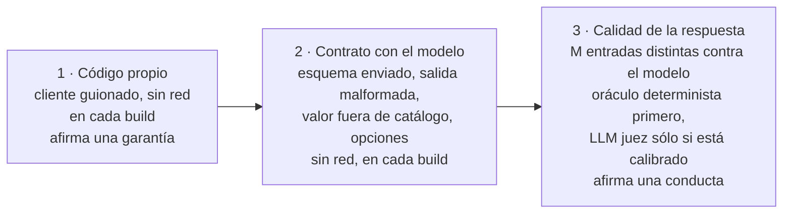

<a id="parte-v"></a>
# Parte V · Producción

<a id="s10"></a>
## §10 Probar y evaluar una capa de IA

> Estás en: transversal · capa Application · [OA-D9](#oa-d9), [OA-D2](#oa-d2), [OA-O3](#oa-o3), [OA-D4](#oa-d4)

Un caso de uso que llama a un modelo tiene dos cosas para probar: el código propio, que responde siempre igual, y la respuesta del modelo, que no. Vale para ESC-01 a ESC-05. La salida estructurada se enseñó en [§5.3](#s5-3) y la recuperación se midió en [§7.5](#s7-5); las versiones de las bibliotecas de evaluación están en el [Anexo F](#anexo-f).

<a id="s10-1"></a>
### §10.1 Qué puede y qué no puede afirmar una prueba sobre un sistema no determinista

**Definición.** Una prueba sobre una capa de IA afirma una **garantía del código** («toda cita que no apunte a un fragmento recuperado se rechaza»), cierta en cada corrida y comprobable sin modelo, o una **conducta del modelo** («en estas M entradas, con este modelo, servidor y fecha, pasaron k»), que no promete nada sobre la entrada siguiente ([§0.4](#s0-4)). No es una prueba inestable: la variación es del modelo y reintentar no la corrige.

Criterio de la guía, no verificado con una fuente: temperatura 0 y semilla fija no garantizan la misma salida entre llamadas ni entre versiones del modelo. Las tres capas de prueba van en este orden:



<a id="s10-2"></a>
### §10.2 Doble de `IChatClient`

**Definición.** Un *doble* de `IChatClient` responde según un guion fijo, sin servidor: es el **cliente guionado** de los ejemplos. La documentación presenta la abstracción como un contrato que «facilitates testing and mocking» (facilita las pruebas con dobles) [REF-44] y muestra cómo implementarla [REF-45]. Resuelve que una prueba de CI no pase ni falle por azar. No mide al modelo: comprueba el código propio ante respuestas conocidas, también las malas.

El guion (`Examples/_Comun/MovilidadUrbana.Asistente.Comun/Pruebas/GuionChatClient.cs`) admite texto y pedidos de herramienta; un espía debajo de la capa de opciones ve lo que saldría al servidor:

`Examples/08-Primera-Herramienta-Solo-Lectura/Pruebas/HerramientasTests.cs`
```csharp
[Test]
public async Task Bucle_TodasLasLlamadasPasanPorLaCapaUnica()
{
    using var bd = await BaseDeEjemplo.CrearAsync();
    using var s = bd.AbrirSesion(BaseDeEjemplo.SesionPropia);
    var guion = new GuionChatClient([
        PasoDelGuion.Herramienta("c1", HerramientasDeLectura.Contar, new Dictionary<string, object?> { ["provincia"] = "Chaco" }),
        PasoDelGuion.Texto("Tenés 1 en Chaco.")]);
    var espia = new ClienteEspia(guion);
    var asistente = new AsistenteDeConsulta(FabricaDeClientes.Envolver(espia, Config, Adaptador.OllamaSharp));

    var r = await asistente.PreguntarAsync("¿Cuántas tengo en Chaco?", new HerramientasDeLectura(s.Localidades));

    Assert.That(r.Text, Is.EqualTo("Tenés 1 en Chaco."));
    Assert.That(espia.OpcionesVistas, Has.Count.EqualTo(2));
    Assert.That(espia.OpcionesVistas, Has.All.Matches<ChatOptions?>(o =>
        o!.Reasoning!.Effort == ReasoningEffort.None && OpcionesDelProveedor.NumCtxDe(o) == ConfiguracionDelModelo.NumCtxPorDefecto));
    Assert.That(guion.ResultadosVistos.Single(), Does.Contain("\"cantidad\": 1"));
}
```

Qué mirar: la herramienta corre sobre la sesión sembrada, y las dos llamadas del bucle salen con las opciones de la capa única ([§5.4](#s5-4)).

<a id="s10-3"></a>
### §10.3 Contrato de la salida estructurada

**Definición.** El *contrato* de una salida estructurada son tres comprobaciones sin modelo: el pedido lleva el esquema del tipo [REF-47], una respuesta que no es JSON termina en el camino sin IA y un JSON bien formado con un valor fuera de `Catalogos` se rechaza. OWASP pide «define and validate expected output formats» (definir y validar los formatos esperados) con código determinista [REF-160]. No valida la verdad del contenido.

`Examples/03-Salida-Estructurada/Pruebas/SalidaEstructuradaTests.cs`
```csharp
[Test]
public async Task TextoNoJson_TryGetResultFalse_SinPropuesta_YNoSeEscribe()
{
    var (alta, _, repo, _) = Armar("La localidad es Bella Vista, en Corrientes.");
    var decision = await alta.ProponerAsync("En Bella Vista, Corrientes, CP 3432, no sé cuántos viven");

    Assert.That(decision.Estado, Is.EqualTo(EstadoDeLaPropuesta.SinPropuesta));
    Assert.That((await alta.ConfirmarAsync(decision)).IsSuccess, Is.False);
    Assert.That(repo.Altas, Is.Empty);
}

// …
[Test]
public async Task Cableado_TodaLlamadaSaleConRazonamientoApagadoNumCtxYEsquema()
{
    // …
    Assert.That(opciones.ResponseFormat, Is.InstanceOf<ChatResponseFormatJson>());
    Assert.That(((ChatResponseFormatJson)opciones.ResponseFormat!).Schema, Is.Not.Null);
}
```

Qué mirar: ante texto libre no hay propuesta ni escritura. El tercer caso lo prueba 15 (`Catalogo_MedioInventado_FallaConLaClave`): `"avion"` falla con su clave, y un texto no JSON es un error de diagnóstico, nunca un «pasa».

<a id="s10-4"></a>
### §10.4 Corridas contra el modelo

**Definición.** Una *corrida contra el modelo* pasa M entradas congeladas por el sistema real y decide cada una con un **oráculo** fijado antes de correr ([§0.4](#s0-4)). La unidad de muestra es la **entrada distinta** (paráfrasis, límite, negativo), no la repetición. Resuelve cuánto sirve el modelo para el escenario. No es una prueba de CI: necesita servidor y vale para un modelo y una fecha.

Reglas de todos los ejemplos (criterio de la guía):

- **Tasa con intervalo.** k/M con su IC95 de Clopper-Pearson, que calcula `tools/verificar.sh tasa <k> <m>`. Con M ≤ 12 toda tasa es descriptiva.
- **Comparación pareada.** Dos variantes se comparan sobre las mismas entradas; se afirma una diferencia si la binomial exacta bilateral sobre los pares discordantes da p < 0,05, lo que exige al menos 6 en el mismo sentido (2 · 0,5⁶ = 0,031). En 06, los embeddings le ganan al azar en hit@1 (p = 0,012) y no se afirma que le ganen a la línea base léxica. Observado en el laboratorio: `qwen3-embedding:0.6b` (digest `ac6da0dfba84`), Ollama 0.40.11, Ollama propio, 2026-10-27; estímulo del mismo autor.
- **Denominador a la vista**: cada exclusión con su motivo; una excluida no se reemplaza.
- **Estabilidad aparte**: repetir una entrada no suma a la tasa.
- **Caché registrada**: en el servidor compartido es «desconocida» y los tiempos no se comparan.

`Examples/06-Embeddings-Y-Busqueda-Semantica/Application/Referencias.cs`
```csharp
public sealed record ComparacionPareada(string A, string B, string Medida, int SoloA, int SoloB, double P)
{
    public bool SeAfirmaDiferencia => SoloA + SoloB > 0 && P < 0.05;

    public static ComparacionPareada Comparar(string a, string b, string medida, IReadOnlyList<bool> aciertosA, IReadOnlyList<bool> aciertosB)
    {
        if (aciertosA.Count != aciertosB.Count) throw new ArgumentException("El diseño pareado pide las mismas preguntas por las dos variantes.");
        var soloA = aciertosA.Zip(aciertosB).Count(x => x.First && !x.Second);
        var soloB = aciertosA.Zip(aciertosB).Count(x => !x.First && x.Second);
        return new(a, b, medida, soloA, soloB, BinomialBilateral(soloA, soloB));
    }
    // …
}
```

Cada corrida deja un **registro**: una línea JSON por llamada (entrada, salida, modelo, digest, hashes, opciones, tokens del servidor, posible truncado) y una por entrada con el veredicto (`Examples/_Comun/MovilidadUrbana.Asistente.Comun/Registro/RegistroRllm.cs`). `tools/recalcular-oraculos.sh` vuelve a decidir cada entrada leyendo sólo el registro. Las pruebas con modelo van en otra categoría y se saltan solas sin servidor:

`Examples/15-Pruebas-Y-Evaluacion/Pruebas/ConModeloTests.cs`
```csharp
[Category("LLM")]
public class ConModeloTests
{
    private ConfiguracionDelModelo _config = null!;

    [OneTimeSetUp]
    public async Task Predicado()
    {
        _config = ConfiguracionDelModelo.DesdeEntorno().Validar();
        var r = await PredicadoDeSalto.EvaluarAsync(_config.PropioEndpoint, _config.PropioModelo, ["completion"]);
        if (r.Saltar) Assert.Ignore(r.Motivo);
    }
    // …
}
```

<a id="s10-5"></a>
### §10.5 `Microsoft.Extensions.AI.Evaluation`

**Definición.** Son las bibliotecas de .NET para evaluar «the quality and safety of responses generated by AI models» (la calidad y la seguridad de las respuestas), sobre M.E.AI [REF-151]. Quality trae evaluadores que usan un LLM juez (`RelevanceEvaluator`, `GroundednessEvaluator`, `RetrievalEvaluator`, entre otros); NLP, métricas sin IA; Safety usa un servicio de Microsoft Foundry y exige Azure [REF-151], [REF-154]; Reporting guarda resultados y una caché de respuestas [REF-152]. Resuelve medir lo que una aserción no captura. No es determinista cuando juzga un modelo: la documentación sugiere seguir tendencias y no hacer fallar el build por un resultado [REF-152].

`IEvaluator` no exige un modelo. En 15, la cita válida de 07 es un evaluador en código que corre antes que el LLM juez:

`Examples/15-Pruebas-Y-Evaluacion/Application/EvaluadoresDeterministas.cs`
```csharp
public ValueTask<EvaluationResult> EvaluateAsync(
    IEnumerable<ChatMessage> messages, ChatResponse modelResponse, ChatConfiguration? chatConfiguration = null,
    IEnumerable<EvaluationContext>? additionalContext = null, CancellationToken cancellationToken = default)
{
    var ctx = ContextoDeRecuperacion.De(additionalContext);
    var v = ValidadorDeCitas.Validar(modelResponse.Text ?? string.Empty, ctx.Recuperados.Select(r => r.Fuente).ToHashSet(StringComparer.Ordinal));
    // En una no respondible, el «No sé» pedido (sin citas) es la respuesta válida.
    var ok = ctx.Pregunta.Respondible ? v.Veredicto == Veredicto.Aceptada : v.Veredicto == Veredicto.NoSe;
    var metrica = new BooleanMetric(Metrica, ok, v.Veredicto.ToString());
    // …
}
```

Qué mirar: el `ChatConfiguration` no se usa. El LLM juez entra donde no hay cuenta: en las preguntas de 07 cuyo literal no fija un valor, el oráculo sólo comprueba la cita ([§7.5](#s7-5)).

<a id="s10-6"></a>
### §10.6 El LLM juez y sus sesgos

**Definición.** Un *LLM juez* es un modelo que puntúa la salida de otro. Con jueces fuertes se informó más del 80 % de acuerdo con preferencias humanas, con sesgos «position, verbosity, and self-enhancement» (de posición, de largo y de autofavorecimiento) [REF-158]. Resuelve juzgar a escala lo que no tiene cuenta. No reemplaza al oráculo ni a una persona: «AI judges should be supplemented with exact evaluation, human evaluation, or both» (se complementan con evaluación exacta, humana o ambas) [REF-08].

En el laboratorio, el LLM juez es `qwen2.5:0.5b` y el generador, `qwen3.5:4b`: distintos, de la misma familia. Criterio de la guía: eso reduce el autofavorecimiento sin eliminarlo; falta un juez de otra familia.

**Protocolo de calibración.** Antes de juzgar se arman 10 casos desde salidas de 07: 5 correctas tal cual y 5 perturbaciones controladas («cita y contradice», sin cita, cita a un fragmento no recuperado), anotadas por el agente que construyó el ejemplo, no por una persona: no es calibración humana. Si el LLM juez acierta menos de 8 de 10, o sus salidas no se leen, sus puntajes no se interpretan. Diez casos sólo pueden descartarlo: aun 8 de 10 da IC95 [0,444; 0,975]. ARES corrige jueces con pocas anotaciones humanas [REF-156].

**Resultado: no calibrado.** Ninguna salida fue interpretable, 0/52: contestó en prosa, sin el puntaje entre las etiquetas pedidas. Acuerdo con la anotación: 0/10, IC95 [0; 0,308]. Observado en el laboratorio: `qwen2.5:0.5b` (digest `a8b0c5157701`), Ollama 0.40.11, Ollama propio, 2026-10-27; estímulo del mismo autor. Decidieron los deterministas ([Ejemplos](#s10-ejemplos)).

<a id="s10-7"></a>
### §10.7 Conjunto de oro

**Definición.** El *conjunto de oro* es la colección de casos contra la que se mide un escenario: la consulta («represents a legitimate user's potential prompt», un pedido posible de una persona), el contexto que la responde y una respuesta válida, más **consultas no respondibles** para comprobar el «no sé» [REF-114]. Resuelve medir recuperación y respuesta contra algo fijo. No es un conjunto de entrenamiento ni una muestra de uso real.

Las preguntas sintéticas las revisa una persona experta («A SME should review and validate the output») y el conjunto se revisa cuando cambian las fuentes [REF-114]. El de la guía:

- **Forma**: 12 respondibles, una por literal de `*Policy`, con valor esperado y formas aceptadas; 4 no respondibles, 2 cercanas y 2 lejanas. «¿Cuántos habitantes tiene Goya, en Corrientes?» es cercana ([§6.1](#s6-1)).
- **Versión atada al código**: los valores esperados salen de `LocalidadRules` y `EncuestaRules`, y `Oro_ValoresEsperadosSalenDeLasReglas` falla si una regla cambia sin el oro. El SHA-256 del archivo va en `ejemplo.json` y en el registro; cambiar una pregunta crea una `v2`.
- **Revisión**: no hay revisión de una persona registrada; el archivo se declara estímulo del mismo autor.

`Examples/06-Embeddings-Y-Busqueda-Semantica/oro/conjunto-de-oro.v1.json`
```json
    { "id": "r03", "tipo": "respondible", "objetivo": "LocalidadPolicy.RequisitoDelCodigoPostal",
      "texto": "¿Cuántos números lleva el código postal de una localidad?",
      "relevantes": ["LocalidadPolicy.RequisitoDelCodigoPostal"],
      "valor_esperado": "4", "formas_aceptadas": [["4", "cuatro"]], "valores_de_catalogo": [] },
```

Qué mirar: `texto`, `relevantes` y `valor_esperado` son consulta, contexto y respuesta.

<a id="s10-practica"></a>
### Práctica de §10

<a id="s10-escenarios"></a>
#### Aplicación por escenario

Criterio de la guía; CTX-PROTO es la combinación de la guía ([§2.2](#s2-2)).

| Escenario | Sin modelo, siempre | CTX-PROTO | CTX-PROD |
|---|---|---|---|
| ESC-01, ESC-02 | cita válida y «no sé» con guion | recuperación contra una línea base | oro revisado por una persona; corrida por cambio de modelo o de corpus |
| ESC-03 | esquema, malformado, fuera de catálogo | tasa descriptiva | corrida por versión del modelo |
| ESC-04, ESC-05 | pedidos de herramienta guionados; aprobación ([§8.5](#s8-5)) | conducta con registro | negativas por herramienta; LLM juez sólo calibrado |

<a id="s10-ejemplos"></a>
#### Ejemplos

Todos los ejemplos tienen modo `--fake` (capas 1 y 2); vocabulario de la evidencia en [§0.4](#s0-4), orden de lectura en el [Anexo E](#anexo-e).

**15 · Pruebas y evaluación** · `Examples/15-Pruebas-Y-Evaluacion/` · avanzado · ilustra [§10.2](#s10-2) a [§10.6](#s10-6) · [OA-D9](#oa-d9), [OA-O3](#oa-o3). Evalúa las 16 salidas congeladas de 07 y la calibración.

```bash
tools/verificar.sh correr 15-Pruebas-Y-Evaluacion                 # --fake --verificar, sin red
tools/verificar.sh correr 15-Pruebas-Y-Evaluacion --con-modelo
```

`Examples/15-Pruebas-Y-Evaluacion/Application/CorridaDeEvaluacion.cs`
```csharp
foreach (var caso in casos)
{
    // 1. Deterministas: siempre, sin modelo y antes que el juez.
    var (determinista, citaValida, _) = await Deterministas.EvaluarAsync(caso, cancellationToken);
    var esperadoDet = caso.Grupo == GrupoDeEntrada.Calibracion ? caso.Anotacion!.Determinista : caso.Resultado07!;
    if (determinista != esperadoDet)
        fallan.Add($"{caso.EntradaId}: el determinista dio «{determinista}» y se esperaba «{esperadoDet}»");

    if (plazo.Vencido)
    {
        Cerrar(caso, determinista, citaValida, [], new("excluida", "plazo", null));
        continue;
    }
    // …
}
```

Qué mirar: un determinista que no dice lo esperado rompe un invariante; un puntaje del LLM juez nunca.

Observado: `qwen2.5:0.5b`, Ollama propio, 2026-10-27; estímulo del mismo autor. Groundedness sobre c06, que cambia «500 km» por «800 km» y conserva la cita:

```text
1. **Context Analysis**: The context provides information about the frequency of usage of the medium (encuesta) and the distance allowed per day (0-500 km). It also mentions the distance allowed per minute (1-600 min).
[…]
4. **Score Calculation**: Based on the definitions, the response should be grounded because it directly addresses the question and provides a complete and accurate response based on the given information.
[…]
**Score**: 5

Your answer is correct.
```

Leída a mano, porque M.E.AI no halló el puntaje entre etiquetas: lee «0-500 km» y declara fundamentada la respuesta que dice 800.

Salida con `--fake` (cliente guionado), sin modelo; el guion trae a propósito un desacuerdo y una salida sin etiquetas:

```text
deterministas sobre las 16 de 07: pasan 12/16 (coinciden con 07: 16/16)
deterministas sobre la calibración: detectan 5/5 perturbaciones y aceptan 5/5 correctas
llamadas al juez: 52 · salidas interpretables: 51/52
acuerdo juez-oráculo determinista (16 salidas de 07): 15/16 (excluidas 0)
acuerdo juez-anotador (10 de calibración, mismo origen que las 16): 9/10 (excluidas 0)
juez: no descartado (9/10 ≥ 8); con 10 casos no queda validado
[…]
invariantes de código: se cumplen
```

Estas cifras prueban el cableado, no el LLM juez. Probá otro juez con `OLLAMA_PROPIO_MODEL`, como dice el README.

**En la demo.** En `Demos/MovilidadUrbana.Asistente/tests/MovilidadUrbana.Asistente.Tests/`, `Cableado/` corre sin servidor y `ConModelo/` guarda los humos de PD-2, PD-3 y PD-6, que afirman siempre los invariantes y dejan la conducta del modelo al oráculo del registro ([§14.5](#s14-5)).

<a id="s10-preguntas"></a>
#### Preguntas guía

**¿Cómo pruebo algo que no responde siempre igual?** ([OA-D9](#oa-d9))

Separando lo que tu código garantiza de lo que el modelo hace. Lo primero, con un cliente guionado en cada build: la cita inválida se rechaza, el JSON malformado no escribe, la baja sin aprobación no ocurre. Lo segundo, aparte: M entradas distintas, un oráculo fijado antes y un registro de la corrida. En CTX-PROTO alcanza una corrida chica y descriptiva; en CTX-PROD se repite con cada cambio de modelo, servidor o instrucciones. Si el paso se resuelve sin modelo, es una función y se prueba como cualquier otra.

**¿Cuándo uso un cliente falso y cuándo la biblioteca de evaluación?** ([OA-D9](#oa-d9))

El cliente falso prueba tu código; la biblioteca mide la respuesta; en ese orden. Si sólo podés tener una, que sea el cliente falso: evaluar respuestas de un código sin probar mide dos cosas a la vez (criterio de la guía). `IEvaluator` no obliga a usar un LLM juez: en 15, la cita es un evaluador en código. En CTX-LOCAL, Quality acepta cualquier `IChatClient` como juez y Safety no, porque pide Azure [REF-154]. La respuesta cambia cuando lo que querés medir no tiene cuenta: ahí entra el LLM juez, calibrado ([§10.6](#s10-6)).

**Mi salida estructurada anda con Qwen: ¿hace falta probar el caso malformado?** ([OA-D2](#oa-d2))

Sí: que hoy ande no es un contrato, y OWASP pide validar el formato en código [REF-160]. El caso malformado es una línea de guion y comprueba que `TryGetResult` da `false` y que no se escribe, como en 03. Sumá el JSON perfecto con un valor fuera de `Catalogos`, que el esquema deja pasar. En CTX-NUBE el servicio puede respetar mejor el esquema, pero un cambio de versión del modelo o del adaptador reabre el caso. Cambiaría sólo si la salida la leyera una persona y no código.

**¿Puedo usar un modelo para evaluar a otro?** ([OA-O3](#oa-o3))

Sí, si antes comprobás que el LLM juez está calibrado y sabés qué sesgo declara. Los jueces fuertes acuerdan con personas en más del 80 % de los casos, con sesgos de posición, largo y autofavorecimiento [REF-158]. En el laboratorio, un juez chico de la misma familia que el generador no devolvió ninguna salida interpretable ([§10.6](#s10-6)). En CTX-PROD su puntaje se sigue como tendencia, nunca como compuerta [REF-152]. La respuesta mejora si tenés casos anotados por personas: con ellos el juez se corrige [REF-156]; sin ellos sólo se descarta.

**¿Cómo armo un conjunto de evaluación sin usuarios?** ([OA-D4](#oa-d4))

Desde las fuentes: por cada fragmento, una consulta, el fragmento que la responde y la respuesta esperada, más no respondibles cercanas y lejanas [REF-114]. Un modelo puede proponer preguntas, pero una persona experta las revisa [REF-114]. En Movilidad Urbana el valor esperado sale de las reglas y una prueba lo ata a ellas ([§10.7](#s10-7)). En CTX-EXISTENTE las fuentes cambian con el código: versioná el conjunto con él. Cuando haya usuarios, sus preguntas reales reemplazan a las tuyas.

<a id="s10-calidad"></a>
#### Criterios de calidad y antipatrones

- El cableado corre sin red, en otra categoría que las pruebas con modelo, que se saltan solas sin servidor.
- Cada salida estructurada tiene probados el esquema enviado, la respuesta malformada y el valor fuera de catálogo.
- Toda tasa lleva k/M, IC95, excluidas con motivo y rótulo, y su registro se recalcula sin el modelo.
- Los deterministas corren antes que el LLM juez, y el LLM juez se calibra antes de interpretarlo.
- Antipatrón: repetir una entrada diez veces y llamarlo «10 casos»; mide estabilidad, no conducta.
- Antipatrón: hacer fallar el build por un puntaje de un LLM juez [REF-152].

<a id="s10-8"></a>
### §10.8 Qué decisión toca: ADR-10

Esta sección aplica **ADR-10, pruebas y evaluación** ([§13.11](#s13-11)): cableado sin red, corridas con registro y deterministas antes que el LLM juez. La plantilla del conjunto de oro y del registro está en el [Anexo A](#anexo-a-10).

<!-- PENDIENTES:
Quitado por falta de respaldo citable:
- «Temperatura 0 no garantiza determinismo»: sin fuente primaria (el dossier lo marca no verificado); queda como «criterio de la guía, no verificado con una fuente».
- Las tres repeticiones de estabilidad de 07: se quitaron (la carta no deja citarlas como tasa y, como conducta, no aportaban a la sección).
- Acuerdo juez-oráculo 0/16 de la corrida con modelo, los 534 s de turno y el «48 de 52 con un número después de Score» del README de 15: fuera de la tabla de cifras citables. Por eso no se muestra el bloque final del log con modelo, que trae el 0/16.
- «Ollama propio, sólo CPU» del README de 15: la carta prohíbe hardware para el Ollama propio; el rótulo va sin hardware.
- Que los evaluadores agénticos lleven AIEVAL001 en 10.11.0: lo respalda una verificación de dossier, no un REF; se omite (15 no usa ninguno, y el README lo dice).
- Cifras y snippets de la sonda N5 (E2–E5, otro dominio): no se citan.
- Cantidad de pruebas de la demo (70): se omite; la demo se describe por suites.
- «Misma familia reduce el autofavorecimiento sin eliminarlo»: inferencia sobre REF-158, marcada criterio de la guía.
- «Limited reasoning ability» de REF-158 y la caché de 14 días de REF-152: se recortaron por presupuesto.
Fuentes dadas de alta: ninguna.
Desvíos de la ficha:
- §10.3 «esquema enviado»: se muestra la prueba de 03 que comprueba ResponseFormat con esquema no nulo, no el texto del esquema.
- §10.7 «revisión humana registrada»: el conjunto de la guía no la tiene; se dice así, con el respaldo del propio archivo (rótulo «escrito para el ejemplo» y nota «Estímulo del mismo autor»).
- El IC95 de 8/10 [0,444; 0,975] es un cálculo de la regla (tools/verificar.sh tasa 8 10, sin modelo), no una medición; el plan lo redondea a [0,44; 0,97]. 2 · 0,5⁶ = 0,031 es aritmética de la regla, tomada del plan.
- «R-LLM» no se escribe en la sección: con el locale es_AR.UTF-8 la compuerta de familias de ID lo marca (el rango [0-9A-C] incluye «L» por colación); con LC_ALL=C no. Se usa «registro de la corrida». Sugerencia para la integración: correr la compuerta con LC_ALL=C, porque OA-D9 trae «R-LLM» en §0.1.
- La pregunta del plan «¿Puedo usar un LLM para evaluar a otro?» pasó a «¿… un modelo …?» para no usar el alias «LLM» aislado.
- Pregunta de estado N5 P6 (Safety con modelo local): va al Anexo F; §10.5 y la segunda pregunta remiten implícitamente vía REF-154 y el Anexo F.
Procedencia de las salidas:
- c06 (Groundedness): Evidencia/R-LLM/15-Pruebas-Y-Evaluacion.modelo.jsonl, entrada_id c06, llamada_n 2; recorte textual con […].
- 15 --fake: Evidencia/15-Pruebas-Y-Evaluacion/correr-fake-verificar.log, líneas finales (se saltea «registro: 78 renglones…»).
- 0/52 y 0/10: Evidencia/15-Pruebas-Y-Evaluacion/corrida-propio-fase3b.log y R-LLM/15-Pruebas-Y-Evaluacion.modelo.jsonl.
- 06 p = 0,012: R-LLM/06-Embeddings-Y-Busqueda-Semantica.modelo.jsonl (fila 06 de la tabla de cifras de la carta §10).
Conteo de prosa (comando de la carta §16.3): 2.200. Tope de la sección: 2.200. Recortes para llegar: rótulos repetidos a la forma corta, «limited reasoning ability», caché de 14 días, confianza de ADR-10 (queda en §13.11), estabilidad de 07.
Snippets por encima de 25 líneas: ninguno.
Remisiones usadas: s0-4, s2-2, s5-3, s5-4, s6-1, s7-5, s8-5, s13-11, s14-5, anexo-a-10, anexo-e, anexo-f, oa-d2, oa-d4, oa-d9, oa-o3; internas: s10-6, s10-7, s10-ejemplos.
Cifras citadas (todas en la tabla de cifras de la carta §10): 15: 0/52 interpretables; 0/10, IC95 [0; 0,308]; anotador = agente. 06: ventaja sobre el azar en hit@1, p = 0,012, sin ventaja afirmada sobre la léxica. «Más del 80 %»: cita de REF-158, no medición. Salidas --fake de 15 como cableado.
-->
