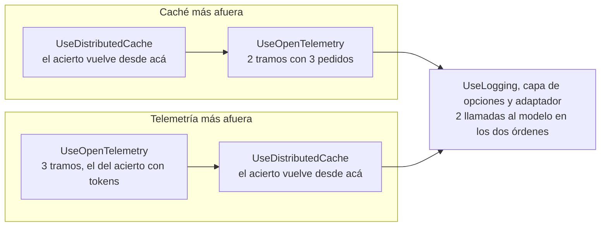
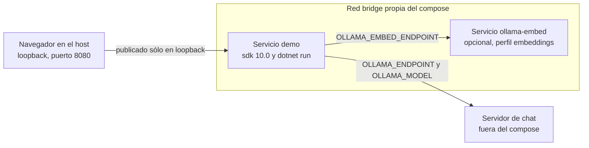

<a id="s12"></a>
## §12 Operar y desplegar

> Estás en: transversal · capa Infrastructure · [OA-O1](#oa-o1), [OA-O2](#oa-o2), [OA-O4](#oa-o4)

En el servidor compartido del laboratorio, la misma pregunta tardó una vez 91,7 s y otra 123,1 s, sin que cambiara una línea de código ([§12.7](#s12-7)). Operar la capa es poder explicar esa diferencia, su costo y lo que viajó en cada llamada. Vale para ESC-01 a ESC-05; su eje, CTX-LOCAL frente a CTX-NUBE y CTX-PROTO frente a CTX-PROD ([§2.2](#s2-2)). Pipeline: [§5.4](#s5-4); versiones: [Anexo F](#anexo-f).

<a id="s12-1"></a>
### §12.1 Observar con OpenTelemetry

**Definición.** Observar la capa es emitir, por cada llamada al modelo, un tramo (*span*) y métricas con las convenciones semánticas de IA generativa de OpenTelemetry: el tramo se llama `{gen_ai.operation.name} {gen_ai.request.model}` y lleva atributos como `gen_ai.provider.name` y `gen_ai.usage.input_tokens` [REF-169]. En .NET lo hace `UseOpenTelemetry` con cualquier `IChatClient` [REF-45]. No exporta nada sola: la aplicación registra la fuente y el medidor (por defecto, `Experimental.Microsoft.Extensions.AI`) y elige un exportador, como el ejemplo 17 ([Ejemplos](#s12-ejemplos)). No es un registro de lo que se dijo: el contenido es opcional ([§12.2](#s12-2)).

La convención está en estado *Development* y se mudó a un repositorio propio [REF-168], [REF-169]. M.E.AI 10.11.0 emite los cuatro nombres de métricas de la v1.41.0 del repositorio anterior [REF-171]; el nuevo cambió tres por `gen_ai.client.inference.*` [REF-169]. El ejemplo 17 compara lo emitido con las dos listas y falla si cambia. Criterio de la guía: el tablero usa los nombres de la versión instalada y se versiona con ella; el estado, en el [Anexo F](#anexo-f).

<a id="s12-2"></a>
### §12.2 Contenido en la telemetría sólo por ambiente

**Definición.** El contenido son los mensajes y las instrucciones de cada llamada: `gen_ai.input.messages`, `gen_ai.output.messages` y `gen_ai.system_instructions`, atributos que la convención marca como opcionales a pedido [REF-169]. `OpenTelemetryChatClient.EnableSensitiveData` vale `false` salvo que la variable `OTEL_INSTRUMENTATION_GENAI_CAPTURE_MESSAGE_CONTENT` diga lo contrario, y fijar la propiedad gana sobre la variable [REF-173]. Resuelve depurar viendo la conversación. No es para producción (criterio de la guía): las trazas guardarían lo que dijo la persona, `Nombre` y `Edad` incluidos ([§11.4](#s11-4)).

El ejemplo 17 fija la propiedad siempre desde `DOTNET_ENVIRONMENT`: con `Development` los tramos traen los tres atributos; con otro valor, ninguno. `UseLogging` en `Debug` registra que hubo llamadas; en `Trace`, el texto del pedido.

<a id="s12-3"></a>
### §12.3 Costo y latencia

**Definición.** El costo de la capa se mide en tokens de entrada y de salida, que la respuesta informa en `Usage` [REF-62] y el tramo en `gen_ai.usage.*` [REF-169]; en la nube se pagan por token y en local, en tiempo de cómputo (criterio de la guía). La latencia de cada ida la registra `gen_ai.client.operation.duration`, y depende además del modelo, del servidor y de la carga ajena.

**Caché de respuestas.** `UseDistributedCache` guarda la respuesta en un `IDistributedCache` y la devuelve sin llamar al modelo ante el mismo pedido [REF-69]. No es semántica: una pregunta parecida no acierta, y las opciones son parte de la clave (en 17, el pedido con temperatura 0,7 no acertó). Ahorra sólo con pedidos literalmente repetidos, raros en un chat libre (criterio de la guía). La caché del prefijo es otra: [§6.4](#s6-4).

**El orden cambia lo que se mide.** Con la caché más afuera, el acierto no llega a la telemetría; con la telemetría más afuera, genera un tramo con tokens que no se pagaron:



El costo real se cuenta por llamadas al modelo, no por tramos. **Límite de concurrencia.** Una capa propia con un `RateLimiter` acota los pedidos simultáneos [REF-45], frente al consumo sin límite (LLM10) [REF-161] y a un servidor que atiende de a uno ([§12.4](#s12-4)).

<a id="s12-4"></a>
### §12.4 Local, servidor compartido o nube

**Definición.** Es dónde corre el modelo: un servidor propio, uno compartido o un servicio gestionado. Resuelve la tensión entre datos que no salen y capacidad. No es una decisión de código: se toma en la raíz de composición ([§5.6](#s5-6)).

- **Ollama.** Atiende por defecto un pedido a la vez por modelo (`OLLAMA_NUM_PARALLEL`, valor 1), la memoria crece con `OLLAMA_NUM_PARALLEL` × `OLLAMA_CONTEXT_LENGTH` y descarga el modelo tras cinco minutos sin uso [REF-55]. Más ventana cuesta memoria y no asegura que el modelo use lo del medio [REF-84] ([§6.5](#s6-5)).
- **Foundry Local.** Corre el modelo en el dispositivo, con API compatible con OpenAI; GA desde el 2026-04-09 [REF-179]. Su documentación no lo presenta como servidor para muchos usuarios [REF-178].
- **Servicio gestionado.** Modelos más grandes, a cambio de costo por token, latencia de red y datos que salen de la organización (criterio de la guía; credenciales en [§11.6](#s11-6)).

**Servidor compartido.** En el del laboratorio había un solo modelo residente, en CPU, y cada cambio de modelo obligaba a descargar uno y cargar otro. Observado en el sondeo del entorno: `qwen3.5:4b` (sin digest registrado), Ollama 0.32.0-rc0, sólo CPU, servidor compartido, 2026-10-25 y 2026-10-26. Criterio de la guía: en un servidor ajeno se usa el modelo cargado con su ventana ([§5.5](#s5-5)); que otra ventana lo recargue no está verificado.

<a id="s12-5"></a>
### §12.5 Configuración y secretos por ambiente

**Definición.** Configurar por ambiente es que servidor, modelo, ventana, ambiente y credenciales salgan del entorno del proceso, no del repositorio. Las variables de entorno pisan las fuentes anteriores y usan `__` por `:` [REF-167]. No es guardar secretos: Secret Manager «doesn't encrypt the stored secrets» (no cifra lo que guarda) y es sólo para desarrollo; para producción la documentación remite a Azure Key Vault [REF-167].

Las variables están en [§5.5](#s5-5) y [§7](#s7). Por ambiente cambian tres cosas: `DOTNET_ENVIRONMENT` decide, en 17, el contenido en la telemetría ([§12.2](#s12-2)); `OLLAMA_SERVIDOR` decide si la ventana es obligatoria; y una credencial existe sólo en CTX-NUBE ([§11.6](#s11-6)). La plantilla comentada está en el [Anexo A](#anexo-a-12).

<a id="s12-6"></a>
### §12.6 El camino mínimo: contenedor con endpoint configurable

**Definición.** Es correr la demo en un contenedor del SDK de .NET con `dotnet run`, sin imagen propia, pasando el servidor de modelos por variable. Resuelve levantarla sin instalar .NET ni escribir direcciones en el repositorio. No es un despliegue productivo: `Dockerfile` y `PublishContainer` quedan fuera ([§12.8](#s12-8)).

`Demos/MovilidadUrbana.Asistente/compose.yaml`
```yaml
services:
  demo:
    image: mcr.microsoft.com/dotnet/sdk:10.0
    # …
    working_dir: /guia/Demos/MovilidadUrbana.Asistente
    command: ["dotnet", "run", "--project", "src/MovilidadUrbana.Asistente/MovilidadUrbana.Asistente.csproj", "--no-launch-profile"]
    environment:
      # …
      ASPNETCORE_URLS: http://+:8080
      ASPNETCORE_ENVIRONMENT: Development
      # …
      # Sin valor: se toman del entorno de quien corre la demo (o quedan los defaults del código).
      OLLAMA_ENDPOINT:
      OLLAMA_MODEL:
      OLLAMA_SERVIDOR:
      OLLAMA_NUM_CTX:
      OLLAMA_EMBED_ENDPOINT:
      OLLAMA_EMBED_MODEL:
      # …
    ports:
      - "127.0.0.1:8080:8080"
    networks: [demo]
```

Qué mirar: las variables del modelo van sin valor, y el puerto, sólo en loopback.



Dentro del contenedor, `localhost` es el contenedor: un Ollama del host no se alcanza como `http://localhost:11434`, y la dirección tiene que ser alcanzable desde la red del compose. Publicar en loopback restringe el acceso desde el host, no desde esa red; la demo no expone `/mcp` ([§11.5](#s11-5)). El README trae el `docker run` equivalente; la corrida completa, en [§14.5](#s14-5).

<a id="s12-7"></a>
### §12.7 Aspire como orquestador de desarrollo

**Definición.** Aspire orquesta contenedores y proyectos de desarrollo desde un AppHost; su panel muestra trazas, métricas y registros, con un visualizador de IA generativa que funciona mejor si la telemetría lleva contenido [REF-174]. La integración con Ollama es del Community Toolkit: `AddOllama` y `AddModel` en el AppHost, `AddOllamaApiClient` en el consumidor [REF-175], [REF-176]. No es monitoreo de producción, y esta guía no la compiló: no hay snippet.

**Advertencia.** La plantilla de *service defaults* activa la resiliencia en todo `HttpClient` de `IHttpClientFactory`: «Turn on resilience by default» y `AddStandardResilienceHandler()` [REF-193]. Ese manejador corta cada intento a los 10 s (`AttemptTimeout`) [REF-194] y reintenta ante `TimeoutRejectedException` [REF-195], y cada reintento reenvía el prompt entero. La misma pregunta tardó 91,7 s y 123,1 s. Observado en el laboratorio, sonda de tiempos: `qwen3.5:4b` (digest `2a654d98e6fb`), Ollama 0.32.0-rc0, sólo CPU, servidor compartido, 2026-10-27. Criterio de la guía: para el cliente del modelo, excluí ese manejador, como la fábrica de [§5.5](#s5-5), o fijá `AttemptTimeout` y `TotalRequestTimeout` en al menos diez minutos y un `ShouldHandle` que no reintente [REF-195].

<a id="s12-8"></a>
### §12.8 Del prototipo a producción

**Qué cambia.** La demo es CTX-PROTO; CTX-PROD pide evaluación, observabilidad, límites de costo, controles de seguridad y un plan para fallas y cambios de versión del modelo ([§2.2](#s2-2)). Lo que la demo no implementa de esta sección (el resto, [§14.6](#s14-6)):

| Aspecto | En la demo | En CTX-PROD |
|---|---|---|
| Telemetría | `UseOpenTelemetry` sin exportador | exportador y tablero versionado ([§12.1](#s12-1)) |
| Contenido | no fija `EnableSensitiveData`: `false` salvo la variable de [§12.2](#s12-2) | ambiente de producción y política de retención ([§12.2](#s12-2)) |
| Concurrencia y costo | sin límite ni caché | límite; caché si se repiten pedidos ([§12.3](#s12-3)) |
| Calidad | humo de tres pasos | conjunto de oro y corridas periódicas ([§10.4](#s10-4), [§10.7](#s10-7)) |
| Realimentación | no hay | el circuito de [§12.9](#s12-9) |
| Empaquetado | SDK y `dotnet run` | imagen propia y orquestador, fuera de alcance |

En el código de la demo, nada llama a `AddOpenTelemetry` ni usa un limitador.

<a id="s12-9"></a>
### §12.9 Realimentación del usuario

**Definición.** La realimentación es que la persona valore una respuesta concreta durante el uso normal: «Enable the user to provide feedback indicating their preferences during regular interaction with the AI system» (que la persona pueda indicar sus preferencias mientras usa el sistema) [REF-01]. Resuelve saber dónde falla la capa con usuarios reales; el estándar de IA responsable de Microsoft pide procesos para que informen fallas [REF-04]. No es una evaluación: es una señal que la alimenta.

El circuito (criterio de la guía, no implementado): la persona marca la respuesta; la marca se guarda con el identificador de la llamada, sin `Nombre` ni `Edad` ([§11.4](#s11-4)); lo marcado como malo se revisa y puede pasar al conjunto de oro ([§10.7](#s10-7)). Fue tarea de producto, y cada vez más la asumen quienes integran IA [REF-08].

<a id="s12-practica"></a>
### Práctica de §12

<a id="s12-escenarios"></a>
#### Aplicación por escenario

Sólo las celdas que cambian; «—» significa sin diferencia con la combinación de la guía, CTX-EXISTENTE × CTX-LOCAL × CTX-PROTO ([§2.2](#s2-2)).

| Escenario | Qué observar | CTX-LOCAL | CTX-NUBE | CTX-SENS | CTX-PROD |
|---|---|---|---|---|---|
| ESC-01 | tramos y tokens por ida al modelo | esperas de minutos; un modelo residente | tokens = costo | sin contenido en trazas ni registros | exportador, límite, realimentación |
| ESC-03 | llamadas que llegan al modelo | — | caché si se repiten textos | — | contrato probado sin modelo ([§10.3](#s10-3)) |
| ESC-04 | un tramo por cada vuelta del bucle | cada vuelta hace cola | tokens por vuelta | el historial lleva resultados de herramientas ([§8.2](#s8-2)) | tope de iteraciones ([§8.2](#s8-2)) |

<a id="s12-ejemplos"></a>
#### Ejemplos

El vocabulario de la evidencia (oráculo, cliente guionado) está en [§0.4](#s0-4).

**17 · Observabilidad y pipeline** · `Examples/17-Observabilidad-Y-Pipeline/` · avanzado · ilustra [§12.1](#s12-1), [§12.2](#s12-2) y [§12.3](#s12-3) · [OA-O1](#oa-o1). Tres pedidos, dos iguales y uno con temperatura 0,7, con un exportador en memoria.

```bash
tools/verificar.sh correr 17-Observabilidad-Y-Pipeline                # --fake --verificar, sin servidor
tools/verificar.sh correr 17-Observabilidad-Y-Pipeline --con-modelo
```

`Examples/17-Observabilidad-Y-Pipeline/Infrastructure/PipelineObservado.cs`
```csharp
public static bool ContenidoEnTelemetria(string ambiente) =>
    string.Equals(ambiente, Desarrollo, StringComparison.OrdinalIgnoreCase);

// …
var contenido = Ambientes.ContenidoEnTelemetria(ambiente);
// …
void Telemetria(OpenTelemetryChatClient c) => c.EnableSensitiveData = contenido;

var builder = new ChatClientBuilder(registrador);
// En ChatClientBuilder, la primera capa que se agrega es la de más afuera.
builder = orden switch
{
    OrdenDeCapas.CacheAfuera => builder.UseDistributedCache(cache).UseOpenTelemetry(configure: Telemetria),
    OrdenDeCapas.TelemetriaAfuera => builder.UseOpenTelemetry(configure: Telemetria).UseDistributedCache(cache),
    _ => throw new ArgumentOutOfRangeException(nameof(orden))
};
return builder.UseLogging(logs).Build();
```

`Examples/17-Observabilidad-Y-Pipeline/Infrastructure/CapturaDeTelemetria.cs`
```csharp
public const string Fuente = "Experimental.Microsoft.Extensions.AI";

// …
public CapturaDeTelemetria()
{
    _trazas = Sdk.CreateTracerProviderBuilder().AddSource(Fuente).AddInMemoryExporter(Spans).Build();
    _metricas = Sdk.CreateMeterProviderBuilder().AddMeter(Fuente).AddInMemoryExporter(_exportadas).Build();
    // …
}
```

Qué mirar: `EnableSensitiveData` se asigna en toda construcción, también cuando vale `false`, y el `switch` es lo único que cambia entre los dos órdenes.

Observado: `qwen3.5:4b`, servidor compartido, 2026-10-27; estímulo del mismo autor. Caché más afuera, ambiente `Production`:

```text
[e01] caché más afuera · ambiente Production · 3 pedidos
[…]
  llegaron al modelo: p1, p3 · aciertos de caché: p2
  spans: 2
[…]
  logs (Debug): 4 líneas, ninguna con el texto del pedido: True
  métricas publicadas por M.E.AI frente a la convención:
    gen_ai.client.operation.duration (medida): semconv v1.41.0 sí · vigente sí
    gen_ai.client.operation.time_per_output_chunk (sin mediciones): semconv v1.41.0 sí · vigente no
    gen_ai.client.operation.time_to_first_chunk (sin mediciones): semconv v1.41.0 sí · vigente no
    gen_ai.client.token.usage (medida): semconv v1.41.0 sí · vigente no
[…]
```

Demostración, 1 de 1, sin tasa: el oráculo pasó y los dos tramos salieron sin contenido. Las métricas de *streaming* no miden porque 17 no lo usa. Salida con `--fake` (cliente guionado), sin modelo, de las tres comparaciones:

```text
comparación (guion) · telemetría más afuera: 2 llamadas, 3 spans; aciertos: p2
[…]
comparación (guion) · ambiente Development: 2 de 2 spans con contenido (gen_ai.input.messages, gen_ai.output.messages, gen_ai.system_instructions)
comparación (guion) · UseLogging en Trace: 2 de 4 líneas de log traen el texto del pedido (en Debug: 0)
```

**En la demo.** El compose de [§12.6](#s12-6) y el README de `Demos/MovilidadUrbana.Asistente/` son el camino del lector; el chat usa `UseOpenTelemetry` sin exportador ([§12.8](#s12-8)).

<a id="s12-preguntas"></a>
#### Preguntas guía

**¿Para qué `UseOpenTelemetry` si ya tengo logs?** ([OA-O1](#oa-o1))

El registro cuenta que pasó algo; el tramo y las métricas dicen cuánto, con atributos estándar de modelo, proveedor, tokens y duración [REF-169]. Vale cuando una operación hace varias idas al modelo, como el bucle de ESC-04, o hay que controlar costo. En CTX-PROTO con una sola llamada, `UseLogging` alcanza (criterio de la guía). En CTX-SENS cuidá los dos: en `Trace`, el registro lleva el texto. Configurá `UseOpenTelemetry` con `EnableSensitiveData` desde el ambiente y comprobá con un exportador en memoria, como en 17, qué sale con el contenido apagado y encendido.

**¿Ollama, Foundry Local o la nube?** ([OA-O4](#oa-o4))

Depende de cuántos usuarios piden a la vez, qué datos salen y quién paga cada token. Ollama sirve a un equipo, pero atiende de a un pedido por modelo salvo que se ajuste `OLLAMA_NUM_PARALLEL`, y la memoria crece con cada pedido paralelo [REF-55]. Foundry Local pone el modelo en el dispositivo de cada persona, no en un servidor para muchos [REF-178]. La nube da capacidad con costo por token y datos que salen: con CTX-SENS es lo que más condiciona el diseño ([§2.2](#s2-2)). La respuesta cambia con la concurrencia medida. Elegí por concurrencia, datos y costo, y registrá la elección en ADR-03 ([§13.4](#s13-4)).

**¿Por qué mi modelo local tarda minutos?** ([OA-O4](#oa-o4))

En un servidor compartido en CPU pesa la cola (criterio de la guía): con un pedido a la vez por modelo [REF-55], el tuyo espera a los demás, y si alguien pide otro modelo, el servidor descarga uno y carga otro ([§12.4](#s12-4)). En el laboratorio, la misma pregunta midió 91,7 s y 123,1 s (rótulo de [§12.7](#s12-7)), y ningún tope fijado de antemano acotó la espera. Con un servidor propio, mirá `OLLAMA_NUM_PARALLEL` y la ventana; en CTX-NUBE, la latencia de red y las cuotas. Si la cola es ajena, elegí entre un servidor propio, con la concurrencia que midas, y la nube.

<a id="s12-calidad"></a>
#### Criterios de calidad y antipatrones

- Toda llamada al modelo pasa por `UseOpenTelemetry`, con la fuente y el medidor registrados, y una prueba con exportador en memoria comprueba qué sale.
- `EnableSensitiveData` se asigna siempre desde el ambiente; nunca `true` fijo en el código.
- El cliente del modelo tiene su espera y su política de reintentos explícitas, sin el manejador estándar de 10 s por intento.
- Antipatrón: un tablero con los nombres de la convención vigente sin comprobar los que emite la versión instalada ([§12.1](#s12-1)).
- Antipatrón: cambiar de modelo o de ventana en un servidor compartido (criterio de la guía).

<a id="s12-10"></a>
### §12.10 Qué decisión toca: ADR-03 y ADR-09

Esta sección aplica **ADR-03, local, servidor compartido o nube** ([§13.4](#s13-4)): local por defecto, elegido en la raíz de composición, con la concurrencia medida. Toca **ADR-09, pipeline transversal** ([§13.10](#s13-10)): telemetría siempre, contenido sólo en desarrollo, caché sólo con pedidos idénticos y un límite frente al servidor. Plantilla de configuración por ambiente: [Anexo A](#anexo-a-12).

<!-- PENDIENTES:
Quitado por falta de respaldo citable:
- Cifras de la advertencia de Aspire que trae la ficha (11 a 24 s con razonamiento apagado, 474,7 s con un prefijo de 4.441 tokens, más de 600 s bajo carga): no están en la tabla de cifras citables (carta §10). Se reemplazaron por la sonda de tiempos (91,7 s y 123,1 s), que sí está.
- Snippet de Aspire (AppHost con AddOllama/AddModel/WithReference y AddOllamaApiClient): no sale de un archivo de Examples/ ni de Demos/ y no se compiló; la carta deja a LangGraph como única pieza no ejecutada. §12.7 nombra las API en prosa con [REF-175], [REF-176] y dice «no hay snippet». Desvío de la ficha.
- Valores por defecto de TotalRequestTimeout y del número de reintentos del manejador estándar: no verificados (heredan de Polly); sólo se cita el AttemptTimeout de 10 s y que el reintento atiende TimeoutRejectedException.
- num_ctx 65.536 del registro de 17, tokens de los tramos (113/39, 94/25) y duraciones de 17: fuera de la tabla de cifras; las líneas de tramo se recortaron con «[…]» en la salida con modelo.
- Puertos y variables del panel de Aspire independiente y su acceso anónimo «sólo para desarrollo»: la fuente del dossier mezcla dos URL (REF-172 y REF-177) y no queda claro cuál lo respalda.
- Que el SetEnvironmentVariable con el proceso andando no cambie EnableSensitiveData: sólo lo respalda una sonda de dossier sin REF.
- ONNX Runtime GenAI como tercera opción local: se omitió por presupuesto (REF-180 disponible si la relectura lo quiere).
- Que otra ventana recargue el modelo en el servidor compartido: marcado «no verificado» (carta §16.13).
- Valores de EMB_PLAN: no se escriben porque marcan la compuerta de familias de ID; se remite a §7.
Fuentes dadas de alta (pendientes de convalidación, carta §16.10), verificadas con curl el 2026-10-27 sobre los archivos crudos:
- REF-193: microsoft/aspire, plantilla aspire-servicedefaults/Extensions.cs en v13.6.4 (commit c8935270), líneas 29-36: «// Turn on resilience by default» y http.AddStandardResilienceHandler().
- REF-194: dotnet/extensions v10.11.0 (commit 25f07afa), HttpStandardResilienceOptions.cs, líneas 85-95: AttemptTimeout «using custom Timeout of 10 seconds», Timeout = TimeSpan.FromSeconds(10).
- REF-195: dotnet/extensions v10.11.0, Polly/HttpRetryStrategyOptions.cs, líneas 22-29: reintenta fallas transitorias, incluida TimeoutRejectedException.
- REF-55 se volvió a abrir el 2026-10-27 para confirmar el texto citado: «OLLAMA_NUM_PARALLEL … default 1», «Required RAM will scale by OLLAMA_NUM_PARALLEL * OLLAMA_CONTEXT_LENGTH» y «kept in memory for 5 minutes».
Desvíos de la ficha:
- Snippet de Aspire: ver arriba.
- La lista de «lo que la demo no implementa» de §12.8 se acota a lo operativo y remite a §14.6 para el resto, para no duplicar la casa de §14.6.
- La pregunta de N5 P8 se responde dentro de §12.3 y la de «qué cambia del prototipo a producción», dentro de §12.8, como pide la ficha. N5 P10 se responde en §12.4 con remisión a §6.5. N5 P3 queda en el Anexo F.
- El diagrama del pipeline de §12.3 sólo compara los dos órdenes; el pipeline completo ya está en §5.4 y no se repite.
- La plantilla de §12 del Anexo A se citó con el ancla anexo-a-12 (carta §13).
Procedencia de las salidas:
- 17 con modelo: Evidencia/17-Observabilidad-Y-Pipeline/, log de la corrida con modelo del 2026-10-27, líneas 4, 8, 9, 12-17; registro Evidencia/R-LLM/17-Observabilidad-Y-Pipeline.modelo.jsonl, entrada e01 (dos llamadas p1 y p3 y la línea del oráculo, resultado pasa).
- 17 --fake (comparaciones con el cliente guionado): Evidencia/Cierre-Construccion/verificar-build.saneo.log, líneas 764, 768 y 769.
- Sonda de tiempos (91,7 s y 123,1 s): cifra de la tabla de la carta §10, con el rótulo de §5.7.
- Sondeo del entorno (un modelo residente en CPU, cambio de modelo = descargar y cargar): Bitacoras/Sondeo-Entorno.md §0, conducta sin cifras.
- Demo sin AddOpenTelemetry ni limitador: búsqueda en Demos/MovilidadUrbana.Asistente/src (2026-10-27); UseOpenTelemetry sólo en Infrastructure/AI/Chat/SesionDeChat.cs.
Verificación adversarial (2026-10-27), correcciones aplicadas:
- «la misma consulta» → «la misma pregunta»: en DEP-13 el texto del pedido es idéntico pero hash_instrucciones difiere entre k01 y k02 (646 y 645 tokens de prompt).
- Fuente y medidor «por defecto»: la demo usa sourceName propio (SesionDeChat.cs).
- §12.5: ASPNETCORE_ENVIRONMENT no decide el contenido en ningún código; sólo DOTNET_ENVIRONMENT en 17 (Ambientes.DelProceso).
- §12.8, fila Contenido: la demo llama UseOpenTelemetry sin configure, así que EnableSensitiveData queda en false salvo OTEL_INSTRUMENTATION_GENAI_CAPTURE_MESSAGE_CONTENT; «el compose fija Development» sugería contenido encendido.
- §12.7: «cero reintentos» no es configurable: Polly 8 declara MaxRetryAttempts con [Range(1, int.MaxValue)] (RetryStrategyOptions.TResult.cs, etiqueta 8.6.4, leído con curl el 2026-10-27). Se reemplazó por un ShouldHandle que no reintente [REF-195]. El plan v3 §C dice «cero reintentos» (AJ-02): desvío a convalidar.
- §12.7: «todo HttpClient» acotado a los de IHttpClientFactory (ConfigureHttpClientDefaults, REF-193); la fábrica crea su HttpClient con new y no queda alcanzada.
- §12.3: «no de la aplicación» se quitó (los tokens dependen del prompt que arma la aplicación).
- §12.9 y pregunta 3: marcados como criterio de la guía (N0b §3.2.4 y Sondeo §0 los declaran criterio propio).
Conteo de palabras de prosa (comando de la carta §16.3): 2.198 antes de la verificación y 2.200 después (en el tope). Tope de la sección (carta §16.3): 2.200.
Snippets por encima de 25 líneas: ninguno (compose 22, PipelineObservado 16, CapturaDeTelemetria 9).
R-PRIV: el único literal de dirección es 127.0.0.1:8080:8080 del compose (loopback, publicado así en el repositorio y en el README). AC-7/AC-8 sin correr (las corre la integración).
Remisiones usadas: s0-4, s2-2, s5-4, s5-5, s5-6, s6-4, s6-5, s7, s8-2, s10-3, s10-4, s10-7, s11-4, s11-5, s11-6, s13-4, s13-10, s14-5, s14-6, anexo-a-12, anexo-f, oa-o1, oa-o2, oa-o4; internas: s12-1, s12-2, s12-3, s12-4, s12-6, s12-7, s12-8, s12-9, s12-ejemplos.
Cifras citadas (todas en la tabla de cifras citables): sonda de tiempos 91,7 s y 123,1 s; 17 conducta 1 de 1; «los tiempos pesimistas no acotan la cola bajo carga» (como «ningún tope fijado de antemano acotó la espera»). Valores que no son mediciones del laboratorio, con su fuente: 10 s de AttemptTimeout [REF-194], OLLAMA_NUM_PARALLEL 1 y cinco minutos [REF-55], GA de Foundry Local 2026-04-09 [REF-179], diez minutos de espera de la fábrica (código, §5.5). Las salidas de 17 muestran 2 llamadas, 2 y 3 tramos, 4 líneas de log: son conducta del código.
-->
