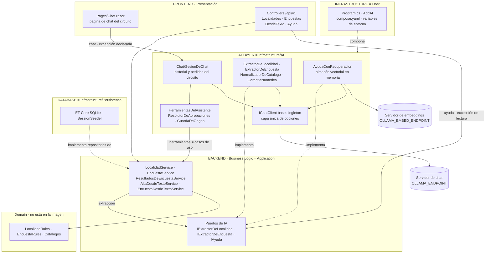
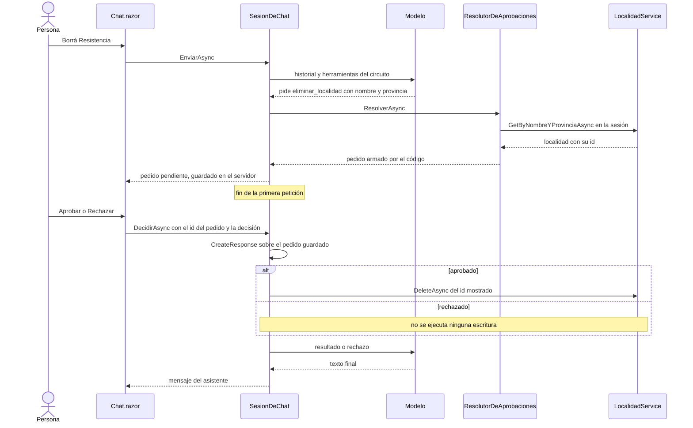

<a id="s14"></a>
## §14 Movilidad Urbana con capa de IA: la demo

> Estás en: escalones 0 a 2 de las dos escaleras · capa Infrastructure/AI · [OA-0.2](#oa-0-2), [OA-0.3](#oa-0-3), [OA-A6](#oa-a6), [OA-O2](#oa-o2)

La demo `Demos/MovilidadUrbana.Asistente/` toma una aplicación que ya existía y le suma la capa de IA sin reescribir sus casos de uso. Corre en CTX-EXISTENTE × CTX-LOCAL × CTX-PROTO ([§2.2](#s2-2)) y compone en un host ESC-01, ESC-03 y ESC-04; ESC-02 y ESC-05 los cubren 06 y 13 ([§3.3](#s3-3)). La demo prueba la composición; los ejemplos, la conducta. Sus decisiones están en [§13](#s13); las versiones, en el [Anexo F](#anexo-f).

<a id="s14-1"></a>
### §14.1 El punto de partida y la tabla de delta

El punto de partida es la API de Movilidad Urbana, `MovilidadUrbana.ApiWeb`, en el commit `8fb4c3a` del laboratorio Lab-E2E.WebBlazor [REF-186]. La demo empezó como copia literal de esa API y sus pruebas, del middleware de sesión por cookie de `MovilidadUrbana.Web` y de sus dos hojas de estilo. Cada archivo copiado dice en su cabecera de dónde salió y en qué columna cae su cambio, y `tools/diff-base.sh` falla si un archivo distinto de la base no tiene fila:

| Pieza | Agregado por la IA | Modificado a causa de la IA | Modificado por otro motivo |
|---|---|---|---|
| Proyecto y `Program.cs` | paquetes de IA; `AddAI`; la página de chat en el mismo host ([§13.14](#s13-14)) | sesión por encabezado en `/api` y por cookie en los documentos | versiones centrales; páginas de estado sólo en `/api` |
| `Domain/Rules/` | — | provincia, medios, frecuencia y motivo tienen que ser valores de `Catalogos` | — |
| `LocalidadService`, `Result` | — | `GetByNombreYProvinciaAsync`, con error si es ambiguo; `SaveAsync` informa el id creado | — |
| `EncuestaService` y su repositorio | — | `ValidarPaso` rechaza valores fuera de `Catalogos`; lectura de la sesión para los agregados | — |
| `Application/`, archivos nuevos | tres puertos de IA, tres casos de uso y `LocalidadPropuesta` con `int? Habitantes` | — | — |
| `Infrastructure/AI/` | todo: extractores, normalizador, ayuda con recuperación, chat, herramientas y aprobación | — | — |
| `SessionSeeder` | 20 respuestas de encuesta por sesión, escritas para el ejemplo, con «Persona 01…20» | — | — |
| Controllers | `DesdeTextoController`, `AyudaController`; ninguna ruta de chat | — | `LocalidadesController` deja de leer del repositorio salteando el servicio |
| `Components/`, `wwwroot/css/` | página de chat, `App`, `Routes` y un layout mínimo | — | hojas copiadas de la web, para conservar su temática |
| Pruebas | `Cableado/`, `ConModelo/` | la fábrica de pruebas usa un cliente guionado | versiones centrales; nombre de persona sintético |

En todos los archivos copiados cambia, además, el namespace raíz. La columna del medio enseña lo que la IA obligó a tocar.

<a id="s14-2"></a>
### §14.2 La imagen redibujada con los componentes reales

La correspondencia entre las capas de la imagen y las de una solución .NET vive en [§3.1](#s3-1). Este es el mismo mapa con los tipos que existen en la demo:



Qué mirar: ninguna flecha va del modelo a `PE` ni a `RU`. El alta desde texto usa un puerto propio, `IExtractorDeLocalidad`, porque el prompt es un detalle del adaptador; el chat usa `IChatClient`, porque la funcionalidad es la conversación ([§4.4](#s4-4)). Las dos excepciones al principio rector de [§1](#s1) van rotuladas: el chat entra sin caso de uso, pero escribe sólo por herramientas sobre casos de uso, y la ayuda no escribe ni lee datos de la sesión.

<a id="s14-3"></a>
### §14.3 Recorrido PD-1…PD-6

Los seis pasos van de la lectura a la escritura. Tres se corrieron contra el modelo como **prueba de humo**, una por cruce de capas ([§0.4](#s0-4)); los otros tres cierran con su prueba de cableado y con el registro del ejemplo hermano. Los pedidos están escritos para el ejemplo (`entradas.v1.json`), con localidades del caso base; el mapa en las escaleras está en [§3.5](#s3-5).

| Paso | Pedido | Escalón | Cómo cierra | Hermano |
|---|---|---|---|---|
| PD-1 | «¿Cuántas localidades tengo en Corrientes?» y «¿Qué medio usa más la gente?» | 1 de agencia, carril de dato exacto | cableado: `Pd1_Contar_DesdeElCasoDeUso`, `Pd1_ResumirEncuesta_SinDatosPersonales` | 08, 12 |
| PD-2 | `POST /api/v1/ayuda`: «¿Cuántos dígitos lleva el código postal?» | 2 de conocimiento; **sube de más**: con doce requisitos cortos alcanza el 0 | humo: controller, puerto directo y recuperación | 07 |
| PD-3 | `POST /api/v1/localidades/desde-texto`: «Agregá Bella Vista, en Corrientes, código postal 3432. No sé cuántos viven.» | 0 de agencia | humo: controller, caso de uso, puerto y adaptador | 03 |
| PD-4 | `POST /api/v1/encuestas/desde-texto`: «Voy en bondi y a veces en bici…»; «avion» | 0 de agencia | cableado: `Pd4_Normaliza_ALasClavesDelCatalogo`, `Pd4_MedioInventado_SeRechaza` | 04 |
| PD-5 | «Agregá Goya, Corrientes, CP 34, con 90000 habitantes.» y la corrección a 3450 | 1 de agencia, con aprobación | cableado: `Pd5_AltaConAprobacion` | 09 |
| PD-6 | «Borrá Resistencia» | 1 de agencia, con estado y aprobación | humo: página, `IChatClient` y herramientas sobre casos de uso | 11 |

En PD-5 el dominio rechaza el código postal de dos dígitos antes de preguntar; con 3450, el pedido muestra los datos que resolvió el código. PD-6 son dos peticiones:



El texto del pedido lo escribe el código:

`Demos/MovilidadUrbana.Asistente/src/MovilidadUrbana.Asistente/Infrastructure/AI/Chat/ResolutorDeAprobaciones.cs`
```csharp
case HerramientasDelAsistente.Eliminar:
{
    var nombre = Argumentos.Texto(llamada.Arguments, "nombre") ?? string.Empty;
    var provincia = normalizador.Provincia(Argumentos.Texto(llamada.Arguments, "provincia"));
    var resolucion = await localidades.GetByNombreYProvinciaAsync(nombre, provincia, cancellationToken);
    if (resolucion.Localidad is not { } l)
    {
        return new(null, string.Join(" ", resolucion.Error!.Errors.Values));
    }
    var baja = new BajaResuelta(l.Id, l.Nombre, l.Provincia);
    return new(Pedido(solicitud, llamada.Name,
        $"Eliminar la localidad «{l.Nombre}» ({l.Provincia}), id {l.Id}, de tu sesión.", baja), null);
}
```

Qué mirar: el modelo aporta nombre y provincia; el id sale del caso de uso, y una localidad ambigua o ajena a la sesión vuelve como error, sin preguntar.

Los tres humos pasaron su oráculo. Observado en el laboratorio: `qwen3.5:4b` (digest `2a654d98e6fb`), Ollama 0.32.0-rc0, sólo CPU, servidor compartido, 2026-10-27; humo de la demo. Embeddings de PD-2: `qwen3-embedding:0.6b` (digest `ac6da0dfba84`), Ollama 0.40.11, Ollama propio, 2026-10-27. Salidas de PD-2 y PD-3, y la llamada pedida en PD-6:

```json
{ "respuesta": "4", "fuente": "[LocalidadPolicy.RequisitoDelCodigoPostal]" }
```

```json
{
  "nombre": "Bella Vista",
  "provincia": "Corrientes",
  "codigoPostal": "3432",
  "habitantes": null
}
```

```json
{"nombre":"eliminar_localidad","argumentos":{"nombre":"Resistencia","provincia":"Chaco"},"resultado":null,"error":null}
```

El código validó la cita de PD-2 contra los fragmentos recuperados. En PD-3 `LocalidadRules` rechazó el `null` y la respuesta pidió el dato. En PD-6 el código mostró «Eliminar la localidad «Resistencia» (Chaco), id 2, de tu sesión.», la persona rechazó y la base no cambió. Es conducta de una entrada por paso, sin tasa; las tasas de 03 y 07 están en [§5](#s5-ejemplos) y [§7](#s7-ejemplos).

<a id="s14-4"></a>
### §14.4 Siete tensiones de integración

| Tensión | Por qué aparece | Cómo se resolvió |
|---|---|---|
| Herramientas por petición o por circuito | `AddAI` registra con `AddChatClient` un cliente base singleton, y la sesión es scoped | `SesionDeChat`, scoped, arma `UseFunctionInvocation` y las herramientas sobre el cliente base, con `AIFunctionFactory.Create` sobre una instancia del circuito; la sesión sale del scope ([§13.13](#s13-13)) |
| Reglas endurecidas frente al catálogo | el caso base pedía «no vacío» y contaba los medios sin mirar sus claves | `NormalizadorDeCatalogo` lleva el texto a una clave de `Catalogos` o lo deja como vino, y la regla endurecida lo rechaza |
| SQLitePCLRaw | EF Core SQLite depende de la serie 2 de SQLitePCLRaw y el conector SqliteVec, de la serie 3 [REF-200] | criterio de la guía: el almacén va en memoria y SqliteVec, que además es preview, queda fuera ([§7.3](#s7-3)) |
| Versiones que arrastra MAF | en los ejemplos con MAF, un transitivo resolvía otra versión de una familia | versiones centrales con fijación de transitivas; `Familias_UnaSolaVersion_SinPreviews` falla si una familia queda en dos versiones ([Anexo F](#anexo-f)) |
| Datos personales en la encuesta | `RespuestaDeEncuesta` guarda nombre y edad | `resumir_encuesta` devuelve `ResultadosDeEncuesta`, un tipo sin `Nombre` ni `Edad` ([§11.4](#s11-4)) |
| Cultura de los números | el host fija `es-AR` («12,5», «90.000») y el modelo puede devolver «12.5» | `GarantiaNumerica` lee el texto con cultura invariante y acepta un valor propuesto sólo si está en él; `es-AR` queda para mostrar |
| Registrar sin validar | `EncuestaService.RegistrarAsync` no valida | no se expone como herramienta |

En CTX-NUEVA las reglas nacen con el catálogo y no hay copia que conciliar. La de datos personales pesa más en CTX-NUBE × CTX-SENS, donde el texto de la persona sale de la máquina.

<a id="s14-5"></a>
### §14.5 Cómo se corre y qué evidencia produjo

Lo de .NET corre en contenedores del SDK; afuera bastan bash, docker y jq. Desde `Demos/MovilidadUrbana.Asistente/`, según su `README.md`:

```bash
tools/demo.sh pruebas          # build + Cableado/ y las pruebas del caso base, sin servidor de modelos, + chequeo de versiones
tools/demo.sh embeddings       # vectoriza los 12 requisitos y la pregunta de PD-2 con el Ollama propio y los guarda en RLLM_DIR
tools/demo.sh humo             # PD-2, PD-3 y PD-6 contra el servidor de chat (lee num_ctx del modelo cargado; usa los embeddings guardados)
```

`tools/demo.sh host guion` levanta la página sin ningún modelo, sólo en el loopback; `host modelo`, con el cliente real.

Ninguna dirección de la infraestructura ni usuario tiene valor en el repositorio: quien corre la demo pasa `OLLAMA_ENDPOINT`, `OLLAMA_MODEL`, `OLLAMA_SERVIDOR`, `OLLAMA_NUM_CTX`, `OLLAMA_EMBED_ENDPOINT`, `OLLAMA_EMBED_MODEL` y `EMB_PLAN`; defaults y esperas, en [§5.5](#s5-5). Con un servidor compartido, la demo no arranca si `OLLAMA_NUM_CTX` no está definida. Dentro de un contenedor, `localhost` es el contenedor. `compose.yaml` suma, opcional, un Ollama propio para los embeddings ([§12.6](#s12-6)).

Evidencia: las 70 pruebas de la demo, sin servidor, pasaron, y ninguna registra una baja sin aprobación; incluyen arquitectura, composición con `ValidateScopes`, sesiones concurrentes y humo del host. Los tres humos dejaron un registro con su oráculo, recalculable sin volver a llamar al modelo ([§10.4](#s10-4)). No se muestran ni comparan tiempos: el servidor compartido atiende a otros clientes.

<a id="s14-6"></a>
### §14.6 Qué no hace la demo y qué haría falta en producción

- **Autorización.** `X-Sesion-Id` y la cookie aíslan sesiones pero no autentican: quien conoce el id ve los datos. Criterio de la guía: CTX-PROD pide identidad y permisos por acción ([§11.3](#s11-3)).
- **MCP.** La demo no expone `/mcp`: haría falta la validación de Host y `Origin` del ejemplo 13 y decidir qué lecturas se publican; fuera del loopback, también autenticación [REF-196] ([§11.5](#s11-5)).
- **Contexto completo frente a RAG.** La calidad no se comparó, por costo de tiempo: 05 mide la reutilización del prefijo ([§6.3](#s6-3)).
- **Ataques.** La inyección indirecta se midió con un solo texto de ataque, del mismo autor; faltan varios ([§11.7](#s11-7)).
- **Juez.** El de 15 es de la familia del generador y no quedó calibrado; falta uno de otra familia ([§10.6](#s10-6)).
- **Varios pasos y varios agentes.** Los ejemplos miden pedidos acotados; la conducta del modelo en tareas de varios pasos y el traspaso mínimo entre agentes quedan sin medir ([§8.8](#s8-8)).
- **Otros contextos de uso.** En CTX-NUBE cambia la composición, no los casos de uso ([§12.4](#s12-4)); CTX-PROD suma evaluación con umbral, telemetría sin contenido y límites de costo ([§12.8](#s12-8)).

<a id="s14-preguntas"></a>
### Preguntas guía de §14

**¿Qué aporta una capa de IA a una aplicación de ABM y encuesta tan estructurada?** ([OA-0.1](#oa-0-1))

Aporta en la entrada y en la consulta, no en las reglas. Convierte una frase en una `LocalidadPropuesta` que pasa por las mismas `LocalidadRules` que el formulario, y responde «¿cuántas localidades tengo en Corrientes?» con un caso de uso. A la validación y a la persistencia no les agrega nada. En CTX-PROTO alcanza con que el recorrido funcione; en CTX-PROD, criterio de la guía, hay que medir si la gente prefiere la frase al formulario. Si un pedido se resuelve con una función, no hace falta modelo: «If you can write a function to handle the task, do that instead of using an AI agent», si podés escribir la función, escribila [REF-117]. Pasá cada pedido por las cuatro preguntas de [§2.4](#s2-4) antes de decidir si hace falta un modelo.

**¿Cómo se respetan `LocalidadRules` y `EncuestaRules` cuando la entrada viene del modelo?** ([OA-D2](#oa-d2))

Con un orden fijo: el modelo propone con salida estructurada, el adaptador normaliza contra `Catalogos` y descarta los números que no estén en el texto, y recién entonces deciden las reglas; la escritura pasa por el caso de uso, que vuelve a validar ([§5.3](#s5-3)). En PD-3 el `null` llega a la regla y la persona completa el dato. En CTX-EXISTENTE el orden no alcanza si la regla es floja: por eso se endurecieron. Si la propuesta llega por una herramienta, como en PD-5, el dominio decide antes de armar el pedido de aprobación. La respuesta cambia si el campo admite texto libre: ahí ninguna regla de catálogo lo controla.

**¿Qué cambió del caso base y por qué?** ([OA-A1](#oa-a1), [OA-A6](#oa-a6))

Lo que dice la tabla de [§14.1](#s14-1). Al clasificar, importa la columna «modificado a causa de la IA»: reglas endurecidas, una búsqueda por nombre y provincia para que la baja no reciba un id del modelo, y la sesión repartida por zona. Cada motivo queda en un ADR, con la alternativa descartada y cuándo deja de valer: la salida como propuesta ([§13.9](#s13-9)), la baja con aprobación ([§13.7](#s13-7)), un host ([§13.14](#s13-14)) y capas como carpetas ([§13.12](#s13-12)). En CTX-NUEVA no hay delta: las reglas nacen con el catálogo y las capas pueden ser proyectos. Registrá el motivo de cada fila como ADR antes de cambiar la pieza.

<!-- PENDIENTES:
Quitado por falta de respaldo citable:
- Que SqliteVec y EF Core SQLite convivan en el mismo archivo resolviendo SQLitePCLRaw a la serie 3 sin advertencias: lo respalda sólo la sonda del dossier N6, no re-ejecutada. Queda el hecho de los manifiestos (REF-200) y la decisión como criterio de la guía.
- Que MAF arrastre versiones concretas de VectorData o de OpenTelemetry: los números están en un comentario de Examples/Directory.Packages.props, no en la tabla de cifras citables; se describe el mecanismo y se remite al Anexo F.
- Recuento de diff-base.sh (iguales, distintos, nuevos): no está en la tabla de cifras citables (AC-9); se dice sólo que la compuerta falla si un cambio no tiene fila.
- Tiempos de los humos y del arranque: no citables y, en el servidor compartido, no comparables.
- El primer humo de PD-6 (defecto de la prueba, repetido): no se cita.
- El tiempo por consulta del 7B en CPU que motivó no comparar contexto completo y RAG: cifra de dossier no re-ejecutada; queda «por costo de tiempo».
- Prosa final del modelo en PD-6 (trae «usted»): no se muestra; la conducta va en prosa.
- La salida del modo guion de la página (Evidencia/Demo-MovilidadUrbana.Asistente/demo-asistente-chat.txt): no se muestra porque su rótulo incluye un identificador interno de plan de embeddings que la compuerta de familias de ID marcaría.
- Que la prueba Category("LLM") de 11 no corrió por presupuesto: sólo lo dice la bitácora de construcción, no un archivo del repositorio; no entra en §14.6.
Fuente nueva: REF-200 (manifiestos .nuspec de NuGet de Microsoft.EntityFrameworkCore.Sqlite 10.0.14 y CommunityToolkit.VectorData.SqliteVec 1.0.3-preview), verificada con curl el 2026-10-27; alta pendiente de convalidar por la presidencia (00-Referencias.md, al final de la lista y en la tabla de correspondencia). Se usa además REF-196 (MCP, «Servers SHOULD implement proper authentication for all connections»), dada de alta por la redacción de §11 y pendiente de convalidación.
Desvíos de la ficha:
- La pregunta «¿Qué cambió del caso base?» lleva OA-A1 (como pide el plan) y además OA-A6, porque la decisión que cambia es clasificar cada pieza de la tabla de delta.
- Los dos diagramas de la ficha (arquitectura de la demo y redibujo de la imagen) se fundieron en uno, en §14.2, con las capas de la imagen como títulos de los subgrafos; se sumó un diagrama de secuencia de PD-6 en §14.3. El diagrama de arquitectura del plan llevaba paréntesis en las etiquetas y una flecha duplicada; se redibujó desde el código.
- Línea de ubicación: §14 cruza las dos escaleras; se escribió «escalones 0 a 2 de las dos escaleras» en lugar de la forma de una escalera.
- Tensiones con nombre, sin sus IDs internos.
- La tabla de delta es una versión agrupada de la del README de la demo (que sigue siendo la completa); EF Core 10.0.11 → 10.0.14 va como «versiones centrales» (Anexo F).
Procedencia de las salidas:
- PD-2: Evidencia/R-LLM/Demo-MovilidadUrbana.Asistente.modelo.jsonl, entrada_id pd2-01, campo salida (copia textual); embeddings: Evidencia/Demo-MovilidadUrbana.Asistente/embeddings-PD-2.v1.resumen.json y embeddings-fase-3a.txt.
- PD-3: mismo registro, pd3-01, campo salida (copia textual, saltos de línea del registro).
- PD-6: mismo registro, pd6-01, llamada_n 1, campo herramientas (copia textual del único elemento); el pedido mostrado sale del motivo de la línea «entrada» de pd6-01.
- «Los tres humos pasaron su oráculo»: líneas «entrada» del registro (resultado «pasa» en las tres) y Evidencia/Demo-MovilidadUrbana.Asistente/recalculo-oraculos.txt (3 de 3 coinciden).
- 70 pruebas sin servidor: Evidencia/Cierre-Construccion/demo-pruebas.saneo.log (Total tests: 70, Passed: 70).
Conteo de palabras de prosa (comando de la carta §16.3): 1.898, después de la verificación adversarial. Tope de la sección: 1.900.
Snippets por encima de 25 líneas: ninguno.
Remisiones usadas: anexo-f, oa-0-1, oa-0-2, oa-0-3, oa-a1, oa-a6, oa-d2, oa-o2, s0-4, s1, s10-4, s10-6, s11-3, s11-4, s11-5, s11-7, s12-4, s12-6, s12-8, s13, s13-12, s13-13, s13-14, s13-7, s13-9, s2-2, s2-4, s3-1, s3-3, s3-5, s4-4, s5-3, s5-5, s5-ejemplos, s6-3, s7-3, s7-ejemplos, s8-8; internas: s14-1.
Cifras citadas: 70 pruebas sin servidor y 0 bajas sin aprobación (tabla de cifras, fila PD-6); humos PD-2, PD-3 y PD-6 como conducta, sin tasa. Los demás números son datos del código o de los estímulos (12 requisitos, 20 respuestas sembradas, códigos postales de las entradas), no mediciones.
AC-7/AC-8 sin correr (las listas viven fuera del repositorio); las corre la integración.
Verificación adversarial (2026-10-27), correcciones: (1) «las tasas de 03, 07 y 11»: 11 no tiene tasa en la tabla de cifras (conducta 1 de 1); queda «03 y 07». (2) «Ninguna dirección ni modelo tiene valor en el repositorio»: el código tiene defaults (README de la demo, tabla de variables); pasa a «dirección de la infraestructura ni usuario», como dice el README. (3) Tensión de cultura: «90.000» lo escribe la persona y GarantiaNumerica lee el texto (comentario de GarantiaNumerica.cs; «12.5» del modelo, N6 T6). (4) «la ayuda no toca el dominio» → «no escribe ni lee datos de la sesión» (comentario de AyudaController.cs). (5) La copia literal incluyó las pruebas de la API (README de la demo, «Delta frente al caso base»). (6) El bloque bash cita su origen (README de la demo). Para compensar las palabras se quitó «Siete choques aparecieron al integrar» y se acortó la frase de tiempos de §14.5.
Abierto (decisión): el plan pide en §14.6 «lo no ejecutado del presupuesto de plan §E.5»; 06-Construccion §2.1 (AC-3a) declara que las pruebas Category("LLM") de 11 y de la demo no corrieron por presupuesto, y §8 dice «no se cita» para la de 11. Falta decidir si §14.6 lo nombra como deuda sin cifra.
-->
