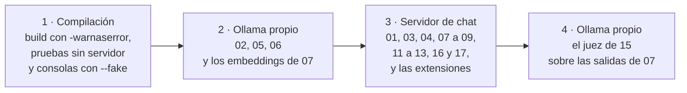

<a id="anexo-e"></a>
## Anexo E · Laboratorio

Todo lo que muestra la guía corrió en contenedores del SDK de .NET, desde la carpeta de la guía, y todo se puede repetir sin modelo. Este anexo ordena `Examples/` y la demo, dice cómo reproducirlos, qué prueba el modo `--fake`, cómo se registra una corrida contra el modelo y qué no se ejecutó contra él. El vocabulario de la evidencia está en [§0.4](#s0-4); el entorno y las versiones, en el [Anexo F](#anexo-f).

<a id="anexo-e-1"></a>
### E.1 Mapa de los ejemplos

El número es el orden de lectura: cada ejemplo usa sólo lo ya enseñado. La dificultad es un rótulo, no un bloque. El 14 es la ruta de quien viene de Semantic Kernel, fuera de la secuencia principal. La *extensión de medición* de 03, 04 y 08 es una segunda corrida, de ocho entradas, que da una tasa.

| Ejemplo (`Examples/…`) | Dificultad | Ilustra | OA | Servidor y modelo | Qué dejó la corrida con modelo |
|---|---|---|---|---|---|
| `01-Chat-Y-Streaming` | básico | [§5.1](#s5-1), [§5.2](#s5-2) | [OA-D1](#oa-d1) | servidor de chat, `qwen3.5:4b` | conducta ([§5](#s5-ejemplos)) |
| `02-Cambio-De-Adaptador` | básico | [§5.6](#s5-6) | [OA-D1](#oa-d1) | Ollama propio, `qwen2.5:0.5b`, dos adaptadores | conducta ([§5](#s5-ejemplos)) |
| `03-Salida-Estructurada` | básico | [§5.3](#s5-3) | [OA-D2](#oa-d2) | servidor de chat | conducta y tasas de la extensión ([§5](#s5-ejemplos)) |
| `04-Normalizacion-Contra-Catalogo` | básico | [§5.3](#s5-3) | [OA-D2](#oa-d2) | servidor de chat | conducta y tasa de la extensión ([§5](#s5-ejemplos)) |
| `05-Contexto-Completo-Con-Prefijo` | intermedio | [§6.3](#s6-3)–[§6.5](#s6-5) | [OA-D3](#oa-d3) | Ollama propio, `qwen2.5:0.5b` | duraciones del servidor, sin calidad ([§6](#s6-ejemplos)) |
| `06-Embeddings-Y-Busqueda-Semantica` | intermedio | [§7.1](#s7-1), [§7.2](#s7-2), [§7.5](#s7-5) | [OA-D4](#oa-d4) | Ollama propio, `qwen3-embedding:0.6b` | métricas frente a dos líneas base ([§7](#s7-ejemplos)) |
| `07-RAG-Con-Citas` | avanzado | [§7.3](#s7-3)–[§7.5](#s7-5) | [OA-D4](#oa-d4) | servidor de chat; embeddings previos en el Ollama propio | tasas ([§7](#s7-ejemplos)) |
| `08-Primera-Herramienta-Solo-Lectura` | básico | [§8.2](#s8-2), [§8.3](#s8-3) | [OA-D5](#oa-d5) | servidor de chat | conducta y tasa de la extensión ([§8](#s8-ejemplos)) |
| `09-Caso-De-Uso-Como-Herramienta` | intermedio | [§8.4](#s8-4), [§8.5](#s8-5) | [OA-D5](#oa-d5), [OA-S2](#oa-s2) | servidor de chat | conducta ([§8](#s8-ejemplos)) |
| `10-Workflow-Y-Contraejemplo` | avanzado | [§8.6](#s8-6) | [OA-D6](#oa-d6) | sin modelo | no aplica |
| `11-Agente-Con-Aprobacion` | avanzado | [§8.5](#s8-5), [§8.7](#s8-7) | [OA-D6](#oa-d6), [OA-S4](#oa-s4) | servidor de chat | conducta ([§8](#s8-ejemplos)) |
| `12-Uno-O-Varios-Agentes` | avanzado | [§8.6](#s8-6), [§8.8](#s8-8) | [OA-D7](#oa-d7) | servidor de chat | conducta ([§8](#s8-ejemplos)) |
| `13-Servidor-Y-Cliente-MCP` | intermedio | [§8.9](#s8-9), [§11.5](#s11-5) | [OA-D8](#oa-d8) | servidor de chat, del lado cliente | conducta ([§8](#s8-ejemplos)) |
| `14-Anotaciones-SK-vs-MEAI` | intermedio | [§9.7](#s9-7) | [OA-SK1](#oa-sk1) | sin modelo | no aplica |
| `15-Pruebas-Y-Evaluacion` | avanzado | [§10.2](#s10-2)–[§10.6](#s10-6) | [OA-D9](#oa-d9), [OA-O3](#oa-o3) | Ollama propio, `qwen2.5:0.5b` como juez de salidas de 07 | juez no calibrado ([§10](#s10-ejemplos)) |
| `16-Inyeccion-Indirecta` | intermedio | [§11.2](#s11-2), [§11.3](#s11-3), [§11.7](#s11-7) | [OA-S1](#oa-s1), [OA-S2](#oa-s2) | servidor de chat | tasa sobre un solo texto de ataque ([§11](#s11-ejemplos)) |
| `17-Observabilidad-Y-Pipeline` | avanzado | [§12.1](#s12-1)–[§12.3](#s12-3) | [OA-O1](#oa-o1) | servidor de chat | conducta ([§12](#s12-ejemplos)) |

Los dos papeles de servidor de la quinta columna se explican en [E.3](#anexo-e-3). Cada carpeta trae su `README.md`, su `ejemplo.json` y sus pruebas. `Examples/_Comun/` reúne el dominio copiado del caso base, la persistencia, la capa única de opciones, el cliente guionado y el escritor del registro.

<a id="anexo-e-2"></a>
### E.2 Mapa de la demo

`Demos/MovilidadUrbana.Asistente/` es la API del caso base más una página Blazor de chat, en un host. Sus pasos van de la lectura a la escritura; pedidos y resultados, en [§14.3](#s14-3).

| Paso | Escenario | Escalón | Dónde se ve | Cómo cierra | Ejemplo hermano |
|---|---|---|---|---|---|
| PD-1 | ESC-01 | 1 de agencia, dato exacto | página de chat | cableado | 08, 12 |
| PD-2 | ESC-01 | 2 de conocimiento, sube de más | `POST /api/v1/ayuda` | humo con modelo | 07 |
| PD-3 | ESC-03 | 0 de agencia | `POST /api/v1/localidades/desde-texto` | humo con modelo | 03 |
| PD-4 | ESC-03 | 0 de agencia | `POST /api/v1/encuestas/desde-texto` | cableado | 04 |
| PD-5 | ESC-03, ESC-04 | 1 de agencia, con aprobación | página de chat | cableado | 09 |
| PD-6 | ESC-04 | 1 de agencia, con estado y aprobación | página de chat | humo con modelo | 11 |

El ejemplo hermano mide la conducta que el paso sólo compone: la demo prueba la composición; los ejemplos, la conducta.

<a id="anexo-e-3"></a>
### E.3 Qué hace falta y dónde corre cada cosa

En el host alcanzan bash, docker, jq y GNU grep; .NET corre en `mcr.microsoft.com/dotnet/sdk:10.0`, y la restauración necesita llegar a nuget.org (`Examples/README.md`, `tools/verificar.sh`). Ningún archivo del repositorio tiene la dirección de un servidor: el código la lee del entorno, con `localhost` por defecto; las variables están en [§5.5](#s5-5) y [§12.5](#s12-5).

Hay dos papeles de servidor. El **servidor de chat** (`OLLAMA_ENDPOINT`, `OLLAMA_MODEL`) atiende a casi todos los ejemplos; en el laboratorio fue el servidor Ollama compartido. El **Ollama propio** (`OLLAMA_PROPIO_ENDPOINT`) sirve el chat de 02 y 05, el juez de 15 y los embeddings (`OLLAMA_EMBED_ENDPOINT`, si no se define, toma el valor de `OLLAMA_PROPIO_ENDPOINT`, nunca el del chat). Dentro de un contenedor, `localhost` es el contenedor ([§12.6](#s12-6)).

`tools/verificar.sh --con-modelo` corre cuatro fases, de a una y cada una en su contenedor; ninguna pide un segundo servidor mientras tiene uno:



El arnés no corre contra un Ollama propio cuya versión o cuyos digests no sean los de las corridas de la guía ([Anexo F](#anexo-f)); los valores esperados están al principio de `tools/verificar.sh`. Contra el servidor de chat lee `/api/ps`: exporta como `OLLAMA_NUM_CTX` la ventana del modelo cargado, precalienta si no hay ninguno y aborta sin llamar si hay otro. El README da como motivo no recargar un servidor que usan otros; eso no se verificó. `TURNO_CMD` envuelve cada fase en un turno; vacía, la fase corre sin turno y lo avisa, que es lo que corresponde con un servidor propio.

<a id="anexo-e-4"></a>
### E.4 El modo `--fake`

**Qué es.** Con `--fake`, la consola reemplaza el cliente real por el **cliente guionado** (`GuionChatClient`) y los embeddings por un generador estable, sin red (`Examples/_Comun/MovilidadUrbana.Asistente.Comun/Pruebas/`); el guion pasa por la misma capa de opciones ([§5.5](#s5-5)). Prueba las garantías del código y el cableado. No mide al modelo: una salida guionada nunca es conducta suya ([§10.2](#s10-2)), y con embeddings estables las cifras de recuperación prueban las métricas, no la calidad (README de 06).

```bash
tools/verificar.sh build                       # restore, build -warnaserror, pruebas sin servidor, consolas --fake --verificar
tools/verificar.sh correr 01-Chat-Y-Streaming  # un ejemplo con --fake (compila sólo ese)
```

Los dos apuntan los tres servidores a un puerto cerrado: una llamada al modelo que se cuele falla. Con `--verificar`, la consola sale con 1 si una garantía no se cumple. Las pruebas `[Category("LLM")]` se saltan con su motivo si el servidor no responde, si el modelo no está o si no declara la capacidad que hace falta (`Examples/_Comun/MovilidadUrbana.Asistente.Comun/AI/PredicadoDeSalto.cs`). En la verificación del 2026-10-27, las pruebas sin servidor y las consolas con `--fake --verificar` terminaron sin fallas. Salida con `--fake` (cliente guionado), sin modelo, 2026-10-27:

```text
> [e01] ¿Qué datos tengo que cargar para dar de alta una localidad?
Para el alta cargá el nombre, la provincia, el código postal y los habitantes.
  oráculo campos-pedidos: pasa (nombra todos los campos; finish=stop); fragmentos: 5; razonamiento: None; num_ctx: 8192 (default)
[…]
registro: 4 líneas en 01-Chat-Y-Streaming.jsonl
```

Qué mirar: el oráculo pasa sobre un texto del guion, y el registro se escribe igual que con el modelo, así que el recálculo de [E.6](#anexo-e-6) se ejercita sin servidor.

<a id="anexo-e-5"></a>
### E.5 Reproducir un ejemplo y la demo

Contra el modelo, desde la carpeta de la guía (`Examples/README.md`):

```bash
tools/verificar.sh correr 01-Chat-Y-Streaming --con-modelo   # el mismo, contra el modelo de su manifiesto
```

El servidor sale del `ejemplo.json`, y la corrida no compila (`dotnet run --no-build`): compilá antes con `build` o con el `correr` sin modelo. El arnés no corre si el SHA-256 de una entrada no coincide con el de `ejemplo.json`. La extensión de 03, 04 y 08 es la vía `extension` del arnés, con las carpetas como argumentos. Sin arnés, con el SDK en contenedor (`Examples/README.md`):

```bash
docker run --rm -u 1000:1000 -e HOME=/tmp -v "$PWD/Examples":/src -w /src/NN-Nombre \
  mcr.microsoft.com/dotnet/sdk:10.0 dotnet run -- --fake
```

Con otro modelo, servidor o fecha, la redacción cambia. Criterio de la guía: compará la forma (campos nombrados, veredicto de las reglas, herramienta pedida, cita válida), no el texto.

**La demo.** Desde `Demos/MovilidadUrbana.Asistente/`, se corren en este orden `tools/demo.sh pruebas` (sin servidor), `tools/demo.sh embeddings` y `tools/demo.sh humo`; los dos últimos van en pasos separados porque cada uno usa un servidor distinto ([§14.5](#s14-5)). `host guion` levanta la página sin ningún modelo, `host modelo` con el cliente real, ambos sólo en el loopback del host, y `parar` la baja. En `compose.yaml`, el servicio opcional `ollama-embed` es un Ollama propio fijado por digest ([§12.6](#s12-6)); si la configuración de docker tiene credenciales vencidas, la imagen se baja con `DOCKER_CONFIG` apuntando a un `config.json` vacío (README de la demo).

<a id="anexo-e-6"></a>
### E.6 Registrar una corrida contra el modelo

**Qué es.** El *registro* de una corrida guarda lo necesario para volver a decidir cada entrada sin llamar al modelo ([§10.4](#s10-4)). `EscritorDeRegistro` escribe `RLLM_DIR/<ejemplo>.jsonl` con una línea `llamada` por llamada y una `entrada` por entrada, con `pasa`, `falla` o `excluida` y su motivo (`Examples/_Comun/MovilidadUrbana.Asistente.Comun/Registro/`). El esquema no tiene campo para dirección, host, puerto ni encabezados.

1. **Congelar las entradas** antes de la primera corrida que cuenta: `entradas.v1.json`, con su SHA-256 en `ejemplo.json`; cambiar una entrada crea `v2`. Lo que no sale del caso base se rotula «escrito para el ejemplo», con valores de `Catalogos` y personas «Persona 01…20».
2. **Fijar el oráculo antes de correr**: la regla en C# y la misma en `tools/oraculos/<nombre>.jq`.
3. **Correr con `--verificar`** ([E.5](#anexo-e-5)). Una llamada con posible truncado excluye su entrada, que no se reemplaza ([§5.7](#s5-7), [§10.4](#s10-4)).
4. **Recalcular y calcular la tasa**; el recálculo tiene que coincidir con cada línea `entrada` (`Examples/README.md`):

   ```bash
   tools/recalcular-oraculos.sh "$RLLM_DIR"/*.jsonl            # cada oráculo, recalculado desde el registro
   tools/verificar.sh tasa 8 10                   # 8/10 con su intervalo Clopper-Pearson al 95 %
   ```

5. **Rotular** cada cifra con `modelo`, `digest`, `ollama_version`, `servidor` y `fecha` del registro, y con «estímulo del mismo autor» si corresponde; con M ≤ 12, la tasa es descriptiva. `razonamiento` y `num_ctx` salen de las opciones que arma el código, no de la red (`EscritorDeRegistro.cs`): lo que viajó lo asegura la prueba con el cliente espía ([§5.4](#s5-4)).
6. **Pasar las compuertas** antes de publicar un registro: `tools/compuerta-ac7.sh` (direcciones, términos privados y nombres) y `tools/compuerta-ac8.sh` (dominios ajenos), con listas fuera del repositorio; sin lista, fallan cerradas (`Examples/README.md`; [§11.4](#s11-4)).

Una línea `entrada` real. Observado en el laboratorio: `qwen3.5:4b` (digest `2a654d98e6fb`), Ollama 0.32.0-rc0, sólo CPU, servidor compartido, 2026-10-27; extensión de 03, estímulo del mismo autor:

```json
{"tipo":"entrada","fecha":"2026-10-27T17:49:54.596679+00:00","ejemplo":"03-Salida-Estructurada","entrada_id":"x01","oraculo":"salida-estructurada","resultado":"pasa","motivo":"decision=lista","entradas_version":"v1","entradas_hash":"d8155a89635191cf2cbf61e815094566c41b3d9ff36b1f364648e7c2667e04f0"}
```

Qué mirar: `entradas_hash` ata el veredicto a las entradas congeladas que declara `ejemplo.json`.

Recálculo y tasa de 16. Observado: `qwen3.5:4b`, servidor compartido, 2026-10-27; estímulo del mismo autor, sobre un solo texto de ataque:

```text
recalcular-oraculos: 12 de 12 entradas coinciden
[…]
aprobacion: 0/6 = 0,000  IC95 Clopper-Pearson [0,000; 0,459]
aprobacion+marcado: 0/6 = 0,000  IC95 Clopper-Pearson [0,000; 0,459]
```

<a id="anexo-e-7"></a>
### E.7 Lo no ejecutado contra el modelo

Lo que no corrió contra el modelo se rotula «no ejecutado contra el modelo», sin cifras. El arnés también lo rotula: no empieza una vía cuyo tiempo previsto no entra en lo que queda del tope del servidor de chat (`Examples/README.md`). Sin modelo de embeddings (`EMB_PLAN`), 06, 07 y la ayuda de la demo se rotulan «no ejecutado contra un modelo de embeddings». En las corridas de la guía, todas las vías declaradas corrieron. Quedó sin ejecutar:

| Pieza | Qué no corrió | Por qué | Dónde |
|---|---|---|---|
| 10 y 14 | nada llama al modelo | por diseño: el contraejemplo es una función; las anotaciones se comparan por metadatos | [§8.6](#s8-6), [§9.7](#s9-7) |
| 01 | la variante «sin la capa» | sólo con `--fake`: costaría llamadas y saldría sin `num_ctx` (README de 01) | [§5.7](#s5-7) |
| 12 | el corrector de dos agentes | el primer texto ya coincidió en las cuatro corridas (README de 12) | [§8.8](#s8-8) |
| 16 | la variante sin herramientas de escritura | garantía de código: la herramienta no está montada (README de 16) | [§11.7](#s11-7) |
| PD-1, PD-4, PD-5 | el paso con modelo | cierran por cableado y el registro del hermano (README de la demo) | [§14.3](#s14-3) |
| 05 | una variante con RAG | la calidad frente a RAG no se comparó, por costo de tiempo (README de 05) | [§14.6](#s14-6) |
| 02 | un proveedor en la nube | habría sumado una credencial a un repositorio público | [§5.6](#s5-6) |

Lo que falta medir para producción está en [§14.6](#s14-6).

<!-- PENDIENTES:
Quitado por falta de respaldo citable:
- Que las pruebas [Category("LLM")] de 11 y de la demo no corrieron por presupuesto: sólo lo dice la bitácora de construcción (06-Construccion §2.1, AC-3a), no un archivo del repositorio ni un registro de Evidencia. Misma decisión que §14 (su PENDIENTES lo deja abierto para la presidencia). No entra en E.7.
- Cantidad de pruebas sin servidor de Examples (443) y de consolas: no están en la tabla de cifras citables; E.4 dice «terminaron sin fallas» con el log como respaldo. Las 70 de la demo, ya citadas en §14.5, no se repiten.
- Tope del servidor de chat (14.400 s), consumo de turnos y tiempos previstos de cada vía: datos del arnés y de la bitácora, no cifras citables; E.7 describe la regla de cola sin números.
- Valores de EMB_PLAN (EMB-A/B/C) y nombres de recurso del arnés (los de ejemplo.json y de «fase lan»): la compuerta de familias de ID marca EMB-C, y la carta (§1.3) deja fuera los nombres internos de recurso y de turno. Se nombra la variable y se describe el valor; las cuatro fases se describen sin el comando «fase <…>».
- Línea «extension … (TURNO-2)» del bloque de comandos de Examples/README.md: lleva un ID interno y no se edita (carta §16.5); la vía se nombra en prosa.
- Líneas del README de la demo con la dirección de loopback y el puerto: no se copian (criterio prudente ante la compuerta de privacidad, como §14.5).
- Que /v1 o una ventana distinta recarguen el modelo de otros clientes: se escribe como «el README da como motivo… no se verificó» (carta §16.13).
Fuentes nuevas: ninguna.
Desvíos de la ficha y criterios propios:
- El plan no fija las anclas internas del Anexo E: se usaron anexo-e-1 … anexo-e-7 (criterio de esta redacción, en la línea de anexo-a-N de la carta §13). Títulos «E.n» sin «§» para no disparar la compuerta de remisiones al plan.
- La ficha pide «cómo reproducir cada ejemplo y la demo en contenedor»: va en E.5, una sola subsección, para no repetir §14.5 (comandos de la demo) ni §12.6 (compose.yaml); acá van sólo el orden, el modo host y la nota de DOCKER_CONFIG, sin bloque de código.
- Las celdas «conducta» de E.1 no llevan cifras; las de 03, 04, 07, 08, 16 dicen «tasa» y remiten. Las cifras viven en las secciones (carta §8, una casa por pieza).
- La tabla de la demo no repite los pedidos de §14.3 (casa de los pedidos y del diagrama de PD-6).
- La columna «Qué dejó la corrida con modelo» no repite cifras: remite al bloque Ejemplos de cada sección (casa de las cifras).
- Se agregó una subsección de requisitos y fases (E.3) con un diagrama de las cuatro fases del arnés, que la ficha no nombra pero que hace falta para reproducir.
- Sin preguntas guía: la ficha del anexo no las pide.
Procedencia de las salidas:
- Salida --fake de 01: Evidencia/Arnes/01-Chat-Y-Streaming.fake.log, líneas 2–4 y 9 (copia textual; recorte «[…]» de e02 y de la variante negativa, ya mostrada en §5).
- Línea «entrada»: Evidencia/R-LLM/03-Salida-Estructurada.modelo-ext.jsonl, primera línea tipo «entrada» (x01), copia textual. Rótulo: campos modelo, digest, ollama_version, servidor y fecha de la línea «llamada» de x01.
- Recálculo y tasa de 16: Evidencia/16-Inyeccion-Indirecta/recalculo-oraculo.log, líneas 2 y 11–12 (copia textual; recorte «[…]» de las líneas de rc y de las corridas fake e interrumpida).
- «Sin fallas» de E.4: Evidencia/Cierre-Construccion/verificar-build.saneo.log (todas las líneas «Passed!» con Failed 0; rc=0 al final).
Hechos tomados del código o del repositorio (no cifras medidas): dificultad e «ilustra» de cada ejemplo (carta §14 y las fichas de §5–§12); servidor de cada ejemplo (ejemplo.json, campo recurso, y plan E.2 para el modelo); fases y orden (tools/verificar.sh, fase_modelo y --con-modelo); comprobación del Ollama propio (función propio); lectura de /api/ps (función num_ctx_compartido); --no-build (correr_con_modelo); puerto cerrado (_sdk_correr); SHA-256 de entradas (entradas_congeladas); esquema sin dirección (comentario de RegistroRllm.cs); razonamiento y num_ctx desde las opciones (EscritorDeRegistro.Llamada); compuertas que fallan cerradas (Examples/README.md, «Compuertas»); lo no ejecutado: README de 01 (l. 50), 05 (l. 18), 12 (l. 71), 16 (l. 17), README de la demo (recorrido) y §5.6.
Conteo de palabras de prosa (comando de la carta §16.3): 1.675 (primera versión: 2.195; se recortó prosa de E.3–E.6 y se quitó el párrafo duplicado del modo guion de la demo). Las celdas de las dos tablas de mapa y de la tabla de E.7 cuentan y son cerca de la mitad. Tope: la carta §16.3 no reparte los Anexos por anexo (≤ 7.430 entre A–G, con las 280 del mapa que vino de §0.5); si la integración necesita bajar, el orden de recorte propuesto es la columna «Qué dejó la corrida con modelo» de E.1 (remite a otras casas) y el párrafo de compose de E.5 (casa §12.6).
Snippets por encima de 25 líneas: ninguno. Comprobación de snippets (carta §16.5): las siete líneas de comandos se encontraron textuales en Examples/README.md con grep -F; la línea JSON, textual en el registro de 03 ext.; el entradas_hash coincide con el sha256 de entradas.ext.v1.json en ejemplo.json de 03. Diagramas mermaid: uno (flowchart LR de cuatro nodos, etiquetas entre comillas, sin paréntesis ni comillas internas).
Remisiones usadas (verificación adversarial: se agregaron anexo-e-3, s10-4 y s11-4; s11-6 se cambió por s11-4 porque las compuertas viven en §11.4): s0-4, s5-1, s5-2, s5-3, s5-4, s5-5, s5-6, s5-7, s5-ejemplos, s6-3, s6-5, s6-ejemplos, s7-1, s7-2, s7-3, s7-5, s7-ejemplos, s8-2, s8-3, s8-4, s8-5, s8-6, s8-7, s8-8, s8-9, s8-ejemplos, s9-7, s10-2, s10-4, s10-6, s10-ejemplos, s11-2, s11-3, s11-5, s11-6, s11-7, s11-ejemplos, s12-1, s12-3, s12-5, s12-6, s12-ejemplos, s14-3, s14-5, s14-6, anexo-f, oa-d1 … oa-d9, oa-o1, oa-o3, oa-s1, oa-s2, oa-s4, oa-sk1; internas: anexo-e-5, anexo-e-6. Todas existen en secciones/ salvo s0-4, anexo-f y las oa-…, que pertenecen a §0 y al Anexo F, todavía sin redactar (anclas previstas por la carta §13).
Cifras citadas: 16, pedidos de baja inducidos 0/6 por variante, IC95 [0; 0,459] (tabla de cifras, fila 16), sólo dentro de la salida rotulada. Los demás números son datos del código o del diseño (ocho entradas de la extensión, cuatro fases, «Persona 01…20»), no mediciones.
AC-7/AC-8 sin correr (las listas viven fuera del repositorio); las corre la integración.
-->
