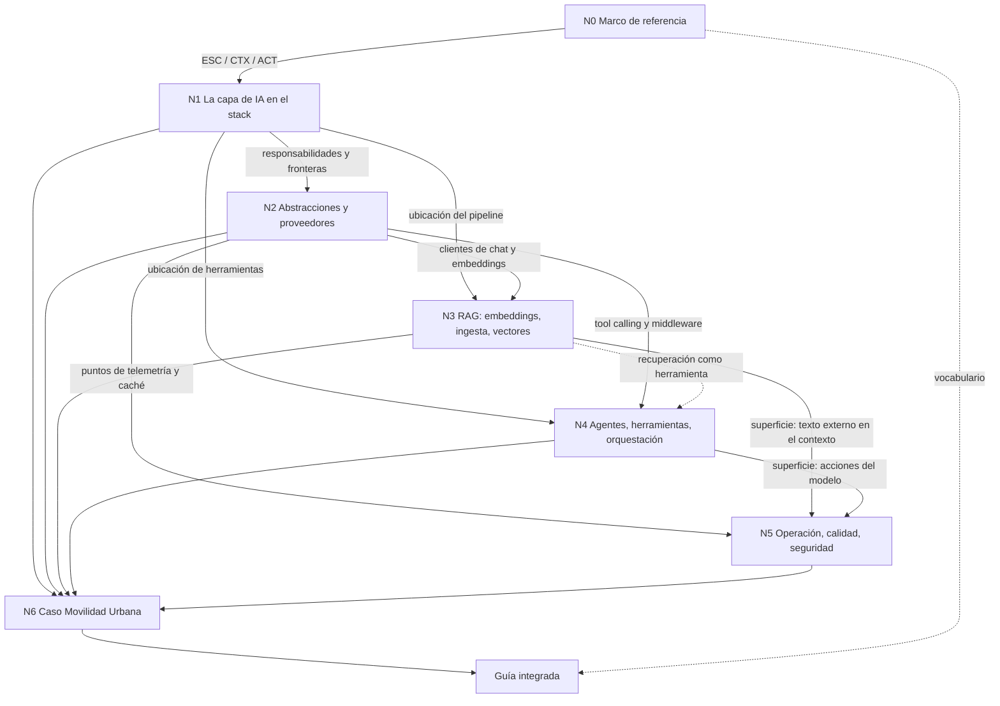

> **Insumo vinculante del PO (2026-10-26)**: [Mesa/I-01-Insumos-Del-PO-Agentes-LangGraph-Anotaciones.md](Mesa/I-01-Insumos-Del-PO-Agentes-LangGraph-Anotaciones.md) — LangGraph en .NET, la confusión con Microsoft Graph y las cuatro familias de anotaciones para agentes. El plan de integración y los especialistas de contenido lo leen antes de fijar el índice de la guía y estructurar el marco conceptual de N4 (y su reflejo en el mapa de N1).

> **Insumo del PO (2026-10-26)**: [Mesa/I-02-Insumo-Del-PO-Recorrido-AI-Engineer.md](Mesa/I-02-Insumo-Del-PO-Recorrido-AI-Engineer.md) — recorrido de un curso «AI Engineer 2026» como fuente de forma y cobertura (no citable): propuestas PR-1 a PR-7 (actor AI Engineer, «por qué ahora», ejemplos y demo en tres niveles, «¿un agente o varios?», escalera de complejidad, autoevaluación). El plan de integración las considera al fijar el índice y la especificación de Examples/ y Demos/.

> **Insumo del PO (2026-10-26)**: [Mesa/I-03-Insumo-Del-PO-Temario-AI-Engineering.md](Mesa/I-03-Insumo-Del-PO-Temario-AI-Engineering.md) — temario «AI Engineering» (forma y cobertura): **CAG (Cache-Augmented Generation) no está cubierto por ningún núcleo** (PR-8, requiere dossier complementario), mirada de producto (PR-9), datos para la IA (PR-10), despliegue como sección visible (PR-11), columna vertebral fundamentos → estrategias de conocimiento → agentes → producción (PR-12).

> **Insumo del PO (2026-10-26)**: [Mesa/I-04-Insumo-Del-PO-Encuesta-Bloqueos.md](Mesa/I-04-Insumo-Del-PO-Encuesta-Bloqueos.md) — encuesta de audiencia (no citable): la arquitectura del sistema domina como bloqueo; propuestas PR-13 (decisiones de arquitectura como sección), PR-14 (objetivos de aprendizaje por actor) y PR-15 (lista de control de cobertura para la relectura integral).

> **Insumo del PO (2026-10-26)**: [Mesa/I-05-Insumo-Del-PO-Desarrollo-De-Agentes-En-NET.md](Mesa/I-05-Insumo-Del-PO-Desarrollo-De-Agentes-En-NET.md) — borrador técnico (no citable, no transcripto: sus ejemplos son de otro proyecto privado ajeno a la guía). Ideas generales reencuadradas **sólo sobre Movilidad Urbana**: principio rector «el modelo propone, la app ejecuta y autoriza» (PR-16), sumar IA a una app existente = MovilidadUrbana.ApiWeb (PR-17), «¿framework de agentes o propio?» (PR-18), comparativo M.E.AI/MAF/SK/OpenAI SDK (PR-19), primer ejercicio de sólo lectura con pruebas negativas (PR-20), lista de seguridad (PR-21), ejemplo pareado SK vs M.E.AI (PR-22).

> **Directiva del PO (2026-10-26, vinculante)**: [Mesa/I-06-Directiva-Del-PO-Caso-Unico-Y-Medios.md](Mesa/I-06-Directiva-Del-PO-Caso-Unico-Y-Medios.md) — Movilidad Urbana es el único caso práctico; nada de otros proyectos; medios móviles disponibles para la demo.

# Bitácora 02 — Cohesión global

Este documento permite trabajar cada núcleo por separado sin perder el modelo completo. Fija el grafo de dependencias y lo que cada núcleo le entrega al siguiente, los vínculos que atraviesan varios núcleos, las tensiones previsibles con su regla de resolución, la matriz núcleo × núcleo y la trazabilidad desde cada solicitud del PO hasta la sección de la guía donde va a quedar.

**Estado: abierto.** Las secciones marcadas «a completar en la fase de plan» las completa la mesa cuando cada núcleo tenga su investigación hecha; las marcadas «a completar al integrar», el cuaderno de integración (`04-Integracion.md`). Cada completado se registra al pie con fecha.

## Índice

- [1. Grafo de dependencias](#1-grafo-de-dependencias)
- [2. Qué entrega cada núcleo a los demás](#2-qué-entrega-cada-núcleo-a-los-demás)
- [3. Matriz núcleo × núcleo](#3-matriz-núcleo--núcleo)
- [4. Vínculos transversales](#4-vínculos-transversales)
- [5. Tensiones previsibles y regla de resolución](#5-tensiones-previsibles-y-regla-de-resolución)
- [6. Trazabilidad solicitud → núcleo → sección de la guía](#6-trazabilidad-solicitud--núcleo--sección-de-la-guía)
- [7. Estructura prevista de la guía](#7-estructura-prevista-de-la-guía)
- [8. Orden de trabajo e integración](#8-orden-de-trabajo-e-integración)
- [9. Referencias cruzadas previstas](#9-referencias-cruzadas-previstas)
- [10. Pendientes de la fase de plan](#10-pendientes-de-la-fase-de-plan)

## 1. Grafo de dependencias

Una flecha `A --> B` significa «B necesita el resultado de A para poder afirmarse». Las punteadas son dependencias de vocabulario o débiles.

Sin ciclos. N5 es el único núcleo que recibe de tres núcleos técnicos y les devuelve exigencias: esa vuelta no es una arista del grafo sino una **revalidación** (M§1.2): si N5 concluye que una práctica de N3 o N4 es insegura, la corrección se hace en N3 o N4 y N5 se revalida.

## 2. Qué entrega cada núcleo a los demás

| Núcleo | Entrega (contrato de salida) | Consumidores |
|---|---|---|
| N0 | Escenarios ESC-01…05, contextos CTX-LOCAL/NUBE, CTX-PROTO/PROD, CTX-PUB/SENS, actores ACT-DEV/ARQ/OPS/SEC/USR; glosario base. | todos |
| N1 | Definición de capa de IA y sus responsabilidades; diagrama de capas aplicado a `Domain/Application/Infrastructure`; espectro de estrategias de integración con criterio de elección por escenario; análisis crítico de la imagen. | N2, N3, N4, N6 |
| N2 | Paquetes y versiones vigentes; patrón de registro del cliente en DI con `OLLAMA_ENDPOINT`; snippets de chat, streaming y salida estructurada verificados contra Qwen; pipeline de *middleware*; relación entre Microsoft.Extensions.AI, Semantic Kernel y Agent Framework. | N3, N4, N5, N6 |
| N3 | Pipeline RAG verificado (ingesta, chunking, embeddings, almacén, recuperación); elección de almacén por contexto; criterio «cuándo no RAG». | N4, N5, N6 |
| N4 | Distinción herramienta / agente / workflow / multiagente; patrón «caso de uso como herramienta»; ejemplo con Agent Framework; servidor MCP mínimo; respuesta documentada sobre LangGraph en .NET. | N5, N6 |
| N5 | Patrón de pruebas para salidas no deterministas (R-LLM); evaluación; traza OpenTelemetry; mapa de riesgos con mitigación mínima por escenario; diferencias prototipo/producción. | N6; revalidación de N2–N4 |
| N6 | Demo en `Demos/` con los escenarios elegidos; resolución de tensiones; modelo completo reconstruido. | guía completa |

## 3. Matriz núcleo × núcleo

Fila = núcleo que **consume**; columna = núcleo que **provee**. `D` dependencia fuerte; `d` débil o de vocabulario; `R` revalidación (el de la fila puede obligar a corregir el de la columna); `—` sin relación.

| consume \ provee | N0 | N1 | N2 | N3 | N4 | N5 | N6 |
|---|---|---|---|---|---|---|---|
| **N0** | · | — | — | — | — | — | — |
| **N1** | D | · | — | — | — | — | R |
| **N2** | d | D | · | — | — | — | R |
| **N3** | d | D | D | · | — | — | R |
| **N4** | d | D | D | d | · | — | R |
| **N5** | d | d | D | D | D | · | R |
| **N6** | d | D | D | D | D | D | · |

Lectura: la columna N6 llena de `R` expresa la regla de integración: si al armar la demo aparece una contradicción, se repara en el núcleo de origen (N1…N5), no en la demo. La fila N5 con tres `D` confirma que N5 se trabaja después de N2–N4.

> A completar en la fase de plan: registrar en esta matriz las dependencias reales que aparezcan al investigar (p. ej., si N3 termina usando un almacén vectorial que N2 no previó) y cualquier `R` ejercida.

## 4. Vínculos transversales

Hilos que atraviesan varios núcleos y que la guía tiene que mantener con un solo sentido:

- **El caso Movilidad Urbana** se anuncia en la introducción, da los ejemplos de N0 (escenarios candidatos), aparece como ejemplo corto en N2–N5 y se cierra en N6 como demo. Es el hilo narrativo de la guía (Rule-Dual-Audience: narrar de punta a punta con un caso concreto).
- **La imagen de entrada** se analiza en N1 y se vuelve a dibujar en N6 con los componentes reales de la demo: el lector ve la diapositiva convertida en una solución.
- **«La aplicación decide, el modelo propone»**: en N2 (salida estructurada validada), N3 (el contexto lo arma la aplicación), N4 (las herramientas pasan por los casos de uso y sus reglas), N5 (agencia mínima) y N6 (`LocalidadRules` rechaza lo que el modelo propone mal). Es el criterio de diseño que une la guía; se declara como criterio propio y se sostiene con las fuentes de seguridad de N5.
- **Abstracción frente a proveedor**: N2 la define, N3 la extiende a embeddings y vectores, N4 la usa para herramientas, N5 la aprovecha para telemetría y caché, N6 la demuestra cambiando sólo configuración.
- **No determinismo**: se presenta en N2 (temperatura), condiciona las pruebas de N3 y N4, se trata en N5 (R-LLM, evaluación) y define cómo se reportan los resultados de la demo en N6.
- **Seguridad** (AH-01): cada núcleo con superficie (N3 texto externo, N4 acciones, N6 datos personales) incluye su advertencia en el lugar donde se enseña la práctica, y N5 la consolida; no se relega todo a un capítulo final.
- **Laboratorio**: cada núcleo con validación E1 deja una carpeta en `Examples/`; N6 reutiliza patrones, no copia código.

## 5. Tensiones previsibles y regla de resolución

| Tensión | Núcleos | Regla de resolución |
|---|---|---|
| La imagen pone RAG como paso **entre** el LLM y los agentes; en la práctica un agente puede usar recuperación como herramienta, y una app puede tener RAG sin agentes. | N1, N3, N4 | N1 presenta la imagen como modelo didáctico y corrige con fuente la relación; la guía usa un solo diagrama propio a partir de N1. |
| Una abstracción mínima (`IChatClient`) frente a un marco completo (Agent Framework, Semantic Kernel). | N2, N4 | Se enseña de abajo hacia arriba: abstracción primero; el marco entra cuando el escenario lo justifica (ESC-04). Criterio propio declarado, a someter a la mesa. |
| RAG frente a herramienta que consulta datos estructurados para ESC-01. | N3, N4, N6 | Datos tabulares del dominio (conteos, filtros) → herramienta sobre el caso de uso; texto no estructurado → RAG. A confirmar con E1 en N6. |
| Qwen local puede no soportar bien *tool calling* o salida estructurada en todas sus variantes. | N2, N4, N6 | Se mide con E1 (tasa de éxito en N corridas) y se reporta; si no alcanza, se documenta el límite como hallazgo y se prueba otra variante disponible, sin tocar el servidor (SUP-06). |
| LangGraph «en .NET»: no hay evidencia de port oficial (BIT-16-00 §6) frente a la expectativa del PO. | N4 | Se responde lo que la evidencia muestre: qué es, qué no existe, equivalentes y vías de integración. No se escala salvo que el PO haya querido decir adoptar LangGraph (disparador 1, sólo si la evidencia no desempata). |
| Demo didáctica simple frente a controles de producción (seguridad, evaluación, observabilidad). | N5, N6 | La demo es CTX-PROTO y lo dice; implementa los controles mínimos que N5 marque como obligatorios incluso en prototipo (p. ej., confirmación antes de escribir) y enumera los de CTX-PROD sin implementarlos. |
| Arquitectura del caso base (tres copias de capas, sin referencias) frente a reutilización en la demo. | N1, N6 | La demo es una solución propia; puede copiar el dominio con procedencia. No «corrige» decisiones del caso base (ia-db, restricciones para IA). |
| Paquetes en preview (`Microsoft.Extensions.DataIngestion`, conector SQLite de vectores) frente a una guía que pretende formar criterio estable. | N3, N5 | Se usan si son la vía vigente, marcados como preview con versión y fecha; la guía separa concepto (estable) de paquete (volátil). |

> **2026-10-28 — Integración (BIT-16-04).** Nota agregada; la tabla de arriba no se modificó. Las ocho tensiones quedaron resueltas en [`04-Integracion.md`](04-Integracion.md) §2, con decisión, evidencia (E1 nueva contra el Ollama propio en contenedor (estación 1): `Integracion-Evidencia/`) y estado. En síntesis: (1) la imagen queda como modelo didáctico, un solo diagrama propio y tres vías de recuperación; (2) de abajo hacia arriba con criterio para subir a agente o workflow de MAF; (3) ESC-01 por herramienta, confirmado con E1; (4) `qwen3.5:4b` sin razonamiento y `qwen3-embedding:0.6b` como propuesta medida, a ratificar; (5) sin LangGraph oficial para .NET, re-verificado; (6) controles mínimos M1–M12 en la demo y CTX-PROD enumerado; (7) copia literal de ApiWeb verificable por `diff`, la IA sólo agrega; (8) demo sólo con paquetes GA por defecto. Las contradicciones entre núcleos, las reparaciones en origen, los criterios propios que pasan a la mesa (MI-01…MI-24), el modelo reconstruido y los ajustes a la estructura de §7 están en BIT-16-04 §3–§8.

## 6. Trazabilidad solicitud → núcleo → sección de la guía

Los IDs `S-` son los de REED-16 §2. La sección usa la numeración prevista en §7.

| ID | Solicitud (resumida) | Núcleo(s) | Sección prevista |
|---|---|---|---|
| S-01 | Analizar y describir la imagen | N1 | §1, §3 |
| S-02 | Marco teórico y práctico vigente en .NET | N1, N2 | §3, §4, Anexo D |
| S-03 | Guías, ejemplos y demo | todos | guía, `Examples/`, `Demos/` |
| S-04 | Estrategias y casos de integración | N0, N1, N2, N3 | §2, §3, §4, §5 |
| S-05 | Creación de agentes | N4 | §6 |
| S-06 | Definiciones | todos | «Definición» de cada sección; Anexo C |
| S-07 | Ejemplos y snippets | N2–N6 | «Ejemplos» de cada sección; Anexo E |
| S-08 | Preguntas y respuestas explicativas | todos | «Preguntas guía» de cada sección |
| S-09 | Demo basada en Lab-E2E.WebBlazor | N6 | §8; `Demos/` |
| S-10 | LangGraph en .NET | N4 | §6 (métodos y marcos) |
| S-11 | Reedición sobre el marco de mesa | — (proceso) | `OUTPUTs/Crear-IA-Layer-Guide-Reedicion.md` |
| S-12 | Composición de la mesa | — (proceso) | REED-16 §8; `Mesa/Ciclo-1/00-Convocatoria.md` |
| S-13 | Experto adicional | — (proceso) | REED-16 §8.3 |
| S-14 | Relectura integral | — (proceso) | último ciclo de `Mesa/` |
| S-15 | Apuntes, borradores, debates | — (proceso) | `Nucleos/`, `Mesa/` |
| S-16 | Rutas de salida | — | REED-16 §11 |
| S-17 | Probar todo contra Qwen | N2, N5, N6 | Anexo E; registros por núcleo |

Chequeo mecánico: toda solicitud de contenido (S-01…S-10, S-17) tiene núcleo y sección; todo núcleo aparece al menos una vez (N0: S-04, S-06; N1: S-01, S-02, S-04; N2: S-02, S-04, S-07, S-17; N3: S-04, S-07; N4: S-05, S-10; N5: S-17; N6: S-09, S-17). No hay núcleo huérfano ni solicitud sin destino.

## 7. Estructura prevista de la guía

Un solo archivo (DC-01). Cada sección temática §3–§7 sigue el Profile: Definición → Aplicación por escenario (y qué cambia por contexto) → Ejemplos (snippet + carpeta de `Examples/`) → Preguntas guía con respuesta → Criterios de calidad → Plantilla o anexo.

| § | Título tentativo | Núcleo | Pieza del Profile |
|---|---|---|---|
| 0 | Índice y ruta de lectura | — | README |
| 1 | «IA ya es parte del stack»: de la diapositiva a una solución | N1 (presentación) | resumen ejecutivo |
| 2 | Marco de referencia: escenarios, contextos y actores | N0 | marco de referencia |
| 3 | La capa de IA en el stack y las estrategias de integración | N1 | mapa conceptual + documento temático |
| 4 | Hablar con un modelo desde .NET: abstracciones y proveedores | N2 | documento temático |
| 5 | RAG: embeddings, ingesta y bases vectoriales | N3 | documento temático |
| 6 | Agentes, herramientas y orquestación (y LangGraph) | N4 | documento temático + métodos y marcos |
| 7 | Operar, evaluar y asegurar la capa de IA | N5 | documento temático |
| 8 | Movilidad Urbana con capa de IA: la demo | N6 | integración |
| A | Plantillas comentadas | N2–N6 | anexo |
| B | Listas de verificación por actor | N5, N0 | anexo |
| C | Glosario | N0 y todos | anexo |
| D | Referencias con versión y fecha de consulta | todos | anexo (Rule-Evidences) |
| E | Laboratorio y demo: cómo reproducir cada ejemplo | todos | anexo |

> A completar en la fase de plan: títulos definitivos, subsecciones de cada §, y la lista de carpetas de `Examples/` por núcleo.

## 8. Orden de trabajo e integración

1. **N0** (hecho en BIT-16-03, se ajusta si la investigación lo pide).
2. **N1**: tesis y mapa; habilita el resto.
3. **N2**: primer contacto con Qwen; releva modelo, capacidades (*tool calling*, salida estructurada) y embeddings disponibles. Su resultado condiciona N3 y N4.
4. **N3 y N4 en paralelo**, cada uno con su laboratorio.
5. **N5**, sobre las superficies de N2–N4; puede devolver correcciones a ellos (§1).
6. **N6 como integración**: demo, resolución de §5 y modelo reconstruido; reparaciones en origen.
7. **Ciclos de mesa** sobre la guía integrada y relectura integral (REED-16 §9–§10).

## 9. Referencias cruzadas previstas

Enlaces internos que la guía debe tener (control C4 de REED-16 §9.1):

| Desde | Hacia | Motivo |
|---|---|---|
| §3 (estrategias) | §4, §5, §6 | cada estrategia remite al capítulo que la construye |
| §4 (salida estructurada) | §8 (alta desde texto libre) | el ejemplo integrado |
| §5 (riesgo de texto externo) | §7 (inyección indirecta) | advertencia en el lugar + tratamiento completo |
| §6 (herramientas de escritura) | §7 (agencia excesiva) | ídem |
| §6 (MCP) | §7 (exposición) | ídem |
| §7 (pruebas R-LLM) | Anexo E | cómo se corrieron |
| §8 | §2 | cada parte de la demo nombra su escenario y contexto |
| todas | Anexo C, Anexo D | glosario y referencias |

## 10. Pendientes de la fase de plan

- Elegir los escenarios que cubre la demo (fila N6 de BIT-16-03 §4.1) y su orden de construcción.
- Fijar el modelo de chat y el de embeddings tras el relevamiento de N2 (SUP-01, SUP-06).
- Completar la matriz §3 con dependencias reales y la estructura §7 con subsecciones.
- Registrar la decisión de la mesa de convocatoria sobre AH-01, AH-02, Operación y entrega, y el rol formal.
