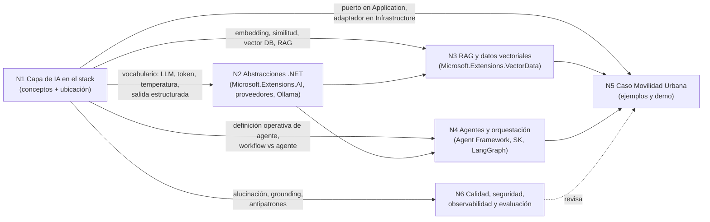
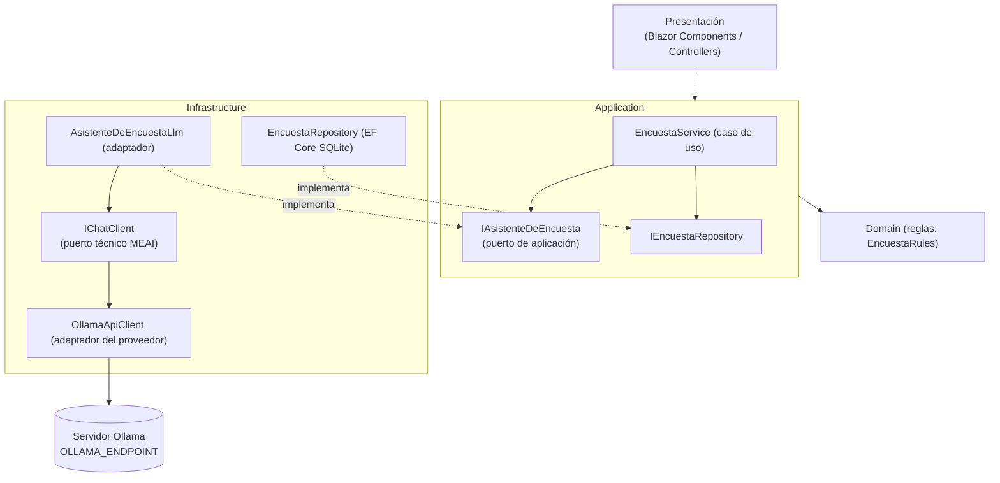

# N1 — La capa de IA en el stack de una aplicación (dossier de investigación)

> **Qué es este documento**: material de trabajo para la mesa evaluadora, no la guía final. Reúne definiciones, estado verificado de la tecnología al **2026-10-25**, snippets y criterios del núcleo N1. Cada afirmación remite a una fuente de la §7 (ids `F01`…) o a evidencia ejecutada (`E01`…). Lo que es criterio propio del investigador está marcado **[criterio propio]**; lo no verificado, **[no verificado]**.

## Índice

1. [Ideas agrupadas y dependencias con los otros núcleos](#1-ideas-agrupadas-y-dependencias-con-los-otros-núcleos)
2. [Definiciones precisas](#2-definiciones-precisas)
3. [Estado actual verificado de la tecnología](#3-estado-actual-verificado-de-la-tecnología-2026-10-25)
4. [Snippets representativos](#4-snippets-representativos)
5. [Preguntas guía con respuestas explicativas](#5-preguntas-guía-con-respuestas-explicativas)
6. [Criterios de calidad y antipatrones](#6-criterios-de-calidad-y-antipatrones)
7. [Tabla de fuentes](#7-tabla-de-fuentes)
8. [Abierto / no verificado](#8-abierto--no-verificado)

---

## 1. Ideas agrupadas y dependencias con los otros núcleos

### 1.1 Lectura fiel de la imagen `INPUTs/AI-Layer.png`

**Lo que la imagen muestra (descripción literal)**. Título «✨ IA ya es parte del stack», logo «LIDR» arriba a la derecha. Cinco franjas horizontales rotuladas a la izquierda:

| Franja | Cajas que contiene | Flechas visibles |
|---|---|---|
| FRONTEND | Web App · Mobile App · Admin Panel; fuera del recuadro, Third-Party Integrations | Flecha punteada desde el recuadro hacia Third-Party Integrations; una flecha entra al recuadro por la izquierda |
| BACKEND | API Gateway → Auth Service → Business Logic → Microservices → File Storage | Flechas en cadena de izquierda a derecha; flechas verticales entre Frontend y API Gateway / Auth Service / Business Logic (con puntas hacia arriba y hacia abajo) |
| AI LAYER (resaltada en dorado) | LLM / Generative Models → **RAG Pipeline** → AI Services & Agents; debajo, una caja «Retrieval · Embeddings · Vector DB» | Flecha bidireccional entre Business Logic (Backend) y la franja AI Layer; líneas punteadas desde LLM y desde AI Services & Agents hacia la caja de Retrieval; flecha corta del RAG Pipeline a esa caja |
| DATABASE | SQL DB · NoSQL DB · **Vector DB** (resaltada) · Cache (Redis) · Object Storage | Flecha bidireccional entre la caja Retrieval/Embeddings/Vector DB y la Vector DB; línea punteada que recorre las bases de datos |
| INFRASTRUCTURE | Docker · Kubernetes · Cloud (AWS/GCP/Azure) · Monitoring & Logging | Flecha hacia arriba desde Cloud hacia la franja Database |

La captura está recortada abajo (se ve una barra de interfaz de red social con contadores), por lo que la franja Infrastructure se lee parcialmente. Fuente: lectura directa del archivo (`E00`).

**Lo que es interpretación [criterio propio]**:

- El diagrama es **didáctico, no normativo**: no es un estándar ni una arquitectura de referencia de un fabricante. Su mensaje es que la IA ocupa un **lugar propio** entre la lógica de negocio y los datos, y que **sólo se comunica con el Backend** (Business Logic), nunca directamente con el Frontend. Esta lectura coincide con la regla de Clean Architecture de que la UI interactúa con infraestructura sólo a través de interfaces del núcleo (`F12`).
- Las flechas «LLM → RAG → Agents» sugieren una **progresión de capacidades** (generar → generar con datos propios → actuar con herramientas), no un flujo de datos obligatorio: un agente puede no usar RAG, y un RAG no requiere agente (`F02`, `F11`).
- La Vector DB aparece **dos veces** (dentro de la capa de IA y en Database): leído en clave de capas, el *uso* (retrieval) es de la capa de IA y el *almacenamiento* es de la capa de datos. En .NET eso se traduce en: la abstracción `VectorStore` la consume la aplicación; el proveedor concreto (InMemory, SQLite‑vec, PostgreSQL, Azure AI Search…) es infraestructura (`F09`).
- «Monitoring & Logging» en Infrastructure tiene correlato directo en la capa de IA de .NET: `UseOpenTelemetry` / `UseLogging` en el pipeline de `IChatClient` (`F05`).
- Autoría: el logo dice «LIDR»; **[no verificado]** quién es el autor ni la fuente original de la diapositiva (búsquedas sin resultado, ver §8). La guía debe citarla como «diagrama de LIDR, tomado de una captura provista por el PO» y no atribuirle más que eso.

### 1.2 Núcleos de ideas de N1

| Grupo | Ideas | Por qué van juntas |
|---|---|---|
| G1 Modelo | LLM, modelo generativo, token, ventana de contexto, prompt / system prompt, temperatura, salida estructurada | Describen *qué es* y *cómo se le habla* al componente central de la capa |
| G2 Fidelidad | alucinación, grounding | Describen el límite del modelo y la respuesta arquitectónica a ese límite |
| G3 Memoria semántica | embedding, similitud coseno, vector DB, RAG | Cadena de dependencia fuerte: RAG ⇐ vector DB ⇐ embeddings ⇐ similitud |
| G4 Acción | agente (LLM + herramientas + bucle + estado), workflow vs agente | Un agente es un LLM aumentado que actúa; se define por contraste con el workflow |
| G5 Ubicación arquitectónica | capas Domain/Application/Infrastructure, puerto, adaptador, raíz de composición, antipatrones | Responde «dónde va la capa de IA en una app .NET» y conecta con el caso Movilidad Urbana |

### 1.3 Dependencias con los otros núcleos

> La numeración N2–N6 la fija la presidencia; aquí se asume la partición temática habitual de la corrida. Si difiere, la mesa reasigna las flechas sin cambiar su contenido.



| Hacia | Qué entrega N1 | Qué necesita N1 de vuelta |
|---|---|---|
| N2 | Definiciones de LLM, prompt, temperatura, salida estructurada que N2 materializa con `IChatClient`/`ChatOptions` | Confirmar qué modelo Qwen corre en el servidor Ollama de la LAN del laboratorio y si soporta tool calling y JSON schema |
| N3 | Definición de embedding, similitud, vector DB y RAG (Lewis et al.) | El proveedor vectorial elegido para el ejemplo (deprecación de conectores SK, §3.3) |
| N4 | Definición de agente y criterio «workflow antes que agente» | Postura sobre LangGraph en .NET (N1 no lo investiga) |
| N5 | Regla de ubicación: interfaz en `Application/Abstractions`, implementación en `Infrastructure/` | Qué caso de uso de Movilidad Urbana recibe IA |
| N6 | Lista de antipatrones (§6) y definición de alucinación/grounding | Métricas y herramientas de evaluación (Microsoft.Extensions.AI.Evaluation) |

---

## 2. Definiciones precisas

Formato: **qué es** / **qué problema resuelve** / **qué no es**. La guía final debe traducir y reformular; las citas literales en inglés quedan acá como respaldo.

### 2.1 Modelo generativo e IA generativa
- **Qué es**: IA que «can create original content, such as natural language, images, audio, and code»; todos los modelos generativos usan los patrones aprendidos en el entrenamiento «to produce new, statistically similar content» (`F03`).
- **Problema que resuelve**: producir contenido nuevo (texto, código, imágenes) a partir de una entrada en lenguaje natural.
- **Qué no es**: no es una base de conocimiento consultable con garantías; produce contenido *estadísticamente similar*, no recuperado. Microsoft además aclara que no genera la misma salida para entradas idénticas (`F03`).

### 2.2 LLM (Large Language Model)
- **Qué es**: el modelo que impulsa las aplicaciones generativas de lenguaje natural; se entrena sobre texto tokenizado y su objetivo es «predict the next token in the sequence based on the preceding tokens»; la salida «is built one token at a time» (`F03`).
- **Problema**: entender y producir lenguaje natural (y código) de forma general.
- **Qué no es**: no es un motor de reglas ni una base de datos; no conoce los datos de *tu* aplicación salvo que se los pases en el contexto (de ahí RAG, `F08`).

### 2.3 Token
- **Qué es**: unidad en que un *tokenizer* parte el texto: «words, character sets, or combinations of words and punctuation» (`F04`).
- **Problema**: es la unidad de cómputo, de límite y de costo: los servicios cobran por tokens de entrada y salida y limitan tokens por minuto (TPM) (`F04`).
- **Qué no es**: no equivale a una palabra; depende del método (palabra, carácter, subpalabra/BPE) (`F04`).

### 2.4 Ventana de contexto
- **Qué es**: el máximo de tokens que el modelo procesa, «often expressed as a combined maximum *context window* that covers both input and output tokens together» (`F04`).
- **Problema**: acota cuánto historial, instrucciones y datos recuperados entran en una llamada; motiva la reducción de chat (`MessageCountingChatReducer`, `SummarizingChatReducer`, experimentales) y RAG (`F05`, `F09`).
- **Qué no es**: no es memoria persistente; lo que no se reenvía en la siguiente llamada, el modelo (en servicios *stateless*) no lo ve (`F05`, sección *Stateless vs. stateful clients*).

### 2.5 Prompt y system prompt (instrucciones)
- **Qué es**: *prompt* es el texto de entrada al que el modelo responde con una *completion*; en chat se organiza en roles **system**, **user**, **assistant**. El *system message* «give[s] the model instructions about the assistant», es único y va primero (`F13`).
- En .NET: `ChatRole.System` en la lista de mensajes, o `ChatOptions.Instructions` («additional per-request instructions») (`F05`, `F14`); en Agent Framework, el parámetro `instructions` del agente (`F17`).
- **Qué no es**: no es un lugar seguro para reglas de negocio ni para autorización: OWASP recomienda manejar funciones extensibles «in code rather than providing them to the model» y aplicar privilegio mínimo (`F16`).

### 2.6 Temperatura (y top‑p)
- **Qué es**: parámetro de muestreo. `ChatOptions.Temperature`: «the temperature for generating chat responses»; `TopP`: «the "nucleus sampling" factor» (`F14`). La referencia del conector Azure OpenAI de Microsoft describe que valores altos de temperatura vuelven la salida «more random» y los bajos «more focused and deterministic», y para top‑p recomienda «Change either this value or 'Temperature', but not both» (`F15`). La afirmación «0 = *arg max* para respuestas bien definidas» sólo aparece en una respuesta de Microsoft Q&A de 2023, no en la referencia oficial vigente **[no verificado]**.
- **Problema**: controlar variabilidad: baja para clasificar/extraer, más alta para redactar.
- **Qué no es**: temperatura 0 **no garantiza determinismo** entre llamadas ni entre versiones del modelo **[criterio propio; no verificado para Ollama/Qwen]**; `ChatOptions.Seed` existe para reproducibilidad «used by a service», sujeto a soporte del proveedor (`F14`).

> **2026-10-28 — Parche P-33 (ciclo 1).** Los parámetros de muestreo no son genéricos: el fabricante los recomienda por modelo y por modo. La model card de Qwen/Qwen3.5-4B (consultada el 2026-10-28) da valores distintos para el modo con razonamiento y sin él, y el Modelfile servido trae `temperature 1`, `top_k 20`, `top_p 0.95` y `presence_penalty 1.5` (Sondeo §R.1). La guía fija por configuración el preajuste exacto **«Instruct (or non-thinking) mode for general tasks»: `temperature=0.7, top_p=0.8, top_k=20, min_p=0.0, presence_penalty=1.5, repetition_penalty=1.0`** (https://huggingface.co/Qwen/Qwen3.5-4B, README l. 837, consultado el 2026-10-28T11:43-03:00), y declara que el Modelfile servido trae otro (`temperature 1`, `top_p 0.95`, que coincide con «non-thinking for reasoning tasks»). La card tiene dos preajustes sin razonamiento (ajuste vinculante del juez de evidencia, V9). Si usa T 0, lo declara como decisión propia medida con R-LLM. Si `TopP`, `TopK` y `PresencePenalty` llegan al servidor por OllamaSharp y por `/v1` queda en PC-05. Hasta que se responda, la guía no afirma que llegan. **N1b, fila nueva:** «modelos con modo de razonamiento conmutable: el modo es un parámetro de integración (latencia, tokens de salida, muestreo propio)», con la card como fuente.

> **2026-10-28 — Parche P2-08 (ciclo 1, ronda 2).** PC-05 respondida: los parámetros del fabricante para el modo sin razonamiento (`top_k` 20, `top_p` 0,95, `presence_penalty` 1,5; P-33) se fijan por configuración con `ChatOptions` tipadas **sólo por la vía nativa**. Por `/v1`, `TopK` no viaja y rige el del Modelfile. La guía lo dice junto al snippet; ya no dice «no se afirma que llegan».


### 2.7 Salida estructurada
- **Qué es**: «a chat response that's of a type you specify instead of just plain text»; en .NET se pide con `GetResponseAsync<T>` (extensión `ChatClientStructuredOutputExtensions`) (`F10`).
- **Problema**: convierte una respuesta de lenguaje natural en un objeto C# tipado (`enum`, `record`) que la capa de aplicación puede validar con reglas del dominio.
- **Qué no es**: no es validación de negocio: el tipo puede llegar bien formado y con un valor incorrecto; además el soporte de *JSON schema* nativo depende del proveedor/modelo: la extensión expone el parámetro `bool? useJsonSchemaResponseFormat` (firma en la referencia enlazada desde `F10`; nombre confirmado por reflexión en `E03`), pero `F10` no documenta su comportamiento por proveedor (**[no verificado]** para Qwen en Ollama).

### 2.8 Alucinación
- **Qué es**: la generación de texto no intencionado/no sustentado. Ji et al. (ACM Computing Surveys, 2022) parten de que la generación basada en deep learning «is prone to hallucinate unintended text» (`F18`). Microsoft usa el término *ungroundedness*: «instances where LLMs produce information that is non-factual or inaccurate from what was present in the source materials» (`F19`). La equivalencia explícita «ungroundedness = alucinación» provenía de un comunicado de Azure que no se pudo abrir (HTTP 503) **[no verificado]**.
- **Problema que plantea**: el modelo puede responder con seguridad algo falso; no hay excepción ni código de error.
- **Qué no es**: no es un *bug* que se corrige con un parche; es una propiedad del mecanismo de predicción del siguiente token (`F03`) **[criterio propio la inferencia]**.

### 2.9 Grounding (anclaje)
- **Qué es**: hacer que la respuesta se apoye en material fuente provisto (documentos, registros), y poder rastrear la afirmación hasta él. Azure AI Content Safety ofrece *groundedness detection*, que ayuda a asegurar que las respuestas del LLM «are based on your provided source material» (`F19`). En RAG, Microsoft pide guardar metadatos de las fuentes «for citations or references» (`F08`).
- **Qué no es**: no elimina la alucinación; la reduce y la vuelve **verificable** (`F01` lo plantea como combinar memoria paramétrica y no paramétrica, lo que permite actualizar y dar procedencia).

### 2.10 Embedding y similitud
- **Qué es**: «numeric representations of non-numeric data that an LLM can use to determine relationships between concepts» (`F06`). En .NET: `IEmbeddingGenerator<TInput,TEmbedding>`; `Embedding<float>.Vector` es `ReadOnlyMemory<float>` (`F07`).
- **Similitud**: la búsqueda vectorial «measures the distance between the data vectors and your query vector»; los más cercanos son los más similares semánticamente (`F09`). La similitud coseno se calcula en .NET con `TensorPrimitives.CosineSimilarity` (compilado, `E01`; API de `System.Numerics.Tensors`).
- **Qué no es**: no es comprensión garantizada ni búsqueda exacta; dos vectores de **modelos distintos** no son comparables **[criterio propio]**.

### 2.11 Vector DB
- **Qué es**: almacenamiento que «store[s] and manage[s] vector embeddings» y ofrece búsqueda por similitud; muchos motores tradicionales la soportan (SQL Server/Azure SQL, Cosmos DB, PostgreSQL+pgvector) además de productos dedicados (`F09`).
- **En .NET**: `Microsoft.Extensions.VectorData.Abstractions` (`VectorStore`, `VectorStoreCollection<TKey,TRecord>`, atributos `[VectorStoreKey]`, `[VectorStoreData]`, `[VectorStoreVector]`) con proveedores intercambiables (`F09`).
- **Qué no es**: no reemplaza a la base transaccional; en el diagrama convive con SQL/NoSQL/Cache (`E00`).

### 2.12 RAG (Retrieval‑Augmented Generation)
- **Origen**: Lewis et al., «Retrieval-Augmented Generation for Knowledge-Intensive NLP Tasks», NeurIPS 2020 (arXiv:2005.11401, 22‑may‑2020): modelos que «combine pre-trained parametric and non-parametric memory for language generation»; en el paper la memoria no paramétrica es «a dense vector index of Wikipedia» accedida por un *retriever* neuronal (`F01`).
- **Uso actual en .NET**: «lets you make your data available to LLMs without training them on it first»; pasos: trocear (*chunk*), convertir a formato buscable (embeddings), almacenar con metadatos para citar, e inyectar en el prompt (`F08`).
- **Problema**: el LLM no conoce datos privados o recientes; RAG los trae al contexto en tiempo de consulta y permite citar.
- **Qué no es**: no es *fine‑tuning* (no cambia pesos) (`F08`, `F09`); y, aclaración importante para la guía, el paper original entrena retriever y generador **de punta a punta**, mientras que el «RAG» de las aplicaciones actuales suele ser un pipeline sin entrenamiento conjunto **[criterio propio, a partir de `F01` y `F08`]**.

### 2.13 Agente
- **Definición operativa adoptada para la guía [criterio propio, sintetizada de fuentes]**: **LLM + herramientas + bucle + estado/memoria**, orientado a un objetivo.
  - Anthropic: el bloque básico es el *augmented LLM*, «an LLM enhanced with augmentations such as retrieval, tools, and memory»; los agentes son «systems where LLMs dynamically direct their own processes and tool usage», a diferencia de los *workflows* «orchestrated through predefined code paths» (`F02`).
  - Microsoft .NET: «Agents are systems that accomplish objectives», más capaces con razonamiento, uso de herramientas y conciencia de contexto (historial, vector stores…) (`F11`).
  - Microsoft Agent Framework: agentes que «use LLMs to process inputs, call tools and MCP servers, and generate responses», con *agent session* para estado y *context providers* para memoria (`F17`).
  - El **bucle** se ve en el mecanismo de *tool calling*: el modelo pide invocar una función, el cliente la ejecuta y devuelve el resultado al modelo con el historial (`FunctionInvokingChatClient`) (`F05`).
- **Qué no es**: no es «cualquier llamada a un LLM». Si el camino está fijado por código, es un *workflow*. Regla explícita de Microsoft: «*If you can write a function to handle the task, do that instead of using an AI agent.*» (`F17`); Anthropic: buscar «the simplest solution possible… This might mean not building agentic systems at all» (`F02`).

> **2026-10-28 — Parche P2-14 (ciclo 1, ronda 2).** Definición de agente que adopta la guía (Consulta de definiciones, P-31.2): **«un sistema en el que el modelo decide, en un bucle, qué herramienta pedir a continuación y cuándo terminar, a partir de los resultados que la aplicación le devuelve. La aplicación ejecuta cada pedido y fija un límite de iteraciones».** Respecto de N1 §2.13 sale «estado/memoria» como condición definitoria y entra la condición de corte. Lo que N4 §2.2 y N6 §2 definen pasa a la entrada calificada **«agente de MAF (`AIAgent`)»**. El bucle de `FunctionInvokingChatClient` ya es un agente: el **agente mínimo**. `AsAIAgent` le suma sesión, aprobación de herramientas y la interfaz común. Fuentes: Anthropic, *Building effective agents* (2024-12-19), «typically just LLMs using tools based on environmental feedback in a loop» y «stopping conditions (such as a maximum number of iterations)»; LangGraph, *Workflows and agents* (dateModified 2026-10-28); MAF Overview (ms.date 2026-10-23), tabla «agents vs workflows»; .NET AI tool calling (ms.date 2026-03-03); MAF Looping (ms.date 2026-07-30), «Always bound autonomous loops». Experimento E-DEF-1, parte 1 (`Mesa/Ciclo-1/Ronda-2/evidencia-definiciones/E-DEF-1/salida.txt`, MAF 1.26.0, MEAI 10.11.0): con el mismo código, el guion del modelo cambia el orden de las herramientas o hace que no se use ninguna.


### 2.14 Puerto y adaptador (ubicación de la capa de IA)
- **Puerto**: «A port identifies a purposeful conversation» (Cockburn, 2005) (`F20`). En Clean Architecture .NET, las abstracciones/interfaces se definen en el núcleo (Application Core) (`F12`).
- **Adaptador**: «For each external device there is an adapter that converts the API definition to the signals needed by that device and vice versa» (`F20`); en .NET, tipos de *Infrastructure* que implementan interfaces del núcleo (`F12`).
- **Raíz de composición**: `Program.cs`, donde se conectan implementaciones con interfaces vía DI (`F12`).
- **Aplicado a la capa de IA [criterio propio]**: hay **dos niveles de puerto**:
  1. `IChatClient` / `IEmbeddingGenerator` / `VectorStore` ya son **puertos técnicos** genéricos provistos por Microsoft, con adaptadores por proveedor (OllamaSharp, OpenAI…) (`F04`→`F05`, `F07`, `F09`).
  2. El **puerto de aplicación** expresa la intención del caso de uso en lenguaje del dominio (p. ej. `IAsistenteDeEncuesta.ClasificarAsync`), vive en `Application/Abstractions/` y lo implementa un adaptador en `Infrastructure/` que usa `IChatClient`. Así el dominio no depende de prompts ni de modelos.
- **Encaje con el caso**: Movilidad Urbana ya sigue este patrón para persistencia: `ILocalidadRepository`, `IEncuestaRepository`, `ISessionContext` en `Application/Abstractions/`; implementaciones en `Infrastructure/Persistence|Sessions`; composición en `Program.cs` con `AddApplication()` / `AddInfrastructure()` (`F21`, ia-db 01_Arquitectura; verificado en `src/MovilidadUrbana.ApiWeb/Application/Abstractions/ILocalidadRepository.cs`). Matiz: las capas son **carpetas** de un único ensamblado, no proyectos separados, así que el compilador no impide violar la dependencia (`F21`).

> **2026-10-28 — Parche P-15 (ciclo 1).** Las herramientas (`AIFunction` sobre casos de uso) y el servidor MCP son adaptadores de entrada; el de salida es `IChatClient`. Diagrama corregido en BIT-16-04 §6.2.


---

## 3. Estado actual verificado de la tecnología (2026-10-25)

Versiones obtenidas de `https://api.nuget.org/v3-flatcontainer/<id>/index.json`; fechas y deprecaciones de la API de registro `https://api.nuget.org/v3/registration5-gz-semver2/<id>/index.json` (`E02`).

### 3.1 Paquetes núcleo

| Paquete | Última estable | Última (incl. preview) | Publicada | Estado | Doc oficial |
|---|---|---|---|---|---|
| `Microsoft.Extensions.AI.Abstractions` | 10.11.0 | 10.11.0 | 2026-10-14 | GA | `F04` |
| `Microsoft.Extensions.AI` | 10.11.0 | 10.11.0 | 2026-10-14 | GA | `F04`, `F05` |
| `Microsoft.Extensions.AI.OpenAI` | 10.11.0 | 10.11.0 | 2026-10-14 | GA | `F10` |
| `Microsoft.Extensions.AI.Evaluation` | 10.11.0 | 10.11.0 | 2026-10-14 | GA | (N6) |
| `Microsoft.Extensions.AI.Templates` | — | 10.11.0-preview.3.26513.7 | — | preview | — |
| `Microsoft.Extensions.VectorData.Abstractions` | 10.11.0 | 10.11.0 | 2026-10-14 | GA | `F09` |
| `OllamaSharp` (comunidad) | 5.5.0 | 5.5.0 | 2026-09-30 | GA; depende de `Microsoft.Extensions.AI` ≥ 10.8.0 (nuspec) | `F05`, `F07`, `F17` |
| `Microsoft.Agents.AI` (Agent Framework) | 1.26.0 | 1.26.0 | 2026-10-23 | GA desde **1.0.0 = 2026-04-02** (previews desde 2025-10-01; rc1–rc5 feb–mar 2026) | `F17` |
| `Microsoft.Agents.AI.Abstractions` / `.Workflows` / `.OpenAI` | 1.26.0 | 1.26.0 | 2026-10-23 | GA | `F17` |
| `Microsoft.SemanticKernel` | 1.81.0 | 1.81.0 | 2026-10-06 | GA, vigente; el README lo presenta con Agent Framework como «enterprise‑ready successor» | `F22` |
| `CommunityToolkit.VectorData.InMemory` | 1.0.1 | 1.0.1 | 2026-08-10 | GA | `F09` |
| `CommunityToolkit.VectorData.SqliteVec` | — | 1.0.3-preview | — | preview | (N3) |

### 3.2 Compatibilidad entre paquetes (nuspec, `E02`)

- `Microsoft.Agents.AI` 1.26.0 (net10.0) depende de `Microsoft.Extensions.AI` 10.10.0, `Microsoft.Extensions.AI.Abstractions` 10.10.1, `Microsoft.Extensions.VectorData.Abstractions` 10.10.0 y `Microsoft.Extensions.AI.Evaluation` 10.10.0: **Agent Framework está construido sobre MEAI**, lo que confirma `F11` («These components serve as the foundation for Microsoft Agent Framework»).
- `Microsoft.Extensions.AI` 10.11.0 apunta a net10.0, net9.0, net8.0, netstandard2.0 y net462; repositorio `github.com/dotnet/extensions`.
- Compilación verificada (`E01`): `Microsoft.Extensions.AI` 10.11.0 + `OllamaSharp` 5.5.0 + `Microsoft.Agents.AI` 1.26.0 + `Microsoft.Extensions.Hosting` 10.0.0 en `net10.0` → *Build succeeded, 0 warnings, 0 errors*.

### 3.3 Renombres y deprecaciones (sorpresas)

| Paquete | Estado verificado | Reemplazo | Fuente |
|---|---|---|---|
| `Microsoft.Extensions.AI.Ollama` | **Deprecado** (motivo «Other»); última 9.7.0-preview.1.25356.2 (2025-07-08); «No further updates, features, or fixes are planned» | `OllamaSharp` | `E02` |
| `Microsoft.SemanticKernel.Connectors.InMemory` | **Deprecado** («Legacy»), última 1.74.0-preview (2026-03-20) | `CommunityToolkit.VectorData.InMemory` | `E02` |
| `Microsoft.SemanticKernel.Connectors.Sqlite` | Deprecado: «renamed to Microsoft.SemanticKernel.Connectors.SqliteVec» | ver fila siguiente | `E02` |
| `Microsoft.SemanticKernel.Connectors.SqliteVec` | **Deprecado** («Legacy»), última 1.74.0-preview: «renamed … to CommunityToolkit.VectorData.SqliteVec since this package has no dependency on Semantic Kernel» | `CommunityToolkit.VectorData.SqliteVec` (preview) | `E02` |
| Semantic Kernel / AutoGen (rol) | No deprecados en NuGet, pero Agent Framework es «the direct successor, created by the same teams» | `Microsoft.Agents.AI` | `F17`, `F22` |

### 3.4 Inconsistencias de la documentación oficial a tener en cuenta

- La página del proveedor Ollama de Agent Framework (ms.date 2026-10-15) todavía indica `dotnet add package Microsoft.Agents.AI --prerelease`, aunque hay estable desde 2026-04-02 (`F17b`, `E02`). Para la guía: usar la estable, sin `--prerelease`.
- La misma página sugiere, para Python, `llama3.2` o `qwen3:4b` como modelos con *function calling* en Ollama (`F17b`); es la única mención oficial a Qwen encontrada en este despacho.
- La documentación de los snippets base de `IChatClient` usa OllamaSharp con `http://localhost:11434` (`F05`, `F07`), lo que alinea con la regla de la corrida (`OLLAMA_ENDPOINT` con ese valor por defecto).

---

## 4. Snippets representativos

Compilan contra las versiones de §3: 4.2–4.4, 4.6 y 4.7 en `E01`; 4.1 (literal) y 4.5 en `E03` (corrección: `E01` no contenía 4.1); **no se ejecutaron contra un modelo** (ver §8). El endpoint se lee de `OLLAMA_ENDPOINT` con `http://localhost:11434` por defecto.

### 4.1 Llamada mínima con system prompt (adaptado de `F05`)

```csharp
using Microsoft.Extensions.AI;
using OllamaSharp;

var endpoint = new Uri(Environment.GetEnvironmentVariable("OLLAMA_ENDPOINT") ?? "http://localhost:11434");
IChatClient client = new OllamaApiClient(endpoint, "qwen3:4b");   // modelo: ver §8

Console.WriteLine(await client.GetResponseAsync(
[
    new(ChatRole.System, "Sos un asistente de movilidad urbana. Respondé en español."),
    new(ChatRole.User, "¿Qué es un viaje multimodal?"),
]));
```

> **2026-10-28 — Parche P-29 (ciclo 1).** Los snippets de §4.1, §4.3, §4.4 y §4.6 compilaron con un SDK 11 rc (E01) y no valen como evidencia de .NET 10: se reilustran con Movilidad Urbana y se compilan con `sdk:10.0` (pendiente P-15 de BIT-16-04; matriz snippet → prueba de Parche P-29). Remisión pedida por el juez de riesgo (chequeo de capa).


### 4.2 Registro en DI con middleware (adaptado de `F05`, sección *Dependency injection* y *Tool calling*)

```csharp
var builder = Host.CreateApplicationBuilder(args);          // en Blazor/API: WebApplication.CreateBuilder
builder.Services.AddChatClient(new OllamaApiClient(endpoint, model))
    .UseFunctionInvocation();                               // + .UseOpenTelemetry(), .UseDistributedCache()
```

### 4.3 Salida estructurada + temperatura baja (adaptado de `F10`; propiedades de `F14`)

```csharp
public record Clasificacion(string Medio, bool EsSustentable);

var opts = new ChatOptions { Temperature = 0f, Instructions = "Respondé en español." };
ChatResponse<Clasificacion> r =
    await chat.GetResponseAsync<Clasificacion>("Clasificá: 'voy en bici al trabajo'", opts);
Console.WriteLine(r.TryGetResult(out var c) ? c.Medio : "sin resultado");
```

### 4.4 Embeddings y similitud coseno (adaptado de `F07`)

```csharp
using System.Numerics.Tensors;

IEmbeddingGenerator<string, Embedding<float>> gen = new OllamaApiClient(endpoint, "nomic-embed-text"); // modelo: ver §8
ReadOnlyMemory<float> a = await gen.GenerateVectorAsync("colectivo");
ReadOnlyMemory<float> b = await gen.GenerateVectorAsync("ómnibus");
Console.WriteLine(TensorPrimitives.CosineSimilarity(a.Span, b.Span));
```

### 4.5 Vector store + búsqueda (literal de `F09`, para N3)

```csharp
var vectorStore = new InMemoryVectorStore(new() { EmbeddingGenerator = embeddingGenerator });
var collection = vectorStore.GetCollection<int, Movie>("movies");
await collection.EnsureCollectionExistsAsync();
await foreach (var result in collection.SearchAsync("animals in the wild", top: 2))
    Console.WriteLine($"{result.Record.Title} (score: {result.Score})");
```
(Paquete `CommunityToolkit.VectorData.InMemory` 1.0.1; no compilado en `E01`, **sí** compilado en `E03` con una clase `Movie` como la de `F09`.)

### 4.6 Agente mínimo con herramienta (adaptado de `F17b` + `AIFunctionFactory` de `F05`)

```csharp
using System.ComponentModel;
using Microsoft.Agents.AI;

AIAgent agent = new OllamaApiClient(endpoint, model).AsAIAgent(
    instructions: "Sos un asistente de movilidad urbana.", name: "Asistente",
    tools: [AIFunctionFactory.Create(ContarLocalidades)]);
Console.WriteLine(await agent.RunAsync("¿Cuántas localidades hay?"));

[Description("Devuelve la cantidad de localidades cargadas.")]
static int ContarLocalidades() => 3;   // en el caso real, delega en un caso de uso de Application
```

### 4.7 Puerto en Application, adaptador en Infrastructure **[criterio propio, sobre `F12`/`F20`/`F21`]**

```csharp
// Application/Abstractions/IAsistenteDeEncuesta.cs  — puerto: habla el idioma del caso de uso
public interface IAsistenteDeEncuesta
{
    Task<Clasificacion?> ClasificarAsync(string textoLibre, CancellationToken ct = default);
}

// Infrastructure/Ai/AsistenteDeEncuestaLlm.cs  — adaptador: conoce prompts y IChatClient
public sealed class AsistenteDeEncuestaLlm(IChatClient chat) : IAsistenteDeEncuesta
{
    public async Task<Clasificacion?> ClasificarAsync(string textoLibre, CancellationToken ct = default)
    {
        var resp = await chat.GetResponseAsync<Clasificacion>(
            [new(ChatRole.System, "Clasificá el medio de transporte."), new(ChatRole.User, textoLibre)],
            new ChatOptions { Temperature = 0f }, cancellationToken: ct);
        return resp.TryGetResult(out var r) ? r : null;   // null => la aplicación decide el camino sin IA
    }
}

// Program.cs (raíz de composición)
builder.Services.AddScoped<IAsistenteDeEncuesta, AsistenteDeEncuestaLlm>();
```



---

## 5. Preguntas guía con respuestas explicativas

**P1. ¿Mi funcionalidad necesita un LLM, o alcanza con código?**
Si la tarea tiene una especificación determinista (validar un CUIT, calcular una tarifa, aplicar `EncuestaRules`), código. Microsoft: «If you can write a function to handle the task, do that instead of using an AI agent» (`F17`); Anthropic recomienda la solución más simple posible (`F02`). El LLM aporta cuando la entrada es lenguaje natural ambiguo (texto libre de una encuesta, una pregunta abierta) o cuando hay que redactar. Criterio: si el error del modelo es inaceptable y no se puede verificar después, no va LLM en ese punto.

**P2. ¿Dónde pongo la llamada al modelo en una solución Domain/Application/Infrastructure?**
En `Infrastructure/`, detrás de una interfaz de `Application/Abstractions/` expresada en lenguaje del caso de uso (§4.7). Así la UI no conoce `IChatClient` (`F12`: la UI interactúa con infraestructura «strictly through interfaces defined in Application Core»), el dominio no conoce prompts y las pruebas usan un doble del puerto. Cuándo no: en un prototipo de una sola pantalla puede inyectarse `IChatClient` directo en un servicio; aceptable si se reconoce como deuda **[criterio propio]**.

**P3. `IChatClient` ya es una abstracción: ¿hace falta otra interfaz encima?**
Depende de qué se quiere aislar. `IChatClient` aísla del **proveedor** (Ollama, OpenAI…) (`F04`). No aísla de la **decisión de usar IA**: el caso de uso que inyecta `IChatClient` sigue armando prompts. Si el prompt y el tipo de respuesta son detalles de la funcionalidad (lo habitual), conviene un puerto de aplicación propio. Si la app es un chat genérico, `IChatClient` puede ser el puerto **[criterio propio]**.

**P4. ¿Cuándo uso RAG y cuándo meto los datos directo en el prompt?**
Si los datos relevantes caben holgadamente en la ventana de contexto y son pocos (p. ej. el catálogo de medios de transporte de Movilidad Urbana), van directo en el prompt o como herramienta. RAG aplica cuando el corpus no entra en la ventana o cambia seguido y hay que recuperar sólo lo relevante y citarlo (`F04`, `F08`, `F09`). RAG no corrige un modelo que no sigue instrucciones; ahí el problema es otro.

**P5. ¿Cómo reduzco la alucinación en una funcionalidad concreta?**
(a) Grounding: pasar los datos fuente y pedir que responda sólo con ellos, guardando metadatos para citar (`F08`); (b) salida estructurada y validación posterior con las reglas del dominio (`F10`); (c) temperatura baja en tareas cerradas (`F15`); (d) herramientas que consultan datos reales en vez de «recordarlos» (`F05`); (e) evaluación sistemática (N6). Ninguna la elimina (`F18`).

**P6. ¿Es un agente o un workflow lo que necesito?**
Si los pasos se conocen de antemano (clasificar texto → validar → guardar), es un **workflow** con una o varias llamadas al LLM en puntos fijos. Si el modelo debe decidir qué herramientas usar y cuántas veces (responder preguntas abiertas sobre las encuestas consultando distintos datos), es un **agente** (`F02`, `F17` tabla «When to use agents vs workflows»). El agente agrega costo, latencia y superficie de ataque (`F16`).

**P7. ¿Qué temperatura uso?**
Tareas con respuesta bien definida (clasificar, extraer, convertir a JSON): 0 o muy baja; redacción creativa: más alta; y no tocar a la vez `Temperature` y `TopP` (`F15`). Verificar con el modelo concreto: el rango y el efecto los define el proveedor **[no verificado para Qwen/Ollama]**.

**P8. ¿Por qué no llamar al LLM directamente desde el componente Blazor?**
Porque mezcla presentación con infraestructura (`F12`), impide probar la lógica sin modelo, deja el prompt y las reglas en la UI, y en Blazor Interactive Server la llamada igual corre en el servidor pero atada al circuito del usuario, sin un caso de uso que aplique políticas (sesión, validación, límites) **[criterio propio; el modelo de ejecución de Blazor Server lo confirma N5]**. Excepción razonable: un streaming de chat puramente conversacional, siempre que el componente consuma un servicio de aplicación y no el cliente del proveedor.

**P9. ¿La regla de negocio puede vivir en el system prompt?**
No como fuente de verdad. El prompt *orienta*; la regla se *hace cumplir* en código (Domain/Application). OWASP LLM01:2025 recomienda restringir el comportamiento del modelo, manejar funciones en código, privilegio mínimo y controles *human-in-the-loop* para operaciones privilegiadas (`F16`). En Movilidad Urbana, `EncuestaRules`/`LocalidadRules` siguen siendo la autoridad; el LLM a lo sumo propone (`F21`).

> **2026-10-28 — Parche P-33 (ciclo 1).** P7 («¿Qué temperatura uso?»): los parámetros de muestreo los recomienda el fabricante por modelo y modo (nota completa en §2.6).


---

## 6. Criterios de calidad y antipatrones

### 6.1 Criterios de calidad (una buena capa de IA en .NET)

| Criterio | Señal de versión buena | Fuente |
|---|---|---|
| Dependencia invertida | Interfaz en `Application/Abstractions`, implementación en `Infrastructure`, composición en `Program.cs` | `F12`, `F20`, `F21` |
| Proveedor intercambiable | El código consume `IChatClient`/`IEmbeddingGenerator`/`VectorStore`, no SDKs concretos | `F04`, `F09` |
| Configuración externa | Endpoint y modelo por configuración/variables (`OLLAMA_ENDPOINT`), no *hardcodeados* | `F17b` (patrón de variables de entorno) |
| Salida tipada y validada | `GetResponseAsync<T>` + validación con reglas del dominio + camino alternativo si falla | `F10` |
| Observabilidad | `UseOpenTelemetry`/`UseLogging` en el pipeline; cuidado con `EnableSensitiveData` | `F05` |
| Grounding y citas | Metadatos de fuente guardados con los chunks | `F08` |
| Mínimo poder | Herramientas expuestas al modelo acotadas; acciones de alto riesgo con aprobación | `F16`, `F17b` (tool approval: la tabla figura en la sección Python de esa página; para .NET **[no verificado]** en `F17b`) |
| Simplicidad | Workflow antes que agente; agente sólo si la tarea es abierta | `F02`, `F17` |

### 6.2 Antipatrones

| Antipatrón | Por qué es malo | Alternativa | Fuente |
|---|---|---|---|
| Llamar al LLM desde la UI (componente Blazor / controller con `OllamaApiClient`) | Rompe la regla de dependencia; no testeable; sin políticas de aplicación | Servicio de aplicación + puerto | `F12` |
| Lógica de negocio en el prompt («no aceptes localidades duplicadas») | No se garantiza su cumplimiento; vulnerable a prompt injection | Reglas en Domain; el prompt sólo orienta | `F16` |
| Confiar en la respuesta sin validar | Alucinación silenciosa | Salida estructurada + validación + `TryGetResult` | `F10`, `F18` |
| Agente para todo | Costo, latencia, imprevisibilidad | Workflow o función | `F02`, `F17` |
| Usar paquetes deprecados (`Microsoft.Extensions.AI.Ollama`, conectores SK InMemory/SqliteVec) | Sin mantenimiento | `OllamaSharp`, `CommunityToolkit.VectorData.*` | `E02` |
| Mezclar embeddings de modelos distintos en la misma colección | Vectores no comparables | Un modelo de embeddings por colección; reindexar al cambiarlo | **[criterio propio]** |
| Exponer herramientas con privilegios amplios (p. ej. «ejecutar SQL») | Escalada vía prompt injection indirecta | Herramientas específicas que llaman casos de uso | `F16` |
| Endpoint y modelo en el código fuente | Filtra infraestructura; impide cambiar de entorno | Configuración + variable de entorno | **[criterio propio]**, regla de la corrida |

---

## 7. Tabla de fuentes

Fecha de consulta de todas: **2026-10-25**.

| Id | Fuente | Qué respalda |
|---|---|---|
| F01 | Lewis et al., *Retrieval-Augmented Generation for Knowledge-Intensive NLP Tasks*, NeurIPS 2020 — https://arxiv.org/abs/2005.11401 | Origen y definición de RAG |
| F02 | Anthropic, *Building effective agents* (19‑dic‑2024) — https://www.anthropic.com/engineering/building-effective-agents | Augmented LLM, workflows vs agentes, patrones, simplicidad |
| F03 | Microsoft Learn, *How Generative AI and LLMs work* (ms.date 2026‑03‑04) — https://learn.microsoft.com/en-us/dotnet/ai/conceptual/how-genai-and-llms-work | IA generativa, LLM, predicción del siguiente token |
| F04 | Microsoft Learn, *Microsoft.Extensions.AI libraries* (ms.date 2026‑09‑14) — https://learn.microsoft.com/en-us/dotnet/ai/microsoft-extensions-ai ; *Understanding tokens* (2026‑03‑04) — https://learn.microsoft.com/en-us/dotnet/ai/conceptual/understanding-tokens | Paquetes MEAI, `IChatClient`, `IEmbeddingGenerator`; tokens, ventana de contexto, costo |
| F05 | Microsoft Learn, *Use the IChatClient interface* (ms.date 2026‑03‑13, act. 2026‑08‑19) — https://learn.microsoft.com/en-us/dotnet/ai/ichatclient | Snippets base, tool calling, caché, telemetría, DI, stateless/stateful, reductores y routing experimentales |
| F06 | Microsoft Learn, *How Embeddings Extend Your AI Model's Reach* (2026‑03‑04) — https://learn.microsoft.com/en-us/dotnet/ai/conceptual/embeddings | Definición de embedding y usos |
| F07 | Microsoft Learn, *Use the IEmbeddingGenerator interface* (2025‑12‑11) — https://learn.microsoft.com/en-us/dotnet/ai/iembeddinggenerator | `GenerateAsync`, `GenerateVectorAsync`, pipelines |
| F08 | Microsoft Learn, *Integrate Your Data into AI Apps with RAG* (2026‑09‑14) — https://learn.microsoft.com/en-us/dotnet/ai/conceptual/rag | Pasos de RAG, metadatos para citas |
| F09 | Microsoft Learn, *Vector databases for .NET AI apps* (2026‑02‑28, act. 2026‑07‑23) — https://learn.microsoft.com/en-us/dotnet/ai/vector-stores/overview | Vector DB, búsqueda vectorial, `Microsoft.Extensions.VectorData`, `CommunityToolkit.VectorData.InMemory` |
| F10 | Microsoft Learn, *Quickstart – Request a response with structured output* (2026‑03‑04) — https://learn.microsoft.com/en-us/dotnet/ai/quickstarts/structured-output | `GetResponseAsync<T>`, salida estructurada |
| F11 | Microsoft Learn, *Agents – .NET* (2025‑12‑10) — https://learn.microsoft.com/en-us/dotnet/ai/conceptual/agents | Definición de agente, orquestaciones, MEAI como base de Agent Framework |
| F12 | Microsoft Learn, *Common web application architectures* (ms.date 2021‑12‑12, act. 2026‑07‑08) — https://learn.microsoft.com/en-us/dotnet/architecture/modern-web-apps-azure/common-web-application-architectures | Clean Architecture = Hexagonal/Ports‑and‑Adapters; interfaces en el núcleo; UI sin acceso directo a Infrastructure; raíz de composición |
| F13 | Microsoft Learn, *Prompt engineering concepts* (2026‑03‑04) — https://learn.microsoft.com/en-us/dotnet/ai/conceptual/prompt-engineering-dotnet | Prompt, roles, system message, few‑shot; ejemplo con `AsAIAgent` y `AgentSession` |
| F14 | Microsoft Learn API, *ChatOptions Class* (Microsoft.Extensions.AI.Abstractions v10.10.1; act. 2026‑10‑16) — https://learn.microsoft.com/en-us/dotnet/api/microsoft.extensions.ai.chatoptions | `Temperature`, `TopP`, `TopK`, `Seed`, `Instructions`, `ResponseFormat`, `Tools`, `Reasoning` |
| F15 | Microsoft Learn, *Azure OpenAI built-in connector reference* (Logic Apps; ms.date 2025‑03‑22, act. 2026‑03‑06) — https://learn.microsoft.com/azure/logic-apps/connectors/built-in/reference/openai (corrección: la URL anterior, https://learn.microsoft.com/azure/ai-services/openai/reference, hoy redirige a la referencia de imagen/audio y no describe temperatura de chat) | Semántica de temperatura/top‑p |
| F16 | OWASP GenAI, *LLM01:2025 Prompt Injection* — https://genai.owasp.org/llmrisk/llm01-prompt-injection/ | Prompt injection directa/indirecta y mitigaciones |
| F17 | Microsoft Learn, *Microsoft Agent Framework Overview* (2026‑07‑29) — https://learn.microsoft.com/en-us/agent-framework/overview/ | Componentes, agentes vs workflows, sucesor de SK y AutoGen |
| F17b | Microsoft Learn, *Agent Framework – Ollama provider* (2026‑10‑15) — https://learn.microsoft.com/en-us/agent-framework/integrations/by-component/model-providers/ollama | `OllamaApiClient(...).AsAIAgent(...)`, `OLLAMA_ENDPOINT`, modelos con tool calling, tool approval |
| F18 | Ji et al., *Survey of Hallucination in Natural Language Generation*, ACM Computing Surveys 2022 — https://arxiv.org/abs/2202.03629 | Alucinación |
| F19 | Microsoft Learn, *Groundedness detection in Azure AI Content Safety* (ms.date 2025‑11‑21, act. 2026‑06‑05) — https://learn.microsoft.com/azure/ai-services/content-safety/concepts/groundedness (corrección: reemplaza al comunicado del Azure Blog de 2024, que devolvió HTTP 503) | Definición de groundedness/ungroundedness y groundedness detection |
| F20 | A. Cockburn, *Hexagonal Architecture* (2005‑09‑04) — https://alistair.cockburn.us/hexagonal-architecture/ | Definición de puerto y adaptador |
| F21 | ia-db de Lab-E2E.WebBlazor, `indexes/01_Arquitectura.md` y código `src/MovilidadUrbana.ApiWeb/Application/Abstractions/ILocalidadRepository.cs` (lectura local; repo público `hdcm-dev/Lab-E2E.WebBlazor`) | Capas del caso base y puertos existentes |
| F22 | GitHub, `microsoft/semantic-kernel` README — https://github.com/microsoft/semantic-kernel | «Microsoft Agent Framework (MAF) is the enterprise‑ready successor to Semantic Kernel» |
| F23 | GitHub, `microsoft/agent-framework` releases — https://github.com/microsoft/agent-framework/releases | dotnet-1.26.0 (23‑oct), 1.25.0 (14‑oct), 1.24.0 (7‑oct) |

### Evidencia ejecutada

| Id | Comando | Resultado |
|---|---|---|
| E00 | `Read INPUTs/AI-Layer.png` | Descripción de §1.1 |
| E01 | `docker run … mcr.microsoft.com/dotnet/sdk:11.0.100-rc.1 dotnet build` sobre proyecto `net10.0` con `Microsoft.Extensions.AI` 10.11.0, `OllamaSharp` 5.5.0, `Microsoft.Agents.AI` 1.26.0, `Microsoft.Extensions.Hosting` 10.0.0, conteniendo los snippets 4.1–4.4, 4.6, 4.7 (fuentes en `{dir-de-trabajo}/n1-check/`) | `Build succeeded. 0 Warning(s) 0 Error(s)` |
| E03 | (verificación adversarial) `docker run … mcr.microsoft.com/dotnet/sdk:10.0` (SDK 10.0.403) `dotnet build` + ejecución de sondas por reflexión, proyecto `net10.0` con `Microsoft.Extensions.AI` 10.11.0, `OllamaSharp` 5.5.0, `Microsoft.Agents.AI` 1.26.0, `CommunityToolkit.VectorData.InMemory` 1.0.1, `Microsoft.Extensions.Hosting` 10.0.0; snippets 4.1 y 4.5 literales (fuentes en `{dir-de-trabajo}/n1-adv/`) | `Build succeeded. 0 Warning(s) 0 Error(s)`; existen `ChatOptions.{Temperature,TopP,TopK,Seed,Instructions,ResponseFormat,Tools,Reasoning}`, `TryGetResult`, `TensorPrimitives.CosineSimilarity`, `AsAIAgent(IChatClient, instructions, name, description, tools, …)`; `MessageCountingChatReducer`/`SummarizingChatReducer` llevan `[Experimental]`; `Embedding<float>.Vector` es `ReadOnlyMemory<float>`; parámetros de `GetResponseAsync<T>`: `chatClient, messages, options, useJsonSchemaResponseFormat, cancellationToken` |
| E02 | `curl https://api.nuget.org/v3-flatcontainer/<id>/index.json` y `…/v3/registration5-gz-semver2/<id>/index.json`; `…/<id>/<ver>/<id>.nuspec` | Versiones, fechas, deprecaciones y dependencias de §3 |

---

## 8. Abierto / no verificado

1. **Autoría de la imagen**: «LIDR» aparece como logo; no se encontró la fuente original ni se confirmó la organización (la búsqueda devuelve un ticker bursátil homónimo sin relación). La guía debe citarla sin atribuir más.
2. **Modelo en el servidor Ollama de la LAN del laboratorio**: el prompt dice «qween»; no se verificó qué variante (`qwen3`, `qwen2.5`…), ni si soporta *tool calling*, *JSON schema* nativo o embeddings. Los nombres `qwen3:4b` y `nomic-embed-text` de los snippets son marcadores; `qwen3:4b` sólo está respaldado como sugerencia de Microsoft para tool calling en Python (`F17b`).
3. **Snippets no ejecutados contra un modelo**: compilan (`E01`) pero no se corrieron; el comportamiento de `GetResponseAsync<T>` con Ollama/Qwen queda para N2/N5.
4. **Compilación con SDK 11 RC**: `E01` usó `mcr.microsoft.com/dotnet/sdk:11.0.100-rc.1` apuntando a `net10.0`. **Resuelto** en la verificación adversarial: `E03` compiló con SDK 10.0.403 sin advertencias.
5. **Semántica de temperatura y groundedness** (`F15`, `F19`): fuentes reemplazadas y leídas completas en la verificación adversarial; siguen **[no verificadas]** la frase «0 = arg max» y la equivalencia explícita «ungroundedness = alucinación».
6. **Temperatura 0 ≠ determinismo**: criterio propio, no verificado con fuente oficial ni con el modelo del laboratorio.
7. **Estado de mantenimiento de Semantic Kernel**: sigue publicando (1.81.0, 2026-10-06); no se encontró una declaración oficial de «modo mantenimiento». Sólo «successor» (`F17`, `F22`).
8. **LangGraph en .NET**: fuera del alcance de N1; lo resuelve N4.
9. **Fecha exacta de GA anunciada** de Agent Framework: NuGet (1.0.0 publicada 2026‑04‑02) y el release `dotnet-1.0.0` de GitHub (publicado 2026‑04‑02, `F23`) coinciden; no se leyó un anuncio en blog con esa fecha.

---

## Verificación adversarial

Hecha el 2026-10-25 contra fuentes primarias, de forma independiente al investigador: NuGet (flatcontainer, registration y nuspec), la API de releases de GitHub, lectura completa de las páginas de learn.microsoft.com, arXiv, Anthropic, OWASP y Cockburn, y compilación más reflexión (`E03`). Las correcciones ya están aplicadas en el cuerpo del documento.

| Afirmación | Veredicto | Evidencia |
|---|---|---|
| MEAI, MEAI.Abstractions, MEAI.OpenAI, MEAI.Evaluation y VectorData.Abstractions 10.11.0, publicados el 2026-10-14 | confirmada | flatcontainer + registration (`E02` repetido) |
| `Microsoft.Extensions.AI.Templates` 10.11.0-preview.3.26513.7 | confirmada | flatcontainer |
| OllamaSharp 5.5.0 (2026-09-30); depende de MEAI ≥ 10.8.0 | confirmada | registration + nuspec |
| Agent Framework 1.26.0 (2026-10-23); 1.0.0 el 2026-04-02; previews desde 2025-10-01; rc1 el 2026-02-20 y rc5 el 2026-03-31 | confirmada | registration; GitHub releases `dotnet-1.0.0` y `dotnet-1.26.0` |
| `Microsoft.Agents.AI` 1.26.0 (net10.0) depende de MEAI 10.10.0, Abstractions 10.10.1, VectorData 10.10.0 y Evaluation 10.10.0 | confirmada | nuspec |
| MEAI 10.11.0 apunta a net10/9/8, netstandard2.0 y net462; repo `dotnet/extensions` | confirmada | nuspec |
| SK 1.81.0 (2026-10-06); InMemory 1.0.1 (2026-08-10); SqliteVec 1.0.3-preview | confirmada | flatcontainer + registration |
| Deprecaciones: MEAI.Ollama («Other», reemplazo OllamaSharp), SK.Connectors.InMemory/SqliteVec («Legacy», reemplazo CommunityToolkit) y SK.Connectors.Sqlite (renombrado a SqliteVec) | confirmada | campo `deprecation` de registration, con mensajes literales |
| README de SK: MAF es el «enterprise‑ready successor» | confirmada | GitHub README; además dice «Semantic Kernel is now Microsoft Agent Framework!»; no habla de modo mantenimiento |
| Agent Framework es el «direct successor, created by the same teams»; la tabla agentes vs workflows; «If you can write a function…» | confirmada | `F17` leído completo |
| La página de Ollama de AF (ms.date 2026-10-15) usa `--prerelease`, `OLLAMA_ENDPOINT` y sugiere `qwen3:4b` sólo para Python | confirmada | `F17b`; el ejemplo C# lanza una excepción si falta `OLLAMA_ENDPOINT` (no tiene valor por defecto) |
| Tool approval en `F17b` | corregida | figura sólo en la tabla de herramientas de Python; para .NET, no verificada |
| Citas de Lewis et al. (22-may-2020, NeurIPS 2020) | confirmada | arXiv:2005.11401 |
| Citas y fecha de Anthropic (19-dic-2024) | confirmada | página leída |
| Citas de `F03`, `F04` (tokens, ventana de contexto, TPM, BPE), `F06`, `F08`, `F09`, `F11`, `F13` | confirmada | páginas leídas; las ms.date coinciden |
| `F05`: snippets con `localhost:11434`, stateless/stateful, reductores y routing experimentales, `EnableSensitiveData` | confirmada | página leída; `[Experimental]` en los reductores (`E03`) |
| `ChatOptions` (Abstractions v10.10.1, act. 2026-10-16): Temperature, TopP, TopK, Seed («used by a service»), Instructions («additional per-request instructions»), ResponseFormat, Tools, Reasoning | confirmada | `F14` + reflexión `E03` |
| `GetResponseAsync<T>`, `TryGetResult`, `GenerateVectorAsync`, `TensorPrimitives.CosineSimilarity`, `AsAIAgent(instructions:, name:, tools:)`, `UseFunctionInvocation`/`UseOpenTelemetry`/`UseLogging`/`UseDistributedCache` | confirmada | `E01` + `E03` |
| Snippet 4.5 (VectorData InMemory) | confirmada | compila en `E03` |
| `E01` contenía los snippets 4.1–4.4 | corregida | `E01` no contenía 4.1 literal; 4.1 compila en `E03` |
| `useJsonSchemaResponseFormat` respaldado por `F10` | corregida | `F10` no lo menciona; el parámetro existe (`E03`) |
| Cita de OWASP «in code rather than exposing them to the model» | corregida | el texto real es «…rather than providing them to the model»; la aprobación humana es para «privileged operations» |
| Cita de Cockburn sobre el adaptador | corregida (completada) | termina en «…and vice versa»; fecha 2005-09-04 confirmada |
| `F15`: temperatura 0 = arg max; «temperature or top_p, not both» | corregida / no verificada | la URL original hoy redirige a la referencia de imagen/audio. Se reemplazó por la referencia del conector de Azure OpenAI, que confirma «more random / more focused and deterministic» y «not both». «0 = argmax» sólo aparece en Microsoft Q&A de 2023: no verificado |
| `F19`: «based on user-selected source materials»; ungroundedness = alucinación | corregida / no verificada | el blog devolvió 503. Se reemplazó por la doc de Content Safety, que dice «based on your provided source material» y define ungroundedness. La equivalencia explícita con alucinación queda no verificada |
| Ji et al., ACM Computing Surveys 2022, «prone to hallucinate unintended text» | confirmada | arXiv:2202.03629 |
| `F12`: Hexagonal/Ports-and-Adapters, interfaces en Application Core, UI «strictly through interfaces defined in Application Core», raíz de composición en Program.cs | confirmada | página leída (ms.date 2021-12-12, act. 2026-07-08) |
| Caso base: `ILocalidadRepository`, `IEncuestaRepository` e `ISessionContext` en `Application/Abstractions`; implementaciones en `Infrastructure/Persistence\|Sessions`; `AddApplication()`/`AddInfrastructure()`; un único proyecto por app; `EncuestaRules`/`LocalidadRules`; repo público | confirmada | lectura del código fuente; `github.com/hdcm-dev/Lab-E2E.WebBlazor` responde 200 |
| Descripción de la imagen (`E00`) | confirmada | imagen revisada; el logo está estilizado como «L1DR» |
| Autoría de LIDR | no verificada | una búsqueda nueva tampoco devuelve la fuente |
| Temperatura 0 ≠ determinismo; comportamiento con Qwen/Ollama | no verificada | sin fuente oficial y sin ejecución contra el modelo |

> Reanudación 2026-10-26: se volvió a consultar el flatcontainer de nuget.org para `microsoft.extensions.ai`, `microsoft.extensions.ai.abstractions`, `ollamasharp`, `microsoft.agents.ai`, `microsoft.extensions.vectordata.abstractions` y `microsoft.semantickernel`; las últimas versiones siguen siendo 10.11.0, 10.11.0, 5.5.0, 1.26.0, 10.11.0 y 1.81.0. La tabla de §3.1 sigue vigente.

### Segunda pasada adversarial (reanudación, 2026-10-26)

Contraste independiente de la primera pasada, sin reutilizar sus salidas: nuget.org (flatcontainer, registration y nuspec), API de releases de GitHub, descarga de las 22 fuentes web y búsqueda literal de cada cita en el texto de la página, lectura del código del caso base y compilación nueva de **todos** los snippets de §4 (4.1 a 4.7) en un solo proyecto (`E04`). No hubo correcciones nuevas al cuerpo: la primera pasada ya había aplicado las que correspondían.

| Afirmación | Veredicto | Evidencia |
|---|---|---|
| Versiones de §3.1 (MEAI ×4, Templates preview, VectorData 10.11.0; OllamaSharp 5.5.0; Agents.AI, .Abstractions, .Workflows, .OpenAI 1.26.0; SK 1.81.0; InMemory 1.0.1; SqliteVec 1.0.3-preview) y fechas 2026-10-14 / 2026-09-30 / 2026-10-23 / 2026-10-06 / 2026-08-10 | confirmada | flatcontainer + registration consultados el 2026-10-26 |
| Agent Framework: previews 2025-10-01, rc1 2026-02-20 … rc5 2026-03-31, 1.0.0 2026-04-02; releases GitHub `dotnet-1.24.0` 10-07, `1.25.0` 10-14, `1.26.0` 10-23 | confirmada | registration + `api.github.com/repos/microsoft/agent-framework/releases` |
| Dependencias de `Microsoft.Agents.AI` 1.26.0 (net10.0) y de OllamaSharp 5.5.0 (MEAI 10.8.0); TFMs y repo de MEAI 10.11.0 | confirmada | nuspec |
| Deprecaciones de §3.3, con motivos («Other»/«Legacy»), mensajes y paquetes alternativos | confirmada | campo `deprecation` de registration |
| Las 40+ citas literales de `F01`–`F03`, `F04`, `F06`, `F08`–`F14`, `F16`, `F17`, `F17b`, `F19`, `F20` | confirmada | búsqueda literal en el texto de cada página descargada; todas aparecen |
| Fechas ms.date / actualización de `F03`–`F15`, `F17`, `F17b`, `F19`; `F14` declara «Package: Microsoft.Extensions.AI.Abstractions v10.10.1» | confirmada | metadatos `ms.date` y `updated_at` de cada página |
| `F17b`: `qwen3:4b` y la fila «Tool Approval» están sólo dentro del pivote `programming-language-python`; el C# usa `--prerelease` y exige `OLLAMA_ENDPOINT` (sin valor por defecto) | confirmada | marcadores `data-pivot` del HTML de la página |
| `F10` no menciona `useJsonSchemaResponseFormat` | confirmada (la corrección de la primera pasada se sostiene) | búsqueda literal sin resultados |
| `F19` no usa la palabra «hallucination» | confirmada (la equivalencia sigue no verificada) | búsqueda literal sin resultados |
| URL antigua de `F15` redirige | confirmada | `302` hacia `/en-us/azure/ai-services/openai/reference` |
| Snippets 4.1–4.7 compilan contra las versiones de §3, sin suprimir advertencias | confirmada | `E04` |
| Caso base: `Application/Abstractions` con los tres puertos, `Infrastructure/Persistence\|Sessions`, `EncuestaService`, `EncuestaRepository`, `EncuestaRules`/`LocalidadRules`, `net10.0` + EF Core SQLite, un proyecto por app; repo público | confirmada | lectura de `src/MovilidadUrbana.ApiWeb/`; GitHub responde 200 |
| Descripción de la imagen (§1.1) | confirmada | imagen revisada de nuevo |
| Autoría de LIDR; «0 = arg max»; temperatura 0 ≠ determinismo; comportamiento con Qwen/Ollama | no verificada | sin fuente primaria nueva; no se ejecutó contra un modelo |

`E04`: `docker run … mcr.microsoft.com/dotnet/sdk:10.0` (SDK 10.0.403) `dotnet build` de un proyecto `net10.0` con `Microsoft.Extensions.AI` 10.11.0, `OllamaSharp` 5.5.0, `Microsoft.Agents.AI` 1.26.0, `CommunityToolkit.VectorData.InMemory` 1.0.1 y `Microsoft.Extensions.Hosting` 10.0.0, sin `NoWarn`, con los snippets 4.1–4.7 literales (más `UseOpenTelemetry`/`UseDistributedCache`/`UseLogging` en 4.2) → `Build succeeded. 0 Warning(s) 0 Error(s)`; fuentes en `{dir-de-trabajo}/n1-adv2/`.

---

## 2026-10-28 — Nota de reanudación (caída de equipo anterior)

> Agregado; no modifica nada de lo anterior. Revisión hecha en estación 1 al reanudar la corrida (Reanudar.md §4.1).

**Qué se perdió.** equipo anterior murió el 2026-10-28 a las 00:50. El trabajo que siguió en esa máquina el 26 y el 27 se perdió y **no se reconstruye de memoria**: este registro vale tal como está escrito. Las fuentes compiladas de `E01`, `E03` y `E04` vivían en `{dir-de-trabajo}/n1-check/`, `n1-adv/` y `n1-adv2/`; en estación 1 esa ruta sólo tiene `recursos/` (comprobado con `ls` el 2026-10-28), y N1 nunca tuvo carpeta `N1-Evidencia/`. Los resultados de esas compilaciones quedan como historia, sin sus fuentes.

**Qué valen las mediciones previas.** N1 no midió nada contra un modelo: toda su evidencia es de NuGet, de fuentes web, de compilación y de reflexión. Lo que se sabe del modelo (qué Qwen había, tool calling, JSON schema, embeddings) viene del `Sondeo-Entorno.md` y de otros núcleos, y describe **el servidor Ollama de la LAN del laboratorio (dado de baja el 2026-10-28)**: vale como historia de ese servidor, no como propiedad del entorno actual. El reemplazo es **el Ollama propio en contenedor (estación 1)**. Al 2026-10-28 08:39 (-03), `GET $OLLAMA_ENDPOINT/api/version` devolvió `0.40.11` y `GET $OLLAMA_ENDPOINT/api/tags` listó sólo `qwen2.5:0.5b` (a8b0c5157701, 494M) y `qwen3-embedding:0.6b` (ac6da0dfba84, 596M). No hay modelo de chat de tamaño útil para tools.

**Clasificación de lo abierto.** (a) dependía del servidor de la LAN → pendiente de re-verificación contra el Ollama propio de estación 1. (b) independiente del servidor → sigue abierto tal cual.

| # | Ítem (ubicación) | Clase | Cómo se re-verifica / estado |
|---|---|---|---|
| 1 | Autoría de la imagen «LIDR» (§1.1, §8.1) | (b) | Sigue abierto. Búsqueda de fuente primaria; si no aparece, se cita como está |
| 2 | Qué modelo Qwen hay y si soporta tool calling, JSON schema nativo y embeddings (§1.3 fila N2, §8.2) | (a) | El sondeo lo había contestado para el servidor dado de baja (`qwen3.5:4b` y `qwen2.5:7b-instruct` con tools y JSON schema; ningún modelo de embeddings): queda como historia. En estación 1: bajar el modelo de chat que fije la mesa (Reanudar §3 propone `qwen3.5:4b`), `GET /api/show` para leer `capabilities`, y una prueba de tool calling y otra de `GetResponseAsync<T>` con `$R/<envoltorio-de-turnos> <recurso-compartido> <etiqueta> "<motivo>" 45 -- <comando>`. Embeddings: `qwen3-embedding:0.6b` ya está instalado; medir dimensión con `/api/embed` |
| 3 | Snippets no ejecutados contra un modelo (§4 encabezado, §8.3) | (a) | Nunca se corrieron, tampoco contra la LAN. Correr 4.1, 4.3, 4.4 y 4.6 contra estación 1 con `OLLAMA_ENDPOINT` y el modelo por variable; 4.4 con `qwen3-embedding:0.6b`, porque `nomic-embed-text` no está. Si el modelo de chat razona por defecto, registrar si hace falta `ChatOptions.Reasoning` (el sondeo de la LAN vio `content` vacío con `qwen3.5:4b` sin apagarlo: historia, re-verificar) |
| 4 | Compilación con SDK 11 RC (§8.4) | (b) | Resuelto el 25-10 (`E03`). Nuevo, independiente del servidor: las fuentes de `E01/E03/E04` se perdieron; recompilar 4.1–4.7 con el recurso `build` en `{dir-de-trabajo}/` y dejar fuentes y salida en `N1-Evidencia/` |
| 5 | «0 = arg max» y equivalencia «ungroundedness = alucinación» (§2.6, §2.8, §8.5) | (b) | Sigue abierto: es de fuentes |
| 6 | Temperatura 0 ≠ determinismo (§2.6, §8.6) | (a) en la parte medible; (b) en la parte de fuente | Con modelo: N corridas del mismo prompt con `Temperature = 0` (y otra tanda con `Seed` fijo) contra estación 1, bajo `<envoltorio-de-turnos> <recurso-compartido>`, y comparar salidas literales. La fuente oficial sigue faltando |
| 7 | Comportamiento con Qwen/Ollama de `useJsonSchemaResponseFormat` (§2.7) | (a) | `GetResponseAsync<T>` con `useJsonSchemaResponseFormat: true` y `false` contra estación 1; registrar si el record llega y si `TryGetResult` falla |
| 8 | Rango y efecto de la temperatura en Qwen/Ollama (§2.6, P7) | (a) | Misma tanda del ítem 6 con 0 y 0,7 |
| 9 | Estado de mantenimiento de Semantic Kernel (§8.7) | (b) | Sigue abierto |
| 10 | LangGraph en .NET (§1.3, §8.8) | (b) | Lo contestó N4 (sin port oficial para .NET); queda para integración |
| 11 | Fecha anunciada de GA de Agent Framework (§8.9) | (b) | Sigue abierto (falta el anuncio en blog) |
| 12 | Tool approval en .NET según `F17b` (§6.1) | (b) | Sigue abierto en `F17b`; N4 compiló `ToolApprovalRequestContent`, a cruzar en integración |
| 13 | Versiones de §3.1 (vigentes al 2026-10-26) | (b) | Pueden haber envejecido: volver a consultar el flatcontainer de nuget.org antes de redactar |

## 2026-10-28 — Reparación de integración (BIT-16-04)

> Nota agregada en la fase de integración ([`../04-Integracion.md`](../04-Integracion.md)). **Sólo agregado**: no se modificó nada de lo anterior. Los IDs entre paréntesis (RA-*, T*, C-*, R-C*, I-*, MI-*) remiten a las resoluciones de BIT-16-04; la evidencia nueva está en `../Integracion-Evidencia/`. Lo marcado MI-nn es criterio propio que vota la mesa en el ciclo 1.

- **§1.1** (RA-1, RA-3). La corrección «con fuente» de la relación LLM → RAG → agentes que pide BIT-16-02 §5 es la tabla de **tres vías** de recuperación: A paso fijo, B herramienta, C `AIContextProvider` (F02 + F11 + N4 §1.2; EA-4, EA-5; EA-6 con `qwen3.5:4b`). La guía usa un solo diagrama propio (BIT-16-04 §6.2). «La abstracción `VectorStore` la consume la aplicación» se lee como el código de la app frente al proveedor, es decir el **adaptador** de `Infrastructure/AI`, no la capa Application.
- **§1.3, §3.1, P8 y §8.3** (RA-7). Numeración invertida: N5 es Operación/Calidad/Seguridad y N6 es el caso Movilidad Urbana. El contenido de las flechas no cambia.
- **§4.7 y su diagrama** (RA-5, RA-4). Se unifica a `Infrastructure/AI/` y a los puertos de N6 (`IAsistenteDeMovilidad`, `IExtractorDeLocalidad`, `IExtractorDeEncuesta`, `IAyuda`). El ejemplo pasa a `IExtractorDeEncuesta` (C3), porque la encuesta no tiene texto libre que clasificar. Se agrega la lectura «sumar IA a una app existente», con remisión a la demo: copia literal de ApiWeb más la capa de IA como agregado, verificable por `diff` (EA-2).
- **§6.1, fila «Mínimo poder»** (RA-8 = C-11). La aprobación de herramientas en .NET está verificada (N4 §2.4/V01; N6 E1/E5) y **ejecutada contra un modelo real** (E-B3: `ToolApprovalRequestContent` 3/3; tras el rechazo, 0 ejecuciones). Se conserva la observación sobre F17b (la tabla está en la pestaña Python). Ítem 12 de la nota de reanudación: cerrado.
- **§8.8, «LangGraph en .NET»** (T5). Lo resolvió N4 §2.13: no hay port oficial; re-verificado el 2026-10-28 (E-B6). Ítem 10 de la nota de reanudación: cerrado.
- **§3.1, fecha de GA de MAF** (C-10). Se citan las dos: «anunciado el 2026-04-03; 1.0.0 en nuget.org el 2026-04-02».
- **Modelos en los snippets 4.1/4.4** (C-2). El modelo y el de embeddings salen de `OLLAMA_MODEL` y `OLLAMA_EMBEDDING_MODEL`; `nomic-embed-text` no está en el servidor vigente. El modelo literal en el código ya es antipatrón de §6.2.
- **RD-PO-3** (R-C18). §4.5: `Movie` queda como cita literal de F09; el snippet de la guía usa `RequisitoRecord` sobre los `*Policy`. P1: «validar un CUIT, calcular una tarifa» → «validar el código postal, aplicar `EncuestaRules`».

> **2026-10-28 — Ciclo 1 de la mesa: convención de ids en estas notas.** «Parche P-nn (ciclo 1)» es un parche de `Mesa/Ciclo-1/03-Parches.md`, aplicado según `Mesa/Ciclo-1/05-Aplicacion.md`; «P-nn» sin calificar dentro de un texto de parche también es un parche. Los pendientes de BIT-16-04 §7 se citan como «pendiente P-nn de BIT-16-04». El plan vinculante de redacción es `Mesa/Ciclo-1/06-Plan-De-Redaccion.md`.

> **2026-10-28 — Parche P-31 (ciclo 1).** `doc_id` de este registro: `BIT-16-N1`. Se cita con ese id desde el ciclo 1.

> **2026-10-28 — Parche P-01 (ciclo 1).** Redacción in situ por R-PRIV (C1-01; jurado 5/5, aprobación 5/5): se redactaron 4 ruta(s) absoluta(s) del home, reemplazadas por rutas desde la raíz del workspace o por variable (`$WORKSPACE`, `$FC_WORK`). No cambió ninguna afirmación (diff palabra por palabra en `Mesa/Ciclo-1/05-Aplicacion.md`). Es la excepción a «sólo agregado» que prevé 03-Parches §0.1; el dictamen de la presidencia sobre esa excepción queda registrado como pendiente en 05-Aplicacion. La salida de la compuerta antes y después está en `Mesa/Ciclo-1/aplicacion/rpriv-2026-10-28-antes.txt` y `rpriv-2026-10-28-despues.txt`.

> **2026-10-28 — Parche P-04 (ciclo 1).** Aplicación por escenario, plantilla de N3b y esqueleto de BIT-16-03 §4.1/§4.2. Cada recomendación de §3–§6 de este registro queda atada a un ESC y a un CTX, o declarada «vale para todos» con su motivo. **Ajuste vinculante (juez de evidencia):** cada celda cita la sección del registro (o la celda de BIT-16-03 §4.1/§4.2) que la respalda; si no hay respaldo, dice «sin respaldo en el registro: pendiente». Ninguna celda queda en blanco.
>
> | Escenario | Qué de este núcleo aplica | Contexto que lo cambia (CTX-LOCAL, CTX-PROTO, CTX-SENS, CTX-PROD) | Criterio o antipatrón de §6 que lo rige | Ejemplo o pieza de la demo |
> |---|---|---|---|---|
> | ESC-01 consulta de datos | Puerto en Application y adaptador en Infrastructure (§2.14, §4.7); grounding (§2.9) y RAG (§2.12) para responder con datos propios | CTX-LOCAL/CTX-NUBE: cambia sólo el adaptador (§6.1 «Proveedor intercambiable»); CTX-SENS: sin respaldo en el registro: pendiente (03 §4.2 no tiene fila N1) | §6.1 «Dependencia invertida», «Grounding y citas»; §6.2 «Llamar al LLM desde la UI» | D4 (Parche P-05); `Examples/06` |
> | ESC-02 búsqueda por significado | Embedding y similitud, vector DB (§2.10, §2.11, §4.4, §4.5) | CTX-LOCAL/CTX-NUBE: modelo de embeddings por configuración (§6.1 «Configuración externa») | §6.2 «Mezclar embeddings de modelos distintos en la misma colección» | `Examples/04` |
> | ESC-03 extracción a estructura | Salida estructurada y validación con las reglas del dominio (§2.7, §4.3) | vale para todos: la validación vive en Domain y no depende del contexto (§6.1 «Salida tipada y validada») | §6.1 «Salida tipada y validada»; §6.2 «Confiar en la respuesta sin validar», «Lógica de negocio en el prompt» | D1–D3; `Examples/03` |
> | ESC-04 acción con aprobación | Agente mínimo con herramienta (§2.13, §4.6) | CTX-PROTO/CTX-PROD: aprobación para acciones de alto riesgo (§6.1 «Mínimo poder») | §6.1 «Mínimo poder», «Simplicidad»; §6.2 «Agente para todo», «Exponer herramientas con privilegios amplios» | D6; `Examples/07` |
> | ESC-05 integración con terceros (MCP) | MCP como adaptador de entrada (§2.14, con la corrección de Parche P-15) | sin respaldo en el registro: pendiente | §6.2 «Exponer herramientas con privilegios amplios» | D7 o `Examples/08` (Parche P-05) |

> **2026-10-28 — Parche P-31 (ciclo 1).** Las fuentes de §7 de este registro entran a la guía por el catálogo único `REF-nnn` del Anexo D (texto en BIT-16-04 §8, nota de Parche P-31). Este registro no se renumera.

> **2026-10-28 — Parche P-34 (ciclo 1).** Este registro todavía no está validado (REED-16 §6.2). Sus secciones «Marcas [C] resueltas» y «Validación del núcleo» se agregan al aplicar el ciclo 1.

## Marcas [C] resueltas (2026-10-28)

> Agregado por la aplicación del ciclo 1 (Parche P-34; REED-16 §6.2, sección 4). Sólo agregado.

| Marca | Situación |
|---|---|
| 01 l. 104 «contrastar con la guía de arquitectura de aplicaciones de IA de Microsoft y con una fuente de patrones de agentes» | **resuelta en** N1 §1.1 (lectura fiel de la imagen) y BIT-16-04 tensión 1 (la imagen queda como modelo didáctico; diagrama propio de BIT-16-04 §6.2 con la corrección de Parche P-15), con N1 F02 y F11 |

## Validación del núcleo (ciclo 1)

> Agregado por la aplicación del ciclo 1 (Parche P-34; REED-16 §6.2, sección 6). Veredicto a la fecha de aplicación; lo revisa la relectura integral.

- **Parches del ciclo 1 que lo alcanzan:** P-01, P-04, P-15 (S2 C1-16: remisión en §2.14), P-29 (S3: remisión en §4.1), P-31, P-33 (S3), P-34.
- **Severidades abiertas sobre él:** S1: ninguno. S2 con verificación diferida: C1-16 (el mermaid de Parche P-15 y la regla de Parche P-30); C1-31 (snippets de §4 recompilados con `sdk:10.0`, pendiente P-15 de BIT-16-04).
- **Veredicto:** **No validado.** Los snippets de §4 no valen como ejecutados hasta compilar en `Examples/` con `sdk:10.0` (RV-18).
