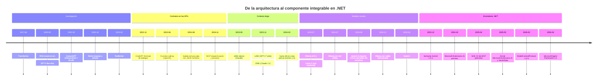

# N1b — «Por qué ahora»: evolución de las capacidades de los LLM que hicieron posible una capa de IA integrable (dossier complementario)

> **Qué es este documento**: material para el jurado de la mesa evaluadora, no texto de la guía. Responde a la propuesta **PR-2** del insumo [I-02](../Mesa/I-02-Insumo-Del-PO-Recorrido-AI-Engineer.md). Cada fecha y cada cifra se verificó el **2026-10-26** contra una fuente primaria (paper en arXiv, anuncio oficial del autor o del fabricante, nuget.org, API de GitHub) o contra evidencia ejecutada (`E1`…`E3`, §8). Los ids de fuente `H01`… están en la §7. Lo que es criterio del investigador se marca **[criterio propio]** y lo que no se pudo verificar, **[no verificado]**.
>
> Niveles de evidencia (contrato `00-Contrato-De-Entrada.md` §3): **E1** ejecutable, **E2** cita literal con ubicación, **E3** contraejemplo, **E4** regla.

## Índice

1. [Relación con el insumo del PO y con los núcleos existentes](#1-relación-con-el-insumo-del-po-y-con-los-núcleos-existentes)
2. [Definiciones con fuente](#2-definiciones-con-fuente)
3. [Desarrollo: la línea de tiempo](#3-desarrollo-la-línea-de-tiempo)
4. [Preguntas guía con respuesta explicativa](#4-preguntas-guía-con-respuesta-explicativa)
5. [Criterios de calidad y antipatrones del tramo](#5-criterios-de-calidad-y-antipatrones-del-tramo)
6. [Recomendación para el jurado](#6-recomendación-para-el-jurado)
7. [Tabla de fuentes](#7-tabla-de-fuentes)
8. [Evidencia ejecutada](#8-evidencia-ejecutada)
9. [Abierto / no verificado](#9-abierto--no-verificado)

---

## 1. Relación con el insumo del PO y con los núcleos existentes

**Origen.** I-02 (L-2) observa que el recorrido de referencia pone un tramo de «evolución de los LLM» antes de los agentes. La presidencia lo tradujo en PR-2: un tramo breve que explique **por qué el tema existe ahora**, con fuente primaria para cada hito y sin cifras de mercado. I-02, I-03 e I-04 son **fuente de forma, no citable**: este dossier no los usa como evidencia, sólo como motivo del despacho.

**Qué ya cubren los núcleos y no se repite acá.**

| Núcleo | Ya tiene | Qué agrega N1b |
|---|---|---|
| N1 | Definiciones de LLM, token, ventana de contexto, salida estructurada, RAG (Lewis et al., `F01`), agente (Anthropic `F02`) | La **fecha** de cada capacidad y el orden en que llegaron; la relación causal entre capacidad y patrón de integración |
| N2 | Estado de los paquetes al 2026-10-25, GA de Agent Framework (2026-04-03, `F11`), soporte de SK (`F12`), deprecaciones | La **historia** de la llegada a .NET: SK 1.0.1 (2023-12), MEAI preview (2024-10) y GA (2025-05), SDK C# de MCP (2025-04) |
| N4 | MCP: versiones del protocolo dentro del SDK (`E03` de N4), patrones de Anthropic | El anuncio original de MCP (2024-11-25) y la primera versión de la especificación (2024-11-05) |
| N3 / I-03 PR-8 | RAG y la propuesta de CAG | El hito de las ventanas largas, que es el argumento de fondo de la discusión CAG frente a RAG |

**Con I-04 (señal de audiencia).** La preocupación dominante es la arquitectura. Por eso el tramo tiene que contar la evolución como **capacidades que cambiaron la forma de integrar** (contratos, herramientas, protocolos), no como una carrera de modelos **[criterio propio]**.

---

## 2. Definiciones con fuente

Formato: qué es, con su fuente; y qué no es, cuando hace falta para no confundir.

| Término | Definición con fuente | Qué no es |
|---|---|---|
| **Transformer** | «a new simple network architecture, the Transformer, based solely on attention mechanisms, dispensing with recurrence and convolutions entirely» (`H01`, resumen) | No es un producto ni un modelo de chat: es la arquitectura sobre la que se construyen los LLM actuales |
| **Aprendizaje *few-shot* (en contexto)** | En GPT-3 las tareas y las demostraciones se especifican «purely via text interaction with the model», «without any gradient updates or fine-tuning» (`H02`, resumen) | No es reentrenamiento: los ejemplos viajan en el prompt de cada llamada |
| **Ajuste por instrucciones con realimentación humana (RLHF)** | Ajustar GPT-3 con demostraciones escritas por etiquetadores y después con «reinforcement learning from human feedback» sobre rankings de salidas. El resultado se llamó InstructGPT (`H03`, resumen) | No garantiza veracidad: el paper dice que InstructGPT «still makes simple mistakes» (`H03`) |
| **RAG** | Modelos que «combine pre-trained parametric and non-parametric memory for language generation» (`H05`). Definición ya adoptada en N1 §2.12 | No es *fine-tuning*. El RAG de las aplicaciones actuales no entrena el recuperador junto con el generador (N1 §2.12, **[criterio propio]** de N1) |
| **ReAct** | Generar «reasoning traces and task-specific actions in an interleaved manner»; las acciones permiten «interface with external sources, such as knowledge bases or environments» (`H06`, resumen) | No es una API: es un patrón de prompting. Las APIs de *function calling* llegaron después |
| **Toolformer** | Un modelo «trained to decide which APIs to call, when to call them, what arguments to pass, and how to best incorporate the results», de forma autosupervisada (`H07`, resumen) | No es lo que usa una app .NET hoy. Es la evidencia de investigación de que un LM puede aprender a decidir el uso de herramientas |
| **Function calling (tool calling)** | «Developers can now describe functions […] and have the model intelligently choose to output a JSON object containing arguments to call those functions» (`H08`, anuncio de OpenAI del 2023-06-13) | El modelo **no ejecuta** la función: propone la llamada y la aplicación la ejecuta. En .NET lo hace `FunctionInvokingChatClient` (N1 §2.13, N2 §4.3) |
| **Salida estructurada con JSON Schema** | «model outputs now reliably adhere to developer-supplied JSON Schemas» (`H09`, 2024-08-06). Se diferencia del *JSON mode* anterior, que «does not guarantee that the model’s response will conform to a particular schema» (`H09`) | No es validación de negocio: el JSON puede respetar el esquema y tener un valor equivocado (N1 §2.7) |
| **Ventana de contexto** | Máximo de tokens que el modelo procesa entre entrada y salida (N1 §2.4, `F04` de N1) | No es memoria persistente (N1 §2.4) |
| **Modelo de pesos abiertos** | Modelo cuyos pesos se publican para ejecutarlo en infraestructura propia, por ejemplo Llama 2, «free for research and commercial use» (`H11`), o Qwen2.5, con la mayoría de sus tamaños bajo Apache 2.0 (`H13`) | No significa «sin restricciones». Las licencias varían por tamaño: Qwen2.5 3B y 72B quedan fuera de Apache 2.0 (`H13`) |
| **Model Context Protocol (MCP)** | «a new standard for connecting AI assistants to the systems where data lives» (`H17`, Anthropic, 2024-11-25) | No reemplaza el *function calling*: lo usa del lado del cliente. MCP estandariza cómo una aplicación **publica** herramientas y recursos para cualquier cliente (N4 §2.14) |

---

## 3. Desarrollo: la línea de tiempo

### 3.1 La tesis del tramo [criterio propio, apoyado en las fuentes de la tabla]

La capa de IA integrable no llegó cuando los modelos se hicieron grandes. Llegó cuando el modelo empezó a ofrecer **contratos que una aplicación puede programar**:

1. **Seguir instrucciones** (2022). El modelo pasa de completar texto a cumplir pedidos. `H03` muestra que el tamaño solo no alcanza: un InstructGPT de 1.3B parámetros fue preferido frente al GPT-3 de 175B.
2. **Proponer acciones con un formato** (2023). El *function calling* convierte la salida del modelo en una invocación con argumentos JSON que la aplicación valida y ejecuta (`H08`).
3. **Responder con un esquema** (2024). La salida estructurada vuelve tipable la respuesta (`H09`). En .NET eso es `GetResponseAsync<T>`.
4. **Traer datos propios** (de 2020 en la investigación a las ventanas largas de 2023-2024). RAG (`H05`) y las ventanas de 100K a 1M tokens (`H10a`–`H10d`) definen cuánto contexto se le puede dar al modelo y a qué costo.
5. **Correr en casa** (2023-2024). Pesos abiertos con licencia comercial (`H11`, `H13`) y un runtime local (`H14`) que suma *tool calling* (`H15`) y salida estructurada (`H16`).
6. **Conectarse por protocolo** (2024-11). MCP separa al que publica herramientas del que las consume (`H17`).
7. **Llegar a .NET como abstracción estándar** (2024-2026). `IChatClient` (MEAI) y después Agent Framework 1.0 hacen que todo lo anterior sea código de aplicación con DI, middleware y pruebas (`H19`–`H23`).

### 3.2 Tabla de hitos

Columna **Peso**: **I** = imprescindible para el lector .NET (cambia cómo escribe o decide la integración); **C** = contexto (explica el origen; se puede nombrar en una línea). La fecha es la de la fuente primaria citada; cuando la fuente es arXiv, es la fecha de la v1 (`E1`).

| # | Fecha | Hito | Qué hizo posible para una aplicación | Fuente | Peso |
|---|---|---|---|---|---|
| 1 | 2017-06-12 | Transformer, «Attention Is All You Need» (Vaswani et al.) | Arquitectura paralelizable que permitió entrenar modelos de lenguaje a gran escala | `H01` (arXiv:1706.03762) | C |
| 2 | 2020-05-22 | RAG (Lewis et al., NeurIPS 2020) | Combinar memoria paramétrica con un índice vectorial externo, con procedencia y conocimiento actualizable | `H05` (arXiv:2005.11401) | I |
| 3 | 2020-05-28 | GPT-3, aprendizaje *few-shot* (Brown et al.) | Resolver tareas nuevas sólo con texto en el prompt, sin reentrenar: nace el «prompt» como interfaz | `H02` (arXiv:2005.14165) | C |
| 4 | 2022-03-04 | InstructGPT: ajuste por instrucciones y RLHF (Ouyang et al.) | Modelos que siguen la intención del usuario; 1.3B preferido sobre 175B | `H03` (arXiv:2203.02155) | C |
| 5 | 2022-10-06 | ReAct (Yao et al., ICLR 2023) | Patrón de razonar y actuar intercalados: el antecedente del bucle de agente | `H06` (arXiv:2210.03629) | C |
| 6 | 2022-11-30 | ChatGPT (OpenAI): formato de diálogo, modelo «sibling» de InstructGPT | La interfaz de chat con roles que hoy modela `ChatMessage`/`ChatRole` | `H04` | C |
| 7 | 2023-02-09 | Toolformer (Schick et al.) | Evidencia de que un LM puede aprender cuándo y cómo llamar APIs | `H07` (arXiv:2302.04761) | C |
| 8 | 2023-05-11 | Claude con 100K tokens de contexto (Anthropic) | Primera ventana de ese orden en un servicio comercial **[no verificado como «primera»]** | `H10a` | C |
| 9 | 2023-06-13 | *Function calling* en la API de OpenAI (gpt-4-0613 y gpt-3.5-turbo-0613), con funciones descritas por JSON Schema. Ese mismo anuncio trae gpt-3.5-turbo-16k, con «4 times the context length» | El modelo propone llamadas con argumentos JSON y la aplicación ejecuta. **Es el hito que convierte al modelo en un componente integrable** | `H08` | **I** |
| 10 | 2023-07-08 | Ollama v0.0.1, «an early preview release» | Runtime local para servir modelos abiertos con una API HTTP | `H14` (API de GitHub, `E3`) | I |
| 11 | 2023-07-18 | Llama 2 (Meta), 7B–70B, «free for research and commercial use» | Primer modelo abierto de un gran laboratorio con licencia de uso comercial **[criterio propio: «primero» no verificado]** | `H11` (anuncio), `H12` (arXiv:2307.09288) | C |
| 12 | 2023-11-06 | GPT-4 Turbo con ventana de 128K (OpenAI DevDay) | Ventanas largas en el modelo de punta de un proveedor gestionado | `H10b` | C |
| 13 | 2023-11-21 | Claude 2.1 con 200K tokens («roughly 150,000 words, or over 500 pages») y *tool use* en beta | Ídem; además, otro proveedor con herramientas | `H10c` | C |
| 14 | 2023-12-19 | Semantic Kernel 1.0.1 para C# (no existe 1.0.0 en nuget.org; 1.0.1 publicado el 2023-12-18 UTC) | Primer SDK estable de Microsoft para orquestar LLM en .NET | `H19`, `E2` | C (hoy se presenta como camino de migración, N2 §5) |
| 15 | 2024-02-15 | Gemini 1.5 Pro: 128K estándar y hasta 1M tokens en vista previa privada | Orden de magnitud nuevo de contexto: abre la discusión «¿hace falta RAG?» | `H10d` | C |
| 16 | 2024-07-25 | Ollama suma *tool calling* («with popular models such as Llama 3.1») | El escenario CTX-LOCAL puede usar herramientas | `H15` | **I** |
| 17 | 2024-08-06 | Salida estructurada con JSON Schema en la API de OpenAI (`strict: true`) | Respuestas que cumplen un esquema: integrable con tipos de C# | `H09` | **I** |
| 18 | 2024-09-19 | Qwen2.5: 0.5B a 72B, hasta 128K de contexto y 8K de generación; Apache 2.0 salvo 3B y 72B | La familia de modelos del laboratorio, con mejoras declaradas en JSON y salidas estructuradas | `H13` (blog); `H13b` (informe técnico, arXiv:2412.15115, 2024-12-19) | I (por ser el modelo de la guía) |
| 19 | 2024-10-08 | `Microsoft.Extensions.AI` preview: «a unifying layer within the .NET ecosystem» | `IChatClient` e `IEmbeddingGenerator` como abstracción común para todos los proveedores | `H20`, `E2` (9.0.0-preview.9.24507.7, mismo día) | **I** |
| 20 | 2024-11-05 / 2024-11-25 | MCP: primera versión de la especificación (2024-11-05) y anuncio público de Anthropic (2024-11-25) | Protocolo abierto entre aplicaciones que publican herramientas y clientes que las usan | `H17`, `H18` | **I** |
| 21 | 2024-12-06 | Ollama suma salida estructurada («constrain a model's output to a specific format») | El escenario ESC-03 (extracción tipada) es viable en local | `H16` | **I** |
| 22 | 2025-04-02 | SDK oficial de C# para MCP (Microsoft con Anthropic), paquete `ModelContextProtocol` | MCP desde .NET: servidor y cliente | `H21`, `E2` (primera preview en NuGet: 2025-03-27; 1.0.0 estable: 2026-02-25) | I |
| 23 | 2025-04-29 | Qwen3: 0.6B a 32B densos y dos MoE, Apache 2.0, con «tool calling» y soporte de MCP declarados | Generación vigente de Qwen. Cuál corre en el servidor Ollama de la LAN lo resuelve la fase A | `H13c` | C (pasa a I si la fase A confirma Qwen3) |
| 24 | 2025-05-21 | GA de las extensiones de IA y de datos vectoriales (`Microsoft.Extensions.AI.Abstractions`, `Microsoft.Extensions.AI`, `Microsoft.Extensions.VectorData.Abstractions`). En NuGet, 9.5.0 estable está fechado el 2025-05-16 y 2025-05-19 | Abstracciones estables: se puede construir producción sobre ellas | `H22`, `E2` | **I** |
| 25 | 2026-04-03 | Microsoft Agent Framework 1.0 para .NET y Python: «stable APIs, and a commitment to long-term support». En NuGet, `Microsoft.Agents.AI` 1.0.0 figura el 2026-04-02 | Agentes y workflows estables sobre MEAI; sucesor de SK y AutoGen | `H23`, `E2` (ya verificado en N2 `F11`/`F15`) | **I** |

**Excluidos a propósito:** las sucesivas generaciones de modelos de punta (GPT-4, Claude 3, Gemini 2, etc.) salvo que traigan una capacidad de integración nueva; los puntajes de benchmarks; los conteos de usuarios y las cifras de mercado. La regla de la §5 explica por qué.

> **2026-10-28 — Parche P-33 (ciclo 1).** Los parámetros de muestreo no son genéricos: el fabricante los recomienda por modelo y por modo. La model card de Qwen/Qwen3.5-4B (consultada el 2026-10-28) da valores distintos para el modo con razonamiento y sin él, y el Modelfile servido trae `temperature 1`, `top_k 20`, `top_p 0.95` y `presence_penalty 1.5` (Sondeo §R.1). La guía fija por configuración el preajuste exacto **«Instruct (or non-thinking) mode for general tasks»: `temperature=0.7, top_p=0.8, top_k=20, min_p=0.0, presence_penalty=1.5, repetition_penalty=1.0`** (https://huggingface.co/Qwen/Qwen3.5-4B, README l. 837, consultado el 2026-10-28T11:43-03:00), y declara que el Modelfile servido trae otro (`temperature 1`, `top_p 0.95`, que coincide con «non-thinking for reasoning tasks»). La card tiene dos preajustes sin razonamiento (ajuste vinculante del juez de evidencia, V9). Si usa T 0, lo declara como decisión propia medida con R-LLM. Si `TopP`, `TopK` y `PresencePenalty` llegan al servidor por OllamaSharp y por `/v1` queda en PC-05. Hasta que se responda, la guía no afirma que llegan. **N1b, fila nueva de la tabla de hitos:** «modelos con modo de razonamiento conmutable: el modo es un parámetro de integración (latencia, tokens de salida, muestreo propio)», con la card como fuente.


### 3.3 Línea de tiempo (mermaid)



**Nota de sintaxis.** El diagrama no se renderizó en esta corrida y la sintaxis `timeline` existe en Mermaid desde la 9.4.0 (2023-02-15, verificado en el paquete npm; la documentación de Mermaid la marca «experimental», aunque aclara que «the syntax is stable except for the icon integration»: https://github.com/mermaid-js/mermaid/blob/develop/docs/syntax/timeline.md). El soporte del renderizador que use la guía queda **[no verificado]**. Si el destino no la soporta, la tabla de la §3.2 es la versión canónica.

### 3.4 Cómo se lee cada carril para la arquitectura de la guía [criterio propio]

| Carril | Qué pieza de la arquitectura de N1 explica | Escenario de N0 |
|---|---|---|
| Contratos en las APIs | Por qué el puerto de Application puede tener firmas tipadas (`GetResponseAsync<T>`) y herramientas que son casos de uso | ESC-03, ESC-04 |
| Contexto largo | Por qué hay que decidir qué entra al contexto (RAG, CAG, reducción de historial) y por qué la ventana es una restricción de diseño y no un detalle | ESC-01, ESC-02 |
| Modelos locales | Por qué CTX-LOCAL es una opción real y por qué las capacidades se verifican **por modelo** | Todos, en CTX-LOCAL |
| MCP | Por qué una aplicación puede **servir** a modelos ajenos además de consumir uno | ESC-05 |
| Ecosistema .NET | Por qué la guía parte de MEAI y Agent Framework y trata a SK como antecedente | Todos |

---

## 4. Preguntas guía con respuesta explicativa

**P1. ¿Qué capacidad cambió el diseño de aplicaciones: el tamaño del modelo o el uso de herramientas?**
El uso de herramientas, junto con los contratos de formato. El tamaño mejoró la calidad, pero `H03` muestra que no alcanza: «Making language models bigger does not inherently make them better at following a user's intent», y un modelo de 1.3B ajustado fue preferido sobre uno de 175B. Lo que permitió **integrar** fue que el modelo devolviera una llamada con argumentos JSON que la aplicación decide si ejecuta (`H08`, 2023-06-13). Desde ahí el modelo es un componente con contrato, y la arquitectura de la guía tiene sentido: el caso de uso sigue en Application y el modelo propone, no ejecuta. **Criterio que forma**: frente a un modelo nuevo, la pregunta útil no es cuántos parámetros tiene sino qué contratos soporta (herramientas, esquema, streaming) y con qué fiabilidad en *mi* proveedor.

**P2. Si el *function calling* existe desde 2023, ¿por qué hizo falta la salida estructurada en 2024?**
Porque resuelven problemas distintos. Con *function calling* el modelo **elige actuar**. La salida estructurada garantiza la **forma de la respuesta** aunque no haya acción. OpenAI lo dice en el anuncio: el JSON mode de 2023 producía JSON válido, pero «does not guarantee that the model’s response will conform to a particular schema» (`H09`). Para ESC-03 (texto libre a `LocalidadModel`) lo que importa es el esquema, no la acción. **Criterio**: aunque el esquema se cumpla, las reglas del dominio (`LocalidadRules`) siguen validando, porque el esquema garantiza la forma y no la verdad (N1 §2.7). Y en CTX-LOCAL hay que verificar el soporte: Ollama lo sumó recién el 2024-12-06 (`H16`).

**P3. Con ventanas de 128K a 1M tokens, ¿sigue haciendo falta RAG?**
Depende del tamaño del corpus, del costo y de la necesidad de citar. Las ventanas largas (`H10b`–`H10d`) permiten meter documentos enteros, que es la idea de CAG (I-03 PR-8). Pero cada token se paga en costo y en latencia en cada llamada (N1 §2.3), y la ventana de un modelo local la acotan el hardware y el modelo: Qwen2.5 declara hasta 128K (`H13`), que no es lo mismo que lo que el servidor configura. RAG además da **procedencia**, que Lewis et al. plantean como problema abierto de la memoria paramétrica: «providing provenance for their decisions and updating their world knowledge remain open research problems» (`H05`). **Criterio**: un corpus chico, estable y sin exigencia de citas puede ir entero en el contexto; un corpus que crece, cambia o exige citar va con recuperación. La decisión se mide, no se supone (N3, dossier de CAG si se convoca).

**P4. ¿Por qué un modelo local es una opción seria hoy y qué no hay que dar por sentado?**
Porque desde 2023 hay modelos de pesos abiertos con licencia comercial (`H11`, `H13`) y un runtime local con API (`H14`) que fue sumando *tool calling* (2024-07-25, `H15`) y salida estructurada (2024-12-06, `H16`). No hay que dar por sentado que **cada modelo** soporte cada capacidad: el anuncio de herramientas de Ollama nombra Llama 3.1, Mistral Nemo, Firefunction v2 y Command-R+, y no nombra Qwen (`H15`). Tampoco que la licencia sea uniforme: dentro de Qwen2.5, las variantes 3B y 72B no son Apache 2.0 (`H13`). **Criterio**: en CTX-LOCAL las capacidades se verifican por modelo y por versión, con una prueba ejecutada (lo que hace el sondeo de la fase A), y la licencia se lee por tamaño.

**P5. ¿Qué resolvió MCP que el *function calling* no resolvía?**
El *function calling* define cómo **un** modelo pide una herramienta a **la** aplicación que lo llama. Cada aplicación declaraba sus herramientas a su manera, y Anthropic describe así el problema: «Every new data source requires its own custom implementation, making truly connected systems difficult to scale» (`H17`). MCP separa los papeles: un servidor publica herramientas y recursos, y cualquier cliente compatible los consume (`H17`, `H18`). Para .NET eso habilita ESC-05: la aplicación de Movilidad Urbana puede exponer consultas a un IDE o a otro agente sin escribir una integración para cada uno. **Criterio**: si las herramientas sólo las usa el propio asistente de la aplicación, alcanza con `AIFunction` en proceso. MCP se justifica cuando hay consumidores externos, y trae su propio control de acceso, que es responsabilidad de ACT-SEC (N4, N5).

**P6. Semantic Kernel llegó a 1.0 en 2023. ¿Por qué la guía parte de Microsoft.Extensions.AI y de Agent Framework?**
Por la cronología del propio Microsoft. SK 1.0.1 salió el 2023-12-19 (`H19`). MEAI apareció en preview el 2024-10-08 como «a unifying layer within the .NET ecosystem» (`H20`) y llegó a GA el 2025-05-21 (`H22`). Agent Framework 1.0, sucesor de SK y AutoGen, salió el 2026-04-03 (`H23`; N2 `F11`, `F12`). Una guía escrita en octubre de 2026 parte de las abstracciones estables vigentes. **Criterio práctico**: la fecha de un tutorial es un dato técnico. Material anterior a mayo de 2025 suele usar APIs preview de MEAI, y material anterior a abril de 2026 suele usar SK o previews de Agent Framework. Hay paquetes de esa época que hoy están deprecados, como `Microsoft.Extensions.AI.Ollama` (N2 §3).

**P7. ¿ReAct es lo mismo que el agente que se arma con Agent Framework?**
Comparten la idea y difieren en el mecanismo. ReAct (2022) intercala razonamiento y acciones **dentro del texto del prompt**, y el programa interpreta ese texto (`H06`). Desde 2023 las APIs devuelven la llamada a la herramienta como **dato estructurado** (`H08`), y en .NET el bucle lo maneja el middleware (`FunctionInvokingChatClient`, N1 §2.13) o el agente de Agent Framework (N4 §2.2). **Criterio**: ReAct explica *por qué* funciona el bucle de agente; no se implementa a mano parseando texto cuando la abstracción ya da las llamadas tipadas.

---

## 5. Criterios de calidad y antipatrones del tramo

### 5.1 Criterios

| Criterio | Cómo se verifica |
|---|---|
| Cada hito tiene **una fuente primaria y una fecha**: paper en arXiv (fecha de la v1), anuncio del autor o fabricante, nuget.org o GitHub | La tabla §3.2 tiene la columna Fuente completa; `E1`–`E3` |
| Se distingue **fecha del anuncio** de **fecha del paquete** cuando difieren (MEAI GA: post 2025-05-21, NuGet 2025-05-16; MAF: post 2026-04-03, NuGet 2026-04-02) | Se nombran las dos, o la del anuncio y la otra en nota |
| Cada hito se justifica por **lo que cambió en la integración**, no por la fama del modelo | Columna «Qué hizo posible» |
| Las cifras que se citan son **del anuncio y se atribuyen** («según el anuncio de…») | Citas de §2 y §3 |
| El tramo es **breve**: una tabla y un diagrama, más un párrafo de tesis | Recomendación de la §6 |

### 5.2 Antipatrones

| Antipatrón | Por qué es un problema | Evidencia |
|---|---|---|
| Contar la historia como **carrera de modelos** (quién tiene más parámetros o mejor puntaje) | Desvía del eje arquitectónico y envejece en meses | `H03`: el tamaño no garantiza seguir intenciones (E2) |
| Usar **cifras de benchmarks del proveedor** como hechos («100 % de fiabilidad») | Son evaluaciones propias, sobre esquemas propios. El anuncio de salida estructurada informa 100 % para gpt-4o-2024-08-06 frente a menos de 40 % para gpt-4-0613 «on our evals» (`H09`) | E2. Si se usa, va atribuido y como ilustración, nunca como garantía |
| Fechar con **la fecha del primer rumor o de la cobertura de prensa** | La fecha del anuncio o del paquete es la verificable | Criterio de las fuentes de §7 |
| Decir «**primero en…**» sin fuente | Es la afirmación más fácil de refutar | §9: «primera ventana de 100K» y «primer modelo abierto con licencia comercial» quedan **[no verificados]**; la guía no los usa |
| Equiparar «el modelo soporta herramientas» con «**mi** modelo en **mi** servidor soporta herramientas» | El soporte es por modelo, versión y runtime | `H15` no nombra Qwen (E3 frente a la generalización) |
| Presentar SK como **punto de partida** en 2026 | Contradice la recomendación vigente de Microsoft | N2 §5 (`F12`) |

---

## 6. Recomendación para el jurado

**Votación sugerida para PR-2: APLICAR con alcance reducido.**

**Qué entra y dónde.**

| Pieza | Ubicación en la guía | Extensión |
|---|---|---|
| Párrafo de tesis (§3.1, reescrito): de la arquitectura al componente con contrato | Apertura de la sección de fundamentos (N1), **después** de los objetivos de aprendizaje (PR-14) y **antes** de las definiciones | 1 párrafo |
| Tabla de hitos **imprescindibles** (filas I de la §3.2: 2, 9, 10, 16, 17, 18, 19, 20, 21, 22, 24, 25), con fecha, qué hizo posible y fuente | Misma subsección | unas 12 filas |
| Línea de tiempo mermaid (§3.3), con los hitos de contexto en el carril «Investigación» | Misma subsección | 1 diagrama |
| Hitos de contexto (filas C) | **Una sola línea** que los nombre con su fuente, o el carril del diagrama; no se desarrollan | 1–2 líneas |
| P1 (¿tamaño o herramientas?) y P6 (¿por qué MEAI y no SK?) | Preguntas guía de la subsección | 2 preguntas |
| P2, P3, P4, P5, P7 | En sus secciones naturales: P2 en salida estructurada (N2), P3 en estrategias de conocimiento (N3 y CAG), P4 en CTX-LOCAL (N2), P5 en MCP (N4), P7 en agentes (N4) | Se reparten, no se concentran |
| Regla «la fecha de un tutorial es un dato técnico» | Criterios de calidad de N2 o anexo de verificación para ACT-DEV | 1 ítem |

**Qué queda fuera, con motivo.**

| Fuera | Motivo |
|---|---|
| Cifras de mercado, adopción, usuarios o inversión | Restricción de PR-2 y del contrato (R-EVID): no hay fuente primaria verificable que importe para la arquitectura |
| Puntajes de benchmarks (BLEU de `H01`, porcentajes de `H09`, comparaciones de `H13`) | Son evaluaciones de los autores; no forman criterio de integración y envejecen. Excepción posible: el 1.3B frente a 175B de `H03`, porque sostiene P1 |
| Generaciones de modelos de punta sin capacidad de integración nueva | Antipatrón «carrera de modelos» (§5.2) |
| Scaling laws, chain-of-thought y modelos de razonamiento | No cambian el contrato de integración del lado .NET. Si la mesa los quiere, se pide un despacho aparte **[criterio propio]** |
| Afirmaciones de «primero en…» | No verificadas (§9) |
| Equivalencias tokens–páginas («~20 pages», «over 500 pages») | Son estimaciones de cada proveedor con distintos tokenizadores. La guía ya explica tokens en N1 §2.3 |

**Dependencias para la integración.**

- Si la fase A confirma que el servidor Ollama de la LAN corre **Qwen3**, la fila 23 pasa a imprescindible y la 18 a contexto.
- Si el jurado aprueba PR-8 (CAG), P3 se escribe junto con el dossier de CAG para no duplicarla.
- La fila 20 (MCP) tiene que coincidir con lo que diga N4 sobre las versiones del protocolo; las fechas de `H18` y de N4 `E03` coinciden (2024-11-05 es la primera versión).

---

## 7. Tabla de fuentes

Fecha de consulta de todas: **2026-10-26**.

| Id | Fuente (URL) | Qué respalda |
|---|---|---|
| H01 | Vaswani et al., *Attention Is All You Need* — https://arxiv.org/abs/1706.03762 (v1 2017-06-12) | Transformer; cita del resumen |
| H02 | Brown et al., *Language Models are Few-Shot Learners* — https://arxiv.org/abs/2005.14165 (v1 2020-05-28) | GPT-3, 175B, *few-shot* sin actualización de gradientes |
| H03 | Ouyang et al., *Training language models to follow instructions with human feedback* — https://arxiv.org/abs/2203.02155 (v1 2022-03-04) | InstructGPT, RLHF, 1.3B preferido sobre 175B, «bigger does not inherently make them better» |
| H04 | OpenAI, *ChatGPT: Optimizing Language Models for Dialogue* (2022-11-30) — https://openai.com/blog/chatgpt/ (leído por instantánea de la Wayback Machine del 2022-12; el sitio devuelve HTTP 403 a clientes automáticos) | ChatGPT, formato de diálogo, «sibling model to InstructGPT» |
| H05 | Lewis et al., *Retrieval-Augmented Generation for Knowledge-Intensive NLP Tasks* (NeurIPS 2020) — https://arxiv.org/abs/2005.11401 (v1 2020-05-22) | RAG; procedencia como problema abierto (= N1 `F01`) |
| H06 | Yao et al., *ReAct: Synergizing Reasoning and Acting in Language Models* (ICLR 2023) — https://arxiv.org/abs/2210.03629 (v1 2022-10-06) | Razonar y actuar intercalados |
| H07 | Schick et al., *Toolformer: Language Models Can Teach Themselves to Use Tools* — https://arxiv.org/abs/2302.04761 (v1 2023-02-09) | Uso de herramientas aprendido de forma autosupervisada |
| H08 | OpenAI, *Function calling and other API updates* (2023-06-13; autores Eleti, Harris, Kilpatrick) — https://openai.com/index/function-calling-and-other-api-updates/ (leído por Wayback, instantánea 2023-07; HTTP 403 directo) | *Function calling*, parámetros `functions`/`function_call`, JSON Schema, gpt-3.5-turbo-16k |
| H09 | OpenAI, *Introducing Structured Outputs in the API* (2024-08-06) — https://openai.com/index/introducing-structured-outputs-in-the-api/ (leído por Wayback, instantánea `20240806180746`; HTTP 403 directo) | Salida estructurada, `strict: true`, diferencia con JSON mode, cifras de la evaluación propia |
| H10a | Anthropic, *Introducing 100K Context Windows* (2023-05-11) — https://www.anthropic.com/news/100k-context-windows | «We’ve expanded Claude’s context window from 9K to 100K tokens, corresponding to around 75,000 words» |
| H10b | OpenAI, *New models and developer products announced at DevDay* (2023-11-06) — https://openai.com/blog/new-models-and-developer-products-announced-at-devday (Wayback 2023-12) | GPT-4 Turbo, 128K; Assistants API |
| H10c | Anthropic, *Introducing Claude 2.1* (2023-11-21) — https://www.anthropic.com/news/claude-2-1 | 200K tokens; *tool use* en beta |
| H10d | Google, *Our next-generation model: Gemini 1.5* (2024-02-15) — https://blog.google/technology/ai/google-gemini-next-generation-model-february-2024/ | 128K estándar; hasta 1M en vista previa privada |
| H11 | Meta, *Meta and Microsoft Introduce the Next Generation of Llama* (2023-07-18) — https://about.fb.com/news/2023/07/llama-2/ | «free for research and commercial use» |
| H12 | Touvron et al., *Llama 2: Open Foundation and Fine-Tuned Chat Models* — https://arxiv.org/abs/2307.09288 (v1 2023-07-18) | Tamaños 7B–70B; Llama 2-Chat |
| H13 | Qwen Team, *Qwen2.5: A Party of Foundation Models!* (2024-09-19) — https://qwenlm.github.io/blog/qwen2.5/ | Tamaños, licencia por tamaño, 128K/8K, mejoras en JSON |
| H13b | Qwen Team, *Qwen2.5 Technical Report* — https://arxiv.org/abs/2412.15115 (v1 2024-12-19) | 18 billones de tokens de preentrenamiento; variantes de pesos abiertos |
| H13c | Qwen Team, *Qwen3: Think Deeper, Act Faster* (2025-04-29) — https://qwenlm.github.io/blog/qwen3/ | Tamaños, Apache 2.0, «excels in tool calling», soporte de MCP |
| H14 | GitHub, `ollama/ollama` release `v0.0.1` — https://github.com/ollama/ollama/releases/tag/v0.0.1 (API: publicado 2023-07-08T17:25:48Z; repo creado 2023-06-26) | Primera versión de Ollama |
| H15 | Ollama, *Tool support* (2024-07-25) — https://ollama.com/blog/tool-support | *Tool calling* en Ollama; modelos nombrados |
| H16 | Ollama, *Structured outputs* (2024-12-06) — https://ollama.com/blog/structured-outputs | Salida restringida a un esquema JSON |
| H17 | Anthropic, *Introducing the Model Context Protocol* (2024-11-25) — https://www.anthropic.com/news/model-context-protocol | Definición y problema que resuelve MCP |
| H18 | GitHub, `modelcontextprotocol/modelcontextprotocol`, carpeta `schema/` — https://github.com/modelcontextprotocol/modelcontextprotocol/tree/main/schema | Versiones de la especificación: 2024-11-05, 2025-03-26, 2025-06-18, 2025-11-25, 2026-07-28 (coincide con N4 `E03`) |
| H19 | Microsoft DevBlogs (Semantic Kernel), *Say hello to Semantic Kernel V1.0.1* (2023-12-19, M. Bolanos) — https://devblogs.microsoft.com/semantic-kernel/semantic-kernel-v1-0-1-has-arrived-to-help-you-build-agents/ | SK 1.0.1 para C#, paquetes estables |
| H20 | Microsoft DevBlogs (.NET), *Introducing Microsoft.Extensions.AI Preview – Unified AI Building Blocks for .NET* (2024-10-08, L. Quintanilla) — https://devblogs.microsoft.com/dotnet/introducing-microsoft-extensions-ai-preview/ | MEAI preview, «unifying layer» |
| H21 | Microsoft Developer Blog, *Microsoft partners with Anthropic to create official C# SDK for Model Context Protocol* (2025-04-02) — https://developer.microsoft.com/blog/microsoft-partners-with-anthropic-to-create-official-c-sdk-for-model-context-protocol/ | SDK C# de MCP, paquete `ModelContextProtocol` |
| H22 | Microsoft DevBlogs (.NET), *AI and Vector Data Extensions are now Generally Available (GA)* (2025-05-21) — https://devblogs.microsoft.com/dotnet/ai-vector-data-dotnet-extensions-ga/ | GA de MEAI.Abstractions, MEAI y VectorData.Abstractions |
| H23 | Microsoft DevBlogs (Agent Framework), *Microsoft Agent Framework Version 1.0* (2026-04-03) — https://devblogs.microsoft.com/agent-framework/microsoft-agent-framework-version-1-0/ | MAF 1.0, APIs estables, soporte de largo plazo (= N2 `F11`) |
| H24 | nuget.org, API de registro — `https://api.nuget.org/v3/registration5-gz-semver2/{id}/index.json` | Fechas de primeras versiones y de la primera estable (`E2`) |
| H25 | arXiv, API de exportación — `https://export.arxiv.org/api/query?id_list={id}` | Fechas de v1 y resúmenes (`E1`) |

---

## 8. Evidencia ejecutada

Archivos en [`N1b-Evidencia/`](N1b-Evidencia/). Los intermedios de las descargas quedaron en `{dir-de-trabajo}/n1b/`.

**E1 — Fechas de v1 y resúmenes en arXiv** (`E1-arxiv-fechas.txt`)

```bash
curl -sL "https://export.arxiv.org/api/query?id_list=<id>"   # para cada id; se extrae <published> y <title>
```
```
1706.03762 | 2017-06-12T17:57:34Z | Attention Is All You Need
2005.11401 | 2020-05-22T21:34:34Z | Retrieval-Augmented Generation for Knowledge-Intensive NLP Tasks
2005.14165 | 2020-05-28T17:29:03Z | Language Models are Few-Shot Learners
2203.02155 | 2022-03-04T07:04:42Z | Training language models to follow instructions with human feedback
2210.03629 | 2022-10-06T01:00:32Z | ReAct: Synergizing Reasoning and Acting in Language Models
2302.04761 | 2023-02-09T16:49:57Z | Toolformer: Language Models Can Teach Themselves to Use Tools
2307.09288 | 2023-07-18T14:31:57Z | Llama 2: Open Foundation and Fine-Tuned Chat Models
2412.15115 | 2024-12-19T17:56:09Z | Qwen2.5 Technical Report
```
Las citas de los resúmenes de la §2 salen de la etiqueta `<summary>` de estas mismas respuestas. Comentarios de arXiv: 2005.11401 «Accepted at NeurIPS 2020»; 2210.03629 «v3 is the ICLR camera ready version».

**E2 — Hitos de .NET en nuget.org** (`E2-nuget-hitos.py`, `E2-nuget-hitos.txt`)

```bash
python3 -I E2-nuget-hitos.py Microsoft.Extensions.AI Microsoft.Extensions.AI.Abstractions Microsoft.SemanticKernel \
  Microsoft.Agents.AI ModelContextProtocol OllamaSharp Microsoft.Extensions.VectorData.Abstractions
```
```
Microsoft.Extensions.AI | primeras: 9.0.0-preview.9.24507.7 2024-10-08T15:05 … | primera estable: 9.5.0 2025-05-16T01:29 | última: 10.11.0 2026-10-14
Microsoft.SemanticKernel | … 0.8.11.1-preview 2023-03-01 … | primera estable: 1.0.1 2023-12-18T22:08 | última: 1.81.0 2026-10-06
Microsoft.Agents.AI | 1.0.0-preview.251001.1 2025-10-01 … | primera estable: 1.0.0 2026-04-02T16:40 | última: 1.26.0 2026-10-23
ModelContextProtocol | 0.1.0-preview.2 2025-03-27 … | primera estable: 1.0.0 2026-02-25T01:28 | última: 2.3.0 2026-10-20
OllamaSharp | 1.0.0 2023-10-16 | … | última: 5.5.0 2026-09-30
Microsoft.Extensions.VectorData.Abstractions | 9.0.0-preview.1.24515.1 2024-10-17 | primera estable: 9.5.0 2025-05-19T17:20
```
Comprobación complementaria: la lista de versiones de `Microsoft.SemanticKernel` que empiezan con `1.0` es `1.0.0-beta1…beta8, 1.0.0-rc1…rc4, 1.0.1`. **No existe un 1.0.0 estable** (E3 frente a «Semantic Kernel 1.0»: lo correcto es «1.0.1»).

**E3 — GitHub** (API pública)

```bash
curl -s https://api.github.com/repos/ollama/ollama/releases/tags/v0.0.1
curl -s https://api.github.com/repos/modelcontextprotocol/modelcontextprotocol/contents/schema
```
```
v0.0.1 2023-07-08T17:25:48Z … "This is an early preview release of Ollama"
['2024-11-05', '2025-03-26', '2025-06-18', '2025-11-25', '2026-07-28', 'draft']
```

**Lectura de los anuncios de OpenAI.** openai.com devuelve HTTP 403 a WebFetch y a curl. Los textos de `H04`, `H08`, `H09` y `H10b` se leyeron con curl desde instantáneas de la Wayback Machine (CDX: la primera instantánea de `H09` es `20240806180746`, del mismo día del anuncio). Extracto literal de `H08`: «June 13, 2023 Authors Atty Eleti Jeff Harris Logan Kilpatrick […] Developers can now describe functions to gpt-4-0613 and gpt-3.5-turbo-0613, and have the model intelligently choose to output a JSON object containing arguments to call those functions».

No hubo pruebas contra el modelo (R-LLM no aplica: este dossier no afirma comportamiento de Qwen).

---

## 9. Abierto / no verificado

1. **`H10a` (Claude 100K, 2023-05-11)**: verificado al cierre de la corrida (título «Introducing 100K context windows», 2023-05-11, de 9K a 100K tokens). Queda abierto sólo el «primero» del punto 2.
2. **«Primero en…»**: no se verificó que Claude 100K haya sido la primera ventana de ese orden en un servicio comercial, ni que Llama 2 haya sido el primer modelo abierto de un gran laboratorio con licencia comercial. La guía no debe afirmarlo.
3. **Soporte de Qwen en Ollama para herramientas y salida estructurada**: `H15` no nombra a Qwen. Que Qwen2.5 o Qwen3 funcionen con *tool calling* y JSON Schema en el servidor Ollama de la LAN lo resuelve el sondeo de la fase A (R-LLM), no este dossier.
4. **Fecha de GA de MEAI**: anuncio 2025-05-21 frente a NuGet 9.5.0 del 2025-05-16 (Abstractions y MEAI) y 2025-05-19 (VectorData). La guía puede usar «mayo de 2025» o la fecha del anuncio con nota.
5. **Preview 1 de `ModelContextProtocol`** (`0.1.0-preview.1.25171.12`): nuget.org la fecha como 1900-01-01 (versión deslistada o sin fecha). La primera fecha válida es 2025-03-27 (preview.2).
6. **Renderizado de `timeline` en mermaid**: no se probó con el renderizador del destino de la guía.
7. **Licencia de Llama 2**: «free for research and commercial use» es la frase del anuncio (`H11`). La licencia tiene condiciones propias que no se leyeron. Si la guía la nombra, no debe llamarla «open source» sin matiz.
8. **Fuera de este dossier**: cronología de los modelos de razonamiento (2024-2025) y de los agentes de uso de computadora. No se investigaron porque no cambian el contrato de integración del lado .NET **[criterio propio]**; si el jurado los quiere, hace falta un despacho aparte.

---

## Verificación adversarial

Verificador adversarial, 2026-10-26. Todo se contrastó de forma independiente contra la fuente primaria. Las mediciones `E1`–`E3` se volvieron a ejecutar desde cero, con descargas propias en `{dir-de-trabajo}/n1b-verif/`, sin reutilizar los intermedios de la corrida original. Las páginas de OpenAI devuelven HTTP 403 también a este verificador, así que se leyeron por la Wayback Machine. La CDX confirma instantáneas del mismo día de cada anuncio: `H04` 20221130, `H08` 20230613, `H09` 20240806180746 y `H10b` 20231106.

**Correcciones hechas en el lugar**

1. **Cita de `H09` mal transcripta** (§2, fila «Salida estructurada», y §4 P2). Decía «does not guarantee that the model's response conforms to a particular schema». El texto literal es «does not guarantee that the model’s response **will conform** to a particular schema». Se corrigió en los dos lugares.
2. **Mermaid `timeline`** (§3.3). Decía «desde la 9.x **[no verificado]**». La verificación da que los tipos `timeline/` aparecen por primera vez en el paquete npm `mermaid@9.4.0`, publicado el 2023-02-15, y que no están en la 9.3.0. Lo que sigue sin probar es el renderizador de la guía.
3. **Título de `H20`** (§7). Estaba abreviado. El título completo es «Introducing Microsoft.Extensions.AI Preview – Unified AI Building Blocks for .NET».

**Revisión de IPs y hosts.** Se buscaron IPs privadas (10/8, 172.16/12, 192.168/16), `.lan`, `.local` y nombres de hosts del entorno. Sólo hubo falsos positivos con números de versión (`10.11.0`). El servidor se nombra siempre «servidor Ollama de la LAN». No hay credenciales.

| Afirmación | Veredicto | Evidencia |
|---|---|---|
| Fechas v1 de arXiv: 1706.03762 2017-06-12, 2005.11401 2020-05-22, 2005.14165 2020-05-28, 2203.02155 2022-03-04, 2210.03629 2022-10-06, 2302.04761 2023-02-09, 2307.09288 2023-07-18, 2412.15115 2024-12-19, con sus títulos y primeros autores | Confirmada | E1, re-ejecutado: `<published>`, `<title>` y `<name>` de export.arxiv.org |
| Citas del resumen: `H01`, `H02` (las dos frases), `H03` («reinforcement learning from human feedback», «still makes simple mistakes», «Making language models bigger…», 1.3B frente a 175B), `H05` (las dos), `H06` (las dos), `H07` | Confirmadas literalmente | Coincidencia exacta de subcadena en `<summary>` (E1) |
| RAG: «NeurIPS 2020»; ReAct: «ICLR 2023» | Confirmadas | Comentarios de arXiv: «Accepted at NeurIPS 2020» y «v3 is the ICLR camera ready version» |
| RAG con «índice vectorial externo» | Confirmada | Resumen de `H05`: «dense vector index of Wikipedia» |
| Llama 2: 7B a 70B, Llama 2-Chat | Confirmada | Resumen de `H12`: «7 billion to 70 billion parameters» |
| Qwen2.5: 18 billones de tokens | Confirmada | Resumen de `H13b`: «18 trillion» (escala corta en inglés, 18 billones en español) |
| `H04` ChatGPT 2022-11-30, «sibling model to InstructGPT», título | Confirmada | Wayback 20230101 (`id_`) |
| `H08` 2023-06-13; autores Eleti, Harris y Kilpatrick; gpt-4-0613 y gpt-3.5-turbo-0613; cita «intelligently choose to output a JSON object…»; `functions`/`function_call` vía JSON Schema; gpt-3.5-turbo-16k con «4 times the context length» | Confirmada | Wayback 20231223 |
| `H09` 2024-08-06; «reliably adhere to developer-supplied JSON Schemas»; `strict: true`; 100 % frente a «less than 40%» «on our evals» | Confirmada | Wayback 20240806180746 |
| `H09` «does not guarantee that the model's response conforms…» | **Refutada como cita literal; corregida** | El texto dice «will conform» |
| `H10a` 2023-05-11, de 9K a 100K, «around 75,000 words» | Confirmada | anthropic.com/news/100k-context-windows («Published May 11, 2023») |
| `H10b` 2023-11-06, GPT-4 Turbo 128K, Assistants API | Confirmada | Wayback 20231231 |
| `H10c` 2023-11-21, 200K, «roughly 150,000 words, or over 500 pages», *tool use* en beta | Confirmada | anthropic.com/news/claude-2-1 («our new beta feature: tool use») |
| `H10d` 2024-02-15, 128.000 estándar, hasta 1M en «private preview» | Confirmada | blog.google («Feb 15, 2024») |
| `H11` 2023-07-18, título, «free for research and commercial use» | Confirmada | about.fb.com |
| `H13` 2024-09-19; 0.5B a 72B; 128K/8K; Apache 2.0 «except for the 3B and 72B variants»; mejoras en JSON | Confirmada | qwenlm.github.io/blog/qwen2.5; Hugging Face: Qwen2.5-3B/72B-Instruct `license:other`, 7B `apache-2.0` |
| `H13c` 2025-04-29; 0.6B a 32B densos y dos MoE (235B-A22B y 30B-A3B), Apache 2.0, «excels in tool calling», MCP | Confirmada | qwenlm.github.io/blog/qwen3; Hugging Face: los dos MoE `apache-2.0` |
| `H14` Ollama v0.0.1 2023-07-08T17:25:48Z, «early preview release»; repositorio creado 2023-06-26 | Confirmada | E3, re-ejecutado (API de GitHub) |
| `H15` 2024-07-25; Llama 3.1, Mistral Nemo, Firefunction v2, Command-R+; no nombra Qwen | Confirmada | ollama.com/blog/tool-support (0 apariciones de «Qwen») |
| `H16` 2024-12-06, «constrain a model’s output to a specific format» | Confirmada | ollama.com/blog/structured-outputs |
| `H17` 2024-11-25, «a new standard for connecting…», «Every new data source requires its own custom implementation…» | Confirmada | anthropic.com/news/model-context-protocol |
| `H18` versiones 2024-11-05, 2025-03-26, 2025-06-18, 2025-11-25, 2026-07-28 y `draft` | Confirmada | E3, re-ejecutado (API de GitHub, `schema/`) |
| `H19` 2023-12-19, M. Bolanos, «V1.0.1» | Confirmada | devblogs («December 19th, 2023», Matthew Bolanos) |
| `H20` 2024-10-08, L. Quintanilla, «a unifying layer within the .NET ecosystem» | Confirmada; título completado | devblogs («October 8th, 2024») |
| `H21` 2025-04-02, Microsoft con Anthropic, paquete `ModelContextProtocol` | Confirmada | developer.microsoft.com («April 2nd, 2025»; `dotnet add package ModelContextProtocol --prerelease`) |
| `H22` 2025-05-21, GA de MEAI.Abstractions, MEAI y VectorData.Abstractions | Confirmada | devblogs («May 21st, 2025») |
| `H23` 2026-04-03, .NET y Python, «stable APIs, and a commitment to long-term support», SK y AutoGen | Confirmada | devblogs («April 3rd, 2026») |
| NuGet: MEAI y Abstractions preview 9.0.0-preview.9.24507.7 del 2024-10-08 y 9.5.0 del 2025-05-16; VectorData 9.0.0-preview.1.24515.1 del 2024-10-17 y 9.5.0 del 2025-05-19; SK 1.0.1 del 2023-12-18T22:08Z, sin 1.0.0 estable; Agents.AI 1.0.0 del 2026-04-02; MCP preview.2 del 2025-03-27 y 1.0.0 del 2026-02-25; OllamaSharp 1.0.0 del 2023-10-16; últimas 10.11.0, 1.81.0, 1.26.0, 2.3.0 y 5.5.0 | Confirmada | E2, re-ejecutado con un script propio. Nota: en el orden de registro, `Microsoft.Agents.AI` lista primero `0.0.1-preview.260417.2`, del 2026-04-17. Por fecha, la primera es `1.0.0-preview.251001.1`, como dice el dossier |
| `ModelContextProtocol` 0.1.0-preview.1.25171.12 con fecha 1900-01-01 | Confirmada: está deslistada (`listed: false`) | E2, re-ejecutado |
| `Microsoft.Extensions.AI.Ollama` deprecado | Confirmada | E2, re-ejecutado: `deprecation` en todas las versiones; la última es 9.7.0-preview.1.25356.2 |
| openai.com devuelve HTTP 403 a clientes automáticos | Confirmada | `curl` directo → 403 |
| Referencias cruzadas (N1 §2.3, §2.4, §2.7, §2.12 y §2.13; N2 §3, §4.3 y §5/P8 con `F12`; N4 §2.2, §2.14 y `E03`) | Confirmadas | Encabezados y contenido de los dossiers N1, N2 y N4 |
| «Primera ventana de 100K» y «primer modelo abierto con licencia comercial» | No verificadas (ya estaban marcadas así) | No se buscó una fuente que pruebe el «primero» |
| La licencia de Llama 2 tiene condiciones propias | No verificada (ya estaba marcada así) | No se leyó el texto de la licencia |


---

## 2026-10-28 — Nota de reanudación (caída de equipo anterior)

> Nota agregada en la reanudación desde estación 1 (`Reanudar.md` §4.1, tercer punto). No se modificó nada de lo anterior. Convención de nombres desde hoy: el servidor medido hasta el 2026-10-26 es **el servidor Ollama de la LAN del laboratorio (dado de baja el 2026-10-28)**; el que lo reemplaza es **el Ollama propio en contenedor (estación 1)**, que se usa sólo por `OLLAMA_ENDPOINT` (R-PRIV).

**Qué se perdió.** equipo anterior murió el 2026-10-28 a las 00:50. Lo que se trabajó ahí el 26 y el 27 se perdió, incluidos los intermedios que cita la §8 (descargas de la corrida original y de la verificación adversarial). **No se reconstruye de memoria**: este dossier vale tal como quedó escrito el 2026-10-26. Los archivos de `N1b-Evidencia/` (`E1-arxiv-fechas.txt`, `E2-nuget-hitos.py`, `E2-nuget-hitos.txt`) sobrevivieron; `E3` (API de GitHub) quedó sólo transcripto en la §8, sin archivo, y se puede volver a correr porque no depende del servidor de IA.

**Alcance de las mediciones.** Este dossier no hizo pruebas contra el modelo (§8: «R-LLM no aplica»); sus `E1`–`E3` son contra arXiv, nuget.org y GitHub y siguen valiendo. Lo que sí dependía del servidor dado de baja son las **remisiones** a «la fase A» y al modelo que corría en la LAN. Las mediciones de esa fase (`Sondeo-Entorno.md`) valen **como historia del servidor dado de baja**, no como estado del entorno vigente.

**Clasificación de lo abierto y de lo que remite al servidor.**

| # | Ítem (ubicación) | Clase | Por qué | Cómo se re-verifica |
|---|---|---|---|---|
| §9.1 | `H10a`: sólo queda abierto el «primero» | (b) sigue abierto | Fuente web; no toca el servidor | — |
| §9.2 | «Primero en…» (Claude 100K, Llama 2) | (b) sigue abierto | Ídem; la guía no lo afirma | — |
| §9.3 | Soporte de Qwen para *tool calling* y JSON Schema «en el servidor Ollama de la LAN» | **(a) pendiente de re-verificación contra el Ollama propio de estación 1** | Era una medición contra el modelo del servidor dado de baja. El sondeo de la fase A la había respondido parcialmente ahí (tools con `finish=tool_calls` en `qwen2.5:7b-instruct` y `qwen3.5:4b`, una corrida cada uno): eso queda como historia | Bajar el modelo que fije la mesa (hoy hay `qwen2.5:0.5b` y `qwen3-embedding:0.6b`; `Reanudar.md` §3 propone `qwen3.5:4b`); `api/show` → `capabilities`; tools con `UseFunctionInvocation()` y una herramienta de Movilidad Urbana; JSON con `GetResponseAsync<T>` sobre un tipo de Movilidad Urbana; N corridas con tasa de éxito, todo por `<envoltorio-de-turnos> <recurso-compartido>` (R-LLM) |
| §9.4 | Fecha de GA de MEAI (anuncio frente a NuGet) | (b) sigue abierto | Es una decisión de redacción | — |
| §9.5 | Preview 1 de `ModelContextProtocol` deslistada | (b) sigue abierto | nuget.org | — |
| §9.6 | Renderizado de `timeline` de mermaid | (b) sigue abierto | Depende del renderizador de la guía | — |
| §9.7 | Condiciones de la licencia de Llama 2 | (b) sigue abierto | Fuente web | — |
| §9.8 | Modelos de razonamiento fuera del dossier | (b) sigue abierto | Criterio del investigador; ver la tensión con el sondeo más abajo | — |
| §3.2 fila 23 y §6 «Dependencias» | «Cuál corre en el servidor Ollama de la LAN lo resuelve la fase A»; Qwen3 pasa a I si la fase A lo confirma | **(a) pendiente de re-verificación** | El peso de las filas 18 y 23 dependía del modelo del servidor dado de baja | `api/tags` del Ollama propio de estación 1 una vez que la mesa fije el modelo; con eso se recalcula qué fila de Qwen es I |
| §3.2 fila 18 | Qwen2.5 «I (por ser el modelo de la guía)» | **(a) pendiente de re-verificación** | Supone el modelo de la guía, que hoy no está decidido para el entorno nuevo | Ídem fila 23 |
| §4 P3 | «Qwen2.5 declara hasta 128K… no es lo mismo que lo que el servidor configura» | **(a) pendiente de re-verificación** (la parte del servidor) | La cifra de `H13` es de la fuente y sigue; la ventana efectiva es del servidor | `api/show` (`model_info.*.context_length`) y `api/ps` (`context_length` cargado) del modelo elegido en estación 1 |
| §4 P4 | «con una prueba ejecutada (lo que hace el sondeo de la fase A)» | **(a) pendiente de re-verificación** | Remite al sondeo del servidor dado de baja | El sondeo corto contra el Ollama propio de estación 1 (`Reanudar.md` §4.1, segundo punto) |
| §8 `E1`–`E3` | Fechas de arXiv, NuGet y GitHub | (b) vigente | No dependen del servidor de IA | Si hace falta, re-ejecutar `E2-nuget-hitos.py` y los `curl` de `E3` |

**Observaciones para la fase de integración** (no se corrigen acá):

- La §9.3 y la §6 siguen esperando «la fase A», pero el sondeo de la LAN ya había registrado que el modelo residente era `qwen3.5:4b`, que no figura en la línea de tiempo (la tabla llega hasta Qwen3, fila 23).
- Los dossiers N1, N2, N4 y N5 usan `qwen3` o `qwen3:4b` como modelo por defecto en sus snippets, N3b midió con `qwen3.5:4b` y `qwen2.5:0.5b`, y este dossier pone a Qwen2.5 como «el modelo de la guía». La integración tiene que fijar un solo modelo para el entorno nuevo y alinear las filas 18 y 23.
- La §6 deja afuera los modelos de razonamiento porque «no cambian el contrato de integración» [criterio propio]. El sondeo de la LAN registró que `qwen3.5:4b` razona por defecto y, con un presupuesto chico, devuelve `content` vacío con `finish=length` hasta que se apaga el razonamiento. Si el modelo de la guía es de esa familia, ese criterio hay que revisarlo con una medición en estación 1.

## 2026-10-28 — Reparación de integración (BIT-16-04)

> Nota agregada en la fase de integración ([`../04-Integracion.md`](../04-Integracion.md)). **Sólo agregado**: no se modificó nada de lo anterior. Los IDs entre paréntesis (RA-*, T*, C-*, R-C*, I-*, MI-*) remiten a las resoluciones de BIT-16-04; la evidencia nueva está en `../Integracion-Evidencia/`. Lo marcado MI-nn es criterio propio que vota la mesa en el ciclo 1.

- **§4 P3, CAG** (RA-9 a). Rige la definición de N3b (paper G1): CAG es **reutilizar el cálculo** del corpus (caché KV o de prefijo); meter documentos enteros en una ventana larga es aprendizaje en contexto. P3 pasa a decir «contexto largo (y, si se reutiliza su cálculo, CAG)».
- **§4 P3, ventanas** (RA-9 b). Se usan tres: declarada por el proveedor, nativa del modelo y configurada por el servidor. Dato del sondeo nuevo: `qwen3.5:4b` declara 262144 nativo y **se carga con 4096** en estación 1 (`api/ps`, Sondeo §R.0); con prompts mayores, Ollama 0.40.11 trunca en silencio (X3).
- **§6 «Qué queda fuera» y §9.8** (RA-9 c, T4). Los modelos de razonamiento **sí** tocan el contrato de integración: con el razonamiento encendido, `qwen3.5:4b` tardó 4–5 veces más en tool calling (19–26 s frente a ~4,7 s, Sondeo §R.4), y el sondeo viejo vio `content` vacío con `finish=length`. Palancas en .NET: `ChatOptions.Reasoning` (`ReasoningEffort.None…ExtraHigh`, EA-4), que OllamaSharp 5.5.0 traduce a `think:false` y el adaptador OpenAI a `reasoning_effort:"none"` (E-B2b), y la vía específica `RawRepresentationFactory` → `ChatRequest.Think` (EA-4, EA-6). Entran como parámetro de integración (una fila o una nota), no como historia de modelos.
- **§3.2 filas 18 y 23 y §6 Dependencias** (RA-9 d, T4). «Qwen2.5 es el modelo de la guía» queda pendiente de la decisión de la mesa (MI-02). La propuesta de la integración es `qwen3.5:4b` (familia Qwen3.5, híbrido con razonamiento) con el razonamiento apagado; si la mesa la ratifica, las filas se recalculan.

> **2026-10-28 — Ciclo 1 de la mesa: convención de ids en estas notas.** «Parche P-nn (ciclo 1)» es un parche de `Mesa/Ciclo-1/03-Parches.md`, aplicado según `Mesa/Ciclo-1/05-Aplicacion.md`; «P-nn» sin calificar dentro de un texto de parche también es un parche. Los pendientes de BIT-16-04 §7 se citan como «pendiente P-nn de BIT-16-04». El plan vinculante de redacción es `Mesa/Ciclo-1/06-Plan-De-Redaccion.md`.

> **2026-10-28 — Parche P-31 (ciclo 1).** `doc_id` de este registro: `BIT-16-N1b`. Se cita con ese id desde el ciclo 1.

> **2026-10-28 — Parche P-01 (ciclo 1).** Redacción in situ por R-PRIV (C1-01; jurado 5/5, aprobación 5/5): se redactaron 2 ruta(s) absoluta(s) del home, reemplazadas por rutas desde la raíz del workspace o por variable (`$WORKSPACE`, `$FC_WORK`). No cambió ninguna afirmación (diff palabra por palabra en `Mesa/Ciclo-1/05-Aplicacion.md`). Es la excepción a «sólo agregado» que prevé 03-Parches §0.1; el dictamen de la presidencia sobre esa excepción queda registrado como pendiente en 05-Aplicacion. La salida de la compuerta antes y después está en `Mesa/Ciclo-1/aplicacion/rpriv-2026-10-28-antes.txt` y `rpriv-2026-10-28-despues.txt`.

> **2026-10-28 — Parche P-31 (ciclo 1).** Las fuentes de §7 de este registro entran a la guía por el catálogo único `REF-nnn` del Anexo D (texto en BIT-16-04 §8, nota de Parche P-31). Este registro no se renumera.

> **2026-10-28 — Parche P-34 (ciclo 1).** Este registro todavía no está validado (REED-16 §6.2). Sus secciones «Marcas [C] resueltas» y «Validación del núcleo» se agregan al aplicar el ciclo 1.

## Marcas [C] resueltas (2026-10-28)

> Agregado por la aplicación del ciclo 1 (Parche P-34; REED-16 §6.2, sección 4). Sólo agregado.

Este registro no tiene marcas `[C:]` de BIT-16-01: N1b se sumó después de la fundación por PR-2. Nada que resolver.

## Validación del núcleo (ciclo 1)

> Agregado por la aplicación del ciclo 1 (Parche P-34; REED-16 §6.2, sección 6). Veredicto a la fecha de aplicación; lo revisa la relectura integral.

- **Parches del ciclo 1 que lo alcanzan:** P-01, P-31, P-33 (fila nueva de §3.2), P-34.
- **Severidades abiertas sobre él:** S1: ninguno. S2: ninguno sobre este registro.
- **Veredicto:** **No validado todavía.** No tiene S1/S2 abiertos ni marcas `[C:]`; queda como candidato a validar en la relectura integral, cuando la fila de Parche P-33 se cite con URL y fecha en la guía.
