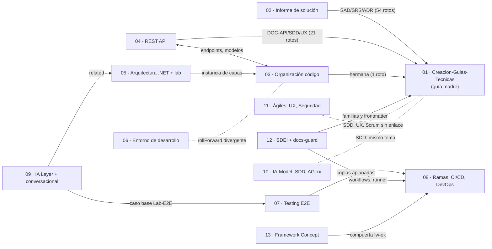

# 00 · Índice maestro

> **Propósito**: visión general de `Lab-Documentos` para decidir qué índice temático abrir: qué es el
> repositorio, cuánto pesa cada carpeta, cómo se organizan `Guides/` y `Concepts/`, qué hay en la raíz,
> de qué prompt salió cada guía, cómo se relacionan las guías, cómo evolucionó el repo y qué hallazgos
> cruzan a más de una guía. El detalle de cada guía vive en los índices 01–13: acá sólo se remite.
> **Fuentes primarias**: `git ls-files`, `git log` y `wc -l` sobre `Lab-Documentos` (`origin/main` en
> `34929f2`, 2026-11-15, merge del PR #77), `CHANGELOG.md`, `README.md`, `AGENTS.md`, `Guides/README.md`
> y los índices 01–13 de esta ia-db 2.0. Medido el 2026-11-16.

Rutas relativas a `Lab-Documentos/` salvo indicación. Los prompts generadores viven en el repo hermano
`Lab-Documentos.Documentacion/PROMPTs/` (ruta relativa a la carpeta común de ambos repos).

## 1. Qué es

Un repositorio **de guías de estudio y conceptos** sobre ingeniería de software con ejemplos en .NET,
escrito en Markdown en español, producido con asistencia de agentes a partir de prompts versionados en
el repo hermano. No hay una aplicación del repo: varias guías traen **laboratorios o demos ejecutables**
(C#, Bash, Dockerfiles, salidas registradas) que respaldan sus afirmaciones, y el repo tiene **compuerta
de documentación propia** (`docs-guard`) más workflows de demo.

| Dato | Valor medido en `34929f2` |
|---|---|
| Archivos versionados | 1 757 (`git ls-files`, respeta `.gitignore`) · ≈ 30 MiB en disco sin `.git` |
| Markdown | 483 `.md` · 164 013 líneas · 455 bloques ` ```mermaid ` |
| Código y laboratorio | 590 `.cs` · 72 `.csproj` · 28 `.razor` · 123 `.sh` · 17 `.py` · 114 `.json` · 24 `.jq` · 16 `.yml` · 136 `.txt` (salidas registradas) · configuración varia |
| Binarios | 12 imágenes/PDF (`.png`, `.jpg`, `.pdf`): inventariados, no leídos |
| Archivos vacíos | `Guides/Arquitectura/Organizacion-Estilo-Rest-API/README.md` (0 bytes) y un `.gitkeep` de la demo de Framework Concept |
| Historia | 232 commits (85 de merge), desde `f7fa8c9` (2026-08-23) hasta `34929f2` (2026-11-15) |

### 1.1 Stack de referencia

| Ámbito | Tecnologías | Índices |
|---|---|---|
| Plataforma | .NET 10 / C#; SDK 10.0.400 fijado por `global.json` en laboratorios y demos | 03, 05, 06, 13 |
| Web y API | ASP.NET Core (controllers, Minimal APIs), Blazor (server, SSR, WebAssembly), OpenAPI, Scalar | 03, 04, 05, 07, 12 |
| Datos | EF Core (SQLite en laboratorios), Dapper, PostgreSQL/Npgsql (informe de solución) | 02, 05 |
| Cliente | .NET MAUI (Android, iOS) con contenido Blazor WASM firmado y actualizable OTA | 07, 13 |
| IA | `IChatClient` (Microsoft.Extensions.AI), RAG, MCP, Ollama como banco local | 09, 10 |
| Pruebas | Playwright para .NET + NUnit, xUnit, Appium/UIAutomator2, `WebApplicationFactory` | 05, 07, 13 |
| Entorno y CI | Docker/BuildKit, devcontainers, GitHub Actions con runner propio (etiqueta `ci-hdcm`), NuGet; Node.js y Python en el laboratorio políglota | 06, 08, 12, 13 |
| Documentación | Markdown + frontmatter YAML + Mermaid; `docs-guard` con lychee, markdownlint-cli2, parser de mermaid y validadores Python | 01, 12 |

## 2. Organización

### 2.1 `Guides/` — once carpetas de categoría

Conteos: `git ls-files` por carpeta; líneas y Mermaid sólo de `.md`. Las filas `Documentacion-Tecnica/`, `IA/` y el
total descuentan los conocimientos mudados el 2026-11-19 a la base de conocimientos (once archivos de las dos carpetas
`Conocimientos/`, 6 420 líneas, 4 Mermaid) y cuentan como archivo los dos `README.md` punteros que quedan, sin sus
líneas.

| Carpeta | Arch. | `.md` | Líneas `.md` | Mermaid | Guías o piezas | Índice |
|---|---:|---:|---:|---:|---|---|
| `Documentacion-Tecnica/` | 157 | 119 | 33 886 | 138 | `Creacion-Guias-Tecnicas/` (59 arch., 20 700 l., guía madre) · `Sistema-De-Documentacion-E-Integracion/` (98 arch., 60 `.md`, 13 186 l., cuerpo `SDEI` + libro DocsAsCode + ejemplos) | [01](01_Documentacion-Tecnica.md), [12](12_Sistema-Documentador-SDEI.md) |
| `Despliegue/` | 35 | 35 | 11 175 | 29 | `Documentacion-Informe-Despliegue/` (30) · `GitHub-Action-Guide/` (1, GHA-00) · `DevOps-Guide/` (4, importado) | [02](02_Informe-de-Solucion.md), [08](08_Ramas-CI-CD-y-DevOps.md) |
| `Arquitectura/` | 94 | 94 | 32 648 | 86 | `Organizacion-Estilo-Patrones-Codigo/` (38) · `Organizacion-Estilo-Rest-API/` (56) | [03](03_Organizacion-Codigo-NET.md), [04](04_Diseno-REST-API.md) |
| `Dot-NET-Arquitectura-Guide/` | 164 | 15 | 8 877 | 15 | `GUIA-NET-ARQ` 2.5.0 · interactiva `GUIA-NET-ARQ-INT` 0.4.0 · Microservicios · Manejo de archivos · `Interactive-Activities/` · `Examples/` (laboratorio L00–L24/V01–V09) · `Exercices/` | [05](05_Arquitectura-NET-y-Laboratorio.md) |
| `Metodologia-Entorno-Desarrollo/` | 343 | 14 | 4 663 | 11 | `GUIA-ENT-DEV` 1.1.0 · `Examples/` (342 arch., laboratorio N0–N8) | [06](06_Metodologia-Entorno-Desarrollo.md) |
| `Testing/` | 29 | 23 | 17 790 | 32 | `E2E-Guide/` (copia vieja) · `Lab-E2E.WebBlazor-Guides/` (E2E-Guide, Test-Guide, copias de CI/ramas, `workflows/`) | [07](07_Testing-E2E.md) |
| `GitFlow/` | 9 | 6 | 4 618 | 9 | `Estandares-Modelo-Ramas-Guide/` (GF-GUIA + anexo de workflows) · `Git-Flow-Guides/` (GitFlow y GitHub Flow) | [08](08_Ramas-CI-CD-y-DevOps.md) |
| `IA/` | 517 | 62 | 25 909 | 68 | `Dot-Net-Integration-AI-Layer-Guide/` (479 arch., 24 `.md`, 12 126 l.: GUIA-NET-IA, guía conversacional, puntero de K1–K8, ejemplos, demo) · `IA-Model/` (15) · `SDD-Guide/` (4) · `references/` (18) · `Claude-Guide.md/` (carpeta, 1 nota) | [09](09_IA-Layer-DotNet.md), [10](10_IA-Modelos-SDD-Agentes.md) |
| `Metodologia-Agiles/` | 5 | 4 | 4 290 | 0 | `Scrum-Guide/` (Scrum + Jira + PDF Scrum Guide 2020) | [11](11_Agiles-UX-y-Seguridad.md) |
| `UX-UI-Design/` | 2 | 2 | 2 038 | 0 | `UX-UI-Guide/` (marco UX/UI/DX + documentación UX) | [11](11_Agiles-UX-y-Seguridad.md) |
| `Otros/` | 2 | 2 | 1 555 | 6 | `Seguridad-Red-Windows-Guide/` (guía + cuaderno) | [11](11_Agiles-UX-y-Seguridad.md) |
| `Guides/README.md` | 1 | 1 | 31 | 0 | `GUIAS-INDICE` (last_review 2026-10-28), tabla de 9 categorías | [11](11_Agiles-UX-y-Seguridad.md) |
| **Total `Guides/`** | **1 358** | **377** | **147 480** | **394** | | |

### 2.2 `Concepts/`

| Carpeta | Arch. | `.md` | Líneas `.md` | Mermaid | Qué es | Índice |
|---|---:|---:|---:|---:|---|---|
| `Concepts/Framework-Concept/` | 280 | 22 (18 fuera de `Demo/`) | 8 202 | 50 | App .NET MAUI híbrida con Blazor WASM firmado y OTA: capítulos 00–08/99, libro `MAUI-Framework-Developer-Guide.md`, ADR-0001, Conocimiento y `Demo/` (262 arch.) | [13](13_Framework-Concept.md) |

El índice 13 declara 284 archivos; esta medición da 280 (18 fuera de `Demo/` + 262 en `Demo/`). La
diferencia no se resolvió (sin verificar).

### 2.3 Raíz y soporte

| Ruta | Arch. | Qué es | Índice |
|---|---:|---|---|
| `README.md` | 1 | `LAB-DOCUMENTOS-README` (54 l., vigente, 2026-10-28): ruta de lectura mínima (Guides → Creacion-Guias-Tecnicas → SDEI), tabla de estructura y cómo correr la compuerta | este |
| `AGENTS.md` | 1 | `IDX-LABDOC-AGENTS` (142 l., borrador): puntero para agentes; define «cuerpo» (carpeta cuyo README declara `corpus_id`, hoy sólo `SDEI`), clases D/P/H y qué no puede cambiar un agente | [12](12_Sistema-Documentador-SDEI.md) |
| `CHANGELOG.md` | 1 | 639 l., Keep a Changelog; también asienta las **delegaciones de merge** | §4 |
| `.github/` | 6 | 5 workflows (`docs-guard`, `docs-enlaces-semanal`, `mini-demo-movilidad`, `framework-concept-demo`, `framework-concept-ios`) + plantilla de PR | [12](12_Sistema-Documentador-SDEI.md), [13](13_Framework-Concept.md), [08](08_Ramas-CI-CD-y-DevOps.md) |
| `scripts/` | 3 | `ci-local.sh` (compuerta en local) + configuración de lychee y markdownlint | [12](12_Sistema-Documentador-SDEI.md) |
| `tools/docs-guard/` | 97 | `dg.py`, esquemas, registro de prefijos, fixtures verde/rojo, carril semanal | [12](12_Sistema-Documentador-SDEI.md) |
| `.gitignore` | 1 | Excluye `bin/`, `obj/`, `*.log`, etc. | — |

## 3. Mapa de guías → índice y origen

Origen: carpeta de `Lab-Documentos.Documentacion/PROMPTs/`. La correspondencia guía↔prompt se asigna por
nombre de carpeta y por las menciones de expedientes en `CHANGELOG.md`; los prompts no se releyeron en
esta regeneración.

| Guía (ruta) | Índice | Prompt generador |
|---|---|---|
| `Guides/GitFlow/Estandares-Modelo-Ramas-Guide/` | 08 | `Guides/01-Crear-Guia-Estudio-Modelo-Ramas` (+ `DEVs/Fixs/04-…`) |
| `Guides/GitFlow/Git-Flow-Guides/` (GitHub Flow / GitFlow) | 08 | `Guides/02-Crear-Guia-GithubFlow`, `Guides/05-Crear-Practica-Interactiva-Practica-GitHubFlow` (+ `DEVs/Fixs/02-…`, `03-…`) |
| `Guides/Despliegue/GitHub-Action-Guide/` | 08 | `Guides/03-GitHub-Action` |
| `Guides/Testing/Lab-E2E.WebBlazor-Guides/` y `Testing/E2E-Guide/` | 07 | `Guides/04-Crear-E2E-Guide-Developer-Guide` |
| `Guides/Dot-NET-Arquitectura-Guide/` | 05 | `Guides/06-Crear-Dot-NET-Arquitectura-Guide` |
| `Guides/Otros/Seguridad-Red-Windows-Guide/` | 11 | `Guides/07-Seguridad-Red-Windows-Guide` |
| `Guides/Arquitectura/Organizacion-Estilo-Patrones-Codigo/` | 03 | `Guides/08-Crear-Guia-Organizacion-Estilo-Patrones-Codigo`, `Guides/12-Organizacion-Estilo-Patrones-Codigo` |
| (sin guía identificable en el repo) | — | `Guides/09-Flujo-Trabajo-Desarrollo-Versionado` (sin verificar qué produjo) |
| `Guides/Despliegue/Documentacion-Informe-Despliegue/` | 02 | `Guides/10-Generacion-Documentacion-Informe-Despliegue` |
| `Guides/Documentacion-Tecnica/Creacion-Guias-Tecnicas/` | 01 | `Guides/11-Generacion-Documentacion-Tecnica` |
| `Guides/Arquitectura/Organizacion-Estilo-Rest-API/` | 04 | `Guides/13-Organizacion-Estilo-Rest-API` |
| `Guides/Documentacion-Tecnica/Sistema-De-Documentacion-E-Integracion/`, `tools/docs-guard/`, `AGENTS.md` | 12 | `Guides/14-Sistema-De-Documentador-Tecnico` (expedientes 0002 y 0003) |
| `Guides/Metodologia-Entorno-Desarrollo/` | 06 | `Guides/15-Metodologia-Entorno-Desarrollo` |
| `Guides/IA/Dot-Net-Integration-AI-Layer-Guide/` | 09 | `Guides/16-IA-Layer` |
| (temario, sin guía publicada) | — | `Guides/17-IA-Estudio` (sólo `01-Crear-Temario-Inicial.md` + `INPUTs/`) |
| `Guides/IA/IA-Model/` | 10 | `Guides/18-IA-Model` (expediente 0001) |
| `Concepts/Framework-Concept/` | 13 | `Concepts/01-Framework-Concept` (expediente 0001; prompts 01–05: crear, autenticación, iOS, coherencia, correr) |
| `Guides/IA/SDD-Guide/`, `IA/references/`, `Metodologia-Agiles/`, `UX-UI-Design/`, `Despliegue/DevOps-Guide/` | 10, 11, 08 | Sin prompt propio: material importado |

Otras carpetas de `PROMPTs/`: `DEVs/` (Breaking-Change, Changed, Enchacement, Features, Fixs, Refactor:
ciclos de mejora sobre guías existentes), `Indexado/` (`Crear-Indexado.md`, `Actualizar-Indexado.md`, que
producen esta ia-db) y `Analisis/` (vacía).

## 4. Cronología (según `CHANGELOG.md`)

| Fecha | Hito | Índice |
|---|---|---|
| 2026-08-23 | `Initial commit`; 2026-08-25 siembra de la app de práctica y sus E2E (luego retirada) | 07, 08 |
| 2026-09-18 → 09-21 | Guía de seguridad Windows; mesas de editores (ciclos 1–4) sobre la guía .NET; reorganización de las prácticas en `Git-Flow-Guides/`; alta del apunte `DOC-SDT-0001` | 05, 08, 11, 12 |
| 2026-09-28 | Reorganización en carpetas de categoría (`9162e07`; no figura en el CHANGELOG) | todos |
| 2026-10-26 | `Concepts/Framework-Concept/` v1.0.0 con `Demo/` y compuerta `fw-ok`; plantilla de PR | 13 |
| 2026-10-27 → 10-28 | Compuerta `docs-guard` (PR-1…PR-7, carril semanal), esqueleto y temas 01–07 del cuerpo `SDEI`, `AGENTS.md`, mini demo MovilidadUrbana; la guía de un solo archivo pasa a obsoleta | 12 |
| 2026-10-28 → 10-30 | Framework Concept: IDs propios, runner, Keycloak, TPR en el g42, login como página del contenido | 13 |
| 2026-11-01 | Framework Concept: libro unificado y Conocimiento; PR común del expediente 0003 de DocsAsCode | 12, 13 |
| 2026-11-02 | SDEI: vocabulario de audiencias y entrega, temas de lectura por agentes, prueba extendida de ayuda por rol | 12 |
| 2026-11-04 | SDEI: libro DocsAsCode Developer Guide; archivado del apunte de un solo archivo | 12 |
| 2026-11-07 | Guía 18 `IA-Model` (15 piezas); delegación del merge del expediente 0001 de la guía 18 | 10 |
| 2026-11-10 | Guía 18: cierre de PD-01 y PD-02 | 10 |
| 2026-11-11 | `GUIA-DISENO-CONVERSACIONAL` 1.0.0 (última entrada del CHANGELOG) | 09 |
| 2026-11-11 → 11-15 | Sin entrada en el CHANGELOG: correcciones de K1–K8 por los bancos de Geometría, Movilidad y Lab-E2E, lámina LD-01, guía conversacional 1.2.0→1.6.0, K8 con consola de chat (PR #67–#77) | 09 |

## 5. Relaciones entre guías



| Relación | Detalle | Índice |
|---|---|---|
| Guía madre documental | 02, 03 y 04 remiten a `Creacion-Guias-Tecnicas`; 76 enlaces entrantes rotos desde la reorganización | 01 |
| Cuerpo nuevo reemplaza al apunte | `SDEI` reemplaza a `DOC-SDT-0001`, que ya no está en `main`; `AGENTS.md` abre la ruta del agente | 12 |
| Mismo tema en varios lugares | SDD: DT `DOC-SDD`, REST `TEM-SDD`, `IA/SDD-Guide` · UX/DX: DT `DOC-UX`, REST `TEM-DX`, `UX-UI-Guide` · Ágiles: DT serie 80 y `Scrum-Guide` · Microservicios: OEP y `Microservicios-Guide.md` | 01, 04, 10, 11 |
| Duplicados | `Lab-E2E.WebBlazor-Guides/` copia GF-GUIA, GHA-00, las dos prácticas y los workflows; `Testing/E2E-Guide/` es copia vieja | 07, 08 |
| Casos compartidos | MovilidadUrbana (mini demo SDEI, demo IA Layer, guía conversacional), Lab-Geometria (prueba de ayuda por rol, bancos de K1–K7), PushDispatch (caso conversacional) | 09, 12 |
| Repos hermanos | `Lab-E2E.WebBlazor`, `Lab-GitFlow`, `Lab-Geometria`, `Lab-Documentos.Documentacion` (expedientes, prompts) | 07, 08, 09, 12, 13 |

## 6. Decisiones y rasgos clave del corpus

| Rasgo | Detalle | Dónde |
|---|---|---|
| Separar norma, guía y criterio propio | Niveles de autoridad N/G/F/O/P (02, 03, 04); marcas de procedencia en laboratorios (05, 06) | 02, 03, 04 |
| Marco por escenario/contexto/actor | `ESC-*`/`CTX-*`/`ACT-*` en casi todas las guías estructuradas; los ejes cambian por guía | 01, 02, 04, 07, 10 |
| Afirmación con evidencia ejecutada | Capturas L00–L24/V01–V09 (05), experimentos (06), banco Ollama con salidas reales (10), «k de M» (09), salidas `exit=1` a propósito (12) | 05, 06, 09, 10, 12 |
| Frontmatter como contrato | `doc_id`, `doc_type`, `status`, `owner`, `last_review`, `traces`; obligatorio en un «cuerpo» con `corpus_id` | 01, 12 |
| Compuerta única de documentación | `docs-guard` en cada PR + `scripts/ci-local.sh` en local + carril semanal de enlaces | 12 |
| Modelo de ramas | `main` + `release/x.y`, cherry-pick main→release, GitFlow sólo en contexto C-4 | 08 |
| Arquitectura por escalones y costo de reversión | Regla de dependencia; se sube de estructura por señal observable; monolito modular primero | 03, 05 |
| REST pragmático | HTTP nivel 2, RFC 9457, OpenAPI 3.x, autoridad por regla | 04 |
| Merge delegado con guarda | Delegaciones asentadas en `CHANGELOG.md` (techo 60/120 min, merge atado al SHA, nunca squash) | §4 |
| Patrón en inglés, dominio en español | Nombres de tipos y `data-testid` | 03, 05, 07 |

## 7. Hallazgos transversales

| ID | Hallazgo | Evidencia | Detalle |
|---|---|---|---|
| HM-01 | Enlaces relativos rotos desde la reorganización `9162e07`, en casi todas las guías | 76 entrantes a DT (01), 57 en 02, 51 en 04, 39 en 08, 25 en 10 (recuentos de cada índice) | 01, 02, 04, 08, 10 |
| HM-02 | `CHANGELOG.md` no registra lo posterior al 2026-11-11 (PR #67–#77: K1–K8, LD-01, conversacional 1.2.0→1.6.0) ni la reorganización `9162e07` | `git log` vs. última entrada (l. 6) | 09 |
| HM-03 | Copias duplicadas del material de ramas/CI en `Testing/` que divergen del original | diffs medidos en 07 y 08 | 07, 08 |
| HM-04 | `Guides/README.md` lista categorías pero varias filas sólo enlazan la carpeta; `Organizacion-Estilo-Rest-API/` no tiene entrada propia y su README está vacío (0 bytes) | `Guides/README.md`; `git ls-files` + tamaño | 04, 11 |
| HM-05 | Sólo `SDEI` es «cuerpo» con `corpus_id`; el resto del corpus queda fuera de la validación estricta de frontmatter | `AGENTS.md` §1; `tools/docs-guard/README.md` l. 31 | 12, 13 |
| HM-06 | Material importado sin `doc_id` ni prompt generador (SDD-Guide, references, Scrum, UX-UI, DevOps-Guide) | frontmatter ausente | 08, 10, 11 |
| HM-07 | Fechas de soporte vencidas (.NET 8/9) en guías que las daban como futuras | índices 04 (H-9) y 06 (H-12) | 04, 06 |
| HM-08 | Mismo tema tratado en varias guías sin enlaces cruzados (SDD, UX/DX, ágiles, microservicios) | §5 | 01, 04, 10, 11 |
| HM-09 | Rutas con forma de workspace y referencias a repos externos que no se pueden verificar desde el repo | índices 07 (H-19), 08 (H-19), 09 (H2) | 07, 08, 09 |
| HM-10 | Errata en nombre de archivo `Dot-NET-Arquiectura-Interactive-Guide.md` y de carpeta `Exercices/`; `Claude-Guide.md/` es una carpeta | `git ls-files` | 05, 10 |

## 8. Dónde buscar (pregunta → índice)

| Si necesitás… | Abrí |
|---|---|
| Elegir qué documento técnico escribir (Vision, SRS, SAD, ADR, Runbook) | [01](01_Documentacion-Tecnica.md) |
| Escribir o evaluar un informe de solución | [02](02_Informe-de-Solucion.md) |
| Organizar una solución .NET (proyectos, capas, nombres, estilo) | [03](03_Organizacion-Codigo-NET.md) |
| Diseñar, versionar o asegurar una API REST | [04](04_Diseno-REST-API.md) |
| Arquitectura .NET en capas con laboratorio, taller, microservicios, archivos | [05](05_Arquitectura-NET-y-Laboratorio.md) |
| Reproducibilidad del entorno (BOM, SDK, locks, devcontainer, SBOM) | [06](06_Metodologia-Entorno-Desarrollo.md) |
| Pruebas E2E con Playwright, unitarias, MAUI con Appium | [07](07_Testing-E2E.md) |
| Modelo de ramas, workflows, GitHub Actions, DORA, SemVer, NuGet | [08](08_Ramas-CI-CD-y-DevOps.md) |
| Capa de IA en .NET, diseño conversacional, Conocimientos K1–K8 (mudados a la base de conocimientos) | [09](09_IA-Layer-DotNet.md) |
| Modelos de IA (IAM-xx), SDD con IA, perfiles AG-xx | [10](10_IA-Modelos-SDD-Agentes.md) |
| Scrum/Jira, UX/UI/DX, auditoría de seguridad Windows | [11](11_Agiles-UX-y-Seguridad.md) |
| Sistema documentador SDEI, docs-guard, AGENTS.md | [12](12_Sistema-Documentador-SDEI.md) |
| App MAUI híbrida con contenido OTA firmado | [13](13_Framework-Concept.md) |

## 9. Notas de esta regeneración

| Nota | Detalle |
|---|---|
| Numeración 2.0 | La ia-db anterior tenía 00–12 con 09 «IA, Ágiles, UX y Otros», 10 «Convenciones y Glosario», 11 SDEI y 12 Framework Concept. La 2.0 parte IA en 09/10, pasa ágiles/UX/seguridad a 11, SDEI a 12 y Framework Concept a 13. En `ia-db/indexes/` conviven todavía los archivos v1.x `09_IA-Agiles-UX-y-Otros.md`, `10_Convenciones-y-Glosario.md`, `11_Sistema-Documentador-SDEI.md` y `12_Framework-Concept.md`: hay que retirarlos o regenerarlos |
| Convenciones y glosario | Sin índice 2.0 propio; las convenciones de cada guía están en su índice temático |
| Sin verificar | Correspondencia exacta guía↔prompt (§3); qué produjo `Guides/09-Flujo-Trabajo-Desarrollo-Versionado`; diferencia 280/284 de §2.2 |
