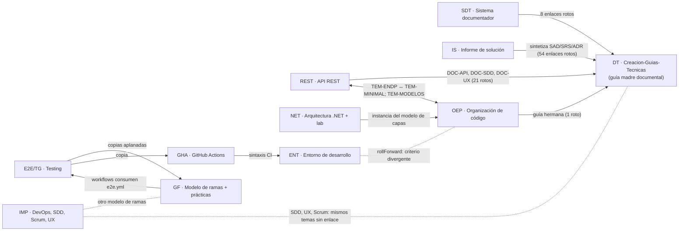

# 00 · Índice maestro

> **Propósito**: visión general de `Lab-Documentos`: qué es, cómo está organizado `Guides/`, cuánto
> pesa cada carpeta, de dónde salió cada guía, qué rasgos comparten, cómo se relacionan, en qué estado
> está el repositorio, qué cambió desde la ia-db 3.0 y qué hallazgos tiene el corpus en conjunto.
> **Fuentes primarias**: `git ls-files`, `git log` y `wc -l` sobre `Lab-Documentos` (`main` en `fe10086`,
> 2026-10-27, merge de E1-U4f), `Lab-Documentos/CHANGELOG.md`, el frontmatter de cada guía, los índices
> 01–12 de esta base (verificados uno por uno contra la fuente) y la ia-db 3.0 del 2026-09-12 como
> línea de base del cambio. Medido el 2026-10-18 sobre `5d5c2b4` (v4.0) y re-medido el 2026-10-27 sobre
> `fe10086` (v4.1, §7.1).

Rutas relativas a `Lab-Documentos/` salvo indicación. Siglas de guía (DT, IS, OEP, REST, NET, ENT,
E2E, GF, GHA, IMP, SEG) definidas en [10](10_Convenciones-y-Glosario.md).

## 1. Qué es

Un repositorio **de guías de estudio** sobre ingeniería de software con ejemplos en .NET, escritas en
Markdown con asistencia de agentes a partir de prompts versionados en `Lab-Documentos.Documentacion/PROMPTs/`.
Desde septiembre de 2026 dejó de ser sólo texto: tres guías traen **laboratorios ejecutables**
(código C#, scripts Bash, Dockerfiles y salidas registradas) que respaldan sus afirmaciones.
No hay una aplicación del repo: cada laboratorio se corre por su cuenta en contenedor. Desde octubre
de 2026 el repo tiene además **compuerta de documentación propia** (`docs-guard`, workflows en
`.github/`), un cuerpo documental nuevo (`SDEI`, [11](11_Sistema-Documentador-SDEI.md)) y la guía con
demo `Concepts/Framework-Concept/` ([12](12_Framework-Concept.md)).

| Dato | Valor (medido) |
|---|---|
| Archivos versionados | 1 161 (`git ls-files`; respeta `.gitignore`) · ≈ 15 MiB |
| Markdown | 383 `.md` · 125 129 líneas · 324 bloques Mermaid en 195 archivos · 1 vacío (0 bytes) |
| Código y laboratorio | 251 `.cs` · 46 `.csproj` · 22 `.razor` · 108 `.sh` · 12 `.py` · 59 `.json` · 17 `.yml/.yaml` · 10 `.toml` · 135 `.txt` (salidas registradas) · otros de configuración (`.props`, `.editorconfig`, `.gitattributes`, `.nvmrc`, `.python-version`…) |
| Binarios | 10 PNG (capturas) · 1 PDF (Scrum Guide 2020) — inventariados, no leídos |
| Fuera de `Guides/` | `README.md` (`LAB-DOCUMENTOS-README`, 53 l., portada con ruta de lectura), `CHANGELOG.md` (386 l.), `AGENTS.md` (142 l.), `.gitignore`, `.github/` (4 workflows + plantilla de PR), `scripts/` (3), `tools/docs-guard/` (66), `Concepts/Framework-Concept/` (245) — ver §2.1 |

### Stack de referencia

| Ámbito | Tecnologías | Dónde |
|---|---|---|
| Plataforma principal | .NET 10 (LTS) / C#; SDK 10.0.400 en los laboratorios (`mcr.microsoft.com/dotnet/sdk:10.0`) | NET, ENT, E2E, IS, OEP, REST, SDT |
| Web y API | ASP.NET Core (controllers, Minimal APIs), Blazor *interactive server* y SSR estático, OpenAPI, Scalar | NET, REST, OEP, E2E, SDT |
| Datos | EF Core (SQLite en laboratorios), PostgreSQL/Npgsql (IS), Dapper (variante NET V09) | NET, IS |
| Cliente | .NET MAUI (MVVM, Android), WPF/WinForms (IS); MAUI + Blazor WebAssembly descargable (Framework Concept) | E2E/TG, IS, FC |
| Pruebas | Playwright para .NET + NUnit, xUnit, Appium/UIAutomator2, `WebApplicationFactory` | E2E, TG, NET, REST |
| Entorno y CI | Docker/BuildKit, devcontainers, GitHub Actions (runner propio `i7infra-dev`), NuGet; Node.js y Python en el laboratorio políglota | ENT, GF, GHA |
| Documentación | Markdown + frontmatter YAML + Mermaid; Markdig/YamlDotNet en la prueba de ayuda por rol; compuerta con lychee, markdownlint-cli2, parser de mermaid (Node.js) y validadores en Python de biblioteca estándar | todo; SDT/SDEI |

## 2. Mapa de `Guides/`

La reorganización `9162e07` (2026-09-28) agrupó las guías en **once carpetas de categoría**. Conteos
de `git ls-files` + `wc -l` (líneas de `.md`):

| Carpeta | Archivos | `.md` | Líneas `.md` | Guías o piezas | `doc_id` / versión · `last_review` | Índice |
|---|---:|---:|---:|---|---|---|
| `Documentacion-Tecnica/` | 131 | 101 | 26 849 | `Creacion-Guias-Tecnicas/` (59 docs, 20 700 l.) · `Sistema-De-Documentacion-E-Integracion/` (72 arch., 42 `.md`, 6 149 l.: cuerpo `SDEI` + apunte obsoleto + mini demo + prueba Blazor) | `GUIA-INDICE` · 2026-07-18 · `IDX-SDEI` 2.0.0-borrador · 2026-10-27 · `DOC-SDT-0001` obsoleto | [01](01_Documentacion-Tecnica.md), [11](11_Sistema-Documentador-SDEI.md) |
| `Despliegue/` | 35 | 35 | 11 175 | `Documentacion-Informe-Despliegue/` (30 docs, 5 348 l.) · `GitHub-Action-Guide/` (1 doc, 2 974 l.) · `DevOps-Guide/` (4 docs, 2 853 l., importado) | `GUIA-INDICE` · 2026-07-21 · `GHA-00` · 2026-08-31 · sin `doc_id` | [02](02_Informe-de-Solucion.md), [08](08_Ramas-CI-CD-y-DevOps.md) |
| `Arquitectura/` | 94 | 94 | 32 648 | `Organizacion-Estilo-Patrones-Codigo/` (38 docs, 11 321 l.) · `Organizacion-Estilo-Rest-API/` (56 docs, 21 327 l.) | `GUIA-INDICE` · 2026-07-20 · README vacío · 2026-07-20 | [03](03_Organizacion-Codigo-NET.md), [04](04_Diseno-REST-API.md) |
| `Dot-NET-Arquitectura-Guide/` | 164 | 15 | 8 877 | Guía principal (2 944 l.) · guía interactiva (814 l.) · Microservicios (717 l.) · Manejo de archivos (913 l.) · `Interactive-Activities/` (29 arch.) · `Examples/` (129 arch., laboratorio) · `Exercices/` (del usuario) | `GUIA-NET-ARQ` 2.5.0 · 2026-09-24 · `GUIA-NET-ARQ-INT` 0.4.0 | [05](05_Arquitectura-NET-y-Laboratorio.md) |
| `Metodologia-Entorno-Desarrollo/` | 343 | 14 | 4 663 | Guía única (3 637 l.) · `Examples/` (342 arch., 74 experimentos) | `GUIA-ENT-DEV` 1.1.0 · 2026-10-09 | [06](06_Metodologia-Entorno-Desarrollo.md) |
| `Testing/` | 29 | 23 | 17 790 | `E2E-Guide/` (copia vieja, 2 docs) · `Lab-E2E.WebBlazor-Guides/` (27 arch.: E2E-Guide, Test-Guide, copias de ramas/Actions, `workflows/`) | `E2E-00`…`E2E-04` · 2026-08-23/09-09 | [07](07_Testing-E2E.md) |
| `GitFlow/` | 9 | 6 | 4 618 | `Estandares-Modelo-Ramas-Guide/` (GF-GUIA + `Anexos/workflows/` con 3 `.yml`) · `Git-Flow-Guides/` (prácticas GitFlow y GitHub Flow) | `GF-GUIA` · 2026-08-23 · `GF-09` · `GHF-IDX` | [08](08_Ramas-CI-CD-y-DevOps.md) |
| `IA/` | 23 | 23 | 4 859 | `SDD-Guide/` (4) · `references/` (18: AG-xx, refinamiento, notas) · `Claude-Guide.md/` (carpeta con 1 nota) | sin `doc_id` (importado) | [09](09_IA-Agiles-UX-y-Otros.md) |
| `Metodologia-Agiles/` | 5 | 4 | 4 290 | `Scrum-Guide/` (Scrum + Jira, estudio, caso, PDF) | sin `doc_id` (importado) | [09](09_IA-Agiles-UX-y-Otros.md) |
| `UX-UI-Design/` | 2 | 2 | 2 038 | `UX-UI-Guide/` (marco teórico + metodología de la sección UX) | sin `doc_id` (importado) | [09](09_IA-Agiles-UX-y-Otros.md) |
| `Otros/` | 2 | 2 | 1 555 | `Seguridad-Red-Windows-Guide/` (guía + cuaderno) | `GUIA-PRINCIPAL`, `CUADERNO` · 2026-09-18 | [09](09_IA-Agiles-UX-y-Otros.md) |
| `Guides/README.md` | 1 | 1 | 31 | Índice por categoría (`GUIAS-INDICE`, 2026-10-27) | — | — |
| **Total `Guides/`** | **837** | **320** | **119 393** | | | |

Las cifras de `Documentacion-Tecnica/` y del total son de `fe10086`; las demás filas no cambiaron desde
`5d5c2b4` salvo dos líneas de redacción en `Despliegue/GitHub-Action-Guide/` y en su copia de `Testing/`.

### 2.1 Fuera de `Guides/` (desde octubre de 2026)

| Ruta | Archivos | Qué es | Índice |
|---|---:|---|---|
| `AGENTS.md` | 1 | Puerta de la ruta «agente» (`IDX-LABDOC-AGENTS`): qué leer, cómo validar, qué no puede cambiar un agente | [11](11_Sistema-Documentador-SDEI.md) §7 |
| `.github/` | 5 | Workflows `docs-guard`, `docs-enlaces-semanal`, `mini-demo-movilidad`, `framework-concept-demo` y plantilla de PR | [11](11_Sistema-Documentador-SDEI.md) §6 |
| `scripts/` | 3 | `ci-local.sh` (la compuerta en local) y configuración de lychee y markdownlint | [11](11_Sistema-Documentador-SDEI.md) §6 |
| `tools/docs-guard/` | 66 | `dg.py`, esquemas JSON, registro de prefijos, lista de dominios, excepciones, parser de mermaid, carril semanal y 53 fixtures | [11](11_Sistema-Documentador-SDEI.md) §6 |
| `Concepts/Framework-Concept/` | 245 | Guía de estudio (13 `.md`) y demo .NET MAUI + Blazor WebAssembly (232 arch.) | [12](12_Framework-Concept.md) |

Convenciones transversales, prefijos de IDs y glosario cruzado → [10](10_Convenciones-y-Glosario.md).

## 3. Procedencia

### 3.1 Cuatro linajes

| Linaje | Guías | Rasgos | Ingreso al repo |
|---|---|---|---|
| **A. Guías estructuradas con aparato común** | DT, IS, OEP, REST | Frontmatter normado (`origin: ia-assisted`), marco ESC/CTX/ACT, mapa conceptual, familias `FAM-`/`TEM-`/`DOC-`, anexos con fuentes `N-/G-/F-/O-/P-`, niveles de autoridad; sin `version`; `last_review` de julio de 2026 | `fab7258` (2026-09-13), movidas sin cambios (R100) por `9162e07` |
| **B. Procedimiento del equipo (bloque ramas/CI/E2E)** | GF, prácticas GitFlow/GitHub Flow, GHA, E2E y el corpus `Lab-E2E.WebBlazor-Guides/` | Frontmatter con `origin: agente`, `owner` = repo de origen (`Lab-GitFlow`, `Lab-E2E.WebBlazor.Documentacion`), marcas **[F]/[C]/[E]/[V]**; anclado a repos hermanos `LAB/Lab-GitFlow` y `LAB/Lab-E2E.WebBlazor` | `fab7258`; el corpus Lab-E2E en `9162e07` (2026-09-28) |
| **C. Guías de estudio versionadas con laboratorio** | NET (+ interactiva y taller), ENT, SDT, SEG | `version` SemVer en frontmatter (NET, ENT), `owner` = cuenta personal del autor, marcas de procedencia propias, laboratorios en contenedor con salidas registradas; desarrolladas con «mesas» de editores/evaluadores (prompts `06`, `07`, `14`, `15`) | NET: `063f4e9`…`8218f97` (2026-09-18 → 09-26), taller `c6e3163` (09-28); SEG `8218d3e`/`ecbdb9d` (09-17/18); SDT `dade777` (09-21); ENT `5d5c2b4` (10-11) |
| **E. Cuerpos con compuerta y expediente** | SDEI (cuerpo del sistema documentador), Framework Concept | Frontmatter de diez campos más `description` con vocabulario en castellano, `owner` = rol o nombre del cuerpo, trazas verificables; nacen de un expediente con mesa y se fusionan por PR con delegación asentada en `CHANGELOG.md` | Framework Concept PR #10 (2026-10-26); SDEI PR #11–#25 (2026-10-27) |
| **D. Material importado** | IMP: `Despliegue/DevOps-Guide/`, `IA/`, `Metodologia-Agiles/`, `UX-UI-Design/`, y `Microservicios-Guide.md`/`Manejo-Archivos-Guide.md` de NET | Encabezado «Documento / Versión / Fecha / Estado» + «Control de cambios», sin frontmatter; casi todo del proyecto *Motor DSL* (`Ejemplo_IA_SDD_Template`, abril de 2026); sin niveles de autoridad; rutas `docs/…` del proyecto de origen | `fab7258` (2026-09-13) |

### 3.2 Prompts generadores (`Lab-Documentos.Documentacion/PROMPTs/Guides/`)

| Prompt | Produjo |
|---|---|
| `01-Crear-Guia-Estudio-Modelo-Ramas` (+ `INPUTs/`) | GF-GUIA |
| `02-Crear-Guia-GithubFlow`, `05-Crear-Practica-Interactiva-Practica-GitHubFlow` (bitácora en `OUTPUTs/`) | Práctica GitHub Flow |
| `03-GitHub-Action` | GHA-00 |
| `04-Crear-E2E-Guide-Developer-Guide` | E2E-00/E2E-01 |
| `06-Crear-Dot-NET-Arquitectura-Guide` (5 prompts + `OUTPUTs/` con mesas 01–07) | NET, interactiva, taller |
| `07-Seguridad-Red-Windows-Guide` | SEG |
| `08-…` y `12-Organizacion-Estilo-Patrones-Codigo` | OEP |
| `09-Flujo-Trabajo-Desarrollo-Versionado` | **vacío** (prompt e `INPUTs/` sin contenido) |
| `10-Generacion-Documentacion-Informe-Despliegue` | IS |
| `11-Generacion-Documentacion-Tecnica` (+ `Inputs/`) | DT |
| `13-Organizacion-Estilo-Rest-API` | REST |
| `14-Sistema-De-Documentador-Tecnico` | SDT |
| `15-Metodologia-Entorno-Desarrollo` | ENT |
| `../DEVs/Enchacement/01-Replanteo-Y-Analisis` (expediente 0002) | SDEI, `docs-guard`, mini demo, `AGENTS.md` ([11](11_Sistema-Documentador-SDEI.md) §8) |
| `../Concepts/01-Framework-Concept` (expediente 0001) | Framework Concept ([12](12_Framework-Concept.md) §5) |

El material IMP no tiene prompt en ese repositorio. La correspondencia prompt → guía es por nombre de
carpeta; no se abrió cada prompt para confirmarla.

### 3.3 `CHANGELOG.md`

Formato Keep a Changelog (386 líneas en `fe10086`). Dos tramos: **del 2026-09-18 al 2026-09-21** (NET
v2.0.1 → v2.4.0, el borrado de `Guides/references/arquitectura/`, la mudanza de las prácticas a
`Guides/Git-Flow-Guides/` y el alta de SDT en `Guides/Sistema-Documentador-Tecnico-Guide/`) y **del
2026-10-26 al 2026-10-27** (Framework Concept v1.0.0 y folio 042; una entrada por unidad E1 del
expediente 0002, de U0a a U4f; la delegación del merge vigente). Entre ambos tramos no registra NET
v2.5.0, la interactiva, el taller, la reorganización `9162e07`, el ingreso del corpus Lab-E2E ni ENT
(ver H-E6).

## 4. Rasgos y decisiones clave del corpus

| Rasgo | Detalle | Dónde se desarrolla |
|---|---|---|
| Separar norma, convención y criterio | Niveles de autoridad (A) o marcas [F]/[C]/[E]/[V] (B, C); «esta guía recomienda» para el criterio propio | [10](10_Convenciones-y-Glosario.md) §3 |
| Afirmación con evidencia ejecutada | NET (capturas `L00–L24`, `V01–V09`), ENT (74 experimentos), E2E (laboratorio hermano), SDT (prueba con `exit=1` a propósito) | [05](05_Arquitectura-NET-y-Laboratorio.md), [06](06_Metodologia-Entorno-Desarrollo.md), [07](07_Testing-E2E.md), [01](01_Documentacion-Tecnica.md) |
| Marco por escenario/contexto/actor | Cada guía estructurada decide qué aplicar según dónde está el lector; los ejes cambian por guía | [10](10_Convenciones-y-Glosario.md) §5 |
| Modelo de ramas adoptado | Tronco `main` + `release/x.y`, cherry-pick main → release, SemVer `-rcN`/`-demo.N`, check único «CI aprobada» | [08](08_Ramas-CI-CD-y-DevOps.md) |
| Arquitectura .NET por escalones | Regla de dependencia; Domain/Application/Infrastructure/WebAPI/Contracts; se sube de escalón por señal observable; sin MediatR/AutoMapper | [05](05_Arquitectura-NET-y-Laboratorio.md) |
| Organización por costo de reversión | Clean/Onion/Hexagonal no son estándares de Microsoft; monolito modular como punto de partida | [03](03_Organizacion-Codigo-NET.md) |
| REST como API HTTP nivel 2 | Cada «regla REST» clasificada; RFC 9457 para errores; OpenAPI 3.x; .NET 10 | [04](04_Diseno-REST-API.md) |
| Mismo commit, mismo resultado | Seis capas del entorno, fuente de verdad + herramienta que hace cumplir + compuerta única | [06](06_Metodologia-Entorno-Desarrollo.md) |
| Qué probar en una pantalla | Superficie / promesa / estado; testigo de hidratación en Blazor | [07](07_Testing-E2E.md) |
| Nombres: patrón en inglés, dominio en español | `CrearProductoCommand`, `IProductoRepository`; `data-testid` en español | [10](10_Convenciones-y-Glosario.md) §6 |

## 5. Relaciones entre guías

| Relación | Detalle | Índice |
|---|---|---|
| Cuerpo nuevo reemplaza al apunte | `SDEI` (`IDX-SDEI`) reemplaza a `DOC-SDT-0001`, ahora `obsoleto` con tabla de destinos; `AGENTS.md` abre la ruta del agente hacia el cuerpo | [11](11_Sistema-Documentador-SDEI.md) |
| Guía madre documental | IS, REST, OEP y SDT remiten a DT; **todos esos enlaces quedaron rotos** con `9162e07` | [01](01_Documentacion-Tecnica.md) |
| Dominio compartido | DT, OEP y REST usan la reserva de salas; IS usa el sistema de audiencias | [10](10_Convenciones-y-Glosario.md) §6 |
| Mismo tema en tres lugares | SDD: DT `DOC-SDD`, REST `TEM-SDD`, IMP `SDD-Guide` · UX/DX: DT `DOC-UX`, REST `TEM-DX`, IMP `UX-UI-Guide` · métodos ágiles: DT `80-Metodos-Agiles/` e IMP Scrum · microservicios: OEP `TEM-MICRO` y NET `Microservicios-Guide.md` | [10](10_Convenciones-y-Glosario.md) §7 |
| Duplicados | `Lab-E2E.WebBlazor-Guides/` copia GF-GUIA, GHA-00, las dos prácticas y `Anexos/workflows/`; `Testing/E2E-Guide/` es la copia vieja de E2E-00/01 | [07](07_Testing-E2E.md), [08](08_Ramas-CI-CD-y-DevOps.md) |
| Repos hermanos | `LAB/Lab-E2E.WebBlazor` (laboratorio E2E), `LAB/Lab-GitFlow` (práctica de ramas), `Lab-Geometria` (caso de SDT); el workspace `IA/PROMPTs/IA.Prompts/PromptFramework/` (Profile y Rules citados por A) | [01](01_Documentacion-Tecnica.md), [07](07_Testing-E2E.md), [08](08_Ramas-CI-CD-y-DevOps.md) |

## 6. Estado del repositorio

| Hecho | Detalle (comprobado el 2026-10-18) |
|---|---|
| Rama y commit | `main` en `fe10086` (2026-10-27, merge del PR #25, E1-U4f), igual a `origin/main` |
| Árbol de trabajo | La ia-db se mide sobre el commit (`git archive fe10086`), no sobre un árbol de trabajo |
| Historia | 74 commits; PR citados en los mensajes: #1–#7, #9–#11, #13, #15–#17 y #19–#25 (#8, #12, #14 y #18 no figuran); varios commits con mensaje «.» (`5d5c2b4`, `fab7258`, `28339d5`, `924ee6a`, `061726f`) |
| Archivos vacíos | `Guides/Arquitectura/Organizacion-Estilo-Rest-API/README.md` (0 bytes); `README.md` y `Guides/README.md` ya tienen contenido |
| Remoto | `https://github.com/hdcm-dev/Lab-Documentos` |

## 7. Qué cambió respecto de la ia-db 3.0 (2026-09-12)

| Aspecto | v3.0 | v4.0 |
|---|---|---|
| Commit indexado | `e1a39bf` (2026-08-26) con la app `MovilidadUrbana` todavía versionada y `Guides/` **sin trackear** | `5d5c2b4` (2026-10-11), árbol limpio; la app se borró en `28339d5` (2026-09-13) y `Guides/` entró en `fab7258` |
| Organización | 15 carpetas planas en `Guides/` | 11 carpetas de categoría (`9162e07`) |
| Volumen | 232 `.md`, 87 577 líneas, 237 archivos | 295 `.md`, 114 597 líneas, 811 archivos (laboratorios incluidos) |
| Índices | 00–09 (ramas, Actions+E2E, importado y arquitectura en índices separados) | 00–10: 05 Arquitectura .NET y laboratorio, 06 Entorno de desarrollo (nuevo), 07 Testing, 08 Ramas+CI/CD+DevOps, 09 IA/Ágiles/UX/Otros, 10 Convenciones |

Mudanzas (todas R100, sin cambios de contenido, salvo indicación):

| Ruta v3.0 (`Guides/…`) | Ruta actual (`Guides/…`) |
|---|---|
| `Documentacion-Tecnica/` | `Documentacion-Tecnica/Creacion-Guias-Tecnicas/` |
| `Documentacion-Informe-Despliegue/` | `Despliegue/Documentacion-Informe-Despliegue/` |
| `Organizacion-Estilo-Patrones-Codigo/`, `Organizacion-Estilo-Rest-API/` | `Arquitectura/…` |
| `Estandares-Modelo-Ramas-Guide/` | `GitFlow/Estandares-Modelo-Ramas-Guide/` |
| `GitFlow-Practice-Guide/`, `GitHubFlow-Practice-Guide/` | `GitFlow/Git-Flow-Guides/…` (vía `Guides/Git-Flow-Guides/`, `fc8f9fa`) |
| `GitHub-Action-Guide/`, `DevOps-Guide/` | `Despliegue/…` |
| `E2E-Guide/` | `Testing/E2E-Guide/` |
| `Scrum-Guide/` · `SDD-Guide/` · `UX-UI-Guide/` | `Metodologia-Agiles/Scrum-Guide/` · `IA/SDD-Guide/` · `UX-UI-Design/UX-UI-Guide/` |
| `references/` | `IA/references/` (sin `arquitectura/`, borrada el 2026-09-18) |
| `Arquitectura/` (3 guías importadas, .NET 9) | `Dot-NET-Arquitectura-Guide/` (`27b17a4`), guía principal **reescrita** v2.0.1 → v2.5.0 sobre .NET 10 |

Altas: SDT y su prueba (`dade777`), SEG (`8218d3e`, `ecbdb9d`), `IA/Claude-Guide.md/Fast-Guide.md`
(`fab7258`), laboratorio y variantes de NET (`b8155c2`…), guía interactiva y taller «La Estancia»
(`8218f97`, `c6e3163`), corpus `Testing/Lab-E2E.WebBlazor-Guides/` (`9162e07`), ENT con 342 archivos
de laboratorio (`5d5c2b4`).

Hallazgos de la v3.0 que ya no valen: copias idénticas de `references/arquitectura/` (borradas);
estado «a mitad de conversión» del árbol (resuelto); «.NET 9» en la guía de arquitectura (ahora SDK
10.0.400); `last_review: AAAA-MM-DD` en REST `Convenciones.md` (no se sostiene: es la línea 54, dentro
del bloque de ejemplo; el frontmatter real dice 2026-07-20).

### 7.1 Qué cambió en la v4.1 (2026-10-27, de `5d5c2b4` a `fe10086`)

| Aspecto | v4.0 | v4.1 |
|---|---|---|
| Commit indexado | `5d5c2b4` (2026-10-11) | `fe10086` (2026-10-27): 42 commits, 13 merges de PR (#10–#25) |
| Volumen | 811 archivos, 295 `.md`, 114 597 líneas | 1 161 archivos (350 altas, 8 modificados, 0 bajas), 383 `.md`, 125 129 líneas |
| Índices | 00–10 | 00–12: **11** cuerpo `SDEI`, mini demo, `docs-guard`, `AGENTS.md` y expediente 0002; **12** Framework Concept. Tocados: 00, 01, 08, 10 y el README; 02–07 y 09 sin cambios (sus cortes siguen en `5d5c2b4`, sin cambios en sus fuentes salvo dos líneas de redacción en GHA y su copia) |

Altas: Framework Concept (PR #10, #17), compuerta y delegación (#11), saneamiento del apunte (#15),
`docs-guard` completo (#16), esqueleto del cuerpo (#20), mini demo (#19), `AGENTS.md` (#21), temas 01–03
(#22), `TEM-07` y Cómo intervenir (#23), temas 04–06 (#24), apunte obsoleto y `url-fecha` (#25).
Modificados: `README.md` y `Guides/README.md` (de vacíos a portada e índice), `CHANGELOG.md`, el apunte
`DOC-SDT-0001`, `Lanzar-Example.md` (frontmatter y ruta `$P`), el README de la prueba de ayuda por rol, y
la redacción de una app privada de referencia en `GitHub-Action-Guide.md` y su copia (PR #13).

Hallazgos de la v4.0 que ya no valen: H-A1 en `README.md` y `Guides/README.md`; H-B1 en SDT (los 8
enlaces se corrigieron en E1-U1); H-C1 (`$P` de `Lanzar-Example.md` corregido); H-E3 (el apunte usa el
vocabulario de la convención y no repite trazas). H-E6 se acota: el `CHANGELOG.md` ya llega al 2026-10-27,
pero el hueco del 2026-09-22 al 2026-10-25 sigue.

## 8. Hallazgos consolidados del corpus

Hechos verificados por los índices de dominio (el ID local entre paréntesis remite al índice) y por un
recorrido propio de enlaces. Ninguno se corrigió: esta base no modifica el proyecto indexado.

### H-A · Puntos de entrada y duplicados

| ID | Hallazgo | Detalle |
|---|---|---|
| H-A1 | README vacío | El README de REST tiene 0 bytes. `README.md` y `Guides/README.md` dejaron de estar vacíos en `fe10086`, pero el paso 3 de la ruta de lectura del `README.md` y la fila «Documentación técnica» de `Guides/README.md` apuntan al apunte `DOC-SDT-0001`, ya `obsoleto` ([11](11_Sistema-Documentador-SDEI.md) §9); GHA-00 enlaza `Guides/README.md` como «convención del repositorio» ([08](08_Ramas-CI-CD-y-DevOps.md) H-04) |
| H-A2 | Guías sin entrada | Ninguna otra guía enlaza a IS ni a ENT; OEP sólo es enlazada desde REST; OEP `61-Analisis-Integral` es huérfano dentro de su guía ([02](02_Informe-de-Solucion.md), [03](03_Organizacion-Codigo-NET.md), [06](06_Metodologia-Entorno-Desarrollo.md)) |
| H-A3 | Copias con el mismo `doc_id` | `GF-GUIA`, `GHA-00`, `GF-09-ESCENARIOS`, `GHF-GUIA`, `GF-AX-WF` duplicados en `Testing/Lab-E2E.WebBlazor-Guides/` (14–41 líneas de diff); `E2E-00`/`E2E-01` en dos copias **divergentes** (194 líneas de diff; la vieja cita clases que ya no existen). Ninguna copia declara cuál es canónica ([07](07_Testing-E2E.md) H-01, [08](08_Ramas-CI-CD-y-DevOps.md) H-03) |
| H-A4 | `doc_id` sólo únicos por guía | `MARCO-*` ×4, `GUIA-INDICE` ×4 (DT, IS, OEP y Framework Concept), `MAPA-CONCEPTUAL`/`ANEXO-GLOSARIO`/`ANEXO-REFERENCIAS` ×3, `FAM-ARQ` en DT e IS; `doc_id` genéricos en SEG ([10](10_Convenciones-y-Glosario.md) §2.1, [12](12_Framework-Concept.md) §6) |
| H-A5 | Tablas repetidas en IMP | `tabla-caracterizacion-agentes.md` y `Secciones-Disciplinas-Especialidades-Tables.md` reproducen secciones de otros documentos ([09](09_IA-Agiles-UX-y-Otros.md)) |
| H-A6 | Dos plantillas de ADR de entorno | En `Metodologia-Entorno-Desarrollo/Examples/` (N7 y `A-plantillas/repo/docs/adr/`), además de A.16 ([06](06_Metodologia-Entorno-Desarrollo.md)) |

### H-B · Enlaces relativos rotos

Recorrido propio (script Python sobre los 295 `.md`, sin bloques de código ni código en línea): **247 de
2 728 enlaces relativos no resuelven**. Por causa:

| ID | Causa | Enlaces | Origen principal |
|---|---|---:|---|
| H-B1 | Hacia la ubicación vieja de DT (`…/Documentacion-Tecnica/…` sin `Creacion-Guias-Tecnicas/`) por `9162e07` | 84 → 76 | IS (54), REST (21), OEP (1); los 8 de SDT se corrigieron en `fe10086` — [01](01_Documentacion-Tecnica.md) |
| H-B2 | Hacia el laboratorio hermano `Lab-E2E.WebBlazor` con profundidad de la ubicación original | ≈54 | `Testing/**` — [07](07_Testing-E2E.md) H-02 |
| H-B3 | Entre la guía de ramas y sus prácticas tras las mudanzas | 39 | `GitFlow/**`, GHA — [08](08_Ramas-CI-CD-y-DevOps.md) H-01 |
| H-B4 | Nombres viejos de archivos dentro de REST (`Proteccion-y-Limites.md`, `Resiliencia.md`…) y anexos inexistentes | 30 | REST — [04](04_Diseno-REST-API.md) |
| H-B5 | `Anexos/workflows/` en las copias aplanadas (la carpeta es `workflows/`) | 16 | `Lab-E2E.WebBlazor-Guides/` — [07](07_Testing-E2E.md) H-03 |
| H-B6 | Rutas del proyecto de origen (`docs/…` del Motor DSL) y archivos renombrados en IMP | ≈14 | `IA/references/`, Scrum — [09](09_IA-Agiles-UX-y-Otros.md) |
| H-B7 | Fuera del repo o movidas: reglas del framework (IS ×2), REST `Contextos.md` desde IS (×1), `ParaRetomar.md` del taller (×2), GF `Estandares-Modelo-Ramas-Guide/README.md` inexistente | ≈6 | [02](02_Informe-de-Solucion.md), [05](05_Arquitectura-NET-y-Laboratorio.md), [08](08_Ramas-CI-CD-y-DevOps.md) |
| — | **No defecto**: 3 enlaces plantados a propósito en la prueba de ayuda por rol de SDT | 3 | [01](01_Documentacion-Tecnica.md) |

Los subtotales aproximados (≈) agrupan la clasificación automática con la de cada índice; el total de 247
es exacto para el método descripto.

**Re-medición v4.1** (`fe10086`, script propio sin bloques de código, excluidos los fixtures de
`tools/docs-guard/`): 246 de 3 211 enlaces relativos no resuelven; el mismo script da 253 de 2 732 sobre
`5d5c2b4`, así que la diferencia con 247/2 728 es de método. La baja es la de H-B1 en SDT (8 enlaces): en
el cuerpo `SDEI` sólo quedan los 3 plantados, y la compuerta los excluye con nombre. Framework Concept
suma 1 roto (en su insumo fuera del conjunto) y 202 enlaces absolutos del workspace que el recorrido no
cuenta ([12](12_Framework-Concept.md) §6).

### H-C · Rutas y menciones obsoletas en el texto

| ID | Dónde | Qué |
|---|---|---|
| H-C1 | `Documentacion-Tecnica/Sistema-De-Documentacion-E-Integracion/Examples/Lanzar-Example.md` | **Resuelto en `fe10086`**: `$P` ya usa la ruta actual ([01](01_Documentacion-Tecnica.md)) |
| H-C2 | `Dot-NET-Arquiectura-Interactive-Guide.md` §3, `Interactive-Activities/Contextos/Contexto.md`, `LaEstancia.WebAPI/Program.cs`, `Interactive-Activities/README.md` | Describen `src/Backend/`, `Infrastructure`, `docs/Temas.md` y `Apuntes-Borradores/`, que no existen así ([05](05_Arquitectura-NET-y-Laboratorio.md)) |
| H-C3 | `Testing/Lab-E2E.WebBlazor-Guides/Nomenclatura-Convensiones-Arquitecture-Dot-Net.md` l. 205; `Test-Guide/*.md` | Citan `Guides/Arquitectura/Dot-NET-Arquitectura-Guide.md` y `Guides/Test-Guide/` ([07](07_Testing-E2E.md)) |
| H-C4 | GHA Anexo F; `Guia-Practica-GitFlow.md` §2; `GF-AX-WF` | Rutas del workspace caducas (`DEV/Discord.Bot.Moderador.Core`, `APLICADA/Ejemplos_Maui_*`) y del repo de origen `Lab-GitFlow.Documentacion` ([08](08_Ramas-CI-CD-y-DevOps.md) H-07, H-19) |

### H-D · Afirmaciones de estado desactualizadas

| ID | Dónde | Qué |
|---|---|---|
| H-D1 | DT `README.md`, IS `README.md` | Afirman «ningún enlace roto»; DT además da conteos de líneas/archivos viejos (237/323; 57 archivos) |
| H-D2 | Guía interactiva §5.1; `Contextos/` del taller | Hallazgo F-A superado por GUIA-NET-ARQ §3.9; contexto cortado al 2026-09-26 |
| H-D3 | `GitFlow-Practice-Guide/README.md` | «Los ocho documentos anteriores» ya consolidados en GF-GUIA |
| H-D4 | `Metodologia-Entorno-Desarrollo/Examples/README.md`, README de N5 y de A-plantillas | «Siete experimentos» / «siete pasos» frente a E5-8 y pasos 1–10; «Qué no se versiona» incompleto |
| H-D5 | `Despliegue/DevOps-Guide/plan-mejoras-devops_v1.0.md` | «En ejecución» desde 2026-04-25, anuncia una v1.1 inexistente |

### H-E · Metadatos y versionado

| ID | Hallazgo |
|---|---|
| H-E1 | Esquema de frontmatter heterogéneo (`origin` con cuatro grafías, `doc_type` propios por linaje); 88 `.md` sin frontmatter ([10](10_Convenciones-y-Glosario.md) §1.2) |
| H-E2 | DT, IS, OEP, REST sin `version`; IMP con versión de cabecera 1.0 y control de cambios hasta 1.5/1.1 |
| H-E3 | **Resuelto en `fe10086`**: el apunte SDT pasó a `status: obsoleto`, `origin: ia-generated`, `confidence: alta`, `audience: [humano, agente]` y trazas sin repetir; su versión sigue sólo en CHANGELOG |
| H-E4 | NET `last_review: 2026-09-24` en la v2.5.0 commiteada el 2026-09-26 |
| H-E5 | OEP `61-Analisis-Integral` con `doc_type: analisis`, no admitido por su `Convenciones.md`; tres plantillas de DT con `doc_id` reales dentro del bloque |
| H-E6 | `CHANGELOG.md` salta del 2026-09-21 al 2026-10-26: faltan NET v2.5.0, interactiva y taller, `9162e07`, corpus Lab-E2E y ENT; la entrada de 09-21 registra SDT en su ruta vieja |

### H-G · Nombres de archivo y carpeta

| Ruta | Problema |
|---|---|
| `Guides/IA/Claude-Guide.md/` | Carpeta con extensión `.md` |
| `Guides/Metodologia-Agiles/Scrum-Guide/ Metodologias-Agiles-Jira-Guide.md` | Espacio inicial |
| `Guides/IA/SDD-Guide/Spec-Driven Development-SDD.md` | Espacio interno |
| `Guides/IA/references/refinamiento_docs/prompt_refinanmiento.md` | Errata y `snake_case` |
| `Guides/Dot-NET-Arquitectura-Guide/Dot-NET-Arquiectura-Interactive-Guide.md` | Errata «Arquiectura» |
| `Guides/Testing/Lab-E2E.WebBlazor-Guides/Nomenclatura-Convensiones-Arquitecture-Dot-Net.md` | Grafías mezcladas |
| `Guides/Dot-NET-Arquitectura-Guide/Interactive-Activities/Actividades/Actividad-3-Diseñar-Modelo-De-Dominio.md` | Único nombre no ASCII (git lo muestra escapado) |
| `Guides/Metodologia-Entorno-Desarrollo/Examples/**` | Scripts `run.sh`, `correr.sh` y `experimento.sh` según carpeta; numeración dual guía ↔ carpeta |

### H-H · Contradicciones de contenido

| ID | Choque | Índice |
|---|---|---|
| H-H1 | Tres modelos de ramas: tronco + `release/x.y` (adoptado) vs `main` + `homologacion` vs GitHub Flow estricto | [08](08_Ramas-CI-CD-y-DevOps.md) H-10 |
| H-H2 | `rollForward` y «reproducible»: OEP `TEM-BUILD` vs ENT §6.4 | [06](06_Metodologia-Entorno-Desarrollo.md) |
| H-H3 | MediatR + AutoMapper prescriptos en `Microservicios-Guide.md`, descartados en GUIA-NET-ARQ | [05](05_Arquitectura-NET-y-Laboratorio.md) |
| H-H4 | Plantilla del informe (13 secciones, requisitos en 9–10) vs `TEM-ESTRUCTURA` (10 secciones, requisitos en 3) | [02](02_Informe-de-Solucion.md) |
| H-H5 | GF-GUIA: runner en contenedor de Playwright (§8.4) vs «sin `container:`»; umbral de dos vs tres versiones | [08](08_Ramas-CI-CD-y-DevOps.md) H-05, H-18 |
| H-H6 | Firma y feed NuGet: `marco-teorico.md` vs GHA §7.4/OBS-4 | [08](08_Ramas-CI-CD-y-DevOps.md) H-14, H-15 |
| H-H7 | `Beginner-Guide.md` §5.2: «ninguna prueba unitaria» y en la misma sección 49 casos unitarios | [07](07_Testing-E2E.md) |
| H-H8 | Dos marcos de prueba paralelos sin correspondencia escrita (ESC/CTX/ACT de E2E vs S1–S6/C-* de TG) | [07](07_Testing-E2E.md) |

### H-I · Dependencias fuera del repo o no verificadas

| Qué | Estado |
|---|---|
| Profile `Study-Guide-Documentation` y `Rule-Narrative-Voice`/`Rule-Dual-Audience` citados por el linaje A | Existen en el workspace (`IA/PROMPTs/IA.Prompts/PromptFramework/`), no en el repo |
| `Knowledge-Template-*-SDD-Default.md`, `Design-Rules-Web-Generico.md` (E2E `Template-SDD-Aplicado.md`); `rules.md` (IMP UX); `Flujo-De-Trabajo-Ramas.md` (insumo de GF §6–§7) | No están en el repo; ubicación no verificada |
| `aserciones.log` del laboratorio NET | Presentado como evidencia, excluido por `*.log` en `.gitignore` |
| `release.yml`, `auditoria-convergencia.yml`; escenarios de GitHub Flow; Fast-Guide de Claude Code; 3 mediciones de ENT sin script | Declarados sin ejecutar o no verificables |
| Fin de soporte de .NET 8/9 (2026-11-10) y GA de .NET 11 | Datos volátiles en REST `FAM-NET` y ENT; vencen en semanas |
| `LAB/Lab-E2E.WebBlazor/.github/workflows/e2e.yml` | Runner activo distinto del que describe E2E §8.6 (fuera del repo) |
| `Lab-Documentos.Documentacion/PROMPTs/Guides/09-…` | Prompt vacío |

### H-J · Carpetas del usuario (no se escriben)

`Guides/Dot-NET-Arquitectura-Guide/Exercices/` (taller de práctica, `Rectangulo` vacío),
`Guides/Dot-NET-Arquitectura-Guide/Interactive-Activities/Mis-Apuntes-Borradores/` y el texto de la
Actividad 1 fuera de los bloques `⟨M⟩` ([05](05_Arquitectura-NET-y-Laboratorio.md)).
