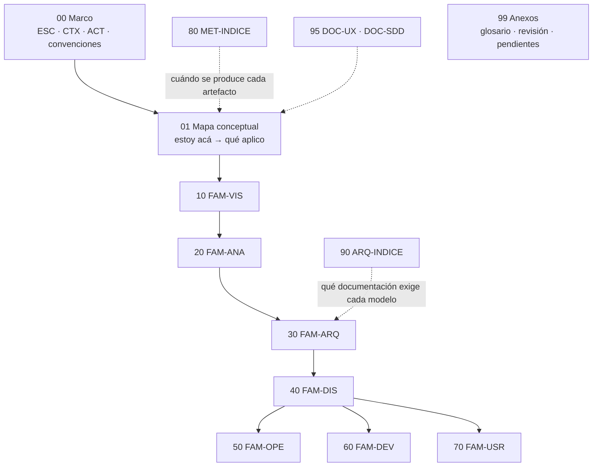

# 01 · Documentación técnica

> **Propósito**: qué tipos de documentación técnica existen (28 del catálogo, en siete familias), cuál
> producir según escenario, contexto y actor, cómo evaluar una versión buena frente a una pobre, y cómo
> montar un **sistema documentador** *docs as code* que publique esa documentación por audiencia y por rol.
> Cubre `Guides/Documentacion-Tecnica/` (131 archivos versionados en `fe10086`). El **cuerpo nuevo** `SDEI` del
> sistema documentador, que reemplaza al apunte, tiene su propio índice: [11](11_Sistema-Documentador-SDEI.md).
> **Fuentes primarias**: `Guides/Documentacion-Tecnica/Creacion-Guias-Tecnicas/README.md` (`GUIA-INDICE`),
> `…/01-Mapa-Conceptual/Mapa-Conceptual.md` (`MAPA-CONCEPTUAL`) y
> `Guides/Documentacion-Tecnica/Sistema-De-Documentacion-E-Integracion/Sistema-Documentador-Tecnico-Guide.md` (`DOC-SDT-0001`).
> **Vigencia**: verificado contra `Lab-Documentos` en `5d5c2b4` (2026-10-18); las filas del sistema documentador,
> re-verificadas contra `fe10086` (2026-10-27, v4.1). Las rutas de este índice son relativas a `Lab-Documentos/`.

## En una pantalla

- El dominio tiene **dos guías** bajo `Guides/Documentacion-Tecnica/`:
  1. `Creacion-Guias-Tecnicas/` — la guía **madre** del corpus (59 `.md`, 20 700 líneas, 87 diagramas
     Mermaid): marco → mapa → siete familias → series y transversales → anexos. Fija el frontmatter y los
     prefijos de identificador que reutilizan las guías hermanas.
  2. `Sistema-De-Documentacion-E-Integracion/` — desde `fe10086`, el **cuerpo `SDEI`** (README, Marco, Mapa, siete
     temas, anexos, mini demo; ver [11](11_Sistema-Documentador-SDEI.md)). Conserva el **apunte** original
     (`DOC-SDT-0001`, 841 líneas, hoy `status: obsoleto`, con tabla de destinos hacia el cuerpo)
     sobre *docs as code*: de Markdown al portal publicado (caso OneSignal/Mintlify), audiencias y privilegios,
     ayuda por rol en un panel .NET (caso Lab-Geometria) y ciclo de vida de la documentación; con una
     **prueba de concepto** ejecutable en devcontainer (`Examples/Prueba-Ayuda-Por-Rol/`).
- Dominio de ejemplo recurrente de la guía madre: **sistema de reserva de salas**. Tecnologías como
  vocabulario (no se enseñan): .NET/C#, Blazor *interactive server*, ASP.NET MVC, .NET MAUI con MVVM
  (`…/00-Marco-de-Referencia/Convenciones.md` §Vocabulario y ejemplos).
- Las normas ISO/IEC/IEEE se citan por designación, sección e idea, **nunca por texto** (licencia)
  (`Convenciones.md` §Trazabilidad y fuentes; `99-Anexos/Pendientes.md` `VER-02`).
- La reorganización `9162e07` (2026-09-28) movió ambas guías a su ubicación actual «sin cambios de
  contenido»: por eso **los enlaces relativos que cruzan guías quedaron rotos** (ver [Hallazgos](#hallazgos)).

## Inventario

### Guías y documentos raíz

| Ruta (bajo `Guides/Documentacion-Tecnica/`) | `doc_id` | Versión | Estado | `last_review` | Líneas |
|---|---|---|---|---|---:|
| `Creacion-Guias-Tecnicas/README.md` | `GUIA-INDICE` | — (sin campo) | `vigente` | 2026-07-18 | 240 |
| `Creacion-Guias-Tecnicas/**` (59 `.md` en total) | 59 `doc_id` únicos | — | todos `vigente` | todos 2026-07-18 | 20 700 |
| `Sistema-De-Documentacion-E-Integracion/Sistema-Documentador-Tecnico-Guide.md` | `DOC-SDT-0001` | v1.0.0 según `CHANGELOG.md` (no en frontmatter) | `obsoleto` (lo reemplaza `IDX-SDEI`) | 2026-10-27 | 841 |
| `Sistema-De-Documentacion-E-Integracion/Examples/Lanzar-Example.md` | `GP-SDEI-LANZAR` (frontmatter agregado en E1) | — | `borrador` | 2026-10-27 | 141 |
| `Sistema-De-Documentacion-E-Integracion/` resto del cuerpo `SDEI` | 27 `doc_id` más (`IDX-SDEI`, `MARCO-SDEI`, `TEM-SDEI-01..07`, `ANX-SDEI-*`, `GP-SDEI-*`, `DEMO-MU-*`) | `2.0.0-borrador` (README) | `borrador` | 2026-10-27 | ver [11](11_Sistema-Documentador-SDEI.md) §3 |
| `Sistema-De-Documentacion-E-Integracion/Examples/Prueba-Ayuda-Por-Rol/` | — | — | — | capturas del 2026-09-19 | 40 archivos |

Ningún documento de la guía madre declara versión; el dato de vigencia es `status` + `last_review`
(`Convenciones.md` §Frontmatter obligatorio). Historia git del dominio: `fab7258` (2026-09-13),
`dade777` (2026-09-21, alta del apunte y su prueba) y `9162e07` (2026-09-28, reorganización).

### Guía madre por bloque (`Creacion-Guias-Tecnicas/`)

| Carpeta | `doc_id` (archivo) | Líneas |
|---|---|---:|
| `00-Marco-de-Referencia/` | `MARCO-ESCENARIOS` (Escenarios 224) · `MARCO-CONTEXTOS` (Contextos 157) · `MARCO-ACTORES` (Actores 259) · `MARCO-CONVENCIONES` (Convenciones 107) | 747 |
| `01-Mapa-Conceptual/` | `MAPA-CONCEPTUAL` (Mapa-Conceptual 286) | 286 |
| `10-Vision/` | `FAM-VIS` (README 133) · `DOC-VISION` (Vision-Document 278) · `DOC-BRD` (297) · `DOC-PRD` (317) · `DOC-ROADMAP` (293) | 1 318 |
| `20-Analisis/` | `FAM-ANA` (README 78) · `DOC-SRS` (642) · `DOC-DOMINIO` (Modelo-de-Dominio 401) | 1 121 |
| `30-Arquitectura/` | `FAM-ARQ` (README 143) · `DOC-SAD` (634) · `DOC-HLD` (436) · `DOC-ADR` (672) · `DOC-SECARQ` (Arquitectura-de-Seguridad 424) · `DOC-THREAT` (Threat-Model 401) · `DOC-RFC` (406) | 3 116 |
| `40-Diseno/` | `FAM-DIS` (README 113) · `DOC-LLD` (431) · `DOC-DATOS` (Modelo-de-Datos 368) · `DOC-API` (API-Specification 507) · `DOC-INTEGRACION` (Integration-Guide 347) | 1 766 |
| `50-Operativa/` | `FAM-OPE` (README 182) · `DOC-INSTALL` (349) · `DOC-DEPLOY` (418) · `DOC-OPERACION` (Operations-Guide 427) · `DOC-ADMIN` (Administrator-Guide 352) · `DOC-RUNBOOK` (444) · `DOC-POSTMORTEM` (376) | 2 548 |
| `60-Desarrollo/` | `FAM-DEV` (README 100) · `DOC-DEVGUIDE` (598) · `DOC-TESTPLAN` (357) · `DOC-TESTCASES` (507) · `DOC-RELEASE` (Release-Notes 323) · `DOC-CHANGELOG` (Change-Log 339) | 2 224 |
| `70-Usuarios/` | `FAM-USR` (README 125) · `DOC-MANUAL` (User-Manual 817, el más largo) | 942 |
| `80-Metodos-Agiles/` | `MET-INDICE` (README 127) · `MET-MANIFIESTO` (359) · `MET-SCRUM` (431) · `MET-KANBAN` (417) · `MET-CANVAS` (493) · `MET-COMPARATIVA` (373) | 2 200 |
| `90-Modelos-de-Arquitectura/` | `ARQ-INDICE` (README 157) · `ARQ-CS` (485) · `ARQ-CAPAS` (407) · `ARQ-MONO` (454) · `ARQ-HEX` (416) · `ARQ-MICRO` (535) · `ARQ-COMPARATIVA` (376) | 2 830 |
| `95-Transversales/` | `DOC-UX` (UX-UI-y-Flujo-de-Usuario 519) · `DOC-SDD` (Spec-Driven-Development 524) | 1 043 |
| `99-Anexos/` | `ANEXO-GLOSARIO` (126) · `ANEXO-REVISION` (Revision-de-Consistencia 101) · `ANEXO-PENDIENTES` (92) | 319 |

## Estructura de la guía madre

Flechas llenas: dependencia de contenido (un SRS sin PRD queda sin justificación). Punteadas: modulación;
métodos y modelos **no agregan artefactos**, cambian cuáles se exigen y con qué profundidad
(`01-Mapa-Conceptual/Mapa-Conceptual.md` §Estructura de la guía).

### Marco de referencia (`00-Marco-de-Referencia/`): los tres ejes

| Eje | Valores | Qué responde |
|---|---|---|
| Escenarios `ESC-` (`Escenarios.md`) | `ESC-1` desarrollo nuevo (prescriptivo) · `ESC-2` migración a otro lenguaje/plataforma (doble: describe el origen, prescribe el destino) · `ESC-3` evaluación con acceso al código (descriptivo/reconstructivo) · `ESC-4` evaluación sólo desde afuera (inferencial, hipótesis marcadas) | La situación de partida; cada documento temático trae las cuatro entradas |
| Contextos `CTX-` (`Contextos.md`) | `CTX-1` web y cliente interactivo (riesgo: documentar pantallas y no flujos) · `CTX-2` backend y servicios (riesgo: endpoints y no dominio) · `CTX-3` fullstack (riesgo: perder la traza entre mitades) | El entorno técnico y su superficie de contrato |
| Actores `ACT-` (`Actores.md`) | `ACT-01` PO · `02` Analista funcional · `03` Arquitecto · `04` Desarrollador · `05` QA · `06` DevOps/SRE · `07` Seguridad · `08` UX/UI · `09` Technical Writer · `10` Agente de IA (autoridad: ninguna; «produce borradores trazables») | Quién produce, aprueba, es consultado o informado (matriz RACI reducida por familia) |
| Convenciones (`Convenciones.md`) | Prefijos de ID, frontmatter obligatorio, estructura de 7 secciones, estilo, regla «no duplicar» | Cómo está escrita la guía (no enseña documentación) |

`ESC-2` es el escenario de **mayor riesgo documental** (`99-Anexos/Pendientes.md` `HUE-03`); la operativa en
migración (corte, coexistencia, vuelta atrás) es «la parte donde las migraciones fallan»
(`Mapa-Conceptual.md` §Cruce escenario × familia).

### Mapa conceptual (`01-Mapa-Conceptual/Mapa-Conceptual.md`)

| Sección | Responde |
|---|---|
| Tabla de entrada 1 — por escenario | «Estoy migrando: qué abro y en qué orden» (columna de prioridad = orden de producción) |
| Tabla de entrada 2 — por contexto | «Trabajo en backend: qué me interviene» |
| Tabla de entrada 3 — por artefacto | «Me pidieron un HLD: qué es y dónde vive» (una subsección por familia + transversales) |
| Cruce escenario × familia | Intensidad ● ◐ ○ de cada familia en `ESC-1..4` |
| Cruce actor × familia | Quién produce y quién aprueba (resumen; la RACI completa está en `Actores.md`) |
| Cómo entrar a la guía | Estudiar · resolver algo concreto · evaluar documentación ajena |

### Las siete familias documentales

| Familia (carpeta) | Pregunta | Documentos (`doc_id`) | Artefactos «menores» como **sección** interna |
|---|---|---|---|
| 1 `FAM-VIS` (`10-Vision/`) | ¿Qué queremos construir? | `DOC-VISION`, `DOC-BRD`, `DOC-PRD`, `DOC-ROADMAP` | — |
| 2 `FAM-ANA` (`20-Analisis/`) | ¿Qué debe hacer el sistema? | `DOC-SRS`, `DOC-DOMINIO` | Casos de uso y reglas de negocio → SRS |
| 3 `FAM-ARQ` (`30-Arquitectura/`) | ¿Cómo estará organizado? | `DOC-SAD`, `DOC-HLD`, `DOC-ADR`, `DOC-SECARQ`, `DOC-THREAT`, `DOC-RFC` | Diagramas y arquitectura de despliegue → SAD |
| 4 `FAM-DIS` (`40-Diseno/`) | ¿Cómo se implementa cada componente? | `DOC-LLD`, `DOC-DATOS`, `DOC-API`, `DOC-INTEGRACION` | UML e interfaces/contratos internos → LLD |
| 5 `FAM-OPE` (`50-Operativa/`) | ¿Cómo se instala, mantiene y opera? | `DOC-INSTALL`, `DOC-DEPLOY`, `DOC-OPERACION`, `DOC-ADMIN`, `DOC-RUNBOOK`, `DOC-POSTMORTEM` | Disaster recovery → Operations Guide |
| 6 `FAM-DEV` (`60-Desarrollo/`) | ¿Cómo trabajamos sobre el proyecto? | `DOC-DEVGUIDE`, `DOC-TESTPLAN`, `DOC-TESTCASES`, `DOC-RELEASE`, `DOC-CHANGELOG` | Coding standards, git workflow, convenciones, CI/CD → Developer Guide |
| 7 `FAM-USR` (`70-Usuarios/`) | ¿Cómo se utiliza el sistema? | `DOC-MANUAL` | Tutoriales, FAQ, guías rápidas → User Manual |

Cada familia tiene su `README.md` (índice de familia con `doc_id` `FAM-*`). Las plantillas **no están
centralizadas**: cada documento temático cierra con su plantilla comentada (`README.md` §Anexos).

#### Estructura de un documento temático (`Convenciones.md` §Estructura)

1 Resumen ejecutivo · 2 Definición (qué es, qué no es, con qué se confunde) · 3 Aplicación por escenario
(`ESC-1..4` × `CTX-1..3`; la fila que no aplica se conserva y se explica) · 4 Ejemplos concretos (reserva de
salas) · 5 Preguntas guía · 6 Criterios de calidad y antipatrones · 7 Anexo: plantilla comentada.
Algunos documentos intercalan secciones propias entre 3 y 5 (ver [Hallazgos](#hallazgos)). Ejemplos de
plantilla: `30-Arquitectura/SAD.md` sigue las 12 secciones de arc42; `20-Analisis/SRS.md` trae 12 secciones
con matriz de trazabilidad; `50-Operativa/Runbook.md` abre por *Impacto* y *Mitigación inmediata* porque se
lee bajo presión.

### Series y transversales

| Serie (carpeta) | Documentos | Ángulo y piezas clave |
|---|---|---|
| Métodos ágiles `MET-` (`80-Metodos-Agiles/`) | `MET-MANIFIESTO`, `MET-SCRUM`, `MET-KANBAN`, `MET-CANVAS`, `MET-COMPARATIVA` | Documental: qué produce, exige y elimina cada método. Scrum concentra la exigencia en la Definition of Done; Kanban la distribuye en criterios de salida por columna. `MET-COMPARATIVA` decide con **seis variables** (escenario, contexto, tamaño de equipo, madurez, previsibilidad exigida, marco regulatorio) y trae ficha de decisión |
| Modelos de arquitectura `ARQ-` (`90-Modelos-de-Arquitectura/`) | `ARQ-CS`, `ARQ-CAPAS`, `ARQ-MONO` (incluye monolito modular), `ARQ-HEX`, `ARQ-MICRO`, `ARQ-COMPARATIVA` | El mismo sistema de reservas bajo los cinco modelos; `ARQ-COMPARATIVA` cruza atributos ISO/IEC 25010 × modelo y **artefacto × modelo** (p. ej. microservicios: «todas las vistas, ninguna opcional», un HLD y una API versionada por servicio) |
| `DOC-UX` (`95-Transversales/UX-UI-y-Flujo-de-Usuario.md`) | Flujos (`FLU-`), inventario de estados, sistema de diseño ≠ biblioteca de componentes | Mínimo de **seis estados** por pantalla en `CTX-1` (vacío, cargando, con datos, error recuperable, error no recuperable, sin permiso) + dos de Blazor *interactive server* (circuito desconectado / reconectado) |
| `DOC-SDD` (`95-Transversales/Spec-Driven-Development.md`) | Ciclo intención → especificación → plan → tareas → código → verificación | La especificación es la fuente de verdad; **siete propiedades** de una especificación apta para agente (IDs estables, criterios verificables, contratos explícitos, sin ambigüedad vía `RFC 2119`, contexto autocontenido, restricciones negativas, trazabilidad). Sólo `status: vigente` entra al ciclo SDD. Riesgos: alucinación, deriva spec↔código, sobreespecificación, falsa completitud |

### Anexos (`99-Anexos/`)

| Archivo | Para qué |
|---|---|
| `Glosario.md` (`ANEXO-GLOSARIO`) | Término canónico, definición, alias; distingue glosario del oficio vs glosarios de plantilla; cierra con «términos que la guía evita» (p. ej. «documentación» a secas) |
| `Revision-de-Consistencia.md` (`ANEXO-REVISION`) | Acta de la revisión: qué se verificó, 11 IDs divergentes unificados (`FAM-DES`/`FAM-QA` → `FAM-DEV`, `DOC-TEST-PLAN` → `DOC-TESTPLAN`, …), decisiones de criterio propio (28 filas y no 27; Test Plan/Cases y Release/Change Log en `FAM-DEV`; alta de `ACT-10`; dominio de reserva de salas en lugar de «HomeHub»). **Leer antes de extender la guía** |
| `Pendientes.md` (`ANEXO-PENDIENTES`) | Backlog vivo, por prioridad (tabla abajo). Las entradas resueltas se eliminan y se registran en el `CHANGELOG.md` del repo |

| ID | Prioridad | Hueco |
|---|---|---|
| `HUE-01` | 1 disperso | Métricas de ingeniería (DORA, flujo) repartidas entre Developer Guide, Test Plan y Kanban |
| `HUE-02` | 1 disperso | Gobierno documental (propiedad, revisión, retiro). «La guía enseña a producir y evaluar, no a mantener viva» |
| `HUE-03` | 2 sin dueño | Guía de transición para migraciones (`ESC-2`), sin `doc_id` |
| `HUE-04` | 2 sin dueño | Catálogo de errores de API traducido a mensajes de interfaz |
| `HUE-05` | 3 no cubierto | Arquitecturas orientadas a eventos y CQRS (candidato más fuerte) |
| `HUE-06`, `HUE-07` | 3 no cubierto | Estimación contractual; Kano/story mapping (son método, no artefacto) |
| `VER-01`, `VER-02` | 4 verificación | Revisión 2023 de ISO/IEC 25010; normas citadas sin texto por licencia |
| `CNV-01`, `CNV-02` | 5 convención | `[Sin publicar]` vs `[Unreleased]` en changelog; traza cruzada Release Notes ↔ Change Log (v1.3.1) |

### Rutas de lectura (`Creacion-Guias-Tecnicas/README.md` §Ruta de lectura sugerida)

Cinco tramos: 1 marco y mapa (**único obligatorio**) → 2 familias 1–2 (frontera PRD ↔ SRS) → 3 familias
3–4 (si el tiempo aprieta: SAD, ADR, LLD, modelo de datos, API) → 4 familias 5–7 (Runbook y Postmortem se
leen bajo presión) ∥ 5 métodos, modelos y transversales. Rutas cortas por rol: Analista, Arquitecto,
Desarrollador, QA (tramo 1 → SRS → Test Plan → Test Cases → Postmortem), DevOps, PO y Technical Writer.

## Sistema documentador (`Sistema-De-Documentacion-E-Integracion/`)

> **Desde `fe10086` este apunte está `obsoleto`.** Lo reemplaza el cuerpo `SDEI`
> ([11](11_Sistema-Documentador-SDEI.md)); la §Tabla de destinos del apunte lleva cada una de sus 47 secciones
> a un tema o anexo (38 completas, 9 parciales). Esta sección se conserva como antecedente y para leer el
> apunte hasta que se archive.

Apunte `DOC-SDT-0001` — pregunta de origen: ¿el portal de OneSignal nace de Markdown que un servicio
renderiza? Respuesta verificada: **sí** (Mintlify sobre MDX + `openapi.json` 3.1). De ahí escala a cómo montar
un documentador propio.

| § | Tema | Qué responde / destila |
|---|---|---|
| 1 | El sitio consultado | Evidencia con `curl`: `<meta generator=Mintlify>`, `.md` crudo por página (MDX con componentes JSX), referencia de API derivada de OpenAPI 3.1, `llms.txt` con 170 páginas para agentes |
| 2 | Modelo *docs as code* | Definición de Write the Docs (5 componentes: issue tracker, Git, texto plano, code review, pruebas); flujo autor → PR → validación → build → HTML / `.md`+`llms.txt` / playground; adopción (`github/docs`, `MicrosoftDocs/azure-docs`, `kubernetes/website`, `mintlify/docs`) |
| 3 | Piezas de un documentador | Tabla pieza → función → alternativas: fuente de prosa, fuente de contrato, navegación, componentes, fragmentos, validación (`lychee`, `markdownlint`, `spectral`, Vale), build/hosting, salida para agentes; estructura Diátaxis |
| 4 | Respuestas directas | Markdown sí; generación parcial (prosa a mano, referencia desde OpenAPI); publicación automática |
| 5 | Audiencias y privilegios | Familia → lector → tipo Diátaxis → **portal interno/externo**; un vault, varias publicaciones; **rol del producto** (filtrado por metadatos) ≠ **confidencialidad** (se separa en el build, no en la vista); nombres de industria: *docs as code*, *internal developer portal* (Backstage/TechDocs), *single sourcing / conditional processing* (DITA 1.3) |
| 6 | Caso Lab-Geometria (`4b114d7`) | Estado: SDD en el repo de código, API sirve su OpenAPI + Scalar (`ADR-08008`), **no hay manual de usuario**. Regla: «¿tiene que cambiar en el mismo PR que el código?» → mismo repo. Tres salidas: el panel renderiza la ayuda del usuario, la API sirve su contrato, lo interno se compila aparte (DocFX/MkDocs) |
| 7 | Propuesta: ayuda por rol | `HelpCatalog` singleton sobre recursos `Ayuda/**.md` incrustados; `/ayuda/{slug}`, `.md` y `llms.txt` **filtrados por rol**; contrato de frontmatter (`title`, `description`, `roles`, `order`, `traces` con versión de CU, `topic`, `translation_of`); derivación CU → página (no generación); idiomas por árbol de `.md` + *culture fallback*; 8 validaciones de CI (3 probadas). Toda la sección es **propuesta**; no se construyó en Lab-Geometria |
| 8 | Ciclo de vida de la documentación | Fases planificado → borrador → en revisión → vigente → desactualizado/obsoleto → archivado (diagrama de estados); anclajes PR / changelog `Unreleased` / tag; metadatos comparados (corpus, SDD Lab-Geometria, Microsoft Learn `ms.date`/`ms.author`/`ms.update-cycle`); **tres formas de envejecer** (cambio de fuente → CI; tiempo → tarea programada; traducción → CI); deprecar antes de remover; actores por fase |
| 9 | 15 preguntas guía | Checklist para diseñar un documentador propio |
| 10 | Observaciones | Hechos / interpretaciones / no verificado (p. ej. si OneSignal genera su OpenAPI desde código: **no verificado**) |
| 11–12 | Glosario y registro de evidencias | 16 términos; 37 fuentes con método y fecha (2026-09-16 y 2026-09-19) |

### Ejemplos y cómo se usan

| Ruta (bajo `…/Sistema-De-Documentacion-E-Integracion/Examples/`) | Qué demuestra | Stack | Cómo se corre |
|---|---|---|---|
| `Prueba-Ayuda-Por-Rol/Consola/` (`Spike.csproj`, `Program.cs`, `Ayuda/{comun,alumno,administrador}/*.md`, `salida.txt`) | Motor aislado: catálogo, filtro por rol (404 si no alcanza), `llms.txt` por rol, escape de HTML (`DisableHtml()`), validador de enlaces y cruces de rol. **Termina en `exit=1` a propósito**: 3 fallas, 2 plantadas y 1 hallada por el validador (`comun/ingresar` → página sólo de alumno) | .NET 10, Markdig 0.45.0, YamlDotNet 16.3.0 | `docker run … mcr.microsoft.com/dotnet/sdk:10.0 dotnet run` (comando en `Prueba-Ayuda-Por-Rol/README.md` §La consola) |
| `Prueba-Ayuda-Por-Rol/Web/` (`AyudaDemo.Web.csproj`, `HelpCatalog.cs`, `Program.cs`, `Textos.cs`, `Components/**.razor` —páginas `Ingresar`, `Inicio`, `Ayuda`, `NoEncontrada`—, `Ayuda/{es,en}/**.md`, `Resources/Textos.en.resx`, `wwwroot/app.css`) | Panel Blazor (render estático de servidor) con ingreso simulado por papel (`/entrar/{role}`), ayuda contextual (`AyudaContextual.razor`), 404 por rol, `.md` fuente, `llms.txt`, dos idiomas con respaldo al español y aviso. Al arrancar: «Catálogo de ayuda: 9 páginas, validador con 0 fallas» (7 en `es/` + 2 en `en/`) | .NET 10 Blazor, Markdig, YamlDotNet, `AddLocalization` + `.resx` sólo para cadenas de UI | Devcontainer (`.devcontainer/devcontainer.json`, imagen `mcr.microsoft.com/devcontainers/dotnet:1-10.0`, puerto 5190): *Reopen in Container* o `npx @devcontainers/cli up/exec … dotnet run --project Web/AyudaDemo.Web.csproj` |
| `Prueba-Ayuda-Por-Rol/capturas/` | 7 PNG (2026-09-19): ingreso, panel alumno, enviar, 404, inglés sin traducir, panel admin, cuentas | — | Inventariadas, no leídas |
| `Lanzar-Example.md` | **Tool-prompt** para levantar la demo en su devcontainer, exponerla por túnel rápido de Cloudflare (`demo-ayuda-por-rol-tunnel`, `*.trycloudflare.com`) y entregar la URL; variantes `--estado` y `--bajar` | Docker, devcontainers CLI, cloudflared | «Leer y ejecutar `/LAB/Lab-Documentos/Guides/Documentacion-Tecnica/Sistema-De-Documentacion-E-Integracion/Examples/Lanzar-Example.md`». Reglas: sólo `Production` al exponer, no tocar túneles `jump-host-tunnel-*`, reintentos ante `000` los primeros minutos del nombre |

El contenido de `Web/Ayuda/` deriva de `CU-00022`, `CU-00023`, `CU-00024`, `CU-00026`, `CU-00028` y
`CU-00029` (v1.1) de Lab-Geometria y lo declara en `traces` (`Prueba-Ayuda-Por-Rol/README.md`). **No es
código de Lab-Geometria.** Aprendizaje registrado (§7.8): en .NET 10, fijar `StatusCode = 404` desde un
componente de render estático devuelve cuerpo vacío; lo que funciona es `NavigationManager.NotFound()` +
`NotFoundPage` en el `Router`.

## Conceptos y decisiones clave

| Concepto / decisión | Destilado | Fuente |
|---|---|---|
| Enlazar por ID, no por ruta | «Los archivos se mueven, los IDs no» | `Creacion-Guias-Tecnicas/00-Marco-de-Referencia/Convenciones.md` §Identificadores |
| `origin` + `confidence` | Mecanismo para distinguir lo verificado de lo inferido; condición para que un agente participe sin degradar la confiabilidad | `Convenciones.md` §Frontmatter; `95-Transversales/Spec-Driven-Development.md` §La doble audiencia |
| Artefacto menor = sección | Casos de uso, CI/CD, DR, FAQ, etc. viven dentro del documento de su familia | `Creacion-Guias-Tecnicas/README.md` §Alcance y límites |
| Familia según dueño natural | Test Plan/Cases, Release Notes y Change Log en `FAM-DEV`; RFC, Threat Model y seguridad en `FAM-ARQ` | `99-Anexos/Revision-de-Consistencia.md` §Decisiones de criterio propio |
| Criterio de paridad de `ESC-2` | Se desarrolla completo en el Test Plan; BRD y SAD lo referencian | ídem |
| Estados de pantalla 4 vs 6 | Cuatro es el piso para toda la guía (`Contextos.md`); seis cuando la pieza es la interfaz (`DOC-UX`) | ídem §Estados de pantalla |
| Agente de IA sin autoridad | `ACT-10` «produce borradores, no decide»; el apunte lo reutiliza para la ayuda derivada | `00-Marco-de-Referencia/Actores.md`; `Sistema-Documentador-Tecnico-Guide.md` §7.4 |
| Derivar ≠ generar | La ayuda se **deriva** del CU (reescrita, con traza versionada); la referencia de API se **genera** del contrato | `Sistema-Documentador-Tecnico-Guide.md` §4, §7.4 |
| Rol ≠ confidencialidad | El rol se filtra en el servidor por metadatos; lo confidencial se separa en el build | ídem §5.3, §7.5 |
| Mismo repo si cambia en el mismo PR | Regla de ubicación de un documento nuevo | ídem §6.2, §8.3 |
| Versionar docs publicadas sólo si conviven versiones | Si no, publicar la desplegada y dejar los tags | ídem §6.3, pregunta 10 |

## Relaciones con otras guías del repo

| Guía | Relación | Evidencia |
|---|---|---|
| `Guides/Despliegue/Documentacion-Informe-Despliegue/` | **Guía hermana**: compone SAD, SRS, Deployment Guide y ADR en un informe único; remite a la guía madre documento por documento | 54 enlaces hacia `Documentacion-Tecnica` (todos rotos, ver Hallazgos) |
| `Guides/Arquitectura/Organizacion-Estilo-Rest-API/` | Reutiliza dominio y convenciones; sus transversales remiten a `DOC-UX`, `DOC-SDD`, `DOC-API`, `DOC-INTEGRACION`, `DOC-CHANGELOG`, `ARQ-INDICE`, `ARQ-HEX` | 21 enlaces (rotos) |
| `Guides/Arquitectura/Organizacion-Estilo-Patrones-Codigo/` | Mismo dominio de ejemplo (reserva de salas) y convenciones | 1 enlace (roto) en su `README.md` |
| `Guides/IA/SDD-Guide/` | Mismo tema que `DOC-SDD` desde otro ángulo; no hay enlaces ni menciones de `doc_id` entre ambas | `git grep` sin coincidencias |
| `Sistema-Documentador-Tecnico-Guide.md` ↔ guía madre | El apunte usa las familias, `doc_id` y actores de la guía madre y agrega la dimensión «hacia qué portal se compila cada familia»; su §8 (ciclo de vida) cubre materia del `HUE-02` (gobierno documental) — *interpretación de este índice; `Pendientes.md` no lo registra como resuelto* | §5.1, §8.4, §8.7 |

## Hallazgos

| Tipo | Ruta | Detalle |
|---|---|---|
| Enlaces rotos (salientes) | `Guides/Documentacion-Tecnica/Sistema-De-Documentacion-E-Integracion/Sistema-Documentador-Tecnico-Guide.md` | **Resuelto en `fe10086`** (E1-U1): los 8 enlaces a `../Documentacion-Tecnica/…` apuntan ahora a `../Creacion-Guias-Tecnicas/…`; la compuerta `docs-guard` verifica la carpeta con lychee sin red |
| Enlaces rotos (entrantes) | `Guides/Despliegue/Documentacion-Informe-Despliegue/**`, `Guides/Arquitectura/Organizacion-Estilo-Rest-API/**`, `Guides/Arquitectura/Organizacion-Estilo-Patrones-Codigo/README.md` | 76 enlaces (54 + 21 + 1) apuntan a `../../Documentacion-Tecnica/…` o `../Documentacion-Tecnica/…`, que tras `9162e07` resuelven a carpetas inexistentes |
| Ruta obsoleta | `…/Examples/Lanzar-Example.md` (tabla «Rutas y nombres fijos») | **Resuelto en `fe10086`**: `$P` y la invocación usan la ruta actual |
| Afirmación desactualizada | `Creacion-Guias-Tecnicas/README.md` §Estado del cuerpo documental | Declara «ningún enlace roto» e «Índice 1 · 237 líneas»; el README tiene hoy 240 líneas y los anexos 319 (declara 323). El total 20 700 coincide con el real, pero la propia tabla suma 20 701 con sus filas (237 + 323). `Revision-de-Consistencia.md` dice «57 archivos»; hoy son 59 |
| Referencia sin destino | `Creacion-Guias-Tecnicas/01-Mapa-Conceptual/Mapa-Conceptual.md` §Cómo entrar a la guía | Remite a «la ruta detallada, con tiempos estimados» del README; el README no trae tiempos |
| Frontmatter fuera de convención | `Sistema-Documentador-Tecnico-Guide.md` | En `fe10086` usa el vocabulario de la convención (`obsoleto`, `ia-generated`, `alta`, `[humano, agente]`) y no repite trazas; siguen propios `doc_type: study-note` (admitido por el esquema del cuerpo `SDEI`) y el `doc_id` `DOC-SDT-0001` |
| Estructura no uniforme | `Creacion-Guias-Tecnicas/{30,40,50}-*/*.md`, `80-*/`, `90-*/` | `Convenciones.md` dice que la estructura de 7 secciones «se respeta sin variaciones», pero hay documentos con secciones intermedias propias y numeración extendida (`50-Operativa/Deployment-Guide.md` 1–11, `40-Diseno/API-Specification.md` 1–9) y otros sin numerar (familias 1–2, series 80/90). El orden relativo de las 7 se conserva |
| Norma externa al repo | `Creacion-Guias-Tecnicas/00-Marco-de-Referencia/Convenciones.md` §Estructura | Cita el Profile `Study-Guide-Documentation` como norma de la estructura; no está en `Lab-Documentos`: vive en el framework de prompts del workspace (`IA/PROMPTs/IA.Prompts/PromptFramework/Profiles/Study-Guide-Documentation.md`), sin enlace desde la guía |
| Rango de CU inconsistente | `Sistema-De-Documentacion-E-Integracion/Sistema-Documentador-Tecnico-Guide.md` §7.8 vs §7.9 | §7.8 dice «nueve páginas derivadas de `CU-00022` a `CU-00029`»; §7.9 dice «derivadas de `CU-00021` a `CU-00029`». `Examples/Prueba-Ayuda-Por-Rol/README.md` enumera seis CU (`00022`, `00023`, `00024`, `00026`, `00028`, `00029`) |
| Sin versión | `Creacion-Guias-Tecnicas/**` | Ningún documento declara versión; todos `last_review: 2026-07-18`. El apunte tampoco (v1.0.0 sólo en `CHANGELOG.md`) |
| CHANGELOG con ruta vieja | `CHANGELOG.md` (entrada 2026-09-21) | Registra el apunte como `Guides/Sistema-Documentador-Tecnico-Guide/`; no hay entrada que documente la mudanza a `Documentacion-Tecnica/Sistema-De-Documentacion-E-Integracion/` |
| Enlaces rotos deliberados | `…/Prueba-Ayuda-Por-Rol/Consola/Ayuda/administrador/habilitar-cuentas.md`; `Web/Ayuda/en/{alumno,comun}/*.md` | `../comun/no-existe.md` es un defecto **plantado**; los de `en/` apuntan a páginas que sólo existen en `es/` y los resuelve el catálogo con respaldo de idioma. No son defectos; desde `fe10086` el README de la prueba lo dice y la compuerta los excluye con nombre y motivo |
| Huecos declarados | `Creacion-Guias-Tecnicas/99-Anexos/Pendientes.md` | `HUE-01..07`, `VER-01..02`, `CNV-01..02` abiertos (ver tabla de Anexos) |
| `doc_id` en plantillas | `Creacion-Guias-Tecnicas/40-Diseno/API-Specification.md:442`, `Integration-Guide.md:286`, `Modelo-de-Datos.md:304` | Los 60 `doc_id` de frontmatter son únicos, pero estas tres plantillas comentadas escriben literalmente `doc_id: DOC-API` / `DOC-INTEGRACION` / `DOC-DATOS` —el mismo ID del documento de la guía—, igual que el ejemplo de frontmatter de `00-Marco-de-Referencia/Convenciones.md:46` (`doc_id: DOC-SAD`), mientras las demás plantillas usan un marcador propio (`SAD-<sistema>`, `RB-<nnn>`, `DOC-PRD-<producto>`…). Un `grep '^doc_id:'` ve duplicados. El esquema de los marcadores tampoco es uniforme (con y sin `DOC-`) |
| Archivos | todo el dominio | Sin archivos versionados vacíos; sin nombres con caracteres raros. Hay `bin/`/`obj/` locales en `Prueba-Ayuda-Por-Rol/Web/`, ignorados por su `.gitignore` |

## Para preguntas X → leé Y

| Necesitás saber… | Leé (ruta bajo `Guides/Documentacion-Tecnica/`) |
|---|---|
| Qué documento producir en mi situación (nuevo, migración, auditoría) | `Creacion-Guias-Tecnicas/01-Mapa-Conceptual/Mapa-Conceptual.md` §Tabla de entrada 1 |
| Qué es un SAD/HLD/LLD/ADR/RFC y en qué se diferencian | `Creacion-Guias-Tecnicas/30-Arquitectura/*.md` y `40-Diseno/LLD.md` §2 Definición |
| Frontera PRD ↔ SRS; casos de uso y reglas de negocio | `10-Vision/PRD.md`, `20-Analisis/SRS.md` §Casos de uso, §Reglas de negocio |
| Plantilla comentada de un artefacto | El anexo final del documento del artefacto (no hay carpeta de plantillas) |
| Cómo evaluar documentación ajena | `Mapa-Conceptual.md` §Tabla de entrada 3 + §Criterios de calidad de cada documento |
| Quién produce y aprueba cada familia | `00-Marco-de-Referencia/Actores.md` §Matriz de responsabilidad |
| Frontmatter, prefijos de ID y estilo del corpus | `00-Marco-de-Referencia/Convenciones.md` |
| Qué documentación exige un modelo de arquitectura | `90-Modelos-de-Arquitectura/Comparativa-y-Criterios.md` |
| Qué documentación exige Scrum/Kanban | `80-Metodos-Agiles/Comparativa-y-Criterios.md` |
| Especificar para un agente de IA | `95-Transversales/Spec-Driven-Development.md` §Qué hace que una especificación sea apta |
| Estados de pantalla y flujos | `95-Transversales/UX-UI-y-Flujo-de-Usuario.md` §Artefactos documentales |
| Qué falta en la guía / antes de extenderla | `99-Anexos/Pendientes.md`, `99-Anexos/Revision-de-Consistencia.md` |
| Cómo diseñar un sistema documentador, su ciclo, compuertas y doble audiencia (vigente) | Cuerpo `SDEI`: `Sistema-De-Documentacion-E-Integracion/README.md` → [11](11_Sistema-Documentador-SDEI.md) §10 |
| Cómo publicar docs como código (Mintlify, MkDocs, DocFX, `llms.txt`) — antecedente | `Sistema-De-Documentacion-E-Integracion/Sistema-Documentador-Tecnico-Guide.md` §2–3 (obsoleto; su §Tabla de destinos dice adónde fue) |
| Portal interno vs externo; documentación por rol | ídem §5, §7; vigente en `TEM-04` y `TEM-05` del cuerpo |
| Ciclo de vida, frescura, deprecar/archivar documentación | ídem §8; vigente en `TEM-02` del cuerpo |
| Levantar la demo de ayuda por rol | `Sistema-De-Documentacion-E-Integracion/Examples/Prueba-Ayuda-Por-Rol/README.md`; para exponerla, `Examples/Lanzar-Example.md` |
