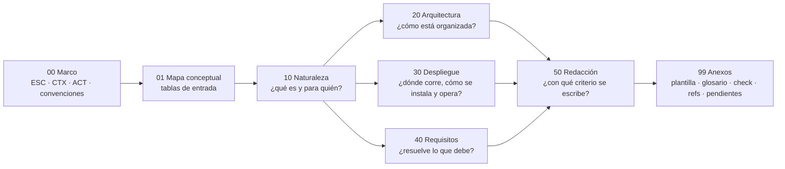

# 02 · Informe de solución (arquitectura, despliegue y requisitos)

> **Propósito**: destilar la guía de estudio que enseña a escribir **un informe que describe una
> solución de software** en términos de arquitectura, despliegue y resolución de requisitos
> funcionales y no funcionales, y su **plantilla formal** del informe. Sirve para ubicar rápido
> qué documento responde cada pregunta sin releer las ≈5 350 líneas del cuerpo.
> **Fuente primaria**: `Guides/Despliegue/Documentacion-Informe-Despliegue/README.md`
> (`GUIA-INDICE`, `status: vigente`, `last_review: 2026-07-21`).
> **Alcance**: `Guides/Despliegue/Documentacion-Informe-Despliegue/**` — 30 archivos Markdown,
> 5 348 líneas, 23 bloques Mermaid (22 en el cuerpo + 1 en el README). Sin código, sin
> binarios, sin imágenes.
> **Vigencia**: verificado contra `main` 5d5c2b4 el 2026-10-18 (ia-db v4.0).

Convención de rutas de este índice: `IDS/` abrevia
`Guides/Despliegue/Documentacion-Informe-Despliegue/` (relativo a `Lab-Documentos/`). Toda otra
ruta se da completa desde `Lab-Documentos/`.

---

## En una pantalla

- **Qué es**: guía formativa con dos objetivos declarados (`IDS/README.md` §Resumen ejecutivo):
  **formar criterio de redacción** (toda la guía) y ofrecer **un modelo formal de documento**
  (`IDS/99-Anexos/Plantilla-del-Informe.md`, `ANEXO-PLANTILLA`).
- **Disparador**: un pedido real citado en `IDS/00-Marco-de-Referencia/Escenarios.md` —«contar con
  un documento que describa la solución propuesta en términos de arquitectura, despliegue y
  resolución de requisitos funcionales y no funcionales»—, que la guía ubica en `ESC-2`.
- **Definición operativa** (`TEM-QUE-ES`): documento **transversal** (cruza análisis, arquitectura
  y operativa), **sintético** (referencia en vez de reproducir) y **orientado a una decisión**
  (integrarse, aprobar, auditar, heredar). Sin cualquiera de los tres rasgos «es otra cosa».
- **No es** un SAD, un SRS, una Deployment Guide ni un manual de usuario: los **compone** y los
  referencia a la guía hermana de documentación técnica.
- **Dominio de ejemplo único**: **sistema de gestión de audiencias** distribuido en el borde
  (`CTX-3`): escritorio + Worker por terminal, backend central, frontend Blazor, servidor de
  archivos FTP o tus, PostgreSQL. Ejemplos **sintéticos**, declarados como tales.
- **Stack de referencia** (`MARCO-CONVENCIONES` §Vocabulario): .NET 10 (LTS), C#, ASP.NET Core,
  Blazor *interactive server*, WPF/WinForms/.NET MAUI, Worker Services, PostgreSQL vía Npgsql.
- **Correcciones de fondo** que la guía impone (README §Estado y verificación):
  ISO/IEC 25010:**2023** tiene **nueve** características (*Usability*→*Interaction Capability*,
  *Portability*→*Flexibility*, nueva *Safety*); **arc42 y C4 son marcos con licencia CC, no
  normas**; la única definición citada de «arquitectura de solución» es la de **TOGAF** (`G-03`).
- **Estado**: los 30 documentos `status: vigente`, `origin: ia-assisted`, `confidence: alta`,
  `last_review: 2026-07-21`. El contenido no cambió desde la v3.0 de la ia-db: sólo se **movió**
  de `Guides/Documentacion-Informe-Despliegue/` a `Guides/Despliegue/…` (commit 9162e07,
  2026-09-28, renombre puro) — y ese movimiento rompió los enlaces a guías hermanas (ver
  [Hallazgos](#hallazgos-del-dominio)).

---

## Inventario de documentos

Los archivos no llevan campo `version`; la vigencia se lee de `status` + `last_review`. Todos:
`status: vigente`, `last_review: 2026-07-21`, `audience: [humano, agente]`.

| Ruta (desde `Lab-Documentos/`) | `doc_id` | `doc_type` | Líneas |
|---|---|---|---:|
| `IDS/README.md` | `GUIA-INDICE` | indice | 175 |
| `IDS/00-Marco-de-Referencia/Escenarios.md` | `MARCO-ESCENARIOS` | marco-de-referencia | 177 |
| `IDS/00-Marco-de-Referencia/Contextos.md` | `MARCO-CONTEXTOS` | marco-de-referencia | 175 |
| `IDS/00-Marco-de-Referencia/Actores.md` | `MARCO-ACTORES` | marco-de-referencia | 119 |
| `IDS/00-Marco-de-Referencia/Convenciones.md` | `MARCO-CONVENCIONES` | marco-de-referencia | 161 |
| `IDS/01-Mapa-Conceptual/Mapa-Conceptual.md` | `MAPA-CONCEPTUAL` | mapa | 106 |
| `IDS/10-Naturaleza-del-Informe/README.md` | `FAM-NAT` | familia | 69 |
| `IDS/10-Naturaleza-del-Informe/Que-es-y-que-no-es.md` | `TEM-QUE-ES` | tema | 237 |
| `IDS/10-Naturaleza-del-Informe/Estandares-y-Marcos.md` | `TEM-ESTANDARES` | tema | 220 |
| `IDS/10-Naturaleza-del-Informe/Audiencia-y-Proposito.md` | `TEM-AUDIENCIA` | tema | 243 |
| `IDS/20-Arquitectura/README.md` | `FAM-ARQ` | familia | 80 |
| `IDS/20-Arquitectura/Vista-de-Componentes.md` | `TEM-COMPONENTES` | tema | 233 |
| `IDS/20-Arquitectura/Vistas-y-Diagramas.md` | `TEM-VISTAS` | tema | 246 |
| `IDS/20-Arquitectura/Decisiones-de-Arquitectura.md` | `TEM-DECISIONES` | tema | 224 |
| `IDS/30-Despliegue/README.md` | `FAM-DESP` | familia | 72 |
| `IDS/30-Despliegue/Topologia-y-Entornos.md` | `TEM-TOPOLOGIA` | tema | 237 |
| `IDS/30-Despliegue/Distribucion-e-Instalacion.md` | `TEM-DISTRIBUCION` | tema | 220 |
| `IDS/30-Despliegue/Operacion-y-Resiliencia.md` | `TEM-OPERACION` | tema | 259 |
| `IDS/40-Requisitos/README.md` | `FAM-REQ` | familia | 71 |
| `IDS/40-Requisitos/Requisitos-Funcionales.md` | `TEM-RF` | tema | 200 |
| `IDS/40-Requisitos/Requisitos-No-Funcionales.md` | `TEM-RNF` | tema | 269 |
| `IDS/50-Redaccion/README.md` | `FAM-RED` | familia | 81 |
| `IDS/50-Redaccion/Estructura-del-Documento.md` | `TEM-ESTRUCTURA` | tema | 266 |
| `IDS/50-Redaccion/Criterio-de-Redaccion.md` | `TEM-CRITERIO` | tema | 242 |
| `IDS/50-Redaccion/Errores-Frecuentes.md` | `TEM-ERRORES` | tema | 256 |
| `IDS/99-Anexos/Plantilla-del-Informe.md` | `ANEXO-PLANTILLA` | anexo | 232 |
| `IDS/99-Anexos/Glosario.md` | `ANEXO-GLOSARIO` | anexo | 87 |
| `IDS/99-Anexos/Lista-de-Verificacion.md` | `ANEXO-CHECK` | anexo | 114 |
| `IDS/99-Anexos/Referencias.md` | `ANEXO-REFERENCIAS` | anexo | 198 |
| `IDS/99-Anexos/Pendientes.md` | `ANEXO-PENDIENTES` | anexo | 79 |

Los subtotales por bloque de `IDS/README.md` §Estado (632 · 106 · 769 · 783 · 788 · 540 · 845 ·
710) coinciden con el recuento actual; `doc_id` únicos, sin duplicados.

---

## Estructura de la guía

Orden de directorios = orden de lectura (`IDS/README.md` §Ruta de lectura sugerida, cuatro
tramos; el **tramo 1 —marco y mapa— es el único obligatorio**).

### Marco de referencia (`IDS/00-Marco-de-Referencia/`)

| Eje | Valores | Fuente |
|---|---|---|
| Escenario `ESC-` (desde dónde se escribe) | `ESC-1` en diseño · `ESC-2` construida · `ESC-3` en evolución/migración · `ESC-4` evaluación de una solución ajena | `Escenarios.md` |
| Contexto `CTX-` (forma de despliegue) | `CTX-1` monolito desplegable único · `CTX-2` cliente-servidor distribuido · `CTX-3` distribuido en el borde · `CTX-4` servicios distribuidos en infraestructura controlada | `Contextos.md` |
| Actor `ACT-` | `01` arquitecto · `02` desarrollador/líder técnico · `03` solicitante técnico · `04` despliegue y operación · `05` analista de requisitos/PO · `06` patrocinador/decisor · `07` redactor técnico · `08` auditor/calidad | `Actores.md` |
| Convenciones | IDs, frontmatter, estructura de documento temático, **cuatro niveles de autoridad**, idioma, estilo | `Convenciones.md` |

Escenarios se distinguen por dos variables: **cuánto de la solución existe** y **quién decide**
(`Escenarios.md` §Por qué cuatro). Resumen de su tabla comparativa:

| | `ESC-1` | `ESC-2` | `ESC-3` | `ESC-4` |
|---|---|---|---|---|
| Lo afirmado es | intención fundamentada | hecho verificable | contraste actual→objetivo | juicio sobre lo ajeno |
| Riesgo dominante | hipótesis como hechos | intención en vez de realidad | vender el destino sin costear el viaje | premiar forma sobre fondo |
| Vista de despliegue | prevista | real | doble | observada o ausente |

Transición clave: **todo `ESC-1` termina en `ESC-2`** — diseñar el informe de diseño para que
viva como *as-built* (`Escenarios.md` §Cómo se combinan).

Contextos, por peso en el informe (`Contextos.md` §Tabla comparativa y
`Mapa-Conceptual.md` §Tabla de entrada por contexto):

| Contexto | Dificultad | Peso arq. · despl. · req. | Riesgo de redacción |
|---|---|---|---|
| `CTX-1` | arquitectura interna | **alto** · bajo · medio | describir carpetas |
| `CTX-2` | contratos entre nodos | medio · **medio** · medio | olvidar contratos |
| `CTX-3` | instalación por terminal + operación degradada | medio · **alto** · **alto** | subestimar instalación y resiliencia |
| `CTX-4` | jerarquía de componentes, consistencia distribuida | **alto** · alto · alto | aplanar (todo con igual detalle) |

`Actores.md` aporta además la **matriz P/C/A/V** por sección del informe, «el error de actor más
común» (escribir para uno mismo; el simétrico: escribir todo para `ACT-06`) y la **ficha de
audiencia**.

### Mapa conceptual (`IDS/01-Mapa-Conceptual/Mapa-Conceptual.md`)

Cuatro tablas: entrada **por escenario** (qué resolver primero y qué leer), **por contexto**
(peso relativo), **por parte del informe** (documento + marco que la respalda) y **cruce
escenario × parte** (tono que corresponde). Es la puerta para «escribir un informe ahora».

### Familias temáticas

| Familia | `doc_id` | Documento | Responde |
|---|---|---|---|
| 10 Naturaleza | `TEM-QUE-ES` | `Que-es-y-que-no-es.md` | Definición, qué no es; lugar en el catálogo de siete familias; relación con 42010 («contiene una AD, y algo más») |
| | `TEM-ESTANDARES` | `Estandares-y-Marcos.md` | Autoridad de 42010, 4+1, arc42, C4, TOGAF; viewpoint vs view; **mapa parte del informe ↔ referentes** |
| | `TEM-AUDIENCIA` | `Audiencia-y-Proposito.md` | Estratificación en tres capas; cómo el propósito (integrarse/auditar/heredar) cambia qué incluir |
| 20 Arquitectura | `TEM-COMPONENTES` | `Vista-de-Componentes.md` | Granularidad *container* de C4; tres tipos de límite; tabla y diagrama de componentes |
| | `TEM-VISTAS` | `Vistas-y-Diagramas.md` | Qué vista responde qué pregunta; **cuatro diagramas recomendados** (contexto, componentes, despliegue, 1–2 flujos) |
| | `TEM-DECISIONES` | `Decisiones-de-Arquitectura.md` | ADR embebido vs externo; formato compacto de cuatro campos; trade-off vs preferencia |
| 30 Despliegue | `TEM-TOPOLOGIA` | `Topologia-y-Entornos.md` | Nodos, artefactos, diagrama de despliegue; entornos dev/staging/prod |
| | `TEM-DISTRIBUCION` | `Distribucion-e-Instalacion.md` | Hosting y empaquetado .NET (Kestrel/proxy, Worker, contenedor, MSIX/ClickOnce); FDD vs SCD por componente |
| | `TEM-OPERACION` | `Operacion-y-Resiliencia.md` | Operación degradada, recuperabilidad, cola diferida; **FTP vs tus**; flujo de subida de punta a punta |
| 40 Requisitos | `TEM-RF` | `Requisitos-Funcionales.md` | Tabla de trazabilidad RF → componente → cómo → **evidencia**; referenciar sin re-especificar el SRS |
| | `TEM-RNF` | `Requisitos-No-Funcionales.md` | Las nueve características de 25010:2023 con subcaracterísticas y su autoridad; tabla de RNF medibles |
| 50 Redacción | `TEM-ESTRUCTURA` | `Estructura-del-Documento.md` | Modelo de **diez** secciones en tres estratos, con trazabilidad a 42010 |
| | `TEM-CRITERIO` | `Criterio-de-Redaccion.md` | La voz (hechos, ritmo, sin relleno, prosa); tiempo verbal; frases «así no / así sí» |
| | `TEM-ERRORES` | `Errores-Frecuentes.md` | Catálogo de **nueve antipatrones** con síntoma y corrección |

Cada familia tiene su `README.md` (`FAM-*`) con «la pregunta que responde», documentos, relación
con las demás familias y «qué se lleva el lector».

**Estructura fija de cada documento temático** (`MARCO-CONVENCIONES` §Estructura, tomada del
Profile `Study-Guide-Documentation`): resumen ejecutivo → definición (qué es / qué no es) →
aplicación por escenario (`ESC-1..4`, y qué cambia por `CTX-1..4`) → ejemplos concretos →
preguntas guía → criterios de calidad → anexo (plantilla o lista). Variante única: la familia 50
reemplaza los ejemplos por **frases de referencia** «así no / así sí».

### Anexos (`IDS/99-Anexos/`)

| Archivo | `doc_id` | Contenido |
|---|---|---|
| `Plantilla-del-Informe.md` | `ANEXO-PLANTILLA` | Frontmatter del informe + **13 secciones** con propósito, contenido, preguntas guía y frase de referencia; lista YAML de verificación |
| `Glosario.md` | `ANEXO-GLOSARIO` | Término canónico, definición, alias/inglés **y fuente** (tres bloques) + nota sobre pares confundidos |
| `Lista-de-Verificacion.md` | `ANEXO-CHECK` | Revisión general (G1–G8), por sección de la plantilla, condicional por escenario y por contexto; **bloque YAML para agentes** |
| `Referencias.md` | `ANEXO-REFERENCIAS` | Fuentes en cinco niveles (`N-`, `G-`, `O-`, `F-`, `P-`), verificadas el 2026-07-21; §6 linaje; §7 no verificadas |
| `Pendientes.md` | `ANEXO-PENDIENTES` | Estado por bloque (todo «Completo»), fuentes sin verificar, convenciones sin fijar, extensiones posibles, registro de revisión |

---

## La plantilla del informe (`ANEXO-PLANTILLA`)

Frontmatter propio del informe (no el de la guía): `titulo`, `version`, `fecha`, `estado`
(borrador · en revisión · aprobado), `autor`, `destinatario`, `escenario: ESC-?`,
`contexto: CTX-?`, `sistema_verificado_contra`, `alcance.incluye/excluye`.

| # | Sección | Tema que cita la plantilla | Referente citado |
|---|---|---|---|
| 1 | Resumen ejecutivo (para `ACT-06`; se escribe último) | — | criterio propio (anexo §Resumen) |
| 2 | Introducción y alcance | — | — |
| 3 | Contexto y objetivos (*stakeholders*, *concerns*, diagrama de contexto) | — | `N-01`, C4 contexto |
| 4 | Visión general de la arquitectura | — | arc42 §4, C4 *Container* |
| 5 | Vista de componentes | `TEM-COMPONENTES` | — |
| 6 | Vistas y comportamiento (`sequenceDiagram`) | `TEM-VISTAS`, `TEM-OPERACION` | 4+1, C4 |
| 7 | Vista de despliegue | `TEM-TOPOLOGIA`, `TEM-DISTRIBUCION` | `N-07` UML, C4 *deployment* |
| 8 | Operación y resiliencia | `TEM-OPERACION` | — |
| 9 | Resolución de RF (`RF-`) | `TEM-RF` | — |
| 10 | Resolución de RNF (`RNF-`, medibles) | `TEM-RNF` | `N-04` 25010:2023 |
| 11 | Decisiones y trade-offs | `TEM-DECISIONES` | `N-01` decisión + *rationale* |
| 12 | Riesgos y pendientes | — | arc42 §11 |
| 13 | Anexos del informe | — | — |

Reglas de uso: si una sección no aplica, **se conserva el título y se explica en una línea**; el
orden sirve tal cual a `ESC-2`; en `ESC-1` cada sección marca *decidido / propuesto / por
confirmar*; en `ESC-3` arquitectura y despliegue se desdoblan en actual / objetivo. El campo de
verificación que «más informes reprueba» es `cada_RNF_tiene_metrica`.

> Ojo: la plantilla (13 secciones, requisitos en 9–10) **no coincide** con el modelo de
> `TEM-ESTRUCTURA` (10 secciones, requisitos en la 3, antes de la arquitectura), aunque la
> plantilla dice que «el fundamento de por qué este orden se explica en `TEM-ESTRUCTURA`». Ver
> hallazgo H2.

---

## Conceptos y decisiones clave

### Los cuatro niveles de autoridad (`MARCO-CONVENCIONES` §Los cuatro niveles)

| Nivel | Qué es | Marca en el texto | Prefijo en `ANEXO-REFERENCIAS` |
|---|---|---|---|
| Normativo | ISO/IEC/IEEE, RFC, OMG, doc. oficial Microsoft | designación exacta + año | `N-xx` |
| Marco o guía de organización | arc42, C4, TOGAF, SAD de RUP | «arc42 propone…» | `G-xx` (y `O-xx` obras) |
| Convención de facto | práctica dominante sin especificación | se declara + evidencia | `F-xx` (y `P-xx` plataformas) |
| Criterio propio | recomendación discutible de la guía | «esta guía recomienda» | — |

Es «la convención más importante de la guía»: el error de citación más frecuente es tratar una
plantilla popular (arc42) como norma.

### Mapa parte del informe ↔ referentes (`TEM-ESTANDARES` §El mapa central)

| Parte | `N-01` 42010 | `O-01` 4+1 | `G-01` arc42 | `G-02` C4 |
|---|---|---|---|---|
| Objetivos y alcance | *concerns* de *stakeholders* | escenarios (parcial) | §1 + §3 | System Context |
| Componentes | *view* estructural | lógica; desarrollo | §5 | Container, Component |
| Comportamiento | *view* dinámica | de proceso | §6 | dinámico (suplementario) |
| Despliegue | *view* física | física | §7 | despliegue (suplementario) |
| RNF | *concerns* de calidad | atributos de la vista de proceso | §10 | — |
| Decisiones | decisiones + *rationale* | — | §9 | — |
| Consistencia | *correspondences* | coherencia entre vistas | transversal | — |

Lecturas que la guía remarca: C4 **no cubre calidad ni decisiones** (arc42 lo complementa); el
despliegue es la parte con genealogía más sólida y la más descuidada; las *correspondences* son
el requisito normativo que peor se cumple. Además: 42010 fija **qué** debe contener una AD, no
procesos ni notaciones; *viewpoint* es la convención, *view* su aplicación al sistema.

### Decisiones de diseño de la guía (criterio propio declarado)

| Decisión | Dónde |
|---|---|
| El informe **contiene** una AD de 42010 pero agrega despliegue y cruce de requisitos | `TEM-QUE-ES` §Relación con `N-01` |
| Vive en la intersección de las familias 2 (Análisis), 3 (Arquitectura) y 5 (Operativa) del catálogo de siete familias | `TEM-QUE-ES`, `MARCO-CONVENCIONES` §Situación en el catálogo |
| Estratificar: resumen (`ACT-06`) · cuerpo (`ACT-03`) · anexos (`ACT-04`); cada capa se entiende sin las siguientes | `TEM-AUDIENCIA` §La estratificación |
| Nivel de zoom por defecto: *container* de C4 (no carpetas, no clases) | `TEM-COMPONENTES` §La granularidad útil |
| Cuatro diagramas típicos; un diagrama que no responde una pregunta del lector sobra | `TEM-VISTAS` §Cómo elegir |
| Embeber 3–5 decisiones estructurantes en formato compacto (contexto · decisión · alternativas · consecuencias) y referenciar el resto como ADR | `TEM-DECISIONES` §ADR embebido |
| Requisitos **antes** que la arquitectura; resolución de requisitos como sección propia; arquitectura y despliegue separados | `TEM-ESTRUCTURA` §El modelo propuesto |
| Elegir protocolo por la propiedad que se necesita (tus por reanudable en enlaces que se cortan) | `TEM-OPERACION` §FTP frente a tus |
| C4 dibujado con `flowchart` + `subgraph`, no con `C4Context` (experimental, `P-01`) | `MARCO-CONVENCIONES` §Formato de los diagramas |

### El sistema de audiencias y sus tres RNF definitorios

| Comportamiento | Característica `N-04` | Mecanismo | Desarrollo |
|---|---|---|---|
| Grabar con el centro caído (`RNF-01`) | Reliability · availability / fault tolerance (borde de Safety) | backend fuera del camino crítico; captura y escritura local | `TEM-OPERACION`, `TEM-RNF` |
| Recuperar tras caída del escritorio (`RNF-02`) | Reliability · recoverability | estado persistido fuera del proceso del escritorio | ídem |
| Subir en segundo plano al cerrar (`RNF-03`) | Performance Efficiency · capacity / time behaviour | cola de subida + protocolo reanudable (`F-01`/`N-08`) | ídem |

`TEM-RNF` advierte que sólo los nombres de las nueve características, las cinco
subcaracterísticas de *Safety* y los renombres/altas de 2023 son **verbatim** de 25010:2023; el
resto de las subcaracterísticas está **reconstruido de la edición 2011**.

Distribución por componente (`TEM-DISTRIBUCION`, tabla sintética): componentes **de terminal en
SCD** (MSIX para el escritorio, servicio de Windows con `UseWindowsService()` para el Worker);
componentes **del centro en FDD** (Kestrel tras Nginx con systemd; Blazor junto al backend).

### Catálogo de antipatrones (`TEM-ERRORES` §El catálogo)

1 carpetas en vez de arquitectura · 2 intención en vez de realidad · 3 vender el destino sin
costear el viaje · 4 autoridad sin fuente · 5 muro de detalle sin jerarquía · 6 despliegue
subestimado · 7 resumen que no se entiende solo · 8 diagrama que no coincide con el texto ·
9 RNF sin métrica.

---

## Fuentes que la guía usa (`ANEXO-REFERENCIAS`)

| ID | Fuente | Para qué |
|---|---|---|
| `N-01` / `N-02` / `N-03` | ISO/IEC/IEEE 42010:2022 · 42020:2019 · 42030:2019 | descripción, procesos y evaluación de arquitectura |
| `N-04` / `N-05` | ISO/IEC 25010:2023 · 25002:2024 | modelo de calidad (9 características) |
| `N-06` | ISO/IEC/IEEE 29148:2018 | requisitos (reemplaza IEEE 830-1998) |
| `N-07` | OMG UML 2.5.1 | nodos y artefactos (despliegue) |
| `N-08` | RFC 959 (FTP, STD 9) | transferencia de archivos |
| `N-09`..`N-17` | Microsoft Learn | publicación FDD/SCD, Kestrel/IIS/Nginx, Windows Service, Worker, contenedores sin Docker, MSIX/ClickOnce, MAUI |
| `N-18` | Npgsql | proveedor PostgreSQL / EF Core |
| `G-01`..`G-04` | arc42 v9 (CC BY-SA 4.0) · C4 (CC BY 4.0) · TOGAF 9.2 · SAD de RUP | marcos |
| `O-01` | Kruchten, «4+1», IEEE Software 1995 | origen de «describir por vistas» |
| `F-01` / `F-02` | tus 1.0.0 · draft-ietf-httpbis-resumable-upload (no es RFC) | subida reanudable |
| `P-01` | Mermaid, sintaxis C4 (experimental) | por qué no usar `C4Context` |

Todas verificadas el 2026-07-21; las ISO **sólo** contra sus PDF de muestra (portada, prólogo,
alcance, índice). Lo no verificado de primera mano está en `Referencias.md` §7 y
`Pendientes.md` §Fuentes sin verificar: cláusulas internas de `N-01`..`N-06`, cláusula 19 de
`N-07`, estructura de `G-04`, la cifra «seis procesos, 37 actividades» de `N-02`, imágenes
*chiseled*/*distroless* (no están en `N-15`), revisión vigente de `F-02`. **No citar como hechos.**

---

## Ejemplos y laboratorios

No hay código, proyectos ni scripts: los «ejemplos» son **fragmentos de informe sintéticos**
sobre el sistema de audiencias, embebidos en cada tema (§Ejemplos concretos) o como frases de
referencia en la familia 50. Los más reutilizables:

| Ejemplo | Dónde |
|---|---|
| Diagrama del sistema de audiencias (terminal × N, centro, servidor de archivos) | `IDS/00-Marco-de-Referencia/Contextos.md` §El sistema de ejemplo |
| Tabla y diagrama de componentes a nivel *container*; «el atajo que nadie documentó» en `ESC-2` | `IDS/20-Arquitectura/Vista-de-Componentes.md` §Ejemplos |
| Diagramas de contexto, *container* y flujo dinámico (cierre + subida diferida) | `IDS/20-Arquitectura/Vistas-y-Diagramas.md` §Ejemplos |
| Cuatro decisiones redactadas (grabar en el borde, videos en archivos + metadatos en PostgreSQL, offline-first, migración) | `IDS/20-Arquitectura/Decisiones-de-Arquitectura.md` §Ejemplos |
| Diagrama de despliegue y tabla de entornos | `IDS/30-Despliegue/Topologia-y-Entornos.md` |
| Tabla de distribución por componente (FDD/SCD, MSIX, systemd) | `IDS/30-Despliegue/Distribucion-e-Instalacion.md` §Distribución por componente |
| Flujo de subida diferida de punta a punta | `IDS/30-Despliegue/Operacion-y-Resiliencia.md` §El flujo de subida diferida |
| Tabla de trazabilidad `RF-01..05` con columna **Evidencia** | `IDS/40-Requisitos/Requisitos-Funcionales.md` §La tabla de trazabilidad |
| Tabla `RNF-01..07` contra 25010:2023 y «la medida en dos versiones» | `IDS/40-Requisitos/Requisitos-No-Funcionales.md` §Ejemplos |
| Pares «así no / así sí» (intención/hecho, vago/medible, carpeta/responsabilidad…) | `IDS/50-Redaccion/Criterio-de-Redaccion.md` §Frases de referencia |

Uso práctico: para **escribir** un informe, entrar por `MAPA-CONCEPTUAL` con escenario y contexto
y completar `ANEXO-PLANTILLA`; para **evaluar** uno (`ESC-4`), recorrer `ANEXO-CHECK` y su bloque
YAML (un campo obligatorio ausente para el escenario/contexto «es un hallazgo»).

### Rutas de lectura por rol (`IDS/README.md` §Rutas alternativas)

| Rol | Ruta |
|---|---|
| Arquitecto que escribe (`ACT-01`) | tramo 1 → familia 10 → plantilla → familias 20/30/40 → familia 50 |
| Responsable de despliegue (`ACT-04`) | tramo 1 → familia 30 → topología y distribución → operación |
| Solicitante técnico / evaluador (`ACT-03`, `ACT-08`) | mapa → `TEM-QUE-ES` → lista de verificación → criterios de calidad de cada tema |
| Analista de requisitos (`ACT-05`) | tramo 1 → familia 40 → `TEM-RNF` → plantilla |

---

## Relaciones con otras guías del repositorio

| Guía | Ruta actual | Relación |
|---|---|---|
| Documentación técnica (guía hermana) | `Guides/Documentacion-Tecnica/Creacion-Guias-Tecnicas/` | Trata por separado SAD, HLD, ADR, SRS, Deployment/Installation/Operations Guide, Runbook, Arquitectura de Seguridad, Modelo de Datos, API Specification. Esta guía **no los reescribe**: los sintetiza y enlaza (`MARCO-CONVENCIONES` §No duplicar). Sus `CTX-` son por tipo de trabajo y **no coinciden** con los de esta guía |
| Organización y estilo de REST API | `Guides/Arquitectura/Organizacion-Estilo-Rest-API/` | Sólo se cita su `Contextos.md` (contextos por relación con el consumidor); mismo prefijo `CTX-` con otro significado — desambiguar por ruta |
| Normas del framework (fuera del repo) | `IA/PROMPTs/IA.Prompts/PromptFramework/` (workspace) | `Rule-Narrative-Voice` (voz), `Rule-Dual-Audience` (citado en `TEM-VISTAS`) y el Profile `Study-Guide-Documentation` (estructura temática) |

Ninguna otra guía del repo enlaza a esta (búsqueda `git grep` de «Documentacion-Informe-Despliegue»
e «informe de solución» fuera de `IDS/`: sin resultados). Las hermanas de categoría
`Guides/Despliegue/DevOps-Guide/` y `Guides/Despliegue/GitHub-Action-Guide/` no tienen vínculo
declarado con esta.

---

## Hallazgos del dominio

| # | Tipo | Detalle |
|---|---|---|
| H1 | Enlaces rotos (masivo) | De 283 enlaces relativos (fuera de bloques de código), **57 están rotos**: 54 a la guía hermana de documentación técnica, 2 a reglas del framework (H4) y 1 a la guía de REST API (H5). Causa de los 54: el renombre de 9162e07 bajó la guía un nivel (`Guides/Despliegue/…`) y la hermana pasó a `Guides/Documentacion-Tecnica/Creacion-Guias-Tecnicas/`. Afecta todos los `../../Documentacion-Tecnica/...` (desde subcarpetas) y `../Documentacion-Tecnica/README.md` (desde `IDS/README.md`); el destino correcto sería `../../../Documentacion-Tecnica/Creacion-Guias-Tecnicas/...` (desde subcarpetas). Archivos afectados: Actores, Contextos, Convenciones, Escenarios, Mapa-Conceptual, Audiencia, Que-es, FAM-NAT README, Decisiones (×6), FAM-ARQ README, Vista-de-Componentes, Vistas-y-Diagramas, Distribucion, Operacion, FAM-DESP README, FAM-REQ README, Errores, Pendientes, Plantilla, README |
| H2 | Contradicción interna | `ANEXO-PLANTILLA` propone **13 secciones** con RF/RNF en 9–10 (después de la arquitectura) y remite a `TEM-ESTRUCTURA` como fundamento «de este orden»; `TEM-ESTRUCTURA` §El modelo propuesto define **10 secciones** con «Requisitos que gobiernan» en la 3, antes de la arquitectura, y lo justifica explícitamente. `ANEXO-CHECK` §Revisión por sección sigue las 13 de la plantilla. `ANEXO-PENDIENTES` registra la numeración como convención sin fijar, pero no la discrepancia de orden |
| H3 | Afirmación desactualizada | `IDS/README.md` §Estado y verificación afirma «ningún enlace interno roto»; vale para los enlaces internos a la guía, pero ya no para los que salen a guías hermanas (H1) |
| H4 | Enlace fuera del repo | `Convenciones.md` y `Vistas-y-Diagramas.md` enlazan `../../../../IA.Prompts/PromptFramework/Rules/Rule-*.md`, que no existe dentro de `Lab-Documentos`; las reglas viven en el workspace (`IA/PROMPTs/IA.Prompts/PromptFramework/Rules/`). Ruta no portable |
| H5 | Enlace a guía movida | `Contextos.md` §Relación con los contextos enlaza `../../Organizacion-Estilo-Rest-API/...`; la guía está ahora en `Guides/Arquitectura/Organizacion-Estilo-Rest-API/` |
| H6 | Matiz de mapeo | `RNF-01` se clasifica como *Reliability — fault tolerance* en `ANEXO-PLANTILLA` §10 y como *Reliability · availability* en la tabla de `TEM-RNF`; el texto de `TEM-RNF` §Los tres requisitos declara ambas. No es error, pero conviene leer `TEM-RNF` como autoridad |
| H7 | Sin versión | Ningún documento tiene campo `version` (el frontmatter de `MARCO-CONVENCIONES` no lo prevé); la vigencia sólo se infiere por `last_review` 2026-07-21, anterior al movimiento de carpeta |

Sin archivos vacíos, sin `doc_id` duplicados, sin nombres con caracteres raros, sin carpetas del
usuario (tipo `Exercices/`) en este dominio.

---

## Para preguntas X → leé fuente Y

| Necesitás saber… | Leé |
|---|---|
| Qué es un informe de solución y en qué se diferencia de SAD/SRS/Deployment Guide | `IDS/10-Naturaleza-del-Informe/Que-es-y-que-no-es.md` §Definición |
| Qué es norma y qué es marco (42010 vs arc42/C4/4+1/TOGAF) | `IDS/10-Naturaleza-del-Informe/Estandares-y-Marcos.md` §El mapa central; `IDS/00-Marco-de-Referencia/Convenciones.md` §Los cuatro niveles |
| La estructura del documento lista para copiar | `IDS/99-Anexos/Plantilla-del-Informe.md` (y el fundamento en `IDS/50-Redaccion/Estructura-del-Documento.md`, ojo H2) |
| En qué escenario/contexto estoy y qué leer primero | `IDS/01-Mapa-Conceptual/Mapa-Conceptual.md` |
| Para quién escribo cada capa y cómo cambia según el propósito | `IDS/10-Naturaleza-del-Informe/Audiencia-y-Proposito.md`; `IDS/00-Marco-de-Referencia/Actores.md` §Matriz |
| Qué diagramas incluir y a qué nivel de zoom | `IDS/20-Arquitectura/Vistas-y-Diagramas.md` §Cómo elegir; `Vista-de-Componentes.md` §La granularidad útil |
| Cómo redactar una decisión con su trade-off | `IDS/20-Arquitectura/Decisiones-de-Arquitectura.md` §El formato compacto |
| Cómo describir topología y entornos | `IDS/30-Despliegue/Topologia-y-Entornos.md` |
| FDD vs SCD, MSIX/ClickOnce, Worker como servicio, contenedor sin Docker | `IDS/30-Despliegue/Distribucion-e-Instalacion.md` §Las opciones de hosting |
| Operación degradada, recuperación, cola diferida, FTP vs tus | `IDS/30-Despliegue/Operacion-y-Resiliencia.md` |
| Cómo trazar RF a mecanismos con evidencia | `IDS/40-Requisitos/Requisitos-Funcionales.md` §La tabla de trazabilidad |
| Las nueve características de ISO/IEC 25010:2023 y cómo hacer medible un RNF | `IDS/40-Requisitos/Requisitos-No-Funcionales.md` |
| La voz, el tiempo verbal, frases «así no / así sí» | `IDS/50-Redaccion/Criterio-de-Redaccion.md` |
| Los nueve antipatrones de redacción | `IDS/50-Redaccion/Errores-Frecuentes.md` §El catálogo |
| Cómo evaluar un informe ajeno (incluido bloque YAML para agentes) | `IDS/99-Anexos/Lista-de-Verificacion.md` |
| Fuentes verificadas, su nivel y lo que no se verificó | `IDS/99-Anexos/Referencias.md` §1–§7; `IDS/99-Anexos/Pendientes.md` |
| Definición y fuente de un término (container, viewpoint, SCD, tus…) | `IDS/99-Anexos/Glosario.md` |
