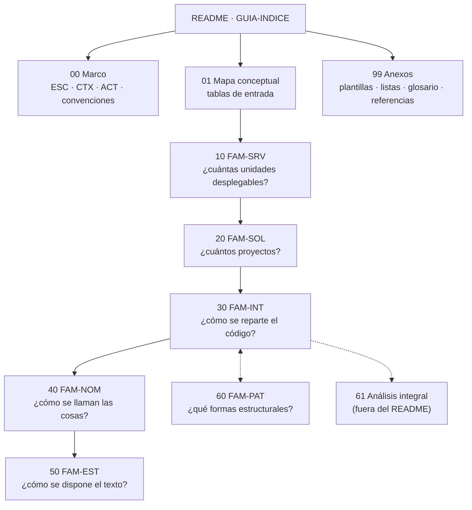

# 03 · Organización, estilo y patrones de código .NET

> **Propósito**: destilar la guía de estudio sobre cómo se organiza y se escribe código .NET —«desde
> cuántas unidades desplegables tiene un sistema hasta si una constante va en `PascalCase`»—, ordenada
> por **costo de reversión** de la decisión. Cubre `Guides/Arquitectura/Organizacion-Estilo-Patrones-Codigo/`
> (38 archivos Markdown, 11 321 líneas, sin código ejecutable ni laboratorios).
> **Fuente primaria**: `Guides/Arquitectura/Organizacion-Estilo-Patrones-Codigo/README.md` (`GUIA-INDICE`,
> `last_review` 2026-07-20) y `Guides/Arquitectura/Organizacion-Estilo-Patrones-Codigo/01-Mapa-Conceptual/Mapa-Conceptual.md`
> (`MAPA-CONCEPTUAL`).
> **Estado del árbol**: `main` en `5d5c2b4`. El contenido entró el 2026-09-13 (commit `fab7258`) bajo
> `Guides/Organizacion-Estilo-Patrones-Codigo/` y el 2026-09-28 (`9162e07`) se movió **sin cambios de
> contenido** a `Guides/Arquitectura/…` (mismas 11 321 líneas que en la v3.0).

En este índice, `OEP/` abrevia `Guides/Arquitectura/Organizacion-Estilo-Patrones-Codigo/` (ruta relativa a
`Lab-Documentos/`). Los `doc_id` **sólo son únicos dentro de esta guía** (ver Hallazgos): citá siempre
`doc_id` + ruta.

## En una pantalla

- **Rasgo distintivo — tres niveles de autoridad.** Toda afirmación normativa declara si es
  *normativo Microsoft* (`N-xx`), *convención de facto* (`F-xx`) o *criterio propio* («esta guía
  recomienda»). Caso insignia: **Clean Architecture no es estándar de Microsoft**; `N-12` describe los
  modelos de capas sin prescribirlos y `dotnet new` no genera ninguno (`OEP/30-Organizacion-Interna/Modelos-de-Capas.md`).
- **Distinción que ordena todo**: *cómo se despliega* y *cómo se organiza el código* son ejes
  independientes. `FAM-SRV` trata el despliegue; `FAM-INT` el código. Partir en servicios no ordena un
  sistema desordenado: lo convierte en un desorden con latencia y fallas parciales (`OEP/README.md`
  §«La distinción…»; `OEP/01-Mapa-Conceptual/Mapa-Conceptual.md` §«La distinción que ordena todo el dominio»).
- **Evidencia de práctica real**: inspección de `dotnet/runtime`, `dotnet/aspnetcore` y `dotnet/efcore`
  (consultados 2026-07-19), elegidos porque difieren entre sí; corrigió afirmaciones que la guía daba por
  sentadas (p. ej. «`src/` + `tests/` en la raíz» no es convención).
- **Stack de referencia**: .NET 10 y C#, ASP.NET Core, Blazor *interactive server* (`CTX-1`), EF Core,
  MSBuild/NuGet. **Dominio de ejemplos**: reserva de salas, sintético (compartido con la guía de
  documentación técnica); `61-Analisis-Integral` usa el dominio de **turnos**.
- **Formato**: sólo prosa, tablas, bloques de código ilustrativos y 25 diagramas Mermaid. No hay
  proyectos, scripts ni devcontainer en este dominio.

## Inventario

Todas las piezas tienen `status: vigente`, `origin: ia-assisted`, `confidence: alta`, `audience: [humano, agente]`.
Ninguna declara número de versión: la única marca temporal es `last_review`.

| Ruta (`OEP/…`) | `doc_id` | `doc_type` | `last_review` | Líneas |
|---|---|---|---|---:|
| `README.md` | `GUIA-INDICE` | indice | 2026-07-20 | 159 |
| `00-Marco-de-Referencia/Escenarios.md` | `MARCO-ESCENARIOS` | marco-de-referencia | 2026-07-19 | 111 |
| `00-Marco-de-Referencia/Contextos.md` | `MARCO-CONTEXTOS` | marco-de-referencia | 2026-07-19 | 104 |
| `00-Marco-de-Referencia/Actores.md` | `MARCO-ACTORES` | marco-de-referencia | 2026-07-19 | 124 |
| `00-Marco-de-Referencia/Convenciones.md` | `MARCO-CONVENCIONES` | marco-de-referencia | 2026-07-19 | 130 |
| `01-Mapa-Conceptual/Mapa-Conceptual.md` | `MAPA-CONCEPTUAL` | mapa | 2026-07-20 | 180 |
| `10-Arquitectura-de-Servicios/README.md` | `FAM-SRV` | familia | 2026-07-19 | 89 |
| `10-Arquitectura-de-Servicios/Monolito.md` | `TEM-MONO` | tema | 2026-07-20 | 236 |
| `10-Arquitectura-de-Servicios/Monolito-Modular.md` | `TEM-MODU` | tema | 2026-07-20 | 387 |
| `10-Arquitectura-de-Servicios/Microservicios.md` | `TEM-MICRO` | tema | 2026-07-20 | 313 |
| `10-Arquitectura-de-Servicios/Criterios-de-Particion.md` | `TEM-PART` | tema | 2026-07-20 | 403 |
| `20-Organizacion-de-Soluciones/README.md` | `FAM-SOL` | familia | 2026-07-20 | 82 |
| `20-Organizacion-de-Soluciones/Topologias-de-Solucion.md` | `TEM-TOPO` | tema | 2026-07-20 | 384 |
| `20-Organizacion-de-Soluciones/Estructura-de-Solucion.md` | `TEM-SLN` | tema | 2026-07-20 | 287 |
| `20-Organizacion-de-Soluciones/Tipos-de-Proyecto.md` | `TEM-SDK` | tema | 2026-07-20 | 323 |
| `20-Organizacion-de-Soluciones/Build-Compartido.md` | `TEM-BUILD` | tema | 2026-07-20 | 392 |
| `30-Organizacion-Interna/README.md` | `FAM-INT` | familia | 2026-07-20 | 88 |
| `30-Organizacion-Interna/Modelos-de-Capas.md` | `TEM-CAPAS` | tema | 2026-07-20 | 397 |
| `30-Organizacion-Interna/Vertical-Slice.md` | `TEM-SLICE` | tema | 2026-07-20 | 346 |
| `30-Organizacion-Interna/Carpetas-o-Proyectos.md` | `TEM-CVP` | tema | 2026-07-20 | 252 |
| `30-Organizacion-Interna/Espacios-de-Nombres.md` | `TEM-NS` | tema | 2026-07-20 | 369 |
| `30-Organizacion-Interna/Modelos-y-Contratos.md` | `TEM-MODELOS` | tema | 2026-07-20 | 410 |
| `40-Nomenclatura/README.md` | `FAM-NOM` | familia | 2026-07-19 | 87 |
| `40-Nomenclatura/Capitalizacion.md` | `TEM-CAPS` | tema | 2026-07-20 | 488 |
| `40-Nomenclatura/Nombrado-de-Tipos-y-Miembros.md` | `TEM-NOMB` | tema | 2026-07-20 | 499 |
| `40-Nomenclatura/Antipatrones-de-Nombrado.md` | `TEM-ANTI` | tema (variante catálogo) | 2026-07-20 | 568 |
| `50-Estilo-de-Codificacion/README.md` | `FAM-EST` | familia | 2026-07-19 | 80 |
| `50-Estilo-de-Codificacion/Formato-y-Llaves.md` | `TEM-FORMATO` | tema | 2026-07-20 | 590 |
| `50-Estilo-de-Codificacion/Convenciones-de-Lenguaje.md` | `TEM-LENG` | tema | 2026-07-20 | 585 |
| `50-Estilo-de-Codificacion/Automatizacion-del-Estilo.md` | `TEM-AUTO` | tema | 2026-07-20 | 616 |
| `60-Patrones-de-Codigo/README.md` | `FAM-PAT` | familia | 2026-07-19 | 74 |
| `60-Patrones-de-Codigo/Patrones-de-Endpoint.md` | `TEM-ENDP` | tema | 2026-07-20 | 257 |
| `60-Patrones-de-Codigo/Patrones-de-Acceso-a-Datos.md` | `TEM-DATOS` | tema | 2026-07-20 | 338 |
| `61-Analisis-Integral/Analisis-Integral.md` | `ANALISIS-INTEGRAL` | analisis | 2026-07-20 | 591 |
| `99-Anexos/Plantillas.md` | `ANEXO-PLANTILLAS` | anexo | 2026-07-19 | 377 |
| `99-Anexos/Listas-de-Verificacion.md` | `ANEXO-CHECK` | anexo | 2026-07-19 | 181 |
| `99-Anexos/Glosario.md` | `ANEXO-GLOSARIO` | anexo | 2026-07-20 | 245 |
| `99-Anexos/Referencias.md` | `ANEXO-REFERENCIAS` | anexo | 2026-07-20 | 179 |

## Estructura interna

El orden de directorios es el orden de lectura: **de lo caro a lo barato**. `FAM-SRV` es la más cara de
revertir; `FAM-NOM`/`FAM-EST` las más baratas. `FAM-INT` ↔ `FAM-PAT` es bidireccional a propósito
(`OEP/01-Mapa-Conceptual/Mapa-Conceptual.md` §«Los seis niveles de decisión»).

### Marco de referencia (`OEP/00-Marco-de-Referencia/`)

| Eje | Valores | Fuente |
|---|---|---|
| Escenarios `ESC-` | `ESC-1` sistema nuevo · `ESC-2` evolución estructural · `ESC-3` normalización de código existente · `ESC-4` evaluación de código ajeno (actividad transversal a los otros tres, no etapa) | `Escenarios.md` |
| Contextos `CTX-` | `CTX-1` web o cliente interactivo · `CTX-2` servicio backend/API · `CTX-3` biblioteca reutilizable · `CTX-4` solución distribuida | `Contextos.md` |
| Actores `ACT-` | `ACT-01` arquitecto · `02` desarrollador · `03` responsable técnico (fija convenciones) · `04` revisor (verifica, no cambia lo acordado) · `05` DevOps (dónde y con qué severidad se verifica) · `06` mantenedor de biblioteca | `Actores.md` (con matriz de responsabilidad) |
| Convenciones | Prefijos de ID, frontmatter obligatorio, estructura de 7 secciones, **tres niveles de autoridad**, «no duplicar» | `Convenciones.md` |

Estructura fija de un documento temático (`MARCO-CONVENCIONES` §«Estructura…», atribuida al Profile
`Study-Guide-Documentation`, externo a este repo): 1 Resumen ejecutivo · 2 Definición (qué es / qué NO
es) · 3 Aplicación por escenario `ESC-1`…`ESC-4` + qué cambia por `CTX` · 4 Ejemplos concretos · 5 Preguntas
guía · 6 Criterios de calidad (con antipatrones) · 7 Anexo. Única desviación admitida: la **variante de
catálogo** de `TEM-ANTI` (ejemplos dentro de cada entrada).

### Mapa conceptual (`OEP/01-Mapa-Conceptual/Mapa-Conceptual.md`)

Responde «estoy acá, ¿qué leo?»: tabla por escenario (leer primero / después / se puede omitir), por
contexto (documentos de peso máximo), **por decisión concreta** (30 preguntas frecuentes → documento),
cruces escenario × familia (`●`/`○`/`–`) y actor × familia (R/C/A), y ruta de lectura en cinco tramos.

### Las seis familias

| Familia (carpeta) | Pregunta | Temas y qué responde cada uno |
|---|---|---|
| **1 · `FAM-SRV`** `10-Arquitectura-de-Servicios/` — *la más cara* | ¿Cuántas unidades desplegables? | `TEM-MONO`: una unidad como default legítimo; «Monolith first». `TEM-MODU`: módulos con límites **que algo automático hace cumplir** (proyectos con referencias dirigidas, `internal` + `InternalsVisibleTo`, analizadores/pruebas de arquitectura). `TEM-MICRO`: qué resuelve y qué no; costos uno por uno; **monolito distribuido** (síntomas: base compartida y despliegues coordinados); ley de Conway. `TEM-PART`: árbol de decisión y cinco criterios verificables; ADR de ejemplo |
| **2 · `FAM-SOL`** `20-Organizacion-de-Soluciones/` | ¿Cuántos proyectos y cómo se agrupan? | `TEM-TOPO`: topologías `T1`–`T5` y las tres preguntas que deciden. `TEM-SLN`: `.sln` vs `.slnx`, `src/`, `eng/`, tests, monorepo. `TEM-SDK`: el atributo `Sdk` define el tipo de proyecto (`N-10`). `TEM-BUILD`: `Directory.Build.props/.targets`, `Directory.Packages.props` (CPM, anclaje transitivo, `VersionOverride`), `global.json` |
| **3 · `FAM-INT`** `30-Organizacion-Interna/` | ¿Cómo se reparte el código adentro? | `TEM-CAPAS`: N capas, Hexagonal, Onion, Clean; origen y diferencias reales. `TEM-SLICE`: Vertical Slice, «lo que cambia junto vive junto». `TEM-CVP`: carpetas o proyectos. `TEM-NS`: patrón `N-01`, `RootNamespace`, namespaces de ámbito de archivo, `global using`. `TEM-MODELOS`: cuatro representaciones de un concepto e idioma **por planos** |
| **4 · `FAM-NOM`** `40-Nomenclatura/` — *mayor densidad normativa* | ¿Cómo se llaman las cosas? | `TEM-CAPS`: tabla normativa elemento por elemento, constantes, acrónimos, prefijos con su nivel. `TEM-NOMB`: categoría gramatical (`N-04`), sufijos, tests, lenguaje ubicuo, español/inglés, componentes Blazor. `TEM-ANTI`: 12 antipatrones de más a menos verificable |
| **5 · `FAM-EST`** `50-Estilo-de-Codificacion/` — *automatizar, no debatir* | ¿Cómo se dispone el texto? | `TEM-FORMATO`: estilos de llaves con nombre, indentación, `using`, orden de miembros, `#region`, comentarios. `TEM-LENG`: `var`, cuerpos de expresión, anulables, `record`/`class`/`struct`, `switch`, `async`, `using` simplificado, namespaces de archivo, top-level statements. `TEM-AUTO`: `.editorconfig`, familias de reglas, severidades, analizadores, estrategia `ESC-3` |
| **6 · `FAM-PAT`** `60-Patrones-de-Codigo/` | ¿Qué formas estructurales se usan? | `TEM-ENDP`: Minimal APIs vs controllers, `MapGroup`, paralelo con otros ecosistemas. `TEM-DATOS`: Repository sobre EF Core (los dos lados), repositorio genérico, Specification, CQRS, qué tipo sale de la consulta, migraciones |
| **61** `61-Analisis-Integral/Analisis-Integral.md` | ¿Qué pasó con `Models/Repositories/Services/Controllers/DTOs`? | Cuatro preguntas encadenadas; tesis: el modelo por tipo técnico **no fue reemplazado, fue re-encuadrado** |

### Anexos (`OEP/99-Anexos/`) — «no se leen de corrido: se usan»

| Archivo | Contenido |
|---|---|
| `Plantillas.md` | Los diez archivos de arranque: 1 esqueleto de repo · 2 `Directory.Build.props` · 3 `Directory.Packages.props` · 4 `global.json` · 5 `.editorconfig` · 6 `.csproj` web · 7 `.csproj` de prueba · 8 `.csproj` de biblioteca publicable (`CTX-3`) · 9 `.git-blame-ignore-revs` · 10 `.gitattributes` |
| `Listas-de-Verificacion.md` | Lista 1 arranque (`ESC-1`) · 2 evaluar si partir (`ESC-2`) · 3 normalizar (`ESC-3`) · 4 evaluar código ajeno (`ESC-4`) · 5 publicar/mantener biblioteca (`CTX-3`) · uso en revisión automatizada |
| `Glosario.md` | Términos A–V más §«Términos que se confunden entre sí» |
| `Referencias.md` | 35 fuentes: `N-01`…`N-20` (Microsoft Learn y SDK), `F-01`…`F-07` (facto), `O-01`…`O-08` (obras); §1–3 con «Precisiones» sobre `F-01`, `F-03`, `F-04`, `F-06`, `N-17`; §4 **conceptos sin fuente normativa**; §5 cómo citar |

## Conceptos y decisiones clave

### Arquitectura de servicios (`FAM-SRV`)

| Matriz despliegue × código | Código organizado | Código desordenado |
|---|---|---|
| **Una unidad desplegable** | Monolito modular (punto de partida recomendado) | «Gran bola de barro» |
| **Varias unidades** | Microservicios | **Monolito distribuido** — lo peor de ambos |

Fuente: `OEP/01-Mapa-Conceptual/Mapa-Conceptual.md` §«La distinción que ordena todo el dominio».

**Árbol de `TEM-PART`** (`OEP/10-Arquitectura-de-Servicios/Criterios-de-Particion.md` §«El árbol de decisión», §«Los cinco criterios»):

| # | Criterio | Umbral (criterio propio, declarado así) |
|---|---|---|
| 1 | ¿Los datos se separan sin transacciones distribuidas en el camino frecuente? | **Veto**: si falla, no se parte; la transacción indivisible marca el límite real |
| 2 | ¿Razones de cambio distintas? | Historial de 6–12 meses: la mayoría de commits del módulo no toca el resto |
| 3 | ¿Perfiles de escalado distintos? | Un orden de magnitud **medido** con telemetría, sostenido |
| 4 | ¿Equipos que se bloquean? | Espera real recurrente; con 1 equipo no aplica, con 4+ es sólido |
| 5 | ¿Disponibilidad/aislamiento distintos? | Requisito escrito y exigible, o incidente ocurrido (incluye cumplimiento normativo) |

Después: ¿el límite coincide con un Bounded Context estable (≈6 meses)? ¿`ACT-05` puede operar una
unidad más? → **extraer UN servicio** (Strangler Fig), medir y volver a decidir. Toda conclusión —incluida
«no partir»— merece un ADR. La guía **declara explícitamente** que criterios, orden, veto y umbrales son
criterio propio sin respaldo en `ANEXO-REFERENCIAS`.

### Organización de soluciones (`FAM-SOL`)

**Topologías** (`OEP/20-Organizacion-de-Soluciones/Topologias-de-Solucion.md`):

| | `T1` Único | `T2` Capas | `T3` Web+API 1 proc. | `T4` 2 procesos | `T5` + clientes |
|---|:---:|:---:|:---:|:---:|:---:|
| Proyectos | 1 | 4 | 5 | 6 | 7+ |
| Unidades desplegables | 1 | 1 | 1 | 2 | 2+ |
| Límite entre capas | disciplina | compilador | compilador | compilador | compilador |
| Proyecto de contratos | no | no | opcional | **sí** | **sí** |

- Las tres preguntas: ¿hay un consumidor que **no puede** referenciar un proyecto (móvil, WASM,
  terceros)? → contratos obligatorio (**restricción**, no preferencia); ¿alguna parte necesita
  desplegarse por separado y los datos se separan? → `T4`; ¿hace falta que el compilador verifique la
  dirección de dependencias? → `T2`/`T3`, si no `T1`.
- Proyectos y procesos son ejes independientes: 1 proyecto × N procesos = escalado horizontal, no partición.
- `.slnx` (`N-11`): soporte CLI desde SDK 9.0.200; `dotnet sln migrate`; en .NET 10 `dotnet new sln`
  crea `.slnx` por defecto. Soporte en versiones de Visual Studio: **no verificado** por la guía.
- `src/` y `eng/` (`F-01`, `F-07`) tienen evidencia unánime en los tres repos; **tests en la raíz y en
  plural no**: `runtime` anida `tests`, `aspnetcore` anida `test`, `efcore` usa `test/` en raíz. La guía
  recomienda tests en la raíz para repos de un solo producto (`OEP/20-Organizacion-de-Soluciones/Estructura-de-Solucion.md` §«Disposición de carpetas»).
- Build compartido: `Directory.Build.props` (`N-09`), CPM con `Directory.Packages.props` (`N-08`),
  `global.json` (`N-13`); `TreatWarningsAsErrors` incondicional en `Directory.Build.props` es antipatrón
  (ver `TEM-AUTO`).

### Organización interna (`FAM-INT`)

- **Capas** (`OEP/30-Organizacion-Interna/Modelos-de-Capas.md` §«Qué comparten…»): Hexagonal (`O-05`,
  Cockburn 2005), Onion (`O-06`, Palermo 2008) y Clean (`O-04`, Martin 2017) **dicen lo mismo**: el dominio
  no depende de la infraestructura y la relación se invierte con interfaces declaradas por el dominio. La
  única decisión que cambia algo medible es **binaria**: ¿dependencia hacia los datos (N capas, `O-02`) o
  invertida hacia el dominio? Discutir Onion vs Clean es discutir nombres de carpetas.
- **Vertical Slice** (`O-07`): no compite con las capas, se combina; recomendación: cortes verticales en
  primer nivel, capas adentro cuando la funcionalidad lo justifica, dominio compartido arriba; nombres de
  corte derivados de los `CU-`.
- **Carpetas o proyectos** (`OEP/30-Organizacion-Interna/Carpetas-o-Proyectos.md`): la única diferencia que
  importa es que **con proyectos el compilador hace cumplir la dirección de la dependencia**. Recomendación:
  empezar con carpetas; partir sólo ante 4 razones (reutilización real, empaquetar NuGet, violación
  **repetida** pese a revisión, consumidor que no puede referenciar). Antes de partir por la tercera: prueba
  de arquitectura o regla de analizador.
- **Espacios de nombres**: única parte normativa de la familia (`N-01`:
  `<Empresa>.<Producto|Tecnología>[.<Funcionalidad>][.<Subespacio>]`); en `CTX-3` son contrato; mover un
  archivo sin ajustar el namespace es inconsistencia que el compilador no señala.
- **Cuatro representaciones** (`OEP/30-Organizacion-Interna/Modelos-y-Contratos.md`): entidad de dominio
  (`Domain/`), modelo de persistencia (a menudo la misma clase), contrato/DTO (borde HTTP o proyecto de
  contratos), modelo de presentación (junto al componente). Regla: **cada representación pertenece a la
  capa que la consume**. Cuántas existen lo decide la topología: en `T1`/`T2` no hay DTO de contrato
  (meterlo es sobreingeniería); en `T4`/`T5` es obligatorio. `DTOs`/`Models` no son buenos segmentos de namespace.
- **Idioma por planos**: plano estructural (segmentos y sufijos de rol: `Service`, `Repository`, `Handler`)
  y plano de dominio se deciden por separado; la combinación más frecuente es estructura en inglés y
  dominio en el idioma del negocio. `Exception`, `EventArgs` y `Async` no se traducen; el vocabulario del
  framework (`Program`, `MapPost`, `CancellationToken`) no entra en la decisión. Lo que no funciona es
  mezclar idiomas **dentro del mismo plano** (`OEP/40-Nomenclatura/Nombrado-de-Tipos-y-Miembros.md` §«Español o inglés»).

### Nomenclatura (`FAM-NOM`)

| Elemento | Convención | Nivel |
|---|---|---|
| Tipos, métodos, propiedades, eventos, enum y valores, campos públicos | PascalCase | `N-02` |
| **Constante (`const`) y `static readonly`** | **PascalCase**, nunca `SCREAMING_SNAKE_CASE` | `N-02` |
| Interfaz / parámetro genérico | `I` + PascalCase / `T` + PascalCase | `N-01` |
| Atributo / excepción | sufijo `Attribute` / `Exception` | `N-01` |
| Parámetro, variable local, constante local | camelCase | `N-02` / `N-05` |
| Campo privado de instancia | `_camelCase` | `F-02` (documentado en `N-05`, no en las FDG) |
| Campo privado estático | `s_camelCase` | `F-03` (estilo `dotnet/runtime`, no norma general de Microsoft) |
| Campo `[ThreadStatic]` | `t_camelCase` | Práctica de `dotnet/runtime` documentada sólo en prosa; a diferencia de `s_`, no está como regla en su `.editorconfig` |
| Método asíncrono | sufijo `Async` | `F-04` / `N-15` |

Fuente: `OEP/40-Nomenclatura/Capitalizacion.md` §«La tabla normativa». `N-03` prohíbe abreviaturas y
notación húngara; `N-04` asigna categoría gramatical (tipos sustantivos, métodos verbos). Los 12
antipatrones de `TEM-ANTI`: húngara · prefijo `C` · `m_` · abreviaturas · nombres genéricos vacíos
(`Manager`, `Helper`) · nombres que mienten · números mágicos y nombres de un carácter · `Impl` · `Base` mal
usado · inconsistencia de sinónimos · enum plural sin `[Flags]` · CRUD sobre dominio que no es CRUD.

### Estilo (`FAM-EST`)

- **C# usa Allman** (`N-06`, reafirmado por `F-06`/`O-08`; la precisión de `Referencias.md` aclara que
  Allman es normativo, no sólo convención). Java/JS usan K&R sin que haya un ganador técnico.
- `TEM-LENG` separa lo cosmético (`var`, cuerpo de expresión) de lo que **cambia semántica** (anulables,
  `record` vs `class`, `async void` derriba el proceso). Recomendaciones: seguir `N-06` en `var`; cada `!`
  con comentario; detectar `async void` con `VSTHRD100` (`N-16`); propagar `CancellationToken`.
- **Severidades** (`OEP/50-Estilo-de-Codificacion/Automatizacion-del-Estilo.md` §«Severidad»): `none`,
  `silent`, `suggestion`, `warning`, `error`. Recomendación asimétrica: **local permisivo, canalización
  estricta** (`dotnet build` vs `dotnet build -warnaserror`); defectos de comportamiento (`async void`)
  como `error` en `.editorconfig`.
- **Normalización `ESC-3`**: anunciar y elegir momento con pocas ramas; declarar regla en `.editorconfig`
  primero; un commit por clase de cambio (`dotnet format whitespace` → `style` → `analyzers`) sin cambios
  funcionales; registrar en `.git-blame-ignore-revs`; activar la regla en el mismo cambio.

### Patrones (`FAM-PAT`)

- **Endpoints** (`OEP/60-Patrones-de-Codigo/Patrones-de-Endpoint.md`): Minimal APIs y controllers están
  soportados de forma permanente; la creencia «Minimal es para prototipos» es falsa. Paso intermedio antes de
  migrar: `MapGroup` (desde .NET 7) + extracción a métodos de extensión. El rendimiento sólo pesa en
  servicios de muy alto tráfico.
- **Acceso a datos** (`OEP/60-Patrones-de-Codigo/Patrones-de-Acceso-a-Datos.md`): el debate «¿repositorio
  sobre EF Core?» se presenta con los dos lados; se decide por hechos observables (puertos y adaptadores,
  dominio en proyecto sin EF Core, variedad de consultas, tamaño, reglas transversales). Combinación
  recomendable: repositorios para escrituras por agregado + lecturas con `DbContext` y proyección a DTO
  («CQRS sin ceremonia»). **Repositorio genérico = antipatrón** en la mayoría de los casos (disyuntiva
  `IQueryable` sí/no; repositorio por tabla rompe el agregado de `O-03`). CQRS **no implica** event sourcing,
  dos bases, mediador ni consistencia eventual. Specification sólo si la proliferación de métodos es medible.

### Análisis integral (`61`)

Tesis: el patrón `Models/Repositories/Services/Controllers/DTOs` es **N capas por tipo técnico** y sigue
siendo legítimo; el modelo actual obliga a hacer explícitas cuatro decisiones: dirección de la dependencia,
eje de agrupación, cuántas representaciones (según topología) y quién verifica los límites (compilador o
disciplina). Ejemplos en dominio de turnos, estructura en inglés y dominio en español
(`OEP/61-Analisis-Integral/Analisis-Integral.md` §«Síntesis»).

## Ejemplos y laboratorios

No hay ejemplos ejecutables en este dominio: todo el código es **ilustrativo y sintético** (declarado
así), embebido en los documentos. Lo más reutilizable:

| Qué | Dónde |
|---|---|
| Diez archivos de arranque de repo, comentados | `OEP/99-Anexos/Plantillas.md` |
| Configuración completa de build compartido (reserva de salas) | `OEP/20-Organizacion-de-Soluciones/Build-Compartido.md` §«Caso sintético» |
| Tres estructuras de solución + `.slnx` mínimo | `OEP/20-Organizacion-de-Soluciones/Estructura-de-Solucion.md` §«Ejemplos concretos» |
| `.csproj` de contratos y `Program.cs` de `T3` (Application Parts, `N-17`) | `OEP/20-Organizacion-de-Soluciones/Topologias-de-Solucion.md` §«Ejemplos concretos» |
| Inversión de dependencia y árbol de cada modelo de capas | `OEP/30-Organizacion-Interna/Modelos-de-Capas.md` §«Ejemplos concretos» |
| Jerarquía completa dominio/contrato/presentación/mapeo (inglés y todo en español) | `OEP/30-Organizacion-Interna/Modelos-y-Contratos.md` §«Ejemplos concretos» |
| Monolito modular con proyectos y registro de módulo | `OEP/10-Arquitectura-de-Servicios/Monolito-Modular.md` §«Ejemplos concretos» |
| ADR-014 de ejemplo («notificaciones permanece en el monolito») | `OEP/10-Arquitectura-de-Servicios/Criterios-de-Particion.md` §«El registro de la decisión» |
| Fragmento comentado de `.editorconfig` | `OEP/50-Estilo-de-Codificacion/Automatizacion-del-Estilo.md` §«Anexo» |

Para material con código compilable sobre la misma problemática, ver `Guides/Dot-NET-Arquitectura-Guide/`
(Examples e Interactive-Activities; otro índice).

## Relaciones con otras guías del repo

| Guía | Vínculo |
|---|---|
| `Guides/Arquitectura/Organizacion-Estilo-Rest-API/` | Hermana desde el protocolo. `TEM-ENDP` ↔ `TEM-MINIMAL` (`80-Implementacion-en-NET/Minimal-APIs-y-Controllers.md`; frontera declarada también en `80-Implementacion-en-NET/README.md` y como «excepción deliberada» en `00-Marco-de-Referencia/Convenciones.md`); `95-Transversales/README.md` deriva a `FAM-SRV` y `TEM-CAPAS`; `95-Transversales/Arquitectura-y-REST.md` cita `TEM-PART`, `TEM-MICRO`, `TEM-CAPAS`, `FAM-SRV`; `20-Diseno-de-Recursos/Modelado-de-Recursos.md` cita `TEM-MODELOS` («un recurso no es una clase del dominio»). Comparte dominio de reserva de salas |
| `Guides/Documentacion-Tecnica/Creacion-Guias-Tecnicas/` | «Guía hermana de documentación técnica» del README (mismo dominio). Su serie `90-Modelos-de-Arquitectura/` (`ARQ-INDICE`, `ARQ-CAPAS`, `ARQ-HEX`…) trata los mismos modelos desde la documentación exigida |
| `Guides/Dot-NET-Arquitectura-Guide/Dot-NET-Arquitectura-Guide.md` | Aplicación concreta Domain/Application/Infrastructure/WebAPI/clientes; es *una* instancia del modelo de capas que esta guía discute, no parte de ella |

La relación es **entrante**: esta guía no enlaza a ninguna otra salvo el README (enlace roto, ver abajo).

## Hallazgos

| Tipo | Ruta | Detalle |
|---|---|---|
| Enlace roto | `OEP/README.md` §«Alcance y límites» (línea 149) | `../Documentacion-Tecnica/README.md` resuelve a `Guides/Arquitectura/Documentacion-Tecnica/README.md`, que no existe tras la reorganización `9162e07`; el destino probable es `Guides/Documentacion-Tecnica/Creacion-Guias-Tecnicas/README.md`. Es el único enlace relativo roto de los 38 archivos |
| `doc_id` duplicados entre guías | `OEP/README.md`, `00-Marco-de-Referencia/*`, `01-Mapa-Conceptual/*`, `99-Anexos/{Glosario,Listas-de-Verificacion,Referencias}.md` | `GUIA-INDICE`, `MARCO-*`, `MAPA-CONCEPTUAL`, `ANEXO-GLOSARIO`, `ANEXO-CHECK`, `ANEXO-REFERENCIAS` se repiten en `Guides/Documentacion-Tecnica/Creacion-Guias-Tecnicas/`, `Guides/Despliegue/Documentacion-Informe-Despliegue/` y/o `Guides/Arquitectura/Organizacion-Estilo-Rest-API/`. Los IDs son únicos por guía, no por repo; `MARCO-CONVENCIONES` dice «los archivos se mueven, los IDs no», pero sin ruta son ambiguos |
| Documento fuera de la tabla | `OEP/61-Analisis-Integral/Analisis-Integral.md` | Ni el README ni el mapa conceptual lo enlazan; sólo se llega navegando la carpeta. Su `doc_type: analisis` no figura en los valores de frontmatter que fija `MARCO-CONVENCIONES` |
| Dominio distinto | `OEP/61-Analisis-Integral/Analisis-Integral.md` | Usa turnos en lugar de reserva de salas (declarado y justificado en su resumen) |
| Referencia externa | `OEP/00-Marco-de-Referencia/Convenciones.md` §«Estructura de un documento temático» | Cita el Profile `Study-Guide-Documentation`, que no está en este repo |
| Sin versión | Los 38 archivos | El frontmatter no lleva campo de versión; sólo `last_review` (2026-07-19/20) |
| Afirmaciones no verificadas declaradas | `OEP/99-Anexos/Referencias.md` §4; `TEM-SLN` §`.slnx` | «Monolith first», Strangler Fig y Ley de Conway se atribuyen «con reserva» sin fuente primaria verificada; soporte de `.slnx` en versiones de Visual Studio no verificado. Es transparencia de la guía, no defecto |
| Sin punto de entrada en el repo | `README.md` (raíz) y `Guides/README.md` | Ambos tienen 0 líneas; fuera de esta guía, sólo `Guides/Arquitectura/Organizacion-Estilo-Rest-API/` la enlaza. Se llega navegando el árbol |
| Historial | commit `fab7258` | El contenido ingresó en un commit con mensaje «.» (2026-09-13); sin trazabilidad de autoría en el mensaje |

## Para preguntas X → leé fuente Y

| Necesitás saber… | Leé |
|---|---|
| Qué documento responde una pregunta puntual | `OEP/01-Mapa-Conceptual/Mapa-Conceptual.md` §«Tabla de entrada por decisión concreta» |
| ¿Monolito o microservicios? ¿Cuándo partir? | `OEP/10-Arquitectura-de-Servicios/Criterios-de-Particion.md` |
| Cómo hacer cumplir límites entre módulos sin partir | `OEP/10-Arquitectura-de-Servicios/Monolito-Modular.md` §«Cómo se hacen cumplir los límites» |
| Qué es un monolito distribuido y cómo se diagnostica | `OEP/10-Arquitectura-de-Servicios/Microservicios.md` §«El monolito distribuido» |
| ¿Un proyecto o varios? ¿Web y API juntas? ¿Contratos? | `OEP/20-Organizacion-de-Soluciones/Topologias-de-Solucion.md` |
| `.sln` vs `.slnx`, `src/`, `tests/`, `eng/` | `OEP/20-Organizacion-de-Soluciones/Estructura-de-Solucion.md` |
| Qué SDK de proyecto elegir | `OEP/20-Organizacion-de-Soluciones/Tipos-de-Proyecto.md` |
| `Directory.Build.props`, versiones NuGet centralizadas, `global.json` | `OEP/20-Organizacion-de-Soluciones/Build-Compartido.md` + `OEP/99-Anexos/Plantillas.md` §2–4 |
| ¿Clean, Onion o Hexagonal? ¿Es estándar de Microsoft? | `OEP/30-Organizacion-Interna/Modelos-de-Capas.md` |
| ¿Por capa o por funcionalidad? | `OEP/30-Organizacion-Interna/Vertical-Slice.md` |
| ¿Capas en carpetas o en proyectos? | `OEP/30-Organizacion-Interna/Carpetas-o-Proyectos.md` |
| ¿Dónde van los DTOs? ¿Inglés o español? | `OEP/30-Organizacion-Interna/Modelos-y-Contratos.md` |
| Cómo estructurar namespaces, `global using` | `OEP/30-Organizacion-Interna/Espacios-de-Nombres.md` |
| PascalCase/camelCase, constantes, `_`, `s_`, acrónimos | `OEP/40-Nomenclatura/Capitalizacion.md` |
| Cómo nombrar clases, métodos, tests; sufijos | `OEP/40-Nomenclatura/Nombrado-de-Tipos-y-Miembros.md` |
| Por qué no `Manager`/`Helper`/húngara | `OEP/40-Nomenclatura/Antipatrones-de-Nombrado.md` |
| Allman, K&R, orden de miembros, `#region` | `OEP/50-Estilo-de-Codificacion/Formato-y-Llaves.md` |
| `var`, anulables, `record`, `async void` | `OEP/50-Estilo-de-Codificacion/Convenciones-de-Lenguaje.md` |
| `.editorconfig`, severidades, normalizar sin romper `git blame` | `OEP/50-Estilo-de-Codificacion/Automatizacion-del-Estilo.md` |
| ¿Minimal APIs o controllers? `MapGroup` | `OEP/60-Patrones-de-Codigo/Patrones-de-Endpoint.md` |
| ¿Repositorio sobre EF Core? CQRS, Specification | `OEP/60-Patrones-de-Codigo/Patrones-de-Acceso-a-Datos.md` |
| Qué pasó con DAO/MVC/Repository/DTO «de antes» | `OEP/61-Analisis-Integral/Analisis-Integral.md` |
| Checklist para arrancar, partir, normalizar, evaluar, publicar biblioteca | `OEP/99-Anexos/Listas-de-Verificacion.md` |
| Qué respaldo tiene una afirmación (`N-`/`F-`/`O-`) | `OEP/99-Anexos/Referencias.md` |
