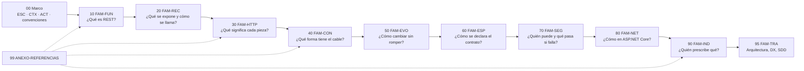

# 04 · Diseño de APIs REST

> **Propósito**: destilar la guía de estudio «Organización y estilo de REST API en .NET»: cómo
> diseñar, especificar, evolucionar, asegurar e implementar en ASP.NET Core una API REST, con cada
> prescripción clasificada por **nivel de autoridad**. Cubre
> `Guides/Arquitectura/Organizacion-Estilo-Rest-API/` (56 archivos versionados, 21 327 líneas; 55
> documentos con contenido + un `README.md` raíz vacío).
> **Fuente primaria**: los `README.md` de cada familia (`FAM-xx`),
> `00-Marco-de-Referencia/Convenciones.md` (`MARCO-CONVENCIONES`) y
> `99-Anexos/Referencias.md` (`ANEXO-REFERENCIAS`). Todas las rutas de este índice son relativas a
> `Lab-Documentos/`. Verificado contra `main` en `5d5c2b4` (2026-10-18).

## En una pantalla

- **Qué cambió desde la v3.0**: la guía se movió de `Guides/Organizacion-Estilo-Rest-API/` a
  `Guides/Arquitectura/Organizacion-Estilo-Rest-API/` (commit `9162e07`, «reorganización de
  Guides/ por categoría»). El contenido no cambió: mismos 56 archivos, mismas 21 327 líneas, todos
  `last_review: 2026-07-20`. Lo que sí cambió es que los enlaces hacia la guía de documentación
  técnica quedaron rotos por el movimiento (ver [Hallazgos](#hallazgos-del-dominio)).
- **Vocabulario**: «REST» en su acepción corriente (API HTTP con recursos por URI y JSON); la
  acepción estricta de Fielding (`O-01`) se reserva para `TEM-REST`. Las guías corporativas
  verificadas prescriben APIs de **nivel 2** de Richardson (`O-03`), no 3; la hipermedia se cumple
  en el 4,2 % de 500 APIs públicas medidas (`O-04`).
- **La convención más importante** (`Convenciones.md` §Los cuatro niveles de autoridad): toda
  afirmación es *normativa* (`N-xx` + sección exacta), *guía de organización* (se nombra la
  organización), *convención de facto* (con evidencia `P-xx`) o *criterio propio* («esta guía
  recomienda»).
- **Dónde hay norma y dónde no**: semántica HTTP, errores, PATCH, caché → hay RFC. Casing de
  campos y URIs, versionado, paginación, filtrado → no hay norma, solo guías que se contradicen.
  La guía **no arbitra por autoridad**: da el criterio (qué problema resolvía cada organización).
- **Dominio recurrente**: sistema de **reserva de salas** (salas, reservas, usuarios, sedes),
  compartido con las guías hermanas; los ejemplos son sintéticos y se declaran como tales.
- **Stack de referencia**: .NET 10 (LTS, `N-23`), ASP.NET Core, consumidores Blazor interactive
  server, MVC y .NET MAUI con MVVM. .NET 11 aparece solo como contraste.

## Inventario

Todos los documentos tienen `status: vigente`, `origin: ia-assisted`, `last_review: 2026-07-20`.
El frontmatter **no tiene campo `version`** (no aplica columna de versión). Rutas relativas a
`Guides/Arquitectura/Organizacion-Estilo-Rest-API/`.

| Carpeta | Archivo | `doc_id` | Líneas |
|---|---|---|---|
| (raíz) | `README.md` | — (vacío, 0 bytes) | 0 |
| `00-Marco-de-Referencia/` | `Actores.md` | `MARCO-ACTORES` | 220 |
| | `Contextos.md` | `MARCO-CONTEXTOS` | 173 |
| | `Convenciones.md` | `MARCO-CONVENCIONES` | 161 |
| | `Escenarios.md` | `MARCO-ESCENARIOS` | 185 |
| `10-Fundamentos-REST/` | `README.md` | `FAM-FUN` | 85 |
| | `Que-es-REST.md` | `TEM-REST` | 379 |
| | `Modelo-de-Madurez.md` | `TEM-RMM` | 389 |
| | `Hipermedia.md` | `TEM-HATEOAS` | 436 |
| | `REST-y-Alternativas.md` | `TEM-ALT` | 591 |
| `20-Diseno-de-Recursos/` | `README.md` | `FAM-REC` | 95 |
| | `Modelado-de-Recursos.md` | `TEM-RECURSOS` | 450 |
| | `Nomenclatura-de-URIs.md` | `TEM-URI` | 571 |
| | `Jerarquias-y-Relaciones.md` | `TEM-JERARQ` | 491 |
| | `Operaciones-No-CRUD.md` | `TEM-ACCIONES` | 608 |
| `30-Semantica-HTTP/` | `README.md` | `FAM-HTTP` | 82 |
| | `Metodos.md` | `TEM-METODOS` | 432 |
| | `Codigos-de-Estado.md` | `TEM-STATUS` | 637 |
| | `Cabeceras-y-Negociacion.md` | `TEM-HEADERS` | 458 |
| | `Cache-y-Peticiones-Condicionales.md` | `TEM-CACHE` | 426 |
| | `Idempotencia-y-Concurrencia.md` | `TEM-IDEM` | 504 |
| `40-Contratos-y-Representaciones/` | `README.md` | `FAM-CON` | 87 |
| | `Formato-y-Nomenclatura-de-Campos.md` | `TEM-CAMPOS` | 451 |
| | `Colecciones-y-Paginacion.md` | `TEM-PAG` | 417 |
| | `Filtrado-Orden-y-Seleccion.md` | `TEM-FILTRO` | 400 |
| | `Actualizaciones-Parciales.md` | `TEM-PATCH` | 428 |
| | `Manejo-de-Errores.md` | `TEM-ERR` | 564 |
| `50-Evolucion-y-Versionado/` | `README.md` | `FAM-EVO` | 114 |
| | `Estrategias-de-Versionado.md` | `TEM-VERS` | 422 |
| | `Compatibilidad-y-Cambios-Rompientes.md` | `TEM-BREAK` | 420 |
| | `Deprecacion-y-Retiro.md` | `TEM-DEPR` | 436 |
| `60-Especificacion-y-Documentacion/` | `README.md` | `FAM-ESP` | 82 |
| | `OpenAPI.md` | `TEM-OPENAPI` | 517 |
| | `Design-First-y-Code-First.md` | `TEM-DESIGNFIRST` | 357 |
| | `Generacion-de-Clientes-y-Pruebas-de-Contrato.md` | `TEM-CLIENTES` | 390 |
| `70-Seguridad-y-Robustez/` | `README.md` | `FAM-SEG` | 87 |
| | `Autenticacion-y-Autorizacion.md` | `TEM-AUTH` | 539 |
| | `Proteccion-de-la-Superficie.md` | `TEM-PROT` | 539 |
| | `Resiliencia-y-Reintentos.md` | `TEM-RESIL` | 489 |
| `80-Implementacion-en-NET/` | `README.md` | `FAM-NET` | 120 |
| | `Minimal-APIs-y-Controllers.md` | `TEM-MINIMAL` | 508 |
| | `Organizacion-del-Proyecto-API.md` | `TEM-PROYECTO` | 534 |
| | `Serializacion-y-Modelos.md` | `TEM-SERIAL` | 539 |
| | `Validacion.md` | `TEM-VALID` | 659 |
| | `Consumo-desde-Blazor-y-MAUI.md` | `TEM-CONSUMO` | 630 |
| | `Pruebas-de-API.md` | `TEM-PRUEBAS` | 682 |
| `90-Guias-de-la-Industria/` | `README.md` | `FAM-IND` | 100 |
| | `Microsoft-y-Azure.md` | `TEM-GMS` | 301 |
| | `Google-AIP.md` | `TEM-GGOOGLE` | 360 |
| | `Zalando-y-otras.md` | `TEM-GOTRAS` | 367 |
| | `Comparativa-y-Criterios.md` | `TEM-GCOMP` | 540 |
| `95-Transversales/` | `README.md` | `FAM-TRA` | 94 |
| | `Arquitectura-y-REST.md` | `TEM-ARQ` | 372 |
| | `Experiencia-del-Consumidor.md` | `TEM-DX` | 409 |
| | `Spec-Driven-Development.md` | `TEM-SDD` | 452 |
| `99-Anexos/` | `Referencias.md` | `ANEXO-REFERENCIAS` | 548 |

Peso por familia (líneas): `80-…` 3 672 · `30-…` 2 539 · `40-…` 2 347 · `20-…` 2 215 ·
`10-…` 1 880 · `90-…` 1 668 · `70-…` 1 654 · `50-…` 1 392 · `60-…` 1 346 · `95-…` 1 327 ·
`00-…` 739 · `99-…` 548. Hay 61 diagramas Mermaid, 268 bloques ```` ```http ```` y 120
```` ```csharp ````.

## Cómo está escrita (lo imprescindible para leerla)

**Frontmatter** (`Convenciones.md` §Frontmatter obligatorio): `doc_id`, `doc_type`
(`tema | marco-de-referencia | familia | mapa | anexo | indice`), `title`, `status`, `origin`,
`confidence`, `owner`, `last_review`, `audience`, `traces`.

**Estructura fija de un `TEM-`** (la fija el Profile `Study-Guide-Documentation`): 1 Resumen
ejecutivo · 2 Definición (qué es / qué **no** es) · 3 Aplicación por escenario (`ESC-1..4` y qué
cambia por `CTX-1..4`) · 4 Ejemplos concretos (HTTP crudo y C#) · 5 Preguntas guía · 6 Criterios
de calidad y antipatrones · 7 Anexo (plantilla o checklist). Los 40 documentos temáticos la
cumplen; `TEM-STATUS` es la única «variante de catálogo» admitida (ejemplos dentro de cada código).

**Identificadores**:

| Prefijo | Qué es |
|---|---|
| `ESC-1..4` (`ESC-4a/4b`) | Escenario: API nueva · exposición o migración · evolución en producción · evaluación de API ajena (con acceso / solo desde afuera) |
| `CTX-1..4` | Contexto, ordenado por distancia al consumidor: pública · interna entre servicios · backend de app propia · integración con sistemas externos |
| `ACT-01..07` | Actor: arquitecto · productor · consumidor · QA · analista funcional · product owner · seguridad y operaciones (veto) |
| `FAM-` / `TEM-` | Familia (carpeta) / documento temático |
| `N-` `G-` `F-` `O-` `P-` | Fuentes del anexo: normativa · guía de organización · convención de facto · obra de referencia · evidencia de plataforma |

**Fuentes** (`Referencias.md` §Los cinco niveles de identificador, 131 filas: `N` 83 · `G` 8 ·
`F` 24 · `O` 7 · `P` 9; todas las URL verificadas el 2026-07-20):

| Prefijo | Ejemplos | Fuerza de la cita |
|---|---|---|
| `N-xx` | RFC 9110 `N-01`, RFC 9111 `N-02`, RFC 6585 `N-03`, RFC 9457 `N-04`, RFC 5789/6902/7396 `N-05..07`, OAS 3.2.0 `N-19`, Microsoft Learn | Es el estándar; designación + sección |
| `G-xx` | Azure `G-01`, Graph `G-02`, monolítica deprecada `G-03`, Google AIP `G-04`, Zalando `G-05`, GOV.UK `G-06`, adidas `G-07`, Heroku `G-08` | Vale para quien la adopta |
| `F-xx` | Drafts IETF (`Idempotency-Key` `F-01`, `RateLimit` `F-02`), JSON:API `F-04`, OData 4.02 `F-05`, `Asp.Versioning` `F-09` | No obliga; requiere `P-xx` |
| `O-xx` | Fielding `O-01`, Richardson/Fowler `O-03`, medición de hipermedia `O-04` | Origen de un concepto, no autoridad |
| `P-xx` | Stripe `P-01`..`P-04`, GitHub `P-05`, Shopify `P-07`, Twilio `P-08` | Prueba de qué se hace, nunca de qué corresponde |

## Mapa de la guía: familias y lo que responde cada parte



| Familia | Pregunta | Documentos y qué resuelve cada uno |
|---|---|---|
| `00-Marco-de-Referencia/` | Vocabulario común | `MARCO-ESCENARIOS` (ESC-3 es «el más frecuente y el peor cubierto»; anexo *ficha de ubicación*) · `MARCO-CONTEXTOS` (anexo *determinación del contexto*) · `MARCO-ACTORES` (matriz D/C/I por decisión; anexo *ficha de asignación*) · `MARCO-CONVENCIONES` |
| `FAM-FUN` | ¿Qué es REST y qué de lo que llamamos REST lo es? | `TEM-REST` seis restricciones de `O-01` · `TEM-RMM` niveles 0–3, la industria estacionada en el 2 · `TEM-HATEOAS` lo que sobrevivió: el enlace de paginación (`N-10`) · `TEM-ALT` GraphQL, gRPC, tRPC, SOAP, mensajería; efecto de HTTP/2-3 |
| `FAM-REC` | ¿Qué expone la API y cómo se llama? *La decisión más difícil de revertir; casi sin norma* | `TEM-RECURSOS` catálogo desde el vocabulario del dominio, no desde tablas · `TEM-URI` lo único normativo es RFC 3986 (`N-08`) · `TEM-JERARQ` «¿el hijo tiene identidad propia fuera del padre?» · `TEM-ACCIONES` operaciones no CRUD (cuatro opciones) |
| `FAM-HTTP` | ¿Qué significa cada pieza del protocolo? *La de más respaldo normativo* | `TEM-METODOS` seguro/idempotente/cacheable (`N-01` §9) · `TEM-STATUS` catálogo y pares que más se erran (`400/422`, `401/403`, `404/403`, `409/412`, `500/503`) · `TEM-HEADERS` negociación, `Vary`, `Location`, `Link` · `TEM-CACHE` `N-02`, `ETag`, `304` · `TEM-IDEM` idempotencia de protocolo vs de negocio, `If-Match` + `412` |
| `FAM-CON` | ¿Qué forma tiene lo que viaja por el cable? | `TEM-CAMPOS` casing, tipos, fechas, dinero, nulos, envoltorio · `TEM-PAG` offset, página, cursor/keyset · `TEM-FILTRO` OData vs JSON:API vs AIP-160 · `TEM-PATCH` tres RFC · `TEM-ERR` RFC 9457 y cuatro modelos incompatibles |
| `FAM-EVO` | ¿Cómo se cambia sin romper? | `TEM-VERS` cinco emplazamientos (`N-60`) y qué usan Stripe, GitHub, Shopify, Twilio, Azure · `TEM-BREAK` tabla cambio → ¿rompe? → por qué; Postel revisado por RFC 9413 (`N-14`) · `TEM-DEPR` `Deprecation`/`Sunset`, ventanas reales |
| `FAM-ESP` | ¿Cómo se declara y comunica el contrato? *Especificar ≠ documentar* | `TEM-OPENAPI` OAS 3.2.0, `AddOpenApi`/`MapOpenApi`, transformers · `TEM-DESIGNFIRST` gobierno del contrato, linting con Spectral · `TEM-CLIENTES` Kiota, pruebas de contrato con `WebApplicationFactory`, `.http` |
| `FAM-SEG` | ¿Quién puede hacer qué y qué pasa cuando falla? | `TEM-AUTH` API key, Basic, Bearer/JWT, OAuth 2.0, mTLS; autorización a nivel de instancia · `TEM-PROT` rate limiting, CORS, validación como frontera, filtración por diferencias de error · `TEM-RESIL` reintentos, backoff + jitter, circuit breaker, `Microsoft.Extensions.Http.Resilience` |
| `FAM-NET` | ¿Cómo llevar el contrato a ASP.NET Core sin que el framework decida por uno? | `TEM-MINIMAL` qué contrato expresa cada modelo · `TEM-PROYECTO` qué genera `dotnet new webapi` · `TEM-SERIAL` `JsonSerializerDefaults.Web`, DTO vs entidad · `TEM-VALID` validación nativa .NET 10 y qué código por falla · `TEM-CONSUMO` `IHttpClientFactory` por anfitrión · `TEM-PRUEBAS` caminos de error |
| `FAM-IND` | ¿Quién prescribe qué y cuánto vale? *Corte por guía, no por decisión* | `TEM-GMS` Azure vs Graph · `TEM-GGOOGLE` AIP, `name` como clave primaria · `TEM-GOTRAS` Zalando, GOV.UK, adidas, Heroku, JSON:API · `TEM-GCOMP` cómo elegir y escribir la guía propia |
| `FAM-TRA` | ¿Cómo se conecta con arquitectura, producto y generación asistida? *Sin fuente normativa posible* | `TEM-ARQ` la API como adaptador primario; BFF · `TEM-DX` el consumidor como usuario · `TEM-SDD` OpenAPI como insumo de un agente |
| `99-Anexos/` | ¿De dónde sale cada afirmación? | `ANEXO-REFERENCIAS` §1–5 fuentes · §6 obsoletos que se siguen citando · §7 advertencias de estado · §8 no verificadas · §9 cómo citar |

### Fronteras fijadas para no duplicar

Fuente: `20-Diseno-de-Recursos/README.md`, `30-Semantica-HTTP/README.md`,
`70-Seguridad-y-Robustez/README.md`, `80-Implementacion-en-NET/README.md`.

| Decisión | Dónde se trata |
|---|---|
| Casing de segmentos de URI; filtro en ruta vs query | `TEM-URI` |
| Casing de campos JSON y de parámetros de query | `TEM-CAMPOS` |
| Sintaxis del filtro | `TEM-FILTRO` |
| Forma de la colección como recurso / su representación y paginación | `TEM-RECURSOS` / `TEM-PAG` |
| Qué código de estado / qué va en el cuerpo del error / qué **no** va en él | `TEM-STATUS` / `TEM-ERR` / `TEM-PROT` |
| Significado de `429` y `Retry-After` / cómo se dimensiona el límite | `TEM-STATUS` / `TEM-PROT` |
| Idempotencia / si un reintento es seguro | `TEM-IDEM` / `TEM-RESIL` (depende del primero) |
| Qué es una ruptura / cómo se detecta automáticamente | `TEM-BREAK` / `TEM-CLIENTES` |
| Configuración de OpenAPI en ASP.NET Core | `TEM-OPENAPI`, no `FAM-NET` |
| Validación como mecánica / como frontera de seguridad | `TEM-VALID` / `TEM-PROT` |
| Minimal APIs vs controllers | `TEM-MINIMAL` (contrato) y `TEM-ENDP` de la guía de código (organización): **duplicación deliberada y declarada** |

## Conceptos y decisiones clave destilados

### Estado de la materia por tema

| Tema | ¿Hay norma? | Lo esencial | Fuente |
|---|---|---|---|
| Métodos, códigos, caché, condicionales | Sí (Internet Standard) | `N-01` RFC 9110, `N-02` RFC 9111. `429`, `428`, `431` los define **RFC 6585** (`N-03`), no 9110 | `30-…/README.md`; `Referencias.md` §7 |
| Errores | Sí, ignorada | RFC 9457 (`N-04`, obsoleta 7807). Cuatro modelos incompatibles: envoltorio `error` de Microsoft, `google.rpc.Status` (AIP-193), *problem+json* de Zalando (regla 176, que cita 7807), Heroku | `40-…/README.md`; `TEM-ERR` |
| PATCH | Sí, tres RFC | 5789 (método), 6902 (JSON Patch), 7396 (Merge Patch). Lo que se ve en producción (JSON parcial con `application/json`) no lo describe ninguno | `TEM-PATCH` |
| Casing de campos y URIs | No | Microsoft `camelCase` vs Zalando `snake_case` («never camelCase») en JSON; Google `camelCase` en colecciones vs Zalando `kebab-case` en paths; Azure admite ambos | `TEM-CAMPOS`, `TEM-URI` |
| Paginación | No | Todas exigen paginar; nada más converge. `Link` (`N-10`) existe, la mayoría pagina en el cuerpo. Costo del `OFFSET` grande documentado en `O-05` | `TEM-PAG` |
| Filtrado | No | OData, JSON:API, AIP-160: ninguna plataforma grande verificada adopta ninguna | `TEM-FILTRO` |
| Versionado | No | Contradicción a tres bandas `G-04`/`G-05`/`G-06`; la opción «más correcta» (media type) tiene adopción nula en las cinco plataformas medidas | `TEM-VERS` §4.3–4.4 |
| Deprecación | Parcial | `Deprecation` RFC 9745 (`N-12`, Proposed Standard, `@<unix>`); `Sunset` RFC 8594 (`N-13`, **Informational**, HTTP-date). Sin evidencia de implementación conforme a 9745 | `TEM-DEPR`; `Referencias.md` §7–8 |

### Criterios propios de la guía («esta guía recomienda»)

| Decisión | Recomendación | Fuente |
|---|---|---|
| Nivel de madurez | Enunciar el nivel objetivo en el documento de convenciones; registrar el nivel observado por endpoint | `TEM-RMM` |
| Hipermedia | Emitir enlaces sin exigirlos; decidir el enlace de paginación desde el principio | `TEM-HATEOAS` |
| Anidamiento | Máximo dos colecciones en la ruta (`/padres/{id}/hijos`); el tercer nivel se justifica | `TEM-JERARQ` |
| Operaciones no CRUD | Orden: descubrir el recurso que falta → subrecurso de acción (por defecto) → recurso de proceso si tarda → `PATCH` de estado → verbo acotado (`:accion`) como último recurso, con «presupuesto» de un dígito | `TEM-ACCIONES` §Tabla de decisión |
| Casing de campos | `camelCase` en ASP.NET Core (default de plataforma) | `TEM-CAMPOS` §Criterio de esta guía |
| Enumerados, nulos, envoltorio | Enums como cadena; ausente ≠ `null` ≠ vacío con semántica documentada; no envolver el recurso individual, sí la colección | `TEM-CAMPOS` |
| Paginación | Cursor | `TEM-PAG` §Cursor, la forma que esta guía recomienda |
| Orden | Sintaxis de JSON:API (`orden=-inicio,id`) aunque no se adopte el resto | `TEM-FILTRO` |
| Errores | RFC 9457 con extensiones + un código estable por error individual; en `CTX-4` prima la coherencia con el ecosistema | `TEM-ERR` §El criterio de esta guía |
| Versionado | La respuesta declara qué contrato sirvió; en este tema la evidencia de la práctica pesa más que la prescripción | `TEM-VERS`; `50-…/README.md` |
| Guías corporativas | De las AIP, tomar piezas periféricas, no centrales; de Azure, las decisiones baratas; abrir el documento antes de aceptar una cita | `TEM-GGOOGLE`, `TEM-GMS`, `TEM-GOTRAS` |
| DX | La guía de inicio la valida `ACT-03`, no `ACT-01`; escribirla antes del primer endpoint | `TEM-DX` |
| Agentes / SDD | Toda afirmación normativa que produzca un agente debe venir con su fuente | `TEM-SDD` |

### `FAM-NET`: tres niveles que no hay que confundir

| Nivel | Ejemplo (`80-Implementacion-en-NET/README.md`) |
|---|---|
| (a) Prescripción normativa de Microsoft | «For new projects, we recommend using Minimal APIs» (`N-24`); `TypedResults` preferido a `Results` (`N-26`) |
| (b) Default de plantilla | `AddOpenApi()` + `MapOpenApi()` dentro de `IsDevelopment()`, sin UI; `WeatherForecast` (`N-66`) |
| (c) Convención de comunidad | Carpetas `Endpoints/`, `Services/`, `DTOs/`; Clean Architecture; Vertical Slice; FluentValidation; Scalar sobre Swagger UI |

### Casos testigo (creencia corriente vs hecho verificado)

Fuente: `Referencias.md` §6–7 y `80-Implementacion-en-NET/README.md` §Los hallazgos que gobiernan la familia.

| Creencia | Hecho | Cita |
|---|---|---|
| «429 está en RFC 9110» | Lo define RFC 6585 | `N-03` |
| El rate limiter de ASP.NET Core devuelve 429 | Devuelve **503** por defecto; 429 es opt-in con `RejectionStatusCode`; `Retry-After` se escribe a mano | `N-43`, `N-42` |
| `Idempotency-Key` es estándar IETF | Draft **expirado**; convención de facto de Stripe | `F-01`, `P-04` |
| Minimal APIs es para demos | Es lo recomendado para proyectos nuevos | `N-24`, `N-58` |
| La validación buena es la de MVC | La nativa de .NET 10 llegó a Minimal APIs y Blazor, **no** a MVC | `N-35` |
| ASP.NET Core implementa RFC 9457 | No; su doc cita 7807, 9457 y 9110; el issue sigue en Backlog | `N-28`, `N-30`, `N-63` |
| El camelCase lo pone System.Text.Json | Lo pone ASP.NET Core vía `JsonSerializerDefaults.Web` (cuatro implicaciones) | `N-37..39` |
| .NET 10 cambió Swagger por Scalar | Las plantillas no traen **ninguna** UI | `N-33`, `N-66` |
| Swashbuckle está muerto | Fuera de las plantillas, pero activo (10.2.3, `net10.0`) | `N-62`, `F-07` |
| `Asp.Versioning` es de Microsoft | Vive en `github.com/dotnet/`, no es producto de Microsoft | `F-09`, `F-10` |
| «Microsoft REST API Guidelines» | Monolítica deprecada (remoción 2024-07-01); hoy Azure y Graph, contradictorias | `G-01..03` |
| OpenAPI 4.0 / OData 4.02 / Hydra W3C | Ninguno es especificación publicada/aprobada | `F-06`, `F-05`, `F-20` |
| FluentValidation cambió de licencia | Falso; fue Fluent Assertions | `F-11` |
| `IExceptionHandler` loguea igual en .NET 10 | Suprime diagnósticos de excepciones manejadas; se restablece con `SuppressDiagnosticsCallback` | `N-29` |

### Documentos obsoletos que delatan material viejo (`Referencias.md` §6)

RFC 2616 y RFC 7231 (→ RFC 9110: `422` pasó a *Unprocessable Content*, `413` a *Content Too
Large*, `414` a *URI Too Long*) · RFC 7807 (→ RFC 9457) · Microsoft REST API Guidelines monolítica
(→ `G-01`/`G-02`) · paquetes `Microsoft.AspNetCore.Mvc.Versioning` (→ `Asp.Versioning`) y
`Microsoft.Extensions.Http.Polly` (→ `Microsoft.Extensions.Http.Resilience`) · «PayPal API
Standards» (repositorio en 404).

## Ejemplos y laboratorios

La guía **no tiene proyectos de ejemplo ni laboratorios ejecutables** en su carpeta: todo vive
como bloques dentro de los Markdown (268 ```` ```http ````, 120 ```` ```csharp ````, YAML de OpenAPI
y Spectral). Lo reutilizable como plantilla:

| Anexo / ejemplo | Dónde |
|---|---|
| Ficha de ubicación (escenario) · determinación del contexto · ficha de asignación de actores | `00-Marco-de-Referencia/Escenarios.md`, `Contextos.md`, `Actores.md` (§Anexo) |
| Plantilla de política de versionado | `50-Evolucion-y-Versionado/Estrategias-de-Versionado.md` §7 |
| Política, aviso y registro de elementos deprecados | `50-Evolucion-y-Versionado/Deprecacion-y-Retiro.md` §7.1–7.3 |
| Checklist de cambio rompiente | `50-Evolucion-y-Versionado/Compatibilidad-y-Cambios-Rompientes.md` §7 |
| Ficha de decisión por operación (no CRUD) | `20-Diseno-de-Recursos/Operaciones-No-CRUD.md` §Anexo |
| Plantilla de decisión de enfoque y checklist de revisión de contrato | `60-Especificacion-y-Documentacion/Design-First-y-Code-First.md` §7.1–7.2 |
| Tabla exhaustiva cambio → ¿rompe? y árbol de decisión | `50-Evolucion-y-Versionado/Compatibilidad-y-Cambios-Rompientes.md` §4.1, §4.3 |
| Documento OpenAPI mínimo y plantilla comentada | `60-Especificacion-y-Documentacion/OpenAPI.md` §4.2, §7.1 |
| `.spectral.yml` sintético (linting en CI) | `60-Especificacion-y-Documentacion/Design-First-y-Code-First.md` §4.4 |
| Pruebas de contrato con `WebApplicationFactory` y archivo `.http` | `60-Especificacion-y-Documentacion/Generacion-de-Clientes-y-Pruebas-de-Contrato.md` §4.3, §4.6 |
| Cancelación como subrecurso y «las cuatro formas en C#» | `20-Diseno-de-Recursos/Operaciones-No-CRUD.md` §Ejemplos concretos |
| Paginación por keyset en ASP.NET Core | `40-Contratos-y-Representaciones/Colecciones-y-Paginacion.md` |

## Relaciones con otras guías del repo

| Guía | Vínculo | Estado del enlace |
|---|---|---|
| `Guides/Arquitectura/Organizacion-Estilo-Patrones-Codigo/` | `TEM-ENDP` (`60-Patrones-de-Codigo/Patrones-de-Endpoint.md`) ↔ `TEM-MINIMAL`; `TEM-MODELOS` ↔ `TEM-RECURSOS`; `FAM-SRV` y `TEM-CAPAS` ↔ `TEM-ARQ` | Funcionan (son hermanas dentro de `Arquitectura/`) |
| `Guides/Documentacion-Tecnica/Creacion-Guias-Tecnicas/` | `DOC-API` (`40-Diseno/API-Specification.md`) y `DOC-INTEGRACION` (`40-Diseno/Integration-Guide.md`) son los artefactos que esta guía llena; `DOC-SDD` ↔ `TEM-SDD`; `DOC-UX` ↔ `TEM-DX`; `ARQ-INDICE` (`90-Modelos-de-Arquitectura/`) ↔ `TEM-ARQ` | **Rotos**: se apuntan como `../../Documentacion-Tecnica/…` |
| `Guides/UX-UI-Design/UX-UI-Guide/UX-UI-Guide.md` | §10 «Developer Experience en REST APIs» y §B.6 tratan DX desde el marco UX, sin niveles de autoridad | Sin enlace directo |
| `Guides/Despliegue/Documentacion-Informe-Despliegue/` | Su `00-Marco-de-Referencia/Contextos.md` contrasta sus `CTX-` con los de esta guía (el mismo `CTX-1` significa cosas distintas en cada guía) | **Roto** (entrante): `../../Organizacion-Estilo-Rest-API/…` |

Los `doc_id` `MARCO-ACTORES`, `MARCO-CONTEXTOS`, `MARCO-CONVENCIONES`, `MARCO-ESCENARIOS` y
`ANEXO-REFERENCIAS` se repiten a propósito en las guías hermanas (Patrones-Código, Despliegue,
Documentación técnica): se desambiguan por ruta. Los `TEM-` de esta guía no colisionan con otros.

## Hallazgos del dominio

| # | Tipo | Ruta | Detalle |
|---|---|---|---|
| H-1 | Archivo vacío | `Guides/Arquitectura/Organizacion-Estilo-Rest-API/README.md` | 0 bytes: la guía no tiene portada ni tabla de contenido; este índice la reconstruye |
| H-2 | Referencias a documentos inexistentes | varios `traces:` y `Convenciones.md` | `MAPA-CONCEPTUAL` (8 menciones, sin carpeta `01-Mapa-Conceptual/`), `ANEXO-GLOSARIO` (`99-Anexos/Glosario.md`) y `ANEXO-CHECK` / `99-Anexos/Listas-de-Verificacion.md` no existen |
| H-3 | Enlaces internos rotos (archivos renombrados) | 28 apariciones en 18 archivos (medido con un recorrido de los `](…)` relativos; sumando H-2 y H-8 dan los 33 enlaces internos que no resuelven) | Apuntan a nombres viejos: `Proteccion-y-Limites.md` (→ `Proteccion-de-la-Superficie.md`), `Resiliencia.md`, `Deprecacion.md`, `Serializacion-Con-System-Text-Json.md` / `Serializacion.md` (→ `Serializacion-y-Modelos.md`), `Clientes-y-Pruebas-de-Contrato.md`, `Consumo-de-APIs.md`, `Experiencia-del-Desarrollador.md`, `Comparativa.md`, `Especificacion-OpenAPI.md`, `Diseno-Primero.md`, `70-…/Errores-y-Problem-Details.md` (probablemente `40-…/Manejo-de-Errores.md`; sin verificar la intención) |
| H-4 | Enlaces rotos por la reorganización | 21 apariciones en `Convenciones.md`, `95-Transversales/*` | `../../Documentacion-Tecnica/…` resuelve a `Guides/Arquitectura/Documentacion-Tecnica/`; hoy esa guía está en `Guides/Documentacion-Tecnica/Creacion-Guias-Tecnicas/` (haría falta `../../../Documentacion-Tecnica/Creacion-Guias-Tecnicas/…`) |
| H-5 | Enlace entrante roto | `Guides/Despliegue/Documentacion-Informe-Despliegue/00-Marco-de-Referencia/Contextos.md` | Apunta a `../../Organizacion-Estilo-Rest-API/…`, ruta anterior a la reorganización |
| H-6 | Inconsistencia de formato | `50-Evolucion-y-Versionado/*.md`, `60-Especificacion-y-Documentacion/*.md` (6 docs) | Numeran las secciones (`## 1. Resumen ejecutivo`), el resto no; los tres de `50-…` cierran además con `## Fuentes citadas`, que los demás no tienen |
| H-7 | Inconsistencia menor | `Convenciones.md` §Identificadores vs `Referencias.md` §Los cinco niveles | Convenciones enumera `N/F/O/P` para citar fuentes y omite `G-xx`, que el anexo sí define |
| H-8 | Falso positivo descartado | `Modelado-de-Recursos.md`, `Nomenclatura-de-URIs.md`, `Google-AIP.md` | `[a-z0-9-]{0,61}[a-z0-9]` parece enlace pero es una expresión regular de AIP-122 |
| H-9 | Vigencia con fecha | `80-Implementacion-en-NET/README.md` | Afirma que .NET 8 y 9 terminan soporte el 2026-11-10 y que .NET 11 GA es en noviembre de 2026: a 2026-10-18 esas afirmaciones están por vencer y la guía no se revisó desde 2026-07-20 |
| H-10 | Fuentes no verificadas | `Referencias.md` §8 | La guía aísla lo no confirmado (p. ej. definición de *breaking change* de GitHub → 404; adopción de `Deprecation` en formato RFC 9745; `Idempotency-Key` fuera de Stripe; plataformas grandes con `application/problem+json`) y prohíbe citarlo |

## Para preguntas X → leé fuente Y

| Necesitás saber… | Leé |
|---|---|
| Qué autoridad tiene una afirmación y cómo citarla | `00-Marco-de-Referencia/Convenciones.md` §Los cuatro niveles; `99-Anexos/Referencias.md` §9 |
| En qué escenario/contexto estás y quién decide qué | `00-Marco-de-Referencia/Escenarios.md`, `Contextos.md` (anexos) y `Actores.md` §Matriz de responsabilidad |
| Si algo «es REST» o qué nivel de Richardson tiene | `10-Fundamentos-REST/Que-es-REST.md`, `Modelo-de-Madurez.md` |
| REST vs GraphQL/gRPC/SOAP/mensajería | `10-Fundamentos-REST/REST-y-Alternativas.md` |
| Cómo modelar y nombrar recursos | `20-Diseno-de-Recursos/Modelado-de-Recursos.md`, `Nomenclatura-de-URIs.md`, `Jerarquias-y-Relaciones.md` |
| Dónde va «cancelar una reserva» | `20-Diseno-de-Recursos/Operaciones-No-CRUD.md` §Tabla de decisión |
| Qué método o código de estado corresponde | `30-Semantica-HTTP/Metodos.md`, `Codigos-de-Estado.md` |
| ETag, `304`, `If-Match`/`412`, `Idempotency-Key` | `30-Semantica-HTTP/Cache-y-Peticiones-Condicionales.md`, `Idempotencia-y-Concurrencia.md` |
| Casing, fechas, dinero, nulos, envoltorio | `40-Contratos-y-Representaciones/Formato-y-Nomenclatura-de-Campos.md` |
| Paginación, filtrado, orden, selección | `40-Contratos-y-Representaciones/Colecciones-y-Paginacion.md`, `Filtrado-Orden-y-Seleccion.md` |
| Formato de errores / PATCH | `40-Contratos-y-Representaciones/Manejo-de-Errores.md`, `Actualizaciones-Parciales.md` |
| Si un cambio rompe, cómo versionar y deprecar | `50-Evolucion-y-Versionado/Compatibilidad-y-Cambios-Rompientes.md` §4.1, `Estrategias-de-Versionado.md`, `Deprecacion-y-Retiro.md` |
| OpenAPI en ASP.NET Core, design-first, clientes y pruebas de contrato | `60-Especificacion-y-Documentacion/*` |
| JWT, autorización por instancia, rate limiting, CORS, reintentos | `70-Seguridad-y-Robustez/*` |
| Minimal APIs, estructura del proyecto, System.Text.Json, validación, consumo, pruebas | `80-Implementacion-en-NET/*` (empezá por su `README.md`) |
| Qué dicen Microsoft, Google, Zalando y cómo elegir guía | `90-Guias-de-la-Industria/*`, `Comparativa-y-Criterios.md` |
| La API en hexagonal/microservicios/BFF, DX, SDD con agentes | `95-Transversales/*` |
| Si una cita está obsoleta o es un mito | `99-Anexos/Referencias.md` §6–8 |

Ruta secuencial recomendada: el orden de carpetas (`00` → `99`). Dentro de cada familia, el
`README.md` fija el orden de lectura (p. ej. en `FAM-REC`: modelar → nombrar → jerarquizar →
acciones, con retorno al modelo).
