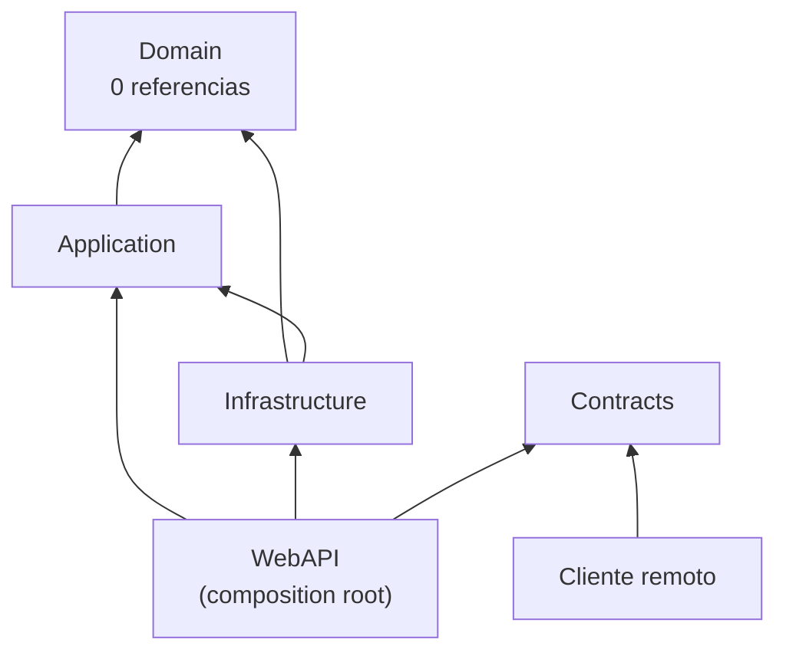
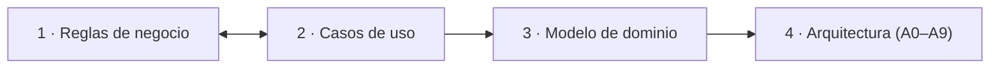

# 05 · Arquitectura .NET y laboratorio

> **Propósito**: destilar todo `Guides/Dot-NET-Arquitectura-Guide/`: la guía de estudio de arquitectura
> .NET por capas (Clean Architecture + vocabulario DDD) con su laboratorio compilado `L00–L24` y sus
> variantes `V01–V09`; la guía interactiva y el taller «La Estancia»; las dos guías de referencia
> de microservicios y de manejo de archivos/multimedia, y la carpeta de práctica del usuario.
> **Fuente primaria**: `Guides/Dot-NET-Arquitectura-Guide/Dot-NET-Arquitectura-Guide.md` (doc_id
> `GUIA-NET-ARQ`, v2.5.0): Índice, §0.3–§0.6, §8.3, §9.1–§9.3, Anexos A–E.
> **Corte**: `Lab-Documentos` en `main` 5d5c2b4 (2026-10-11), relevado el 2026-10-18. Rutas relativas
> a `Lab-Documentos/`; abreviatura `ARQ/` = `Guides/Dot-NET-Arquitectura-Guide/`.

---

## 1. Inventario

### 1.1 Documentos (Markdown)

| Ruta (`ARQ/…`) | doc_id | Versión | Estado | Líneas | Qué es |
| --- | --- | --- | --- | ---: | --- |
| `Dot-NET-Arquitectura-Guide.md` | `GUIA-NET-ARQ` | 2.5.0 | vigente (last_review 2026-09-24) | 2944 | **La guía**: estudio + criterios, con laboratorio reproducible |
| `Dot-NET-Arquiectura-Interactive-Guide.md` | `GUIA-NET-ARQ-INT` | 0.4.0 | en construcción (2026-09-25) | 814 | Banco de pruebas de la guía sobre «La Estancia La Ana»: hitos A0–A9, hallazgos F-A…F-J |
| `Microservicios-Guide.md` | — (sin frontmatter) | — (no declara) | — | 717 | Referencia prescriptiva: microservicios, auth, gateway, configuración, 5 patrones de frontend |
| `Manejo-Archivos-Guide.md` | — (sin frontmatter) | «Versión 1.0» (pie) | — | 913 | Complemento de la anterior: archivos, imágenes, video, compresión, firma digital |
| `Interactive-Activities/README.md` | — | — | control de cambios 2026-09-28 | 262 | Prólogo y temario del taller «Del requerimiento a la arquitectura» (4 actividades) |
| `Interactive-Activities/Actividades/Actividad-1-Deduciendo-Reglas-Negocios.md` | — | — | en curso (párrafo I cerrado por mesa 2026-10-03) | 921 | Cuaderno **del autor** + bloques ⟨M⟩ de la mesa |
| `Interactive-Activities/Actividades/Actividad-2-Deducir-Los-Casos-De-Uso.md` | — | — | consigna | 175 | Casos de uso, matriz regla × CU, huecos |
| `Interactive-Activities/Actividades/Actividad-3-Diseñar-Modelo-De-Dominio.md` | — | — | consigna | 190 | Tabla de ubicación de reglas, agregados, jerarquías |
| `Interactive-Activities/Actividades/Actividad-4-Implementar-La-Arquitectura.md` | — | — | consigna | 154 | Los diez hitos A0–A9 con comando verificador |
| `Interactive-Activities/Actividades/README.md` | — | — | — | 6 | Metodología: humano + agentes IA + mesa |
| `Interactive-Activities/Contextos/Contexto.md` | — | — | corte 2026-09-26 | 335 | Reconstrucción desde cero del taller (roles, carriles, decisiones, entorno) |
| `Interactive-Activities/Contextos/ParaRetomar.md` | — | — | sesión 2026-09-26 | 101 | Refresco corto: dónde quedó la actividad 1 |
| `Interactive-Activities/Contextos/README.md` | — | — | — | 7 | Qué leer para retomar (limpio vs. en caliente) |
| `Interactive-Activities/Mis-Apuntes-Borradores/Mis-Notas.md` | — | — | borrador del usuario | 1336 | Notas de trabajo del usuario: **no se indexa su contenido** |
| `Exercices/README.md` + `Exercice1/…/Rectangulo.cs` | — | — | taller del usuario | 2 + 7 | Práctica personal: **sólo se menciona, no se escribe** |

### 1.2 Código y artefactos (164 archivos versionados en `ARQ/`)

| Bloque | Archivos | Contenido |
| --- | ---: | --- |
| `Examples/Dot-NET-Arquitectura-Lab/MyProject/` | 37 | Solución final del laboratorio (8 proyectos, `.slnx`, `global.json`) |
| `Examples/Dot-NET-Arquitectura-Lab/capturas/` | 33 | Salidas literales `L00…L24` con encabezado (fecha, imagen, digest, SDK, comando) |
| `Examples/Dot-NET-Arquitectura-Lab/Variantes/` | 52 | 3 programas aparte (9 `.csproj`: `ProductoSinPrecio` Domain+Demo; `Pedidos` Domain+Application+Infrastructure+Demo; `FabricaYResultado` Domain+Infrastructure+Demo) + `global.json` propio + `variantes.sh` + 11 capturas `V01…V09` |
| `Examples/Dot-NET-Arquitectura-Lab/Conceptos-DI/` | 6 | `Paso0`–`Paso2`: regla de dependencia → inversión → contenedor (§2.2) |
| `Examples/Dot-NET-Arquitectura-Lab/lab.sh` | 1 | Guion de 842 líneas que corre los 25 pasos y escribe `aserciones.log` |
| `Interactive-Activities/LaEstancia/` | 19 | Solución `LaEstancia.slnx` (un proyecto WebAPI con carpeta `Domain/` en esqueleto) |

`aserciones.log` existe en disco pero **no está versionado** (lo excluye `*.log` en `.gitignore`, l. 121).
No hay PNG/PDF en el dominio.

---

## 2. Mapa de la guía principal (`GUIA-NET-ARQ`)

Problema conductor (§0.4): una **tienda** con catálogo de productos; una sola *Business Rule* al
comienzo («precio > 0»), luego clientes, pedidos y otras apps. Cuatro escenarios **E-A…E-D** (§0.4)
más **E-E** (§9.1). Dos lecturas (§0.3): **Recorrido** §1→§9 con laboratorio, o **Consulta** entrando por §9.1 y §7.

| Parte | § | Responde | Pasos de lab |
| --- | --- | --- | --- |
| — | 0 | Alcance (fuera: microservicios, CI, Blazor/MAUI completos, seguridad), marcas de procedencia, entorno | L00 |
| I Fundamentos | 1 | Solución/proyecto/referencia/paquete; por qué la referencia es una flecha; `using` no crea dependencia; ciclos | L01–L05 |
| | 2 | Regla de dependencia, inversión, DI, *composition root*; correspondencia con los círculos de Martin; esqueleto de 4 proyectos | L06–L08 |
| II Construcción | 3 | *Entity*, *Value Object* (`Producto`, `Dinero`), *Business Rule*, *Invariant* vs *Precondition*, lanzar vs devolver, jerarquías (§3.9), conjuntos cerrados (§3.10) | L09–L10, V01, V04, V06, V08 |
| | 4 | *Use Case* → Command + Handler, *Repository*, pruebas sin base, CQS vs CQRS, MediatR opcional, *Aggregate* `Pedido` (§4.10), `SaveChanges` en el Handler (§4.11) | L11–L12, V02 |
| | 5 | API en marcha, cambiar almacenamiento sin tocar Domain, mapeo EF Core desde afuera, `SaveChangesAsync`, errores HTTP (400/500/ProblemDetails) | L13–L21, V03, V05, V07, V09 |
| | 6 | Clientes: servicio en vez de `HttpClient` en la página, nacimiento de `Contracts`, Blazor Server sin API (E-A) | L22 |
| III Criterio | 7 | Cada objeto responde una pregunta (tabla §7.1), vocabulario plano → vocabulario de la guía (§7.4), clase única y término medio | — |
| | 8 | Árbol físico (§8.1), carpetas ≠ regla (§8.2), **referencias permitidas (§8.3, fuente única)**, nombres (§8.4), `Contracts` (§8.5) | L23 |
| | 9 | Mapa de entrada (§9.1), escalera (§9.2), sobreingeniería (§9.3), evaluar versión/paquete (§9.4), escalera en código (§9.6), ejercicios (§9.7), criterio en una línea (§9.8) | L24 |
| Anexos | A | Hoja de ruta L00–L24 y V01–V09 (paso, §, comando, qué confirma, captura) | todos |
| | B | 12 preguntas de verificación para diseñar una solución nueva | — |
| | C | Versiones, soporte y licencias (consultado 2026-09-18) | — |
| | D | Glosario término → equivalente → § → código | — |
| | E | Referencias autor-fecha (Martin, Evans, Fowler, Cockburn, Liskov, Seemann, Microsoft…) | — |

Estructura interna fija de los capítulos I–II (§0.3): prerrequisitos → definiciones → preguntas con
**«Respuesta:» en negrita** primero → práctica → pregunta de cierre «¿cuándo no aplica?». Buscar
`^\*\*Respuesta` en el archivo da el resumen de todas las decisiones.

---

## 3. Conceptos y decisiones clave

### 3.1 La regla y el esqueleto



*Grafo de `ProjectReference` según §2.7 (L08) y §8.3. `Contracts` nace en L22.*

| Proyecto (§8.3) | Puede referenciar | No puede |
| --- | --- | --- |
| `Domain` | nada | todo lo demás |
| `Application` | `Domain` | `Infrastructure`, `WebAPI`, `Contracts`¹, clientes |
| `Infrastructure` | `Domain`, `Application` | `WebAPI`, `Contracts`, clientes |
| `WebAPI` | `Application`, `Infrastructure` (sólo para el contenedor), `Contracts` | clientes |
| `Contracts` | nada | todo lo demás |
| Cliente remoto (E-B) | `Contracts` | `Domain`, `Application`, `Infrastructure`, `WebAPI` |
| Cliente en proceso, único (E-A con `Application`, §6.4) | `Application`² | `Infrastructure`, `Domain` por fuera de `Application` |

¹ Apartamiento válido declarado en §8.3. ² Sólo Blazor en el servidor y único cliente. **Ningún cliente referencia `Infrastructure`.**

Decisiones de §1–§2 (cada una con su experimento):

| Afirmación | Evidencia |
| --- | --- |
| `using` sin referencia no compila (CS0234/CS0246) | L03 |
| Un ciclo de referencias se agrega con código 0 y falla al compilar (MSB4006) | L04 |
| Separar en proyectos convierte la regla en error de compilación | L06 vs L07 |
| `Infrastructure` depende de `Domain` porque el dominio declara la interfaz | §2.4 |
| La WebAPI conoce `Infrastructure` sólo para registrar en el contenedor | §2.5, L17 (`grep` → sólo `Program.cs`) |
| Las carpetas no hacen cumplir la regla; las referencias son transitivas (`DisableTransitiveProjectReferences`, no ejercitada) | §8.2 |
| Interfaces de Repository en `Domain` a sabiendas (Martin las ubica en *Use Cases*) | §2.1, salvedad |

### 3.2 Domain (§3)

| Pregunta | Respuesta de la guía | § |
| --- | --- | --- |
| ¿Es *Business Rule*? | Sí si seguiría valiendo con el negocio en papel («prueba del papel») | 3.2 |
| ¿Por qué setter privado? | Para que el único camino a fijar el precio pase por la regla (CS0200 en L10) | 3.4 |
| ¿Entity sin reglas? | Clase con propiedades públicas es honesta | 3.5 |
| ¿Dónde vive una regla? | En el objeto que conoce los datos que la regla necesita | 3.6 |
| ¿*Invariant* o *Precondition*? | Vale toda la vida y mirando ese objeto solo → *Invariant*; sólo antes de un acto → *Precondition* (tabla de 9 reglas) | 3.7 |
| ¿Lanzar o devolver? | Esperable por la entrada → resultado tipado (`DomainResult`); defecto del llamador → excepción. 4 preguntas; medición V06 | 3.8 |
| ¿Jerarquía de tipos? | Sólo si los subtipos difieren en comportamiento que el negocio nombra y cumplen sustitución de Liskov; 3 preguntas jerarquía vs composición | 3.9 |
| ¿Conjunto cerrado? | `enum` no cierra (`(EstadoProducto)99` compila); *Value Object* con fábrica sí (V08) | 3.10 |

### 3.3 Application, Infrastructure y borde (§4–§5)

- *Use Case* = el método de servicio de siempre; su firma es el **Command**, su cuerpo el **Handler** (§4.2).
- *Repository*: colección en memoria de *Entities*, sin reglas (§4.4); opcional sobre EF Core, se justifica por pruebas y aislamiento (§5.5, §9.3; Microsoft 2018).
- Pruebas de la regla con un `FakeProductoRepository` en el proyecto de tests (§4.6, L11); L12 muestra que detectan la regresión.
- No es CQRS (un solo modelo) y **MediatR no hace falta** (§4.8–§4.9). La guía tampoco adopta AutoMapper (§9.4).
- `SaveChangesAsync` sube al Handler (detrás de `IUnitOfWork`) cuando un *Use Case* toca más de un *Aggregate* (§4.11, V02).
- Cambiar almacenamiento: `Domain.dll` con SHA-256 idéntico antes/después de EF Core (L16).
- EF Core mapea la *Entity* desde afuera (Fluent API); constructor privado + setters privados (§5.4, V05, V07).
- Error de regla sin traducir → 500 (L20); con `DomainExceptionHandler` → 400 ProblemDetails (L21); JSON mal formado → 400 automático (L19).

### 3.4 Criterio (§7–§9)

| Objeto (§7.1) | Ejemplo | Vive en | Existe sólo si… |
| --- | --- | --- | --- |
| Entity | `Producto` | Domain | hay reglas que proteger |
| Value Object | `Dinero` | Domain | el valor tiene comportamiento/reglas propias |
| Command / Query | `CrearProductoCommand` | Application | hay un Use Case que orquestar |
| Response DTO | `ProductoResponse` | Contracts | hay API consumida por otro proceso |
| ViewModel | `ProductoListItemViewModel` | Cliente | la pantalla muestra algo distinto de lo recibido |
| Form model | `ProductoFormModel` | Cliente | hay formulario con enlace de datos |
| Persistence model | `ProductoDbModel` | Infrastructure | el esquema no se adapta (E-C) |
| Jerarquía de tipos | `ActividadProductiva` → `Agricola` | Domain | comportamiento que difiere por tipo nombrado por el negocio |

Escalera (§9.2, *criterio de la guía*): **1** un proyecto → **2** término medio (Entity + form model)
→ **3** Domain + Application → **4** + WebAPI + Contracts. Se sube con una señal observable (§9.3),
no por tener «buenas clases». Sobreingeniería = capa que sólo reenvía.

| Escenario (§9.1) | Estructura de partida |
| --- | --- |
| E-A Blazor en servidor, CRUD con pocas reglas | Un proyecto (o término medio) |
| E-B API con clientes .NET remotos | 4 proyectos backend + `Contracts` + clientes |
| API con clientes no .NET | E-B sin `Contracts`: el contrato es el OpenAPI |
| E-C base heredada de esquema fijo | + persistence model en Infrastructure |
| E-D reglas ricas repetidas | Domain y Application separados |
| E-E app local (escritorio/móvil) sin servidor | Un proyecto con modelo con comportamiento |

Nombres (§8.4): **patrón en inglés como sufijo, concepto del negocio en español como raíz**
(`CrearProductoCommand`, `IProductoRepository.AddAsync`; ❌ `ProductRepository`, ❌ `IProductoRepositorio.Agregar`).
Evaluar un paquete (§9.4): soporte, licencia, vulnerabilidades, alternativa nativa, costo de salida.
Criterio en una línea (§9.8): *cada capa y cada clase se agrega cuando aparece la señal que la
justifica, y el compilador —no la convención— hace cumplir las que se agregaron.*

### 3.5 Datos volátiles (Anexo C, consultado 2026-09-18 — reverificar antes de decidir)

| Componente | Dato |
| --- | --- |
| .NET 10 | LTS hasta 2028-11-14 (versión del laboratorio) |
| .NET 8 / .NET 9 | soporte hasta 2026-11-10 |
| MediatR | 12.5.0 Apache-2.0; desde 13.0.0 RPL-1.5 o comercial |
| AutoMapper | 14.0.0 última MIT; GHSA-rvv3-g6hj-g44x afecta < 15.1.1 y 16.0.0–16.1.0 |
| Dapper | 2.1.86 Apache-2.0 (único paquete de terceros del lab, V09) |
| Refit | < 7.2.22 con GHSA-3hxg-fxwm-8gf7 |

---

## 4. El laboratorio (`ARQ/Examples/Dot-NET-Arquitectura-Lab/`)

### 4.1 Qué hay

```text
Dot-NET-Arquitectura-Lab/
├── lab.sh                 L00–L24 en mcr.microsoft.com/dotnet/sdk:10.0; capturas + aserciones.log
├── capturas/Lnn-*.txt     33 salidas literales; 1.ª línea «# comando:» = comando completo
├── MyProject/             código final (SDK 10.0.400, rollForward latestFeature)
│   ├── src/Backend/       Domain · Application · Infrastructure (EF Core Sqlite 10.0.12) · WebAPI (OpenApi 10.0.11)
│   ├── src/Contracts/     CrearProductoRequest, ProductoResponse
│   ├── src/Clients/       ConsoleClient (cliente remoto real, L22)
│   └── tests/Backend/     Domain.Tests y Application.Tests (xUnit 2.9.3)
├── Conceptos-DI/Paso0..2  consola: new directo → interfaz + composition root → ServiceCollection (sin captura)
└── Variantes/             fuera de lab.sh; las corre variantes.sh
    ├── ProductoSinPrecio/ V01 · §3.7 Precondition de vender
    ├── Pedidos/           V02–V03 · §4.10–§5.5 Aggregate, IUnitOfWork, AsNoTracking
    └── FabricaYResultado/ V04–V09 · §3.8, §3.10, §5.4 lanzar/devolver, enum vs VO, materializadores (Dapper)
```

Todos los proyectos apuntan a `net10.0`. Los archivos intermedios que un paso reemplaza
(`InMemoryProductoRepository`, `Program.cs` de L13, `Intento.cs`) **no** están en `MyProject/`: viven
dentro de `lab.sh` (§0.5).

### 4.2 Cómo se corre

```bash
# desde ARQ/Examples/Dot-NET-Arquitectura-Lab/  (encabezado de lab.sh)
docker run --rm --user "$(id -u):$(id -g)" -e IMAGEN=... -e DIGEST=... \
  -v "$PWD":/lab -w /lab mcr.microsoft.com/dotnet/sdk:10.0 bash lab.sh
# variantes: desde Variantes/, montado en /variantes, `bash variantes.sh`
```

- La API del lab escucha en `http://127.0.0.1:5180` (L13).
- Lo que cambia entre equipos: rutas, `Guid`, fechas, SHA-256 de L16, parche del SDK. Lo que
  verifica `aserciones.log`: códigos de error, estados HTTP, códigos de salida; incluye **una aserción
  que falla a propósito** (Anexo A).
- Pasos ⚠ (L03, L04, L07, L10, L12, L18, L19, L20): predecir antes de ejecutar (§0.5).
- No construido a propósito: un segundo ABM y un cliente con `IProductoApiService`/ViewModels (Anexo A).

### 4.3 Marcas de procedencia (§0.5) — imprescindibles para leer la guía

| Marca | Lectura |
| --- | --- |
| *Salida registrada: `capturas/Lnn-….txt`* | extracto literal de una corrida real |
| **[Compilado: `MyProject/…`]** / `Variantes/…` | extracto de código que compiló con 0 advertencias |
| **[Compilado sin captura: `Conceptos-DI/…`]** | compiló y corrió, sin salida versionada |
| **[Fragmento ilustrativo: motivo]** | no forma parte del código final; `contraejemplo` = lo que no conviene |
| **Criterio de esta guía** | recomendación propia, no norma |
| [Autor, año] | respaldado en Anexo E (cita + implicancia + código) |

---

## 5. Guía interactiva y taller «La Estancia»

### 5.1 Qué es

`GUIA-NET-ARQ-INT` **no es otra guía**: es el banco de pruebas de `GUIA-NET-ARQ` sobre un problema
real (Actividad Integradora 3.3, Programación II, UTN FRP, TUP 2026: estancia «La Ana», 15 casos de
uso, 18 reglas). La versión de escritorio previa (WinForms, `net9.0-windows`) vive fuera de este repo
(`PROG2/2026/dev/tup_prog_2_2026_actividad3.3/`, sólo lectura, según `Contexto.md` §3). Lo que la
actividad encuentra **vuelve a la guía** (§0.1). Marcas propias (§0.3): *Verificado en máquina*,
**[Leído]**, **[Fuente: enunciado]**, **⏳ Pendiente de mesa**, **⚠ Hallazgo contra la guía**,
**Criterio de esta actividad**.

| § | Contenido |
| --- | --- |
| 1 | Dominio (`Estancia`, `Campo`, `Parcela`, `Actividad` → `Agricola`/`Ganadera` → `Cria`/`ReCria`/`Invernada`) |
| 2 | Línea de base escritorio: 18 reglas medidas (11 en dominio, 3 duplicadas, 3 sólo en vista, 1 sin implementar — §7 v0.2.0) |
| 3 | Solución `LaEstancia`: OpenAPI 10.0.11 + Scalar 2.17.9 + EF Core Sqlite 10.0.12; TPH con `Discriminator` verificado aparte |
| 4 | Hitos **A0–A9** con «error típico» y comando verificador (tabla §4.2); Tarea 2 como instrumento de medición |
| 5 | Hallazgos contra la guía **F-A…F-J** y preguntas P-01…P-04 |
| 6–7 | Bitácora (decisiones D-x, preguntas A-1…A-4) y registro de cambios 0.1.0→0.4.0 |

### 5.2 Hitos A0–A9 (§4.2 de la interactiva; Actividad 4)

| Hito | Qué | Señal |
| --- | --- | --- |
| A0 | Medir la línea de base | `grep` de `is Agricola…` en `Vistas/` |
| A1 | Modelo dado tal cual detrás de HTTP | mismos números que escritorio |
| A2 | Del índice al identificador | dos peticiones con un alta en medio |
| A3 | Nace `Application` (RN-09, RN-10, RN-14) | `dotnet test` sin HTTP ni base |
| A4 | `Domain` como proyecto | `CS0234`; `Domain` sin referencias |
| A5 | Cierre polimórfico y contrato con subtipos | `grep ' is Agricola' src/` vacío |
| A6 | `double` → *Value Object* dinero | totales que difieren |
| A7 | Persistir la jerarquía | SHA-256 de `Domain.dll` idéntico |
| A8 | `Contracts` + cliente | cliente referencia sólo `Contracts` |
| A9 | Tarea 2 en los dos mundos | `git diff --stat` y defecto latente que no se reproduce |

### 5.3 El taller (`ARQ/Interactive-Activities/`)



| Actividad | Entra → Sale | Disciplina (README §3) |
| --- | --- | --- |
| 1 | párrafo en prosa → tablas términos/actos/reglas + preguntas al autor | análisis |
| 2 | tablas → CU con pre/postcondiciones, matriz regla × CU, huecos | análisis funcional |
| 3 | reglas + CU → diagrama de clases + tabla de ubicación | análisis → diseño |
| 4 | modelo → solución en capas verificada por compilador | diseño |

Rasgos del método (README §3.3, Actividad 1): «prueba del papel», etiquetas `T` término / `V` acto /
`A` atributo (ocho en total), letra/intención/propuesta separadas, especie–momento–dueño. Antecedente
citado: Abbott (1983); arco OOAD de Larman (2004). Roles (`Contexto.md` §1): PO = alumno y autor del
enunciado; moderador = agente; especialistas = subagentes; **la mesa decide y queda aprobado**.
Base B de conocimiento y actas: `Lab-Documentos.Documentacion/PROMPTs/Guides/06-Crear-Dot-NET-Arquitectura-Guide/OUTPUTs/` (`Mesa/04…07`).

Cómo se corre `LaEstancia` (no hay `dotnet` en el host; `Contexto.md` §10):

```bash
cd ARQ/Interactive-Activities/LaEstancia     # ruta real; ver H-02/H-03
docker run --rm --user "$(id -u):$(id -g)" -e HOME=/tmp/home -e DOTNET_CLI_HOME=/tmp/home \
  -v "$PWD":/w -w /w mcr.microsoft.com/dotnet/sdk:10.0 \
  bash -c 'mkdir -p /tmp/home && dotnet build LaEstancia.slnx'
# API en 5250 (perfil http), Scalar en /scalar/, OpenAPI en /openapi/v1.json
```

Estado real del código: un solo proyecto `src/LaEstancia.WebAPI` (paquetes OpenAPI, Scalar, EF Core
Sqlite/Design) con carpeta `Domain/{Actividades,Campos,Estancias}` de 11 clases esqueleto (84 líneas);
`Program.cs` sin endpoints ni registros. **El dominio lo escribe el PO** (`Contexto.md` §8).

---

## 6. Guías de referencia: microservicios y archivos

Prescriptivas («cómo lo hacemos»), sin frontmatter, sin marcas de procedencia ni referencias
cotejadas; plataforma de ejemplo multi-tenant (chat, IA, pagos, formularios). Ambas cierran con
tablas para agentes IA.

| `Microservicios-Guide.md` § | Tema |
| --- | --- |
| 1 | Glosario; principios (autonomía, base por servicio, *smart endpoints dumb pipes*, *design for failure*) |
| 2 | Cuándo sí/no; scaffolding de 4 capas por servicio (+ RCL admin/producto opcionales); MediatR + FluentValidation + AutoMapper; comunicación entre servicios (§2.4) y base por servicio (§2.5) |
| 3 | IdP centralizado, flujos OAuth2 por cliente, `tenant_id` en JWT |
| 4 | API Gateway: YARP vs Ocelot |
| 5 | Secrets vs parametría; manifest-driven; settings store multi-tenant |
| 6 | Frontends: admin vs producto; patrones 1 (mini-front), 2 (monolito), **2.5 monolito modular con RCL («recomendado para la mayoría de los equipos», §6.4)**, 3 (app shell + micro-frontends), 4 BFF, 5 API-first |
| 7–9 | Extensibilidad del Admin Portal; consumo multi-cliente; Docker/IIS |
| 10 | Tablas de decisión (backend, frontend, auth) y matriz de madurez MVP→Plataforma |
| 11–12, Apéndice | Roles/prompts para agentes; casos (Mercado Libre, Spotify, AWS, Atlassian…); árbol del monorepo |

| `Manejo-Archivos-Guide.md` § | Tema |
| --- | --- |
| 1 | Principios (`IFileStorage`, File Service, archivo con GUID + SHA-256, URLs firmadas 5–60 min, prefijo por tenant); proveedores Drive/FTP/S3/local; seguridad |
| 2 | Pipeline de imágenes, thumbnails, caché tipo WhatsApp, blur-up, CDN, móviles |
| 3 | Video: codecs, HLS/DASH/WebRTC/RTSP, FFmpeg, grabación diferida, cámaras IP, live, VOD |
| 4 | Compresión (archivos, imágenes, video; perfiles) |
| 5 | Firma digital, watermarking, cadena de custodia, DRM |
| 6 | File Service en el ecosistema, estructura, eventos |
| 7–8 | Glosario; tablas G1–G6 para agentes (roles, estructura, storage, video, compresión, prompts) |

---

## 7. Relaciones con otras guías del repo

| Con | Vínculo |
| --- | --- |
| `Guides/Arquitectura/Organizacion-Estilo-Patrones-Codigo/` | Mismo tema desde la organización de código (servicios, soluciones, nomenclatura, patrones); `10-Arquitectura-de-Servicios/Microservicios.md` se solapa con `Microservicios-Guide.md` |
| `Guides/Arquitectura/Organizacion-Estilo-Rest-API/` | Diseño REST (`80-Implementacion-en-NET`) complementa §5 (códigos HTTP, ProblemDetails, OpenAPI) |
| `Guides/Metodologia-Entorno-Desarrollo/Metodologia-Entorno-Desarrollo-Guide.md` | Declara `related: ../Dot-NET-Arquitectura-Guide/Dot-NET-Arquitectura-Guide.md` |
| `Guides/Testing/Lab-E2E.WebBlazor-Guides/Nomenclatura-Convensiones-Arquitecture-Dot-Net.md` | Remite a esta guía como «criterio general» (con ruta vieja, H-07) |
| `CHANGELOG.md` | Historia v2.0.1–v2.4.0 de la guía y del laboratorio |
| `Lab-Documentos.Documentacion/PROMPTs/Guides/06-Crear-Dot-NET-Arquitectura-Guide/` | Prompt generador, mesas y conocimiento del taller (fuera del repo indexado) |

Dentro del dominio: `GUIA-NET-ARQ` §0.1 remite a `Microservicios-Guide.md` para lo que excluye;
`Manejo-Archivos-Guide.md` se declara complemento de esa guía; `GUIA-NET-ARQ-INT` declara
`related: [Dot-NET-Arquitectura-Guide.md]`; el temario del taller (`Interactive-Activities/README.md`,
tabla de la Actividad 3) remite a §3.1, §3.3, §3.6, §3.7, §3.9, §4.10, §7 y §9.6 de la guía (el archivo
`Actividad-3-…md` en sí no cita §), y la tabla §4.2 de la interactiva cruza cada hito A0–A9 con los § que pone a prueba.

---

## 8. Hallazgos del dominio

| # | Tipo | Ruta | Detalle |
| --- | --- | --- | --- |
| H-01 | nombre con errata | `ARQ/Dot-NET-Arquiectura-Interactive-Guide.md` | «Arquiectura» (falta la t); el nombre se repite así en `Contexto.md` |
| H-02 | desfase doc ↔ código | `ARQ/Dot-NET-Arquiectura-Interactive-Guide.md` §3.1–§3.2, §3.6–§3.7 | Describe `Interactive-Activities/global.json`, `src/Backend/LaEstancia.WebAPI` y un proyecto `LaEstancia.Infrastructure` aparte; lo real es `Interactive-Activities/LaEstancia/src/LaEstancia.WebAPI` (sin `Backend/`), sin Infrastructure, con los paquetes EF Core en la WebAPI y una carpeta `Domain/` dentro. `cd Interactive-Activities` de §3.7 no llega al `.slnx` |
| H-03 | rutas viejas | `ARQ/Interactive-Activities/Contextos/Contexto.md` §3, §9, §10 | Nombra `Interactive-Activities/docs/…` y `docs/Temas.md`, que no existen (hoy `Actividades/`, `Mis-Apuntes-Borradores/`, temario en `README.md`); §10 hace `dotnet build LaEstancia.slnx` desde `Interactive-Activities/`, donde no está |
| H-04 | enlaces rotos | `ARQ/Interactive-Activities/Contextos/ParaRetomar.md` l. 14 y 101 | `Actividad-1-Deduciendo-Reglas-Negocios.md` (está en `../Actividades/`) y `Temas.md` (no existe) |
| H-05 | carpeta mal nombrada | `ARQ/Interactive-Activities/README.md` §2 | El árbol dice `Apuntes-Borradores/`; la carpeta es `Mis-Apuntes-Borradores/` |
| H-06 | hallazgo superado | `ARQ/Dot-NET-Arquiectura-Interactive-Guide.md` §5.1 | Afirma 0 ocurrencias de «jerarqu»/«Liskov» en la guía (2817 líneas); la v2.5.0 (2944 líneas) ya tiene §3.9 (`grep -ci`: 22 líneas con «jerarqu», 3 con «Liskov»). F-A figura «en mesa» sin actualizar |
| H-07 | ruta vieja externa | `Guides/Testing/Lab-E2E.WebBlazor-Guides/Nomenclatura-Convensiones-Arquitecture-Dot-Net.md` l. 205 | Apunta a `Guides/Arquitectura/Dot-NET-Arquitectura-Guide.md`; la guía se mudó a `Guides/Dot-NET-Arquitectura-Guide/` (commit 27b17a4, 2026-09-20) |
| H-08 | changelog incompleto | `CHANGELOG.md` | Última entrada de la guía: v2.4.0 (2026-09-21); no registra v2.5.0 (commit 8218f97, 2026-09-26), ni la guía interactiva ni el taller |
| H-09 | fecha dudosa | `ARQ/Dot-NET-Arquitectura-Guide.md` frontmatter | `last_review: 2026-09-24` en la v2.5.0, que entró el 2026-09-26 (no verificable si hubo revisión posterior) |
| H-10 | contradicción de criterio | `ARQ/Microservicios-Guide.md` §2.2–§2.3, §11 | Prescribe MediatR + AutoMapper por servicio; `GUIA-NET-ARQ` §4.9, §9.4 y Anexo C no los adopta por licencia (RPL/comercial) y vulnerabilidad de AutoMapper |
| H-11 | sin metadatos | `ARQ/Microservicios-Guide.md`, `ARQ/Manejo-Archivos-Guide.md` | Sin frontmatter, doc_id, fecha ni fuentes; la primera no declara versión |
| H-12 | carácter no ASCII | `ARQ/Interactive-Activities/Actividades/Actividad-3-Diseñar-Modelo-De-Dominio.md` | `ñ` en el nombre (git lo muestra escapado `Dise\303\261ar`) |
| H-13 | contexto desactualizado | `ARQ/Interactive-Activities/Contextos/{Contexto,ParaRetomar}.md` | Corte 2026-09-26; la Actividad 1 ya registra la mesa de cierre del 2026-10-03 (acta 07). `Contexto.md` §3 y §8 dan la interactiva con 815 líneas (hoy 814) y la mesa 06 «corriendo» |
| H-14 | artefacto no versionado | `ARQ/Examples/Dot-NET-Arquitectura-Lab/aserciones.log` | Anexo A lo presenta como evidencia, pero `*.log` lo excluye del repo |
| H-15 | carpetas del usuario | `ARQ/Exercices/`, `ARQ/Interactive-Activities/Mis-Apuntes-Borradores/`, cuaderno de Actividad 1 | Del usuario: no escribir (en Actividad 1 sólo los bloques ⟨M⟩ son de la mesa). `Exercices/Exercice1` es un `Rectangulo` vacío |
| H-16 | comentario desfasado | `ARQ/Interactive-Activities/LaEstancia/src/LaEstancia.WebAPI/Program.cs` | Dice que las capas irán «bajo src/Backend/», carpeta que la solución no tiene |

---

## 9. Para preguntas X → leé fuente Y

| Necesitás saber… | Leé |
| --- | --- |
| Qué estructura conviene a un problema concreto | `ARQ/Dot-NET-Arquitectura-Guide.md` §9.1 → §9.2/§9.3; checklist Anexo B |
| Qué proyecto puede referenciar a cuál | §8.3 (única fuente de la regla) |
| Qué clase usar (Entity, DTO, ViewModel, DbModel…) | §7.1 y §7.2 a–g |
| Si una regla es *Invariant* o *Precondition* | §3.7 (tabla) y §3.2 (prueba del papel) |
| Lanzar excepción o devolver resultado | §3.8; código `Variantes/FabricaYResultado/`; medición V06 |
| Cuándo usar herencia en el dominio | §3.9; caso real en la guía interactiva §1–§2 |
| Command/Handler/Repository sin MediatR | §4.2–§4.9; `MyProject/src/Backend/MyProject.Application/` |
| Dónde va `SaveChangesAsync` y la *Unit of Work* | §4.11, §5.5; `Variantes/Pedidos/` |
| Cómo traducir una `DomainException` a HTTP 400 | §5.6; `MyProject.WebAPI/ExceptionHandlers/DomainExceptionHandler.cs` |
| Cuándo nace `Contracts` | §6.3, §8.5 (L22) |
| Cómo nombrar clases y carpetas | §8.4 |
| Si adoptar MediatR/AutoMapper/un paquete | §9.4 (L24) y Anexo C |
| Qué comando prueba cada concepto | Anexo A; `capturas/Lnn-*.txt` (línea `# comando:`) |
| Reproducir el laboratorio | `ARQ/Examples/Dot-NET-Arquitectura-Lab/lab.sh` (encabezado) y §0.6 |
| Retomar el taller de La Estancia | `Interactive-Activities/Contextos/README.md` → `Contexto.md` (ojo H-03) |
| Método para deducir reglas de un enunciado | `Interactive-Activities/README.md` §3–§4 y `Actividades/Actividad-1-…md` |
| Microservicios, gateway, auth multi-tenant, frontends | `ARQ/Microservicios-Guide.md` §2–§6, §10 |
| Storage, imágenes, video, firma digital | `ARQ/Manejo-Archivos-Guide.md` §1–§5, tablas G3–G5 |
