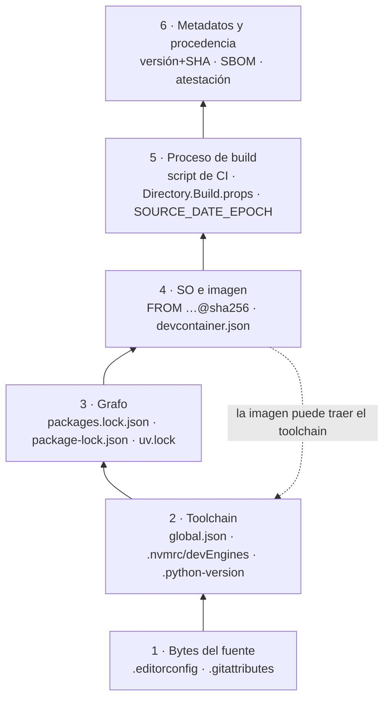

# 06 · Metodología del entorno de desarrollo

> **Propósito**: cómo hace un equipo que edita en Windows con Visual Studio, en Linux y en devcontainers para obtener **el mismo resultado del mismo commit** y poder demostrar después con qué entorno se construyó cada artefacto. Cubre codificación y finales de línea, política de texto, toolchain, dependencias, contenedores/devcontainers, procedencia, compuertas y la solución políglota .NET + Node.js + Python, con un laboratorio de 74 experimentos ejecutables en Docker.
> **Fuente primaria**: `Guides/Metodologia-Entorno-Desarrollo/Metodologia-Entorno-Desarrollo-Guide.md` (`GUIA-ENT-DEV`, v1.1.0, `vigente`, `last_review` 2026-10-09, 3 637 líneas) y su laboratorio `Guides/Metodologia-Entorno-Desarrollo/Examples/` (342 archivos versionados).
> **Verificado contra**: `Lab-Documentos` en `main` 5d5c2b4 (2026-10-11), el 2026-10-18. Dominio nuevo respecto de la ia-db v3.0 (2026-09-12): allí no existía.

Convención de este índice: las rutas son relativas a `Lab-Documentos/`. Para abreviar, **`GUIA`** = `Guides/Metodologia-Entorno-Desarrollo/Metodologia-Entorno-Desarrollo-Guide.md` y **`EX/`** = `Guides/Metodologia-Entorno-Desarrollo/Examples/`. `§n` remite a secciones de `GUIA`; `E<n>-<m>` a experimentos de su Anexo E.

## En una pantalla

- **Un caso real como hilo** (GUIA §1): ~100 `.cs`/`.razor` en cp1252 compilaban en Windows y fallaban en Linux (`CS1056` en un identificador, `?` en literales). Se arregló pasándolos a UTF-8 con BOM, pero sin política escrita. La guía lo reproduce con un ejemplo sintético (E1-01) y lo usa para recorrer **seis capas** del entorno.
- **Tesis central**: «**Lo que el repositorio no declara, lo aporta quien construye**» (§1.3). Cada capa tiene una *fuente de verdad* en el repo, una herramienta que la **hace cumplir** (no sólo declara) y una CI que **arbitra**.
- **El contenedor no lo resuelve todo** (§3.5, §8.2.1): fija SO y, por digest, el toolchain; no fija los bytes del fuente (E5-1), ni el grafo, ni la procedencia.
- **Visual Studio no entra al devcontainer** para .NET (hallazgo negativo documentado, §8.2.4) → el devcontainer es una comodidad que reproduce la CI, no el lugar donde vive la política.
- **Todo es evidencia**: cada salida citada se ejecutó (2026-10-07 / 2026-10-09) y está versionada en `EX/*/salidas/`; 223 fuentes `[B01]–[B223]` con fecha de consulta (Anexo D). **Nada corrió en Windows**: lo de Windows está rotulado **[no verificado]**.

## Inventario de la guía

| Ruta | doc_id | Versión | Estado | Líneas | Qué es |
|---|---|---|---|---|---|
| `GUIA` | `GUIA-ENT-DEV` | 1.1.0 (2026-10-09) | `vigente` | 3 637 | Guía de estudio única del dominio; `doc_type: study-guide`, `origin: ai-assisted`, `owner`: cuenta personal del autor |
| `EX/README.md` | — | — | — | 45 | Índice del laboratorio: carpeta ↔ IDs ↔ cómo correr |
| `EX/<carpeta>/README.md` (×10) | — | — | — | 35–227 | Requisitos, comandos y qué demuestra cada experimento |

Frontmatter de `GUIA` (líneas 1–18), datos útiles: `entorno_validado` (Linux x86_64 con Docker; .NET SDK 8.0.425 y 10.0.400, 11.0.100-rc.1; Node 22.23.2 y 24.21.0; Python 3.12.14/3.12.15; uv 0.12.23; git 2.39.5 y 2.47.3), `traces` (P-01…P-10, R-01–R-03, R-06, R-07, R-PROF, R-PRIV; mapeados en Anexo F, que aclara que R-04 y R-05 «regían el proceso de trabajo, no la guía»), `related: [../GitFlow, ../Despliegue, ../Dot-NET-Arquitectura-Guide/Dot-NET-Arquitectura-Guide.md]` (las tres rutas existen), `laboratorio: Examples/`.

Historia (GUIA, «Control de cambios»): 1.0.0-borrador (2026-10-07, 71 experimentos) → 1.0.0-rc.1 → 1.0.0 → **1.1.0** (los tres el 2026-10-09; tres ciclos de revisión integral). El encabezado de 1.1.0 dice 74 experimentos; el conteo de IDs del Anexo E da 74 (verificado).

## Estructura de la guía

```text
GUIA
├── 0  Cómo usar la guía ........ dos lecturas (Recorrido / Consulta), ruta mínima, marcas, laboratorio
├── 1  El caso .................. cp1252 → CS1056 / U+FFFD; por qué Windows lo tapa; qué quedó abierto
├── 2  Marco .................... ESC-01..05 · CTX-NET/NODE/PY/POLI · ACT-DEV/ARQ/OPS/REV · matrices
├── 3  Pila de capas ............ definiciones, 6 capas, «qué fija cada mecanismo», mapa «estoy acá → qué aplico»
├── 4  Codificación y EOL ....... el fenómeno, lector por lector
├── 5  Política de texto ........ decidir · declarar · verificar · migrar (capa 1)
├── 6  Toolchain ................ global.json, .nvmrc/devEngines, .python-version/requires-python (capa 2)
├── 7  Dependencias ............. locks, restauración estricta, CPM, registros (capa 3)
├── 8  Contenedores ............. qué fija/no fija, etiqueta vs digest, devcontainer, convivencia Windows (capa 4)
├── 9  Procedencia .............. metadatos, determinismo, SBOM, SLSA y firma (capas 5–6)
├── 10 Compuertas y gobierno .... compuerta única, CI árbitro, revisor, descongelar, sin protección de rama
├── 11 Solución políglota ....... capítulo central de integración (.NET + Node + Python)
├── 12 Hoja de ruta ............. 10 pasos de adopción + contrato YAML de validaciones
└── Anexos A plantillas · B checklists por actor · C glosario (86 términos) · D bibliografía (B01–B223)
          E laboratorio (índice de experimentos) · F trazas, límites, no verificado · Control de cambios
```

**Plantilla de capítulo** (§4 a §11, §0.2): Definición → Cómo funciona → Qué propone la industria (.NET, Node.js, Python) → Aplicación por escenario y contexto → Ejemplos concretos → Preguntas guía (con respuesta) → Criterios de calidad → Plantilla (remite al Anexo A) → Práctica. Por eso `§n.3` es siempre «industria», `§n.6` «preguntas guía», `§n.9` «práctica».

### Qué responde cada parte

| Sección | Responde | Entrada típica |
|---|---|---|
| §0.2 | En qué orden leer; experimento mínimo por capítulo (E0-6, E1-01, E2-2, E3-1, E4-2, E5-1, E6-2, E7-1, E8-1) | Primera lectura |
| §0.3 | Qué significan `[Bnn]`, `E4-2`, **[criterio]**, **[no verificado]**, **[observado]**, **[interpretación]** | Leer cualquier afirmación |
| §0.4 | Cómo correr el laboratorio; `DOCKER_CONFIG` temporal; vías desde Windows (no probadas) | Reproducir |
| §1 | Por qué el mismo `.cs` compila en Windows y no en Linux | El síntoma del caso |
| §2 | Vocabulario de escenarios, contextos y actores; quién lidera/aplica/verifica cada capítulo (§2.4) | Asignar responsabilidades |
| §3.1 | Definiciones: fijar ≠ congelar; declarar ≠ hacer cumplir; determinista ≠ reproducible ≠ hermética; deriva; procedencia | Discusiones de vocabulario |
| §3.2–§3.3 | Las seis capas y, por mecanismo, **qué deja libre** | «¿Esto alcanza?» |
| §3.4 | Qué propiedad necesita un equipo (reproducible sólo si hay que demostrar ante un tercero) | Dimensionar el esfuerzo |
| §3.6 | Mapa por **síntoma**, por escenario, por contexto y por archivo a tocar | Diagnóstico rápido |
| §4 | Cómo supone la codificación cada lector (Roslyn, Razor, Node, Python, git); `CodePage`; cuándo el EOL cambia el binario | Entender el fenómeno |
| §5 | Tabla de BOM/EOL por extensión, variantes A/B, migración de heredado en commit mecánico verificable | Escribir `.editorconfig`/`.gitattributes` |
| §6 | Qué fija `global.json` y qué no; `rollForward` atado a usar lock; `devEngines`; `required-version` de uv | Fijar SDK/runtime |
| §7 | Locks y restauración estricta por ecosistema; CPM no es lock; mapeo de fuentes | Congelar paquetes |
| §8 | Etiqueta vs digest; `devcontainer.json` (image/build/features/lock); clon Windows montado en Linux; imagen dev vs CI | Devcontainers |
| §9 | Qué graba el SDK; `ContinuousIntegrationBuild`, `SOURCE_DATE_EPOCH`; SBOM y alcance; niveles SLSA y firma | «¿Con qué se construyó?» |
| §10 | Compuerta única (texto · toolchain · grafo), hooks, CI árbitro, lista del revisor, ADR para descongelar, límites sin protección de rama | Gobierno |
| §11 | Qué se rompe primero con los tres ecosistemas; punto único de versiones; frontera de la build A/B; imagen única vs por componente; SBOM políglota | Monorepo políglota |
| §12 | Orden de adopción (10 pasos) y contrato de validaciones | Plan de adopción |
| Anexo A | 18 plantillas comentadas (A.1–A.18), verificadas juntas en EA-1 | Copiar una plantilla |
| Anexo B | Checklists por actor (B.1 DEV, B.2 ARQ, B.3 OPS, B.4 REV) | Definición de «hecho», PR |
| Anexo F | Qué pedido cubre cada sección; lo no verificado; interpretaciones; datos volátiles | Límites de la evidencia |

## Marco de referencia (§2)

| Tipo | IDs | Nota clave |
|---|---|---|
| Escenarios | **ESC-01** Windows + Visual Studio · **ESC-02** Linux/macOS · **ESC-03** WSL 2 · **ESC-04** Devcontainer · **ESC-05** CI | ESC-01 es donde el problema **no se ve**; ESC-02 donde aparece; macOS se trata como Linux |
| Contextos | **CTX-NET** · **CTX-NODE** · **CTX-PY** · **CTX-POLI** | Variante transversal: heredado vs repo nuevo |
| Actores | **ACT-DEV** · **ACT-ARQ** · **ACT-OPS** · **ACT-REV** | ARQ lidera §3, §5–§7, §11; OPS lidera §8–§10; la procedencia se **produce** sólo en la CI **[criterio]** |

## Las seis capas (§3.2)



| Capa | Si el repo calla, la aporta… | Cómo se rompe | Experimento | Capítulo |
|---|---|---|---|---|
| 1 Bytes | El editor y el git de cada estación | Compila en una plataforma y no en otra; commits de BOM/EOL | E0-1 | §4, §5 |
| 2 Toolchain | El SDK más alto instalado; el `PATH`; la imagen | Mismo fuente, otra DLL | E0-2 | §6 |
| 3 Grafo | El resolvedor el día que corre | Un rango resuelve otra versión | E0-3a/b/c | §7 |
| 4 SO/imagen | El host o la etiqueta el día de la descarga | Misma etiqueta, otros bytes | E0-4 | §8 |
| 5 Proceso | Lo que cada uno tipea o configura | Rutas y fechas incrustadas | E0-5 | §9 |
| 6 Metadatos | Nadie | No se puede contestar «¿con qué se construyó?» | E0-6 | §9 |

Regla de lectura (§3.2): la falla de una capa inferior no se arregla en una superior (un lock no compensa un fuente en cp1252). Ampliación 1.1.0 (E5-8, enunciada en §8.2.2 punto 1 y aplicada en §9.6, §11.3): **los bytes de un artefacto .NET gestionado los decide la capa 2 exacta**, no la 4 (mismo SDK en tres bases Linux → misma DLL y PDB); de ahí los dos caminos de CI (imagen propia por digest o runner alojado con acciones por SHA).

## Decisiones y criterios clave (destilado)

| Tema | Decisión de la guía | Dónde | Evidencia |
|---|---|---|---|
| Fenómeno | Roslyn intenta UTF-8, falla y relee con la página ANSI del sistema (1252 en Windows en español; UTF-8 tolerante en Linux → U+FFFD). Identificador con U+FFFD → `CS1056`; literal → corrupción silenciosa | §1.2, §4.2.1–4.2.2 | E1-01, E1-02 |
| EOL | `* text=auto eol=lf` (A.2) o `* text=auto`; ambas dejan el índice en LF. `.cmd`/`.bat` CRLF; `.sh` LF obligatorio. **git no expande llaves** en `.gitattributes` | §5.2.2, §5.2.4 | E2-1, E5-7 |
| Codificación por extensión | UTF-8 siempre; el BOM lo decide **el lector** donde hay uno (`.sh`, `.json`, `pyproject.toml` sin BOM; `.ps1` con BOM para PS 5.1) y **la convención** en la familia .NET: `.razor`/`.cshtml`/`.sln` con BOM; `.slnx` sin; `*.cs` y proyectos, una de dos **declarada** | §5.2.3 | E2-5, E2-6, E2-8 |
| Variante A / B | Repo nuevo → A (sin BOM, `dotnet format` normaliza). Heredado ya convertido con BOM (el caso) → B (`utf-8-bom` en `*.{cs,csproj,props,targets}`) | §5.2.3, A.1 | EA-1 (1b, 1c) |
| Migración de heredado | Commit mecánico verificado por script (`0 con cambio de contenido`), aparte; `.git-blame-ignore-revs` en commit **posterior** con el SHA final en `main` | §5.2.6, A.15 | E2-2 |
| `rollForward` | Por defecto **con lock**: `disable` + `packages.lock.json` en ejecutables + `RestoreLockedMode` en CI + `NU1603` como error. Alternativa sin lock: `latestPatch`/`latestFeature` + SDK registrado por la CI. Mezclar lock con `rollForward` permisivo → `NU1004` en CI. Va en ADR | §6.4 | E3-1, E3-6 |
| Declarar vs hacer cumplir | `engines` sólo advierte; `devEngines`, `npm ci`, `dotnet restore --locked-mode`, `uv sync --locked` fallan | §3.1, §3.3, §6.2.3 | E0-2b, E3-3 |
| CPM | `Directory.Packages.props` **no es lock**: con CPM sin lock no se garantiza la versión pedida | §7.2.1 | E4-2 |
| Imágenes | **Digest** en toda imagen que construye lo publicado (`repo:tag@sha256:…`); actualización como PR (bot o workflow); cadencia mínima mensual. Fijar digest sin proceso de actualización «congela vulnerabilidades» | §8.2.2 | E0-4, E5-2 |
| Devcontainer | «Mismo SDK, no misma imagen»: etiqueta **fija** de SDK y SO + `global.json`, o la misma receta (`build.dockerfile`) que la CI; `devcontainer-lock.json` + `--frozen-lockfile`. La CLI monta la raíz del repo git, no la carpeta abierta | §8.2.2–8.2.3, §8.2.6 | E5-5, E5-5b, E5-6 |
| Convivencia Windows | «El repo declara, las estaciones obedecen, la CI arbitra»; el artefacto publicado sale **sólo** de la CI | §8.2.4 | [B123][B124][B125] |
| Repo Windows en Linux | `dubious ownership`, archivos «modificados», `bash\r`, `Permission denied`, `obj/` de root → todos capa 1 o UID; se corrigen en el repo (`eol`, `--chmod=+x`) o con `--user` | §8.2.5 | E5-3, E5-4 |
| Procedencia | Para el caso (privado, equipo chico): **registro del entorno** (A.17) + SBOM junto al artefacto. SLSA L2 exige que firme la plataforma; BuildKit sale con `builder.id` vacío (ni L1); clave propia con cosign = «L1 firmado por un inquilino» | §9.2.4 | E6-5 |
| Compuerta única | Un programa, tres pasos (texto · toolchain · grafo), tres alcances (`--staged`, `--base`, todo); **archivo presente sin su herramienta = rojo**; hook sin lógica propia | §10.2.2, A.11 | E7-1, E7-7 |
| Sin protección de rama | La CI avisa pero no impide (`main` queda roto); impedir = rama protegida (plan), `pre-receive` propio o compuerta en el **acto irreversible** (publicar) | §10.2.7 | E7-5 |
| Descongelar | Todo lo que depende de la versión se mueve **en el mismo PR**; ADR para SDK/runtime, `rollForward`, política de texto, compuerta | §10.2.6, A.16 | E7-4 |
| Políglota: texto | Lo primero que se rompe **no** es C#: shebangs, `JSON.parse`, `tomllib`, comparaciones propias. Política por extensión pasa los 15 lectores | §11.2.1–11.2.2 | E8-1 |
| Políglota: versiones | Un archivo nativo por ecosistema **donde lo busca su herramienta** (`.python-version` dentro del proyecto uv, no en la raíz); la compuerta lo hace «único». mise/asdf como lectores, no fuente | §11.2.3 | E8-2 |
| Frontera de build | **A**: MSBuild llama a npm y uv (F5 en VS; requiere imagen con los tres runtimes; usa el Node del `PATH`). **B**: orquestador `build.sh` (CI). Ambos deben dar la misma DLL en `Release`; `.esproj` reescribe el lock por defecto | §11.2.5 | E8-3, E8-4 |
| Imagen única vs por componente | Única para devcontainer, frontera A y CI de un artefacto; por componente si se publican por separado. Misma DLL byte a byte; el tamaño no decide | §11.2.6–11.2.7 | E8-5 |
| SBOM políglota | Tres documentos distintos: artefacto (2 componentes), dependencias declaradas (4), entorno de build (~900). Mínimo los dos primeros + procedencia | §11.2.8 | E8-6 |

## Hoja de ruta de adopción (§12)

| Paso | Qué | Quién | Valida |
|---|---|---|---|
| 1 | Inventariar capa 1 (`iconv`, `head -c3`, `git ls-files --eol`) | ARQ | E1-09 |
| 2 | Tabla por extensión → `.editorconfig` + `.gitattributes`; elegir variante A/B | ARQ | EA-1 paso 1 |
| 3 | Migración mecánica + `.git-blame-ignore-revs` | ARQ, REV | E2-2 |
| 4 | Activar compuerta en CI y hook versionado | OPS | E2-3 |
| 5 | Fijar toolchain (`global.json` + ADR de `rollForward`, `devEngines`, `.python-version`) | ARQ, OPS | E3-1 |
| 6 | Congelar grafo (locks, CPM, registros, restauración estricta) | ARQ, OPS | E4-1, E4-4, E4-5 |
| 7 | Dónde corre la CI: imagen propia por digest o runner alojado con acciones por SHA; devcontainer alineado | ARQ, OPS | E7-4 |
| 8a | `ContinuousIntegrationBuild`, `SOURCE_DATE_EPOCH`, registro del entorno, SBOM | OPS | EA-1 paso 9 |
| 8b | Procedencia firmada si hay consumidor externo | OPS | **[no verificado]** (plataforma) |
| 9 | Gobierno: `CODEOWNERS`, bots con *cooldown*, ADR, compuerta en publicación | ARQ, OPS | **[no verificado]** (plataforma) |
| 10 | Revisión políglota | ARQ | E8-1…E8-6 |

Pasos 1–4 responden la pregunta 1 del caso (codificación), 5–7 la 2 (congelar), 8a la 3 (con qué se construyó).

## Plantillas (Anexo A ↔ `EX/A-plantillas/repo/`)

| Anexo | Archivo | Ruta en el repo de ejemplo |
|---|---|---|
| A.1 · A.2 | `.editorconfig` · `.gitattributes` | `EX/A-plantillas/repo/.editorconfig`, `.gitattributes` |
| A.3 · A.4 | `global.json` · `Directory.Build.props` (+ `.targets`: lock en ejecutables) | `EX/A-plantillas/repo/global.json`, `Directory.Build.props`, `Directory.Build.targets` |
| A.5 · A.6 | `Directory.Packages.props` · `nuget.config` | `EX/A-plantillas/repo/` |
| A.7 · A.8 | `package.json` + `.npmrc` · `pyproject.toml` + `.python-version` | `EX/A-plantillas/repo/web/`, `EX/A-plantillas/repo/tools/gen/` |
| A.9 · A.10 | `devcontainer.json` · Dockerfile multi-runtime (SDK + Node + uv/Python por digest) | `EX/A-plantillas/repo/.devcontainer/devcontainer.json`, `imagen/Dockerfile` |
| A.11 | Hook + esqueleto de compuerta (**falla a propósito**; la completa es `EX/N7-compuertas-y-gobierno/compuerta/compuerta.sh`) | `EX/A-plantillas/repo/.githooks/pre-commit`, `tools/ci/compuerta.sh` |
| A.12 · A.13 · A.14 | Workflow de CI (no ejecutado en GitHub) · `dependabot.yml` · `CODEOWNERS` | `EX/A-plantillas/repo/.github/` |
| A.15 · A.16 | `.git-blame-ignore-revs` · ADR de entorno | `EX/A-plantillas/repo/.git-blame-ignore-revs`, `docs/adr/0000-plantilla-entorno.md` |
| A.17 · A.18 | Registro del entorno · `.gitignore` | `EX/A-plantillas/repo/tools/ci/registrar-entorno.sh`, `.gitignore` |

Verificación conjunta: **EA-1** = `EX/A-plantillas/verificar.sh` (pasos 1–10; el 10 necesita `npx` en el host), salida `EX/A-plantillas/salidas/EA-1-plantillas.txt`.

## Laboratorio (`EX/`)

Todo corre en contenedores: sólo hace falta Docker (con buildx). No se instala .NET, Node ni Python en el host. Las salidas de referencia están versionadas en `salidas/` de cada carpeta (87 archivos `.txt`). `EX/.gitignore` excluye `bin/`, `obj/`, `node_modules/`, `.venv/`, `__pycache__/`. Hay además cinco `.gitignore` por carpeta: N1, N2 y N7 excluyen `work/`; N6 suma `out/`, `dist/`, `drop/`, `*.nupkg`, `*.snupkg`, `*.tgz`, `*.whl` y `cosign.key`; N8 suma `dist/` (ver H-10).

| Carpeta (`EX/…`) | Capítulo | IDs | Archivos | Qué demuestra (resumen) | Cómo se corre |
|---|---|---|---|---|---|
| `N0-modelo-de-capas-y-reproducibilidad/` | §3 | E0-1…E0-6, E0-2b, E0-5b | 27 | Mueve una capa a la vez dejando fija el resto: cp1252, SDK 8 vs 10, rangos npm/NuGet/uv, etiqueta movida, determinista ≠ reproducible, manifiesto por capa | `bash correr-todo.sh` (~1,5 min con imágenes en caché); `capaN-*/experimento.sh` |
| `N1-codificacion-y-finales-de-linea/` | §4 | E1-01…E1-13 (scripts: `E1-N1-…`) | 39 | Roslyn, Razor, Node, Python, git, shebang, Unicode, `file`, plantillas del SDK frente a cp1252/BOM/CRLF; sonda `GetEncoding(0)`; la reproducción del caso de §1.2 queda en `salidas/e1-reproduccion-guia-1.2.txt` | `python generar.py` (crea `work/`) y `sh correr-todo.sh` (~3 min según su README); scripts `e1-*.sh`/`.mjs`/`.py` |
| `N2-politica-de-texto-y-remediacion/` | §5 | E2-1…E2-8 | 27 | Precedencia `.gitattributes`/`autocrlf`/`.editorconfig`; migración en 3 commits; compuerta de texto; `working-tree-encoding`; BOM por lector; editorconfig-checker; relevamiento de 6 repos `dotnet/*` | `bash correr-todo.sh`; `eN-*/run.sh` (e1–e7; `e8-repos-de-referencia/` no tiene script: relevamiento fechado que «no se re-corre», según `EX/README.md`); `e2-migracion/squash-y-blame.sh` para la fusión por *squash*; herramientas en `tools/` (`check_text_policy.py`, `migrar-a-utf8.sh`, `verificar-commit-mecanico.sh`, imagen `lab-n2-texto:local`) |
| `N3-fijacion-del-toolchain/` | §6 | E3-1…E3-7 (carpetas `01-…`–`06-…`; E3-7 es inspección del host) | 45 | Siete `global.json` contra dos SDK; SDK→compilador; `engines`/`devEngines`/Corepack; `requires-python` vs `.python-version`; chequeo común; otro SDK rompe `--locked-mode` | `sh correr-todo.sh` o `sh correr.sh` en cada subcarpeta; salidas también pegadas en su README |
| `N4-congelamiento-de-dependencias/` | §7 | E4-1…E4-5 | 28 | Lock de NuGet, CPM y *transitive pinning*, mapeo de fuentes e impostor, npm/pnpm/Yarn, uv/pip-tools/Poetry/`pylock.toml` | `docker run … bash /src/run.sh` por carpeta (montada `:ro`), ver README |
| `N5-entornos-en-contenedores/` | §8 | E5-1…E5-8, E5-5b | 28 | Qué fija un contenedor; etiqueta vs digest (OpenSSL movido); clon Windows en Linux; UID en bind mount; devcontainer por digest + lock; imagen dev vs CI; llaves en `.gitattributes`; capa 4 no cambia la DLL | `./eN-*/experimento.sh` (host: git, iconv, file, python3; E5-5 requiere `npx`) |
| `N6-procedencia-y-trazabilidad/` | §9 | E6-1…E6-6, E6-2b | 34 | Metadatos del SDK; determinismo de DLL/PDB/`.nupkg` (SDK 11 RC); `npm pack`/`npm sbom`; wheels + PEP 770; procedencia BuildKit + cosign; SBOM .NET (CycloneDX, `sbom-tool`) | `bash eN-*/experimento.sh`; piezas sintéticas en `fuente-dotnet/`, `fuente-node/`, `fuente-python/`; commit de autor y fecha fijos (`comun/preparar-repo.sh`) |
| `N7-compuertas-y-gobierno/` | §10 | E7-1…E7-7, E7-5b (`V7-01`) | 40 | Misma compuerta en hook y CI; pre-commit contra la política; lista del revisor y cambio invisible; descongelar; sin protección de rama (`publicar.sh`, `pre-receive`); esquemas de Dependabot/Renovate; Node y Python. `04-…/ADR-plantilla-entorno.md` es un segundo ADR de ejemplo (además de A.16) | `bash correr-todo.sh`; `0N-*/run.sh` (el 04 usa `correr.sh`); **compuerta de referencia**: `compuerta/compuerta.sh` |
| `N8-integracion-poliglota/` | §11 | E8-1…E8-6 | 44 | Solución de referencia `solucion/` (.NET `Saludo` + `web/` Node + `tools/gen/` Python + `verificar.sh` + `verificar-texto.py` + `build.sh` + `registrar-entorno.sh` + `ci/github-actions.ejemplo.yml`); 15 lectores; punto único de versiones; frontera A/B; `.esproj`; imagen única vs por componente; SBOM unificado | `bash eN-*/experimento.sh`; imágenes `imagen/Dockerfile` y `Dockerfile.por-componente` |
| `A-plantillas/` | Anexo A | EA-1 | 28 | Las 18 plantillas juntas en `repo/` (más `.nvmrc` en la raíz y una consola mínima `src/App/` sobre la que corren los pasos .NET) | `bash verificar.sh` |

Requisitos comunes (`EX/README.md`): Docker con buildx; acceso a `mcr.microsoft.com`, Docker Hub, `ghcr.io`, nuget.org, npm y PyPI. Con credenciales de Docker Hub vencidas: `D=$(mktemp -d); ln -s ~/.docker/cli-plugins "$D/"; export DOCKER_CONFIG=$D` (enlazar los *plugins* evita que buildx caiga de v0.35.0 a 0.13.1, **[observado]** en GUIA §0.4). Desde Windows: WSL 2 o Git Bash con `MSYS_NO_PATHCONV=1`, **[no verificado]**.

Composición por tipo (342 archivos): 97 `.sh`, 87 `.txt` (salidas), 27 `.json`, 15 `.csproj`, 15 `.cs`, 13 `.md`, 11 `.py`, 9 `.toml`, 8 Dockerfile (incl. `Dockerfile.node`, `.python`, `.por-componente`), y archivos de política (`.editorconfig`, `.gitattributes`, `.nvmrc`, `.python-version`, `.npmrc`, locks). Sin binarios ni imágenes.

## Marcas de procedencia (imprescindibles para leer la guía)

| Marca | Significado |
|---|---|
| `[Bnn]` | Afirmación respaldada por la fuente nn del Anexo D (B01–B193 consultadas 2026-10-07; B194–B223, 2026-10-09) |
| `E<n>-<m>` | Resultado de un experimento del Anexo E, con carpeta y salida versionada |
| **[criterio]** | Recomendación propia de la guía, discutible, fundada en la evidencia vecina |
| **[no verificado]** | No se pudo comprobar; sin motivo escrito = «requiere Windows» |
| **[observado]** | Comportamiento medido que el fabricante no documenta; lleva versión |
| **[interpretación]** | Inferencia no medida, compatible con la evidencia; listadas en Anexo F |

## Límites declarados (Anexo F, resumen)

- **Nada corrió en Windows, WSL 2 ni Docker Desktop**: todo lo de ESC-01/ESC-03 sale de documentación.
- **No verificado** (requiere Windows o plataforma alojada): rama Windows de Roslyn (ACP 1252) y ACP UTF-8 (pregunta abierta: [B15] contradice la deducción de [B19]); qué escribe VS al guardar con `.editorconfig`; que VS respete `global.json`; VS sin devcontainer .NET (hallazgo negativo a revalidar); Dependabot/Renovate reales; `actions/attest`, procedencia npm/PyPI; runner Windows; Python 3.15 por defecto UTF-8; cosign sin clave.
- **Mediciones sin script versionado** (Anexo F): tres del laboratorio N8 (`.npmrc` de miembro de *workspace*, DLL `Debug` ≠ `Release`, BuildKit v0.33.1) y los mensajes de Yarn/pnpm/uv/Poetry de la tabla de §7.3.
- **Datos volátiles** a revisar antes de aplicar: fin de soporte de .NET 8 y 9 el **2026-11-10** [B61]; Node 24 LTS / 26 Current; Python 3.15.0 (2026-10-09); uv 0.13.0 pasa el Python por defecto a 3.15 [B223]; SLSA v1.2; CycloneDX 1.7; SPDX 3.0.1.

## Relaciones con otras guías del repo

| Guía | Relación | Ruta |
|---|---|---|
| Despliegue | Fuera de alcance de esta guía: termina en el artefacto y su procedencia; verificar antes de instalar «es tema de la guía de Despliegue» (GUIA §0.1). Declarada en `related` | `Guides/Despliegue/` (`DevOps-Guide/`, `GitHub-Action-Guide/`, `Documentacion-Informe-Despliegue/`) |
| GitHub Actions | Esta guía usa Actions para la CI (A.12, §9.2.4 `gh attestation verify`, §10.2.7 ramas protegidas); la sintaxis y escenarios viven allá | `Guides/Despliegue/GitHub-Action-Guide/GitHub-Action-Guide.md` |
| GitFlow / modelo de ramas | Declarada en `related`; esta guía exige PR por cambio de entorno, merge commit o *squash* con un PR por commit para la migración (§5.2.6) y protección de rama (§10.2.7) | `Guides/GitFlow/` |
| Arquitectura .NET | Declarada en `related` | `Guides/Dot-NET-Arquitectura-Guide/Dot-NET-Arquitectura-Guide.md` |
| Build compartido (`TEM-BUILD`) | Solapa con §6–§7 (`global.json`, `Directory.*.props`, CPM). **Criterio divergente**: ver hallazgo H-06 | `Guides/Arquitectura/Organizacion-Estilo-Patrones-Codigo/20-Organizacion-de-Soluciones/Build-Compartido.md` |

Ningún archivo versionado fuera de `Guides/Metodologia-Entorno-Desarrollo/` enlaza a esta guía (verificado con `grep` sobre los `.md` del repo): sólo se llega a ella por el árbol de carpetas.

## Hallazgos del dominio

| ID | Tipo | Ruta | Detalle |
|---|---|---|---|
| H-01 | Inconsistencia interna | `EX/README.md` (tabla) y `EX/N5-entornos-en-contenedores/README.md` | La tabla de `EX/README.md` lista N5 como «E5-1 … E5-7, E5-5b» y el README de N5 abre con «Siete experimentos», pero ambos documentan E5-8 (ciclo 3) más abajo; el Anexo E de la GUIA sí lo incluye |
| H-02 | Inconsistencia interna | `EX/A-plantillas/README.md` | La primera sección dice «corre siete pasos (con dos subpasos)» y su tabla llega al 7; la sección «Ampliaciones (ciclo 2)» dice pasos 1 a 10. El texto inicial quedó desactualizado frente a `verificar.sh` |
| H-03 | Instrucción incompleta | `EX/README.md` fila N3 | Dice «`sh correr.sh` en cada subcarpeta» y omite `EX/N3-fijacion-del-toolchain/correr-todo.sh`, que existe y su README (línea 225) documenta |
| H-04 | Nomenclatura irregular | `EX/N7-compuertas-y-gobierno/04-descongelamiento-controlado/correr.sh` | En N7 los demás experimentos usan `run.sh`; el 04 usa `correr.sh`. Entre carpetas conviven `run.sh` (N2, N4, N7), `correr.sh` (N3), `experimento.sh` (N0, N5, N6, N8) |
| H-05 | Numeración dual | `EX/N1-…`, `EX/N2-…`, `EX/N3-…`, `EX/N7-…` | IDs de la guía distintos de los de scripts/carpetas (`E1-N1-01`, carpetas `e1-…` de N2 que no coinciden con E2-n, `01-…` de N3, `V7-01` = E7-5b). Está declarado en Anexo E y `EX/README.md`, pero obliga a usar esas tablas como traductor |
| H-06 | Divergencia entre guías | `GUIA` §6.4 vs `Guides/Arquitectura/Organizacion-Estilo-Patrones-Codigo/20-Organizacion-de-Soluciones/Build-Compartido.md` (`TEM-BUILD`, 2026-07-20) | `TEM-BUILD` presenta `rollForward: latestFeature` como «compromiso habitual» y afirma que con `global.json` «el build es reproducible»; `GUIA` (posterior) recomienda `disable` por defecto con lock, muestra que un `rollForward` permisivo sólo hace cumplir el piso (§3.3, E0-2) y que mezclado con lock rompe con `NU1004` (E3-6). No se contradicen en el hecho, pero sí en la recomendación por defecto y en el uso de «reproducible» |
| H-07 | Sin punto de entrada | repo | Ningún `.md` fuera del dominio enlaza a la guía (ver Relaciones) |
| H-08 | Evidencia sin script | `GUIA` Anexo F | Declarado por la propia guía: tres mediciones de N8 y los mensajes de deriva de Yarn/pnpm/uv/Poetry (§7.3) no tienen script versionado |
| H-09 | Dato con vencimiento inminente | `GUIA` §10.2.6, §12 paso 5, Anexo F | El fin de soporte de .NET 8 y 9 (2026-11-10) y las versiones «vigentes» están fechados al 2026-10-09; la guía los marca como volátiles |
| H-10 | Documentación incompleta | `EX/README.md` («Qué no se versiona») | Dice que sólo N1 y N2 suman exclusiones (`work/`), pero también hay `.gitignore` en N6 (`out/`, `dist/`, `drop/`, paquetes, `cosign.key`), N7 (`work/`) y N8 (`dist/`) |
| H-11 | Cifra contradictoria | `GUIA` §0.2 y §0.4 vs `EX/N0-modelo-de-capas-y-reproducibilidad/README.md` | La guía da para N0 «alrededor de un minuto y medio» / «~1,5 minutos»; el README de N0 dice «≈ 1 minuto con las imágenes ya descargadas» |
| — | Verificado sin hallazgo | `Guides/Metodologia-Entorno-Desarrollo/**` | 0 archivos vacíos; 0 nombres con espacios o caracteres no ASCII; 0 enlaces relativos rotos en los 14 `.md` (guía + 13 de `EX/`); 0 anclas internas rotas en `GUIA` (183 encabezados); 74 IDs de experimento = los 74 anunciados; 223 fuentes = B01–B223 |

## Para preguntas X → leé fuente Y

| Necesitás saber… | Leé |
|---|---|
| Por qué un `.cs` compila en Windows y falla en Linux con `CS1056` o muestra `?` | `GUIA` §1.2, §4.2.1–4.2.2; `EX/N1-codificacion-y-finales-de-linea/salidas/e1-roslyn-sdk8.txt` |
| Qué hacer ante un síntoma concreto (`bash\r`, `NU1004`, `A compatible .NET SDK was not found`, hashes distintos) | `GUIA` §3.6 «Por síntoma» |
| Con BOM o sin BOM, y qué EOL, por tipo de archivo | `GUIA` §5.2.2–5.2.3; plantillas A.1/A.2 en `EX/A-plantillas/repo/` |
| Cómo migrar un heredado cp1252 sin ensuciar `blame` | `GUIA` §5.2.6, A.15; `EX/N2-politica-de-texto-y-remediacion/e2-migracion/`, `tools/verificar-commit-mecanico.sh` |
| Qué `rollForward` poner en `global.json` | `GUIA` §6.2.2, §6.4; `EX/N3-fijacion-del-toolchain/01-dotnet-global-json/` |
| Cómo fijar Node y Python (`devEngines`, `.nvmrc`, `.python-version`, `required-version`) | `GUIA` §6.2.3–6.2.4, A.7, A.8; `EX/N3-fijacion-del-toolchain/03-…`, `04-…` |
| Cómo congelar paquetes NuGet/npm/uv y en qué modo restaurar en CI | `GUIA` §7, A.5, A.6; `EX/N4-congelamiento-de-dependencias/` |
| Si un devcontainer «congela el entorno» y cómo armarlo | `GUIA` §3.5, §8.2.1–8.2.3, A.9; `EX/N5-entornos-en-contenedores/e1-…`, `e5-devcontainer-por-digest/` |
| Etiqueta o digest para las imágenes, y cómo mantenerlas | `GUIA` §8.2.2; `EX/N5-entornos-en-contenedores/e2-etiqueta-vs-digest/` |
| Cómo convive Visual Studio en Windows con el devcontainer | `GUIA` §8.2.4 |
| Qué falla al montar en Linux un clon hecho en Windows | `GUIA` §8.2.5; `EX/N5-entornos-en-contenedores/e3-clon-windows-en-linux/`, `e4-uid-en-bind-mount/` |
| Cómo saber con qué entorno se construyó un artefacto (registro, SBOM, SLSA) | `GUIA` §9, §11.2.8, A.17; `EX/N6-procedencia-y-trazabilidad/` |
| Cómo armar la compuerta única y el hook versionado | `GUIA` §10.2.2–10.2.3, A.11; `EX/N7-compuertas-y-gobierno/compuerta/compuerta.sh` |
| Qué hacer si el plan de GitHub no permite proteger ramas | `GUIA` §10.2.7; `EX/N7-compuertas-y-gobierno/05-sin-proteccion-de-rama/` |
| Qué mira un revisor en un PR que toca el entorno | `GUIA` §10.2.5, Anexo B.4; `EX/N7-compuertas-y-gobierno/03-revisor-cambios-de-entorno/` |
| Cómo integrar .NET + Node + Python en una sola solución | `GUIA` §11 (modelo §11.2.9); `EX/N8-integracion-poliglota/solucion/` |
| En qué orden adoptar todo en un equipo | `GUIA` §12 |
| Una plantilla lista para copiar | `GUIA` Anexo A; `EX/A-plantillas/repo/` |
| Qué no está probado | `GUIA` Anexo F |
