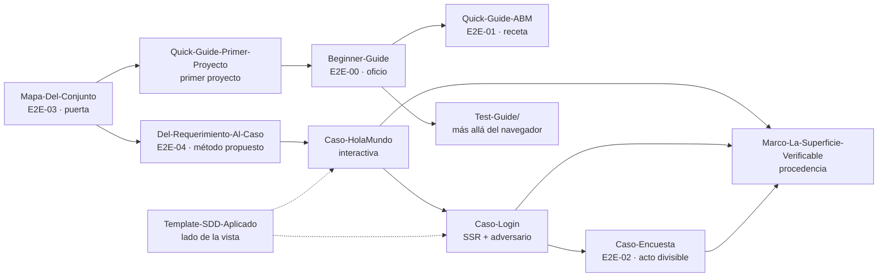

# 07 · Testing E2E

> **Propósito**: destilar el dominio de pruebas automatizadas del repositorio —E2E por navegador con
> Playwright para .NET, el método «superficie / promesa / estado» para decidir qué probar, las
> pruebas que no abren un navegador (unitarias, API, pantalla MAUI) y el material de CI/ramas que
> viaja con el corpus de los laboratorios E2E—. Cubre `Guides/Testing/**` (29 archivos versionados:
> 23 `.md`, 3 `.yml`, 3 `.png`; ver inventario).
> **Fuente primaria**: `Guides/Testing/Lab-E2E.WebBlazor-Guides/E2E-Guide/Mapa-Del-Conjunto.md`
> (`E2E-03`, puerta de entrada del conjunto, `last_review` 2026-09-09) y
> `Guides/Testing/Lab-E2E.WebBlazor-Guides/E2E-Guide/Beginner-Guide.md` (`E2E-00`).
> **Laboratorio que respaldan**: `LAB/Lab-E2E.WebBlazor` (repo hermano, **fuera** de `Lab-Documentos`;
> último commit observado `8fb4c3a`, 2026-09-18).
> **Base**: `Lab-Documentos` en `main` `5d5c2b4`; el corpus entró con el commit `9162e07`
> (2026-09-28, «reorganización de Guides/ por categoría e ingreso del corpus E2E»).

## En una pantalla

- **Dos carpetas, una vigente.** `Guides/Testing/E2E-Guide/` (2 docs) es la copia **vieja** de la
  guía E2E —movida desde `Guides/E2E-Guide/` sin cambios—, con los nombres de código previos al
  renombrado del laboratorio (`Infraestructura/`, `ServidorDeLaAplicacion`). La vigente es
  `Guides/Testing/Lab-E2E.WebBlazor-Guides/` (corpus completo de Lab-E2E, 27 archivos). Leé siempre
  la segunda. → ver [Hallazgos](#hallazgos-del-dominio).
- **Tres familias** dentro de `Lab-E2E.WebBlazor-Guides/`:
  1. `E2E-Guide/` — **cómo se prueba una pantalla web** (oficio Playwright + método de diseño de
     casos). 11 documentos.
  2. `Test-Guide/` — **los demás tipos de prueba** (unitaria, integración de API, pantalla nativa
     MAUI) y cuál va en qué capa. 4 documentos.
  3. Raíz + `workflows/` — **material de CI y ramas** que acompaña al laboratorio: copias aplanadas
     de las guías de GitFlow/GitHub Flow, GitHub Actions, la regla de nomenclatura .NET y los tres
     workflows de referencia.
- **Stack**: .NET 10, Blazor *interactive server* + SSR estático, SQLite, Clean Architecture,
  `Microsoft.Playwright.NUnit` 1.62.0 + NUnit 4.3.2, MAUI (Android) con Appium/UIAutomator2,
  GitHub Actions. **Runner**: los workflows del laboratorio que describe `Beginner-Guide` §8.6 corren
  en `ubuntu-latest` con la línea de `i7infra-dev` comentada; los tres de `LE2E/workflows/` (copias
  de Lab-GitFlow) sí usan `[self-hosted, i7infra-dev]` (ver H-19).
- **Marcas de evidencia** en todo el conjunto: **[E: ruta]** evidencia en el repo · **[V]**
  verificado por ejecución · **[F: id]** fundamentado en fuente externa · **[C]** criterio del
  laboratorio · (Test-Guide agrega **[B: n]** = bibliografía consultada el 2026-09-12). `Mapa-Del-Conjunto`
  declara sólo E/V/C; **[F]** aparece en `Beginner-Guide`, `Del-Requerimiento-Al-Caso` y las copias de CI.
- **Idea rectora**: *«La promesa es lo que se prueba. Los estados son de dónde parte y adónde llega
  esa prueba.»* (`Mapa-Del-Conjunto.md` §2.1).

---

## Inventario de guías

Rutas relativas a `Lab-Documentos/Guides/Testing/`. `LE2E/` = `Lab-E2E.WebBlazor-Guides/`.
«s/fm» = sin frontmatter YAML. Ninguno declara `version:`; la vigencia se lee de `last_review`.

### `E2E-Guide/` (copia vieja)

| Ruta | doc_id | doc_type | Estado | last_review | Líneas |
|---|---|---|---|---|---|
| `E2E-Guide/Beginner-Guide.md` | E2E-00 | guia-de-estudio | vigente (declarado) · **desactualizada** | 2026-08-23 | 1812 |
| `E2E-Guide/Quick-Guide-ABM.md` | E2E-01 | guia-rapida | vigente (declarado) · **desactualizada** | 2026-08-24 | 325 |

### `LE2E/E2E-Guide/` (vigente)

| Ruta | doc_id | doc_type | Estado / confidence | last_review | Líneas |
|---|---|---|---|---|---|
| `LE2E/E2E-Guide/Mapa-Del-Conjunto.md` | E2E-03 | documento-integrador | vigente · alta | 2026-09-09 | 228 |
| `LE2E/E2E-Guide/Del-Requerimiento-Al-Caso.md` | E2E-04 | metodo-propuesto | vigente · **media** | 2026-09-09 | 714 |
| `LE2E/E2E-Guide/Quick-Guide-Primer-Proyecto.md` | — | s/fm | — | — | 536 |
| `LE2E/E2E-Guide/Beginner-Guide.md` | E2E-00 | guia-de-estudio | vigente · alta | 2026-08-23 | 1816 |
| `LE2E/E2E-Guide/Quick-Guide-ABM.md` | E2E-01 | guia-rapida | vigente · alta | 2026-08-24 | 345 |
| `LE2E/E2E-Guide/Caso-HolaMundo-Page.md` | — | s/fm (caso de diseño) | — | — | 861 |
| `LE2E/E2E-Guide/Caso-Login-Page.md` | — | s/fm (caso de diseño) | — | — | 465 |
| `LE2E/E2E-Guide/Caso-Encuesta-Page.md` | E2E-02 | caso-de-diseño | vigente · alta | 2026-09-04 | 437 |
| `LE2E/E2E-Guide/Marco-La-Superficie-Verificable.md` | — | s/fm (marco conceptual) | — | — | 446 |
| `LE2E/E2E-Guide/Template-SDD-Aplicado.md` | — | s/fm (fecha en cuerpo: 2026-09-01) | — | — | 169 |
| `LE2E/E2E-Guide/Notas.GitHub.md` | — | s/fm (nota operativa) | — | — | 19 |
| `LE2E/E2E-Guide/Imagenes/*.png` (3) | — | capturas del Explorador de pruebas y del asistente de VS | inventariadas, no leídas | — | binario |

### `LE2E/Test-Guide/`

| Ruta | doc_id | Estado | Fecha de anclaje | Líneas |
|---|---|---|---|---|
| `LE2E/Test-Guide/README.md` | — (s/fm) | — | lab en commit `946d023`; fuentes al 2026-09-12 | 55 |
| `LE2E/Test-Guide/Panorama-De-Pruebas-Automatizadas.md` | — (s/fm) | — | [V 2026-09-12] | 1030 |
| `LE2E/Test-Guide/Pruebas-Unitarias-Y-Arquitectura.md` | — (s/fm) | — | — | 476 |
| `LE2E/Test-Guide/Pruebas-De-Interfaz-Por-Pantalla.md` | — (s/fm) | — | [V 2026-09-13] | 469 |

### `LE2E/` raíz y `LE2E/workflows/` (CI y ramas)

| Ruta | doc_id | owner | Estado / confidence | last_review | Líneas | Original en el repo |
|---|---|---|---|---|---|---|
| `LE2E/GitHub-Action-Guide.md` | GHA-00 | Lab-GitFlow | vigente · alta | 2026-08-31 | 2978 | `Guides/Despliegue/GitHub-Action-Guide/GitHub-Action-Guide.md` (2974) |
| `LE2E/Estandares-Modelo-Ramas.md` | GF-GUIA | Lab-GitFlow | vigente · alta | 2026-08-23 | 2034 | `Guides/GitFlow/Estandares-Modelo-Ramas-Guide/Estandares-Modelo-Ramas.md` (2029) |
| `LE2E/Guia-Practica-GitFlow.md` | GF-09-ESCENARIOS | Lab-GitFlow | vigente · alta | 2026-08-23 | 1183 | `Guides/GitFlow/Git-Flow-Guides/GitFlow-Practice-Guide/…` (1178) |
| `LE2E/Guia-Practica-GitHubFlow.md` | GHF-GUIA | Lab-GitFlow | vigente · media | 2026-09-01 | 1072 | `Guides/GitFlow/Git-Flow-Guides/GitHubFlow-Practice-Guide/…` (1067) |
| `LE2E/Nomenclatura-Convensiones-Arquitecture-Dot-Net.md` | — (s/fm) | — | — | (aplicado 2026-09-18) | 206 | — (único) |
| `LE2E/workflows/README.md` | GF-AX-WF | Lab-GitFlow | vigente · media | 2026-08-23 | 114 | `Guides/GitFlow/Estandares-Modelo-Ramas-Guide/Anexos/workflows/README.md` (103) |
| `LE2E/workflows/ci.yml` · `release.yml` · `auditoria-convergencia.yml` | — | — | — | — | 92 · 74 · 90 | idénticos (md5) a los de `Guides/GitFlow/…/Anexos/workflows/` |

Las copias de la raíz de `LE2E/` difieren de sus originales sólo en el bloque «De qué va / Para quién /
Qué deja» agregado al inicio y en enlaces reescritos para la carpeta plana (verificado con `diff`:
14–41 líneas distintas por archivo).

---

## Mapa de la estructura interna

### La cadena que documenta el conjunto E2E

```
situación → propósito → actos → superficies → recurso → estados → pantallas → identificadores → casos
└──────────── Del-Requerimiento-Al-Caso ────────────┘  └─ casos de diseño ─┘  └───── Beginner ─────┘
```
(fuente: `LE2E/E2E-Guide/Mapa-Del-Conjunto.md` §1)



### `LE2E/E2E-Guide/` — qué responde cada documento

| Documento | Pregunta que contesta (según `Mapa-Del-Conjunto` §3.1) | Secciones clave |
|---|---|---|
| `Mapa-Del-Conjunto.md` | ¿Qué leo para qué, y quién es dueño de cada tema? | §2.1 nueve conceptos contra el caso Encuesta · §2.2 criterio de clase/método · §2.3 cruce de los dos ejes · §3.2 **tabla de dueños** · §3.3 rutas por perfil |
| `Del-Requerimiento-Al-Caso.md` | Me tiraron un problema: ¿cómo llego a superficies, promesas y estados? | §1 tres eras (papel → transcripción → recursos) · §3 punto cero y cinco alturas · §4 **cinco preguntas de ida (P1–P5)** · §5 qué recurso representa el acto (ejes estructural y atencional) · §6 promesas del acto vs del recurso · §10 **qué tiene evidencia y qué no** · §11 veinte criterios |
| `Quick-Guide-Primer-Proyecto.md` | ¿Cómo creo el proyecto y escribo la primera prueba? | §1 `dotnet new nunit` + `Microsoft.Playwright.NUnit` (o asistente de VS) · §2 Hola Mundo + testigo de hidratación + Explorador de pruebas + `e2e.yml` · §3 cómo se diseña un caso (deriva a `Caso-HolaMundo` y `Caso-Login`, a leer juntos) · §4 anexo: excepción por navegadores no instalados (`playwright.ps1 install`) |
| `Beginner-Guide.md` | ¿Cómo se escribe, se estabiliza y se ata a la CI una suite E2E? | 9 capítulos + anexos A–F (ver abajo) |
| `Quick-Guide-ABM.md` | ¿Cuál es el camino corto para un ABM más? | §1 ciclo de corrida · §2 siete pasos · §3 trampas · §4 lista · §5 evidencia |
| `Caso-HolaMundo-Page.md` | ¿Cómo decido qué probar, en el caso mínimo? | §1 superficie, estado, circuito, identificador · §2.2 **cinco preguntas de la frase** · §2.3–2.4 doce superficies que pasan/no pasan · §4 **testigo de hidratación** · §6 ausencias decididas |
| `Caso-Login-Page.md` | ¿Y cuando hay un adversario además de un usuario? | §1 guard, credencial, rechazo indiferenciado · §2.4 **promesa negativa** · §3 SSR vs interactiva · §5 diez casos · §6 hallazgo del `returnurl` |
| `Caso-Encuesta-Page.md` | ¿Y cuando el acto se recorre en tramos? | §1.2 acto divisible · §3 ¿tres pasos son tres superficies? · §4.2 promesa sobre la memoria · §5 nueve casos · §6 **dos promesas sin caso** |
| `Marco-La-Superficie-Verificable.md` | ¿De dónde sale este vocabulario y adónde se puede ir? | §2 tres tradiciones · §3 especificación formal (promesa negativa = hiperpropiedad) · §4 usage-centered design / UI Stack · §5 especificación por ejemplo, AAA, IdlingResource · §6 aportes propios · §7 tabla de procedencia · §8 bibliografía con grado de verificación |
| `Template-SDD-Aplicado.md` | ¿Cómo se construye la superficie del lado de la vista? | §1 tokens, tema, componentes por patrón, shells · §2 decisiones declaradas · §3 criterios verificados · §4 reproducción |
| `Notas.GitHub.md` | ¿Cómo evito que un PR desde un fork corra en el runner propio? | *Settings → Actions → General → Fork pull request workflows* → «Require approval» |

### `Beginner-Guide.md` (E2E-00) por capítulo

| § | Tema | Qué deja |
|---|---|---|
| 1 | Qué es una E2E | Definición, qué no es, ubicación en la pirámide, qué hace Playwright |
| 2 | Marco de referencia | ESC-01..05 · CTX-01..04 · ACT-01..04 (abajo) |
| 3 | Mapa conceptual | Entrada por escenario, por artefacto, por síntoma |
| 4 | Anatomía del proyecto | §4.1 proyecto de la solución vs carpeta `@playwright/test` · §4.2 paquetes y jerarquía `PlaywrightTest → BrowserTest → ContextTest → PageTest` · §4.3 carpetas · §4.4 **el `[SetUpFixture]` en el namespace raíz** · §4.5 `.runsettings` |
| 5 | Qué testear | Tres filtros (valor, riesgo de integración, costo de detectarlo de otro modo) · reparto 4+9+9 = 22 casos · contrato `data-testid` · antipatrones |
| 6 | Cómo se escribe un caso | Forma, localizadores como contrato, aserciones que esperan, sembrar datos |
| 7 | App con servidor | §7.2 testigo `estado-app`/`data-interactivo` · §7.3 aislamiento por cookie de sesión (`src/MovilidadUrbana.Web/Sessions/SessionMiddleware.cs`) · §7.4 publicar antes de probar · §7.5 `@bind:event="oninput"` · §7.6 catálogo de intermitencias · §7.7 paralelismo · §7.11 traza a mano |
| 8 | Workflows | `e2e.yml` reutilizable · `ci.yml` política · `verificacion-entorno.yml` humo · atar al merge · `workflow_dispatch` |
| 9 | Evidencias | §9.1 verificado · §9.2 **no verificado** · §9.3 dos errores de deriva doc↔sistema |
| A–F | Anexos | A clase base comentada · B caso comentado · C listas (C.1 caso nuevo, C.2 integrar a CI, C.3 intermitencia) · D glosario · E fuentes · F ruta por perfil |

### `LE2E/Test-Guide/` — más allá del navegador

| Documento | Responde | Secciones clave |
|---|---|---|
| `README.md` | Orden de lectura y mapa S1–S6 → suite | Diagrama escenario → suite real · «Lo que no hay acá» (carga, contrato entre servicios, mutación, seguridad, cobertura, iOS, Windows, emuladores en CI) |
| `Panorama-De-Pruebas-Automatizadas.md` | ¿Qué tipos de prueba hay y cuál va dónde? **Define el marco** S/C/actores | §1 dobles (stub, fake, mock, spy) · §2 marco · §3 pirámide vs trofeo · §4 **capa de Clean Architecture → tipo de prueba** · §5 base real o doble · §6 web/API/móvil · §7 criterios (Moq mock vs stub §7.4) · §8 mapa «estoy acá → aplico esto» |
| `Pruebas-Unitarias-Y-Arquitectura.md` | ¿Qué es una unidad según dónde vive el código? | §2 cinco propiedades · §3 dominio · §4 aplicación (doble o real) · §5 dobles · §6 ViewModel MVVM · §7 MAUI sin workload (`net10.0-android`) · §8 criterios de calidad |
| `Pruebas-De-Interfaz-Por-Pantalla.md` | ¿Cómo pruebo una app sin DOM? | §3 tres niveles de localización (accesibilidad, texto, coordenadas) · §4 Appium/UIAutomator/Espresso/`adb` · §5 **lo hecho en el moto e6 play** (27 capturas, suite Appium de 5 casos) · §6 qué se traslada de la web · §7 criterios |

### `LE2E/` raíz — material de CI y ramas (sólo para qué lo trae el corpus E2E)

La estructura de `GHA-00`, `GF-GUIA`, las dos prácticas y `GF-AX-WF` se destila **una sola vez** en
[08_Ramas-CI-CD-y-DevOps.md](08_Ramas-CI-CD-y-DevOps.md) (son copias de originales de `Guides/GitFlow/` y
`Guides/Despliegue/`). Acá sólo queda su papel dentro del conjunto E2E:

| Documento | Para qué lo trae el corpus E2E |
|---|---|
| `GitHub-Action-Guide.md` (GHA-00) | Disecciona los workflows de `LAB/Lab-E2E.WebBlazor/.github/workflows/` (catálogo `W-E2E-*` del Anexo F) |
| `Estandares-Modelo-Ramas.md` (GF-GUIA) | La E2E es la puerta del PR (§8 «PR y pruebas automatizadas») |
| `Guia-Practica-GitFlow.md` (GF-09-ESCENARIOS) · `Guia-Practica-GitHubFlow.md` (GHF-GUIA) | Practican los dos modelos sobre la app sembrada del laboratorio |
| `workflows/` (GF-AX-WF) | `ci.yml`, `release.yml`, `auditoria-convergencia.yml` consumen `./.github/workflows/e2e.yml` del laboratorio vía `uses:` |
| `Nomenclatura-Convensiones-Arquitecture-Dot-Net.md` (único, sin original) | §1 regla · §2 tabla de decisión · §3 lo que no se traduce · §4 procedimiento de renombrado · §5 código nuevo. Explica por qué las guías nuevas citan `Infrastructure/`, `E2ETestBase`, `TestAppServer` |

---

## Conceptos y decisiones clave

### Los dos ejes del conjunto (`Mapa-Del-Conjunto` §2.3)

| Eje | Pregunta | Dueño |
|---|---|---|
| **Superficie / promesa / estado** | ¿**Qué** hay que probar y dónde corta? | Casos de diseño + Marco |
| **Escenario / contexto / actor** (ESC, CTX, ACT) | ¿**Cuándo** se prueba, **dónde** corre, **quién** decide? | `Beginner-Guide` §2 |

Se cruzan en **ESC-01** («se escribe una pantalla nueva»): ahí se aplican las cinco preguntas.

### Marco de la guía E2E (`Beginner-Guide` §2)

| Eje | Valores |
|---|---|
| Escenarios | ESC-01 pantalla nueva · ESC-02 cambio en un PR (CI bloquea el merge) · ESC-03 prueba intermitente · ESC-04 despliegue (humo contra la URL) · ESC-05 regresión de fondo (todos los navegadores, fuera del camino crítico) |
| Contextos | CTX-01 máquina de desarrollo · CTX-02 runner de CI (headless) · CTX-03 entorno desplegado (no se levanta nada; el estado no se destruye) · CTX-04 emulación móvil |
| Actores | ACT-01 quien desarrolla · ACT-02 QA · ACT-03 DevOps · ACT-04 PO / autoridad de cambio |

### Marco de Test-Guide (`Panorama` §2) — distinto y complementario

| Eje | Valores |
|---|---|
| Escenarios | S1 Regla · S2 Caso de uso · S3 Contrato (API) · S4 Superficie · S5 Persistencia · S6 Regresión visual y de plataforma |
| Contextos | C-Web · C-API · C-Móvil · C-Escritorio (fuera de lo verificado) · C-CI |
| Actores | Quien diseña la solución · quien escribe la prueba · quien mantiene el pipeline · quien evalúa (revisor, docente) |

### Los nueve conceptos (`Mapa-Del-Conjunto` §2.1) y dónde aterrizan

| Concepto | Dónde vive en la prueba |
|---|---|
| Acto | — (previo al código) |
| Superficie | La clase `[TestFixture]` (una por superficie) |
| Recurso (asistente, ABM, modal…) | Helpers e identificadores; **no se prueba en sí** |
| Estado de partida | `[SetUp]` |
| Promesa del acto | Un `[Test]` |
| Promesas del recurso | Un `[Test]` por cada una |
| Promesa negativa | Un `[Test]`, a veces comparando dos observaciones |
| Estado | Una aserción `Expect(...)`; **nunca un caso propio** |
| Identificador | `data-testid` → `GetByTestId` |
| *Borde*: testigo | Clase base, no cada caso |
| *Borde*: regla de dominio | Prueba unitaria (49 casos en 27 ms **[V]**) |

### Decisiones y criterios destilados

| Decisión / criterio | Fuente |
|---|---|
| E2E como **proyecto de la solución** con `Microsoft.Playwright.NUnit`, no carpeta `@playwright/test`: el Explorador de VS no descubre Playwright-JS. «Lo no defendible es terminar con las dos» | `Beginner-Guide` §4.1 |
| `[SetUpFixture]` en el **namespace raíz** de las pruebas (si queda en uno hijo, la URL base llega vacía) | `Beginner-Guide` §4.4; `Quick-Guide-ABM` §3 |
| Testigo de hidratación: `<div hidden data-testid="estado-app" data-interactivo="…">` + espera dentro de `IrAAsync` | `Beginner-Guide` §7.2; `Caso-HolaMundo-Page` §4 |
| Una superficie **SSR** no necesita testigo; una `InteractiveServer` sí | `Caso-Login-Page` §3 |
| Aislamiento del estado en la **app**: cookie de sesión nueva por prueba + repositorios que filtran por ella | `Beginner-Guide` §7.3 |
| Paralelismo `ParallelScope.Fixtures` (con `Children` falla `'Browser' was not present`); número declarado en **un solo archivo** | `Quick-Guide-ABM` §3; `Beginner-Guide` §7.7, §9.3 |
| Persistencia se verifica **recargando** | `Beginner-Guide` §5.2 |
| Un caso, un motivo de falla; una clase por superficie (si no sale un `[SetUp]` natural, era un recorrido) | `Mapa-Del-Conjunto` §2.2 |
| Un caso vive donde está la promesa, no donde está el dato | `Caso-Encuesta-Page` §5.1 |
| Promesa de **dos sujetos** (legítimo y adversario); la negativa se verifica comparando observaciones | `Caso-HolaMundo-Page` §2.2; `Caso-Login-Page` §2.4; `Marco` §3.3 |
| Las pruebas se ajustan a lo que la app hace; corregir el comportamiento es decisión de diseño, no de la prueba | `Caso-Login-Page` §6 |
| «Dos estados son distintos cuando la salida que se le ofrece a la persona es distinta» | `Del-Requerimiento-Al-Caso` §4 P5, §11.12 |
| La superficie se deduce **del acto**, no de la pantalla | `Del-Requerimiento-Al-Caso` §1, §11.7 |
| Corregir en el **documento dueño**; los demás enlazan | `Mapa-Del-Conjunto` §3.2, §4 |
| Cada prueba responde una sola pregunta con el SUT más chico posible; la arquitectura decide qué tan chico | `Panorama` §11 |
| La capa de aplicación **no tiene suite propia** (se ejercita desde API y ViewModels) — hueco declarado **[C]** | `Panorama` §4.2 |
| Sin DOM, el árbol de accesibilidad es el DOM (`AutomationId`) | `Pruebas-De-Interfaz-Por-Pantalla` §9 |
| Arquitectura en inglés, dominio en español; `data-testid`, `AutomationId`, rutas y textos **no se traducen** | `Nomenclatura-…` §1–§3 |
| CI: un solo check obligatorio (`CI aprobada`), permisos mínimos, sin `container:` en `i7infra-dev` | `workflows/README.md` |

### Lo verificado vs lo no verificado (según las propias guías)

| Verificado | No verificado |
|---|---|
| Build `-warnaserror` en verde; **22 E2E** en chromium (7 s), firefox (13 s), webkit (15 s), emulación móvil (6 s) — 2026-08-23 · 49 unitarias en 27 ms — 2026-08-24 (`Beginner` §9.1) | Explorador de pruebas de VS (sin Windows) · `playwright show-trace` · comportamiento real de los workflows en Actions según `Beginner` §9.2 (sólo YAML) · invocación de `e2e.yml` desde otro repo |
| `ci.yml` del anexo **sí corrió** en Actions sobre `i7infra-dev` (2026-08-25) (`workflows/README.md`) | `release.yml` y `auditoria-convergencia.yml` en Actions (su lógica de shell sí, local) |
| API 13 casos, ViewModels 18 casos **[V 2026-09-12]** · suite Appium 5/5 dos veces + falsificación en rojo **[V 2026-09-13]** | iOS, Windows, emuladores en CI; Appium no corre en CI (`android.yml` sólo compila) |
| Recursos ejercitados: formulario simple, asistente, ABM, modal | Pestañas, maestro-detalle, página de llegada y buscador modal: **razonamiento por analogía** (`Del-Requerimiento-Al-Caso` §10.3) |

---

## Laboratorios y cómo se usan

Todo el corpus se apoya en repos **hermanos** de `LAB/`, no en código dentro de `Lab-Documentos`.

| Laboratorio / suite | Qué demuestra | Guía que lo usa |
|---|---|---|
| `LAB/Lab-E2E.WebBlazor/src/MovilidadUrbana.Web` + `tests/MovilidadUrbana.E2ETests` | ABM de localidades, asistente Encuesta de 3 pasos, navegación — 22 E2E (4 + 9 + 9) | `Beginner-Guide`, `Quick-Guide-ABM`, `Caso-Encuesta-Page` |
| `src/WebBlazor.HolaMundo` + `tests/WebBlazor.HolaMundo.E2ETests` | Superficie interactiva mínima, testigo de hidratación | `Quick-Guide-Primer-Proyecto`, `Caso-HolaMundo-Page`, `Template-SDD-Aplicado` |
| `src/WebBlazor.Login` + `tests/WebBlazor.Login.E2ETests` | Superficie SSR con guard, 10 casos, rechazo indiferenciado | `Caso-Login-Page`, `Template-SDD-Aplicado` |
| `tests/MovilidadUrbana.UnitTests` | Reglas de dominio (`LocalidadRules`, `EncuestaRules`), 49 casos | `Beginner` §5.2, `Pruebas-Unitarias-Y-Arquitectura` |
| `tests/MovilidadUrbana.ApiWeb.Tests` | Integración en proceso con `WebApplicationFactory`, 13 casos | `Panorama` §4.2, §6.2 |
| `tests/MovilidadUrbana.MAUI.Tests` | ViewModels con `FakeNavigationService`/`FakeAlertService`, 18 casos | `Pruebas-Unitarias-Y-Arquitectura` §6–§7 |
| `tests/MovilidadUrbana.MAUI.UITests` | Appium/UIAutomator2 contra un moto e6 play, 5 casos (`.devcontainer/dev.sh uitests`; `dev.sh up` monta `/dev/bus/usb`) | `Pruebas-De-Interfaz-Por-Pantalla` §5.1, §5.5 |
| `src/MovilidadUrbana.ApiWeb`, `src/MovilidadUrbana.MAUI` | Las otras dos «cabezas» (API y app Android) sobre la misma aplicación; la capa de aplicación se ejercita desde ellas | `Panorama` §4.2, §6 |
| `evidencia/2026-09-01-aplicacion-template`, `evidencia/2026-09-03-testigo-de-hidratacion`, `evidencia/2026-09-12-maui`, `evidencia/2026-09-13-uitests` | Evidencia versionada de corridas (el laboratorio tiene además `2026-09-12-capas-y-api`, `-renombre`, `-unificacion`, no citadas en las tablas de este índice) | `Template-SDD-Aplicado` §3–§4, casos de diseño y Test-Guide |

**Cómo se corre** (según `Beginner-Guide` §7.9, §9.1 y `Quick-Guide-Primer-Proyecto`):

| Acción | Comando |
|---|---|
| Compilar en contenedor | `scripts/dotnet.sh dotnet build Lab-E2E.WebBlazor.sln --configuration Release -warnaserror` |
| Suite E2E por navegador | `scripts/pruebas.sh chromium` (`firefox`, `webkit`; `EMULAR_MOVIL=true` para móvil) |
| Unitarias | `scripts/dotnet.sh dotnet test tests/MovilidadUrbana.UnitTests --configuration Release` |
| Instalar navegadores (local, error frecuente) | `./bin/Debug/net10.0/playwright.ps1 install` |
| CI | `.github/workflows/{e2e,ci,verificacion-entorno,e2e-holamundo,e2e-login,android}.yml` del laboratorio |

Imágenes usadas en la verificación: `mcr.microsoft.com/dotnet/sdk:10.0` (SDK 10.0.400) y
`mcr.microsoft.com/playwright:v1.62.1-noble` (`Beginner` §9.1).

---

## Relaciones con otras guías del repo

| Guía | Relación |
|---|---|
| `Guides/GitFlow/Estandares-Modelo-Ramas-Guide/` y `Guides/GitFlow/Git-Flow-Guides/` | **Originales** de las copias aplanadas en `LE2E/` (mismos `doc_id`). La política de ramas y el PR como puerta (§8) consume la E2E |
| `Guides/Despliegue/GitHub-Action-Guide/GitHub-Action-Guide.md` | **Original** de `LE2E/GitHub-Action-Guide.md` (GHA-00) |
| `Guides/Despliegue/DevOps-Guide/` | Marco de pipeline y supply chain que GHA §8 cita sin desarrollar |
| `Guides/Arquitectura/Organizacion-Estilo-Patrones-Codigo/` y `Guides/Dot-NET-Arquitectura-Guide/` | Capas de Clean Architecture que `Panorama` §4 convierte en regla de prueba; criterio general de nombres al que apunta `Nomenclatura-…` §6 (con ruta rota, ver hallazgos) |
| `Guides/UX-UI-Design/UX-UI-Guide/` | Vecina del vocabulario superficie/estado y de `Template-SDD-Aplicado` (las bases citadas en este último —`Knowledge-Template-*`, `Design-Rules-Web-Generico.md`— **no** están en `Lab-Documentos`) |
| `Guides/Metodologia-Entorno-Desarrollo/` | Plantilla de repo con `.github/workflows/ci.yml` propio (otro índice) |
| `Guides/Documentacion-Tecnica/Creacion-Guias-Tecnicas/60-Desarrollo/Test-Plan.md`, `Test-Cases.md` | Plantillas documentales de plan y casos de prueba (no las cita ninguna guía de `Testing/`) |
| `Guides/Dot-NET-Arquitectura-Guide/Examples/Dot-NET-Arquitectura-Lab/MyProject/tests/Backend/` | Otro ejemplo de unitarias por capa (`ProductoTests.cs`, `CrearProductoHandlerTests.cs` con `FakeProductoRepository`) que encarna la regla capa → prueba de `Panorama` §4; sin enlace desde `Testing/` |

Convenciones y glosario transversales → `10_Convenciones-y-Glosario.md`.

---

## Hallazgos del dominio

| # | Tipo | Ruta | Detalle |
|---|---|---|---|
| H-01 | duplicado / desactualizado | `Guides/Testing/E2E-Guide/` vs `Guides/Testing/Lab-E2E.WebBlazor-Guides/E2E-Guide/` | Dos copias de `Beginner-Guide.md` y `Quick-Guide-ABM.md` con **el mismo `doc_id`** (E2E-00, E2E-01) y el mismo `last_review`, pero contenido divergente (194 líneas de diff en Beginner): la vieja cita `Infraestructura/ServidorDeLaAplicacion.cs`, `PruebaE2E.cs`, `ReglasDeLocalidad`, que ya no existen en el laboratorio tras el renombrado del 2026-09-18 |
| H-02 | enlaces rotos | `LE2E/E2E-Guide/*.md` y `E2E-Guide/*.md` | Los enlaces al laboratorio usan `../../../Lab-E2E.WebBlazor/…` (o `../../` en la copia vieja), que resuelve a `Lab-Documentos/Guides/Lab-E2E.WebBlazor` (inexistente). Los destinos sí existen en `LAB/Lab-E2E.WebBlazor/`: la profundidad correcta sería `../../../../../`. ~50 enlaces (Caso-HolaMundo 19, Caso-Encuesta 22, Login 3, Marco 2, Beginner 3, Quick-ABM 1) |
| H-03 | enlaces rotos | `LE2E/Estandares-Modelo-Ramas.md`, `GitHub-Action-Guide.md`, `Guia-Practica-GitFlow.md`, `Guia-Practica-GitHubFlow.md` | Apuntan a `Anexos/workflows/…`, que en la copia aplanada es `workflows/…` (16 enlaces: Estandares 10, GitFlow 3, GitHubFlow 2, GitHub-Action-Guide 1) |
| H-04 | enlaces rotos | `LE2E/GitHub-Action-Guide.md` | `[README](../README.md)` → `Guides/Testing/README.md`, que no existe |
| H-05 | enlaces rotos | `LE2E/workflows/README.md` | `../../Guia-Practica-GitFlow.md` (2×) resuelve a `Guides/Testing/Guia-Practica-GitFlow.md`; el archivo está en `LE2E/`. Su comando `grep … ../../../../Lab-E2E.WebBlazor/.github/workflows/e2e.yml` también quedó con profundidad de la ubicación original |
| H-06 | referencia rota | `LE2E/Nomenclatura-Convensiones-Arquitecture-Dot-Net.md` §6 | Cita `LAB/Lab-Documentos/Guides/Arquitectura/Dot-NET-Arquitectura-Guide.md`; la guía está en `Guides/Dot-NET-Arquitectura-Guide/Dot-NET-Arquitectura-Guide.md` |
| H-07 | nombre con errores | `LE2E/Nomenclatura-Convensiones-Arquitecture-Dot-Net.md` | «Convensiones» y «Arquitecture» (mezcla de grafías) en el nombre de archivo |
| H-08 | rutas internas obsoletas | `LE2E/Test-Guide/*.md` | Se describen como documentos de `Guides/Test-Guide/` (ubicación anterior); hoy están en `Guides/Testing/Lab-E2E.WebBlazor-Guides/Test-Guide/` |
| H-09 | frontmatter faltante | `LE2E/E2E-Guide/{Caso-HolaMundo-Page,Caso-Login-Page,Marco-La-Superficie-Verificable,Quick-Guide-Primer-Proyecto,Template-SDD-Aplicado,Notas.GitHub}.md`, `LE2E/Test-Guide/*.md`, `LE2E/Nomenclatura-…md` | 11 documentos sin `doc_id`/`status`/`last_review`, aunque `Mapa-Del-Conjunto` §4 (criterio 3) pide mirar `doc_type` y `confidence` «lo primero» |
| H-10 | contradicción interna | `LE2E/E2E-Guide/Beginner-Guide.md` §5.2 (l. 516) y copia vieja (l. 512) | Afirma que el laboratorio «no tiene ninguna prueba unitaria» y, párrafos después, cita `tests/MovilidadUrbana.UnitTests` con 49 casos (agregados el 2026-08-24, §9.1) |
| H-11 | forma / tipografía | `LE2E/E2E-Guide/Quick-Guide-Primer-Proyecto.md` | Línea 1 vacía antes del H1; título «(E2E) E2E» duplicado; «epxlorador»; «La tabla de arriba…» sin tabla; el árbol muestra `e2e-holamundo.yml` pero el bloque se titula `e2e.yml` |
| H-12 | residuo de renombrado | `LE2E/E2E-Guide/Beginner-Guide.md` §4.4, `Quick-Guide-ABM.md` §2.3 | El ejemplo de namespace incorrecto sigue diciendo `…E2ETests.Infraestructura` (la carpeta ahora es `Infrastructure/`); el árbol de §4.3 quedó desalineado tras el renombrado. Menor |
| H-13 | colisión de IDs | `LE2E/GitHub-Action-Guide.md` §3 vs `LE2E/Estandares-Modelo-Ramas.md` §1 | `E-01..E-10` (escenarios de automatización) y `E-01..E-08` (escenarios de ramas) usan el mismo prefijo con significados distintos |
| H-14 | marcos paralelos | `Beginner-Guide` §2 vs `Panorama` §2 | Dos marcos con IDs distintos (ESC/CTX/ACT vs S1–S6/C-Web…); el cruce entre ambos no está escrito en ningún documento (`Mapa` §2.3 sólo cruza ESC con superficie/promesa) |
| H-15 | promesas sin caso (declaradas) | `LE2E/E2E-Guide/Caso-Encuesta-Page.md` §6 | Paso direccionable `/encuesta/{Paso}` nunca ejercitado; fallo al registrar (`boton-procesando`) sin caso. Anotado, no resuelto |
| H-16 | hallazgo de producto (declarado) | `LE2E/E2E-Guide/Caso-Login-Page.md` §6 | `<NotAuthorized>` de `Routes.razor` es camino muerto (el middleware de cookies redirige con `returnurl`); `SesionRequerida` nunca se muestra |
| H-17 | dependencia externa no versionada | `LE2E/E2E-Guide/Template-SDD-Aplicado.md` | Cita `Knowledge-Template-HTML-SDD-Default.md`, `Knowledge-Template-Blazor-Interactive-Server-SDD-Default.md`, `Design-Rules-Web-Generico.md` sin ruta; no están en `Lab-Documentos` (no verificado dónde viven) |
| H-18 | dato de infraestructura en guía | `LE2E/E2E-Guide/Notas.GitHub.md`, `LE2E/workflows/*` | Nombran el runner autoalojado `i7infra-dev` y un repo público; la nota es texto informal en segunda persona («tu máquina»), dice «desde la configuración de la organización» pero da la ruta de *Settings* del repo, y las casillas que transcribe son las del bloque «…in private and internal repositories» aunque el repo es público |
| H-19 | deriva doc ↔ laboratorio (fuera de `Lab-Documentos`) | `LE2E/E2E-Guide/Beginner-Guide.md` §8.6 vs `LAB/Lab-E2E.WebBlazor/.github/workflows/e2e.yml` l. 89 (commit `8fb4c3a`) | La guía dice que «los jobs corren en los runners alojados por GitHub» con `i7infra-dev` comentado; en el laboratorio el primer job de `e2e.yml` tiene `runs-on: [self-hosted, i7infra-dev]` **activo** y `ubuntu-latest` comentado, aunque su propio comentario dice «se deja comentado». El resto de los jobs sí usa `ubuntu-latest` |
| H-20 | README vacío (vecino) | `Guides/README.md` | 0 líneas: no hay índice de `Guides/` que apunte a `Testing/`; la entrada al corpus es sólo `Mapa-Del-Conjunto.md` |

---

## Para preguntas X → leé fuente Y

| Necesitás saber… | Leé |
|---|---|
| Por dónde entrar al conjunto E2E según tu perfil | `LE2E/E2E-Guide/Mapa-Del-Conjunto.md` §3.3 |
| Quién es dueño de un tema (para corregir en un solo lugar) | `Mapa-Del-Conjunto.md` §3.2 |
| Cómo crear el proyecto NUnit + Playwright y la primera prueba | `LE2E/E2E-Guide/Quick-Guide-Primer-Proyecto.md` §1–§2 |
| Qué paquetes y qué clase base (`PageTest`) usar | `LE2E/E2E-Guide/Beginner-Guide.md` §4.2 |
| Por qué la URL base llega vacía | `Beginner-Guide.md` §4.4 · `Quick-Guide-ABM.md` §3 |
| Por qué un clic se pierde en Blazor Server (hidratación) | `Caso-HolaMundo-Page.md` §4 · `Beginner-Guide.md` §7.2 |
| Cómo aislar datos entre pruebas paralelas | `Beginner-Guide.md` §7.3, §7.7 · `Quick-Guide-ABM.md` §2.4 |
| Qué casos escribir para un ABM | `Quick-Guide-ABM.md` §2.5 · `Beginner-Guide.md` §5.2 |
| Cómo decidir qué probar en una pantalla | `Caso-HolaMundo-Page.md` §2.2 (cinco preguntas) |
| Cómo pasar de un pedido vago a superficies y estados | `Del-Requerimiento-Al-Caso.md` §3–§6 (y §10 para su confianza) |
| Cómo probar una promesa negativa / seguridad de acceso | `Caso-Login-Page.md` §2.4, §4.4 · `Marco-…` §3.3 |
| Cómo probar un asistente en pasos | `Caso-Encuesta-Page.md` §3–§5 |
| De dónde vienen «superficie», «promesa», «testigo» | `Marco-La-Superficie-Verificable.md` §7 |
| Cómo diagnosticar una intermitencia | `Beginner-Guide.md` §7.6, §7.10 · Anexo C.3 |
| Cómo se ata la E2E al merge del PR | `Beginner-Guide.md` §8.4 · `LE2E/workflows/README.md` |
| Qué tipo de prueba corresponde a cada capa | `LE2E/Test-Guide/Panorama-De-Pruebas-Automatizadas.md` §4.2 |
| Stub, fake, mock o spy | `Panorama` §1, §7.3–§7.4 · `Pruebas-Unitarias-Y-Arquitectura.md` §5 |
| Cómo probar un ViewModel MAUI sin el workload | `Pruebas-Unitarias-Y-Arquitectura.md` §6–§7 |
| Cómo probar la app Android en un teléfono | `Pruebas-De-Interfaz-Por-Pantalla.md` §3–§5 |
| Cómo nombrar clases/carpetas (inglés vs español) | `LE2E/Nomenclatura-Convensiones-Arquitecture-Dot-Net.md` §2 |
| Qué está verificado y qué no | `Beginner-Guide.md` §9 · `Del-Requerimiento-Al-Caso.md` §10 · `workflows/README.md` «Estado de verificación» |
