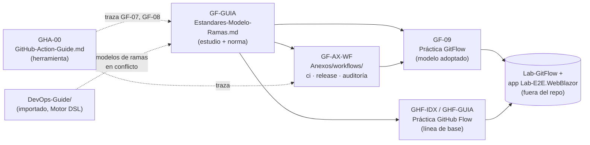

# 08 · Ramas, CI/CD y DevOps

> **Propósito**: destilar el procedimiento de ramas, versionado y pull requests que el equipo
> adoptó (tronco `main` + ramas `release/x.y`), sus tres workflows listos para copiar, las dos
> guías prácticas que lo ejercitan (GitFlow adoptado y GitHub Flow como línea de base), la guía de
> estudio de GitHub Actions y el material importado de DevOps (DORA, SemVer, Conventional Commits,
> supply chain, publicación NuGet). 14 archivos, ≈10 700 líneas.
> **Fuente primaria**: `Guides/GitFlow/Estandares-Modelo-Ramas-Guide/Estandares-Modelo-Ramas.md`
> (`GF-GUIA`), `Guides/GitFlow/Estandares-Modelo-Ramas-Guide/Anexos/workflows/README.md` (`GF-AX-WF`),
> `Guides/Despliegue/GitHub-Action-Guide/GitHub-Action-Guide.md` (`GHA-00`) y
> `Guides/Despliegue/DevOps-Guide/marco-teorico.md` (sin `doc_id`).
> **Vigencia**: relevado sobre `Lab-Documentos` `main` 5d5c2b4 (2026-10-18); sus fuentes no cambiaron hasta
> `fe10086` salvo una redacción de dos líneas en `GHA-00` y en su copia `Guides/Testing/Lab-E2E.WebBlazor-Guides/GitHub-Action-Guide.md` (§7 y OBS-4/OBS-11: el pipeline de firma fuera de los
> repos de referencia se nombra como «una app híbrida de referencia de la organización»). La sección
> [Workflows propios de Lab-Documentos](#workflows-propios-de-lab-documentos) es de la v4.1 (2026-10-27). Todas las
> rutas son relativas a `Lab-Documentos/`.

## En una pantalla

- **Modelo adoptado [C]**: una línea principal `main` + ramas cortas (`feature/`, `fix/`, `chore/`)
  + `release/x.y` para estabilizar. Las correcciones nacen en `main` y viajan a la release por
  **cherry-pick, nunca al revés**. No existen `develop`, `homologacion` ni `produccion`: son
  **ambientes**, y entre ambientes se mueven **artefactos** (`GF-GUIA` §6.1).
- **GitFlow se documenta en serio pero no se adopta**: es el modelo del contexto `C-4` (tres o más
  versiones soportadas), según la nota de 2020 de Driessen [F: NVIE-1] (`GF-GUIA` §4.4, §5).
- **Marcas de autoridad** en todo el corpus propio: **[F]** fuente externa · **[C]** convención del
  equipo, discutible · **[E]** comprobado leyendo/ejecutando en el workspace, con fecha.
  `GF-GUIA` usa solo [F]/[C]; las prácticas y `GHA-00` agregan [E].
- **Dueño declarado**: `owner: Lab-GitFlow` en todos los documentos con frontmatter. Se escribieron
  para el repo de práctica `Lab-GitFlow` con la app de `Lab-E2E.WebBlazor` como sistema bajo prueba.
- **Verificación**: `ci.yml` del anexo **corrió en Actions** (2026-08-25, runner `i7infra-dev`);
  `release.yml` y `auditoria-convergencia.yml` **no** corrieron en Actions (los tres parsean como
  YAML; solo la lógica de shell de la auditoría se ejecutó fuera de Actions, [E 2026-08-23]); los
  escenarios de GitHub Flow **no se ejecutaron** según su README.
- **`DevOps-Guide/` es material importado** (proyecto *Motor DSL*, `Ejemplo_IA_SDD_Template`, abril
  2026): no comparte el aparato de marcas ni frontmatter, y propone **otros dos** modelos de ramas.
  Ante conflicto, prevalece `GF-GUIA` (ver hallazgos H-10).

## Inventario

| Ruta | doc_id | Versión / fecha | Estado | Líneas |
|---|---|---|---|---:|
| `Guides/GitFlow/Estandares-Modelo-Ramas-Guide/Estandares-Modelo-Ramas.md` | `GF-GUIA` (consolida `GF-01..08`, `GF-AX-GL/PL/LV/PF/FU`) | `last_review` 2026-08-23 | vigente · confidence alta | 2 029 |
| `Guides/GitFlow/Estandares-Modelo-Ramas-Guide/Anexos/workflows/README.md` | `GF-AX-WF` | 2026-08-23 | vigente · confidence media | 103 |
| `…/Anexos/workflows/ci.yml` | — | — | corrió en Actions [E 2026-08-25] | 92 |
| `…/Anexos/workflows/release.yml` | — | — | sin correr en Actions | 74 |
| `…/Anexos/workflows/auditoria-convergencia.yml` | — | — | shell probado local [E 2026-08-23] | 90 |
| `Guides/GitFlow/Git-Flow-Guides/GitFlow-Practice-Guide/README.md` | `GF-09` | 2026-08-23 | vigente · alta | 91 |
| `Guides/GitFlow/Git-Flow-Guides/GitFlow-Practice-Guide/Guia-Practica-GitFlow.md` | `GF-09-ESCENARIOS` | 2026-08-23 | vigente · alta | 1 178 |
| `Guides/GitFlow/Git-Flow-Guides/GitHubFlow-Practice-Guide/README.md` | `GHF-IDX` | 2026-08-25 | vigente · media | 150 |
| `Guides/GitFlow/Git-Flow-Guides/GitHubFlow-Practice-Guide/Guia-Practica-GitHubFlow.md` | `GHF-GUIA` | 2026-09-01 | vigente · media | 1 067 |
| `Guides/Despliegue/GitHub-Action-Guide/GitHub-Action-Guide.md` | `GHA-00` (traza `GF-07`, `GF-08`, `GF-AX-WF`) | 2026-08-31 | vigente · alta | 2 974 |
| `Guides/Despliegue/DevOps-Guide/marco-teorico.md` | — | v1.0 · 2026-04-25 | Aprobado | 1 637 |
| `Guides/Despliegue/DevOps-Guide/guia-flujo-trabajo-versionado.md` | — | «Abril 2026» | sin estado (onboarding) | 714 |
| `Guides/Despliegue/DevOps-Guide/plan-mejoras-devops_v1.0.md` | — | v1.0 · 2026-04-25 | En ejecución (F1 cerrada, F2 en curso, F3 pendiente) | 400 |
| `Guides/Despliegue/DevOps-Guide/publish-nuget.md` | — | sin fecha | sin estado | 102 |

Copias aplanadas de cuatro de estos documentos viven también en
`Guides/Testing/Lab-E2E.WebBlazor-Guides/` con el mismo `doc_id`, más una copia de la carpeta del
anexo en `Guides/Testing/Lab-E2E.WebBlazor-Guides/workflows/` (README `GF-AX-WF` + los tres `.yml`
idénticos byte a byte) (H-03).

## Mapa del dominio

## `GF-GUIA` — Estándares de modelo de ramas (documento único)

Todo el contenido de estudio está acá; fuera quedan solo los tres workflows y las dos prácticas.

| § | Tema | Responde |
|---|---|---|
| 1 | Marco de referencia | Escenarios `E-01..08`, contextos `C-1..4`, actores `A-*`; dos separaciones de funciones [C] |
| 2 | Mapa conceptual | Entrada por escenario (con enlace a cada escenario práctico), por rol, por artefacto; rutas de lectura |
| 3 | Fundamentos de Git | Las cinco operaciones: `merge`, `squash merge`, `rebase`, `cherry-pick`, `tag` |
| 4 | GitFlow | Cómo funciona cada pieza; **§4.4 la nota de 2020** que lo acota a software versionado con varias versiones |
| 5 | Cómo elegir el modelo | Cuatro modelos (§5.1), comparación (§5.2), por contexto (§5.3), **criterio en tres preguntas** (§5.4), qué dice y qué no la evidencia DORA (§5.5), aplicación al equipo (§5.6) |
| 6 | **Modelo adoptado** | Inventario de ramas, **siete reglas**, nomenclatura, la única excepción (emergencia), guardarraíles, antipatrones |
| 7 | Integración y versionado | Rama ≠ tag ≠ artefacto ≠ ambiente; ambientes con campos ISO-29119; SemVer; ciclo de vida y reversión; corte y admisión; build hermético y promoción; QA por ambiente; demos; autorización y cierre |
| 8 | Pull requests y pruebas | Ciclo del PR y por qué squash; tamaño; estados del issue; **qué verifica el pipeline y cuándo**; protección de rama y **de tags `v*`** |
| A | Glosario | Vocabulario codificado, objetos de VCS y de despliegue, operaciones, proceso, alias |
| B | Plantillas | Issue, pull request, mensaje de commit, registro de release (con cherry-picks aplicados) |
| C | Listas de verificación | Antes del PR (A-DEV), al revisar (A-REV), antes de cortar (A-OPS+A-PO), antes de cherry-pick, antes de promocionar (A-OPS+A-AUT), en emergencia, semanal |
| D | Preguntas que forman criterio | Para escenarios no previstos |
| E | Fuentes | URL con código HTTP del 2026-08-23; «citada por el insumo» = no reabierta; normas pagas; fuerza de la evidencia; insumo `Flujo-De-Trabajo-Ramas.md` (no está en este repo) |

Cada sección de §3–§8 repite el patrón *definición → aplicación por escenario → ejemplo → preguntas
guía → criterios de calidad*.

### Marco (§1)

| Eje | Valores |
|---|---|
| Escenarios | `E-01` funcionalidad nueva · `E-02` defecto antes de liberar · `E-03` corte de versión · `E-04` estabilización de la candidata · `E-05` emergencia en producción · `E-06` versión de demostración · `E-07` mantenimiento sin efecto funcional · `E-08` rechazo de un cambio |
| Contextos | `C-1` sin release abierta · `C-2` con release abierta (cada cambio exige decisión de admisión) · `C-3` producción comprometida (habilita la excepción) · `C-4` **tres o más** versiones soportadas en paralelo (cambia el modelo) |
| Actores | `A-PO` · `A-DEV` · `A-REV` · `A-QA` · `A-OPS` (devops/releases) · `A-SEC` · `A-AUT` (autoridad de cambio, por riesgo [F: ITIL-1]) |

Dos separaciones [C]: **quien escribe el cambio no declara que está verificado** (el issue lo cierra
A-QA; «mergeado no es verificado») y **quien construye el artefacto no autoriza su liberación**.
Releases vivas simultáneas (máx. 2: producción + candidata) ≠ versiones soportadas (≥ 3 → C-4).

### Comparación y criterio (§5.2–§5.4)

| | GitHub Flow | GitFlow | GitLab Flow | Tronco + release |
|---|---|---|---|---|
| Ramas de vida larga | 1 | 2 | 1 + ambientes | 1 |
| Versiones vivas | 1 | varias | 1–2 | 1–2 |
| Defecto de producción se corrige en | principal | release / hotfix | principal + cherry-pick | principal + cherry-pick |
| Coordinación | baja | alta | media | media |
| Feature flags / pruebas fuertes | sí / sí | no / menos | sí / sí | sí / sí |

Las tres preguntas: **¿cuántas versiones soportar?** · **¿qué tan seguido se libera?** · **¿qué tan
buena es la regresión automatizada?** Aplicadas al equipo (§5.6): una versión viva descarta GitFlow;
liberaciones con autorización descartan GitHub Flow puro; la regresión existe → tronco + release.
DORA [F: DORA-1] asocia ≤ 3 ramas activas e integración diaria con mejor desempeño, **pero es
correlación de encuesta, no causalidad** (§5.5).

### Modelo adoptado (§6)

| Rama | Vida | Nace de | Quién escribe |
|---|---|---|---|
| `main` | permanente | — | nadie directo: solo merges de PR |
| `feature/*`, `fix/*`, `chore/*` | objetivo ≤ 2 días; **umbral normativo > 7 días incumple** [C] | `main` | el desarrollador asignado |
| `release/x.y` | semanas, después se borra | `main` o un commit anterior elegido | nadie directo: cherry-picks y hotfixes por PR |
| `hotfix/*` | fuera del inventario («tres tipos, no hay un cuarto»): solo vía de excepción, §6.4 | **el tag de producción** | PR a `release/x.y` + retorno a `main` |

Nomenclatura [C]: `prefijo/NNN-descripcion`, número de issue adelante
(`feature/107-filtro-por-partida`, `fix/142-superficie-con-fraccion`, `hotfix/199-timeout-consulta`).

**Las siete reglas (§6.2)**

| # | Regla | Autoridad | ¿Se suspende en emergencia? |
|---|---|---|---|
| 1 | Toda rama nace de `main` actualizado | [C] | sí → nace del tag |
| 2 | `main` protegida: PR + verde + ≥ 1 aprobación | [C] | no |
| 3 | Un issue → una rama → un PR → un commit en `main` | [C] | sí → dos ramas y dos PR, mismo issue |
| 4 | Defectos se reproducen y corrigen en el tronco, con prueba, y después se cherry-pickean | [F: TBD-1, SRE-2, GL-1] | no |
| 5 | No se corrige en la release «esperando» llevarlo al tronco | [F: TBD-2] | sí → **retorno a `main` el mismo día** con `cherry-pick -x` |
| 6 | Se construye una vez; se promociona el artefacto | [F: SRE-1] | no |
| 7 | Configuración por variable de entorno, nunca por rama ni compilación condicional | [C] | no |

Las reglas 4 y 5 son «el corazón del modelo»; el contrapunto (GitFlow estabiliza en release y
mergea hacia develop) se resuelve **por contexto, no por autoridad**. La excepción (§6.4) se activa
**solo** con servicio caído/degradado para usuarios ahora, o vulnerabilidad explotada, a partir de
un hecho registrado; un cherry-pick que no aplica limpio **no** es emergencia.

### Integración y versionado (§7)

- **Cuatro objetos**: rama (puntero móvil) · tag (inmutable, `v1.4.0`; no es artefacto) · artefacto
  (build versionado, no se rehace por ambiente) · ambiente. «¿Qué hay en producción?» se responde
  con un tag. *Desplegar no es liberar*: los feature flags separan ambas cosas.
- **Ambientes (§7.2)**: Integración (punta de `main`) · Homologación (candidata `v1.4.0-rc2`) ·
  Producción (último liberado, con autorización de A-AUT) · Efímero/demo (`v1.5.0-demo.3`, no
  soportado). En la práctica se representan con contenedores locales desde el mismo binario [C].
- **SemVer** [F: SEMVER-1] + Conventional Commits [F: CC-1]: PATCH/MINOR/MAJOR; candidata
  `vX.Y.Z-rcN`; demo `vX.Y.Z-demo.N` [C]. El sufijo baja la precedencia (`-rc2` < limpia).
- **Ciclo (§7.4)**: corte → build único `rc1` → homologación → defecto: fix en `main` + cherry-pick +
  `rc(n+1)` → autorización → promoción del **mismo** artefacto + tag final → revisión posterior.
  Reversión: repromocionar la versión anterior sana; si no se puede, arreglar hacia adelante (E-05).

### Pull requests y pipeline (§8)

| Disparador | Alcance |
|---|---|
| `pull_request` a `main`/`release/*` | Verificación rápida + regresión en **un solo navegador** (chromium); sin sharding |
| `push` a `main` / `release/*`, `merge_group` | Matriz completa (un cherry-pick limpio no garantiza que funcione [F: TBD-1]) |
| `schedule` | Matriz completa nocturna |
| `workflow_dispatch` | A pedido, parametrizado |

Protección de `main` y `release/*`: sin push directo; **un único check obligatorio `CI aprobada`**
(un job salteado no es aprobado); 1 aprobación [C]; *Require review from Code Owners*; 2
aprobaciones en rutas sensibles (`.github/workflows/**`, `src/**/Persistencia/**`) [C]; borrado
automático de rama. **Protección de tags `v*`** (§8.5): solo A-OPS crea tags de versión; el commit
debe ser alcanzable desde `main` o una `release/*`; la versión final exige registro de A-AUT [C].

## `GF-AX-WF` — los workflows del anexo

| Archivo | Disparadores | Qué hace | Permisos |
|---|---|---|---|
| `ci.yml` | `push`/`pull_request` a `main` y `release/**`, `merge_group` (solo el `push` lleva `paths-ignore`: `**/*.md`, `docs/**`, `.gitignore`); `concurrency` cancela la corrida previa solo en PR | `verificacion-rapida` → `e2e` (llama al reutilizable `e2e.yml`; chromium en PR, cuatro navegadores si no) → `ci-ok` «CI aprobada» con `if: always()` que verifica resultados. **Reemplaza** al `ci.yml` de la app sembrada | `contents: read` |
| `release.yml` | `push` de tag `v*` | Verifica la referencia con matriz completa, **construye una vez**, sube artefacto y publica la versión | `contents: write` (único) |
| `auditoria-convergencia.yml` | cron diario 06:15 UTC, `push` a `release/**`, manual | `git cherry` (compara por contenido, exige `fetch-depth: 0`) para detectar correcciones de release que no volvieron a `main`; excluye commits con encabezado `Convergencia:` | `contents: read` |

Supuestos declarados: existe `e2e.yml` reutilizable con **exactamente cuatro** entradas
(`navegadores`, `url-base`, `referencia`, `retencion-dias`; no `cantidad-shards`) [F: GHA-1];
proyecto `src/MovilidadUrbana.Web`, pruebas .NET `tests/MovilidadUrbana.E2ETests` con
`pruebas.runsettings` (sin `package.json` ni `playwright.config.js`); runner
`[self-hosted, i7infra-dev]` —contenedor sin socket de Docker, .NET 10 sobre Ubuntu 24.04, por eso
**sin `container:`**—; repo privado sin forks o con aprobación manual, porque un runner persistente
que corre el `ci.yml` de un PR ajeno es ejecución remota de código [C].

## Guías prácticas

Ambas: repo `Lab-GitFlow`, equipo de tres (**I1/I2/I3** rotando por los actores), cada escenario con
*Objetivo · Precondición · Pasos · Qué observar · Errores frecuentes · Verificación*. Requieren
escritura y permiso de protección de rama, runner `i7infra-dev` (o uno alojado cambiando `runs-on:`)
y Docker. **Dejan estados incompatibles en el mismo repo: correr una a la vez** [C] (`GHF-IDX`).

### GitFlow (modelo adoptado) — `GF-09` / `GF-09-ESCENARIOS`

Orden de ejecución ≠ orden de lectura: **00 → 01 → 03 → 02 → 04 → 05 → 06 → 07** (el 02 exige
`release/1.0`, que crea el 03; el 05 exige `v1.0.0`, que produce el paso 6 del 03).

| # | Escenario | Ejercita | I1 / I2 / I3 |
|---|---|---|---|
| 00 | Preparación | Sembrar la app por `rsync` de lista positiva, comprobar pruebas, instalar los workflows del anexo, protección de rama, `CODEOWNERS` (equipos `@equipo/devops`, `@equipo/datos`) | — |
| 01 | Funcionalidad nueva | `E-01`: rama corta, PR en borrador, revisión, squash merge | DEV / REV / QA |
| 02 | Defecto con release abierta | `E-02`: prueba que falla primero, fix en `main`, admisión, cherry-pick, nueva candidata | QA / DEV / REV+OPS |
| 03 | Corte de release y liberación | `E-03`+`E-04`: corte retroactivo desde un SHA, `rc`, criterios de admisión, plan de pruebas, autorización, tag final | OPS / PO / QA |
| 04 | PR que rompe la regresión | `E-08`: «el control que motivó esta guía» (`OrderBy` → `OrderByDescending`) | DEV / REV / QA |
| 05 | Emergencia en producción | `E-05`: hotfix **desde el tag**, compuerta antes de etiquetar la punta, retorno el mismo día | DEV / OPS / AUT |
| 06 | Versión de demostración | `E-06`: elegir el commit, tag `-demo`, construir una vez | OPS / PO / DEV |
| 07 | Cierre y auditoría | Convergencia, higiene de ramas, retrospectiva con responsable | los tres |

Datos operativos [E]: los scripts de la app son `scripts/dotnet.sh`, `pruebas.sh`, `publicar.sh`;
**no anteponer `publicar.sh`** (el fixture publica solo; si hay binario autocontenido previo las 22
pruebas caen en `OneTimeSetUp` con código 150, corrida del 2026-08-24); para probar el autocontenido:
`PUBLICAR_ANTES_DE_PROBAR=false scripts/pruebas.sh chromium`. Los escenarios 01–05 llevan una jornada.

### GitHub Flow (línea de base) — `GHF-IDX` / `GHF-GUIA`

Ejercita el modelo **no adoptado**: «todo lo que un modelo agrega hay que justificarlo contra lo que
costaría no tenerlo». Ciclo de seis pasos [F: GH-1]; el modelo **no define versiones ni ambientes**.
Tres consecuencias a sentir: el defecto de producción se corrige en la principal; hacen falta
**feature flags**; hace falta regresión fuerte. Orden de ejecución = orden de lectura (00 → 07).

| # | Escenario | Ejercita |
|---|---|---|
| 00 | Preparación | Sin `release.yml` ni auditoría: el `ci.yml` de la app alcanza [E] |
| 01 | Funcionalidad nueva | Los seis pasos documentados |
| 02 | Corrección hacia adelante | `E-05` sin rama de hotfix |
| 03 | PR que rompe la regresión | `E-08` |
| 04 | Cambio grande con feature flag | Partir, interruptor primero, encender, retirar el interruptor |
| 05 | Reversión | Cuando corregir hacia adelante no llega a tiempo |
| 06 | Vista previa para demostración | `E-06` sin tag |
| 07 | Cierre y auditoría | Qué controles dejan de tener sentido |

Estado: comandos **no ejecutados** (`GHF-IDX`). Fuera de este repo existe una bitácora de corrida
manual, `Lab-Documentos.Documentacion/PROMPTs/Guides/05-Crear-Practica-Interactiva-Practica-GitHubFlow/OUTPUTs/Experiencia-Ejemplo-GitHubFlow.md`
(`GHF-EXP-01`, `status: en-curso`, 2026-09-01).

## `GHA-00` — GitHub Actions, guía de estudio

«Primero el vocabulario, después la sintaxis sección por sección, recién entonces los escenarios.»
Todos los ejemplos salen de workflows reales del workspace (Anexo F); lo no implementado se marca
como ilustrativo. Marcas extra: **[E: ID]** (archivo leído el 2026-08-31) y **[E: OBS-n]** (hecho
negativo: algo que ningún repo hace).

| § | Tema | Responde |
|---|---|---|
| 1 | Automatización de la construcción | CI; entrega vs despliegue continuo; pipeline, stage, **puerta** (bloqueante/informativa); qué nivel de prueba corre dónde (costo de la señal) |
| 2 | Qué es Actions | Modelo de ejecución, dónde vive un workflow, qué se ve en la interfaz |
| 3 | Marco | `E-01..E-10`, `C-1..C-5`, actores; **regla de reparto** fuente/host (de Geometría) |
| 4 | Mapa conceptual | Entrada por escenario, **por síntoma**, por artefacto a producir |
| 5 | Anatomía | `name`, `on` (filtros, `workflow_dispatch`, cron), `permissions`, `concurrency`, `jobs`/`needs`, `steps`, `set -euo pipefail`, fijar versión de acciones, `if` y funciones de estado, artefactos y caché, `GITHUB_ENV`/`GITHUB_OUTPUT`/`GITHUB_STEP_SUMMARY`, contextos y expresiones, `env` |
| 6 | Composición | Workflows reutilizables (`workflow_call`; caso «dieciocho copias»), acciones, matrices literal/dinámica, `fail-fast` |
| 7 | Escenarios | E-01 PR · E-02 línea principal · E-03 puertas (`-warnaserror`, cobertura) · **E-04 NuGet** · E-05 FTP · E-06 imagen · E-07 móvil (Android/iOS) · E-08 corte y release (`nbgv`, `fetch-depth: 0`) · E-09 entorno desplegado · E-10 regresión programada |
| 8 | Cadena de suministro | SCA (`dotnet list package --vulnerable`), SBOM CycloneDX, **lo que el workspace no hace** (firma, atestaciones; SLSA solo citado) |
| 9 | Operación | Runners alojados vs propios, costo, secretos/permisos/terceros/forks, protección de rama, **los siete fallos que se repiten** |
| A–F | Anexos | Glosario · Plantillas B.1 CI mínima, B.2 reutilizable + invocación, B.3 publicación por tag, B.4 job resumen · Listas C.1–C.4 · Preguntas · Fuentes (`GHDOC-*`, `FOWLER-*`, `NUGET-*`…) · **Catálogo de evidencia** |

Marco de `GHA-00` (§3) — **los códigos no coinciden con los de `GF-GUIA`**:

| Eje | Valores |
|---|---|
| Escenarios | `E-01` PR · `E-02` línea principal · `E-03` puertas · `E-04` NuGet · `E-05` hosting/FTP · `E-06` contenedor · `E-07` móvil · `E-08` corte y release · `E-09` entorno desplegado · `E-10` regresión programada (`E-00` tareas de repo: descartado) |
| Contextos | `C-1` runner alojado · `C-2` autoalojado · `C-3` repo público · `C-4` repo privado · `C-5` plataforma destino ≠ runner (workload `ios` no existe en Linux) |
| Actores | `A-DEV` · `A-QA` · `A-DEVOPS` · `A-PO` · `A-SEC` |

Evidencia (Anexo F, rutas **externas** a `Lab-Documentos`, relativas al workspace):

| ID | Workflow | Aporta |
|---|---|---|
| `W-E2E-CI/E2E/ENT` | `LAB/Lab-E2E.WebBlazor/.github/workflows/{ci,e2e,verificacion-entorno}.yml` | Concurrencia condicional, job resumen, reutilizable con matriz dinámica y caché de navegadores, humo contra entorno |
| `W-PT-CI/NUGET/ANDROID` | `Libs/NugetOrg/PrintThermal_Motor_Maui/.github/workflows/` | Ocho paquetes `MotorDsl.*`, versión única por outputs, Linux + `macos-15`, verificación «están los 8», push en orden de dependencias con `--skip-duplicate`, sin `<Version>` en `.csproj` |
| `W-GEO-FTP` | `PROG2/Geometria/Lab-Geometria/.github/workflows/deploy-front-ftp.yml` | Filtro de rutas, puertas antes de publicar (publicaba sin puertas hasta el 2026-08-18) |
| `W-DEV-QR`, `W-HIB-INT` | `APLICADA/Ejemplos_Maui_Devices/…`, `APLICADA/Ejemplo_Maui_Hibrida/…` | iOS de 33 pasos, versión desde `Info.plist`, limpieza de credenciales con `if: always()` |
| `W-BOT-CI/DOCKER/PUB` | `DEV/Discord.Bot.Moderador.Core/.github/workflows/` | Cinco puertas trazadas a stages, SCA + SBOM, Buildx con caché, release con checksum |

Rutas tal como las escribe el Anexo F (leídas el 2026-08-31). Al 2026-10-18 **tres no existen** en el
workspace: el bot vive hoy en `DEV/Discord.Bot-Moderador/Discord.Bot.Moderador.Core/` y los dos MAUI
(con sus `.Documentacion`, de donde salen `IDX-DEV-09` e `IDX-HIB-08`) en `APLICADA/2026/EJEMPLOS/`
(H-19). Las de `Lab-E2E.WebBlazor`, `PrintThermal_Motor_Maui` y `Lab-Geometria` siguen vigentes.

Observaciones `OBS-1..11`: sin acciones propias; ninguna acción anclada a SHA en los doce workflows;
**sin firma de artefactos ni atestaciones**; sin notificación fuera de GitHub; ningún repo de
referencia despliega de forma continua a producción; APK firmado con clave de depuración.

## `DevOps-Guide/` — material importado

Encabezados «Archivo / Versión / Fecha / Estado» en lugar de frontmatter; cita rutas del repo de
origen (`/docs/09_devops/`, `/devs/devops/`) que **no existen acá** (H-11).

| Archivo | Qué es | Secciones / contenido clave |
|---|---|---|
| `marco-teorico.md` | Marco teórico de **release engineering de librerías .NET**, Motor DSL como caso. Lectura docente §1→2→11→13; alumno §1→3→4→5→6→7→12 | §2 DevOps: CALMS, Three Ways, Westrum, SRE, Platform Eng. · **§3 DORA**: cuatro métricas con umbrales Elite/High/Medium/Low; MTTR renombrado *Failed Deployment Recovery Time* (2023); 24 capabilities; DORA en una librería · **§4 Versionado**: SemVer 2.0.0, CalVer, ZeroVer (anti-pattern), auto-versioning, Keep a Changelog 1.1.0, inmutabilidad y yanking · §5 Conventional Commits 1.0.0 y trazabilidad commit→versión→changelog→tag · **§6 Branching**: GitHub Flow, GitFlow, TBD, Release Flow, OneFlow, árbol de decisión, §6.7 contradicción documental · §7 Pipeline: 15 stages, gates DoR/DoD, determinismo · **§8 Supply chain**: 6 controles no negociables, SLSA v1.0, SBOM, NIST SSDF, OWASP SCVS, Scorecards, Sigstore, EU CRA · §9 feeds Preview/Stable, release en 5 pasos, deprecación en 3 fases · §10 GitOps (no aplica a librerías) · §11 seis contextos de industria · §12 decisiones D1–D5, D7 + RACI + thresholds · §13 bibliografía |
| `guia-flujo-trabajo-versionado.md` | Onboarding de flujo GitHub | `main` + `homologacion` protegidas; ramas `{issue}-homologacion-{siglas}` (ej. `42-homologacion-JPC`); versión **`MAJOR.MINOR.PATCH.BUILD`** con BUILD global que nunca se resetea; ramas `maintenance/v{MAJOR}.{MINOR}.x` solo bajo demanda; Conventional Commits con scopes .NET; diccionario de commits (código, DDL de BD, breaking); cheat sheet y «reglas que no se negocian» |
| `plan-mejoras-devops_v1.0.md` | Registro archivístico del plan sobre `/docs/09_devops` del template | Auditoría inicial (P0: archivo de versionado corrupto, triple contradicción de feed, sin CHANGELOG; P1; Bloque A cross-repo: `LICENSE` GPL v2 vs MIT, `acuerdo-equipo` con `develop`); **decisiones D1–D7** (D1 solo GitHub Packages · D2 MIT · D3 GitHub Flow estricto · D4 `net10.0` único · D5 Conventional Commits + MinVer · D6 tres fases · D7 tono industrial); patrón *plan-then-confirm* con subagentes; auditorías por fase; riesgos; lecciones |
| `publish-nuget.md` | Receta manual | Orden por dependencias; versión en `<Version>` de **todos** los `.csproj`; GitHub Packages (el `--password` de `dotnet nuget add source` es el **PAT**); nuget.org con API key |

## Workflows propios de Lab-Documentos

Hasta `5d5c2b4` el repositorio no tenía `.github/`: los workflows del corpus eran **material de estudio** (el anexo
`GF-AX-WF`, los ejemplos de `GHA-00`). Desde `fe10086` tiene CI propia, que vigila la documentación y no el código:

| Workflow | Para qué | Índice |
|---|---|---|
| `.github/workflows/docs-guard.yml` | Compuerta documental en cada PR; reutilizable por `workflow_call` | [11](11_Sistema-Documentador-SDEI.md) §6 |
| `.github/workflows/docs-enlaces-semanal.yml` | Carril programado de enlaces externos; informe en un issue | [11](11_Sistema-Documentador-SDEI.md) §6 |
| `.github/workflows/mini-demo-movilidad.yml` | Verifica la mini demo contra el SHA fijado del código | [11](11_Sistema-Documentador-SDEI.md) §5 |
| `.github/workflows/framework-concept-demo.yml` | Compuerta de la demo de Framework Concept (`fw-ok`) | [12](12_Framework-Concept.md) |

Comparten las reglas que el corpus enseña: runner propio `[self-hosted, i7infra-dev]` (sin `container:`),
`permissions: contents: read`, sin `pull_request_target` y guarda contra PR desde forks (`GHA-00` §9.3). Los tres del
expediente 0002 fijan `actions/checkout` por SHA; `framework-concept-demo.yml` lo usa por etiqueta (`@v4`, tres
veces): ver [12](12_Framework-Concept.md) §6. El merge de los PR del expediente 0002 está delegado con guarda y commit de merge atado al SHA; la
delegación vive en `CHANGELOG.md`.

## Conceptos y decisiones clave (destilado)

| Concepto | Qué fija | Fuente |
|---|---|---|
| Tronco + release | Correcciones `main` → `release/x.y` por cherry-pick; nunca al revés | `GF-GUIA` §6 |
| Contexto decide el modelo | GitFlow solo con ≥ 3 versiones soportadas (C-4) | `GF-GUIA` §1.2, §4.4, §5.3 |
| Build una vez, promocionar | El binario probado es el liberado; ambientes por variable de entorno | `GF-GUIA` §6.2 reglas 6–7, §7.5; `release.yml` |
| Un solo check obligatorio | `CI aprobada` resume y exige que los jobs corrieron | `GF-GUIA` §8.5; `GF-AX-WF`; `GHA-00` B.4 |
| Convergencia | `git cherry` detecta fixes de release sin retorno; `Convergencia:` justifica | `auditoria-convergencia.yml` |
| Verificación proporcional | PR: rápido + chromium; integrado: matriz completa | `GF-GUIA` §8.4; `ci.yml` |
| Entrega ≠ despliegue continuo | En el workspace el despliegue a producción es siempre manual | `GHA-00` §1.3, OBS-10 |
| Puerta ≠ disponibilidad | Un 200 no prueba calidad (caso Geometría) | `GHA-00` §1.4 |
| Versión derivada de Git | Tag `v*` → versión; `fetch-depth: 0`; sin `<Version>` en `.csproj` | `GHA-00` §7.4, §7.8 |
| Inmutabilidad de NuGet | Un número publicado no se reutiliza; verificar el conjunto antes de subir | `GHA-00` §7.4; `marco-teorico.md` §4.6 |
| DORA con cautela | Cuatro métricas; correlación, no causalidad | `marco-teorico.md` §3; `GF-GUIA` §5.5 |

## Relaciones con otras guías del repo

- **Testing E2E** (índice 07): `ci.yml`, `release.yml` y las prácticas consumen el `e2e.yml`
  reutilizable de `Lab-E2E.WebBlazor` que explican `Guides/Testing/E2E-Guide/` y
  `Guides/Testing/Lab-E2E.WebBlazor-Guides/`; esta última carpeta además **duplica** cuatro
  documentos de este dominio (H-03).
- **Documentación técnica** (índice 01, `Guides/Documentacion-Tecnica/`): lugar donde un proyecto
  documentaría su flujo de ramas y su pipeline.
- **Informe de solución / despliegue** (índice 02, `Guides/Despliegue/Documentacion-Informe-Despliegue/`):
  hermana de carpeta en `Despliegue/`; documenta el despliegue que estos pipelines preparan.
- **SDD, Scrum, UX** (`Guides/IA/SDD-Guide/`, `Guides/Metodologia-Agiles/Scrum-Guide/`,
  `Guides/UX-UI-Design/UX-UI-Guide/`): mismo origen Motor DSL que `DevOps-Guide/`
  (`plan-mejoras` remite a `/devs/metodologia-sdd/` y `/devs/agentes-especialidades/`). La ficha del
  rol DevOps de ese catálogo está en `Guides/IA/references/agentes-especialidades/AG-09-ingeniero-devops.md`
  (carpeta SDD `docs/09_devops/`, librería .NET publicada como NuGet).
- **Metodología de entorno de desarrollo** (índice 06): trae otros workflows de ejemplo,
  `Guides/Metodologia-Entorno-Desarrollo/Examples/A-plantillas/repo/.github/workflows/ci.yml` y
  `…/Examples/N8-integracion-poliglota/solucion/ci/github-actions.ejemplo.yml`.
- **Prompts generadores** (fuera del repo): `Lab-Documentos.Documentacion/PROMPTs/Guides/01-Crear-Guia-Estudio-Modelo-Ramas/`,
  `02-Crear-Guia-GithubFlow/`, `03-GitHub-Action/`, `05-Crear-Practica-Interactiva-Practica-GitHubFlow/`,
  `09-Flujo-Trabajo-Desarrollo-Versionado/` (su `.md` está vacío y `INPUTs/` sin contenido).

## Hallazgos

| ID | Tipo | Ruta | Detalle |
|---|---|---|---|
| H-01 | enlaces rotos | `Guides/GitFlow/**`, `GitHub-Action-Guide.md` | **39 enlaces relativos rotos** por la reorganización `9162e07` (las prácticas pasaron a `Git-Flow-Guides/`, Actions a `Despliegue/`): `GF-GUIA` → `../GitFlow-Practice-Guide/` (11); `GF-AX-WF` → `../../../GitFlow-Practice-Guide/` (2); prácticas → `../Estandares-Modelo-Ramas-Guide/` (22: `Guia-Practica-GitFlow.md` 12, su README 1, `Guia-Practica-GitHubFlow.md` 7, su README 2); `GHA-00` → `../Estandares-Modelo-Ramas-Guide/` (4) |
| H-02 | enlace a inexistente | `Guia-Practica-GitFlow.md:1178` | Remite a `Estandares-Modelo-Ramas-Guide/README.md`, que no existe en ninguna ruta |
| H-03 | duplicados / doc_id repetido | `Guides/Testing/Lab-E2E.WebBlazor-Guides/{Estandares-Modelo-Ramas,GitHub-Action-Guide,Guia-Practica-GitFlow,Guia-Practica-GitHubFlow}.md` | Copias aplanadas con el mismo `doc_id` (`GF-GUIA`, `GHA-00`, `GF-09-ESCENARIOS`, `GHF-GUIA`) y `last_review`; difieren en un bloque «De qué va/Para quién/Qué deja» y en enlaces ajustados (31/14/41/27 líneas de diff). Ninguna declara cuál es canónica. También está copiada la carpeta del anexo: `Lab-E2E.WebBlazor-Guides/workflows/` (README con `doc_id` `GF-AX-WF` y 15 líneas de diff; `ci.yml`, `release.yml` y `auditoria-convergencia.yml` idénticos) |
| H-04 | archivo vacío | `Guides/README.md` | 0 líneas; `GHA-00` lo enlaza como «convención del repositorio» |
| H-05 | contradicción interna | `GF-GUIA` §8.4 «Runner» | Dice que las pruebas corren **dentro del contenedor oficial de Playwright** [F: PW-1]; `GF-AX-WF` y `GHA-00` §9.1 dicen **sin `container:`** (el runner no tiene Docker), verificado [E 2026-08-25] |
| H-06 | contradicción | `Guia-Practica-GitFlow.md` §2 paso 3 vs `GF-AX-WF`, `ci.yml` | El `ci.yml` de la app sembrada se dispara «sobre `main` y `develop`» según la práctica; «solo sobre `main`» según el anexo. No verificable desde este repo |
| H-07 | rutas de origen | `Guia-Practica-GitFlow.md` §2 paso 3; `GF-AX-WF` | Copia desde `../Lab-GitFlow.Documentacion/Analisis/Estandares-Modelo-Ramas-Guide/…` y comprueba `../../../../Lab-E2E.WebBlazor/…`: rutas del repo de origen, no de `Lab-Documentos` |
| H-08 | texto desactualizado | `GitFlow-Practice-Guide/README.md` | «Los ocho documentos anteriores explican el modelo»: hoy están consolidados en `GF-GUIA` |
| H-09 | numeración inconsistente | `GHA-00` Anexo E | Dice «las veinte entradas `GHDOC-*`» y lista 22 (falta `GHDOC-20`; `23` antes de `22`); llama «`Anexos/Fuentes.md`» a lo que hoy es el Anexo E de `GF-GUIA` |
| H-10 | tres modelos de ramas | `DevOps-Guide/guia-flujo-trabajo-versionado.md`, `marco-teorico.md` §6.7/§12.3, `GF-GUIA` §6 | `main`+`homologacion` (y versión de 4 componentes) vs GitHub Flow estricto (D3) vs tronco + `release/x.y` (adoptado; prohíbe `homologacion` como rama). `marco-teorico` §6.7 ya lo declara deuda documental. Prevalece `GF-GUIA` |
| H-11 | rutas del origen | `DevOps-Guide/*.md` | Citan `/docs/09_devops/`, `/devs/devops/`, `/devs/metodologia-sdd/` de `Ejemplo_IA_SDD_Template`; no existen acá |
| H-12 | estado congelado | `plan-mejoras-devops_v1.0.md` §5.4, §12 | «En ejecución» al 2026-04-25; anuncia una v1.1 con el cierre de F2/F3 que no está en el repo |
| H-13 | título vs contenido | `marco-teorico.md` §12 | Titula «D1–D7» pero desarrolla D1–D5 y D7; D6 (alcance en tres fases) solo está en `plan-mejoras` §3 |
| H-14 | tensión entre corpus | `marco-teorico.md` §8.1/§12.1 vs `GHA-00` §7.4, OBS-4 | El marco afirma firma `dotnet nuget sign` y feed **solo GitHub Packages**; `GHA-00` (2026-08-31) muestra los paquetes `MotorDsl.*` publicados en **nuget.org** y ningún workflow firmando. Que sean el mismo producto es inferencia por nombres; cuál rige hoy no es verificable desde acá |
| H-15 | tensión de práctica | `publish-nuget.md` vs `GHA-00` §7.4 | La receta sube la versión en `<Version>` de cada `.csproj`; `GHA-00` sostiene «la versión no vive en el `.csproj`» (se inyecta con `-p:PackageVersion`). `publish-nuget.md` no tiene fecha ni estado |
| H-16 | heterogeneidad | `Guides/Despliegue/DevOps-Guide/` | Sin frontmatter ni `doc_id`; nombres kebab en minúscula (uno con versión en el nombre) frente a PascalCase del resto del dominio |
| H-17 | verificación parcial | `release.yml`, `auditoria-convergencia.yml`, prácticas | Nunca corrieron en Actions; escenarios de GitHub Flow sin ejecutar; insumo `Flujo-De-Trabajo-Ramas.md` (origen de §6–§7) no está en el repo |
| H-18 | contradicción interna | `GF-GUIA` §4.4 y §5.6 vs §1.2 | §4.4 y §5.6 dicen que a GitFlow «habría que migrar si algún día hay que soportar **dos** versiones en paralelo»; §1.2 fija el umbral en **tres o más** y aclara que «dos versiones soportadas siguen dentro de C-2» |
| H-19 | rutas de evidencia caducas | `GHA-00` Anexo F (`W-BOT-*`, `W-DEV-QR`, `W-HIB-INT`, `IDX-DEV-09`, `IDX-HIB-08`) | `DEV/Discord.Bot.Moderador.Core/`, `APLICADA/Ejemplos_Maui_Devices*` y `APLICADA/Ejemplo_Maui_Hibrida*` no existen hoy; se movieron a `DEV/Discord.Bot-Moderador/…` y `APLICADA/2026/EJEMPLOS/…` |
| H-20 | ID de fuente repetido | `GF-GUIA` Anexo E vs `GHA-00` Anexo E | `DORA-1` nombra *Trunk-based development* en uno y *Continuous integration* en el otro. `GHA-00` creó el prefijo `GHDOC-` justamente para no chocar con `GHA-1` del «cuerpo hermano», pero repite `DORA-1` con otra fuente (`SEMVER-1` sí coincide en ambos) |
| H-21 | umbrales con hueco | `marco-teorico.md` §3.1 | *Lead Time for Changes*: Elite «<1 hora», High «1 día - 1 semana»; el tramo 1 h–1 día queda sin categoría. El control de cambios además resume «DORA + 4 capabilities» cuando §3.3 trata 24 |

## Para preguntas X → leé fuente Y

| Necesitás saber… | Leé |
|---|---|
| Qué ramas existen y quién escribe en cada una | `GF-GUIA` §6.1–§6.3 |
| Por qué no usamos GitFlow / cuándo sí | `GF-GUIA` §4.4, §5.3–§5.4 |
| Cómo se corrige un defecto con release abierta | `GF-GUIA` §6.2 (reglas 4–5); práctica escenario 02 |
| Qué hacer en una emergencia de producción | `GF-GUIA` §6.4; Anexo C «Durante una emergencia»; práctica escenario 05 |
| Cómo numerar una candidata, una demo o un parche | `GF-GUIA` §7.3 |
| Cuándo se corta una release y qué se admite | `GF-GUIA` §7.4 «Cuándo se corta» y «Criterios de admisión» |
| Qué verifica el pipeline en cada disparador | `GF-GUIA` §8.4; `Anexos/workflows/ci.yml` |
| Cómo configurar la protección de rama y de tags | `GF-GUIA` §8.5; práctica escenario 00 paso 4 |
| Plantilla de PR, issue, commit o registro de release | `GF-GUIA` Anexo B |
| Qué workflow copiar y qué supone | `Anexos/workflows/README.md` |
| Detectar fixes de release que no volvieron a `main` | `auditoria-convergencia.yml`; práctica escenario 07 |
| Armar la práctica con tres personas | `GitFlow-Practice-Guide/README.md` (orden 00→01→03→02→…) |
| Cómo se trabaja sin rama de release / con feature flags | `GitHubFlow-Practice-Guide/Guia-Practica-GitHubFlow.md` escenarios 02, 04, 05 |
| Sintaxis de un workflow clave por clave | `GHA-00` §5 |
| Por qué falla mi workflow | `GHA-00` §4.2 (por síntoma), §9.5 (los siete fallos) |
| Workflows reutilizables y matrices | `GHA-00` §6 |
| Publicar NuGet desde Actions | `GHA-00` §7.4; manual: `DevOps-Guide/publish-nuget.md` |
| Publicar por FTP, imagen Docker, APK/iOS, release con adjuntos | `GHA-00` §7.5–§7.8 |
| Runners propios vs alojados, costo, secretos, forks | `GHA-00` §9.1–§9.3 |
| SCA, SBOM, qué no hacemos en supply chain | `GHA-00` §8; teoría: `marco-teorico.md` §8 |
| Métricas DORA y sus umbrales | `marco-teorico.md` §3.1 |
| SemVer vs CalVer, Keep a Changelog, yanking | `marco-teorico.md` §4 |
| Conventional Commits y diccionario para .NET | `marco-teorico.md` §5; `guia-flujo-trabajo-versionado.md` §4–§5 |
| Comparar GitHub Flow, GitFlow, TBD, Release Flow, OneFlow | `marco-teorico.md` §6.1–§6.5, árbol de decisión §6.6 (y §6.7 sobre la contradicción) |
| Decisiones D1–D7 del caso Motor DSL | `plan-mejoras-devops_v1.0.md` §3; `marco-teorico.md` §12 |
| Qué CI corre hoy sobre `Lab-Documentos` | [Workflows propios de Lab-Documentos](#workflows-propios-de-lab-documentos); [11](11_Sistema-Documentador-SDEI.md) §6 |
