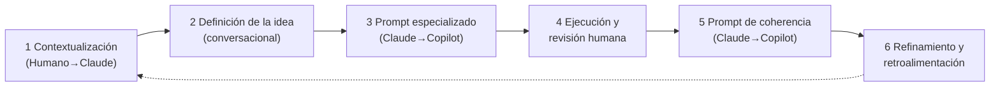

# 09 · IA, métodos ágiles, UX/UI/DX y otros

> **Propósito**: inventario y destilado de cuatro carpetas que **no** comparten el aparato de las
> guías propias (familias, `TEM-`/`DOC-`, frontmatter YAML): `Guides/IA/` (SDD, catálogo de
> agentes AG-xx, prompts de refinamiento, nota de Claude Code), `Guides/Metodologia-Agiles/`
> (Scrum + Jira), `Guides/UX-UI-Design/` (marco teórico UX/UI/DX) y `Guides/Otros/` (auditoría de
> seguridad en Windows). 32 archivos (31 `.md` + 1 PDF), 12 742 líneas de Markdown (`wc -l`).
> Salvo la guía de seguridad (frontmatter YAML, 2026-09-18), todo proviene del proyecto
> *Motor DSL de Generación de Documentos* (repositorio `Ejemplo_IA_SDD_Template`, UTN FRP TUP
> Aplicada 2025) o de guías genéricas de abril de 2026, y llegó **ya escrito**.
> **Fuente primaria**: encabezados «Documento / Versión / Fecha / Estado», índices internos y
> control de cambios de cada archivo; para la guía de seguridad, su frontmatter.
> **Base**: `Lab-Documentos` en `main` 5d5c2b4 (2026-10-18). Todas las rutas son relativas a
> `Lab-Documentos/`. Las cuatro carpetas entraron en su ubicación actual con el commit 9162e07
> (2026-09-28, «reorganización de Guides/ por categoría»); en la v3.0 de esta ia-db vivían en
> `Guides/SDD-Guide/`, `Guides/Scrum-Guide/`, `Guides/UX-UI-Guide/` y `Guides/references/`.
> Dos piezas son **posteriores a la v3.0** (2026-09-12): `Claude-Guide.md/Fast-Guide.md` (fab7258,
> 2026-09-13, en `Guides/Claude-Guide.md/`) y la guía de seguridad + cuaderno (8218d3e 2026-09-17,
> regenerada en ecbdb9d 2026-09-18, en `Guides/Seguridad-Red-Windows-Guide/`); 9162e07 sólo las movió.

## Advertencias de lectura

- **Sin `doc_id`** en IA, Ágiles y UX: se identifican por ruta. Los IDs que aparecen (`AG-xx`,
  `SA-xx`, `NB-xx`, `CU-xx`, `RN-xx`, `US-xx`, `BT-xx`, `FU-xx`, `WF-xx`) son del **proyecto de
  origen** y no remiten a nada de este repo.
- Las rutas que citan (`docs/00_contexto/…`, `docs/11_examples/…`, `/devs/…`) son del Motor DSL y
  **no existen acá** (H-09.08).
- Hay **dos numeraciones de subagentes** que no coinciden: `AG-ROOT…AG-11` (13 perfiles) y
  `SA-01…SA-12` (12 subagentes del prompt). `SA-03` significa cosas distintas según el archivo
  (H-09.09). Leé siempre el ID junto con el nombre del perfil.
- Nombres con espacios: ` Metodologias-Agiles-Jira-Guide.md` (espacio **inicial**) y
  `Spec-Driven Development-SDD.md`. Citalos entre comillas en la shell (H-09.02).

## Inventario

| Ruta | doc_id | Versión · fecha | Estado | Líneas | Qué es |
|---|---|---|---|---:|---|
| `Guides/IA/SDD-Guide/Metodologia-Prompting-SDD-Guide.md` | — | 1.0 · 2026-04-06 | Activo | 671 | Metodología de **prompting colaborativo Claude ↔ Copilot** para SDD |
| `Guides/IA/SDD-Guide/Spec-Driven Development-SDD.md` | — | s/d | — | 79 | Los **tres niveles de SDD** y marco de decisión |
| `Guides/IA/SDD-Guide/Secciones-Disciplinas-Especialidades-Tables.md` | — | s/d | — | 80 | Tablas: secciones `00…11` de `/docs/`, especialidades AG-xx, trazabilidad, mapeo agente → doc |
| `Guides/IA/SDD-Guide/References.md` | — | s/d | — | 5 | Tres URL de `agentfactory.panaversity.org` (SDD, markdown writing, three levels) |
| `Guides/IA/references/agentes-especialidades/README.md` | — | 2026-04-04 | — | 74 | Índice de las 13 especialidades y flujo de lectura |
| `Guides/IA/references/agentes-especialidades/AG-ROOT…AG-11` (13 archivos) | — | s/d | — | 187–286 c/u (3 204 total) | Una ficha por especialidad (estructura fija, ver abajo) |
| `Guides/IA/references/agentes-especialidades/tabla-caracterizacion-agentes.md` | — | 1.0 · 2026-04-03 | — | 29 | Tabla de caracterización AG-ROOT…AG-11 (copia del §1 del siguiente) |
| `Guides/IA/references/refinamiento_docs/agentes-refinamiento-docs.md` | — | 1.0 · 2026-04-03 | — | 515 | Perfiles + criterios de refinamiento por agente + **prompt maestro** de orquestación |
| `Guides/IA/references/refinamiento_docs/prompt_refinanmiento.md` | — | s/d | — | 189 | Variante «lista para ejecutar» del prompt maestro (SA-01…SA-12) |
| `Guides/IA/references/notas/tools.md` | — | s/d | — | 7 | Nota suelta: atajos de vista previa Markdown en VS Code |
| `Guides/IA/Claude-Guide.md/Fast-Guide.md` | — | s/d | — | 6 | Nota: reanudación automática de Claude Code al recuperar el límite de uso |
| `Guides/Metodologia-Agiles/Scrum-Guide/ Metodologias-Agiles-Jira-Guide.md` | — | cabecera 1.0, control de cambios 1.5 · 2026-04-13/14 | Activo | 2 836 | Referencia de métodos ágiles (Parte 1) + Jira (Parte 2) + §16 técnicas + §17 arranque |
| `Guides/Metodologia-Agiles/Scrum-Guide/Estudio-Guide.md` | — | cabecera 1.0, control de cambios 1.1 · 2026-04-15 | — | 594 | «Cómo arrancar un proyecto con Scrum» por ejemplos |
| `Guides/Metodologia-Agiles/Scrum-Guide/Caso-De-Estudio-1-Guide.md` | — | 1.0 · 2026-04-15 | — | 139 | Corrección de US de impresión de tickets desde MAUI híbrida |
| `Guides/Metodologia-Agiles/Scrum-Guide/guia-organizacion-proyecto-jira.md` | — | 1.0 · 2026-04-14 | — | 721 | Paso a paso para dar de alta y organizar un proyecto en Jira |
| `Guides/Metodologia-Agiles/Scrum-Guide/2020-Scrum-Guide-US.pdf` | — | 2020 (PDF 1.7, 14 págs., 254 KB) | — | — | Scrum Guide oficial en inglés. **Inventariado, no leído** |
| `Guides/UX-UI-Design/UX-UI-Guide/UX-UI-Guide.md` | — | 1.0 · 2026-04-25 | Aprobado | 1 714 | **Marco teórico UX/UI/DX** (12 capítulos + 3 apéndices, APA 7) |
| `Guides/UX-UI-Design/UX-UI-Guide/metodologia-uix-ux.md` | — | 1.0 · 2026-04-25 | **Borrador** | 324 | Qué documentar en la sección UX del template (flujos, wireframes, guía de experiencia) |
| `Guides/Otros/Seguridad-Red-Windows-Guide/Beginning-Security-Windows-Network-Guide.md` | `GUIA-PRINCIPAL` (`guia-estudio`) | last_review 2026-09-18 | vigente | 1 292 | Auditoría de seguridad e investigación de intrusiones en un servidor Windows, para principiantes |
| `Guides/Otros/Seguridad-Red-Windows-Guide/Cuaderno-Ejercicios-Seguridad-Windows.md` | `CUADERNO` (`cuaderno-ejercicios`) | last_review 2026-09-18 | vigente | 263 | 9 bloques de ejercicios + proyecto integrador + soluciones |

Ninguna de las cuatro carpetas tiene `README.md` en su raíz; el único README del dominio es el
interno `Guides/IA/references/agentes-especialidades/README.md`. `Guides/README.md` está vacío (0 bytes).

## 1. SDD y agentes (`Guides/IA/`)

```
Guides/IA/
├── SDD-Guide/                 ← el MÉTODO (cómo se trabaja con IA bajo SDD)
│   ├── Metodologia-Prompting-SDD-Guide.md      (núcleo, 671 l.)
│   ├── Spec-Driven Development-SDD.md          (tres niveles)
│   ├── Secciones-Disciplinas-Especialidades-Tables.md  (≈ §6–§7 del núcleo)
│   └── References.md
├── references/
│   ├── agentes-especialidades/  ← los PERFILES (quién revisa cada sección)
│   ├── refinamiento_docs/       ← los PROMPTS (orquestador + subagentes)
│   └── notas/tools.md
└── Claude-Guide.md/Fast-Guide.md   ← directorio con nombre .md (H-09.01)
```

### 1.1 Los tres niveles de SDD (`Spec-Driven Development-SDD.md`)

| Nivel | Idea | Cuándo |
|---|---|---|
| 1 · **Spec-First** | «La spec guía la implementación. Una vez completada, se descarta.» | Sesión única, prototipos, bugs puntuales, trabajo individual |
| 2 · **Spec-Anchored** (estándar para equipos) | Spec y código son artefactos vivos; **el cambio de spec precede al de código** | Equipo de 2+, compliance, mantenimiento 6+ meses |
| 3 · **Spec-as-Source** (experimental) | La spec es el artefacto; el código se regenera. «Identical specifications do not produce identical code» | CRUD repetitivo, código desechable, con tests robustos |

Recomendación del archivo: empezar en Spec-First y migrar a Spec-Anchored cuando haya equipo o
horizonte largo. Fuente citada: Panaversity Agent Factory (`References.md`).

### 1.2 Metodología de prompting colaborativo (`Metodologia-Prompting-SDD-Guide.md`)

**Separación de roles** (§2–§3): Claude = arquitecto de prompts y estratega documental (proyecto
persistente en claude.ai con knowledge base; genera prompts, evalúa salidas y orquesta 12
subagentes, y sólo Copilot tiene acceso al filesystem); Copilot = ejecutor en el IDE que sigue la
lectura prescrita («no decide qué es relevante», §3.2); el humano orquesta, copia los prompts y aprueba (§3.3). Validada en el Motor DSL
(.NET/MAUI, 12 secciones documentales, 32 CU, 185+ tests, publicación NuGet — dato declarado §1).



| § | Qué responde |
|---|---|
| §4 | Las 6 fases; cada una con prompt típico y **tabla de caracterización** (dirección, tipo, especialidad implícita AG-xx, input, output, restricción clave). F1: «NO generar artefactos, solo analizar» |
| §5 | 7 patrones de prompt: *Lectura antes de acción* · *Uno a la vez con confirmación* · *Diagnóstico antes de plan* · *Corrección de desvío* · *Decisión de arquitectura embebida* · *Verificación y deploy* · *Coherencia pre-cambio* |
| §6 | Tabla de 13 especialidades (AG-ROOT…AG-11), flujo de trazabilidad, mapeo agente → entradas/salidas |
| §7 | Resumen de las 12 secciones `00_contexto … 11_examples` de `/docs/` |
| §8 | Ejemplo completo del concepto al sprint (5 pasos) |
| §9 | Anti-patrones (tabla) |
| §10 | Adaptación a otro proyecto en 5 pasos (no todos necesitan las 12 secciones; una persona cubre varios roles; coherencia cada 2–3 sprints) |
| §11–§12 | Diagrama ASCII del flujo; **cadena de trazabilidad** |
| §13 | Control de cambios (sólo 1.0) |

**Cadena de trazabilidad SDD** (§12): Visión (`00`) → NB-xx (`01`) → CU-xx → RN-xx (`02`) →
ADR (`05`) → US-xx → BT-xx (`06`) → TK-xx (`07`) → test cases (`08`) → pipeline (`09`).

**Anti-patrones (§9)**, destilados: mega-prompt inicial · aprobar sin revisar · Copilot sin
lectura previa · sesiones demasiado largas (máx. 2–3 CU por sesión) · Claude sin ver la salida de
Copilot · mezclar lectura y escritura en interfaces de proveedor · prompt sin `dotnet build`/`dotnet test` final.

### 1.3 Catálogo de especialidades AG-xx (`references/agentes-especialidades/`)

| ID | Perfil | Sección del template | Artefactos |
|---|---|---|---|
| AG-ROOT | Arquitecto de Soluciones Senior | `docs/README.md` | Árbol documental, coherencia cross-documental |
| AG-00 | Product Manager / Analista de Negocio | `00_contexto/` | Visión, alcance, roadmap, acuerdo de equipo |
| AG-01 | Analista de Negocio Senior | `01_necesidades_negocio/` | NB-xx, criterios de éxito |
| AG-02 | Analista Funcional / Ing. de Requisitos | `02_especificacion_funcional/` | CU-xx, RN-xx, DSL, modelo conceptual |
| AG-03 | Especialista en Developer Experience | `03_ux-ui/` | Modos de uso, wireframes de salida, errores |
| AG-04 | Ingeniero de Prompts / AI Specialist | `04_prompts_ai/` | System prompt, guardrails, few-shot, evaluación |
| AG-05 | Arquitecto de Software Senior | `05_arquitectura_tecnica/` | ADRs, contratos, pipeline, C4 |
| AG-06 | Scrum Master / Agile Coach | `06_backlog-tecnico/` | US-xx, BT-xx, DoR, MoSCoW |
| AG-07 | Scrum Master / Gestión de Proyectos Ágiles | `07_plan-sprint/` | Sprint plans, review/retro, velocidad |
| AG-08 | Ingeniero QA / SDET Senior | `08_calidad_y_pruebas/` | Estrategia, DoD, matriz de cobertura, quality gates |
| AG-09 | Ingeniero DevOps Senior | `09_devops/` | CI/CD, SemVer, publicación NuGet, rollback |
| AG-10 | Technical Writer / Developer Advocate | `10_developer_guide/` | Guías de integración, tutoriales, troubleshooting |
| AG-11 | Developer Advocate / Ing. de Aplicación | `11_examples/` | 3 apps de referencia ejecutables |

**Estructura fija de cada ficha AG** (verificada por encabezados en los 13 archivos):
§1 ¿Qué es esta especialidad? · §2 Tareas principales · §3 Especificaciones normalizadas que
produce · §4 Criterios de calidad · §5 Preguntas guía (con *ejemplo práctico*) · §6 Plantilla base
(bloques Markdown de los documentos del template) · §7 Anti-patrones comunes.

Uso según el `README.md` del catálogo: leer la ficha antes de escribir; usar la plantilla mientras
se escribe; aplicar §4 como checklist al revisar; lanzar los subagentes del prompt maestro al refinar.
Orden de lectura recomendado: AG-00 → 01 → 02 → (03 + 04) → 05 → 06 → 07 → 08 → 09 → 10 → 11 → AG-ROOT.

### 1.4 Prompts de refinamiento (`references/refinamiento_docs/`)

| Archivo | Contenido | Subagentes |
|---|---|---|
| `agentes-refinamiento-docs.md` | §1 tabla de caracterización · §2 competencias y criterios por agente (AG-ROOT…AG-11) · §3 **prompt maestro de orquestación** · §4 instrucciones de uso (completa y parcial) · §5 control de cambios | «Sub-agente 1…12» |
| `prompt_refinanmiento.md` | El mismo prompt reescrito «listo para ejecutar», con consolidación ampliada | `SA-01…SA-12` |

Reglas comunes a ambos prompts: **no modificar archivos** (sólo analizar y reportar); salida en
español y Markdown; cada subagente entrega *Hallazgos* (ID · Severidad Alta/Media/Baja · Archivo ·
Descripción), *Propuestas de mejora* y *Evaluación* 1–10 (completitud, coherencia, calidad).
Consolidación: dashboard de salud, (en `prompt_refinanmiento.md`) mapa de trazabilidad de la
cadena Visión→Pipeline, top 10 hallazgos, plan de acción por impacto/esfuerzo, dependencias entre hallazgos.
Correspondencia: `SA-01`=AG-ROOT, `SA-02`=AG-00 … `SA-11`=AG-09, **`SA-12` = AG-10 + AG-11**
(los ejemplos `11_examples` no tienen subagente propio).

### 1.5 Notas sueltas

- `Claude-Guide.md/Fast-Guide.md`: Claude Code «(v2.1.234 o posterior)» puede reanudar solo al
  restablecerse el límite: `/config` → *Continue automatically at usage limit*, o
  `/config autoContinueAtUsageLimit=true`. **Versión y clave no verificadas** contra documentación oficial.
- `references/notas/tools.md`: atajos de VS Code para la vista previa Markdown (`Ctrl+K V`,
  `Ctrl+Shift+V`). No es material de IA.

## 2. Métodos ágiles y Jira (`Guides/Metodologia-Agiles/Scrum-Guide/`)

### 2.1 ` Metodologias-Agiles-Jira-Guide.md` — mapa (2 836 líneas)

| Parte · § | Tema | Qué responde |
|---|---|---|
| P1 · §1 | Propósito; §1.3 relación con la cadena SDD | Las metodologías gobiernan **cómo** se ejecuta desde el Product Backlog hacia abajo |
| P1 · §2 | Manifiesto: 4 valores, 12 principios, historia, Waterfall vs Ágil | |
| P1 · §3 | Scrum: pilares, valores, roles, artefactos, eventos, sprint, diagrama | |
| P1 · §4 | Kanban: principios, tablero, métricas, Scrum vs Kanban, cuándo elegirlo | |
| P1 · §5 | XP, SAFe, LeSS, Scrumban + comparativa | |
| P1 · §6 | US, épicas, tareas: formato, **INVEST**, Given/When/Then, jerarquía Iniciativa→Épica→US→Sub-tarea→Bug, estimación, priorización | ¿Cómo redacto y ordeno una US? |
| P1 · §7 | Velocity, burndown, burnup, CFD, lead/cycle time | |
| P1 · §8 | Anti-patrones de backlog, sprints y ceremonias | |
| P2 · §9–§10 | Jira: conceptos, tipos de proyecto, tipos de issue, campos, **prioridades ↔ MoSCoW** (§10.3), workflow, nomenclatura (§10.5) | |
| P2 · §11 | Alta de proyecto Scrum: board, backlog, sprints, epics, Fix Versions, componentes | |
| P2 · §12 | Flujo diario: planning, daily, review, retro, refinamiento | |
| P2 · §13 | Reportes: velocity, burndown, sprint report, CFD, control chart, dashboards, **JQL** | |
| P2 · §14 | Fix Versions como hitos, Release Hub, release notes; **§14.6 mapeo SDD → Jira** | ¿Dónde va cada artefacto SDD en Jira? |
| P2 · §15 | Integraciones: Git (Smart Commits), CI/CD, Confluence, Slack/Teams, automatizaciones | |
| §16 | Técnicas: vertical slicing, walking skeleton, tracer bullet, story mapping, example mapping, spike, ATDD, mob programming, Shape Up, impact mapping, dual-track; **§16.13 tabla situación → técnica** | ¿Qué técnica uso en esta situación? |
| §17 | Arranque: diagnóstico, elección de metodología, checklist Sprint 0, **§17.4 orden de artefactos**, errores frecuentes | ¿Por dónde empiezo? |

**§14.6 Mapeo SDD → Jira** (destilado): fase del roadmap → Fix Version · Épica → Epic ·
US → Story · BT → Sub-task/Task · Sprint Plan → Sprint · NB → Initiative/Theme (o Label) ·
CU → Linked issue o Label · DoR → checklist en la Story · DoD → condiciones de transición a Done ·
review → Sprint Report + filtro del sprint · retro → issues de mejora en el sprint siguiente · velocity → Velocity Chart.

**§17.4 Orden de construcción**: Visión → Épicas → Story Map (MVP = capa mínima) → US priorizadas
MoSCoW → DoR y DoD → … (cada artefacto depende del anterior; «saltear un paso genera retrabajo»).

### 2.2 Los otros tres

| Archivo | Estructura | Idea central |
|---|---|---|
| `Estudio-Guide.md` | §1 cuándo estás listo (3 insumos ↔ AG-00/01/02-03) · §2 Product Backlog en 4 pasos (visión, épicas, US + MoSCoW, DoR/DoD) · §3 ejemplos A clínica / B ferretería / C cursos online · §4 agrupar en épicas · §5 criterios de épica · §6 el patrón que se repite | Una épica es una **capacidad funcional completa** (independencia, tamaño > 1 sprint, cohesión); «primero identificá la capacidad → después fijate quién la usa». Ocho elementos antes del primer planning: visión, épicas, Must, Should, Could, Won't v1, DoR, DoD |
| `Caso-De-Estudio-1-Guide.md` | §1 caso · §2 US originales · §3 cuatro problemas · §4 reescritura con criterios de aceptación US-01…03 · §5 resumen | Errores típicos: actor técnico en vez de rol de usuario, US que mezclan implementación con necesidad, escenarios sueltos, falta de estructura |
| `guia-organizacion-proyecto-jira.md` | P1 elementos de Jira (jerarquía, campos, MoSCoW, workflow, métricas, JQL) · P2 metodologías que propone Jira · P3 alta paso a paso (3.1–3.10) · P4 ejemplos: e-commerce, app de delivery, SaaS CRM, Motor DSL · anti-patrones | Versión operativa y resumida de la guía grande; declara basarse en `devs/metodos-agiles/metodologias-agiles-jira.md` del template |

Anti-patrones de Jira (tabla final de `guia-organizacion-proyecto-jira.md`): todo «Must» (forzar
60/20/20), épicas sin descomponer (stories de 3–8 SP), board fantasma, sprint elástico,
refinamiento inexistente (10 % del sprint), daily de 45 min, velocity como KPI individual, US como tarea técnica.

## 3. UX/UI/DX (`Guides/UX-UI-Design/UX-UI-Guide/`)

### 3.1 `UX-UI-Guide.md` — Marco teórico (1 714 líneas)

Postura (§1.2): UX, UI y DX son **un continuo**; DX es UX cuando el humano es un desarrollador y la
interfaz es código, contratos, errores y documentación. Rutas de lectura (§1.3): **diseñador**
§2→§9 · **desarrollador/integrador de APIs** §2→§4→§5→§10→§11 · **auditor académico** §1→§2→§5→§7→§12 + apéndices.

| § | Tema | Cuadro |
|---|---|---|
| 1 | Encuadre; 10 preguntas guía de redacción (§1.4, retomadas como checklist en §12.2) | |
| 2 | Nueve disciplinas: HCI, usabilidad, UX, UI, IxD, arquitectura de información, accesibilidad, service design, DX | C1 §2.10 |
| 3 | Procesos: Garrett (5 planos), Doble Diamante, Design Thinking, Lean UX, Design Sprint; criterios de selección | C2 §3.6 |
| 4 | 10 heurísticas de Nielsen, 8 reglas de Shneiderman, leyes psicológicas (Fitts, Hick, Postel…) | C3 §4.4 |
| 5 | ISO 9241-210:2019, ISO 9241-11:2018, **WCAG 2.2**, WAI-ARIA 1.2, IEEE 1063 / ISO/IEC 26514 | C4 §5.3.4 |
| 6 | Sistemas de diseño: Atomic Design, ITCSS, Material 3 / HIG / Carbon / Polaris | C5 §6.4 |
| 7 | Investigación cualitativa/cuantitativa, métricas estandarizadas (SUS, etc.) | C6 §7.4 |
| 8 | Web: paradigmas, Core Web Vitals, arquitectura de información aplicada, patrones, CSS, accesibilidad, forms inline vs on-submit, microinteracciones, casos, antipatrones | C7 §8.7.1 |
| 9 | Móvil: mobile first, tipos de app, Material 3 vs HIG, ergonomía táctil, navegación, inputs, performance, accesibilidad, notificaciones | C8 §9.5.1 |
| 10 | **DX en REST APIs**: métricas (TTFC…), estándares, modelos de error, patrones, versionado URL vs header, Diátaxis | C9 §10.4.2, C10 §10.6.1 |
| 11 | Caso Motor DSL multi-target: usuarios, renderizado, WCAG 2.2 AA en el preview, **tolerancia formal preview ↔ output físico** | |
| 12 | Tabla maestra pilar × proceso × norma × métrica; checklist verificativo | |
| A–C | Glosario · Bibliografía (B.1–B.10, APA 7) · Índice de cuadros | |

Decisiones y criterios que conviene recordar:

- **Versionado de API** (§10.6.1): URL path para APIs públicas con breaking changes poco
  frecuentes; header con fecha (`API-Version`, estilo Stripe) para SaaS con cambios frecuentes y
  muchos clientes; query `?v=` desaconsejado.
- **Tolerancias formales > buenas intenciones** (§11.5–§11.6): ±0 caracteres por línea, anchos y
  wrapping; ±1 línea con QR/imagen; el esqueleto textual del preview debe ser byte-exacto al
  renderer de texto plano (test de snapshot en CI). El preview **no** es WYSIWYG estricto, y eso se declara.
- **Tabla maestra** (§12.1), DX: Lean UX + Diátaxis · RFC 9457, OpenAPI 3.1, semver · TTFC, error rate, tickets de soporte.
- **Checklist §12.2** (16 ítems): personas, fidelidad declarada, normas con versión y año, UX vs
  DX explícito, restricciones, métricas, modelo de errores canónico (`code`, `severity`, `hint`,
  `halts`, `context`), tolerancias, nivel WCAG, Nielsen #1/#5/#9, decisiones congeladas vs abiertas,
  Diátaxis, glosario y bibliografía, versionado y deprecación, casos reales, antipatrones.

### 3.2 `metodologia-uix-ux.md` — Qué documentar en la sección UX (Borrador)

| § | Contenido |
|---|---|
| 1 | Los tres artefactos de la sección: `flujos-de-usuario_v1.0.md` (happy path, alternativos, error paths, decisiones, transiciones) · `wireframes-descripcion_v1.0.md` (especificación textual por pantalla) · `guia-experiencia_v1.0.md` |
| 2 | Inputs: los que vienen del análisis funcional y los que hay que pedir al cliente; preguntas concretas |
| 3 | Plantillas normalizadas: flujos `FU-xx` (estilo Nielsen Norman Group), wireframes `WF-xx` (propósito, layout, componentes, estados, notas, captura), guía de experiencia (principios, patrones, tono, accesibilidad mínima, identidad visual) |
| 4 | Articulación en la cadena: la arquitectura no puede diseñar la API sin los flujos («si el wireframe dice “ves resultados mientras tipeás”, hace falta un endpoint con debounce») |

Usa `SA-03` para la sección UX y `SA-05` para arquitectura (numeración distinta de la de
`prompt_refinanmiento.md`, donde SA-03 es Analista de Negocio, SA-05 es DX y la arquitectura es
SA-07; H-09.09); cita un `rules.md` que no está en el repo.

## 4. Seguridad de red Windows (`Guides/Otros/Seguridad-Red-Windows-Guide/`)

Única pieza del dominio con **frontmatter YAML** (`doc_id`, `doc_type`, `title`, `status`, `origin:
ia-assisted`, `confidence: alta`, `owner`, `last_review`, `audience`, `traces`). Historia: alta en
8218d3e (2026-09-17, PR #5) y regeneración «escenario 2019, mesa» en ecbdb9d (2026-09-18). Se generó con el prompt
`Lab-Documentos.Documentacion/PROMPTs/Guides/07-Seguridad-Red-Windows-Guide/`; sus `traces`
`ESC-TESTIGO` y `ESC-CORPUS` resuelven en los `OUTPUTs/` de ese prompt, **no** dentro de `Lab-Documentos`.

**Guía (`GUIA-PRINCIPAL`)**: para quien sospecha que su servidor Windows fue intervenido y **no**
tiene formación en redes ni en SO. Las salidas de comandos son **ilustrativas** (escenario
ficticio), ancladas a documentación oficial (§12).

| § | Tema | Clave |
|---|---|---|
| 1 | Qué vas a auditar: red/IP/puerto, AD, **escenario `SRV-MADERA01`** (§1.4), cuentas, tipos de logon, línea de base | Escenario: Windows Server 2019, DC + archivos + facturación, `maderasur.local`, una dirección privada ficticia, RDP publicado a internet |
| 2 | El modelo de seguridad en cinco ideas (todo puede registrarse, Event ID, SID, correlación, el atacante también lo sabe) | |
| 3 | **Reglas de no daño**: orden de volatilidad (RFC 3227), mínima alteración y registro de tus acciones, NIST SP 800-61, cuándo no seguir solo | La guía cubre sobre todo *detección y análisis* |
| 4 | Registro de eventos: anatomía, tres formas de leer, reloj y zona horaria | |
| 5 | Accesos: **4624** (logon), **4625** (fallo / fuerza bruta), **1102** (borrado del log), el silencio como evidencia | |
| 6 | Persistencia: cuentas, servicios, tareas programadas, Autoruns | |
| 7 | Lo vivo: `netstat`/`Get-NetTCPConnection`, conexión → proceso → archivo, sesiones, TCPView/Process Explorer | «Una foto, no una película» |
| 8 | Auditoría: política básica vs avanzada, las tres mejoras que más rinden, **Sysmon**, WEF | |
| 9 | Método de caza: síntoma → hipótesis → artefacto, línea de tiempo, MITRE ATT&CK, hecho vs interpretación, **checklist §9.5**, causa raíz | |
| 10 | Pentesting I: autorización, laboratorio aislado (Kali + WS2019 en una red host-only con direcciones privadas fijas —las da la guía—, snapshots) | |
| 11 | Pentesting II: Nmap, NetExec, BloodHound, ataques a credenciales, Metasploit/C2, «atacar para aprender a defender» | |
| A | Montar el laboratorio paso a paso (VirtualBox), generar la evidencia como atacante, investigar como defensor | |
| 12–13 | Referencias · Glosario | |

**Cuaderno (`CUADERNO`)**: 9 bloques alineados con la guía (§1–2, §3, §4, §5, §6, §7, §8, §9,
§10–11), ejercicios de **lectura** (sobre `SRV-MADERA01`, sin Windows) y de **laboratorio** (🧪),
un **proyecto integrador** (montar el lab, forzar RDP con Hydra, crear `sqlbackup` + tarea de
persistencia + borrar el log, y después investigar como defensor con la checklist §9.5) y
soluciones explicadas. Regla de oro: laboratorio aislado o autorización escrita, nunca sistemas ajenos.

## Ejemplos y laboratorios del dominio

No hay código ejecutable en estas cuatro carpetas. Lo práctico es:

| Material | Cómo se usa |
|---|---|
| Plantillas §6 de cada ficha `AG-xx` | Punto de partida para escribir la sección `docs/NN_…` correspondiente de un proyecto SDD |
| Prompt maestro (`agentes-refinamiento-docs.md` §3 / `prompt_refinanmiento.md`) | Se pega en un agente capaz de lanzar subagentes; ejecución parcial = un solo perfil sobre una carpeta |
| Ejemplos A/B/C de `Estudio-Guide.md` y §4 de `guia-organizacion-proyecto-jira.md` | Backlogs completos de referencia en dominios distintos |
| `Caso-De-Estudio-1-Guide.md` | Ejercicio de corrección de US (antes/después) |
| Laboratorio de seguridad (guía §10 y Apéndice A; cuaderno) | Dos VMs en red host-only; generar la evidencia como atacante y reconstruirla como defensor |

## Relaciones con otras guías del repo

| Tema de este dominio | Dónde lo trata el corpus propio | Índice |
|---|---|---|
| SDD (tres niveles, spec como contrato) | `Guides/Documentacion-Tecnica/Creacion-Guias-Tecnicas/95-Transversales/Spec-Driven-Development.md` (`DOC-SDD`) y `Guides/Arquitectura/Organizacion-Estilo-Rest-API/95-Transversales/Spec-Driven-Development.md` (`TEM-SDD`) | [01](01_Documentacion-Tecnica.md), [04](04_Diseno-REST-API.md) |
| UX y flujo de usuario | `…/Creacion-Guias-Tecnicas/95-Transversales/UX-UI-y-Flujo-de-Usuario.md` (`DOC-UX`) | [01](01_Documentacion-Tecnica.md) |
| DX de APIs (cap. 10 del marco UX) | `Guides/Arquitectura/Organizacion-Estilo-Rest-API/95-Transversales/Experiencia-del-Consumidor.md` (`TEM-DX`) | [04](04_Diseno-REST-API.md) |
| Scrum, Kanban, Canvas como productores de documentación | `Guides/Documentacion-Tecnica/Creacion-Guias-Tecnicas/80-Metodos-Agiles/` (`MET-INDICE`, `MET-SCRUM`, `MET-KANBAN`, `MET-CANVAS`, `MET-COMPARATIVA`, `MET-MANIFIESTO`) | [01](01_Documentacion-Tecnica.md) |
| Subagentes especializados + auditoría entre fases (AG-09 en acción) | `Guides/Despliegue/DevOps-Guide/plan-mejoras-devops_v1.0.md` (cita `/devs/agentes-especialidades/`, `/devs/metodologia-sdd/`, `/devs/refinamiento_docs/` del template: el origen de `Guides/IA/references/`) | [08](08_Ramas-CI-CD-y-DevOps.md) |
| Versionado SemVer, publicación NuGet (AG-09) | `Guides/Despliegue/DevOps-Guide/` y `Guides/GitFlow/Estandares-Modelo-Ramas-Guide/` | [08](08_Ramas-CI-CD-y-DevOps.md) |

## Hallazgos del dominio

| ID | Tipo | Ruta | Detalle |
|---|---|---|---|
| H-09.01 | nombre-raro | `Guides/IA/Claude-Guide.md/` | Es un **directorio** con extensión `.md`; adentro, `Fast-Guide.md` (6 líneas, sin encabezado de documento) |
| H-09.02 | nombre-raro | `Guides/Metodologia-Agiles/Scrum-Guide/ Metodologias-Agiles-Jira-Guide.md`, `Guides/IA/SDD-Guide/Spec-Driven Development-SDD.md` | Espacio inicial en el primero; espacio interno en el segundo |
| H-09.03 | nombre-raro | `Guides/IA/references/refinamiento_docs/prompt_refinanmiento.md` | Errata («refinanmiento») y snake_case, frente al kebab-case del resto |
| H-09.04 | version-contradictoria | ` Metodologias-Agiles-Jira-Guide.md`, `Estudio-Guide.md` | Cabecera «Versión 1.0» pero el control de cambios llega a 1.5 y 1.1 |
| H-09.05 | nombre-declarado-distinto | varios | El nombre declarado no coincide con el archivo: `Estudio-Guide.md` → `guia-de-estudio.md`; `Caso-De-Estudio-1-Guide.md` → `caso-de-estudio-1.md`; `Metodologia-Prompting-SDD-Guide.md` → `metodologia-sdd-prompting_v1.0.md`; pie de `UX-UI-Guide.md` → `marco-teorico-ux-ui_v1.0.md`; pie de `metodologia-uix-ux.md` → `SA-03_guia-documentacion-ux-ui_v1.0.md` |
| H-09.06 | enlace-roto | `Guides/IA/references/agentes-especialidades/README.md` (l. 6 y 74) | `../agentes-refinamiento-docs.md` no existe; el archivo está en `../refinamiento_docs/agentes-refinamiento-docs.md` |
| H-09.07 | enlace-roto | `Guides/Metodologia-Agiles/Scrum-Guide/Caso-De-Estudio-1-Guide.md` (l. 7) | `guia-de-estudio.md` no existe; hoy es `Estudio-Guide.md` |
| H-09.08 | rutas-de-origen | `Guides/IA/references/agentes-especialidades/AG-01,07,10,11,ROOT…` | Enlaces relativos a `docs/…` / `../10_developer_guide/…` del Motor DSL; en su mayoría dentro de plantillas o ejemplos ilustrativos (p. ej. AG-ROOT §5.2), pero no resuelven en este repo. Igual con `docs/…` en ` Metodologias-Agiles-Jira-Guide.md` §1.3 y §17.4 |
| H-09.09 | ids-inconsistentes | `prompt_refinanmiento.md`, `agentes-refinamiento-docs.md`, `metodologia-uix-ux.md` | 13 perfiles AG para 12 subagentes (AG-10 y AG-11 fusionados en SA-12 / «Sub-agente 12»); `SA-03` es «Analista de Negocio» en el prompt y la sección UX en `metodologia-uix-ux.md` (donde la UX es AG-03); igual `SA-05`: DX en el prompt, arquitectura en `metodologia-uix-ux.md` (en el prompt es SA-07); el prompt maestro dice «13 subcarpetas temáticas» y son 12 (`00`–`11`) |
| H-09.10 | duplicado | `tabla-caracterizacion-agentes.md` ↔ `agentes-refinamiento-docs.md` §1; `Secciones-Disciplinas-Especialidades-Tables.md` ↔ `Metodologia-Prompting-SDD-Guide.md` §6–§7 | Mismo contenido (cambia el formato); además `tabla-caracterizacion-agentes.md` se titula «Agentes de Refinamiento de Documentación» |
| H-09.11 | referencia-ausente | `Guides/UX-UI-Design/UX-UI-Guide/metodologia-uix-ux.md` §1 | Cita «los tres artefactos que define el `rules.md`»; no hay ningún `rules.md` en el repo |
| H-09.12 | sin-metadatos | `Guides/IA/**`, `Guides/Metodologia-Agiles/**`, `Guides/UX-UI-Design/**` | Ningún frontmatter ni `doc_id`; varios sin fecha ni versión (`Spec-Driven Development-SDD.md`, `Secciones-…`, `References.md`, fichas AG, `prompt_refinanmiento.md`) |
| H-09.13 | doc_id-generico | `Guides/Otros/Seguridad-Red-Windows-Guide/*` | `GUIA-PRINCIPAL` y `CUADERNO` no llevan prefijo de dominio; hoy no colisionan, pero son candidatos a colisión. Sus `traces` `ESC-TESTIGO`/`ESC-CORPUS` sólo existen en `Lab-Documentos.Documentacion/PROMPTs/Guides/07-…/OUTPUTs/` |
| H-09.14 | no-verificable | `Guides/IA/Claude-Guide.md/Fast-Guide.md` | «Claude Code v2.1.234 o posterior» y `autoContinueAtUsageLimit` no se verificaron contra documentación oficial |
| H-09.15 | fuera-de-tema | `Guides/IA/references/notas/tools.md` | Nota de atajos de VS Code dentro de la carpeta de IA |
| H-09.16 | sin-readme | `Guides/IA/`, `Guides/Metodologia-Agiles/`, `Guides/UX-UI-Design/`, `Guides/Otros/` | Ninguna carpeta tiene `README.md` en su raíz (el único es el interno de `references/agentes-especialidades/`); `Guides/README.md` existe pero está vacío (0 bytes) |
| H-09.17 | origen-no-hallado | `Guides/UX-UI-Design/UX-UI-Guide/UX-UI-Guide.md` | La v3.0 decía que se generó desde `PROMPTs/Guides/06-Crear-UX-UI-Guide/`; esa carpeta ya no existe (la `06-` actual es `Crear-Dot-NET-Arquitectura-Guide`). Origen hoy no verificable |
| H-09.18 | binario | `Guides/Metodologia-Agiles/Scrum-Guide/2020-Scrum-Guide-US.pdf` | Scrum Guide 2020 (14 págs.), inventariada y no leída; ningún `.md` del repo la enlaza |
| H-09.19 | fence-roto | `Guides/IA/references/agentes-especialidades/AG-ROOT-arquitecto-soluciones.md` §6 (l. 133–142) | Dentro de la plantilla ` ```markdown `, el bloque ` ```text ` del árbol se «cierra» con `` `` ` `` (backticks separados para no cortar el bloque externo): 3 fences en el archivo. Renderiza bien, pero la plantilla copiada queda con el bloque `text` sin cerrar |

## Para preguntas X → leé fuente Y

| Necesitás saber… | Leé |
|---|---|
| Qué nivel de SDD conviene a tu proyecto | `Guides/IA/SDD-Guide/Spec-Driven Development-SDD.md` § «Marco de Decisión» |
| Cómo repartir el trabajo entre un agente estratega y uno ejecutor | `Guides/IA/SDD-Guide/Metodologia-Prompting-SDD-Guide.md` §2–§4 |
| Qué patrón de prompt usar (leer antes, uno a la vez, diagnóstico antes de plan…) | `Metodologia-Prompting-SDD-Guide.md` §5 |
| Errores típicos al trabajar con IA en SDD | `Metodologia-Prompting-SDD-Guide.md` §9 |
| La cadena Visión → NB → CU → … → pipeline | `Metodologia-Prompting-SDD-Guide.md` §12 |
| Qué perfil revisa una sección y con qué criterios | `Guides/IA/references/agentes-especialidades/AG-xx-*.md` §4–§5 |
| Plantilla de un documento del template SDD (visión, CU, ADR, DoD, pipeline…) | ficha `AG-xx` correspondiente §6 |
| Un prompt para auditar documentación con subagentes en paralelo | `Guides/IA/references/refinamiento_docs/agentes-refinamiento-docs.md` §3–§4 o `prompt_refinanmiento.md` |
| Scrum, Kanban, XP/SAFe/LeSS en profundidad | ` Metodologias-Agiles-Jira-Guide.md` §2–§5 (y el PDF oficial) |
| Cómo escribir y validar una user story (INVEST, Given/When/Then) | ` Metodologias-Agiles-Jira-Guide.md` §6; `Caso-De-Estudio-1-Guide.md` |
| Cómo definir épicas y armar el primer backlog | `Guides/Metodologia-Agiles/Scrum-Guide/Estudio-Guide.md` §2, §5–§6 |
| Qué técnica de descomposición aplicar | ` Metodologias-Agiles-Jira-Guide.md` §16.13 |
| Por dónde arrancar un proyecto ágil (Sprint 0) | ` Metodologias-Agiles-Jira-Guide.md` §17; `Estudio-Guide.md` §1 |
| Configurar Jira y mapear artefactos SDD a Jira | `guia-organizacion-proyecto-jira.md` P3; ` Metodologias-Agiles-Jira-Guide.md` §11, §14.6 |
| Heurísticas, leyes, normas (WCAG 2.2, ISO 9241) | `Guides/UX-UI-Design/UX-UI-Guide/UX-UI-Guide.md` §4–§5 |
| DX de una API: errores, versionado, Diátaxis | `UX-UI-Guide.md` §10 |
| Checklist de cierre de un documento UX/UI/DX | `UX-UI-Guide.md` §12.2 |
| Qué documentar en la sección UX (flujos, wireframes, guía de experiencia) | `Guides/UX-UI-Design/UX-UI-Guide/metodologia-uix-ux.md` §1, §3 |
| Investigar una sospecha de intrusión en Windows sin romper la evidencia | `Guides/Otros/Seguridad-Red-Windows-Guide/Beginning-Security-Windows-Network-Guide.md` §3–§9 |
| Qué significan los eventos 4624, 4625 y 1102 | misma guía §5 |
| Armar un laboratorio de pentesting y practicar | misma guía §10–§11 y Apéndice A; `Cuaderno-Ejercicios-Seguridad-Windows.md` |
