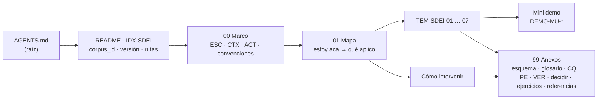

# 11 · Sistema documentador: cuerpo `SDEI`, mini demo y compuerta `docs-guard`

> **Propósito**: dónde está y qué dice cada pieza del **cuerpo nuevo** del sistema documentador (`corpus_id: SDEI`,
> versión `2.0.0-borrador`), su ejemplo ejecutable (la mini demo MovilidadUrbana), la compuerta de documentación que
> lo vigila (`docs-guard`), la puerta para agentes (`AGENTS.md`) y el expediente del que sale todo eso.
> **Fuentes primarias**: `Guides/Documentacion-Tecnica/Sistema-De-Documentacion-E-Integracion/README.md`
> (`IDX-SDEI`), `AGENTS.md` (`IDX-LABDOC-AGENTS`), `tools/docs-guard/README.md` y `CHANGELOG.md` (entradas del
> 2026-10-27).
> **Vigencia**: verificado contra `Lab-Documentos` en `main` `fe10086` (merge de E1-U4f, 2026-10-27). Las rutas son
> relativas a `Lab-Documentos/` salvo las del expediente, que son de `Lab-Documentos.Documentacion/`.

## Índice

1. [Definiciones](#1-definiciones)
2. [En una pantalla](#2-en-una-pantalla)
3. [Inventario del cuerpo](#3-inventario-del-cuerpo)
4. [Cómo está armado](#4-cómo-está-armado)
5. [Ejemplos (`Examples/`)](#5-ejemplos-examples)
6. [Compuerta `docs-guard` y workflows](#6-compuerta-docs-guard-y-workflows)
7. [`AGENTS.md`: la ruta del agente](#7-agentsmd-la-ruta-del-agente)
8. [Procedencia: expediente 0002 de DocAsCode](#8-procedencia-expediente-0002-de-docascode)
9. [Hallazgos](#9-hallazgos)
10. [Para preguntas X → leé Y](#10-para-preguntas-x--leé-y)

## 1. Definiciones

| Término | Significado en este índice |
| --- | --- |
| Cuerpo nuevo | Carpeta cuyo `README.md` declara `corpus_id` en el frontmatter. Hoy hay uno: `SDEI`. Ahí todo documento exige frontmatter y la compuerta bloquea lo que en el resto del repo sólo avisa |
| Heredado | Todo lo de `Guides/` fuera del cuerpo nuevo: la compuerta lo revisa sin bloquear (paso `avisos`) |
| `docs-guard` | Compuerta documental de `Lab-Documentos`: grupos `PR-1` a `PR-7`, autoprueba y agregador, en cada PR y en local con `scripts/ci-local.sh` |
| Clase D / P / H | Quién cierra un cambio: D un generador, P un agente o persona que propone, H sólo una persona (`AGENTS.md` §1) |
| `source.lock` | Archivo que fija repositorio y SHA del código que una página documenta |
| Traza de nivel 1 / 2 | Página → ficha (el ID existe y la versión coincide) / ficha → código (el ancla `ruta#Símbolo@SHA` resuelve y cumple su afirmación) |
| RRD | Registro de requerimientos documentales (`_requisitos.md`, filas `RD-nn` con criterio Dado/Cuando/Entonces) |

## 2. En una pantalla

- El cuerpo `SDEI` **reemplaza** al apunte de un solo archivo `DOC-SDT-0001`, que queda `status: obsoleto` con una
  tabla de destinos sección → `doc_id` (47 secciones; 38 completas y 9 parciales) y se archiva en la versión siguiente
  del cuerpo. El índice [01](01_Documentacion-Tecnica.md) conserva la descripción del apunte como antecedente.
- **29 documentos con `doc_id`** (README, Marco, Mapa, siete temas, ocho anexos, guía obsoleta y diez piezas de
  `Examples/`) más la prueba de concepto de ayuda por rol, que ya existía. Todos en `borrador`, salvo `DOC-SDT-0001`.
- Tres **rutas de lectura** desde el README: *aprender* (Marco → Mapa → `TEM-01`…`TEM-07` → mini demo → Ejercicios),
  *intervenir* (Mapa → Cómo intervenir → Lista de verificación) y *agente* (`AGENTS.md` → README → Convenciones →
  Esquema → Glosario).
- Cada tema tiene **seis secciones fijas** (definición, aplicación por escenario, ejemplos, preguntas guía, criterios
  de calidad, anexo); los anexos guardan el material de consulta.
- La compuerta `docs-guard` corre sobre el cuerpo en cada PR (`[self-hosted, i7infra-dev]`), sin red para verificar;
  un carril semanal revisa enlaces externos y entre repositorios y abre o actualiza un issue.
- No hay sitio publicado: el cuerpo se lee en GitHub (`CTX-SDEI-1`, «sin sitio»). Por eso este índice **no enlaza a
  un `llms.txt`**: no existe en el escalón 1.

## 3. Inventario del cuerpo

Rutas bajo `Guides/Documentacion-Tecnica/Sistema-De-Documentacion-E-Integracion/`. 72 archivos versionados en la
carpeta (40 de la prueba de ayuda por rol, 10 de la mini demo).

| Ruta | `doc_id` | Tipo | Estado | Líneas | Qué contiene |
| --- | --- | --- | --- | ---: | --- |
| `README.md` | `IDX-SDEI` | índice | borrador | 177 | Puerta del cuerpo: `corpus_id`, versión, objetivos `OBJ-SDEI-01..05`, tres rutas, tabla de contenido |
| `00-Marco.md` | `MARCO-SDEI` | marco de referencia | borrador | 196 | Escenarios `ESC-SDEI-1..4`, contextos `CTX-SDEI-1..4`, actores `ACT-SDEI-1..6`, convenciones (§5) |
| `01-Mapa.md` | `MAPA-SDEI` | mapa | borrador | 130 | Tablas «estoy acá → qué aplico» por escenario, contexto, artefacto y actor; índice de anexos |
| `TEM-01-Sistema-Documentador.md` | `TEM-SDEI-01` | tema | borrador | 348 | Piezas, fuentes de verdad, repositorios, compuertas y actores; caso de industria y adopciones públicas |
| `TEM-02-Ciclo-Documental.md` | `TEM-SDEI-02` | tema | borrador | 349 | Fases de la captura de requerimientos a la integración; RRD, estados del documento, quién decide |
| `TEM-03-Topologia-Y-Versionado.md` | `TEM-SDEI-03` | tema | borrador | 326 | Dónde vive cada pieza y contra qué versión vale: commit, SHA fijado o etiqueta |
| `TEM-04-Doble-Audiencia.md` | `TEM-SDEI-04` | tema | borrador | 279 | Una fuente Markdown para personas y agentes: canales, `AGENTS.md`, controles anti-inyección |
| `TEM-05-Ayuda-Al-Usuario-Final.md` | `TEM-SDEI-05` | tema | borrador | 281 | Ayuda derivada de la especificación, trazada a la regla con versión, servida por rol |
| `TEM-06-Compuertas-Y-CI.md` | `TEM-SDEI-06` | tema | borrador | 311 | Dos carriles, regla de cinco condiciones para bloquear, pares rojo/verde, seguridad del runner |
| `TEM-07-Marco-SDD.md` | `TEM-SDEI-07` | tema | borrador (hasta el escalón 2) | 331 | Encaje con un desarrollo guiado por especificación sin duplicar su registro de IDs ni su norma |
| `99-Anexos/Esquema-Frontmatter-Y-Prefijos.md` | `ANX-SDEI-ESQUEMA` | anexo | borrador | 202 | Diez campos más `description`, vocabularios cerrados, trazas, registro de prefijos, forma del RRD |
| `99-Anexos/Glosario.md` | `ANX-SDEI-GLOSARIO` | anexo | borrador | 78 | Términos y siglas con alias y ancla; un término, un significado |
| `99-Anexos/Referencias.md` | `ANX-SDEI-REFERENCIAS` | anexo de referencias | borrador | 176 | APA 7 autor-año con ancla `ref-…` y fecha de consulta en toda fuente web |
| `99-Anexos/Criterios-De-Calidad.md` | `ANX-SDEI-CQ` | anexo | borrador | 88 | `CQ-01` a `CQ-14`, con pregunta de verificación y control que los automatiza |
| `99-Anexos/Patrones-De-Ejemplos.md` | `ANX-SDEI-PE` | anexo | borrador | 72 | `PE-01` a `PE-12` para ejemplos que sirvan a personas y agentes |
| `99-Anexos/Lista-De-Verificacion.md` | `ANX-SDEI-VER` | anexo | borrador | 158 | Ítems `VER-*` de sí/no antes de pasar una guía a vigente, con regla de origen |
| `99-Anexos/Como-Decidir.md` | `ANX-SDEI-DECIDIR` | anexo | borrador | 174 | Criterios con fuente, escala anclada 1–5, filtros, regla de firmeza, matriz trabajada, clase D/P/H |
| `99-Anexos/Ejercicios.md` | `ANX-SDEI-EJERCICIOS` | anexo | borrador | 128 | `EJR-SDEI-nn` que comprueban los objetivos del README, con caso resuelto y claves |
| `Sistema-Documentador-Tecnico-Guide.md` | `DOC-SDT-0001` | study-note | **obsoleto** | 841 | Apunte original con aviso de reemplazo y §Tabla de destinos; texto sin tocar |
| `Examples/Como-Intervenir.md` | `GP-SDEI-INTERVENIR` | proceso | borrador | 175 | Plantilla de cinco pasos: ubicar, derivar, validar, proponer, mantener |
| `Examples/Como-Intervenir-Lab-Documentos.md` | `GP-SDEI-INTERVENIR-LD` | proceso | borrador | 35 | Instancia de la plantilla para este repositorio: rutas, compuerta, quién decide |
| `Examples/Lanzar-Example.md` | `GP-SDEI-LANZAR` | guía práctica | borrador | 141 | Tool-prompt que levanta la prueba de ayuda por rol y la expone por un túnel (frontmatter agregado en E1) |
| `Examples/MovilidadUrbana-Mini-Demo/README.md` | `DEMO-MU-00` | guía práctica | borrador | 391 | Tutorial de la mini demo (ver §5) |
| `Examples/MovilidadUrbana-Mini-Demo/docs/_requisitos.md` | `DEMO-MU-01` | rrd | borrador | 61 | RRD de la demo: qué documentación necesita cada audiencia y cómo se comprueba |
| `Examples/MovilidadUrbana-Mini-Demo/docs/fichas/RN-LOC-01.md` | `DEMO-MU-11` | ficha | borrador | 79 | Regla del largo del nombre de localidad, con anclas al código y la divergencia 60/80 |
| `Examples/MovilidadUrbana-Mini-Demo/docs/fichas/RN-LOC-02.md` | `DEMO-MU-12` | ficha | borrador | 55 | Unicidad de localidad por nombre y provincia, con anclas |
| `Examples/MovilidadUrbana-Mini-Demo/docs/ayuda/alta-de-localidad.md` | `DEMO-MU-21` | guía práctica | borrador | 68 | Ayuda al usuario final (CL-06): alta de una localidad |
| `Examples/MovilidadUrbana-Mini-Demo/docs/tecnica/arquitectura.md` | `DEMO-MU-31` | guía práctica | borrador | 72 | Técnica (CL-07): capas y dónde se declara cada regla |
| `Examples/MovilidadUrbana-Mini-Demo/docs/tecnica/compilar-y-primer-pedido.md` | `DEMO-MU-32` | guía práctica | borrador | 119 | Técnica (CL-07): compilar la API al SHA, pedir el contrato, primer alta por HTTP |
| `Examples/Prueba-Ayuda-Por-Rol/` | — | ejemplo | — | 40 archivos | Prueba de concepto anterior al cuerpo; descrita en [01](01_Documentacion-Tecnica.md#ejemplos-y-cómo-se-usan) |

La tabla del README (§4) es la fuente del estado; si cambia, prevalece el README.

## 4. Cómo está armado

*Diagrama: dependencias de lectura del cuerpo; las flechas van del documento que remite al que se lee después.*

| Eje del Marco | Valores | Dónde |
| --- | --- | --- |
| Escenarios | `ESC-SDEI-1` corpus de guías · `-2` app cliente sin roles · `-3` panel con roles · `-4` servicio con paquetes | `00-Marco.md` §2 |
| Contextos | `CTX-SDEI-1` con o sin sitio · `-2` con o sin SDD · `-3` mismo repo, hermano o dedicado · `-4` dentro o fuera de la organización del runner | `00-Marco.md` §3 |
| Actores | `ACT-SDEI-1` PO (clase H) · `-2` analista · `-3` desarrollo · `-4` agente de IA (sólo clase P) · `-5` estudiante y docente · `-6` persona usuaria | `00-Marco.md` §4 |

**Contrato de frontmatter** (`99-Anexos/Esquema-Frontmatter-Y-Prefijos.md` §2): `doc_id`, `doc_type`, `title`,
`status` (`borrador`/`vigente`/`obsoleto`), `origin` (`human`/`ia-assisted`/`ia-generated`), `confidence` (si
`origin` no es `human`), `owner`, `last_review`, `audience` (lista cerrada), `traces` (`ID` o `ID@MAYOR.MENOR`) y
`description` de 10 a 160 caracteres. `corpus_id` y `version` viven sólo en el README del cuerpo. Las páginas de
ayuda (`roles` o `translation_of`) usan otro esquema. Los esquemas JSON están en `tools/docs-guard/esquemas/` y el
registro cerrado de prefijos (38 líneas, `interno`/`externo`) en `tools/docs-guard/prefijos.txt`. Comparación con los
frontmatter de las demás guías: [10](10_Convenciones-y-Glosario.md) §1.

**Versión y estado** (`README.md` §6): SemVer sólo en el README; es la 2 porque reemplaza al apunte. Pasar un
documento a `vigente` es un PR propio de una persona; la etiqueta `2.0.0` la pone el PO.

## 5. Ejemplos (`Examples/`)

| Pieza | Qué demuestra | Cómo se corre |
| --- | --- | --- |
| `MovilidadUrbana-Mini-Demo/` | Documentar una app real (MovilidadUrbana.MAUI, de `Lab-E2E.WebBlazor`) **desde otro repositorio**, sin copiar código: `source.lock` fija el SHA `8fb4c3a`; fichas `RN-LOC-01/02` con anclas de nivel 2; contrato OpenAPI extraído en ejecución (`contracts/openapi.json`); deriva contra `main` sólo avisa. Caso real: la divergencia 60/80 del largo de nombre | `verificar.sh` (baja el código por `git archive`, extrae el contrato y corre los controles); en CI, `.github/workflows/mini-demo-movilidad.yml`. Prueba negativa permanente: `tools/docs-guard/fixtures/anclas/real-rn-loc-01/` |
| `Como-Intervenir.md` + `Como-Intervenir-Lab-Documentos.md` | El proceso para cambiar documentación en cinco pasos y su instancia en este repo | Lectura; termina en un PR que la compuerta acepta |
| `Prueba-Ayuda-Por-Rol/` y `Lanzar-Example.md` | Ayuda por rol en Blazor (sin cambios de código en E1; el README aclara que el catálogo cuenta 7 páginas en español y 2 traducciones, y que los enlaces de `Web/Ayuda/en/` a páginas sin traducción son deliberados) | Ver [01](01_Documentacion-Tecnica.md#ejemplos-y-cómo-se-usan) |

## 6. Compuerta `docs-guard` y workflows

| Grupo / paso de `scripts/ci-local.sh` | Controles | Herramienta |
| --- | --- | --- |
| `PR-1` `enlaces` | Enlaces internos y anclas; relativos que salen del repo | lychee `--offline --include-fragments`; `dg.py fuera` |
| `PR-2` `esquema` | Frontmatter contra los esquemas, prefijos, forma del RRD | `dg.py esquema` |
| `PR-3` `ai` | Anti-inyección `AI-1` a `AI-5` con excepciones con huella | `dg.py ai` |
| `PR-4` `estructura` | Markdown estructural (MD013 apagado) y mermaid que parsea | markdownlint-cli2; `mermaid/mermaid-parse.mjs` |
| `PR-5` `trazas` | Cada `traces` contra el registro de `doc_id`; anclas de nivel 2 con `--fuente` | `dg.py trazas` |
| `PR-6` `contrato` | Diff del contrato OpenAPI | `dg.py contratos`, `dg.py contrato` |
| `PR-7` `fijadas` | Piezas fijadas por SHA-256, formato de referencias `ref-…`, URL y citas por dominio con fecha (`url-fecha`, ampliado en E1-U4f) | `dg.py fijadas`, `reflint`, `url-fecha` |
| `autoprueba` | Par rojo/verde de cada control y fixture `AK-7` (siempre rojo) | `tools/docs-guard/fixtures/` (53 archivos) |
| `avisos` | `url-fecha` y `cita-linea` sobre lo heredado; nunca bloquea | `dg.py avisos` |

Fuente: `tools/docs-guard/README.md` §4. Un control nuevo se agrega según su §9.

| Workflow (`.github/workflows/`) | Disparo | Qué hace |
| --- | --- | --- |
| `docs-guard.yml` | `pull_request`, `workflow_call` | La compuerta en un solo job con agregador estricto; reutilizable desde repos hermanos (`Lab-Documentos.Documentacion` la llama fijada por SHA) |
| `docs-enlaces-semanal.yml` | `cron` lunes 06:17 UTC, a mano, PR que lo toca | Carril programado: enlaces externos y entre repos sobre `tools/docs-guard/arbol.tsv`; informe en un issue único (`issues: write`) |
| `mini-demo-movilidad.yml` | PR con `paths`, a mano | Baja el código al SHA del `source.lock`, extrae el contrato, verifica anclas y deriva |
| `framework-concept-demo.yml` | PR, a mano | Compuerta de la demo de Framework Concept → [12](12_Framework-Concept.md) |

Todos corren en `[self-hosted, i7infra-dev]` con `permissions: contents: read` por defecto y guarda contra forks; los
tres del expediente 0002 fijan sus actions por SHA (el de Framework Concept no: [12](12_Framework-Concept.md) §6). Plantilla de PR:
`.github/pull_request_template.md`. El modelo de ramas y las prácticas de Actions del corpus están en
[08](08_Ramas-CI-CD-y-DevOps.md).

## 7. `AGENTS.md`: la ruta del agente

`AGENTS.md` (`IDX-LABDOC-AGENTS`, 142 líneas) es un **puntero**: no repite reglas. Orden de lectura: el propio
archivo → README del cuerpo → `00-Marco.md` §5 Convenciones → Esquema de frontmatter → Glosario → fila del Mapa →
`scripts/ci-local.sh` en verde. Dice qué puede proponer un agente (clase P) y qué no (nada de clase H: pasar a
vigente, etiquetar, publicar) y trae un ejemplo trabajado: agregar una página al cuerpo.

## 8. Procedencia: expediente 0002 de DocAsCode

El diseño del cuerpo, la compuerta y la mini demo salen del expediente 0002 (replanteo de la metodología
DocAsCode), en este repositorio. Ruta base:
`PROMPTs/DEVs/Enchacement/01-Replanteo-Y-Analisis/OUTPUTs/`.

| Pieza | Ruta (bajo la base) | Qué fija |
| --- | --- | --- |
| Carátula | `Expedientes/0002-Replanteo-Metodologia-DocAsCode/README.md` | Estado del expediente, índice de folios y alias de redacción |
| Resolución del ciclo 1 | `…/actuaciones/099-resolucion.md` | Decisiones `D01`…; entre ellas `D09` (frontmatter y prefijos), `D25` (mini demo por SHA), `D27` (cuerpo y rutas), `D28` (APA 7 con fecha), `D29` (objetivos y ejercicios como anexo) |
| Resolución del ciclo 2 | `…/actuaciones/129-resolucion-ciclo-2.md` | Reconsideraciones y umbrales del ciclo 2 |
| Respuestas del PO y delegación | `…/actuaciones/130-respuestas-del-po-y-asiento.md` a `133-providencia-criterios-e1.md` | Delegación del merge (D08 firme), decisiones delegadas a la mesa, criterios de E1 |
| Integración | `Bitacoras/N09-Integracion.md` | Modelo integrado (§7 prefijos, §9.2 paquete de la compuerta E1) |
| Plan | `Bitacoras/N10-Plan-De-Implementacion.md` | Fichas de las unidades E1-U0a … E1-U6 (§6) y ondas (§14) |
| Lista de verificación | `Bitacoras/R07-Reglas-PromptFramework.md` | Ítems `VER-*` del framework de prompts |
| Folios de unidad | `…/actuaciones/2nn-e1-*.md` y `…/evidencia/E1-*/` | Qué hizo cada unidad, PR, SHA de merge, CI y lecciones; los posteriores al merge de E1-U0c se versionan en una resincronización |

Unidades de E1 y su huella en `Lab-Documentos` (de `CHANGELOG.md`): U0a compuerta y delegación; U1 saneamiento del
apunte; U2 `docs-guard` completo y carril semanal; U3 mini demo; U4a esqueleto del cuerpo; U4b temas 01–03; U4c
temas 04–06; U4d `TEM-07` y Cómo intervenir; U4e `AGENTS.md`; U4f apunte obsoleto y `url-fecha` ampliado. U5 es este
reindexado.

## 9. Hallazgos

| Tipo | Ruta | Detalle |
| --- | --- | --- |
| Ruta de lectura desactualizada | `README.md` (raíz) §Ruta de lectura mínima, paso 3 | Apunta al apunte `DOC-SDT-0001`, que está `obsoleto`; la entrada vigente es `…/Sistema-De-Documentacion-E-Integracion/README.md` (`IDX-SDEI`). `Guides/README.md` repite el enlace al apunte en la fila «Documentación técnica» |
| Diagrama con cajas viejas | `…/README.md` §3 | El mermaid de rutas rotula los temas como «en redacción» y su leyenda dice que no tienen archivo; los siete temas ya existen (la tabla de §4 está al día) |
| Estado del README | `…/README.md` tabla inicial | «Estado: el esqueleto… los siete temas se agregan sobre él» quedó de E1-U4a |
| Enlaces rotos deliberados | `Examples/Prueba-Ayuda-Por-Rol/` | 3 enlaces relativos no resuelven a propósito (`../comun/no-existe.md` plantado; 2 de `Web/Ayuda/en/` a páginas sin traducción). La compuerta los excluye con nombre y motivo. No son defectos |
| Avisos heredados repetidos | `DOC-SDT-0001` | El paso `avisos` informa 33 citas sin fecha (5 URL, 28 por dominio) del apunte obsoleto en cada PR hasta que se archive (folio 260, H-1) |
| `owner` personal | `DOC-SDT-0001` | Conserva como `owner` la cuenta personal del autor; los documentos nuevos usan un rol o el nombre del cuerpo |

## 10. Para preguntas X → leé Y

| Necesitás saber… | Leé (bajo `Guides/Documentacion-Tecnica/Sistema-De-Documentacion-E-Integracion/` salvo indicación) |
| --- | --- |
| Qué es un sistema documentador y qué piezas tiene | `TEM-01-Sistema-Documentador.md` |
| En qué escenario cae mi proyecto y qué piezas le tocan | `00-Marco.md` §2 y `01-Mapa.md` §2 |
| Cómo escribir el frontmatter de una página nueva | `99-Anexos/Esquema-Frontmatter-Y-Prefijos.md` §2, §7 |
| Qué prefijos de ID existen o cómo registrar uno | `99-Anexos/Esquema-Frontmatter-Y-Prefijos.md` §5; `tools/docs-guard/prefijos.txt` |
| Dónde vive la documentación respecto del código y contra qué versión | `TEM-03-Topologia-Y-Versionado.md` |
| Cómo sirve la misma fuente a personas y agentes; anti-inyección | `TEM-04-Doble-Audiencia.md`; `tools/docs-guard/README.md` §1 (`AI-n`, `AK-n`) |
| Ayuda al usuario por rol, trazada a la regla | `TEM-05-Ayuda-Al-Usuario-Final.md`; prueba en `Examples/Prueba-Ayuda-Por-Rol/` |
| Qué bloquea y qué avisa la CI documental | `TEM-06-Compuertas-Y-CI.md`; `tools/docs-guard/README.md` §5 |
| Por qué dio rojo un control | `tools/docs-guard/README.md` §4–§6; en local `scripts/ci-local.sh <grupo> <ruta>` |
| Cómo encaja con un SDD | `TEM-07-Marco-SDD.md` |
| Cambiar la documentación de un proyecto | `Examples/Como-Intervenir.md`; `99-Anexos/Lista-De-Verificacion.md` |
| Documentar una app desde otro repo, fijada por SHA | `Examples/MovilidadUrbana-Mini-Demo/README.md` §3–§6 |
| Elegir entre dos diseños documentales | `99-Anexos/Como-Decidir.md` |
| Cómo citar una fuente web | `99-Anexos/Referencias.md`; `00-Marco.md` §5 |
| Adónde fue una sección del apunte viejo | `Sistema-Documentador-Tecnico-Guide.md` §Tabla de destinos |
| Qué puede cambiar un agente en el repo | `AGENTS.md` (raíz de `Lab-Documentos`) §5 |
| Por qué se decidió algo del cuerpo | Expediente 0002 (§8): `099-resolucion.md`, `129-resolucion-ciclo-2.md`, `N10` |
