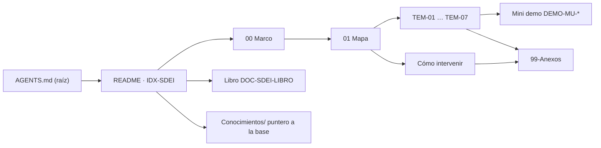

# 12 · Sistema documentador: cuerpo `SDEI`, libro, conocimiento, mini demo y compuerta `docs-guard`

> **Propósito**: dónde está y qué dice cada pieza del **cuerpo nuevo** del sistema documentador (`corpus_id: SDEI`,
> versión `2.0.0-borrador.2`): temas, anexos, el libro *DocsAsCode Developer Guide* partido por Parte, el conocimiento
> de especificación (mudado a la base de conocimientos; en `Conocimientos/` queda el puntero), los ejemplos (mini demo MovilidadUrbana y prueba de ayuda por rol), la
> compuerta que lo vigila (`docs-guard`, `scripts/`, workflows) y la puerta para agentes (`AGENTS.md`).
> **Fuentes primarias**: `Guides/Documentacion-Tecnica/Sistema-De-Documentacion-E-Integracion/README.md`
> (`IDX-SDEI`), `AGENTS.md` (`IDX-LABDOC-AGENTS`), `tools/docs-guard/README.md`.
> **Vigencia**: 2026-11-16, verificado contra `Lab-Documentos` `main` `34929f2`. Rutas relativas a `Lab-Documentos/`;
> `…/` abrevia `Guides/Documentacion-Tecnica/Sistema-De-Documentacion-E-Integracion/`.

## Índice

1. [Definiciones](#1-definiciones)
2. [En una pantalla](#2-en-una-pantalla)
3. [Inventario del cuerpo](#3-inventario-del-cuerpo)
4. [Cómo está armado y rutas de lectura](#4-cómo-está-armado-y-rutas-de-lectura)
5. [Conceptos y decisiones clave](#5-conceptos-y-decisiones-clave)
6. [Conocimiento de especificación (mudado a la base)](#6-conocimiento-de-especificación-mudado-a-la-base)
7. [Ejemplos (`Examples/`)](#7-ejemplos-examples)
8. [Compuerta `docs-guard`, `scripts/` y workflows](#8-compuerta-docs-guard-scripts-y-workflows)
9. [`AGENTS.md` y plantilla de PR](#9-agentsmd-y-plantilla-de-pr)
10. [Estado, vigencia y procedencia](#10-estado-vigencia-y-procedencia)
11. [Hallazgos](#11-hallazgos)
12. [Para preguntas X → leé Y](#12-para-preguntas-x--leé-y)
13. [Fuentes](#13-fuentes)

## 1. Definiciones

| Término | Significado en este índice | Fuente |
| --- | --- | --- |
| Sistema documentador | Piezas, fuentes de verdad, repositorios, anclas de versión, compuertas, canales y actores que producen y mantienen la documentación de un sistema | `…/README.md` §1 |
| Cuerpo nuevo | Carpeta cuyo `README.md` declara `corpus_id`. Hoy hay uno: `SDEI`. Ahí la falta de frontmatter o una referencia mal formada bloquean; en lo heredado sólo avisan | `…/README.md` §5; `tools/docs-guard/README.md` §1 |
| Clase D / P / H | Quién cierra un cambio: D un generador determinista, P un agente o persona que propone y entra por la compuerta, H sólo una persona | `…/00-Marco.md` §1; `…/99-Anexos/Como-Decidir.md` §6 |
| Escenario `ESC-SDEI-n` | Tipo de sistema: 1 corpus de guías, 2 app cliente sin roles, 3 panel con roles, 4 servicio con paquetes | `…/00-Marco.md` §2 |
| Contexto `CTX-SDEI-n` | Variante que cambia una respuesta: 1 con/sin sitio, 2 con/sin SDD, 3 mismo repo/hermano/dedicado, 4 dentro/fuera de la organización del runner | `…/00-Marco.md` §3 |
| Clase de pieza `CL-nn` | Catálogo cerrado de 14 clases de pieza documental (especificación, RRD, `AGENTS.md`, contrato, ayuda, técnica, índice para agentes…) | `…/01-Mapa.md` §4; `DocsAsCode-Designing-Specification` §2.1 (en la base de conocimientos) |
| RRD | Registro de requerimientos documentales (`_requisitos.md` o `doc_type: rrd`): filas `RD-nn` con audiencia, tarea, pieza, criterio Dado/Cuando/Entonces y decisión | `…/TEM-02-Ciclo-Documental.md`; `tools/docs-guard/README.md` §4 |
| Traza | `traces: [ID]` o `[ID@MAYOR.MENOR]`; nivel 1 página → ficha, nivel 2 ficha → código por ancla `ruta#Símbolo@SHA` | `…/99-Anexos/Esquema-Frontmatter-Y-Prefijos.md` §4 |
| `source.lock` | Archivo que fija repo y SHA del código que documenta una carpeta | `…/Examples/MovilidadUrbana-Mini-Demo/source.lock` |
| `audience` / `delivery` | `audience` orienta (no da ni quita acceso); `delivery` es la regla de entrega, que protege, con valores del registro de audiencias `AUD-` | `…/99-Anexos/Esquema-Frontmatter-Y-Prefijos.md` §2 |
| Carril PR / carril programado | La compuerta que bloquea en cada PR sin red / la corrida semanal con red que sólo avisa por un issue | `tools/docs-guard/README.md` §3 |
| `AI-n` / `AK-n` | Chequeos anti-inyección del contenido (AI-1 a AI-5) / controles del sistema (AK-3 excepciones con huella, AK-4 dominios, AK-5 job sin secretos, AK-7 fixture siempre rojo) | `tools/docs-guard/README.md` §1 |

## 2. En una pantalla

- **Cuerpo `SDEI` completo en borrador**: README, Marco, Mapa, siete temas, ocho anexos, libro (raíz + nueve piezas),
  conocimiento de especificación con su plantilla, y ejemplos. Nada está `vigente`; pasar a `vigente` es un PR propio
  de una persona y la etiqueta `2.0.0` la pone el PO (`…/README.md` §6).
- **La guía de un solo archivo (`DOC-SDT-0001`) ya no está en `main`**: quedó archivada en la etiqueta
  `sdei-v2.0.0-borrador`, donde vive su «tabla de destinos» sección → `doc_id` (`CHANGELOG.md` l. 57; `…/README.md` §3).
- **Novedades respecto de 2026-10-29**: libro *DocsAsCode Developer Guide* partido por Parte (resolución 99 del
  expediente 0003); `Conocimientos/` con el conocimiento 1.4 «borrador ensayado, no probado» (mudado el 2026-11-19 a la base, §6); `TEM-04` renombrado
  «Lectura por agentes» (antes «Doble audiencia»); `TEM-05` con regla de entrega y ayuda en el punto de uso;
  vocabulario `delivery`/`AUD-`; prueba extendida `Examples/Prueba-Ayuda-Por-Rol/Audiencias/`; control
  `mermaid-arroba`; runner con etiqueta genérica `ci-hdcm`.
- **Compuerta**: `docs-guard` (grupos `PR-1` a `PR-7`, autoprueba, agregador estricto) en cada PR y en push a `main`;
  en local `scripts/ci-local.sh`. Carril semanal de enlaces externos y entre repos.
- **Sin sitio publicado** (`CTX-SDEI-1`): se lee en GitHub; no hay `llms.txt` del cuerpo.

## 3. Inventario del cuerpo

Bajo `…/`. Todos `status: borrador`; `origin: ia-assisted` salvo los `DEMO-*`/`AUD-*` (`ia-generated`). Líneas al
commit `34929f2`.

### 3.1 Núcleo, temas y anexos

| Ruta | `doc_id` | Tipo | Líneas | Qué contiene |
| --- | --- | --- | ---: | --- |
| `README.md` | `IDX-SDEI` | índice | 183 | `corpus_id`, versión, objetivos `OBJ-SDEI-01..05`, tres rutas, tabla de contenido (§4), armado (§5), versión (§6), origen (§7) |
| `00-Marco.md` | `MARCO-SDEI` | marco de referencia | 216 | Escenarios, contextos, actores `ACT-SDEI-1..6`, convenciones (§5), caso que recorre el marco (§6) |
| `01-Mapa.md` | `MAPA-SDEI` | mapa | 133 | «Estoy acá → qué aplico» por escenario, contexto, artefacto (catálogo `CL-nn`) y actor; índice de anexos |
| `TEM-01-Sistema-Documentador.md` | `TEM-SDEI-01` | tema | 355 | Piezas, arquitectura de referencia, caso de industria (portal de un proveedor de notificaciones), adopciones públicas, ensayos reproducibles |
| `TEM-02-Ciclo-Documental.md` | `TEM-SDEI-02` | tema | 353 | Fases de la captura a la integración; RRD, estados, cláusulas con criterio; fila real del RRD de la mini demo |
| `TEM-03-Topologia-Y-Versionado.md` | `TEM-SDEI-03` | tema | 333 | Regla para ubicar una pieza; commit, SHA fijado o etiqueta; `source.lock` real; caso Lab-Geometria |
| `TEM-04-Doble-Audiencia.md` | `TEM-SDEI-04` | tema | 334 | **Lectura por agentes**: una fuente para personas y agentes, `AGENTS.md` como puntero, índice derivado del frontmatter, anti-inyección; el agente lee con la audiencia de su usuario |
| `TEM-05-Ayuda-Al-Usuario-Final.md` | `TEM-SDEI-05` | tema | 446 | Ayuda derivada de la especificación, trazada a la regla con versión, regla de entrega, idiomas, ayuda en el punto de uso (campos, paneles, portales) |
| `TEM-06-Compuertas-Y-CI.md` | `TEM-SDEI-06` | tema | 354 | Dos carriles, regla de cinco condiciones para bloquear, pares rojo/verde, guarda de merge G1–G4, seguridad del runner |
| `TEM-07-Marco-SDD.md` | `TEM-SDEI-07` | tema | 351 | Encaje con un desarrollo guiado por especificación sin duplicar su registro de IDs ni su norma; «borrador hasta el escalón 2» |
| `99-Anexos/Esquema-Frontmatter-Y-Prefijos.md` | `ANX-SDEI-ESQUEMA` | anexo | 218 | Diez campos + `description`, `delivery`, README del cuerpo y páginas de ayuda, trazas, prefijos, RRD, ejemplo con errores |
| `99-Anexos/Glosario.md` | `ANX-SDEI-GLOSARIO` | anexo | 108 | Términos con alias y ancla; un término, un significado |
| `99-Anexos/Referencias.md` | `ANX-SDEI-REFERENCIAS` | anexo-referencias | 289 | APA 7 autor-año con ancla `ref-…` y fecha de consulta |
| `99-Anexos/Criterios-De-Calidad.md` | `ANX-SDEI-CQ` | anexo | 88 | `CQ-01` a `CQ-14` con pregunta y control que los automatiza |
| `99-Anexos/Patrones-De-Ejemplos.md` | `ANX-SDEI-PE` | anexo | 74 | `PE-01` a `PE-12` |
| `99-Anexos/Lista-De-Verificacion.md` | `ANX-SDEI-VER` | anexo | 158 | Ítems `VER-*` sí/no antes de pasar a `vigente` |
| `99-Anexos/Como-Decidir.md` | `ANX-SDEI-DECIDIR` | anexo | 177 | Criterios con fuente, escala 1–5, filtros, regla de firmeza, matriz trabajada, «Quién decide» (§6) |
| `99-Anexos/Ejercicios.md` | `ANX-SDEI-EJERCICIOS` | anexo | 131 | `EJR-SDEI-nn` contra los objetivos, con claves |

Cada tema tiene seis secciones fijas (definición, aplicación por escenario, ejemplos concretos, preguntas guía,
criterios de calidad, anexo) más «Fuentes y observaciones» (`…/README.md` §5).

### 3.2 Libro *DocsAsCode Developer Guide*

Edición de lectura del cuerpo; «las fuentes siguen siendo estos documentos» (`…/README.md` §4). Diez archivos con
navegación «anterior · índice · siguiente».

| Ruta | `doc_id` | Líneas | Contenido |
| --- | --- | ---: | --- |
| `DocsAsCode-Developer-Guide.md` | `DOC-SDEI-LIBRO` | 224 | Raíz: índice general y glosario-índice (anexo A) |
| `DocsAsCode-Developer-Guide-Parte-0.md` | `DOC-SDEI-LIBRO-P0` | 248 | Preliminares y prólogo |
| `DocsAsCode-Developer-Guide-Parte-I.md` | `DOC-SDEI-LIBRO-P1` | 994 | Parte I. Fundamentos |
| `DocsAsCode-Developer-Guide-Parte-II.md` | `DOC-SDEI-LIBRO-P2` | 1035 | Parte II. Diseñar el sistema documentador |
| `DocsAsCode-Developer-Guide-Parte-III.md` | `DOC-SDEI-LIBRO-P3` | 520 | Parte III. Audiencias y canales |
| `DocsAsCode-Developer-Guide-Parte-IV.md` | `DOC-SDEI-LIBRO-P4` | 848 | Parte IV. Verificar e integrar |
| `DocsAsCode-Developer-Guide-Parte-V-a.md` | `DOC-SDEI-LIBRO-P5A` | 1020 | Parte V. Práctica, caps. 11–14 |
| `DocsAsCode-Developer-Guide-Parte-V-b.md` | `DOC-SDEI-LIBRO-P5B` | 475 | Parte V. Práctica, caps. 15–17 (17.4 recibe la explicación del conocimiento, §6) |
| `DocsAsCode-Developer-Guide-Parte-VI.md` | `DOC-SDEI-LIBRO-P6` | 447 | Parte VI. Industria |
| `DocsAsCode-Developer-Guide-Anexos.md` | `DOC-SDEI-LIBRO-ANX` | 1248 | Anexos B a J |

### 3.3 Puntero del conocimiento y ejemplos

| Ruta | `doc_id` | Tipo | Líneas | Qué contiene |
| --- | --- | --- | ---: | --- |
| `Conocimientos/README.md` | — (retirados `ANX-SDEI-ESPECIFICACION` y `ANX-SDEI-FICHA-VACIA`) | puntero, sin frontmatter | — | Aviso de la mudanza del conocimiento 1.4 y de la ficha A-01 a la base (§6) |
| `Examples/Como-Intervenir.md` | `GP-SDEI-INTERVENIR` | proceso | 176 | Plantilla de cinco pasos: ubicar, derivar, validar, proponer, mantener |
| `Examples/Como-Intervenir-Lab-Documentos.md` | `GP-SDEI-INTERVENIR-LD` | proceso | 47 | Instancia para este repositorio |
| `Examples/Lanzar-Example.md` | `GP-SDEI-LANZAR` | guía práctica | 168 | Levantar la prueba de ayuda por rol en su devcontainer y exponerla por túnel |
| `Examples/MovilidadUrbana-Mini-Demo/README.md` | `DEMO-MU-00` | guía práctica | 396 | Tutorial de la mini demo (§7.1) |
| `…/MovilidadUrbana-Mini-Demo/docs/_requisitos.md` | `DEMO-MU-01` | rrd | 62 | RRD de la demo |
| `…/docs/fichas/RN-LOC-01.md`, `RN-LOC-02.md` | `DEMO-MU-11`, `-12` | ficha | 79, 55 | Largo del nombre (divergencia 60/80) y unicidad por nombre y provincia, con anclas |
| `…/docs/ayuda/alta-de-localidad.md` | `DEMO-MU-21` | guía práctica | 68 | Ayuda al usuario final (CL-06) |
| `…/docs/tecnica/arquitectura.md`, `compilar-y-primer-pedido.md` | `DEMO-MU-31`, `-32` | guía práctica | 72, 119 | Técnica (CL-07) |
| `Examples/Prueba-Ayuda-Por-Rol/README.md` | — (sin frontmatter) | ejemplo | 95 | Prueba de concepto de ayuda por rol (§7.2) |
| `…/Prueba-Ayuda-Por-Rol/_requisitos.md` | `DEMO-PAR-01` | rrd | 76 | `RD-21` a `RD-32` |
| `…/Prueba-Ayuda-Por-Rol/Audiencias/_audiencias.md` | `AUD-DEMO-AYR` | registro-audiencias | 41 | Cinco audiencias ficticias con rol, alcance, superficie, nivel e «Incluye» |
| `…/Audiencias/Reglas/RN-DEMO-ASUNTO.md` | `DEMO-AYR-01` | ficha | 40 | Regla ficticia del largo del asunto, anclas `valida`/`muestra` |
| `…/Audiencias/Ayuda/{app-a,app-b,campos,comun,raiz}/*.md` | — (página de ayuda) | ayuda | 15–17 c/u | Cinco páginas con `delivery:`; dos con `contexto: app-a/…` o `app-b/…` |
| `…/Audiencias/*.cs`, `Audiencias.csproj`, `Microtexto.resx`, `salida.txt` | — | código | — | Validador de los controles E-1…E-6 y su salida registrada (§7.2) |

## 4. Cómo está armado y rutas de lectura

*Diagrama: dependencias de lectura; la flecha va del documento que remite al que se lee después.*

| Ruta | Para quién | Recorrido | Sale con |
| --- | --- | --- | --- |
| Aprender | Quien estudia desde cero | Marco → Mapa entero → `TEM-01`…`TEM-07` → tutorial de la mini demo → Ejercicios | `OBJ-SDEI-01..05` |
| Intervenir | Quien cambia la documentación de un proyecto | Mapa (fila del escenario) → Cómo intervenir + instancia → Lista de verificación | Un PR que la compuerta acepta |
| Agente | Un agente de IA | `AGENTS.md` → README → Convenciones (`00-Marco.md` §5) → Esquema → Glosario | Reglas para una página que pasa la compuerta |

Fuente: `…/README.md` §3. Alternativa de lectura lineal: el libro, desde `DocsAsCode-Developer-Guide.md`.

## 5. Conceptos y decisiones clave

| Concepto / decisión | Qué fija | Fuente |
| --- | --- | --- |
| Docs as code | Markdown versionado en Git, revisado por PR, verificado por CI | `…/README.md` §1 |
| Contrato de frontmatter | `doc_id`, `doc_type`, `title`, `status` (`borrador`/`vigente`/`obsoleto`), `origin` (`human`/`ia-assisted`/`ia-generated`), `confidence` (si `origin` ≠ `human`), `owner`, `last_review`, `audience`, `traces`, más `description` ≤ 160 caracteres; opcional `delivery` | `…/99-Anexos/Esquema-Frontmatter-Y-Prefijos.md` §2; `tools/docs-guard/esquemas/cuerpo.schema.json` |
| Versión del cuerpo | SemVer sólo en el README (`readme-cuerpo.schema.json`); excepción: el conocimiento repite su **Versión:** en `version` | `…/README.md` §6 |
| `audience` vs `delivery` | `audience` orienta; `delivery` protege. `agente` queda sólo como valor heredado: el agente es un lector que hereda la audiencia de su usuario. Controles `audiencia-vocabulario` y `delivery-clave-cercana` **todavía no implementados** | `…/99-Anexos/Esquema-Frontmatter-Y-Prefijos.md` l. 53-66 |
| Páginas de ayuda | Sin `doc_id`, con `roles` o `translation_of`; opcional `contexto: <app>/<id>`; esquema `ayuda.schema.json` | `…/99-Anexos/Esquema-Frontmatter-Y-Prefijos.md` §3 |
| Registro de prefijos | Cerrado, con ámbito `interno`/`externo` (32 líneas de datos); un ID `externo` sin `source.lock` avisa, con `source.lock` bloquea si no resuelve | `tools/docs-guard/prefijos.txt`; `tools/docs-guard/README.md` §4 |
| ID en lugar de ruta; trazas versionadas | La ruta cambia, el ID no; subir la versión de una regla pone en rojo a quien la repite | `…/00-Marco.md` §5 (citado en el conocimiento §4) |
| Regla de bloqueo (cinco condiciones) | Determinista y sin red; defecto introducido por el mismo PR; par rojo/verde; línea de base 0; sin falsos positivos o con excepción con huella | `…/TEM-06-Compuertas-Y-CI.md`; `tools/docs-guard/README.md` §5 |
| Anclas entre repos | Por SHA o etiqueta, nunca por rama | `…/TEM-03-Topologia-Y-Versionado.md` |
| Citación | APA 7 con ancla `ref-…` y fecha de consulta; control `url-fecha` | `…/00-Marco.md` §5; `…/99-Anexos/Referencias.md` |
| Repos privados | Se nombran sólo por alias; nada de rutas de máquina, IP, hosts ni usuarios en lo versionado | `AGENTS.md` §5 |

## 6. Conocimiento de especificación (mudado a la base)

**Mudado el 2026-11-19** a la base de conocimientos (privado): `Knowledges/Knowledge-DocsAsCode-Designing-Specification.md`, alias
`DocsAsCode-Designing-Specification`, **Versión 1.5**, Vigente con el rótulo «borrador ensayado, no probado» en §0 y en
`Tema`. La 1.5 **no renumera**: los `§N` de una cita a la 1.4 valen igual. La ficha A-01 quedó dentro de su §5.1, en
bloque cercado; los `doc_id` `ANX-SDEI-ESPECIFICACION` y `ANX-SDEI-FICHA-VACIA` quedaron retirados. En
`…/Conocimientos/` queda el `README.md` puntero. La 1.4 (2026-11-02) se lee en `Lab-Documentos` `8791fb1`.

El conocimiento (`Compatible-con: Rule-Forma-De-Conocimiento.md 1.3`) dice qué decidir para diseñar la documentación como código de un proyecto nuevo o
existente, qué artefactos deja (A-01 a A-13) y cómo se comprueba.

| Sección | Contenido |
| --- | --- |
| Rótulo | **«Borrador ensayado, no probado»**: ronda 4 del expediente 0003, ocho corridas válidas, ninguna pasa la métrica; cuatro P0 abiertos (C1, C2 ×2, C3a). «Úsese como guía con criterio» |
| §0 | Propósito, cuándo conviene / cuándo no, terminología mínima, mapa de carga por tarea |
| §2 | Catálogo de 14 clases `CL-01`…`CL-14`, invariantes `I-01`…`I-25`, apéndice por escenario, aplicabilidad |
| §3 | Procedimiento en ocho pasos, decisiones del aplicador `D-nn` (D-18 «Audiencias y entrega» en §3.2.1), cómo decidir, nuevo vs existente, regla de falla, público/privado, dónde corre el cómputo (§3.7) |
| §4 | Decisiones ya tomadas (no se reabren al aplicar) |
| §5 | Esqueletos: ficha A-01, frontmatter mínimo, fila del RRD, instancia de Cómo intervenir, `AGENTS.md`, prefijos, workflow |
| §6–§10 | Criterios `DE-nn`, anti-patrones, conformidad, trazabilidad, control de cambios 1.0→1.5 |

Rasgos: marcas de procedencia `(DK-nn)` ronda 1, `(R2-x)` ronda 2, `(R3: id)` ronda 3, citas `F399:n` y `F206:n` a
folios del expediente y `@3b10b0f`/`00171bd` a commits del cuerpo. El control de cambios admite que supera la meta de
≤ 500 líneas (en unas 230 con la 1.3). La ficha A-01, que en la 1.4 era un archivo propio de `Conocimientos/`, es el esqueleto
vacío de §5.1.

## 7. Ejemplos (`Examples/`)

### 7.1 Mini demo MovilidadUrbana

| Aspecto | Detalle | Fuente |
| --- | --- | --- |
| Qué demuestra | Documentar `MovilidadUrbana` (API web y MAUI de `Lab-E2E.WebBlazor`) **desde otro repo**, sin copiar código | `…/MovilidadUrbana-Mini-Demo/README.md` §2–§3 |
| Ancla | `source.lock`: SHA `8fb4c3a8…`, `comparar: main`, rutas `src/MovilidadUrbana.ApiWeb` y `.MAUI`, contrato `GET /openapi/v1.json`, workflow declarado | `…/source.lock` |
| Verificación | `verificar.sh` baja el código por `git archive`, extrae el contrato y corre los controles; en CI `mini-demo-movilidad.yml` | README §4 |
| Caso real | `RN-LOC-01`: letra e intención dicen 60, el comportamiento admite 80 (divergencia «de fondo») | `…/docs/fichas/RN-LOC-01.md` l. 35-39; README §7 |
| Prueba negativa | La ficha 1.0 sin corregir en `tools/docs-guard/fixtures/anclas/real-rn-loc-01/` debe dar rojo contra el código real | `tools/docs-guard/README.md` §6 |
| Tutorial | §5 «documentar una pantalla nueva», con la forma de la entrada de `CHANGELOG.md` | README §5 |

### 7.2 Prueba de ayuda por rol

Origen: la propuesta de la §7 de la guía archivada. No es código de Lab-Geometria: su ayuda web deriva de los casos
de uso de la unidad Web de ese proyecto en el SHA `5f07b12` (`RD-21` a `RD-27`).

| Carpeta | Qué es | Resultado registrado |
| --- | --- | --- |
| `Consola/` | Motor aislado: catálogo, filtro por rol, `llms.txt`, validador | `salida.txt`: `Validador: 3 fallas`, `[exit=1]` **a propósito** (dos defectos plantados y uno encontrado) |
| `Audiencias/` | Prueba extendida de la resolución 399 del expediente 0003: controles E-1…E-6 (cruce de audiencia, alcance, paquete sin fuga, contrato por exposición, anclas `muestra`/`valida`/`contiene`, `aria-describedby`, `nivel-vs-repo`). **Contenido ficticio** | `salida.txt`: `Validador: 8/8 pares`, `[exit=0]` |
| `Web/` | Panel Blazor .NET 10 (render estático), ingreso simulado por papel, 404 por rol, fuente `.md`, `llms.txt`, ES/EN | Log: `Catálogo de ayuda: 9 páginas` (7 en español + 2 traducciones) |
| `.devcontainer/`, `capturas/` | Imagen `devcontainers/dotnet:1-10.0`, puerto 5190; siete PNG del 2026-09-19 | — |

Fuente: `…/Examples/Prueba-Ayuda-Por-Rol/README.md`. Levantarla: `…/Examples/Lanzar-Example.md` (versiones fijas de
devcontainers CLI y cloudflared).

## 8. Compuerta `docs-guard`, `scripts/` y workflows

### 8.1 Grupos del carril PR

| Grupo / paso de `scripts/ci-local.sh` | Controles | Herramienta |
| --- | --- | --- |
| `PR-1` `enlaces` | Enlaces internos y anclas; relativos que salen del repo | lychee `--offline --include-fragments`; `dg.py fuera` |
| `PR-2` `esquema` | Frontmatter contra esquemas, prefijos, RRD; `frontmatter-no-yaml` | `dg.py esquema` |
| `PR-3` `ai` | AI-1 a AI-5 con excepciones con huella (AI-3 sólo avisa) | `dg.py ai` |
| `PR-4` `estructura` | markdownlint (MD013 apagado), mermaid que parsea, `mermaid-arroba` (`ID@1.0` en mermaid se escribe `ID#64;1.0` sin HTML) | markdownlint-cli2; `mermaid/mermaid-parse.mjs`; `dg.py mermaid-arroba` |
| `PR-5` `trazas` | `traces` contra el registro de `doc_id`, encabezados con ID y filas `RD-nn`; anclas de nivel 2 sólo con `--fuente` | `dg.py trazas` |
| `PR-6` `contrato` | Diff de `contracts/openapi.json` vs `.generado/`; con `source.lock` + `workflow:` lo compara ese workflow | `dg.py contratos`, `contrato` |
| `PR-7` `fijadas` | SHA-256 de `BASE-FIJADA.md`, formato `ref-…`, `url-fecha` | `dg.py fijadas`, `reflint`, `url-fecha` |
| `autoprueba` | Par rojo/verde de cada control + fixture `AK-7` | `tools/docs-guard/fixtures/` (84 archivos) |
| `avisos` | `url-fecha` y `cita-linea` sobre lo heredado; nunca bloquea | `dg.py avisos` |

Fuente: `tools/docs-guard/README.md` §4–§6. RUTA por defecto: la carpeta del cuerpo (`scripts/ci-local.sh` l. 34).
`dg.py` (1085 líneas, sólo biblioteca estándar, corre con `python3 -I`) implementa además `frescura` (usado por el
carril semanal). Agregar un control: §9 del README de la herramienta.

### 8.2 Configuración

| Archivo | Qué es | Quién lo cambia |
| --- | --- | --- |
| `tools/docs-guard/dominios.txt` | Lista de dominios permitidos (AK-4), uno por línea con motivo; ya incluye dominios de la guía 16 (AI Layer) | Clase P con aprobación explícita (README §7) |
| `tools/docs-guard/prefijos.txt` | Registro cerrado de prefijos | PR |
| `tools/docs-guard/excepciones.txt` | `sha256 ruta control`; hoy una sola: `AGENTS.md` fuera de AI-3 | Clase H |
| `tools/docs-guard/esquemas/` | `cuerpo`, `ayuda`, `readme-cuerpo` (subconjunto de draft-07) | PR con par rojo/verde |
| `tools/docs-guard/arbol.tsv` | Repo → ruta del workspace para el carril semanal; cuatro repos públicos | PR |
| `scripts/docs-guard.lychee.toml`, `docs-guard.markdownlint-cli2.jsonc` | Configuración de lychee y markdownlint | PR |

### 8.3 Workflows

| Workflow (`.github/workflows/`) | Disparo | Qué hace |
| --- | --- | --- |
| `docs-guard.yml` (148 l.) | `pull_request`, `push` a `main`, a mano, `workflow_call` (entradas: carpeta, commit de Lab-Documentos, archivos raíz con `traces`) | La compuerta en un job con agregador estricto; reutilizable por SHA desde repos hermanos |
| `docs-enlaces-semanal.yml` (97 l.) | `cron` lunes 06:17 UTC, a mano, PR que lo toca (en seco) | `semanal.sh`: árbol del workspace, lychee con red, atraso de `base_commit`/`sha:`, deriva de fijadas, frescura > 365 días, línea de base de AI-3; issue único, `issues: write` |
| `mini-demo-movilidad.yml` (54 l.) | PR con `paths` (la demo, `tools/docs-guard/**`, el propio workflow), a mano | Baja el código al SHA, extrae contrato, verifica anclas y deriva |
| `framework-concept-demo.yml`, `framework-concept-ios.yml` | — | Fuera de este dominio: demo de Framework Concept |

Todos los del dominio: `runs-on: [self-hosted, ci-hdcm]`, `permissions: contents: read`, actions fijadas por SHA
(`checkout@11bd719…` v4.2.2), guarda contra PR desde fork, sin secretos ni agente LLM en el job (AK-5). Etiquetas
del repo: `docs-guard-v1.0.0`, `sdei-v2.0.0-borrador`.

## 9. `AGENTS.md` y plantilla de PR

`AGENTS.md` (`IDX-LABDOC-AGENTS`, 142 líneas, `last_review: 2026-10-28`) es un **puntero**: si difiere del documento
al que apunta, vale el documento.

| Sección | Contenido |
| --- | --- |
| §3 | Ruta: este archivo → README del cuerpo → Convenciones → Esquema → Glosario → fila del Mapa → `scripts/ci-local.sh` en verde |
| §4 | Cómo validar antes de proponer |
| §5 | P puede: páginas en borrador, correcciones, fichas, ejemplos, prefijo nuevo, entradas de `CHANGELOG.md`. H: pasar a `vigente`, cambiar `AGENTS.md` o `excepciones.txt`, agregar dominio o workflow, etiquetar/publicar. Privado sólo por alias (`SDD-B`) |
| §7 | Ejemplo trabajado: agregar una página al cuerpo |

`.github/pull_request_template.md` (34 l.) viene del expediente 0001 (Framework Concept): cuatro campos obligatorios
(unidad declarada, qué sigue después del merge, cambio del propósito de la ficha de tienda, datos que se recogen). Los
dos de tienda se responden «no aplica» cuando el PR no toca `Concepts/Framework-Concept/Demo/**`: un PR documental
sólo llena los dos primeros.

## 10. Estado, vigencia y procedencia

| Pieza | Estado | Nota |
| --- | --- | --- |
| Todo el cuerpo | `borrador` | Hasta revisión de una persona; `TEM-07` explícitamente «hasta el escalón 2» |
| Conocimiento 1.4 | `borrador` ensayado, no probado | Publicado así por decisión del PO (control de cambios 1.4) |
| `DOC-SDT-0001` (guía de un solo archivo) | archivada fuera de `main` | Se lee en la etiqueta `sdei-v2.0.0-borrador`; el libro la cita como `[Compilado: …]` |
| Prueba de ayuda por rol | sin estado (README sin frontmatter) | Exceptuado: los README de subcarpetas de ejemplos no llevan frontmatter |

**Procedencia.** El diseño sale del expediente 0002 de DocAsCode (decisiones D09 frontmatter y prefijos, D25 mini
demo por SHA, D27 cuerpo y rutas, D28 APA 7, D29 objetivos y ejercicios), unidades E1-U0a…E1-U4f; la reedición
(libro por Partes, conocimiento, audiencias y entrega, AC-11…AC-36) sale del expediente 0003. Ambos viven en el
repositorio hermano `Lab-Documentos.Documentacion` (`…/README.md` §7; `CHANGELOG.md`). Relaciones: frontmatter de las
demás guías → [10](14_Convenciones-y-Glosario.md); ramas y Actions → [08](08_Ramas-CI-CD-y-DevOps.md); guía de
documentación técnica y apunte original → [01](01_Documentacion-Tecnica.md); demo con su workflow propio →
`Concepts/Framework-Concept/` (sin verificar el número de su índice en esta versión de la ia-db).

## 11. Hallazgos

| Tipo | Ruta | Evidencia |
| --- | --- | --- |
| Resuelto desde la v1.x | `README.md` (raíz), `Guides/README.md` | Ya apuntan a `…/README.md` (`IDX-SDEI`), no a la guía archivada; el diagrama de `…/README.md` §3 ya dice que todas las cajas tienen archivo |
| Nombre de archivo que no sigue al título | `…/TEM-04-Doble-Audiencia.md` | El título es «Lectura por agentes»; el archivo conserva «Doble-Audiencia» (lo reconoce `…/01-Mapa.md` l. 49 y `…/README.md` §4) |
| Inconsistencia de clase | `AGENTS.md` §5 vs `tools/docs-guard/README.md` §7 y `dominios.txt` l. 2 | `AGENTS.md` pone «agregar un dominio» en clase H; la herramienta dice «clase P con aprobación explícita» |
| Controles anunciados no implementados | `…/99-Anexos/Esquema-Frontmatter-Y-Prefijos.md` l. 64-66, 75 | `audiencia-vocabulario`, `delivery-clave-cercana` y `contexto-resuelve` «todavía no están implementados»; esquema sólo comprueba la forma de `delivery` |
| Tamaño fuera de meta | `…/Conocimientos/` (conocimiento 1.4, en `8791fb1`) | **Cerrado (2026-11-19): mudado** a la base de conocimientos, cuya forma no fija techo de tamaño |
| Ejemplo de huella ficticio | `tools/docs-guard/README.md` §7 | Muestra `3f5a…c2 AGENTS.md AI-3`; la huella real en `excepciones.txt` empieza con `26d0e20c` (es un ejemplo, no un defecto) |
| Plantilla de PR ajena al dominio | `.github/pull_request_template.md` | Sus preguntas de tienda son de Framework Concept; obligan a «no aplica» en cada PR documental |
| Enlaces rotos deliberados | `Examples/Prueba-Ayuda-Por-Rol/` | `Consola/Ayuda/administrador/habilitar-cuentas.md` → `comun/no-existe.md` (plantado) y dos de `Web/Ayuda/en/` a páginas sin traducción; la compuerta los excluye con motivo. No son defectos |
| Título «falso» en un bloque | `…/MovilidadUrbana-Mini-Demo/README.md` l. 317 | `## 2026-10-28 (…)` está dentro de un bloque `text` (forma de entrada del CHANGELOG): no es una sección |
| Referencias a commits viejos | Conocimiento §0 | Evidencia relativa a Lab-Documentos `00171bd` y `@3b10b0f`, anteriores a `34929f2`: las líneas citadas pueden haber corrido (sin verificar una por una) |

## 12. Para preguntas X → leé Y

| Necesitás saber… | Leé (bajo `…/` salvo indicación) |
| --- | --- |
| Qué es un sistema documentador y qué piezas tiene | `TEM-01-Sistema-Documentador.md` |
| En qué escenario cae mi proyecto y qué le toca | `00-Marco.md` §2; `01-Mapa.md` §2 |
| Frontmatter de una página nueva | `99-Anexos/Esquema-Frontmatter-Y-Prefijos.md` §2, §7 |
| Prefijos de ID o cómo registrar uno | `99-Anexos/Esquema-Frontmatter-Y-Prefijos.md` §5; `tools/docs-guard/prefijos.txt` |
| Contra qué versión vale una pieza | `TEM-03-Topologia-Y-Versionado.md` |
| Agentes leyendo la misma fuente; anti-inyección | `TEM-04-Doble-Audiencia.md`; `tools/docs-guard/README.md` §1 |
| Ayuda al usuario, audiencias y regla de entrega | `TEM-05-Ayuda-Al-Usuario-Final.md`; `Examples/Prueba-Ayuda-Por-Rol/Audiencias/` |
| Qué bloquea y qué avisa la CI | `TEM-06-Compuertas-Y-CI.md`; `tools/docs-guard/README.md` §5 |
| Por qué dio rojo un control | `tools/docs-guard/README.md` §4–§6; `scripts/ci-local.sh <grupo> <ruta>` |
| Encaje con un SDD | `TEM-07-Marco-SDD.md` |
| Diseñar el sistema documentador de otro proyecto | `DocsAsCode-Designing-Specification` en la base de conocimientos (mapa de carga §0; ficha A-01 en §5.1); acceso según `Conocimientos/README.md` |
| Cambiar la documentación de un proyecto | `Examples/Como-Intervenir.md`; `99-Anexos/Lista-De-Verificacion.md` |
| Documentar una app desde otro repo, por SHA | `Examples/MovilidadUrbana-Mini-Demo/README.md` §3–§7 |
| Elegir entre dos diseños documentales | `99-Anexos/Como-Decidir.md` |
| Citar una fuente web | `99-Anexos/Referencias.md`; `00-Marco.md` §5 |
| Leer todo de corrido | `DocsAsCode-Developer-Guide.md` y sus nueve piezas |
| Adónde fue una sección de la guía vieja | Tabla de destinos de `Sistema-Documentador-Tecnico-Guide.md` en la etiqueta `sdei-v2.0.0-borrador` |
| Qué puede cambiar un agente | `AGENTS.md` §5 (raíz) |
| Reutilizar la compuerta desde otro repo | `.github/workflows/docs-guard.yml` (`workflow_call`) |

## 13. Fuentes

- `Guides/Documentacion-Tecnica/Sistema-De-Documentacion-E-Integracion/` (README, Marco, Mapa, `TEM-01`…`TEM-07`,
  `99-Anexos/`, libro, `Conocimientos/` (en `8791fb1`; hoy puntero), `Examples/`).
- `AGENTS.md`; `CHANGELOG.md` (l. 57, 264); `README.md` y `Guides/README.md` (enlaces al cuerpo).
- `tools/docs-guard/` (`README.md`, `dg.py`, `esquemas/`, `fixtures/`, `mermaid/`, `dominios.txt`, `prefijos.txt`,
  `excepciones.txt`, `arbol.tsv`, `semanal.sh`); `scripts/ci-local.sh`, `scripts/docs-guard.*`.
- `.github/workflows/docs-guard.yml`, `docs-enlaces-semanal.yml`, `mini-demo-movilidad.yml`;
  `.github/pull_request_template.md`.

Vigencia: 2026-11-16, fuente `Lab-Documentos` `34929f2`.
